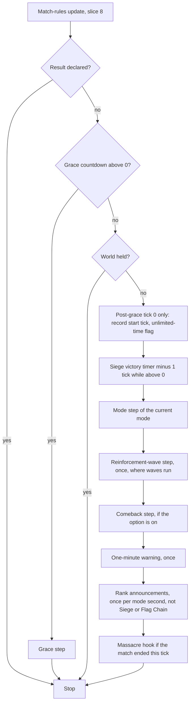
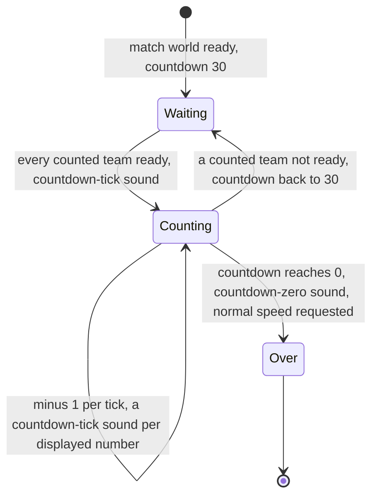
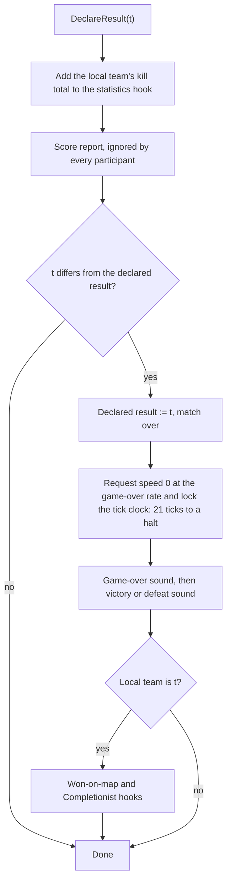

# Skirmish rules and modes

> Status: Reference · Prefix: R-MODE · Related: [00 Reference overview](../00_reference_overview.md) · [02 Units](../02_units/README.md) · [03 Buildings and world objects](../03_buildings_and_world_objects/README.md) · [04 Supply crates, powers and weapons](../04_supply_crates_powers_and_weapons/README.md) · [05 Population flow](../05_population_flow.md) · [07 Bots](../07_bots.md) · [08 Maps and level design](../08_maps_and_level_design/README.md) · [09 Front end and match flow](../09_front_end_and_match_flow/README.md) · [12 Simulation model](../12_simulation_model/README.md)

This folder specifies the skirmish match of the reference game: one shared match-rule skeleton (this file) and six modes that vary only the territory unit and the score.

| File | Content | Requirement ids |
|---|---|---|
| [README.md](README.md) | time base, teams, colours, co-op, Siege sides, the mode catalogue, the match lifecycle, the per-tick order, the grace period, scores, ranks, elimination, Catch-up bonus, Comeback Bonus, sudden death, the end of a match, the match HUD, players leaving, the match state record, the match options, the cross-mode comparison | R-MODE-001 to R-MODE-199 |
| [spawn_control.md](spawn_control.md) | Spawn Control | R-MODE-200 to R-MODE-249 |
| [zone_control.md](zone_control.md) | Zone Control | R-MODE-250 to R-MODE-299 |
| [relic_run.md](relic_run.md) | Relic Run | R-MODE-300 to R-MODE-349 |
| [siege.md](siege.md) | Siege | R-MODE-350 to R-MODE-399 |
| [launch_race.md](launch_race.md) | Launch Race | R-MODE-400 to R-MODE-449 |
| [flag_chain.md](flag_chain.md) | Flag Chain | R-MODE-450 to R-MODE-499 |

## 1 Purpose and player experience

A skirmish match is a contest of 2 to 4 player teams on one map. The reference game has no build queue and no currency: a team's strength is the crowd of Workers that its territory produces, and every mode turns territory into score in its own way (DEC-001). The world updates every tick; the mode rules evaluate once per **mode second**; and a declared winner, or a declared draw, starts the end-of-match sequence (DEC-017).

Players meet the match in this order: a lobby where the host picks the mode, the map and the options; a loading view; a frozen start, where every human presses Ready and a three-second countdown runs; the running match with its scoreboard, clock and announcements; possibly sudden death; and a game-over overlay that stays until the player leaves through the in-game menu.

### 1.1 The modes at a glance

| Mode | Objective | Ends by | Time limit | Player structure | Complexity label |
|---|---|---|---|---|---|
| [Spawn Control](spawn_control.md) | own Spawn Nodes; a team that owns none for 30 mode seconds is eliminated | last team standing, or score at time-up | option, 0 to 60 minutes; 0 means none | free-for-all, 2 to 4; co-op 2 against 2 on maps that allow it | simple |
| [Zone Control](zone_control.md) | hold Control Zones | score at time-up; never by elimination | option, 1 to 60 minutes | free-for-all, 2 to 4; co-op 2 against 2 on maps that allow it | simple |
| [Relic Run](relic_run.md) | carry Relics into the team's own Relic Base, 1 point each | score at time-up | option, 1 to 60 minutes | free-for-all, 2 to 4; co-op on maps that allow it | medium |
| [Siege](siege.md) | the attackers capture every Command Console linked to the defenders' Core Device before it detonates | Core Device destroyed (attackers win) or detonated (defenders win) | the Core Device countdown from the map, in mode seconds | 1 against 1; 1 defender against 2 attackers and 2 against 2, both with forced co-op | medium |
| [Launch Race](launch_race.md) | fuel the team's Launch Vessel with solar energy, load 100 Workers and launch | the first Launch Vessel to climb above the win height | none | free-for-all, 2 to 4 | hard |
| [Flag Chain](flag_chain.md) | capture a connected chain of Flag posts into an enemy's Home post to eliminate that enemy | last team standing, or Flag posts and eliminations at time-up | option, 0 to 60 minutes; 0 means none | free-for-all, 2 to 4 | hard |

A seventh, debug-only mode of the reference is not part of the catalogue (DEC-058).

### 1.2 Conventions used in this folder

- **Ticks.** The tick, the reference tick rate and game speed are defined in [reference/12](../12_simulation_model/01_tick_timing_and_main_loop.md) (`ref.sim.tick_period`, 10 ticks per second at game speed 1). Every duration of this folder is an integer number of ticks; seconds appear only as a derived display value (DEC-002, DEC-009).
- **Mode second.** A mode second is `ref.mode.mode_second` (11 ticks). "Per second" in a mode rule means once per mode second (R-MODE-002).
- **Post-grace tick n.** Ticks are counted from the first tick after the grace period, which is post-grace tick 0.
- **Team ids.** Slots 0 to 3 are player positions; slot 4 is the Rogue faction and slot 5 the Visitor faction; the no-team value means neutral ([reference/12 teams](../12_simulation_model/06_teams_and_player_commands.md)).
- **Positions.** A start position is a slot of the map, 0 to (player count − 1). Map objects name positions, and load maps each position to the team that holds it.
- **Division.** `÷` is integer division, truncating toward zero (DEC-241); `/` is exact division.
- **Text.** Player-facing text is written as string ids; the new text of each id is in the string table of §4.

## 2 Rules

### 2.1 Time base

**R-MODE-001** (MUST) Every timer of the match rules is an integer number of ticks, read from the tick counter only; no match rule reads the wall clock or a render-frame clock (DEC-002, DEC-009). Seconds are shown only as a value derived from ticks.

**R-MODE-002** (MUST) The **mode second** is the named constant `ref.mode.mode_second` = 11 ticks (1.1 s at the reference tick rate). Every rule that the match rules state "per second" advances once per mode second: the mode step of every mode, the match clock and time limit, the elimination countdowns, the Relic spawn timer, the reinforcement-wave countdown ([reference/05](../05_population_flow.md)) and the rank check. The match clock therefore runs 10 % slower than game time. The constant is a deliberate, named rule (DEC-006). It stays at 11 ticks for the first playable, and an A/B playtest of 10 against 11 ticks runs before launch (DEC-003).

**R-MODE-003** (MUST) The match rules keep three mode-second timers: the **rules timer** of the mode step, the **wave timer** of the reinforcement waves and the **rank timer** of the rank announcements. Each counts ticks and completes a mode second when `ref.mode.mode_second` ticks have elapsed. All three start at 0 at match start, so the first mode second of each ends on post-grace tick 0, and the d-th on post-grace tick 11 × (d − 1).

**R-MODE-004** (MUST) A rule that the reference states as a fixed number of seconds counted down by one tick's duration per tick is an explicit tick count, with its own key in the document that owns the rule: 3 s is `ref.match.grace_period` (30 ticks); 5 s is `ref.econ.comeback.first_ticks` (51 ticks, reference/05); 10 s and 15 s are the Siege victory delays `ref.mode.siege.victory_delay_single_ticks` (101 ticks) and `ref.mode.siege.victory_delay_multi_ticks` (151 ticks); 45 s is `ref.econ.comeback.interval_ticks` (450 ticks, reference/05). The Launch Vessel countdowns are specified in [reference/03 mode objects](../03_buildings_and_world_objects/mode_objects.md).

**R-MODE-005** (MUST) A recount that a mode object performs "every 1 second" runs every `ref.mode.recount.one_second` (11 ticks), and one written "every 2 seconds" runs every `ref.mode.recount.two_second` (21 ticks). This covers the Control Zone, Flag post and Relic ownership recounts and the Relic Base delivery check (DEC-064).

**R-MODE-006** (MUST) While the world is held ([reference/12](../12_simulation_model/01_tick_timing_and_main_loop.md) R-SIM-550) no world object advances and match time does not advance, but the match-rules update still runs each tick. Every game-time timer therefore starts at post-grace tick 0, and the grace countdown counts command frames, not game time.

### 2.2 Teams, factions and start positions

**R-MODE-007** (MUST) Every match has the six team slots of [reference/12](../12_simulation_model/06_teams_and_player_commands.md) (`ref.sim.max_teams`, R-SIM-392, R-SIM-393). Slots 0 to 3 are player positions. Slot 4 is the **Rogue faction** and slot 5 the **Visitor faction**. Both faction slots exist as bot teams in every match, and each always owns one bot controller, which runs the full bot controller of [reference/07](../07_bots.md) (DEC-558).

**R-MODE-008** (MUST) The Rogue and Visitor factions are neutral-hostile in every mode: they never win a match and never block an elimination win. They can own Spawn Nodes, Control Zones, Flag posts and Relics, and they score where a mode file says so, but every winner, draw and last-team-standing test of every mode excludes them. Hostile Supply crate outcomes stay owned by the Rogue faction, and the Visitor faction still arrives with the Abductor (DEC-082). The hazard outcomes are team-blind (DEC-107), and the owner of Brood creatures is DEC-121.

**R-MODE-009** (MUST) Map-placed structures and actors name a start position. At load each start position is mapped to the team that holds it, or to the no-team value when no team holds it, and each start position is a typed record of the map definition that carries its camera view, its Siege side and its co-op group (DEC-560; R-SIM-411, R-SIM-418).

**R-MODE-010** (MUST) The player slots of a match are 0 to (player count − 1) of the map, 2 to 4. Before the match the host may close slots; every slot that stays **open** is occupied for the whole match. At match start the host fills every empty open slot with a bot team (R-SIM-006, R-SIM-433), and a participant who leaves is taken over by a bot (R-MODE-069). A closed slot is an unused slot. The number of open slots is fixed at match start (DEC-079). The spectator team kind exists, but no match setup offers a spectator slot (DEC-244).

**R-MODE-011** (MUST) Outside Siege and co-op, a team's start position is drawn when the match first needs it, uniformly with the simulation generator from the positions that no team holds yet; match initialisation asks in team-slot order. In a tutorial the position equals the team slot, and the Rogue and Visitor factions use their own slot ids (R-SIM-417; DEC-450 is open on assigning every position once at match start).

### 2.3 Team colours

**R-MODE-012** (MUST) Team colours come from the colour table of [reference/12](../12_simulation_model/06_teams_and_player_commands.md) (R-SIM-415, keys `ref.sim.team_colour.<name>`). The lobby offers the `ref.sim.team.player_colour_count` (8) colour ids 0 to 7, named `team.colour.green`, `team.colour.red`, `team.colour.yellow`, `team.colour.blue`, `team.colour.orange`, `team.colour.purple`, `team.colour.cyan` and `team.colour.pink`.

**R-MODE-013** (MUST) When a slot is initialised for a match outside co-op and outside Siege, its colour id is set to its slot id. Initialising a local-player slot makes it the local team, and initialising any slot that is not a bot clears its disconnected flag. A slot initialised after the match world has initialised its teams is initialised in the match world at once.

**R-MODE-014** (MUST) A request to set slot t to colour id c is decided by the first of these rules that applies:

1. c is none: the slot takes its slot default colour from `ref.match.colour.slot_defaults` and its colour id becomes none.
2. Siege: the request needs the map's player count, and is refused while the count is unknown. Let n be the number of slots that already hold c. On a 3-player map the defender colour (`ref.sim.team.siege_defender_colour_id`) is full when n ≥ `ref.match.colour.siege_3p_defender_limit` (1), and the attacker colour (`ref.sim.team.siege_attacker_colour_id`) is full when n ≥ `ref.match.colour.siege_3p_attacker_limit` (2). On any other map a colour is full when n ≥ player count ÷ `ref.match.colour.siege_side_divisor` (2). A full colour is refused.
3. Co-op: the request is refused unless c is a valid co-op colour (R-MODE-015).
4. Otherwise: the request is refused when any other used slot holds c.

An accepted request sets the slot's colour id to c and its colour to the table colour of c.

**R-MODE-015** (MUST) Colour id c is a valid co-op colour unless at least `ref.match.coop.max_alliances` (2) distinct colours are already in use and no slot uses c, or at least `ref.match.coop.members_per_alliance` (2) slots already use c. A colour is **taken** when any used slot holds it. The **next available colour** is the lowest colour id 0 to 7 that is not taken, or none.

**R-MODE-016** (MUST) At match-world initialisation each bot slot below the player count, in a match that is neither co-op nor Siege, chooses a colour from 0 to `ref.sim.team.bot_colour_count` − 1 (0 to 3) that no other team holds, as a uniform choice from the list of free colours (DEC-014, R-SIM-416); in a tutorial a bot's colour is its slot id. Each unused slot at or above the player count draws a colour from 0 to 3 that no player slot holds, so that the effects that pick a random team colour, the Essence Grove and the Allegiance Scrambler, have a colour for every slot; a colour drawn for an unused slot is not reserved, so two unused slots can share one (R-SIM-422, DEC-450).

**R-MODE-017** (MUST) The colour of a co-op group that has no colour id is `ref.match.colour.no_group`, an opaque grey (DEC-078).

### 2.4 Co-op alliances

**R-MODE-018** (MUST) Co-op is on when the match setup's co-op flag is set. The lobby shows the co-op switch only on maps that allow co-op; selecting a map that forces co-op switches it on and shows no switch; selecting a map that does not allow co-op clears it. Switching co-op on sets every team's colour id to none (DEC-034).

**R-MODE-019** (MUST) In co-op each player picks a colour for their alliance: at most `ref.match.coop.max_alliances` (2) colours are in use, with at most `ref.match.coop.members_per_alliance` (2) members each (R-MODE-015).

**R-MODE-020** (MUST) At load, in a co-op match that is not Siege, alliance assignment runs `AssignAlliance(t)` for each slot t from 0 to (player count − 1) that is not the Rogue or Visitor faction and has co-op group 0, in slot order. `G1` and `G2` are the map's group-1 and group-2 position lists:

```
AssignAlliance(t):
    pos   := PositionOf(t)                        # drawn now if t has none (R-MODE-011)
    n1, n2 := number of slots already in group 1, in group 2
    solo1 := (|G1| == 1);  solo2 := (|G2| == 1)
    group := 0
    if pos in G1:
        group := 1
        if n1 == 2 or (n1 == 1 and solo1):           # group 1 full: t moves to group 2
            group := 2
            pos := G2[0] if (TeamAtPosition(G2[0]) is no team or solo2) else G2[1]
            position[t] := pos
    else if pos in G2:                               # mirror image
        group := 2
        if n2 == 2 or (n2 == 1 and solo2):
            group := 1
            pos := G1[0] if (TeamAtPosition(G1[0]) is no team or solo1) else G1[1]
            position[t] := pos
    for every other slot i below the player count:   # evict whoever now shares t's position
        if position[i] == position[t]: position[i] := none
        PositionOf(i)                             # an evicted slot draws a free position again
    if (group == 1 and solo1) or (group == 2 and solo2): PlaceSoloMember(t, group)
    else if group == 0:                              PairAllianceMembers(t)          # the map defines no groups
    else:                                            PairAllianceMembers(t, group)   # fixed groups
```

The resulting colours apply inside this step on every participant; alliance assignment issues no player command (DEC-119).

**R-MODE-021** (MUST) `PlaceSoloMember(t, g)`: t keeps its colour id, or, when it has none, draws a colour from 0 to 3 that no used slot holds (DEC-014); t joins group g, takes the group's single position, and its co-op group position is 0.

**R-MODE-022** (MUST) `PairAllianceMembers(t, g)` with fixed groups: t joins group g with co-op group position 1; its partner joins g with co-op group position 2 and moves to the group's other position. The partner is: when t has a colour, the first other used slot with the same colour, otherwise the **last** used slot with no colour, which then takes t's colour; when t has no colour, the first other used slot without a colour, and both then take a random colour, (simulation draw mod 8) ÷ `ref.sim.team.coop_colour_divisor`, drawn again while it is taken.

**R-MODE-023** (MUST) `PairAllianceMembers(t)` without map groups pairs t, in slot order: with a slot of the same colour, joining that slot's group, or group 1 if it has none and group 1 is empty, or group 2 otherwise; else with a slot that has no colour, which takes t's colour, or a random free colour from 0 to 3 when t has none (colour 0, without a draw, when it is free); else, when t has no colour, with a coloured slot that has no partner, whose colour t takes.

**R-MODE-024** (MUST) Two fallback steps of alliance assignment never apply, because their test for an existing partner also matches the candidate slot itself: pairing an uncoloured t with a coloured slot in `PairAllianceMembers(t, g)`, and the final forced random pair of `PairAllianceMembers(t)`. A player slot that no earlier step pairs keeps co-op group 0 (DEC-451 is open on always placing every player slot in a group).

**R-MODE-025** (MUST) Each alliance group has a group colour id. Its members are drawn in the member-1 and member-2 shades of that colour by their co-op group position (R-SIM-421). Friendship in co-op is membership of the same group, and outside co-op a team is a friend only of itself; group 0 makes the Rogue and Visitor factions friends of each other in a co-op match (R-SIM-412, R-SIM-413, DEC-451). Co-op scoring is per mode, and the population caps of an alliance are not pooled (DEC-079).

### 2.5 Siege sides

**R-MODE-026** (MUST) In Siege the lobby colour is the side: the defender colour `ref.sim.team.siege_defender_colour_id` (0, green) and the attacker colour `ref.sim.team.siege_attacker_colour_id` (1, red). The player-options page offers random (colour none), attackers and defenders in place of colours.

**R-MODE-027** (MUST) At load Siege assigns sides and positions in place of R-MODE-011 and R-MODE-020 (R-SIM-419). For each slot below the player count whose colour is none, in slot order: it defends if every attacker position is taken, attacks if every defender position is taken, and otherwise takes the side (simulation draw mod 2). A defender then takes a random free defender position (a position not in the map's attacking list) and an attacker a random free attacker position, both with the simulation generator. Outside co-op the colours are the side colours. In a co-op Siege match the slot's group is 1 when its position is in the map's group-1 list and 2 otherwise, the group colour is the side colour, and the co-op group position is 1 or 2.

**R-MODE-028** (MUST) A team attacks when the map's attacking flag for its start position is set, and defends otherwise; the no-team value neither attacks nor defends. Outside Siege no position attacks, so every team counts as defending wherever a shared rule asks.

### 2.6 Mode catalogue

**R-MODE-029** (MUST) The modes are the enumeration `MatchMode`, in this order, which is also the order of the mode-select list and of the option schemas (§2.19):

| Order | Enumerator | Name | Help text | Complexity label | Assets |
|---|---|---|---|---|---|
| 0 | `MatchMode::SpawnControl` | `mode.spawn_control.name` | `mode.spawn_control.objective` | `mode.complexity.simple` | `help.mode_card`, `help.mode_page` (1 page), `map.spawn_control` |
| 1 | `MatchMode::ZoneControl` | `mode.zone_control.name` | `mode.zone_control.objective` | `mode.complexity.simple` | `help.mode_card`, `help.mode_page` (2 pages), `map.zone_control` |
| 2 | `MatchMode::RelicRun` | `mode.relic_run.name` | `mode.relic_run.objective` | `mode.complexity.medium` | `help.mode_card`, `help.mode_page` (3 pages), `map.relic_run` |
| 3 | `MatchMode::Siege` | `mode.siege.name` | `mode.siege.objective` | `mode.complexity.medium` | `help.mode_card`, `help.mode_page` (3 pages), `map.siege` |
| 4 | `MatchMode::LaunchRace` | `mode.launch_race.name` | `mode.launch_race.objective` | `mode.complexity.hard` | `help.mode_card`, `help.mode_page` (4 pages), `map.launch_race` |
| 5 | `MatchMode::FlagChain` | `mode.flag_chain.name` | `mode.flag_chain.objective` | `mode.complexity.hard` | `help.mode_card`, `help.mode_page` (3 pages), `map.flag_chain` |

The complexity label is drawn with the badge `ui.difficulty_badge` on the mode buttons, and each mode has one explainer animation `anim.explainer` ([reference/11](../11_tutorial_and_help.md)). The debug-only mode of the reference is not an enumerator (DEC-058).

**R-MODE-030** (MUST) One bot difficulty applies to every bot team of a match: `BotDifficulty::Easy`, `BotDifficulty::Standard` or `BotDifficulty::Hard`, default Standard; a tutorial starts with Easy (R-MODE-083). The difficulty parameters are in [reference/07](../07_bots.md).

**R-MODE-031** (MUST) Each mode is a typed ruleset on the shared skeleton of this file: a score function, an elimination predicate, a win predicate, a time-up decider, a sudden-death policy, a typed option schema and a HUD formatter (DEC-017). Each mode file states these for its mode.

### 2.7 The match rules object and the match lifecycle

**R-MODE-032** (MUST) All mode rules live in one match rules object (`MatchRules`). It holds the lobby roster (six lobby slots), the chosen mode and its option values, every mode timer and score, and the end state. It is simulation state: every participant advances it from the same sequenced commands, inside the simulation step (DEC-008). This library specifies no networking model (DEC-200).

**R-MODE-033** (MUST) The match rules object lives for the process and is reset when the front end is entered and at match teardown (R-SIM-004). Every per-match value of the match state record (§2.18) takes its initial value at match start, so no value survives from an earlier match (DEC-011).

**R-MODE-034** (MUST) A match passes through the states of diagram 3-A: front end; lobby, where the host picks the mode and the map and the options take their defaults; loading, entered when every human is ready (or the single-player start is pressed), after empty slots have been filled with bots and the match-start command has been sent; grace, with the world held; running; sudden death where the mode has it; the Siege round end; and game over. Single-player and multiplayer matches share this lifecycle and differ only in the front end ([reference/09](../09_front_end_and_match_flow/screen_flow_and_match_setup.md)).

**R-MODE-035** (MUST) After game over the only way out of a match is the leave action of the in-game menu, which tears the match down and rebuilds the front end at its main page, or at the tutorial page after a tutorial. There is no results page; the result is shown only by the game-over overlay of the match HUD (§2.16). A results screen is DEC-048.

### 2.8 Per-tick order of the match rules

**R-MODE-036** (MUST) The match-rules update runs once per tick, in update slice `ref.sim.slice.match_rules` after that slice's world step (R-SIM-511), and it runs also while the world is held. The world step of a held world is skipped, the match-rules update is not.

**R-MODE-037** (MUST) The match-rules update runs these steps in this order:

1. If the match is over (a winner or a draw has been declared), stop. No step runs after the tick in which the result is declared.
2. If the grace countdown is above 0, run the grace step (§2.9) and stop.
3. If the world is held, stop.
4. On post-grace tick 0, once: record the start tick; when the time remaining is none or at most 0, set the unlimited-time flag.
5. If the Siege victory timer is above 0, decrease it by 1 tick.
6. Run the mode step of the current mode (the mode files).
7. Run the reinforcement-wave step when the mode runs waves (Launch Race, Flag Chain) or the map enables them by a map reinforcement count or a map Transport cap above 0. Transit Gates advance exactly once per tick on every map, so the wave step never runs twice in one tick (DEC-065; [reference/05](../05_population_flow.md) R-ECON-090).
8. If the Comeback Bonus option is on, run the Comeback step (§2.13).
9. One-minute warning: when 0 < time remaining ≤ `ref.match.one_minute_warning` (60 mode seconds) and the warning has not been given, emit the announcement `match.one_minute_warning` and mark it given.
10. Rank announcements (§2.10), once per mode second of the rank timer, in every mode except Siege and Flag Chain.
11. Achievement hook: when the match became over in this tick and the local team's kill total is at least `ref.match.massacre_kills` (2,000 Workers), emit the Massacre achievement event (DEC-047).

**R-MODE-038** (MUST) Messages, sounds, help notifications and achievement progress that a step produces are emitted as presentation events at the tick where the step runs; no step plays a sound or writes the user interface directly (DEC-007).

### 2.9 Grace period, readiness and countdown

**R-MODE-039** (MUST) Every match starts with the world held and the grace countdown at `ref.match.grace_period` (30 ticks, 3.0 s). The ready-up barrier counts the teams of kind local player, remote player and spectator; bot teams, the Rogue and Visitor factions included, are never waited for (DEC-036).

**R-MODE-040** (MUST) The grace step runs on every tick of the grace period:

1. In Relic Run, ensure the starting Relic ([relic_run.md](relic_run.md) R-MODE-305).
2. If every counted team is ready: on the first ready tick (countdown at 30) emit the countdown-tick sound; decrease the countdown by 1 per tick, a decrement per command frame that game speed does not change; and emit one countdown-tick sound per displayed number, when the displayed number changes.
3. Otherwise set the countdown back to 30, so withdrawing readiness restarts the countdown.
4. When the countdown reaches 0: emit the countdown-zero sound, mark the grace period over, request game speed `ref.sim.speed.normal` at once ([reference/12](../12_simulation_model/01_tick_timing_and_main_loop.md) R-SIM-552), and emit the visited-map achievement event (the Tourist hook, DEC-047).

The countdown sounds use `sfx.ui.match_ui.countdown_tick`. The world runs its first step on post-grace tick 0.

**R-MODE-041** (MUST) A player toggles readiness with the Ready action ([reference/06](../06_controls_camera_and_commands.md)) during the grace period while no window is open; the action issues the `ToggleReady` command for the player's team, which flips the team's in-match ready flag on every participant (R-SIM-459). In the lobby the same command flips the lobby slot's ready flag.

**R-MODE-042** (MUST) The grace overlay is drawn at the top centre, in red, with a font height of `ref.match.grace_overlay.font_height` (4 % of the screen height). It shows, in this priority:

1. while counting: `match.grace_period.countdown` with the number (remaining ticks ÷ 10) + 1, that is 3, 2 and 1, at `ref.match.grace_overlay.countdown_scale` (125 %) size and solid;
2. else, when the local team is ready: `match.grace_period.waiting` with the number of ready counted teams and the number of counted teams;
3. else: `match.grace_period.prompt_keyboard` or `match.grace_period.prompt_pad`, by the active input device.

Texts 2 and 3 blink on the presentation clock: alpha `ref.match.grace_overlay.blink_on_alpha` (1.0) for the first `ref.match.grace_overlay.blink_on_time` (0.3 s) of each real second, `ref.match.grace_overlay.blink_off_alpha` (0.2) for the rest.

**R-MODE-043** (MUST) During the grace period each scoreboard row of a bot team and of a ready human shows `match.grace_period.ready` in place of its score.

**R-MODE-044** (MUST) A pause request is refused during the grace period, after game over, and whenever a remote human takes part (R-SIM-553). Supply crate drops are not suspended during the grace period; only a paused match stops them (DEC-116).

### 2.10 Scores and rank announcements

**R-MODE-045** (MUST) Each slot has an integer score and a previous score; the meaning of the score is per mode. The mode step backs the scores up (previous := score for every slot) at the start of every mode second. Zeroing clears every score. Awarding points adds to a slot's score unless the match is over.

**R-MODE-046** (MUST) The HUD delta of a row is score − previous score, shown as "(+d)"; Relic Run shows instead the number of Relics the team currently owns (§2.16).

**R-MODE-047** (MUST) Once per mode second of the rank timer, outside Siege and Flag Chain, the match rules rank the used teams that are not the Rogue or Visitor faction. A team's rank is the number of those teams with a strictly higher score, plus 1 (DEC-074). When a team's rank differs from its stored rank, the new rank is stored; when the stored rank was valid and the team is the local team, the announcement for the new rank is emitted: `match.rank.tied_<r>` (r = 1 to 3) when another ranked team has an equal score, otherwise `match.rank.moved_<r>` (r = 1 to 4; `match.rank.moved_4` names last place). A tie at rank 4 cannot occur with four ranked teams. The stored ranks start at none, so the first ranking announces nothing.

### 2.11 Elimination

**R-MODE-048** (MUST) Three separate notions of elimination exist:

| Notion | Effect | Used by |
|---|---|---|
| **eliminating a team** (the hard rules flag) | sets the slot's eliminated flag, records the elimination time (a statistics hook, never read by a rule) and emits `match.eliminated.self` to that team's player and `match.eliminated.other` to the others; it destroys nothing | Spawn Control, Flag Chain |
| **wiping a team** (R-SIM-407) | every actor of the team takes unresistable damage of 2 × its current health (`ref.sim.team.eliminate_damage_factor`), so it dies and leaves Essence orbs; the team's Collectors, which take damage only while vulnerable, and its bot controller survive; all its Powers stop; every Transit Gate it owns becomes neutral. Spawn Nodes and other structures keep their owner | together with eliminating, in Spawn Control and Flag Chain; alone, on the losers of sudden death in Spawn Control, Zone Control, Relic Run and Flag Chain |
| **counts as eliminated** (the query) | Spawn Control and Flag Chain: the eliminated flag. Zone Control and Relic Run: the map has Spawn Nodes, the team owns none and it has fewer than `ref.econ.comeback.worker_threshold` (50) live Workers. Siege and Launch Race: never | the Comeback Bonus, its HUD countdown, the Relic Run sudden-death tie-break |

**R-MODE-049** (MUST) The Spawn Node test of the query counts every Spawn Node on the map, over the per-team counts and the no-team count; every count starts at 0 in every match (DEC-011, R-SIM-020).

**R-MODE-050** (MUST) The losers that sudden death wipes are not flagged eliminated. They keep their Spawn Nodes, which keep producing Workers, so a wiped team can return to play before the tie is broken (DEC-300 is open on removing their Spawn Nodes).

### 2.12 Catch-up bonus

**R-MODE-051** (MUST) The Catch-up bonus option exists in Spawn Control, Zone Control and Siege (values 0 to 90 % in steps of 10, default `ref.econ.catch_up.option_percent`, 90). The bonus is a proportional curve: a team's Spawn Node output multiplier is a function of its share deficit, the gap between its share of the Spawn Nodes held by the teams in play and the even share; the Rogue and Visitor factions are excluded from the share, and allies count as other teams (DEC-081). The curve, its maximum and where it applies are owned by [reference/05](../05_population_flow.md). In Siege it has no effect on any reference map, because no Siege map has a Spawn Node. A map can switch it off with its no-catch-up option (§2.19), and the multiplier is then 1.

### 2.13 Comeback Bonus

**R-MODE-052** (MUST) When the Comeback Bonus option is on, the Comeback step runs on every post-grace tick (R-MODE-037 step 8). For every used slot that is not the Rogue or Visitor faction, it counts the slot's Comeback timer down while the team counts as eliminated (R-MODE-048) and holds it at the interval otherwise; on expiry it grants one power from the Comeback pool when the team has a free Power slot. The timers, the pool and the grant are [reference/05](../05_population_flow.md) R-ECON-112 to R-ECON-116 (`ref.econ.comeback.first_ticks`, `ref.econ.comeback.interval_ticks`, `ref.econ.comeback.pool`). An eliminated team has two Power slots (DEC-033). The grant ignores the map's excluded outcomes (DEC-452 is open on filtering the pool).

**R-MODE-053** (MUST) A Comeback grant marks the power's source as the Comeback Bonus for the Power slots panel. When the timer expires and both Power slots are occupied, no power is granted and the local team's player sees the notice `ui.power_slots.comeback_full`.

**R-MODE-054** (MUST) While the local team counts as eliminated, the option is on and the grace period is over, the HUD shows `match.comeback_bonus.countdown` in red with the whole seconds left on the local team's Comeback timer, ⌊remaining ticks × `ref.sim.tick_period`⌋.

**R-MODE-055** (MUST) The Comeback Bonus defaults per mode are explicit typed defaults (DEC-073):

| Mode | Option | Default | Can a team count as eliminated? | In play |
|---|---|---|---|---|
| Spawn Control | switch | on | yes: the eliminated flag | on by default |
| Zone Control | switch | on | yes: the soft test | on by default |
| Relic Run | switch | on | yes: the soft test | on by default |
| Siege | none | on | never | runs, never grants |
| Launch Race | none | on | never | runs, never grants |
| Flag Chain | switch | on | yes: the eliminated flag | on by default |

### 2.14 Sudden death

**R-MODE-056** (MUST) The sudden-death option exists in Spawn Control, Zone Control, Relic Run and Flag Chain (a switch, default `ref.match.option.sudden_death`, on). When the time limit expires with the top score tied and the option is on, sudden death starts: the announcement `match.sudden_death.start` is emitted, the sudden-death flag is set and every used team not on the top score is wiped (R-MODE-048); co-op Relic Run skips the wipe. The next per-second evaluation that finds a single leader declares it the winner. Zone Control instead adds `ref.mode.zone_control.sudden_death_extension` (60 mode seconds) and evaluates again at the end of each extra minute. With the option off, a tie at time-up is declared a draw. The lobby forces the option off and disables it whenever the time limit is 0 (none). Each mode file states its sudden-death policy.

### 2.15 Ending a match

**R-MODE-057** (MUST) Declaring a result `DeclareResult(t)`, with t a team 0 to 5 or the draw value, runs on every call, repeated calls with the same t included:

1. if a local team exists, add its kill total to the achievement statistics (a hook; repeated calls add it again; DEC-047);
2. issue the score report, the six scores and t, which every participant ignores (R-SIM-451; no statistics service consumes it).

Only when t differs from the declared result so far:

3. the declared result becomes t, and the match is over;
4. the match rules request game speed `ref.sim.speed.stopped` at `ref.sim.speed.game_over_rate` and lock the tick clock, so the world slows to a halt over 21 ticks and is then held for good (R-SIM-555);
5. emit the game-over sound, then the victory sound when the local team is t, otherwise the defeat sound; a draw plays the defeat sound;
6. when the local team is t, emit the won-on-map achievement event and the Completionist check (DEC-047).

Declaring "none" runs steps 1 and 2 only.

**R-MODE-058** (MUST) After the result is declared, the match HUD shows it (§2.16) until the player leaves through the in-game menu (R-MODE-035). The data available at match end, the scores, kill totals and times, is the input of a results screen (DEC-048).

**R-MODE-059** (MUST) Every mode has an achievement hook, evaluated where its mode file states. The rules evaluate the 12 achievement conditions as presentation events, but no achievement is awarded; the achievements, statistics and leaderboards are the design phase's (DEC-047). The hooks are: Total Control (Spawn Control), Crowned (Zone Control), Stockpiler (Relic Run), Iron Defence (Siege), Clean Launch (Launch Race), Flag Sweep (Flag Chain), Massacre (R-MODE-037 step 11), Tourist (R-MODE-040), Completionist (R-MODE-057), and Giant Slayer, Friendly Fire and Annihilator ([reference/09](../09_front_end_and_match_flow/options_localisation_and_hooks.md)).

**R-MODE-060** (MUST) In a co-op match the game-over winner line shows the declared result: the alliance of the declared winner, named by its group colour (`team.colour.*`), or the draw line for a draw (DEC-069).

**R-MODE-061** (MUST) The match clock emits the countdown-zero sound at time-up, on the mode second at which the time remaining reaches 0 (DEC-072).

### 2.16 The match HUD

**R-MODE-062** (MUST) The match HUD is drawn from the read-only match state (DEC-007) and is hidden while the interface is hidden. Every size and position below is in pixels × scale, where scale = screen height ÷ `ref.match.hud.reference_height` (800).

**R-MODE-063** (MUST) The **scoreboard** box has its top-left corner at `ref.match.hud.scoreboard_origin` (10, 10), width `ref.match.hud.scoreboard_width` (440; `ref.mode.launch_race.hud.scoreboard_width`, 530, in Launch Race) and height `ref.match.hud.scoreboard_base_height` (50) + rows × `ref.match.hud.row_height` (14) × `ref.match.hud.row_spacing` (1.3). In co-op before game over the height is multiplied by `ref.match.hud.coop_height_factor` (2.0), or by `ref.match.hud.coop_height_factor_siege` (1.4) in Siege. It has a black fill at alpha `ref.match.hud.fill_alpha` (0.75) and a white outline at alpha `ref.match.hud.outline_alpha` (0.2). In a tutorial it is hidden until some team scores. Its title is `match.hud.scores_title`, or `mode.siege.hud.title` in Siege.

**R-MODE-064** (MUST) The scoreboard lists the used teams by score, highest first (Siege: by defence-time record). The Rogue and Visitor factions have a row only while their score is not 0. The local team's row is highlighted in `ref.match.hud.local_row_highlight`. In co-op each alliance has a header row `match.hud.alliance_header` with the alliance's colour name and score total, drawn in the group colour, followed by its members, indented; the factions follow when their score is above 0.

**R-MODE-065** (MUST) The generic **score line** (Zone Control, Relic Run) is `match.hud.score_line`: the team name, the score, the delta "(+d)" (R-MODE-046) and the estimate "(est. n)" with n = score + d × time remaining. The delta is blanked during the part of every game second from `ref.match.hud.delta_hidden_from` (0.5) onwards, except in Relic Run. The estimate is shown in Zone Control with a score mode other than 2 and in Spawn Control with score mode 1, while the match has a time limit. Spawn Control, Siege, Launch Race and Flag Chain have their own score lines (the mode files).

**R-MODE-066** (MUST) The **match clock** box is drawn at the top centre, or right of the scoreboard when the screen width is at most `ref.match.hud.narrow_screen_width` (800); its size is `ref.match.hud.timer_box` (80) with a font of `ref.match.hud.timer_font` (30). It shows the time remaining in mode seconds as minutes:seconds, with the colon blinking on game time, while the time remaining is above 0, outside the grace period, and, in the second tutorial, only once its bots may spawn. It emits the countdown-tick sound at every whole minute and at every mode second of the last `ref.match.hud.timer_warning` (10 mode seconds), during which it is red and scaled by `ref.match.hud.timer_warning_scale` (1.2). The countdown-zero sound plays at time-up (R-MODE-061).

**R-MODE-067** (MUST) The HUD also shows: the reinforcement countdown `ui.match.reinforcement_countdown` at a font of `ref.match.hud.reinforcement_font` (20) wherever waves run and the local team does not count as eliminated ([reference/05](../05_population_flow.md) R-ECON-097); the Comeback countdown (R-MODE-054); and, centred at a font of `ref.match.hud.crate_timer_font` (50), the remaining time of an active Spawn Surge (`match.hud.spawn_surge_timer`) and of an active Frenzy (`match.hud.frenzy_timer`), red below `ref.match.hud.crate_timer_warning` (2 s) ([reference/04](../04_supply_crates_powers_and_weapons/crates_and_powers.md)). The Siege round overlay and the Launch Race status panel are in their mode files.

**R-MODE-068** (MUST) After game over the HUD shows the title `match.game_over.title` at a font of `ref.match.hud.game_over_title_font` (70) at y = `ref.match.hud.game_over_title_y` (180), and the winner line at y = `ref.match.hud.game_over_winner_y` (250) with a font of `ref.match.hud.game_over_winner_font` (35): outside co-op `match.game_over.winner` with the winner's name in the winner's colour, or `match.game_over.draw` for a draw; in co-op R-MODE-060. Single-round Siege skips the winner line and shows its own overlay. A final score list in team colours is centred at `ref.match.hud.final_list_y` (73 % of the screen height), in a box scaled by `ref.match.hud.final_list_box_scale` (1.3): name and score in Spawn Control, Zone Control and Relic Run; names only in Launch Race; the defence times in multi-round Siege; neither list nor box in Flag Chain and single-round Siege. At the bottom a blinking prompt, `match.game_over.leave_prompt_keyboard` or `match.game_over.leave_prompt_pad`, names the menu action that leads to the leave action.

### 2.17 Players leaving

**R-MODE-069** (MUST) When a participant leaves during a match, each of its teams that is not a bot changes, at the same tick on every participant, to a bot team; a bot controller is spawned for it so the bot takes over at once ([reference/12](../12_simulation_model/06_teams_and_player_commands.md) R-SIM-434, R-SIM-436); the bot takeover time is recorded; and `match.player_left` is emitted. The team keeps playing, and no mode treats a departed player as eliminated (DEC-035). Late join, reconnection and slot reclaim are DEC-205.

**R-MODE-070** (MUST) When a participant leaves in the lobby, each of its slots becomes unused, with colour id none, an empty name and the disconnected flag set, and the lobby chat shows `ui.lobby.player_left`.

### 2.18 The match state record

**R-MODE-071** (MUST) The match rules object holds the state below. "Start" is the value at every match start (DEC-011); "reset" is the value after the reset of R-MODE-033 where it differs.

| State | Start value | Purpose |
|---|---|---|
| rules timer, wave timer, rank timer | 0 | the three mode-second timers (R-MODE-003) |
| mode | from the match setup | the current `MatchMode`; none at the front end |
| option values | from the match setup | the typed options of the mode (§2.19); not cleared by the reset |
| lobby slots × 6 | kind unused, score 0, previous score 0, colour the slot default, Launch Vessel none, colour id none, name empty, ready false | the roster (R-SIM-398) |
| time remaining | none, then set when the options change (R-MODE-084) and, in Siege, by the Core Device | mode seconds left; none means no limit |
| declared result | none | none, a team 0 to 5, or the draw value |
| Relic spawn countdown | none (not armed) | Relic Run, in mode seconds |
| reinforcement countdown | 0 | mode seconds to the next wave, shown on the HUD ([reference/05](../05_population_flow.md)) |
| turret wave counter | 0 | waves until the next turret grant |
| first wave flag | true | set until the first wave has run |
| stored rank × 6 | none | the last announced rank |
| mode initialised | false | the one-shot initialisation of Siege and Flag Chain |
| complete-defence flag | true, set at Siege initialisation | the Iron Defence hook |
| Siege objectives | empty | the linked Command Consoles of each Core Device, then the Core Device |
| start tick | none | post-grace tick 0, recorded once |
| victory timer | none | the Siege delay after the round result |
| bot difficulty | Standard | §2.6 |
| round-reset request | false | multi-round Siege |
| best defence time | none | multi-round Siege: the next round's Core Device countdown |
| defence time records × 6 | none | Siege defence time per team, in mode seconds |
| rounds played | 0 | multi-round Siege; kept across a round reset |
| round finished | false | Siege |
| grace countdown | `ref.match.grace_period` | above 0 during the grace period |
| one-minute warning given | false | R-MODE-037 step 9 |
| eliminated × 6 | false | the hard elimination flag |
| eliminations scored × 6 | 0 | Flag Chain |
| elimination time × 6 | 0 | written only; a statistics hook |
| elimination countdown × 6 | `ref.mode.spawn_control.elimination_mode_seconds` | Spawn Control |
| Comeback timer × 6 | `ref.econ.comeback.first_ticks` | §2.13 |
| co-op flag | false | §2.4 |
| single-round Siege | true; not changed by the reset | DEC-066 |
| sudden death active | false | §2.14 |
| unlimited time | false | set at post-grace tick 0 |
| basic crates only | false | §2.19 |
| Control Zone counter | 0 | the number of Control Zones (Zone Control) or Flag posts (Flag Chain) |
| Core Device default time | 0 | the first Core Device countdown of the match |
| Launch Race status panel | none | presentation only |

**R-MODE-072** (MUST) The match rules object provides these operations:

| Operation | Behaviour |
|---|---|
| reset | R-MODE-033 and the start values of R-MODE-071 |
| round reset | multi-round Siege only ([siege.md](siege.md) R-MODE-366): every colour id none; rounds played + 1; rotate the positions, the new position of slot i being the old position of slot (i + 1) mod player count; remember the positions (the factions none); mark both faction lobby slots unused; destroy the match world and create a new one; restore the positions; initialise it with the same map; fade in over `ref.mode.siege.round_fade_in` (1.0 s); reset the tick clock; clear the request; set the wave timer and the reinforcement countdown to 0; set the grace countdown to `ref.match.grace_period` (R-SIM-029, R-SIM-030) |
| initialise team, remove teams | R-MODE-013, R-MODE-069, R-MODE-070 |
| set options, set option, valid option, read option, options changed, set research levels | §2.19 |
| award points, zero scores, back up scores | R-MODE-045 |
| advance | §2.8 |
| draw the HUD, score line, grace overlay, Launch Race panel | §2.16 and the mode files; presentation only |
| in grace period | grace countdown above 0 |
| in lobby | the participant is at the front end |
| running | not in the lobby, a mode is set and a match world exists |
| over | a match world exists and a result is declared |
| eliminate team, counts as eliminated, count Workers | §2.11 |
| record defence time | Siege ([siege.md](siege.md) R-MODE-360) |
| declare result, Completionist check | R-MODE-057 |
| human team count, bot team count | the slots of kind local player or remote player; of kind bot |
| mode name | the mode's name string id, or `mode.unknown` for no mode |
| colour operations | §2.3 |
| precise time remaining | time remaining − k ÷ 10 (exact division), where k (0 to 10) is the number of ticks since the rules timer last completed a mode second |
| count Spawn Nodes | the sum of the per-team Spawn Node counts and the no-team count (R-MODE-049) |
| Flag Chain route test | [flag_chain.md](flag_chain.md) R-MODE-464 |

### 2.19 Match options

**R-MODE-073** (MUST) Every match option is typed and has an explicit default for each mode; a mode that lacks an option uses the typed default of R-MODE-076 (DEC-073). The six mode schemas hold 38 options. Within a mode the options are listed in this display order:

| Mode | Options, in display order |
|---|---|
| Spawn Control | score mode, time limit, Catch-up bonus, crate drop period, starting powers, Comeback Bonus, sudden death, crate placement |
| Zone Control | score mode, time limit, Catch-up bonus, crate drop period, starting powers, Comeback Bonus, sudden death, crate placement |
| Relic Run | time limit, crate drop period, Comeback Bonus, sudden death, crate placement |
| Siege | Catch-up bonus, crate drop period |
| Launch Race | crate drop period, reinforcement interval, reinforcement count, Transport cap, turret frequency, turret cap |
| Flag Chain | time limit, crate drop period, reinforcement interval, reinforcement count, Transport cap, turret frequency, Comeback Bonus, sudden death, turret cap |

**R-MODE-074** (MUST) The option definitions are:

| Option | Label | Control | Range and step | Default | Modes |
|---|---|---|---|---|---|
| score mode | `match.options.score_mode` | list | Spawn Control 0 to 1 (`mode.spawn_control.score_mode.held`, `mode.spawn_control.score_mode.per_second`); Zone Control 0 to 3 (`mode.zone_control.score_mode.zones_per_second`, `mode.zone_control.score_mode.population_per_second`, `mode.zone_control.score_mode.final_population`, `mode.zone_control.score_mode.total_control`) | 0: `ref.mode.spawn_control.option.score_mode`, `ref.mode.zone_control.option.score_mode` | Spawn Control, Zone Control |
| time limit | `match.options.time_limit`; 0 shows `match.options.time_limit.none` | spinner | minutes in steps of 1: 0 to 60 in Spawn Control and Flag Chain, where 0 means no limit; 1 to 60 in Zone Control and Relic Run | `ref.mode.spawn_control.option.time_limit` (10), `ref.mode.zone_control.option.time_limit` (5), `ref.mode.relic_run.option.time_limit` (10), `ref.mode.flag_chain.option.time_limit` (15) | Spawn Control, Zone Control, Relic Run, Flag Chain |
| Catch-up bonus | `match.options.catch_up_bonus` | spinner | 0 to 90 % in steps of 10 | `ref.econ.catch_up.option_percent` (90) | Spawn Control, Zone Control, Siege |
| crate drop period | `match.options.crate_drop_period`; 0 shows `match.options.crate_drop_period.none` | spinner | 0 to 300 s in steps of 10; 0 means no Supply crates | `ref.econ.crate.drop_rate_s` (40) | all six |
| starting powers | `match.options.starting_powers` | spinner | 0 to 3 in steps of 1 | `ref.econ.start.powers` (0) | Spawn Control, Zone Control |
| Comeback Bonus | `match.options.comeback_bonus` | switch | off, on | `ref.match.option.comeback_bonus` (on) | Spawn Control, Zone Control, Relic Run, Flag Chain |
| sudden death | `match.options.sudden_death` | switch | off, on; forced off while the time limit is 0 | `ref.match.option.sudden_death` (on) | Spawn Control, Zone Control, Relic Run, Flag Chain |
| crate placement | `match.options.crate_placement` | list | random (`match.options.crate_placement.random`), weighted (`match.options.crate_placement.weighted`) | `ref.match.option.crate_placement` (weighted) | Spawn Control, Zone Control, Relic Run |
| reinforcement interval | `match.options.reinforcement_interval` | spinner | 10 to 300 mode seconds in steps of 10 | `ref.econ.gate.interval_mode_seconds` (60) | Launch Race, Flag Chain |
| reinforcement count | `match.options.reinforcement_count` | spinner | 1 to 100 in steps of 1 | `ref.econ.gate.count` (40) | Launch Race, Flag Chain |
| Transport cap | `match.options.transport_cap` | spinner | 1 to 10 in steps of 1 | `ref.econ.gate.transport_cap` (2) | Launch Race, Flag Chain |
| turret frequency | `match.options.turret_frequency` | spinner | 0 to 10 in steps of 1 | `ref.econ.gate.turret_frequency` (7 in Launch Race, 2 in Flag Chain) | Launch Race, Flag Chain |
| turret cap | `match.options.turret_cap` | spinner | 0 to 5 in steps of 1 | `ref.econ.gate.turret_cap` (3 in Launch Race, 2 in Flag Chain) | Launch Race, Flag Chain |

**R-MODE-075** (MUST) The options have these meanings:

| Option | Meaning | Rules |
|---|---|---|
| score mode | the mode's scoring formula | [spawn_control.md](spawn_control.md), [zone_control.md](zone_control.md) |
| time limit | when the options change, time remaining := v × `ref.match.option.time_limit_unit` (60 mode seconds) for v > 0, else none; at post-grace tick 0 the match is unlimited when the time remaining is none or at most 0 | R-MODE-037, R-MODE-084 |
| Catch-up bonus | the Spawn Node output bonus of a team far behind on Spawn Nodes | R-MODE-051 |
| crate drop period | the mean time between Supply crate drops; each interval is drawn afresh around it; 0 means none; the number of crates at once is capped by the map width | [reference/04](../04_supply_crates_powers_and_weapons/crates_and_powers.md), R-ECON-120 |
| crate placement | random: anywhere on the map; weighted: towards the structures of low-scoring teams | reference/04 (DEC-114, DEC-465) |
| starting powers | that many random powers for each player team at start, from the valid outcomes minus an exclusion list | R-ECON-110, R-ECON-111 |
| Comeback Bonus | §2.13 | R-MODE-052 |
| sudden death | §2.14 | R-MODE-056 |
| reinforcement interval | mode seconds between Transit Gate waves | R-ECON-090 |
| reinforcement count | Workers per owned Transit Gate per wave; a map value overrides the lobby default, and a map value of 0 is a value (DEC-065) | R-ECON-091 |
| Transport cap | a gate grants a Transport power while the team holds fewer Transport powers than the cap | R-ECON-093 |
| turret frequency | a turret power on waves 1, 1 + F, 1 + 2F; 0 means never | R-ECON-092 |
| turret cap | a gate grants a turret power (in Flag Chain possibly an airstrike) while the team holds fewer than the cap; it also decides whether a placed turret keeps its Power slot (R-MODE-077) | R-ECON-093, R-ECON-104 |

**R-MODE-076** (MUST) A mode that lacks an option reads its typed default, which reproduces the reference effect of the missing option (DEC-073):

| Option | Typed default where the mode lacks it |
|---|---|
| time limit | none: no time limit (Siege until its Core Device sets the time remaining; Launch Race always) |
| Comeback Bonus | on: it runs in Siege and Launch Race but never grants, because no team counts as eliminated there |
| sudden death | off |
| reinforcement interval | 60 mode seconds, `ref.econ.gate.interval_mode_seconds` |
| reinforcement count | the map's Transit Gate count; in Siege the map's attacker count and defender count each default to it |
| Transport cap | the map's Transport cap; no Transports when the map sets none |
| turret frequency | 0: no reinforcement turrets |
| turret cap | `ref.econ.gate.turret_cap_default` (2) |
| crate drop period | 0: no Supply crates |
| crate placement | random |
| Catch-up bonus | 0: multiplier 1 |
| starting powers | 0 |

**R-MODE-077** (MUST) In a mode with the turret-cap option, a turret power stays in its Power slot while its placed turret exists and counts toward the cap. In a mode without the option, a turret power ends when its turret is placed, and the cap is not tracked ([reference/04](../04_supply_crates_powers_and_weapons/crates_and_powers.md)).

**R-MODE-078** (MUST) Choosing a mode in the lobby sets the mode and every option of the mode to its default, as one update that no participant sees half-applied (DEC-243).

**R-MODE-079** (MUST) Choosing a map clears the co-op flag on a map that does not allow co-op and sets it on a map that forces co-op. When the mode has a time limit, the time limit becomes the map's play time in minutes when the map sets one, else the mode default. The host applies the map's defaults once, authoritatively; no participant applies them on its own (DEC-067).

**R-MODE-080** (MUST) Entering the lobby from map selection sets every option of the mode to its default, except that a time limit set from the map's play time is kept (DEC-067).

**R-MODE-081** (MUST) Applying an option, singly or as a whole schema, stores the typed value and then runs "options changed", which recomputes the time remaining (R-MODE-075). An option index outside the mode's schema is rejected.

**R-MODE-082** (MUST) These match-setup options lie outside the per-mode schemas:

| Option | Control | Default | Effect |
|---|---|---|---|
| bot difficulty | lobby list `match.options.bot_difficulty`: `match.options.bot_difficulty.easy`, `match.options.bot_difficulty.standard`, `match.options.bot_difficulty.hard`; host only | Standard; a tutorial starts with Easy | every bot team ([reference/07](../07_bots.md)); only defined values are accepted (DEC-077) |
| co-op | advanced-options switch `match.options.coop`, only on maps that allow co-op; set by maps that force it | off | §2.4 |
| basic crates only | advanced-options switch `match.options.basic_crates` | off | restricts the Supply crate outcomes and the Comeback pool ([reference/04](../04_supply_crates_powers_and_weapons/crates_and_powers.md), R-ECON-115) |
| password | advanced-options text field `match.options.password`; host only, multiplayer only, at most `ref.match.option.password_max_length` (16) characters | empty | the join gate ([reference/09](../09_front_end_and_match_flow/screen_flow_and_match_setup.md)) |
| single-round Siege | none: no page offers it | on | multi-round Siege cannot be selected (DEC-066) |
| research levels | none | — | overwritten at every match start: every level 3, then Strike team 1; laser, grenade, rocket and airstrike 2; Worker 4 (DEC-115) |

**R-MODE-083** (MUST) The two tutorials run Zone Control on their own maps ([reference/11](../11_tutorial_and_help.md)). At setup each uses the Zone Control defaults, its tutorial map, Easy bots and requested colour 0; the second tutorial also sets the slot colours 0, 1 and 2; start positions and bot colours equal the slot ids. The first tutorial drops no Supply crates, and the second drops none before its bots are released. At the second tutorial's end step basic crates only is switched on, crate placement becomes random, the bot difficulty becomes Standard and the bots are released.

**R-MODE-084** (MUST) The map options that change mode rules are listed below; the map option catalogue and its grammar are [reference/08](../08_maps_and_level_design/rules_and_conventions.md). Every per-map limit has three distinct forms: absent, which applies the lobby default; 0, which means none; and an explicit unlimited value, never encoded as 0 or a negative number (DEC-120). A map value overrides the lobby default (DEC-065).

| Map option | Mode effect |
|---|---|
| modes | the modes under which the map is listed |
| player count | the player slots, of which the host may close some before the match (R-MODE-010) |
| population cap | per-team cap = cap ÷ open slots, fixed for the match; alliances are not pooled; the bodies that count are listed in [reference/05](../05_population_flow.md) (DEC-079); a map without a cap states unlimited explicitly (DEC-120); when a map sets it twice the last value counts |
| defender population cap | Siege: each defender's cap; the attackers share the rest |
| attacking positions | Siege: the attacking start positions |
| co-op allowed, co-op forced | co-op offered, or forced |
| group-1 positions, group-2 positions | fixed co-op alliances (R-MODE-020) |
| play time | the default time limit, in minutes (R-MODE-079) |
| excluded crate outcomes | Supply crate outcomes that never drop on the map; every outcome, hostile ones included, respects the list ([reference/04](../04_supply_crates_powers_and_weapons/crates_and_powers.md); DEC-107) |
| no catch-up | Catch-up multiplier 1 |
| instant Spawn Node capture | Spawn Nodes skip their activation delay ([reference/05](../05_population_flow.md)) |
| gate reinforcement count | enables Transit Gate waves in any mode; the count per gate where the mode has no count option |
| gate Transport cap | enables waves; the Transport cap where the mode has no cap option; makes the Transport outcome invalid |
| no gun turrets | waves grant no turret powers |
| attacker reinforcement count, defender reinforcement count | Siege: per-side counts |
| attacker reinforcement power, defender reinforcement power | a power kind granted per wave to each team of that side (outside Siege the attacker power goes to every team); that side's gates then grant no Transport (R-ECON-102) |
| attacker power option, defender power option | the option of those powers (R-ECON-103) |
| airstrike threshold | Flag Chain: an airstrike in place of a turret above that many Flag posts (R-ECON-104) |
| Beam Dish team match, no Beam Dish control | Beam Dish rules ([reference/03](../03_buildings_and_world_objects/README.md)) |
| Visitor faction position | the team that fields Visitor-faction Workers in place of Workers ([reference/02](../02_units/README.md)) |

**R-MODE-085** (MUST) Which participant may change each option is decided by the lobby authority model, DEC-243; the default is the reference model, in which the user interface shows the option controls to the host only.

### 2.20 Common to every mode

**R-MODE-086** (MUST) Each mode step does its per-second work when the rules timer completes a mode second, and the time remaining counts mode seconds. A 10-minute limit is 600 mode seconds and reaches its time-up evaluation with the 600th decrement, on post-grace tick 6,589 (659 s of game time).

**R-MODE-087** (MUST) The players of a match are the open slots of the map, 2 to 4; empty open slots are bots from the start, and co-op exists only on maps that allow or force it. The per-team population cap is the map's cap ÷ the number of open slots, fixed for the whole match, with no pooling within alliances and an explicit list of counted bodies ([reference/05](../05_population_flow.md); DEC-079). The match rules set no engine population limit and no per-tick budget (DEC-228).

**R-MODE-088** (MUST) Supply crate drops follow the mode's crate drop period and crate placement. Each mode file lists the mode's Supply crate validity rules, which [reference/04](../04_supply_crates_powers_and_weapons/crates_and_powers.md) specifies; every outcome respects the map's excluded outcomes (DEC-107).

**R-MODE-089** (MUST) No match rule loops without bound: every random choice of the match rules is a choice from an explicit candidate list, with a defined result when the list is empty (DEC-014). Every tie is decided by an explicit ordered rule over stable ids (DEC-016).

**R-MODE-090** (MUST) The content build validates every map for every mode it offers, so that each mode's objects and links are present and typed (DEC-561).

**R-MODE-091** (MUST) Every value in the tuning tables of this folder is the reference value and the Species starting value, and this folder is the specification of record for the match rules (DEC-004, DEC-005). Integer divisions and truncations follow the reference semantics (DEC-241).

## 3 States and flows

Diagram 3-A: the match lifecycle (R-MODE-033 to R-MODE-035, R-MODE-039, R-MODE-056, R-MODE-057).

```mermaid
stateDiagram-v2
    [*] --> FrontEnd : application start or front end rebuilt, match rules reset
    FrontEnd --> Lobby : host picks the mode and the map, options take their defaults
    Lobby --> Lobby : option, colour, name and ready changes
    Lobby --> Loading : every human ready or single-player start, empty slots filled with bots, match-start command
    Loading --> Grace : match world initialised, world held, grace countdown 30
    Grace --> Grace : a human or spectator not ready, countdown back to 30
    Grace --> Grace : all ready, countdown minus 1 per tick
    Grace --> Running : countdown reaches 0, normal speed requested
    Running --> Running : mode step, reinforcement waves, Comeback Bonus, ranks
    Running --> SuddenDeathPhase : time up, top score tied, sudden death on
    SuddenDeathPhase --> SuddenDeathPhase : still tied; Zone Control adds 60 mode seconds
    SuddenDeathPhase --> MatchOver : tie broken, result declared
    Running --> SiegeRoundEnd : Core Device destroyed or detonated, defence time recorded
    SiegeRoundEnd --> Loading : multi-round with rounds left, fade out, round reset
    SiegeRoundEnd --> MatchOver : single round or last round, victory delay over, no pulse wave
    Running --> MatchOver : result declared, a team or a draw
    MatchOver --> FrontEnd : leave action of the in-game menu, teardown, reset
```



Diagram 3-B: the per-tick order of the match-rules update in update slice 8 (R-MODE-036, R-MODE-037).



Diagram 3-C: the grace countdown (R-MODE-039, R-MODE-040).



Diagram 3-D: declaring a result (R-MODE-057).



## 4 Tuning table

Keys cited here and defined elsewhere: `ref.sim.tick_period`, `ref.sim.slice.match_rules`, `ref.sim.speed.normal`, `ref.sim.speed.stopped` and `ref.sim.speed.game_over_rate` in [reference/12 tick timing](../12_simulation_model/01_tick_timing_and_main_loop.md); `ref.sim.max_teams`, `ref.sim.team.*` and `ref.sim.team_colour.*` in [reference/12 teams](../12_simulation_model/06_teams_and_player_commands.md); `ref.econ.catch_up.option_percent`, `ref.econ.crate.drop_rate_s`, `ref.econ.start.powers`, `ref.econ.comeback.*` and `ref.econ.gate.*` in [reference/05](../05_population_flow.md); the mode keys `ref.mode.<mode>.*` in the mode files.

| key | value | unit | range or notes | requirement | DEC |
|---|---|---|---|---|---|
| `ref.mode.mode_second` | 11 | ticks | 1.1 s; the period of the rules, wave and rank timers | R-MODE-002, R-MODE-003 | DEC-002, DEC-003, DEC-006 |
| `ref.mode.recount.one_second` | 11 | ticks | recounts written with a 1-second period | R-MODE-005 | DEC-064 |
| `ref.mode.recount.two_second` | 21 | ticks | recounts written with a 2-second period | R-MODE-005 | DEC-064 |
| `ref.match.grace_period` | 30 | ticks | 3.0 s; command frames while every counted team is ready | R-MODE-039, R-MODE-040 | DEC-002, DEC-036 |
| `ref.match.one_minute_warning` | 60 | mode seconds | warned once when 0 < time remaining ≤ 60 | R-MODE-037 | — |
| `ref.match.massacre_kills` | 2,000 | Workers killed | Massacre hook | R-MODE-037 | DEC-047 |
| `ref.match.option.time_limit_unit` | 60 | mode seconds per time-limit minute | also the whole-minute ticks of the clock | R-MODE-066, R-MODE-075 | DEC-003 |
| `ref.match.option.comeback_bonus` | on | switch | Spawn Control, Zone Control, Relic Run, Flag Chain; typed default on elsewhere | R-MODE-055, R-MODE-074 | DEC-073 |
| `ref.match.option.sudden_death` | on | switch | Spawn Control, Zone Control, Relic Run, Flag Chain; forced off while the time limit is 0; typed default off elsewhere | R-MODE-056, R-MODE-074 | DEC-073 |
| `ref.match.option.crate_placement` | weighted | random or weighted | Spawn Control, Zone Control, Relic Run; typed default random elsewhere | R-MODE-074, R-MODE-076 | DEC-073, DEC-114 |
| `ref.match.option.password_max_length` | 16 | characters | | R-MODE-082 | — |
| `ref.mode.spawn_control.option.score_mode` | 0 | list index | 0 to 1 | R-MODE-074 | — |
| `ref.mode.zone_control.option.score_mode` | 0 | list index | 0 to 3 | R-MODE-074 | — |
| `ref.mode.spawn_control.option.time_limit` | 10 | minutes | 0 to 60 in steps of 1; 0 means none | R-MODE-074 | DEC-073 |
| `ref.mode.zone_control.option.time_limit` | 5 | minutes | 1 to 60 in steps of 1 | R-MODE-074 | — |
| `ref.mode.relic_run.option.time_limit` | 10 | minutes | 1 to 60 in steps of 1 | R-MODE-074 | — |
| `ref.mode.flag_chain.option.time_limit` | 15 | minutes | 0 to 60 in steps of 1; 0 means none | R-MODE-074 | DEC-073 |
| `ref.match.colour.slot_defaults` | (100, 255, 100), (255, 50, 50), (255, 255, 50), (120, 180, 255), (255, 150, 0), (250, 250, 250) | RGB per slot 0 to 5 | a slot's colour while its colour id is none | R-MODE-014, R-MODE-071 | — |
| `ref.match.colour.siege_3p_defender_limit` | 1 | slots | the defender colour is full at this count on a 3-player map | R-MODE-014 | — |
| `ref.match.colour.siege_3p_attacker_limit` | 2 | slots | the attacker colour is full at this count on a 3-player map | R-MODE-014 | — |
| `ref.match.colour.siege_side_divisor` | 2 | — | a side colour is full at player count ÷ 2 on other maps | R-MODE-014 | — |
| `ref.match.colour.no_group` | (153, 153, 153, 255) | RGBA8 | 60 % grey, opaque | R-MODE-017 | DEC-078 |
| `ref.match.coop.max_alliances` | 2 | alliances | colours in use in co-op | R-MODE-015, R-MODE-019 | DEC-034 |
| `ref.match.coop.members_per_alliance` | 2 | slots | | R-MODE-015, R-MODE-019 | DEC-034 |
| `ref.match.grace_overlay.font_height` | 0.04 | × screen height | | R-MODE-042 | — |
| `ref.match.grace_overlay.countdown_scale` | 1.25 | × font | the countdown number | R-MODE-042 | — |
| `ref.match.grace_overlay.blink_on_time` | 0.3 | s of real time per second | presentation clock | R-MODE-042 | DEC-007 |
| `ref.match.grace_overlay.blink_on_alpha` | 1.0 | alpha | | R-MODE-042 | — |
| `ref.match.grace_overlay.blink_off_alpha` | 0.2 | alpha | | R-MODE-042 | — |
| `ref.match.hud.reference_height` | 800 | px | scale = screen height ÷ 800 | R-MODE-062 | — |
| `ref.match.hud.scoreboard_origin` | (10, 10) | px × scale | top-left corner | R-MODE-063 | — |
| `ref.match.hud.scoreboard_width` | 440 | px × scale | Launch Race: `ref.mode.launch_race.hud.scoreboard_width` | R-MODE-063 | — |
| `ref.match.hud.scoreboard_base_height` | 50 | px × scale | | R-MODE-063 | — |
| `ref.match.hud.row_height` | 14 | px × scale | | R-MODE-063 | — |
| `ref.match.hud.row_spacing` | 1.3 | × row height | | R-MODE-063 | — |
| `ref.match.hud.coop_height_factor` | 2.0 | × height | co-op, before game over | R-MODE-063 | — |
| `ref.match.hud.coop_height_factor_siege` | 1.4 | × height | co-op Siege, before game over | R-MODE-063 | — |
| `ref.match.hud.fill_alpha` | 0.75 | alpha | black fill | R-MODE-063 | — |
| `ref.match.hud.outline_alpha` | 0.2 | alpha | white outline | R-MODE-063 | — |
| `ref.match.hud.local_row_highlight` | (0.7, 0.7, 0.5, 0.7) | RGBA, 0 to 1 | | R-MODE-064 | — |
| `ref.match.hud.delta_hidden_from` | 0.5 | fraction of each game second | the delta is blank from this phase to the end of the second | R-MODE-065 | — |
| `ref.match.hud.narrow_screen_width` | 800 | px | the clock moves right of the scoreboard at or below | R-MODE-066 | — |
| `ref.match.hud.timer_box` | 80 | px × scale | | R-MODE-066 | — |
| `ref.match.hud.timer_font` | 30 | px × scale | | R-MODE-066 | — |
| `ref.match.hud.timer_warning` | 10 | mode seconds | red, scaled and ticking at or below | R-MODE-066 | — |
| `ref.match.hud.timer_warning_scale` | 1.2 | × size | | R-MODE-066 | — |
| `ref.match.hud.reinforcement_font` | 20 | px × scale | | R-MODE-067 | — |
| `ref.match.hud.crate_timer_font` | 50 | px × scale | Spawn Surge and Frenzy timers | R-MODE-067 | — |
| `ref.match.hud.crate_timer_warning` | 2 | s, from ticks | red below | R-MODE-067 | — |
| `ref.match.hud.game_over_title_font` | 70 | px × scale | | R-MODE-068 | — |
| `ref.match.hud.game_over_title_y` | 180 | px × scale | | R-MODE-068 | — |
| `ref.match.hud.game_over_winner_y` | 250 | px × scale | | R-MODE-068 | — |
| `ref.match.hud.game_over_winner_font` | 35 | px × scale | | R-MODE-068 | — |
| `ref.match.hud.final_list_y` | 0.73 | × screen height | centre of the final score list | R-MODE-068 | — |
| `ref.match.hud.final_list_box_scale` | 1.3 | × box | | R-MODE-068 | — |

String ids that this file uses, with their new text; a word in braces, such as `{seconds}`, marks a value inserted at run time:

| String id | Text |
|---|---|
| `mode.spawn_control.name`, `mode.zone_control.name`, `mode.relic_run.name`, `mode.siege.name`, `mode.launch_race.name`, `mode.flag_chain.name` | Spawn Control, Zone Control, Relic Run, Siege, Launch Race, Flag Chain |
| `mode.spawn_control.objective` | Hold Spawn Nodes. A team left without any is knocked out; the last team in play wins. |
| `mode.zone_control.objective` | Keep Workers in the Control Zones to score. The highest score when time runs out wins. |
| `mode.relic_run.objective` | Lift Relics with your Workers and bring them to your base. Each one delivered scores a point. |
| `mode.siege.objective` | Attackers take every Command Console before the Core Device goes off; defenders hold on until it does. |
| `mode.launch_race.objective` | Power your fuel pumps with Solar Arrays, fill and crew your Launch Vessel, and launch first. |
| `mode.flag_chain.objective` | Raise a linked chain of Flag posts to an enemy Home post to knock that team out. |
| `mode.complexity.simple`, `mode.complexity.medium`, `mode.complexity.hard` | Simple, Medium, Hard |
| `mode.unknown` | Unknown mode |
| `match.one_minute_warning` | One minute left. |
| `match.grace_period.countdown` | Match begins in {seconds} |
| `match.grace_period.waiting` | Waiting for players: {ready} of {total} ready |
| `match.grace_period.prompt_keyboard` | Press {ready_key} to signal you are ready |
| `match.grace_period.prompt_pad` | Press {ready_button} to signal you are ready |
| `match.grace_period.ready` | Ready |
| `match.rank.moved_1`, `match.rank.moved_2`, `match.rank.moved_3`, `match.rank.moved_4` | You are now first. · You are now second. · You are now third. · You are now last. |
| `match.rank.tied_1`, `match.rank.tied_2`, `match.rank.tied_3` | You share first place. · You share second place. · You share third place. |
| `match.eliminated.self` | You are out of the match. |
| `match.eliminated.other` | {team} is out of the match. |
| `match.sudden_death.start` | Sudden death: the next team to lead alone wins. |
| `match.comeback_bonus.countdown` | Comeback power in {seconds} |
| `match.hud.scores_title` | Scores |
| `match.hud.alliance_header` | {colour} alliance: {points} points |
| `match.hud.score_line` | {name}  {points} points (+{delta}) (est. {estimate}) |
| `match.hud.spawn_surge_timer` | Spawn Surge: {seconds} |
| `match.hud.frenzy_timer` | Frenzy: {seconds} |
| `match.game_over.title` | Match over |
| `match.game_over.winner` | {team} takes the match |
| `match.game_over.draw` | Nobody wins: the match is drawn |
| `match.game_over.leave_prompt_keyboard` | Press {menu_key} for the menu, then leave |
| `match.game_over.leave_prompt_pad` | Press {menu_button} for the menu, then leave |
| `ui.lobby.player_left` | {name} has left. |
| `match.options.score_mode` | Scoring |
| `mode.spawn_control.score_mode.held`, `mode.spawn_control.score_mode.per_second` | Spawn Nodes held now · Spawn Nodes held, added up each second |
| `mode.zone_control.score_mode.zones_per_second`, `mode.zone_control.score_mode.population_per_second`, `mode.zone_control.score_mode.final_population`, `mode.zone_control.score_mode.total_control` | Zones held, added up each second · Workers in zones, added up each second · Workers in zones at the end · Holding every zone, added up each second |
| `match.options.time_limit`, `match.options.time_limit.none` | Time limit (minutes) · None |
| `match.options.catch_up_bonus` | Catch-up bonus (%) |
| `match.options.crate_drop_period`, `match.options.crate_drop_period.none` | Supply crate interval (seconds) · No Supply crates |
| `match.options.starting_powers` | Starting powers |
| `match.options.comeback_bonus` | Comeback Bonus |
| `match.options.sudden_death` | Sudden death |
| `match.options.crate_placement`, `match.options.crate_placement.random`, `match.options.crate_placement.weighted` | Supply crate placement · Anywhere · Near trailing teams |
| `match.options.reinforcement_interval` | Reinforcement interval (seconds) |
| `match.options.reinforcement_count` | Workers per reinforcement wave |
| `match.options.transport_cap` | Transport limit |
| `match.options.turret_frequency` | Turret every N waves |
| `match.options.turret_cap` | Turret limit |
| `match.options.bot_difficulty`, `match.options.bot_difficulty.easy`, `match.options.bot_difficulty.standard`, `match.options.bot_difficulty.hard` | Bot difficulty · Easy · Standard · Hard |
| `match.options.coop` | Co-op: two against two |
| `match.options.basic_crates` | Basic Supply crates only |
| `match.options.password` | Password |

String ids cited from other documents: `team.colour.*` and `match.player_left` ([reference/12 teams](../12_simulation_model/06_teams_and_player_commands.md)), `ui.match.reinforcement_countdown` ([reference/05](../05_population_flow.md)), `ui.power_slots.comeback_full` (the Power slots panel, [reference/04](../04_supply_crates_powers_and_weapons/crates_and_powers.md)).

## 5 Edge cases and interactions

1. **Map play time and the default time limit.** Choosing a map requests the map's play time, and entering the lobby resets the options to their defaults. The host applies the map's defaults once, authoritatively, and lobby entry keeps a time limit set from the play time, so the map's play time always survives (R-MODE-079, R-MODE-080, DEC-067). The lobby's map row shows the play time as hours:minutes, so 10 minutes reads 0:10. On the reference maps the play time is 10 to 15 minutes in Spawn Control and 5 to 10 in Zone Control; Relic Run, Launch Race and Flag Chain maps set none; Siege maps set 15 or 20, which only the lobby shows, because Siege has no time-limit option and its clock is the Core Device countdown ([reference/08](../08_maps_and_level_design/rules_and_conventions.md)).
2. **Three timers on post-grace tick 0.** The rules timer, the wave timer and the rank timer all complete their first mode second on post-grace tick 0, so the first mode step, wave 1 and the first ranking all fall on that tick (R-MODE-003). The first ranking only stores ranks (R-MODE-047).
3. **A repeated result declaration.** A second `DeclareResult` with the declared result adds the local kill total to the statistics hook again and issues another score report, but changes nothing else (R-MODE-057).
4. **Sudden-death returns.** A team wiped by sudden death keeps its Spawn Nodes and may produce Workers again before the tie breaks; in Spawn Control it is not flagged eliminated, so it still counts as a team (R-MODE-050, DEC-300).
5. **Comeback on a map without Spawn Nodes.** In Zone Control and Relic Run a team counts as eliminated only on a map that has Spawn Nodes, so on a map without any the Comeback Bonus never grants. All Spawn Node counts start at 0 in every match, so a count left from an earlier match can never make the test pass (R-MODE-049, DEC-011).
6. **Ties in the rank announcement.** With scores 10, 10, 5, 5 the ranks are 1, 1, 3, 3; both leaders hear the tied-first announcement and both trailing teams the tied-third one (R-MODE-047, DEC-074).
7. **Readiness.** Withdrawing readiness during the countdown restarts it at 30 ticks; bots are never waited for; the countdown is counted in command frames, so it lasts 30 ticks whatever the game speed (R-MODE-039, R-MODE-040).
8. **Options a mode lacks.** Launch Race has no time limit, so its time remaining stays none and the match is unlimited; Siege's time remaining is set by its Core Device at load; a turret power in a mode without the turret-cap option ends when its turret is placed (R-MODE-076, R-MODE-077).
9. **A departed player.** The bot that takes over is a full bot team; it is not eliminated, its bot controller counts against the population cap ([reference/05](../05_population_flow.md) R-ECON-107), and the slot is not returned to a player who rejoins (DEC-205).
10. **An unpaired co-op slot.** A player slot that alliance assignment leaves in co-op group 0 is a friend of the Rogue and Visitor factions and of every other group-0 slot (R-MODE-024, R-MODE-025, DEC-451).
11. **No time limit and sudden death.** With a time limit of 0 the lobby forces sudden death off; the match can then end only by elimination, or not at all in a mode without elimination (R-MODE-056).
12. **Siege colour limits on a 3-player map.** One defender and two attackers: a second defender request is refused when one slot already defends, and a third attacker when two already attack (R-MODE-014).
13. **Closed slots and departures.** On a 4-player map with a cap of 2,000 and one slot closed by the host, three teams play with a cap of 666 each for the whole match; a departure changes nothing, because a bot takes the team over (R-MODE-010, R-MODE-087, DEC-079).
14. **The factions and winning.** A faction may lead the scores on the HUD, but no mode declares it the winner and no last-team-standing test waits for it (R-MODE-008, DEC-082).

### 5.1 Cross-mode comparison

| Aspect | Spawn Control | Zone Control | Relic Run | Siege | Launch Race | Flag Chain |
|---|---|---|---|---|---|---|
| Complexity label | simple | simple | medium | medium | hard | hard |
| Territory unit | Spawn Node | Control Zone | delivered Relic | Command Console | Solar Array, then fuel | Flag post |
| Score (per mode second unless stated) | Spawn Nodes owned, set or added | zones owned, zone population, final population or the all-zones point | +1 per delivery, at the delivery | defence time in mode seconds | ⌊fuel⌋ + passengers + ⌊height⌋ | Home post status; at time-up Flag posts + 10 × eliminations |
| Ends by | elimination of every other team, or time-up | time-up | time-up | Core Device destroyed or detonated | a Launch Vessel above the win height | elimination of every other team, or time-up |
| Time limit option (default) | 0 to 60 minutes (10); 0 means none | 1 to 60 (5) | 1 to 60 (10) | none: the Core Device countdown, 900 or 1,200 mode seconds on reference maps | none | 0 to 60 (15); 0 means none |
| Hard elimination | no Spawn Node for 30 mode seconds, after the protection period | no | no | no | no | Home post captured through a connected chain |
| Counts as eliminated (Comeback) | the hard flag | no Spawn Node and fewer than 50 Workers | as Zone Control | never | never | the hard flag |
| Draw possible | yes, sudden death off | yes | yes | no | no | yes |
| Sudden death | first single leader | extensions of 60 mode seconds | next delivery | — | — | next capture that breaks the tie |
| Comeback Bonus (default) | on | on | on | runs, never grants | runs, never grants | on |
| Catch-up bonus option | yes | yes | no | yes, no effect | no | no |
| Starting powers option | yes | yes | no | no | no | no |
| Crate placement option | yes | yes | yes | no: random | no: random | no: random |
| Transit Gate waves | no | where the map enables them | where the map enables them | yes, from map options | yes, from mode options | yes, from mode options |
| Mode objects | the spawn network | Control Zones | Relic Bases, Relic Spawn Zones, Relics | Core Device, Command Consoles, Transit Gates, bot objectives, Breach Charge | Launch Vessels, fuel depots, fuel pumps, fuel lines, the energy grid, Transit Gates | Flag posts, Home posts, Transit Gates |
| Population cap | cap ÷ open slots | cap ÷ open slots | cap ÷ open slots | defender cap; the attackers share the rest | cap ÷ open slots | cap ÷ open slots |
| Mode Supply crate rules | — | — | — | no rocket turret, no Abductor; no Collector, Builder or Spawn Surge; no Transport with a map Transport cap | no Transport | no Transport with a map Transport cap |
| Bot priority model ([reference/07](../07_bots.md)) | standard | standard with the zone override | Relic | Siege diffusion and objectives | Launch Race with markers | Siege diffusion with Flag post pins |
| Bot formation Leaders | yes | yes | yes | no | no | no |
| Rank announcements | yes | yes | yes | no | yes | no |
| Game-over list | name and score | name and score | name and score | none in a single round | names | none |
| Achievement hook | Total Control | Crowned | Stockpiler | Iron Defence | Clean Launch | Flag Sweep |

The number of reference maps per mode and per player count is [reference/08](../08_maps_and_level_design/rules_and_conventions.md).

## 6 Acceptance criteria

- **AC-01** (R-MODE-002, R-MODE-003) Given a match whose grace period ends, when the rules timer is traced, then it completes mode seconds on post-grace ticks 0, 11, 22 and 33, and every mode second lasts exactly 11 ticks.
- **AC-02** (R-MODE-086) Given Spawn Control with a 10-minute limit and no elimination, when the match runs, then the time remaining reaches 0 on post-grace tick 6,589 and the time-up evaluation runs on that tick.
- **AC-03** (R-MODE-039, R-MODE-040) Given two humans, when both are ready from command frame f, then normal speed is requested on frame f + 29 and the world steps from the next tick; when one withdraws readiness at frame f + 15 and re-readies at f + 20, then the request comes on frame f + 49.
- **AC-04** (R-MODE-047) Vectors of rank announcements for the local team A:

| Scores A, B, C, D | Ranks | Announcement to A when A's stored rank was 2 |
|---|---|---|
| 10, 10, 5, 5 | 1, 1, 3, 3 | `match.rank.tied_1` |
| 10, 8, 8, 2 | 1, 2, 2, 4 | `match.rank.moved_1` |
| 2, 8, 8, 10 | 4, 2, 2, 1 | `match.rank.moved_4` |
| 8, 8, 8, 10 | 2, 2, 2, 1 | none: the rank did not change |

- **AC-05** (R-MODE-014) Vectors of Siege colour requests: on a 3-player map with one defender, a defender request is refused and an attacker request accepted; with two attackers an attacker request is refused; on a 4-player map with two defenders a defender request is refused; on a 2-player map with one attacker an attacker request is refused.
- **AC-06** (R-MODE-015) Given co-op with green held by two slots and red by one, then green is refused, red is accepted and blue is refused; given only green in use by one slot, then blue is accepted.
- **AC-07** (R-MODE-057) Given a match, when the result is declared for team 1 and then declared again for team 1, then the speed request and the sounds happen once and the statistics hook runs twice; when a draw is declared and the local team exists, then the defeat sound plays.
- **AC-08** (R-MODE-055, R-MODE-076) Given Siege and Launch Race, then the Comeback step runs every post-grace tick and never grants a power.
- **AC-09** (R-MODE-078 to R-MODE-080) Given the host chooses Spawn Control, then all 8 options take their defaults; when the host then chooses a map with a play time of 15 and enters the lobby, then the time limit is 15 and the other options are at their defaults.
- **AC-10** (R-MODE-076) Given Launch Race, then the time remaining is none and the match is unlimited; given Siege, then the time remaining equals the Core Device countdown after load.
- **AC-11** (R-MODE-069) Given a remote human leaves at tick n of a running match, then on every participant the team is a bot team at tick n, `match.player_left` is emitted at tick n and the team never counts as eliminated for leaving.
- **AC-12** (R-MODE-062, R-MODE-063) Given a 1,600 px high screen, then scale = 2, the scoreboard's corner is at (20, 20) and its width is 880 px, or 1,060 px in Launch Race.
- **AC-13** (R-MODE-008) Given each mode, when the Rogue or Visitor faction holds the highest score at time-up or is the last team besides one player team, then the faction is never declared the winner and no player team's elimination win waits for it.
- **AC-14** (R-MODE-037) Given a tick in which a result is declared by the mode step, then no step after the mode step changes match state in that tick, apart from the Massacre hook, and from the next tick the match-rules update stops at step 1.
- **AC-15** (R-MODE-037) Given a Flag Chain map that also sets a map reinforcement count, then Transit Gate waves run every 660 ticks at the default interval, never every 330.
- **AC-16** (R-MODE-020 to R-MODE-024) Given a 4-player co-op map with group-1 positions {0, 2} and group-2 positions {1, 3}, two players on green and two on red, and a fixed seed, when alliance assignment runs, then each slot's group is the group of its final start position, each group has two members, and the assignment is identical on every participant.

- **AC-17** (R-MODE-010, R-MODE-087) Given a 4-player map with a population cap of 2,000 and one slot closed before the match, then three teams play, each with a cap of 666 from match start to match end, and a team whose player leaves keeps the same cap under its bot.

## 7 Dependencies

- **Reference documents:** [00 Reference overview](../00_reference_overview.md) (core loop); [02 Units](../02_units/README.md) (Workers, Collectors, the Visitor faction's Workers); [03 Buildings and world objects](../03_buildings_and_world_objects/README.md) and [mode objects](../03_buildings_and_world_objects/mode_objects.md) (every mode object); [04 Supply crates, powers and weapons](../04_supply_crates_powers_and_weapons/crates_and_powers.md) (crate drops, outcome validity, Power slots); [05 Population flow](../05_population_flow.md) (Catch-up bonus, Comeback Bonus, reinforcement waves, caps, starting powers); [06 Controls, camera and commands](../06_controls_camera_and_commands.md) (the Ready action); [07 Bots](../07_bots.md); [08 Maps and level design](../08_maps_and_level_design/rules_and_conventions.md) (map options, per-mode validation); [09 Front end and match flow](../09_front_end_and_match_flow/screen_flow_and_match_setup.md) (lobby, loading, achievement hooks); [10 Audio design](../10_audio_design.md) (match sound events); [11 Tutorial and help](../11_tutorial_and_help.md) (tutorials, help pages, hints); [12 Simulation model](../12_simulation_model/README.md) (tick timing, teams, commands, match lifecycle).
- **Engine components:** [UI framework](../../architecture/components/ui_framework/README.md) (HUD, lobby pages); [audio engine](../../architecture/components/audio_engine.md); [data schemas](../../architecture/components/data_schemas/README.md) (typed match options and map records).
- **Assets:** `help.mode_card`, `help.mode_page`, `anim.explainer`, `ui.difficulty_badge`, `map.spawn_control`, `map.zone_control`, `map.relic_run`, `map.siege`, `map.launch_race`, `map.flag_chain`, `sfx.ui.match_ui.countdown_tick`, `strings.en_gb`, `strings.de_de`, `strings.es_es`, `strings.fr_fr`, `strings.it_it`, `strings.ja_jp`, `strings.ko_kr`, `strings.pt_br`, `strings.ru_ru`.

## 8 Open decisions

Open decisions whose default this file specifies:

- DEC-001 — the reference core loop for the world game (§1).
- DEC-003 — the length of the mode second after playtest (R-MODE-002).
- DEC-047 — achievements, statistics and leaderboards; the hooks only (R-MODE-037, R-MODE-057, R-MODE-059).
- DEC-048 — a post-match results screen (R-MODE-035, R-MODE-058).
- DEC-121 — the owner of Brood creatures (R-MODE-008).
- DEC-116 — Supply crates during the grace period (R-MODE-044).
- DEC-200 — the replication and authority model (R-MODE-032).
- DEC-205 — join, reconnect, leave and session continuity (R-MODE-069).
- DEC-228 — per-tick budget and population caps (R-MODE-087).
- DEC-243 — lobby authority and the match-setup state (R-MODE-078, R-MODE-085).
- DEC-300 — the return of teams wiped out in sudden death (R-MODE-050).
- DEC-450 — start positions and the colours of bot and unused slots (R-MODE-011, R-MODE-016).
- DEC-451 — co-op friendship of slots outside the two alliances (R-MODE-024, R-MODE-025).
- DEC-452 — the Comeback Bonus pool and the map's excluded outcomes (R-MODE-052).
- DEC-558 — the bot controller of the Rogue and Visitor factions (R-MODE-007).
- DEC-114 — the position of score-weighted crate drops (R-MODE-075).
- DEC-115 — the fixed match research levels (R-MODE-082).
- DEC-241 — numeric semantics of the integer divisions (R-MODE-091).
- DEC-244 — session admission and spectators (R-MODE-010).

Resolved decisions applied in this file: DEC-002, DEC-004, DEC-005, DEC-006, DEC-007, DEC-008, DEC-009, DEC-011, DEC-014, DEC-016, DEC-017, DEC-033, DEC-034, DEC-035, DEC-036, DEC-064, DEC-065, DEC-067, DEC-069, DEC-072, DEC-073, DEC-074, DEC-077, DEC-078, DEC-079 (the cap from the open slots), DEC-081 (the proportional Catch-up curve), DEC-082, DEC-107, DEC-119, DEC-120, DEC-465, DEC-560 and DEC-561. DEC-003 carries the owner's decision to keep 11 ticks for the first playable. DEC-058 records why the debug-only mode is absent. The Open decisions of the mode files are listed in each of them.
