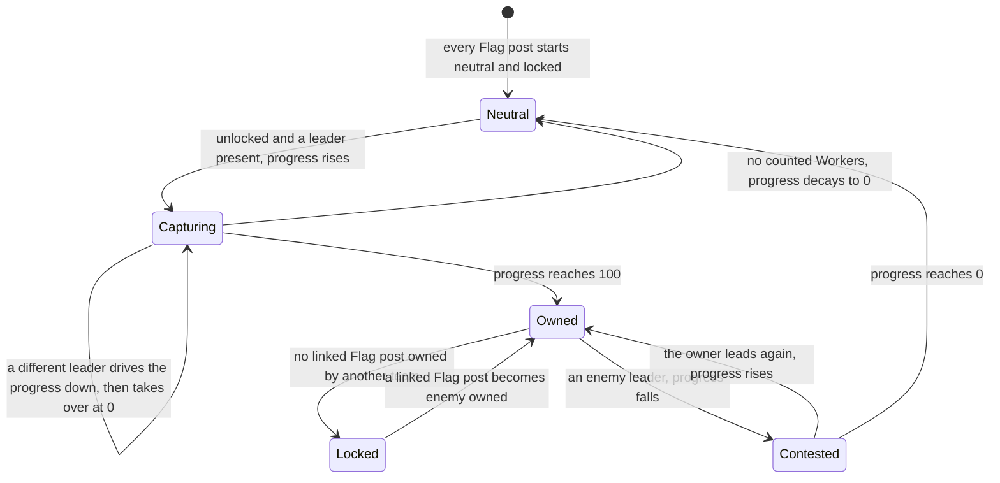
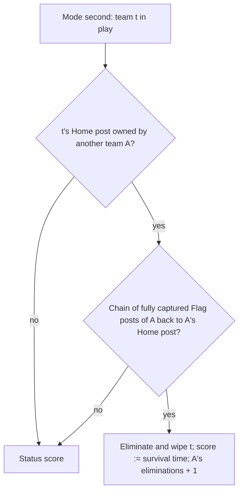

# Flag Chain

> Status: Reference · Prefix: R-MODE · Related: [Skirmish rules and modes](README.md) · [03 Mode objects](../03_buildings_and_world_objects/mode_objects.md) · [05 Population flow](../05_population_flow.md) · [07 Bots](../07_bots.md) · [10 Audio design](../10_audio_design.md)

## 1 Purpose and player experience

Flag Chain is a front-line mode. Flag posts are linked into a graph, and each team has one Home post. A Flag post can be captured only when it touches territory of another team, so capture spreads outward from the Home posts along the links. When a team's Home post falls to an enemy that holds an unbroken chain of fully captured Flag posts from it back to that enemy's own Home post, the team is out. The last team in play wins; at time-up, Flag posts held plus a bonus per elimination decide. Workers arrive through each team's Transit Gate.

## 2 Rules

### 2.1 Teams, objects and options

**R-MODE-450** (MUST) Flag Chain is free-for-all for 2 to 4 players, with no co-op map. Each start position has one Transit Gate; two reference maps add a neutral one.

**R-MODE-451** (MUST) The Flag posts are Control Zones with a radius and links ([reference/03](../03_buildings_and_world_objects/mode_objects.md)). At load each Flag post that the map gives to a start position becomes that team's **Home post** and is then set neutral, so every Flag post starts the match neutral. On post-grace tick 0 each Flag post adds 1 to the Control Zone counter, which starts at 0 in every match (DEC-011), and its links are two-way: the map stores Flag post adjacency as one two-way relation (DEC-561).

**R-MODE-452** (MUST) Every Flag post starts with progress 0, capturing team none, trend 0, locked, every team count 0, its under-attack throttle at 0 and its recount timer at 0, so its first recount, which first evaluates its lock, runs on post-grace tick 0.

**R-MODE-453** (MUST) At each recount a Flag post evaluates its lock: a neutral Home post is unlocked; a partly owned Flag post (0 < progress < 100) is unlocked; any other Flag post is locked unless a linked Flag post is owned by a team **other than its own owner** (for a neutral Flag post, by any team). Neutral neighbours never unlock, so a neutral Flag post whose neighbours are all neutral is locked, an owned Flag post surrounded by its own and neutral Flag posts is locked, and capture spreads outward from the Home posts.

**R-MODE-454** (MUST) A Flag post recounts every `ref.mode.recount.one_second` (11 ticks, DEC-064). The capture values are owned by [reference/03](../03_buildings_and_world_objects/mode_objects.md):

1. When unlocked, it counts per used team the Workers within 40 wu (a fixed capture radius, not the Flag post's radius) that are not dead, not burning and not inside a Transport; the leader is the team with the strictly highest count. When locked, it refreshes no count and has no leader.
2. With a leader whose count is top out of a total of counted Workers, change = 5 × top × (top / total). When the Flag post is owned, the capturing team becomes its owner. When the leader differs from the capturing team, the progress falls by change × one tick's duration, and at 0 or below the Flag post becomes neutral and the leader becomes the capturing team. When the leader is the capturing team, the progress rises by change × one tick's duration, and at 100 or above the leader owns the Flag post.
3. With no leader, a neutral Flag post's progress falls by 10 × one tick's duration (at 0 or below its capturing team becomes none), and an owned Flag post's progress does not change.

The update runs once per recount but scales by one tick's duration, so the progress changes by 0.5 × top² ÷ total per recount: 20 uncontested Workers capture a neutral Flag post in 10 recounts (110 ticks), and an enemy Flag post takes twice as long, because it is first driven to 0 and then raised to 100.

**R-MODE-455** (MUST) A Flag post's trend is the sign of its last progress change; the flag picture `marker.flag_post_state` shows raised, lowered or neutral by the trend, or locked when it is locked.

**R-MODE-456** (MUST) While enemy Workers are within the radius of the local team's own Home post, the Home post emits `mode.flag_chain.base_under_attack` and sets its throttle to `ref.mode.flag_chain.under_attack_throttle` (200 recounts); the throttle falls by 1 per recount, so the announcement repeats at most every 200 recounts, 2,200 ticks (DEC-071 is open on a throttle of 200 ticks).

**R-MODE-457** (MUST) At each recount the nearest bot navigation node receives a per-team priority from the Flag post, or 1.0 for an Easy bot ([reference/07](../07_bots.md)).

**R-MODE-458** (MUST) The options are time limit (0 to 60 minutes, default `ref.mode.flag_chain.option.time_limit`, 15; 0 means none), crate drop period, reinforcement interval, reinforcement count, Transport cap, turret frequency (default 2), Comeback Bonus, sudden death and turret cap (default 2) (README R-MODE-074).

### 2.2 The mode step

**R-MODE-459** (MUST) The reinforcement-wave step runs once every tick, before the per-second step (README R-MODE-037 step 7). Transit Gates advance exactly once per tick on every map, and where a map sets a gate reinforcement count or a Transport cap, the map value overrides the lobby default ([reference/05](../05_population_flow.md) R-ECON-091; DEC-065).

**R-MODE-460** (MUST) The first Flag Chain step after the grace period initialises the mode once (R-MODE-451).

**R-MODE-461** (MUST) When the rules timer completes a mode second, the Flag Chain step runs:

1. If the time remaining is above 0, decrease it by 1. Back up the scores.
2. Elimination: for each used player team t that is not eliminated and whose Home post is owned by another team A: when the route test (R-MODE-464) from t's Home post for A succeeds, t is eliminated and wiped (README R-MODE-048), t's score becomes its survival time, the whole seconds of match time at its elimination, and A's eliminations scored rises by 1.
3. Status: each used player team that is not eliminated takes the status of its Home post (R-MODE-462) as its score.
4. The surviving team is the only used player team that is not eliminated when exactly one remains; otherwise there is none.
5. At time-up (time remaining at or below 0 and the match not unlimited), the time-up decider of R-MODE-463 gives the leader, a team or the draw value; it replaces the surviving team.
6. When the leader is the draw value and sudden death is on: the first time, wipe every used player team whose time-up score differs from the highest, set the sudden-death flag and emit `match.sudden_death.start`; on later mode seconds the decider runs again with time still up, so the next Flag post change that breaks the tie ends the match. Otherwise, when there is a surviving team, or a time-up result (a team, or the draw value with sudden death off), it is declared; when the local team wins, the Flag Sweep achievement event is emitted (R-MODE-472).

**R-MODE-462** (MUST) A Home post's status is the first that applies of: **enemy occupied**, owned by another team; **under attack**, owned by its team with enemy Workers within its radius at the latest recount; **unoccupied**, neutral; **under threat**, owned by its team and unlocked; **safe**, owned by its team and locked. A neutral Home post never reports itself under threat (DEC-078). The statuses are an ordered enumeration, safe highest and enemy occupied lowest, and every status ranks above every survival time, so the scoreboard lists the teams in play by status and then the eliminated teams by how long they survived.

**R-MODE-463** (MUST) The time-up decider gives every team slot that is not eliminated, except the Rogue and Visitor factions (DEC-082), the time-up score Flag posts owned + `ref.mode.flag_chain.elimination_points` (10) × eliminations scored. Unused slots take part with a score of 0. The highest time-up score wins; equal highest scores give the draw value, so all-zero scores are a draw. The decider reads only valid team indices; the no-team value is never an index (DEC-068).

**R-MODE-464** (MUST) The route test checks whether team A holds an unbroken chain of fully captured Flag posts from Flag post z back to A's own Home post:

```
ChainRouteExists(z, A, visited):
    if z in visited:                                  return false
    if owner(z) != A:                                 return false
    if progress(z) < 100 and trend(z) < 0:            return false   # a Flag post being recaptured breaks the chain
    visited := visited + {z}
    if z is A's Home post:                            return true
    for each Flag post n linked to z, in link order:
        if ChainRouteExists(n, A, visited):           return true
    return false
```

The search is depth-first with backtracking, and the visited set bounds it by the number of Flag posts (DEC-014).

### 2.3 Result

**R-MODE-465** (MUST) While a team is in play its score is its Home post status; an eliminated team's score is its survival time; at time-up the decider uses Flag posts owned + 10 × eliminations.

**R-MODE-466** (MUST) The last player team in play wins; otherwise the time-up decider; a tie at time-up starts sudden death, or is a draw with sudden death off. The Rogue and Visitor factions can hold Flag posts but never win and never block the last-team-standing win (DEC-082).

**R-MODE-467** (MUST) The default turret frequency of 2 gives turret waves 1, 3 and 5 onward, with a turret cap of 2. On a turret wave a team receives the airstrike power in place of the gun turret when it holds at least (Flag post count + 1) ÷ 2 Flag posts, or, on a map with an airstrike threshold, more than that many ([reference/05](../05_population_flow.md) R-ECON-104).

**R-MODE-468** (MUST) The population cap per team is the map's cap ÷ the number of open slots, fixed for the match (DEC-079), 350 to 1,000 on the reference maps.

**R-MODE-469** (MUST) The Transport outcome is invalid on a map with a Transport cap; the Collector, Builder and Spawn Surge outcomes are valid only where Spawn Nodes exist; the map's excluded outcomes never drop (DEC-107; [reference/04](../04_supply_crates_powers_and_weapons/crates_and_powers.md)).

**R-MODE-470** (MUST) Bots use Siege-style diffusion seeded by the Flag post pins, assault Flag posts with Transports, rush with turrets and form no Leader formations; idle Workers also look for nearby Flag posts ([reference/07](../07_bots.md), R-ECON-105).

### 2.4 HUD and end of match

**R-MODE-471** (MUST) Each scoreboard row shows its team's status text with no number: `mode.flag_chain.status.eliminated`, `mode.flag_chain.status.enemy_occupied`, `mode.flag_chain.status.under_attack`, `mode.flag_chain.status.unoccupied`, `mode.flag_chain.status.under_threat` or `mode.flag_chain.status.safe`. The game-over list is not drawn (README R-MODE-068). A Flag post shows a cloth flag on a pole, lowered by (100 − progress) wu while partly owned, with the picture of R-MODE-455 recoloured per team, and a ring whose owned fraction is drawn in the owner's or capturer's colour and the rest grey ([reference/03](../03_buildings_and_world_objects/mode_objects.md)). The hints `help.hint.flag_chain_01` and `help.hint.flag_chain_02` explain the chain and the attack on a Flag post.

**R-MODE-472** (MUST) The Flag Sweep hook's time test always passes, so the event accompanies every win of the local team; no achievement is awarded, and its condition is the design phase's (DEC-047).

## 3 States and flows

Diagram 3-A: one Flag post (R-MODE-452 to R-MODE-455).



Diagram 3-B: elimination by a chain (R-MODE-461 step 2, R-MODE-464).



## 4 Tuning table

The Flag post capture values (capture radius, rate factor, neutral decay, full progress) are owned by [reference/03](../03_buildings_and_world_objects/mode_objects.md); the wave values by [reference/05](../05_population_flow.md); option keys are in the [README](README.md).

| key | value | unit | range or notes | requirement | DEC |
|---|---|---|---|---|---|
| `ref.mode.flag_chain.elimination_points` | 10 | points per elimination scored | time-up decider | R-MODE-463, R-MODE-465 | DEC-082 |
| `ref.mode.flag_chain.under_attack_throttle` | 200 | recounts | 2,200 ticks at the 11-tick recount | R-MODE-456 | DEC-064, DEC-071 |

String ids that this file uses, with their new text:

| String id | Text |
|---|---|
| `mode.flag_chain.base_under_attack` | Enemies are at your Home post! |
| `mode.flag_chain.status.eliminated` | {name}  Out |
| `mode.flag_chain.status.enemy_occupied` | {name}  Home post taken |
| `mode.flag_chain.status.under_attack` | {name}  Home post attacked |
| `mode.flag_chain.status.unoccupied` | {name}  Home post empty |
| `mode.flag_chain.status.under_threat` | {name}  Home post exposed |
| `mode.flag_chain.status.safe` | {name}  Home post secure |

## 5 Edge cases and interactions

1. **A Home post taken without a chain.** An enemy that owns a team's Home post but holds no unbroken chain back to its own Home post does not eliminate the team; the team stays in play with the status enemy occupied (R-MODE-461, R-MODE-462).
2. **A breaking chain.** A Flag post of the chain that is partly owned and losing progress breaks the route, so recapturing any link of the chain saves the team (R-MODE-464).
3. **Waves on maps that set gate values.** Three reference maps set a gate count of 100 and a Transport cap of 3; those map values apply, and the gates still advance once per tick, so waves come every 660 ticks at the default interval (R-MODE-459, DEC-065).
4. **The factions on Flag posts.** The Rogue faction can own Flag posts, which can lock or unlock their neighbours, but it never scores at time-up (R-MODE-463, DEC-082).
5. **Unlimited matches.** With a time limit of 0 only elimination ends the match, and a match in which no chain ever reaches a Home post never ends.
6. **The Control Zone counter.** The counter that the airstrike rule reads is the number of Flag posts on the map, because it starts at 0 in every match (R-MODE-451, R-MODE-467, DEC-011).

## 6 Acceptance criteria

- **AC-01** (R-MODE-454) Given 20 uncontested Workers of team A at a neutral, unlocked Flag post, then A owns it after 10 recounts (110 ticks); given an enemy Flag post, then after 20 recounts.
- **AC-02** (R-MODE-453) Given a chain of A's Home post – P – Q, with the Home post owned by A and P and Q neutral, then P is unlocked, because a neighbour is owned by a team; Q is locked, because its only neighbours are neutral; and A's Home post is locked, so its status is safe.
- **AC-03** (R-MODE-461, R-MODE-464) Given A owns B's Home post and every Flag post of a path back to A's Home post at progress 100, then B is eliminated on the next mode second; given one Flag post of that path at progress 70 with a falling trend, then B is not.
- **AC-04** (R-MODE-463) Vectors at time-up, sudden death off: (A: 5 Flag posts, 1 elimination; B: 12, 0) → A wins with 15 against 12; (A: 4, 0; B: 4, 0) → draw; the Rogue faction holding 20 Flag posts does not change either result.
- **AC-05** (R-MODE-456) Given enemies at the local Home post on every recount, then `mode.flag_chain.base_under_attack` is emitted once per 2,200 ticks.
- **AC-06** (R-MODE-462) Given a neutral Home post with enemies inside its radius, then its status is unoccupied, never under threat.

## 7 Dependencies

- **Reference documents:** [README](README.md); [03 Mode objects](../03_buildings_and_world_objects/mode_objects.md) (Flag post, Home post, Transit Gate); [05 Population flow](../05_population_flow.md) (waves, the airstrike rule); [04 Supply crates](../04_supply_crates_powers_and_weapons/crates_and_powers.md); [07 Bots](../07_bots.md); [10 Audio design](../10_audio_design.md) (the announcement).
- **Assets:** `map.flag_chain`, `marker.flag_post_state`, `help.hint.flag_chain_01`, `help.hint.flag_chain_02`.

## 8 Open decisions

- DEC-071 — the interval of the base-under-attack announcement (R-MODE-456).
- DEC-047 — the Flag Sweep hook (R-MODE-472).

Resolved decisions applied: DEC-011, DEC-014, DEC-064, DEC-065, DEC-068, DEC-078, DEC-079, DEC-082, DEC-107, DEC-561.
