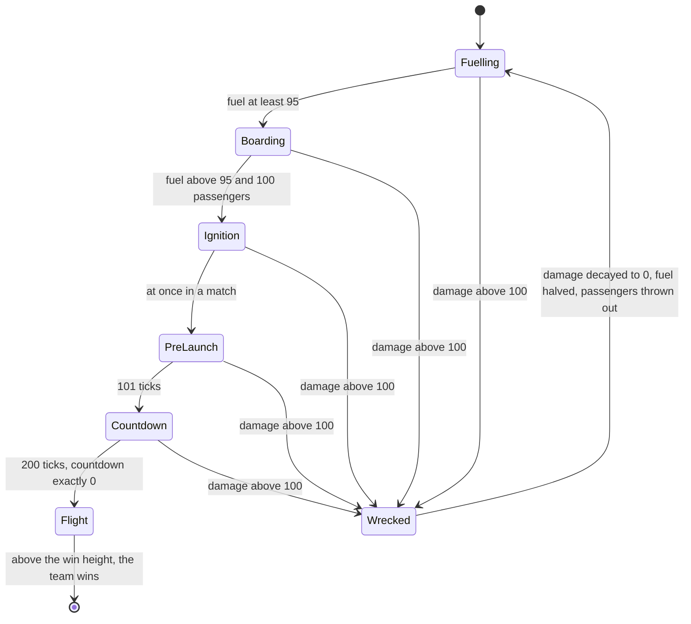

# Launch Race

> Status: Reference · Prefix: R-MODE · Related: [Skirmish rules and modes](README.md) · [03 Mode objects](../03_buildings_and_world_objects/mode_objects.md) · [05 Population flow](../05_population_flow.md) · [07 Bots](../07_bots/README.md) · [10 Audio design](../10_audio_design/README.md)

## 1 Purpose and player experience

Launch Race is a race to space. Each team has its own Launch Vessel, fed by its own fuel pumps, fuel lines and fuel depots, but the energy that drives the pumps comes from Solar Arrays that every team fights over. When a vessel is fuelled, the team sends 100 Workers aboard; the vessel then counts down and launches, and the first vessel to climb above the win height wins. Enemies attack a fuelled vessel, and a vessel that takes too much damage explodes, loses fuel and throws its passengers out. Workers arrive only through each team's Transit Gate.

## 2 Rules

### 2.1 Teams, objects and options

**R-MODE-400** (MUST) Launch Race is free-for-all for 2 to 4 players, with no co-op map. Each start position has its own Launch Vessel, three fuel depots, three fuel pumps, their fuel lines and one Transit Gate; the Solar Arrays and their energy grid are shared and contested.

**R-MODE-401** (MUST) The fuel chain is: Solar Array → grid splitter → grid pylons → grid terminal → fuel pump → fuel lines → fuel depot → Launch Vessel. Its structures and their rules are owned by [reference/03](../03_buildings_and_world_objects/mode_objects.md); they use `mesh.structure.launch_vessel`, `mesh.structure.fuel_depot`, `mesh.structure.fuel_pump_housing`, `mesh.structure.fuel_pump_arm`, `mesh.structure.fuel_line_foot`, `mesh.structure.fuel_line_span` and `fx.fuel_flow`.

**R-MODE-402** (MUST) The Launch Vessel refuels as [reference/03](../03_buildings_and_world_objects/mode_objects.md) R-BLDG-322 and R-BLDG-330 state, with the values of their keys: its intake count is the number of intake calls from its fuel depots whose level is above `ref.bldg.launch_vessel.intake_level_min` (0.1); its target rate is the intake count × the current level × `ref.bldg.launch_vessel.refuel_gain` (0.4); each tick its rate moves to `ref.bldg.launch_vessel.refuel_keep` (0.99) × rate + 0.01 × target; its fuel grows by rate × one tick's duration, up to `ref.bldg.launch_vessel.max_fuel` (100). With three depots at full level the steady rate is about 1.2 fuel points per second, so 0 to 95 takes about 80 s plus the smoothing lag.

**R-MODE-403** (MUST) The Launch Vessel passes through the states of diagram 3-A ([reference/03](../03_buildings_and_world_objects/mode_objects.md) R-BLDG-329 to R-BLDG-336 own the values): Fuelling; Boarding at fuel ≥ `ref.bldg.launch_vessel.full_fuel` (95), which emits `mode.launch_race.fuelled`; Ignition at fuel above 95 with at least `ref.bldg.launch_vessel.launch_passengers` (100) passengers, which emits `mode.launch_race.preparing`; PreLaunch at once in a match, with a camera shake of `ref.bldg.launch_vessel.camera_shake` (5); Countdown when the ready countdown of `ref.bldg.launch_vessel.prelaunch_ticks` (101 ticks) ends; Flight when the launch countdown of `ref.bldg.launch_vessel.countdown_ticks` (200 ticks), a countdown of 10 at half rate, reaches exactly 0. Any state except Flight and Wrecked becomes Wrecked when the damage exceeds `ref.bldg.launch_vessel.wreck_damage` (100); Wrecked returns to Fuelling when the damage has decayed to 0, its fuel burnt down to `ref.bldg.launch_vessel.wreck_fuel_floor` (0.5) × its value before the explosion and its passengers thrown out one per tick, half of them on fire ([reference/05](../05_population_flow.md) R-ECON-118).

**R-MODE-404** (MUST) Flight cannot be damaged and cannot return to refuelling; it ends only in the launch result (DEC-076). In Flight the vessel climbs by thrust × one tick's duration per tick, thrust = max(`ref.bldg.launch_vessel.thrust_factor` (2) × √(height above the ground), `ref.bldg.launch_vessel.min_thrust` (0.1)) wu/s (R-BLDG-335); from launch to above the win height it takes 248 ticks on ground at height 0, 238 at 50, 227 at 100, 215 at 150, 203 at 200 and 176 at 300.

**R-MODE-405** (MUST) While a vessel is Boarding, each of its fuel depots picks one random actor of its team within `ref.bldg.fuel_depot.boarding_radius_wu` (300 wu) per tick and sends it aboard when it is a Worker in the Idle state ([reference/02](../02_units/worker.md) table 2.4-A; [reference/03](../03_buildings_and_world_objects/economy_and_spawn_objects.md) R-BLDG-203). A vessel with fuel above `ref.bldg.launch_vessel.attack_fuel` (33) that is not Wrecked attracts enemy attackers within `ref.bldg.launch_vessel.attacker_radius_wu` (150 wu) every `ref.bldg.launch_vessel.attacker_interval_ticks` (11 to 30 ticks, 1 to 3 s); the damage it takes is scaled by `ref.bldg.launch_vessel.damage_scale` (0.2) and decays at `ref.bldg.launch_vessel.damage_decay_per_s` (0.33 per second); grenades thrown at it aim `ref.unit.worker.attack_aim_height` (50 wu) above its base and their damage is measured to the base ([reference/03](../03_buildings_and_world_objects/mode_objects.md) R-BLDG-323 to R-BLDG-326). How long a vessel survives an attack follows from these rules and is not a value of its own (DEC-108).

**R-MODE-406** (MUST) The vessel's looping sounds are started and stopped by explicit events, never kept alive by polling, so a loop never runs twice for one vessel (DEC-323). The vessel uses `sfx.building.launch_vessel.hungry`, `sfx.building.launch_vessel.fuelled`, `sfx.building.launch_vessel.fuelled_b`, `sfx.building.launch_vessel.engine_burn`, `sfx.building.launch_vessel.engine_burn_b`, `sfx.building.launch_vessel.flight`, `sfx.building.launch_vessel.damaged`, `sfx.building.launch_vessel.malfunction` and `sfx.building.launch_vessel.explode`; the chain uses `sfx.building.fuel_pump.pump_up`, `sfx.building.fuel_pump.pump_up_b`, `sfx.building.fuel_pump.pump_down`, `sfx.building.fuel_pump.pump_down_b`, `sfx.building.fuel_line.flow` and `sfx.building.fuel_depot.load_passenger` ([reference/10](../10_audio_design/README.md)).

**R-MODE-407** (MUST) The options are crate drop period, reinforcement interval, reinforcement count, Transport cap, turret frequency and turret cap (README R-MODE-074). Launch Race has no time limit and no sudden death; the Comeback Bonus runs with its typed default and never grants (README R-MODE-055).

### 2.2 The mode step

**R-MODE-408** (MUST) When the rules timer completes a mode second, the Launch Race step decreases the time remaining when it is above 0 (it is none, so it never is) and backs up the scores. Then:

1. For each player team (not the Rogue or Visitor faction) that has no known Launch Vessel: it takes the Launch Vessel that the team owns, the last such structure in structure order when there are several (DEC-016).
2. For each player team in slot order: its score is 0; when it has a vessel, its score is ⌊fuel⌋, then plus the passengers, then plus ⌊height above the ground⌋, truncating at each step. When the vessel is in Flight and its height is above `ref.mode.launch_race.win_height` (600 wu, an absolute height), the team is declared the winner and the loop stops, so the lowest team index wins simultaneous launches (DEC-016). When the local team wins with its vessel's damage at most `ref.mode.launch_race.clean_launch_max_damage` (0.01) and no other used player team's vessel above `ref.mode.launch_race.clean_launch_rival_fuel` (50) fuel, the Clean Launch achievement event is emitted (DEC-047).

**R-MODE-409** (MUST) The reinforcement-wave step runs once every tick, outside the per-second step (README R-MODE-037 step 7; DEC-065).

**R-MODE-410** (MUST) The score, which orders the scoreboard and the rank announcements, is ⌊fuel⌋ + passengers + ⌊height above the ground⌋, with fuel 0 to 100 and passengers 0 to 100. Winning depends only on the absolute height of a vessel in Flight, never on the score.

### 2.3 Result

**R-MODE-411** (MUST) The first vessel above the win height wins. There is no draw, no elimination and no time limit; a match in which no vessel launches never ends.

**R-MODE-412** (MUST) The length of a launch is not a value of its own and no rule keeps a launch timer: it follows from the state timers of [reference/03](../03_buildings_and_world_objects/mode_objects.md) R-BLDG-332 to R-BLDG-334, the Flight climb of R-MODE-404 (R-BLDG-335) and the once-per-mode-second win test of R-MODE-408. Derived from those rules, a launch takes, from the moment boarding completes, 1 tick of Ignition, 101 ticks of PreLaunch, 200 ticks of Countdown, 176 to 248 ticks of Flight by the vessel's ground height (R-MODE-404) and up to 11 ticks until the next mode second: 478 to 561 ticks (47.8 to 56.1 s); AC-07 checks it.

**R-MODE-413** (MUST) Transit Gates are the only source of Workers: no player owns a Spawn Node at the start, and one reference map adds 8 starting Workers per position. Every owned gate releases the reinforcement count per wave unless the team is at its cap; it grants a Transport power while the team holds fewer than the Transport cap, aimed 75 wu in front of the gate, and a turret power on waves 1, 8 and 15 onward at the default frequency of 7 while the team holds fewer than the turret cap; one map disables turrets ([reference/05](../05_population_flow.md) R-ECON-090 to R-ECON-099).

**R-MODE-414** (MUST) The population cap per team is the map's cap ÷ the number of open slots, fixed for the match (DEC-079), 450 to 900 on the reference maps, and it is checked per gate per wave (R-ECON-095).

**R-MODE-415** (MUST) In Launch Race the Transport outcome is invalid, because Transports come from the gates; the Collector, Builder and Spawn Surge outcomes are valid only on maps that have Spawn Nodes, which are neutral; the map's excluded outcomes never drop (DEC-107; [reference/04](../04_supply_crates_powers_and_weapons/crates_and_powers.md)).

**R-MODE-416** (MUST) Bots use the Launch Race priority model with marker pins on the Solar Array fields, ferry Workers with Transports, defend their vessel with turrets above the Easy difficulty and form no Leader formations ([reference/07](../07_bots/README.md)).

### 2.4 HUD and end of match

**R-MODE-417** (MUST) The scoreboard is `ref.mode.launch_race.hud.scoreboard_width` (530) wide. Each row is `mode.launch_race.hud.score_line`: the damage part only while the damage is above 0, the rate part (rate × 100 per second) only while the rate is above 0, and the passenger part only while there are passengers. During the Countdown the row alternates every `ref.mode.launch_race.hud.alternation` (0.5 s of real time) with `mode.launch_race.hud.liftoff_in`, showing the countdown + 1.

**R-MODE-418** (MUST) The **Launch Vessel status panel** is drawn at the top right, `ref.mode.launch_race.panel.width` (0.2 × the screen height) wide and `ref.mode.launch_race.panel.aspect` (1.5) times as tall, in the frame `icon.hud.launch_panel`. It shows a fuel column in the team colour, the damage overlay `icon.hud.launch_panel_damaged` scaled by damage, a passenger grid of `ref.mode.launch_race.panel.grid` (10 × 10) cells and the engine flame `fx.muzzle_flash` in PreLaunch, Countdown and Flight; the fuel column is the strip `fx.beam_long`, drawn over the refuelling sheet `fx.beam_short` while the fuel is below 100 %. Its caption is the first that applies of: `mode.launch_race.panel.under_attack`, the countdown number, `mode.launch_race.panel.liftoff`, `mode.launch_race.panel.on_fire`, `mode.launch_race.panel.load`, `mode.launch_race.panel.capture`, `mode.launch_race.panel.fuel`. The panel's full layout is [reference/09 options, localisation and hooks](../09_front_end_and_match_flow/options_localisation_and_hooks.md) §2.14 (R-META-505 to R-META-510). The mode's objective cards are hooks only and draw nothing in a match ([reference/11](../11_tutorial_and_help.md) R-TUT-013, DEC-050).

**R-MODE-419** (MUST) The game-over list shows the team names only (README R-MODE-068). The Clean Launch hook fires only for a launch win by the local team under both conditions; no achievement is awarded (DEC-047).

## 3 States and flows

Diagram 3-A: the Launch Vessel (R-MODE-403, R-MODE-404).

## 4 Tuning table

The fuel chain, refuel, state-timer, attack and flight values are owned by [reference/03](../03_buildings_and_world_objects/mode_objects.md); the wave values by [reference/05](../05_population_flow.md); option keys are in the [README](README.md).

| key | value | unit | range or notes | requirement | DEC |
|---|---|---|---|---|---|
| `ref.mode.launch_race.win_height` | 600 | wu | absolute height of a vessel in Flight, strictly above | R-MODE-408, R-MODE-411 | DEC-076 |
| `ref.mode.launch_race.clean_launch_max_damage` | 0.01 | damage | at most | R-MODE-408 | DEC-047 |
| `ref.mode.launch_race.clean_launch_rival_fuel` | 50 | fuel | no rival vessel strictly above | R-MODE-408 | DEC-047 |
| `ref.mode.launch_race.hud.scoreboard_width` | 530 | px × scale | | R-MODE-417 | — |
| `ref.mode.launch_race.hud.alternation` | 0.5 | s of real time | presentation clock | R-MODE-417 | DEC-007 |
| `ref.mode.launch_race.panel.width` | 0.2 | × screen height | | R-MODE-418 | — |
| `ref.mode.launch_race.panel.aspect` | 1.5 | height ÷ width | | R-MODE-418 | — |
| `ref.mode.launch_race.panel.grid` | 10 × 10 | cells | one per passenger seat | R-MODE-418 | — |

String ids that this file uses, with their new text:

| String id | Text |
|---|---|
| `mode.launch_race.fuelled` | Your Launch Vessel is full. Send 100 Workers aboard. |
| `mode.launch_race.preparing` | Your Launch Vessel is getting ready to launch. |
| `mode.launch_race.hud.score_line` | {name}  damage {damage}%  fuel {fuel}% (+{rate}/s)  aboard {passengers}/100 |
| `mode.launch_race.hud.liftoff_in` | {name}  launch in {seconds} |
| `mode.launch_race.panel.under_attack` | Vessel under fire: {damage}% damage |
| `mode.launch_race.panel.liftoff` | Launch! |
| `mode.launch_race.panel.on_fire` | Your Launch Vessel is burning |
| `mode.launch_race.panel.load` | Send 100 Workers aboard |
| `mode.launch_race.panel.capture` | Take Solar Arrays to start the fuel flowing |
| `mode.launch_race.panel.fuel` | Fuel {fuel}% |

## 5 Edge cases and interactions

1. **Simultaneous launches.** Two vessels above the win height on the same mode second: the lower team index wins (R-MODE-408, DEC-016).
2. **No launch.** Without a time limit, a match in which no team ever fuels and crews its vessel never ends (R-MODE-411).
3. **Score versus win.** A team can lead the scoreboard with a full, crewed vessel and still lose to a vessel that launches first (R-MODE-410).
4. **Explosion during the countdown.** A vessel in PreLaunch or Countdown that takes more than 100 damage is Wrecked and must refuel; once in Flight it cannot be stopped (R-MODE-403, DEC-076).
5. **Several vessels.** When a team owns more than one Launch Vessel, the last one in structure order is its vessel for the score and the win test (R-MODE-408).
6. **The Comeback Bonus.** No team counts as eliminated in Launch Race, so the Comeback Bonus never grants (README R-MODE-055).

## 6 Acceptance criteria

- **AC-01** (R-MODE-408, R-MODE-410) Given a vessel with fuel 63.7, 42 passengers and 12.9 wu above the ground, then the team's score is 63 + 42 + 12 = 117.
- **AC-02** (R-MODE-408) Given teams 1 and 3 whose vessels are both above 600 wu in Flight at the same mode second, then team 1 is declared the winner.
- **AC-03** (R-MODE-404, DEC-076) Given a vessel in Flight that is hit by any weapon, then its damage does not change and it reaches the win height.
- **AC-04** (R-MODE-403, R-MODE-404) Given a vessel on ground at height 0 whose boarding completes at tick n, then it enters Flight about 302 ticks later and passes 600 wu 248 ticks after that.
- **AC-05** (R-MODE-406, DEC-323) Given a vessel in Flight, then exactly one flight loop plays for it, and it stops when the vessel is removed.
- **AC-06** (R-MODE-408) Given the local team wins with damage 0 and a rival vessel at 49 fuel, then the Clean Launch event is emitted; with the rival at 51, it is not.
- **AC-07** (R-MODE-412) Given a vessel whose boarding completes at tick n, then its team is declared the winner no earlier than tick n + 550 and no later than tick n + 561 on ground at height 0, and no earlier than tick n + 478 and no later than tick n + 489 on ground at height 300.

## 7 Dependencies

- **Reference documents:** [README](README.md); [03 Mode objects](../03_buildings_and_world_objects/mode_objects.md) (Launch Vessel, fuel chain, energy grid); [03 Economy and spawn objects](../03_buildings_and_world_objects/economy_and_spawn_objects.md) (Solar Arrays); [05 Population flow](../05_population_flow.md) (waves, the released passengers); [07 Bots](../07_bots/README.md); [09 Options, localisation and hooks](../09_front_end_and_match_flow/options_localisation_and_hooks.md) (panel layout); [10 Audio design](../10_audio_design/README.md).
- **Assets:** `mapfile.launch_race`, `mesh.structure.launch_vessel`, `mesh.structure.fuel_depot`, `mesh.structure.fuel_pump_housing`, `mesh.structure.fuel_pump_arm`, `mesh.structure.fuel_line_foot`, `mesh.structure.fuel_line_span`, `fx.fuel_flow`, `fx.beam_long`, `fx.beam_short`, `fx.muzzle_flash`, `icon.hud.launch_panel`, `icon.hud.launch_panel_damaged`, `sfx.building.launch_vessel.hungry`, `sfx.building.launch_vessel.fuelled`, `sfx.building.launch_vessel.fuelled_b`, `sfx.building.launch_vessel.engine_burn`, `sfx.building.launch_vessel.engine_burn_b`, `sfx.building.launch_vessel.flight`, `sfx.building.launch_vessel.damaged`, `sfx.building.launch_vessel.malfunction`, `sfx.building.launch_vessel.explode`, `sfx.building.fuel_pump.pump_up`, `sfx.building.fuel_pump.pump_up_b`, `sfx.building.fuel_pump.pump_down`, `sfx.building.fuel_pump.pump_down_b`, `sfx.building.fuel_line.flow`, `sfx.building.fuel_depot.load_passenger`.

## 8 Open decisions

- DEC-108 — Launch Vessel survival under attack (R-MODE-405).
- DEC-047 — the Clean Launch hook (R-MODE-419).
- DEC-050 — the objective cards, hooks only (R-MODE-418).

Resolved decisions applied: DEC-016, DEC-065, DEC-076, DEC-079, DEC-107, DEC-323.
