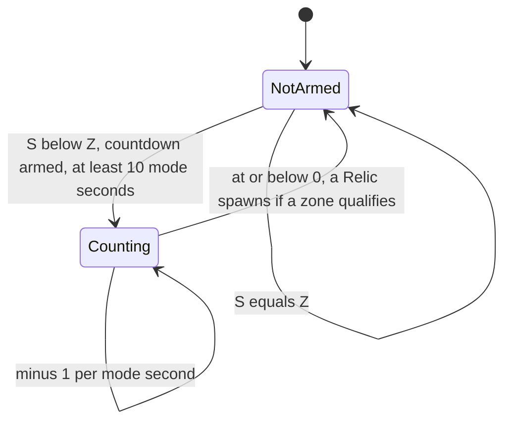

# Relic Run

> Status: Reference · Prefix: R-MODE · Related: [Skirmish rules and modes](README.md) · [03 Mode objects](../03_buildings_and_world_objects/mode_objects.md) · [07 Bots](../07_bots.md) · [11 Tutorial and help](../11_tutorial_and_help.md)

## 1 Purpose and player experience

Relic Run is a carrying race. Relics appear at neutral Relic Spawn Zones; a crowd of at least 20 Workers lifts one and carries it, slowly, towards its team's Relic Base, while enemy crowds try to take it over. Every Relic delivered scores 1 point, and the highest score at time-up wins. A new Relic appears some mode seconds after one is delivered or destroyed, sooner when few Relics are on the map.

## 2 Rules

### 2.1 Teams, objects and options

**R-MODE-300** (MUST) Relic Run is free-for-all for 2 to 4 players, with co-op on maps that allow it (one reference map) (README §2.4).

**R-MODE-301** (MUST) Every Control Zone that the map gives to a start position is that team's **Relic Base**, with fixed ownership; every neutral Control Zone is a **Relic Spawn Zone**. The Zone Control occupancy recount does not run in Relic Run ([reference/03](../03_buildings_and_world_objects/mode_objects.md)).

**R-MODE-302** (MUST) A **Relic** is a carryable structure that no map can place; only the match rules create it, with no team, a random facing and a mesh chosen by a simulation draw from the 8 variants of `mesh.relic.variant`, and with its off-screen marker `marker.relic`. Its lifting, carrying, ownership, self-routing and destruction rules are owned by [reference/03](../03_buildings_and_world_objects/mode_objects.md); in summary: 20 to 50 Workers lift it within a carry radius of 33 wu; every recount (`ref.mode.recount.one_second`, DEC-064) its owner becomes the team with the strictly highest count of live Workers within 50 wu, provided that count is at least 20, otherwise no team, and ownership does not change when the new owner is a friend of the old; while at least 20 lift it, it moves with a push of lifters ÷ 50 × 16 × the speed scale × |sin(game time)|; an owned Relic without a waypoint routes itself, at most once per game second, to its owner's nearest Relic Base, or to the nearest Relic Spawn Zone when a faction owns it; it is destroyed when it tilts (up component below 0.7) or goes under water (height below 0); and it carries a bot navigation node with priority modifier 1.0 that follows it ([reference/07](../07_bots.md)). Its sounds are `sfx.building.relic.spawn`, `sfx.building.relic.owner_changed` and `sfx.building.relic.drop`, and a lifting Worker plays `sfx.unit.worker.lift_relic`.

**R-MODE-303** (MUST) Each Relic Base checks for deliveries every `ref.mode.recount.two_second` (21 ticks, DEC-064): every Relic owned by the base's team within 30 wu of the base position (a three-dimensional distance, owned by reference/03) is destroyed, and the team is awarded `ref.mode.relic_run.points_per_delivery` (1) point (README R-MODE-045). The delivery emits `mode.relic_run.delivered`, the scored sound `sfx.building.control_zone.relic_scored` with its layers `sfx.building.control_zone.relic_scored_b` and `sfx.building.control_zone.relic_scored_c`, and a hint notification.

**R-MODE-304** (MUST) The options are time limit (1 to 60 minutes, default `ref.mode.relic_run.option.time_limit`, 10), crate drop period, Comeback Bonus, sudden death and crate placement (README R-MODE-074). Relic Run has no Catch-up bonus, no starting powers and no score mode.

### 2.2 Relic spawning

**R-MODE-305** (MUST) On every tick of the grace period, when no Relic exists, one Relic is spawned at a Relic Spawn Zone chosen uniformly with the simulation generator (README R-MODE-040 step 1).

**R-MODE-306** (MUST) Each mode second, after the time-up evaluation of R-MODE-307 (and during sudden death too), let S be the number of Relics and Z the number of Relic Spawn Zones. When S < Z the spawn countdown runs:

1. When it is none (not armed): window := `ref.mode.relic_run.spawn_window` (60) × S / Z; countdown := window / 2 + U[0, window / 2), raised to at least `ref.mode.relic_run.spawn_min` (10) mode seconds.
2. Otherwise, when it is above 0: decrease it by 1.
3. Otherwise (at or below 0): set it to none and spawn a Relic: with S = 0 at a Relic Spawn Zone chosen uniformly; otherwise at the Relic Spawn Zone whose nearest Relic is farthest away, provided that distance is more than `ref.mode.relic_run.spawn_min_distance` (30 wu); equal distances go to the first zone in stable-id order (DEC-016), and no Relic is spawned in this cycle when no zone qualifies. A spawn emits `mode.relic_run.new_relic`.

A Relic therefore appears ⌈countdown⌉ + 1 mode seconds after the countdown is armed; with no Relic left, 11 mode seconds (121 ticks) after.

### 2.3 The mode step

**R-MODE-307** (MUST) When the rules timer completes a mode second, the Relic Run step decreases the time remaining by 1 unconditionally (it goes below 0 during sudden death) and backs up the scores. When the time remaining is at or below 0:

1. Over the used player slots (not the Rogue or Visitor faction): track the leader and the draw value, with a high score that starts below every score, so teams on 0 compare properly; also find the best team that does not count as eliminated (README R-MODE-048), a tie between such teams giving the draw value.
2. If the leader is the draw value and sudden death is on, and a tied top team counts as eliminated, the leader becomes the best team that does not count as eliminated: a soft-eliminated team loses ties.
3. Co-op: sum the scores of alliance group 1 and of group 2; equal sums give the draw value; otherwise the leader is the **last** slot index of the higher group (DEC-016). This overrides steps 1 and 2.
4. When the leader is none, because no used player team exists or because step 2 found every tied team eliminated, a draw is declared; the Rogue and Visitor factions never win (DEC-082). Stop.
5. Else, when sudden death is active and the leader is not the draw value: declare the leader and stop.
6. Else, when the leader is the draw value and sudden death is on: outside co-op wipe every used player team below the top score (README R-MODE-048); set the sudden-death flag and emit `match.sudden_death.start`. The next delivery breaks the tie.
7. Else declare the leader. When the local team wins with a top score above `ref.mode.relic_run.stockpiler_ratio` (2) × the second-highest score and above `ref.mode.relic_run.stockpiler_min_score` (3), emit the Stockpiler achievement event (DEC-047). Stop.

**R-MODE-308** (MUST) A team's score is the number of Relics it has delivered, raised by 1 at each delivery (R-MODE-303); nothing else changes it.

### 2.4 Result

**R-MODE-309** (MUST) The highest score at time-up wins; a tie starts sudden death, which the next delivery ends, or is a draw with sudden death off. A co-op win goes to the alliance with the higher total. The Rogue and Visitor factions never win (DEC-082).

**R-MODE-310** (MUST) The population cap per team is the map's cap ÷ the number of open slots, fixed for the match (DEC-079); the reference maps give 500 to 1,000 per team.

**R-MODE-311** (MUST) Supply crates follow the standard rules ([reference/04](../04_supply_crates_powers_and_weapons/crates_and_powers.md)).

**R-MODE-312** (MUST) Bots use the Relic priority model, in which Relic nodes weigh 1.0, free carried Relics that are stuck, and form Leader formations only with enough idle Workers ([reference/07](../07_bots.md)).

**R-MODE-313** (MUST) The map schema and the rules accept duplicate Relic Spawn Zones at one place (DEC-315).

### 2.5 HUD and end of match

**R-MODE-314** (MUST) The score line is the generic score line (README R-MODE-065) with the delta replaced by the number of Relics the team owns now, always shown. The game-over list shows name and score. The hints `help.hint.relic_run_lift` and `help.hint.relic_run_capture` explain lifting and delivering.

**R-MODE-315** (MUST) The Stockpiler hook fires only for a win at time-up by the local team over both thresholds; no achievement is awarded (DEC-047).

## 3 States and flows

Diagram 3-A: the life of one Relic (R-MODE-302, R-MODE-303, R-MODE-306).

```mermaid
stateDiagram-v2
    [*] --> Resting : spawned at a Relic Spawn Zone, no team
    Resting --> Carried : a team has at least 20 Workers within 50 wu
    Carried --> Carried : recount, a non-friendly team with a strictly higher count takes over
    Carried --> Resting : fewer than 20 Workers of the leading team
    Carried --> Delivered : owned and within 30 wu of the owner's Relic Base at a check
    Carried --> Destroyed : tilted or under water
    Resting --> Destroyed : tilted or under water
    Delivered --> [*] : 1 point; the spawn countdown can arm
    Destroyed --> [*] : the spawn countdown can arm
```

Diagram 3-B: the spawn countdown (R-MODE-306).

## 4 Tuning table

Option keys are in the [README](README.md) tuning table; the Relic's lifting, carrying, ownership and delivery-distance values are owned by [reference/03](../03_buildings_and_world_objects/mode_objects.md).

| key | value | unit | range or notes | requirement | DEC |
|---|---|---|---|---|---|
| `ref.mode.relic_run.points_per_delivery` | 1 | points | | R-MODE-303, R-MODE-308 | — |
| `ref.mode.relic_run.spawn_window` | 60 | mode seconds | window = 60 × S / Z | R-MODE-306 | DEC-002 |
| `ref.mode.relic_run.spawn_min` | 10 | mode seconds | lower bound of the armed countdown | R-MODE-306 | DEC-002 |
| `ref.mode.relic_run.spawn_min_distance` | 30 | wu | a new Relic only at a zone farther than this from every Relic | R-MODE-306 | — |
| `ref.mode.relic_run.stockpiler_ratio` | 2 | × the second-highest score | strictly greater | R-MODE-307, R-MODE-315 | DEC-047 |
| `ref.mode.relic_run.stockpiler_min_score` | 3 | points | strictly greater | R-MODE-307, R-MODE-315 | DEC-047 |

String ids that this file uses, with their new text:

| String id | Text |
|---|---|
| `mode.relic_run.delivered` | {team} has brought a Relic home. |
| `mode.relic_run.new_relic` | A new Relic has appeared. |

## 5 Edge cases and interactions

1. **The starting Relic.** The grace step guarantees one Relic at the start; if it is destroyed during the grace period another spawns on the next grace tick (R-MODE-305).
2. **No free zone.** When every Relic Spawn Zone has a Relic within 30 wu, the armed countdown expires without a spawn and arms again on the next mode second (R-MODE-306).
3. **Soft-eliminated teams and ties.** In a tie at time-up with sudden death on, a tied team that counts as eliminated loses the tie to the best team that does not; when every tied team counts as eliminated, a draw is declared (R-MODE-307 steps 2 and 4).
4. **Co-op ties.** In co-op the declared winner is the last slot of the higher-scoring alliance; equal alliance totals are a draw, and sudden death then starts without a wipe (R-MODE-307 steps 3 and 6).
5. **Time below zero.** During sudden death the time remaining keeps falling below 0; the clock box is hidden, because it shows only while the time remaining is above 0 (README R-MODE-066).
6. **Faction-owned Relics.** A Relic that the Rogue or Visitor faction owns routes to the nearest Relic Spawn Zone and never scores (R-MODE-302).

## 6 Acceptance criteria

- **AC-01** (R-MODE-306) Vectors of the armed countdown, U being the unit draw:

| S | Z | Window | Countdown armed at |
|---|---|---|---|
| 0 | 3 | 0 | 10 (raised to the minimum) |
| 1 | 3 | 20 | 10 + 10 × U |
| 2 | 3 | 40 | 20 + 20 × U |
| 1 | 4 | 15 | the larger of 10 and 7.5 + 7.5 × U |

- **AC-02** (R-MODE-306) Given no Relic on the map, then the next Relic appears 11 mode seconds (121 ticks) after the countdown is armed.
- **AC-03** (R-MODE-303, R-MODE-308) Given a Relic owned by team A within 30 wu of A's Relic Base, then within 21 ticks it is destroyed, A's score rises by 1 and `mode.relic_run.delivered` is emitted once.
- **AC-04** (R-MODE-307) Given a tie at time-up with sudden death on outside co-op, then the teams below the top are wiped, and the first delivery afterwards decides the match on the next mode second.
- **AC-05** (R-MODE-307) Given a co-op match with alliance totals 7 and 5, then the last slot of the alliance with 7 is declared the winner.
- **AC-06** (R-MODE-307, R-MODE-315) Given the local team wins 7 to 3, then the Stockpiler event is emitted; given 6 to 3 or 3 to 1, then it is not.

## 7 Dependencies

- **Reference documents:** [README](README.md); [03 Mode objects](../03_buildings_and_world_objects/mode_objects.md) (Relic, Relic Base, Relic Spawn Zone); [02 Worker](../02_units/worker.md) (lifting); [04 Supply crates](../04_supply_crates_powers_and_weapons/crates_and_powers.md); [07 Bots](../07_bots.md); [11 Tutorial and help](../11_tutorial_and_help.md).
- **Assets:** `map.relic_run`, `mesh.relic.variant`, `marker.relic`, `help.hint.relic_run_lift`, `help.hint.relic_run_capture`, `sfx.building.relic.spawn`, `sfx.building.relic.owner_changed`, `sfx.building.relic.drop`, `sfx.building.control_zone.relic_scored`, `sfx.building.control_zone.relic_scored_b`, `sfx.building.control_zone.relic_scored_c`, `sfx.unit.worker.lift_relic`.

## 8 Open decisions

- DEC-315 — duplicate Relic Spawn Zones (R-MODE-313).
- DEC-047 — the Stockpiler hook (R-MODE-315).

Resolved decisions applied: DEC-002, DEC-016, DEC-064, DEC-079, DEC-082.
