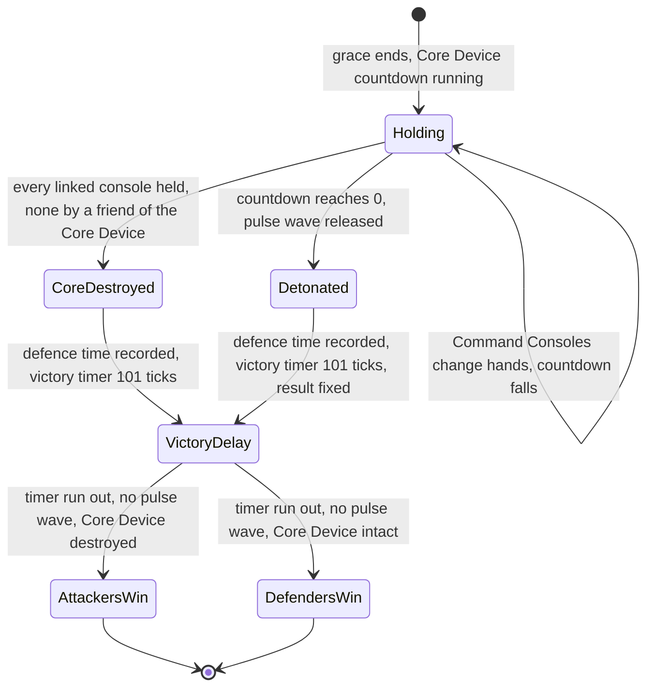
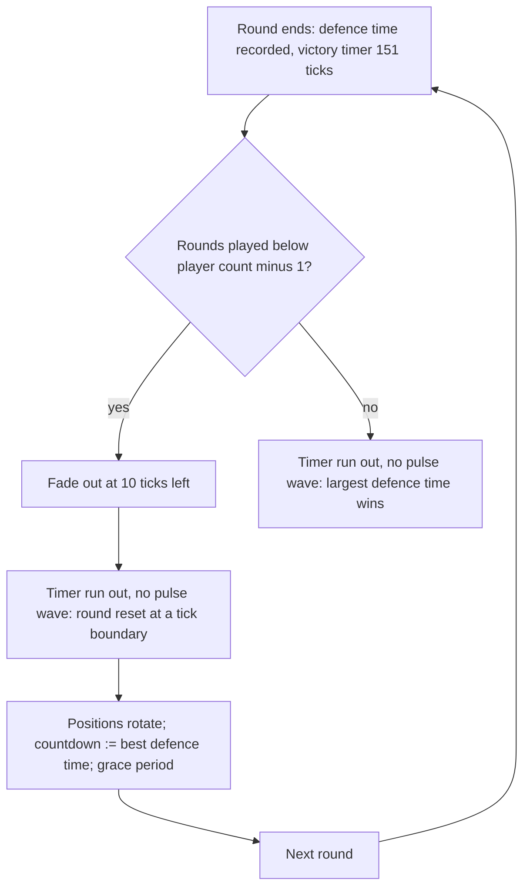

# Siege

> Status: Reference · Prefix: R-MODE · Related: [Skirmish rules and modes](README.md) · [03 Mode objects](../03_buildings_and_world_objects/mode_objects.md) · [03 Defences and props](../03_buildings_and_world_objects/defences_and_props.md) · [05 Population flow](../05_population_flow.md) · [07 Bots](../07_bots/README.md) · [12 Match lifecycle](../12_simulation_model/02_match_lifecycle_and_state_reset.md)

## 1 Purpose and player experience

Siege is one-sided. The defenders own the Core Device, a bomb whose countdown is the match clock, and the Command Consoles linked to it; their base is walled and turreted. The attackers pour Workers in through their Transit Gates and must hold every linked Command Console at once before the countdown ends. If they do, the Core Device is destroyed and the attackers win; if the countdown ends, it detonates, releasing a pulse wave across the map, and the defenders win.

## 2 Rules

### 2.1 Sides and objects

**R-MODE-350** (MUST) The map's attacking list names the attacking start positions; every other position defends (README R-MODE-028). The reference shapes are 1 against 1, 1 defender against 2 attackers and 2 against 2; the last two force co-op (DEC-034). Players choose random, attackers or defenders in the lobby, and sides and positions are resolved at load (README R-MODE-026, R-MODE-027). One reference map also places Visitor-faction Workers.

**R-MODE-351** (MUST) The **Core Device** (`mesh.structure.core_device`, [reference/03](../03_buildings_and_world_objects/mode_objects.md)) is placed once per map and owned by a defender position. Its map record gives its start time in mode seconds and its linked Command Consoles. At load it registers for its team, uses the best defence time so far as its start time when one exists (later rounds), records the match's Core Device default time once, and sets the time remaining to its start time: the Core Device countdown is the match clock and counts mode seconds. On the reference maps it equals the map's play time in mode seconds, 900 or 1,200 ([reference/08](../08_maps_and_level_design/rules_and_conventions.md) R-MAP-167; the Siege maps per player count are R-MAP-180). Decreased once per mode second from post-grace tick 0, a countdown of T reaches 0 on post-grace tick 11 × (T − 1): tick 9,889 (988.9 s) for 900 and tick 13,189 (1,318.9 s) for 1,200. The Core Device detonates at its next advance after that.

**R-MODE-352** (MUST) The linked **Command Consoles** (3, or 4 on one reference map) switch at load to their Core Device configuration of `ref.bldg.command_console.linked_port_count` (3) ports by an explicit port rebuild, with no second initialisation and no second creation sound (DEC-458); they use `mesh.structure.command_console_linked`, an unlinked console `mesh.structure.command_console`, and an operated console loops `sfx.building.command_console.presence_loop`. Every tick a console's owner is recomputed from its port occupants ([reference/03](../03_buildings_and_world_objects/mode_objects.md) R-BLDG-301): a team needs more than `ref.bldg.command_console.linked_capture_threshold` (1) occupant on a linked console, or more than `ref.bldg.command_console.capture_threshold` (2) on an unlinked five-port console; the first qualifying team in slot order takes it and is replaced only by a team with strictly more occupants (DEC-016); with no qualifying team the console is neutral.

**R-MODE-353** (MUST) Transit Gates are the attackers' Worker source (3 to 6 per attacking position on the reference maps) and the defenders' (0 or 1).

**R-MODE-354** (MUST) The defences are walls, which only a Breach Charge or their own team's scuttle destroys (DEC-043), Barrier Emitters, 12 to 40 neutral gun turrets per reference map (160 on the eight maps), the Breach Charge (`mesh.structure.breach_charge`) on one map, and the bot objective chains and markers ([reference/03 defences](../03_buildings_and_world_objects/defences_and_props.md), [reference/07](../07_bots/README.md)).

**R-MODE-355** (MUST) A Solar Array that is captured from the team that held it at match start is knocked out: it loses its ports for the rest of the match (DEC-301 is open on keeping this rule). An array that starts the match with no team has no starting team, so its first capture does not knock it out; the starting-team and current-team fields use one no-team value (DEC-464).

**R-MODE-356** (MUST) The options are the Catch-up bonus, which has no effect because no reference Siege map has a Spawn Node (DEC-124), and the crate drop period (README R-MODE-074). Siege has no time limit, score mode, sudden death or Comeback switch; the Comeback Bonus runs with its typed default and never grants (README R-MODE-055).

### 2.2 The mode step

**R-MODE-357** (MUST) On the first Siege step after the grace period the mode initialises once: the complete-defence flag becomes true, and for each Core Device its linked Command Consoles and then the Core Device itself are appended to the objectives list.

**R-MODE-358** (MUST) Every tick, once more than `ref.mode.siege.defence_check_delay` (100 ticks) have passed since post-grace tick 0, counted on the tick counter (DEC-009), the complete-defence flag is cleared unless the owner of every objective defends; a neutral objective does not defend.

**R-MODE-359** (MUST) The Core Device advance ([reference/03](../03_buildings_and_world_objects/mode_objects.md)) links its consoles again and then:

1. when every linked Command Console has an owner and none is owned by a friend of the Core Device's team, the Core Device is destroyed: it explodes, `mode.siege.core_destroyed` is emitted, every Transit Gate not owned by the defending team becomes neutral, and the defence time (start time − precise time remaining, README R-MODE-072) is recorded for the Core Device's team. A Core Device with no linked console meets this condition on its first advance (DEC-459 is open on rejecting such maps);
2. when the time remaining first reaches `ref.match.one_minute_warning` (60 mode seconds) or less, it emits `mode.siege.one_minute_warning` once;
3. when the time remaining is at or below 0 and it has not detonated, it records the start time as the defence time, releases a pulse wave of its team (initial radius `ref.bldg.core_device.pulse_radius_wu`, 200 wu, R-BLDG-313; growing each tick by `ref.weapon.pulse_wave.growth_per_tick` (0.03) × its radius until it reaches the map width, [reference/04](../04_supply_crates_powers_and_weapons/weapons_and_projectiles.md) R-CRATE-481) that kills the non-friendly Workers it reaches, or converts them on a map with the Visitor faction, and sets every Transit Gate not owned by its team to neutral.

When the Core Device detonates, the Siege result is fixed and Command Console capture is no longer evaluated (DEC-075).

**R-MODE-360** (MUST) Recording a defence time t for team d: the best defence time becomes the smaller of itself and t (t itself when none); the round is finished; the victory timer is set to `ref.mode.siege.victory_delay_multi_ticks` (151 ticks, 15 s) in multi-round Siege or `ref.mode.siege.victory_delay_single_ticks` (101 ticks, 10 s) in a single round; and d's defence time record becomes t. Defence times are in mode seconds, and so is every "defended for" display.

**R-MODE-361** (MUST) The victory timer decreases by 1 tick on every post-grace tick (README R-MODE-037 step 5).

**R-MODE-362** (MUST) When the rules timer completes a mode second, the Siege step decreases the time remaining by 1 only while it is above 0 and the victory timer has run out, so the clock stops at the round end. Then, when the round is finished (the tick counts of steps 1 and 2 are DEC-859 item 5):

1. in multi-round Siege only, when the victory timer has at most `ref.mode.siege.fade_out_ticks` (10 ticks) left and rounds remain (rounds played < player count − 1), the fade-out starts;
2. when the victory timer has run out and no pulse wave is alive: in a single round, or in the last round (rounds played = player count − 1), the winner is chosen (R-MODE-363) and declared, and when the local team defends and the complete-defence flag is still set, the Iron Defence achievement event is emitted (DEC-047); otherwise the victory timer becomes none, the round is no longer finished and a round reset is requested (R-MODE-366).

### 2.3 Result

**R-MODE-363** (MUST) In a single round the first slot that owns a Core Device is examined: when its Core Device was destroyed, the winner is the first slot below the player count whose position attacks; otherwise the first slot whose position defends (DEC-016). One team id is declared even for an alliance; in co-op the overlay names the side, `mode.siege.attackers_win` or `mode.siege.defenders_win`.

**R-MODE-364** (MUST) In multi-round Siege the winner is the slot with the largest defence time record.

**R-MODE-365** (MUST) Siege is a single-round match: no match setup can select multi-round Siege, whose rules R-MODE-360 to R-MODE-366 still specify (DEC-066). In multi-round Siege the positions rotate one place each round, the next round's Core Device countdown is the best defence time so far, and the match has as many rounds as the player count.

**R-MODE-366** (MUST) A round reset runs the round-reset operation of README R-MODE-072 at a tick boundary, after every slice of the tick in which the request was raised and before the next tick's commands apply ([reference/12](../12_simulation_model/02_match_lifecycle_and_state_reset.md) R-SIM-029, R-SIM-030; DEC-261), so every participant rebuilds from the same state. The new round fades in over `ref.mode.siege.round_fade_in` (1.0 s).

**R-MODE-367** (MUST) In a single round, after the Core Device is destroyed or detonates, the result waits for the 101-tick victory delay, counted from the round end, and for the pulse wave to vanish, and is declared on the first mode-second boundary after both.

**R-MODE-368** (MUST) Every Siege map enables Transit Gate waves by its gate reinforcement count (60 to 100 Workers per gate per wave on the reference maps), every 60 mode seconds from post-grace tick 0. Per-side counts are possible but unused; Transports come only where the map sets a Transport cap; there are no reinforcement turrets; one map gives each defending team an airstrike power per wave, and its defending gates then grant no Transport ([reference/05](../05_population_flow.md) R-ECON-099 to R-ECON-103).

**R-MODE-369** (MUST) Each defending team has the map's defender cap (200 to 350 on the reference maps), and the attackers share (map cap − defenders × defender cap) ÷ attackers (550 to 1,725); a map with no defender cap uses map cap ÷ open slots for both sides (DEC-079).

**R-MODE-370** (MUST) In Siege the rocket turret and Abductor outcomes are invalid; the Collector, Builder and Spawn Surge outcomes are invalid on maps without Spawn Nodes, which is every reference Siege map; the Transport outcome is invalid on a map with a Transport cap; and the map's excluded outcomes never drop (DEC-107; [reference/04](../04_supply_crates_powers_and_weapons/crates_and_powers.md)).

**R-MODE-371** (MUST) Bots follow the objective chains with diffusion priorities; attacking bots dispatch every Worker once per main cycle, every `ref.bot.cycle.period_siege` (30 ticks) for Easy and Standard bots and every `ref.bot.cycle.period_hard` (11 ticks) at Hard ([reference/07](../07_bots/03_decision_loop_and_leaders.md) R-BOT-075, R-BOT-146); bots form no Leader formations and route through Breach Charge gaps ([reference/07](../07_bots/README.md)).

### 2.4 HUD and end of match

**R-MODE-372** (MUST) The scoreboard is titled `mode.siege.hud.title` and ordered by defence-time record. A defender's line is `mode.siege.hud.defend`; an attacker's is `mode.siege.hud.attack`, or `mode.siege.hud.defended_for` with minutes:seconds once the slot has a defence time record. After a round end the round overlay shows, in multi-round Siege, `mode.siege.hud.round_defended` in the defenders' colour and, while the victory timer has less than `ref.mode.siege.next_round_display` (110 ticks) left, `mode.siege.hud.next_round` with the seconds left; in a single round with a winner, R-MODE-363's side line in co-op or `mode.siege.hud.team_wins` outside it. The Core Device shows rising glow and, in the last 10 mode seconds, a countdown screen ([reference/03](../03_buildings_and_world_objects/mode_objects.md)); its presence loop uses `sfx.building.launch_vessel.flight` and its pulse wave `fx.beam_long`.

**R-MODE-373** (MUST) At game over a single-round Siege shows only the title, with no winner line and no score list (README R-MODE-068). The hints `help.hint.siege_attack`, `help.hint.siege_defend`, `help.hint.siege_core_device`, `help.hint.siege_breach_charge` and `help.hint.siege_spawn_nodes` explain the mode.

**R-MODE-374** (MUST) The Iron Defence hook fires only for a defending local team whose side owned every objective on every checked tick; no achievement is awarded (DEC-047).

## 3 States and flows

Diagram 3-A: a single Siege round (R-MODE-359 to R-MODE-363, R-MODE-367).

Diagram 3-B: multi-round Siege, which no match setup selects (R-MODE-362, R-MODE-365, R-MODE-366).

## 4 Tuning table

The Core Device, Command Console, pulse wave and explosion values are owned by [reference/03](../03_buildings_and_world_objects/mode_objects.md) and [reference/04](../04_supply_crates_powers_and_weapons/weapons_and_projectiles.md); the Core Device countdowns are map data ([reference/08](../08_maps_and_level_design/rules_and_conventions.md)).

| key | value | unit | range or notes | requirement | DEC |
|---|---|---|---|---|---|
| `ref.mode.siege.defence_check_delay` | 100 | ticks | 10.0 s after post-grace tick 0, strictly more | R-MODE-358 | DEC-009 |
| `ref.mode.siege.victory_delay_single_ticks` | 101 | ticks | 10 s | R-MODE-360, R-MODE-367 | DEC-002, DEC-066 |
| `ref.mode.siege.victory_delay_multi_ticks` | 151 | ticks | 15 s | R-MODE-360 | DEC-002, DEC-066 |
| `ref.mode.siege.fade_out_ticks` | 10 | ticks | multi-round: the fade-out starts at this much victory delay left | R-MODE-362 | DEC-066 |
| `ref.mode.siege.next_round_display` | 110 | ticks | multi-round: the next-round countdown shows below this much delay left | R-MODE-372 | DEC-066 |
| `ref.mode.siege.round_fade_in` | 1.0 | s of real time | presentation | R-MODE-366 | DEC-066 |

String ids that this file uses, with their new text:

| String id | Text |
|---|---|
| `mode.siege.hud.title` | Objectives |
| `mode.siege.hud.defend` | {name}  Hold the Core Device |
| `mode.siege.hud.attack` | {name}  Take every Command Console |
| `mode.siege.hud.defended_for` | {name}  held out for {minutes}:{seconds} |
| `mode.siege.hud.round_defended` | {team} held out for {minutes}:{seconds} |
| `mode.siege.hud.next_round` | Next round in {seconds} |
| `mode.siege.hud.team_wins` | {team} takes the Siege |
| `mode.siege.attackers_win` | The attackers take the Siege |
| `mode.siege.defenders_win` | The defenders hold the Siege |
| `mode.siege.core_destroyed` | The Core Device has been destroyed. |
| `mode.siege.one_minute_warning` | The Core Device goes off in one minute. |

## 5 Edge cases and interactions

1. **Two one-minute messages.** In Siege the time remaining is the Core Device countdown, so both the match's one-minute warning (README R-MODE-037 step 9) and the Core Device's own message fire at 60 mode seconds left.
2. **Destruction and detonation together.** Once the Core Device has detonated, capturing its consoles changes nothing (DEC-075).
3. **No linked console.** A Core Device that links no console is destroyed on its first advance and the attackers win at once; map validation should reject such a map (DEC-459, DEC-561).
4. **The complete-defence flag.** The flag is not checked during the first 100 ticks after the grace period, so the initial ownership of the objectives cannot clear it (R-MODE-358).
5. **Solar Arrays.** Every reference Siege Solar Array starts owned by a team, so the knock-out applies to each one's first capture by another team (R-MODE-355, DEC-301, DEC-464).
6. **Catch-up and Comeback.** Both are present and do nothing on the reference maps: no Spawn Nodes, and no team ever counts as eliminated (R-MODE-356).
7. **Walls.** A wall falls only to a Breach Charge or to its own team's scuttle, which is what makes the attackers' Breach Charge decisive (DEC-043).

## 6 Acceptance criteria

- **AC-01** (R-MODE-351) Given a Core Device countdown of 900, then the time remaining reaches 0 on post-grace tick 9,889; given 1,200, on tick 13,189.
- **AC-02** (R-MODE-359, R-MODE-360, R-MODE-367) Given the attackers hold all three linked consoles at post-grace tick 5,000, then the Core Device is destroyed on that tick, the clock stops at 445 mode seconds, the recorded defence time is 900 − (445 − 0.6) = 455.6 mode seconds (6 ticks after the mode second of tick 4,994), and the attackers' first slot is declared the winner on the first mode-second boundary after the 101-tick delay has run out.
- **AC-03** (R-MODE-352) Vectors of Command Console ownership, linked console: occupants (A 2, B 0) → A; (A 1, B 1) → neutral; (A 2, B 2), A first in slot order → A; (A 2, B 3) → B.
- **AC-04** (R-MODE-358) Given an objective owned by an attacker at post-grace tick 50 and by defenders from tick 60, then the complete-defence flag is still set; given an objective neutral at tick 150, then it is cleared.
- **AC-05** (R-MODE-363) Given a co-op 2 against 2 match whose Core Device detonates, then the first defending slot is declared and the overlay shows `mode.siege.defenders_win`.
- **AC-06** (R-MODE-365) Given any match setup, then multi-round Siege cannot be selected.

## 7 Dependencies

- **Reference documents:** [README](README.md); [03 Mode objects](../03_buildings_and_world_objects/mode_objects.md) (Core Device, Command Console, Breach Charge, Transit Gate); [03 Defences and props](../03_buildings_and_world_objects/defences_and_props.md) (walls, Barrier Emitters, turrets); [03 Economy and spawn objects](../03_buildings_and_world_objects/economy_and_spawn_objects.md) (Solar Array knock-out); [04 Weapons and projectiles](../04_supply_crates_powers_and_weapons/weapons_and_projectiles.md) (pulse wave); [05 Population flow](../05_population_flow.md); [07 Bots](../07_bots/README.md); [12 Match lifecycle](../12_simulation_model/02_match_lifecycle_and_state_reset.md).
- **Assets:** `mapfile.siege`, `mesh.structure.core_device`, `mesh.structure.command_console`, `mesh.structure.command_console_linked`, `mesh.structure.breach_charge`, `sfx.building.command_console.presence_loop`, `sfx.building.launch_vessel.flight`, `fx.beam_long`, `help.hint.siege_attack`, `help.hint.siege_defend`, `help.hint.siege_core_device`, `help.hint.siege_breach_charge`, `help.hint.siege_spawn_nodes`.

## 8 Open decisions

- DEC-043 — wall destructibility (R-MODE-354).
- DEC-066 — multi-round Siege (R-MODE-365).
- DEC-301 — the Solar Array knock-out (R-MODE-355).
- DEC-459 — a Core Device with no linked Command Console (R-MODE-359).
- DEC-047 — the Iron Defence hook (R-MODE-374).

Resolved decisions applied: DEC-002, DEC-009, DEC-016, DEC-034, DEC-075, DEC-079, DEC-081, DEC-107, DEC-458, DEC-464.
