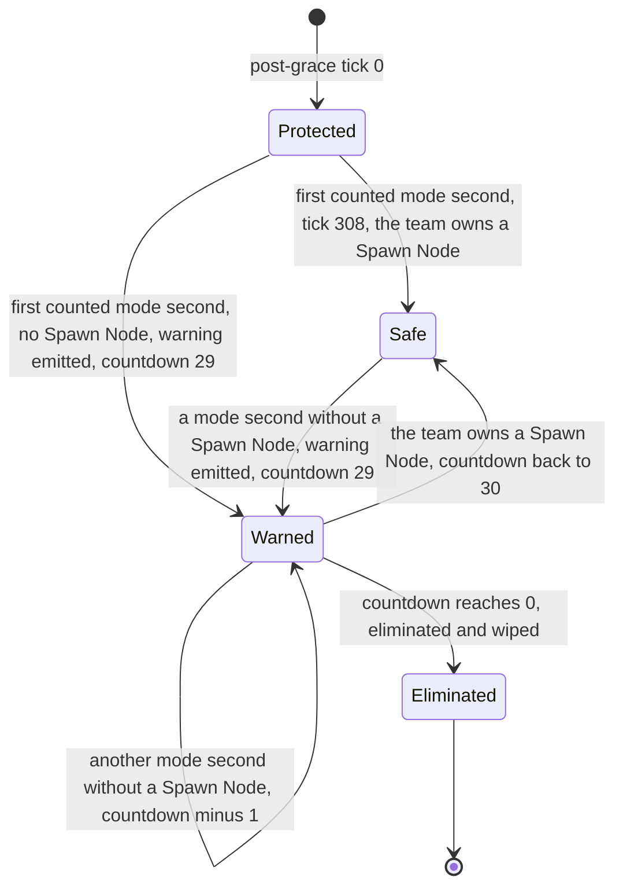
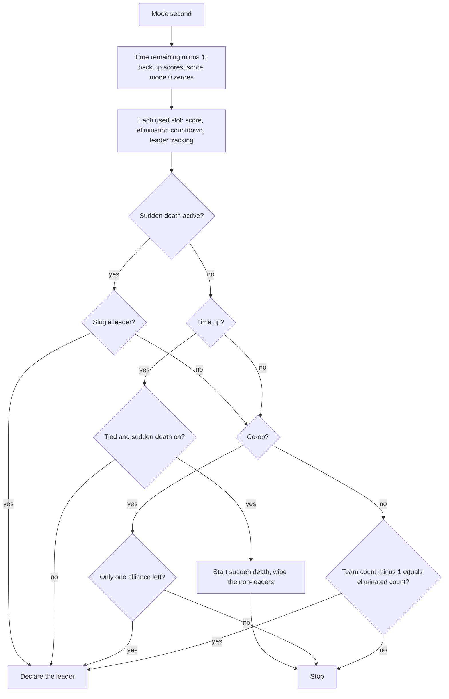

# Spawn Control

> Status: Reference · Prefix: R-MODE · Related: [Skirmish rules and modes](README.md) · [05 Population flow](../05_population_flow.md) · [03 Economy and spawn objects](../03_buildings_and_world_objects/economy_and_spawn_objects.md) · [07 Bots](../07_bots/README.md)

## 1 Purpose and player experience

Spawn Control is the territory mode in its plainest form. Teams capture and hold Spawn Nodes, which produce their Workers and also score. A team that owns no Spawn Node for 30 consecutive mode seconds, once a short protection period after the start has passed, is out of the match. The last team in play wins; with a time limit, the score at time-up decides. The mode has no objects of its own: the spawn network is the objective.

## 2 Rules

### 2.1 Teams, objects and options

**R-MODE-200** (MUST) Spawn Control is free-for-all for 2 to 4 players. Co-op, 2 against 2, exists on maps that allow it, with fixed alliances where the map defines group positions (positions 0 and 2 against 1 and 3 on the one reference map that does) (README R-MODE-018 to R-MODE-025).

**R-MODE-201** (MUST) The objective is the spawn network: Spawn Nodes, Relays, the Source Node and Population Limiters ([reference/03](../03_buildings_and_world_objects/economy_and_spawn_objects.md), [reference/05](../05_population_flow.md)); it uses `mesh.structure.spawn_node`. Maps may also place Beam Dishes, jump pads, gun turrets, Barrier Emitters and neutral Transit Gates; the gates stay inactive, because no Spawn Control map enables reinforcement waves. The mode needs no mode-specific object; it is the first playable mode of Species, and the rest of the build order is DEC-229.

**R-MODE-202** (MUST) The options are score mode, time limit (0 to 60 minutes, default `ref.mode.spawn_control.option.time_limit`, 10; 0 means none), Catch-up bonus, crate drop period, starting powers, Comeback Bonus, sudden death and crate placement (README R-MODE-074). The proportional Catch-up bonus applies (README R-MODE-051, DEC-081).

### 2.2 Timers

**R-MODE-203** (MUST) The **protection period** is `ref.mode.spawn_control.protection_ticks` (300 ticks, 30.0 s): the elimination countdown runs only on a mode second that ends more than 300 ticks after post-grace tick 0. The first such mode second is the 29th, on post-grace tick 308.

**R-MODE-204** (MUST) Each player team has an **elimination countdown** of `ref.mode.spawn_control.elimination_mode_seconds` (30 mode seconds), which is set back to 30 on every mode second in which the team owns a Spawn Node. A team is eliminated on its 30th consecutive counted mode second without a Spawn Node, 330 ticks after the last mode second in which it owned one.

### 2.3 The mode step

**R-MODE-205** (MUST) When the rules timer completes a mode second, the Spawn Control step runs:

1. If the time remaining is above 0, decrease it by 1. Back up the scores. With score mode 0, zero the scores.
2. Set the high score to 0 and the leader to none. Then, for each used slot t in slot order:
   1. The Rogue or Visitor faction is skipped entirely when it has at most `ref.mode.spawn_control.faction_min_actors` (1) actor, which is its bot controller, or owns no Spawn Node. Otherwise it adds the number of Spawn Nodes it owns now to its score, and nothing else: it takes no part in the team count, the elimination countdown or the leader comparison (DEC-082).
   2. Add 1 to the team count. If t is eliminated, add 1 to the eliminated count and skip the rest for t.
   3. t becomes the last live team. Add the number of Spawn Nodes t owns now to its score.
   4. When the protection period has passed (R-MODE-203): if t owns no Spawn Node, then on the first such mode second (countdown at 30) emit `mode.spawn_control.elimination_warning.self` to t's player and `mode.spawn_control.elimination_warning.other` to the other players, decrease t's countdown by 1, and when it is at or below 0, eliminate and wipe t (README R-MODE-048). If t owns a Spawn Node, set its countdown to 30.
   5. Leader tracking: when t's score equals the high score, the leader becomes the draw value; when it is greater, the leader becomes t and the high score t's score. The high score starts at 0, so a team scoring 0 marks a draw until a team scores more.
3. If sudden death is active: when the leader is not the draw value, declare the leader and stop. While still tied there is no stop: step 4 is skipped and the step continues with step 5.
4. Otherwise, when time is up (time remaining at or below 0 and the match not unlimited): if the leader is the draw value and sudden death is on, start sudden death (README R-MODE-056), wiping every used team whose score differs from the high score, factions included; their eliminated flags are not set and their Spawn Nodes keep producing. Otherwise declare the leader, the draw value meaning a draw. Stop.
5. Co-op: there is a winner unless some used slot other than the Rogue and Visitor factions is not eliminated and is not a friend of the last live team; the test covers every slot (DEC-070). With a winner, declare the leader, which is the higher-scoring member of the surviving alliance, or the draw value when the two allies tie.
6. Outside co-op: when the team count − 1 equals the eliminated count, declare the last live team. When that is the local team, emit the Total Control achievement event (DEC-047).

**R-MODE-206** (MUST) The score per mode second is:

| Score mode | Label | Rule |
|---|---|---|
| 0 (default) | `mode.spawn_control.score_mode.held` | score := the Spawn Nodes the team owns now (zeroed, then added) |
| 1 | `mode.spawn_control.score_mode.per_second` | score += the Spawn Nodes the team owns now (cumulative) |

### 2.4 Result

**R-MODE-207** (MUST) A team wins as the last team in play that is not eliminated (in co-op, the surviving alliance's leading member), or with the highest score at time-up, or as the first single leader during sudden death. A draw is a tie at time-up with sudden death off. A team loses by elimination or by a lower score at time-up. With no time limit only elimination ends the match.

**R-MODE-208** (MUST) The population cap per team is the map's cap ÷ the number of open slots, fixed for the match and not pooled within an alliance ([reference/05](../05_population_flow.md), DEC-079); the reference maps give 500 to 1,000 per team, and one co-op map has no cap, which the map states as an explicit unlimited value (DEC-120; [reference/08](../08_maps_and_level_design/rules_and_conventions.md)).

**R-MODE-209** (MUST) Supply crates follow the standard rules; the Collector, Builder and Spawn Surge outcomes are valid, because every Spawn Control map has Spawn Nodes ([reference/04](../04_supply_crates_powers_and_weapons/crates_and_powers.md)).

**R-MODE-210** (MUST) Bots use the standard priority model, form Leader formations when they have enough friendly Workers and set Waypoint beacons at Spawn Nodes ([reference/07](../07_bots/README.md)).

### 2.5 HUD and end of match

**R-MODE-211** (MUST) The Spawn Control score line is, in this priority: while 0 < the team's countdown < 30, `mode.spawn_control.hud.nodes_countdown` (score mode 0) or `mode.spawn_control.hud.points_countdown` (score mode 1) with the countdown; for an eliminated team, `mode.spawn_control.hud.eliminated`; with score mode 1, the generic score line with delta and estimate (README R-MODE-065); with score mode 0, `mode.spawn_control.hud.nodes`. The game-over list shows name and score (README R-MODE-068).

**R-MODE-212** (MUST) The Total Control hook fires only for an elimination win outside co-op by the local team, never for a win at time-up; no achievement is awarded (DEC-047).

## 3 States and flows

Diagram 3-A: one team's elimination countdown (R-MODE-203, R-MODE-204).

Diagram 3-B: the Spawn Control step (R-MODE-205).

## 4 Tuning table

Option keys are in the [README](README.md) tuning table.

| key | value | unit | range or notes | requirement | DEC |
|---|---|---|---|---|---|
| `ref.mode.spawn_control.protection_ticks` | 300 | ticks | 30.0 s; the countdown runs on mode seconds ending strictly later | R-MODE-203 | DEC-002, DEC-039 |
| `ref.mode.spawn_control.elimination_mode_seconds` | 30 | mode seconds | 330 ticks; start value and reset value of each countdown | R-MODE-204, R-MODE-205 | DEC-002 |
| `ref.mode.spawn_control.faction_min_actors` | 1 | actors | a faction with at most this many actors is skipped | R-MODE-205 | DEC-082 |

String ids that this file uses, with their new text:

| String id | Text |
|---|---|
| `mode.spawn_control.elimination_warning.self` | You hold no Spawn Node. You will be out in {seconds} seconds. |
| `mode.spawn_control.elimination_warning.other` | {team} holds no Spawn Node and will be out in {seconds} seconds. |
| `mode.spawn_control.hud.nodes_countdown` | {name}  {nodes} Spawn Nodes, out in {seconds} |
| `mode.spawn_control.hud.points_countdown` | {name}  {points} points, out in {seconds} |
| `mode.spawn_control.hud.eliminated` | {name}  Out |
| `mode.spawn_control.hud.nodes` | {name}  {nodes} Spawn Nodes |

## 5 Edge cases and interactions

1. **Zero scores and the draw marker.** At the first mode second, before any team owns a Spawn Node, every team scores 0 and the leader is the draw value. A time-up in that state is a draw, or sudden death (R-MODE-205 step 2.5).
2. **Sudden-death survivors return.** A team wiped by sudden death is not eliminated; it still owns its Spawn Nodes, keeps its countdown and can win if it retakes the lead (DEC-300).
3. **Factions on Spawn Nodes.** The Rogue and Visitor factions can own Spawn Nodes and score, but the last player team in play wins at once; the factions never block that win (DEC-082).
4. **Losing the last Spawn Node early.** A team that loses every Spawn Node during the protection period is not warned until post-grace tick 308; from then its 30 mode seconds count.
5. **Unlimited matches.** With a time limit of 0 the match ends only by elimination, and the estimate on the HUD is not shown (README R-MODE-065).
6. **Co-op last alliance.** When one alliance remains, the declared winner is its higher-scoring member, and a tie between the two allies is declared a draw (R-MODE-205 step 5).

## 6 Acceptance criteria

- **AC-01** (R-MODE-203, R-MODE-204) Given a team that owns no Spawn Node from the start, then it is warned on post-grace tick 308 and eliminated on post-grace tick 627 (308 + 29 × 11).
- **AC-02** (R-MODE-204) Given a team that owns a Spawn Node on the mode second of post-grace tick 1,001 and none afterwards, then it is warned on tick 1,012 and eliminated on tick 1,331.
- **AC-03** (R-MODE-205, R-MODE-206) Vectors at time-up, score mode 0, sudden death on:

| Spawn Nodes owned (A, B, C) | Result |
|---|---|
| 4, 3, 1 | A wins |
| 4, 4, 1 | sudden death; C is wiped |
| 0, 0, 0 | sudden death; nobody is wiped |

- **AC-04** (R-MODE-205) Given score mode 0, sudden death off and a tie at time-up, then a draw is declared.
- **AC-05** (R-MODE-205, DEC-070) Given a co-op match in which both members of one alliance are eliminated, then the next mode second declares the higher-scoring survivor.
- **AC-06** (R-MODE-205, DEC-082) Given two player teams and the Rogue faction owning a Spawn Node, when one player team is eliminated, then the other is declared the winner on that mode second.
- **AC-07** (R-MODE-212) Given a local-team win at time-up, then no Total Control event is emitted; given a local-team elimination win outside co-op, then it is.

## 7 Dependencies

- **Reference documents:** [README](README.md) (shared skeleton); [05 Population flow](../05_population_flow.md) (Spawn Node production, Catch-up bonus, caps); [03 Economy and spawn objects](../03_buildings_and_world_objects/economy_and_spawn_objects.md) (Spawn Node capture); [04 Supply crates](../04_supply_crates_powers_and_weapons/crates_and_powers.md); [07 Bots](../07_bots/README.md); [08 Maps](../08_maps_and_level_design/rules_and_conventions.md).
- **Assets:** `mesh.structure.spawn_node`, `mapfile.spawn_control`, `help.mode_card`, `help.mode_page`.

## 8 Open decisions

- DEC-229 — the build order after the Spawn Control first playable (R-MODE-201).
- DEC-300 — the return of teams wiped out in sudden death (§5 item 2).
- DEC-047 — the Total Control hook (R-MODE-212).

Resolved decisions applied: DEC-002, DEC-039, DEC-070, DEC-079, DEC-081, DEC-082, DEC-120.
