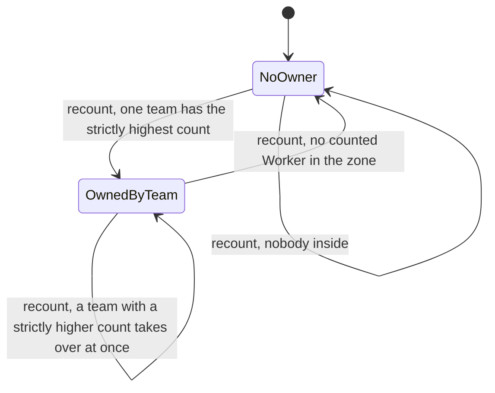
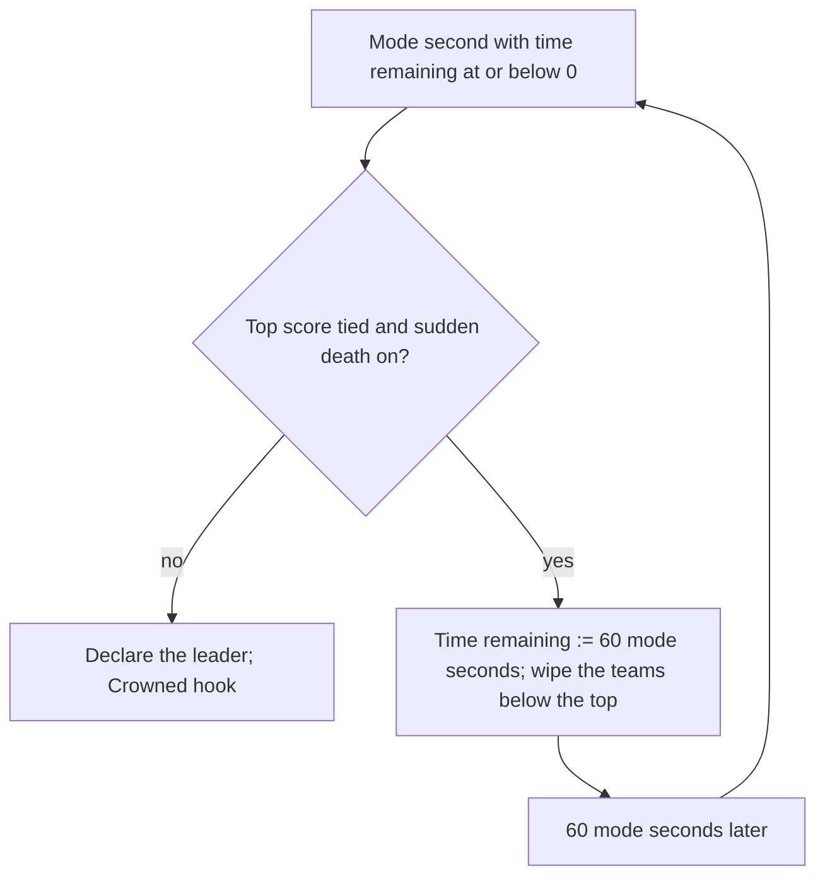

# Zone Control

> Status: Reference · Prefix: R-MODE · Related: [Skirmish rules and modes](README.md) · [03 Mode objects](../03_buildings_and_world_objects/mode_objects.md) · [05 Population flow](../05_population_flow.md) · [07 Bots](../07_bots.md) · [11 Tutorial and help](../11_tutorial_and_help.md)

## 1 Purpose and player experience

Zone Control is a king-of-the-hill mode. The map has Control Zones, drawn as coloured rings on the ground; the team with the most Workers standing inside a zone owns it at once, with no capture progress. Owning zones, or crowding them, scores every mode second, and the highest score when time runs out wins. Nobody is ever eliminated. The two tutorials teach the game on Zone Control maps.

## 2 Rules

### 2.1 Teams, objects and options

**R-MODE-250** (MUST) Zone Control is free-for-all for 2 to 4 players, with co-op, 2 against 2, on maps that allow it, including fixed alliances (positions 0 and 2 against 1 and 3) on one reference map (README §2.4). The two tutorials run on Zone Control maps ([reference/11](../11_tutorial_and_help.md); README R-MODE-083).

**R-MODE-251** (MUST) The mode objects are Control Zones ([reference/03](../03_buildings_and_world_objects/mode_objects.md)). A Control Zone is recounted every `ref.mode.recount.one_second` (11 ticks, DEC-064): it counts, through the actor grid, every Worker of any team within its radius (a map value, default in reference/03) that is not dead, not on fire and not inside a Transport, per team and in total. Its owner is the team with the strictly highest count; a tie keeps the lower team index (DEC-016); no Worker leaves it with no team. Ownership changes at once: there is no capture progress and no contested state. The counting query is an actor-grid query whose exactness is DEC-094.

**R-MODE-252** (MUST) Maps may add a spawn network (every reference Zone Control map but one has Spawn Nodes), Command Consoles that capture Beam Dishes, and Transit Gates whose waves the map enables (README R-MODE-037 step 7).

**R-MODE-253** (MUST) The options are score mode (four formulas), time limit (1 to 60 minutes, default `ref.mode.zone_control.option.time_limit`, 5; it cannot be unlimited), Catch-up bonus, crate drop period, starting powers, Comeback Bonus, sudden death and crate placement (README R-MODE-074). The proportional Catch-up bonus applies (README R-MODE-051, DEC-081).

### 2.2 The mode step

**R-MODE-254** (MUST) When the rules timer completes a mode second, the Zone Control step runs:

1. If the time remaining is above 0, decrease it by 1. Back up the scores. With score mode 2, zero the scores.
2. Set the Control Zone counter to 0. For every Control Zone: with score mode 1 or 2, add the zone's count of each of the six teams to that team's score, the Rogue and Visitor factions included; add 1 to the counter; when the zone has an owner, add 1 to that owner's zones owned. The counter is match state and starts at 0 in every match (DEC-011).
3. Notify the hint overlay of the Control Zone event for the local team ([reference/11](../11_tutorial_and_help.md)).
4. For each used slot, the factions included: with score mode 0, add its zones owned to its score; with score mode 3, add 1 when its zones owned equals the counter. Then track the leader as Spawn Control does ([spawn_control.md](spawn_control.md) R-MODE-205 step 2.5, the high score starting at 0), over the player teams only: the factions never become the leader (DEC-082).
5. When the time remaining is at or below 0: if the leader is the draw value and sudden death is on, set the time remaining to `ref.mode.zone_control.sudden_death_extension` (60 mode seconds), set the sudden-death flag, emit `match.sudden_death.start` and wipe every used team whose score differs from the highest (README R-MODE-048); this repeats each time an extension ends tied. Otherwise declare the leader. When the local team wins with a highest score above `ref.mode.zone_control.crowned_margin` (1.5) × the second-highest score, emit the Crowned achievement event (DEC-047); the second-highest score is the largest score strictly below the highest over all used slots.

**R-MODE-255** (MUST) The score per mode second is:

| Score mode | Label | Rule |
|---|---|---|
| 0 (default) | `mode.zone_control.score_mode.zones_per_second` | score += the zones the team owns |
| 1 | `mode.zone_control.score_mode.population_per_second` | score += the team's count summed over every zone |
| 2 | `mode.zone_control.score_mode.final_population` | score := the team's count summed over every zone (zeroed each mode second) |
| 3 | `mode.zone_control.score_mode.total_control` | score += 1 when the team owns every zone |

**R-MODE-256** (MUST) The map schema and the rules accept concentric Control Zones, several zones that share a centre with different radii, which make the central area worth 2 or 3 zones under score mode 0, and Control Zones that start the match owned by a team (DEC-315).

### 2.3 Result

**R-MODE-257** (MUST) The highest score at time-up wins. A tie at time-up is a draw with sudden death off, and with sudden death on starts extensions of 60 mode seconds until the tie breaks. The Rogue and Visitor factions score on the HUD but never win (DEC-082). A team counts as eliminated only in the soft sense of README R-MODE-048, for the Comeback Bonus.

**R-MODE-258** (MUST) The population cap per team is the map's cap ÷ the number of open slots, fixed for the match (DEC-079); the reference maps give 500 to 1,000 per team, and one co-op map is unlimited (DEC-120).

**R-MODE-259** (MUST) Bots use the standard priority model with the Control Zone override and keep a garrison in held zones above the Easy difficulty ([reference/07](../07_bots.md)).

### 2.4 HUD and end of match

**R-MODE-260** (MUST) The score line is the generic score line of README R-MODE-065; its estimate is shown with score modes 0, 1 and 3. The game-over list shows name and score.

**R-MODE-261** (MUST) A Control Zone is drawn as a ring whose segments are proportional to each team's share of the zone's total count, in team colours, the owner's segment animated and opaque and the others at reduced alpha, with the remainder grey, and a faint vertical glow column; the ring fades as the camera comes close. The values belong to [reference/03](../03_buildings_and_world_objects/mode_objects.md): owner alpha 255, others 100, column 1,200 wu tall, fade within 500 wu to a minimum alpha of 0.4. The ring uses `fx.beam_long`; the zone's ownership change plays `sfx.building.control_zone.owner_changed` and `sfx.building.control_zone.owner_changed_b`, and an occupied zone loops `sfx.building.control_zone.presence_loop`. The hint `help.hint.zone_control` explains the mode.

**R-MODE-262** (MUST) The Crowned hook fires only for a win at time-up by the local team by more than the margin; no achievement is awarded (DEC-047).

## 3 States and flows

Diagram 3-A: the ownership of one Control Zone at each recount (R-MODE-251).

Diagram 3-B: time-up and sudden death in Zone Control (R-MODE-254 step 5).

## 4 Tuning table

Option keys are in the [README](README.md) tuning table; the Control Zone radius and the ring presentation values are owned by [reference/03](../03_buildings_and_world_objects/mode_objects.md).

| key | value | unit | range or notes | requirement | DEC |
|---|---|---|---|---|---|
| `ref.mode.zone_control.sudden_death_extension` | 60 | mode seconds | added each time the time-up evaluation is tied | R-MODE-254, R-MODE-257 | DEC-002 |
| `ref.mode.zone_control.crowned_margin` | 1.5 | × the second-highest score | strictly greater | R-MODE-254, R-MODE-262 | DEC-047 |

This file uses the string ids of the README (`match.sudden_death.start`, `match.hud.score_line` and the score-mode labels).

## 5 Edge cases and interactions

1. **Ties for a zone.** Two teams with equal counts: the lower team index owns the zone (DEC-016).
2. **Concentric zones.** A Worker inside two concentric zones counts in both, so a team holding the centre can own two or three zones at once (R-MODE-256, DEC-315).
3. **Approximate counts.** The actor-grid count can include Workers of whole cells beyond the radius until DEC-094 is decided; the reference counts are the default.
4. **Factions in zones.** Rogue-faction Workers count in zones and can own them, which denies the zone to the players, but the faction never wins (DEC-082).
5. **No elimination.** A team without Workers keeps scoring 0 and stays in the match; on a map with Spawn Nodes it counts as eliminated for the Comeback Bonus while it owns none and has fewer than 50 Workers (README R-MODE-048).
6. **Sudden-death returns.** A team wiped by sudden death keeps its Spawn Nodes and can score again before the extension ends (DEC-300).

## 6 Acceptance criteria

- **AC-01** (R-MODE-251) Given a zone with 12 red and 12 blue Workers inside, red being team 1 and blue team 2, then team 1 owns the zone; given 0 Workers inside, then the zone has no team.
- **AC-02** (R-MODE-254, R-MODE-255) Vectors for one mode second, two zones, team A owning zone 1 with 30 Workers and team B owning zone 2 with 10, A having 5 Workers in zone 2:

| Score mode | A's score change | B's score change |
|---|---|---|
| 0 | +1 | +1 |
| 1 | +35 | +10 |
| 2 | := 35 | := 10 |
| 3 | +0 | +0 |

- **AC-03** (R-MODE-254) Given a tie at time-up with sudden death on, then the time remaining becomes 60, the non-leaders are wiped, and the next evaluation comes 60 mode seconds (660 ticks) later.
- **AC-04** (R-MODE-254, R-MODE-262) Given the local team wins with 160 against a second-highest 100, then the Crowned event is emitted; with 150 against 100 it is not.
- **AC-05** (R-MODE-257, DEC-082) Given the Rogue faction has the highest score at time-up, then the best player team is declared the winner.

## 7 Dependencies

- **Reference documents:** [README](README.md); [03 Mode objects](../03_buildings_and_world_objects/mode_objects.md) (Control Zones); [05 Population flow](../05_population_flow.md); [07 Bots](../07_bots.md); [11 Tutorial and help](../11_tutorial_and_help.md); [12 Space, routing and physics](../12_simulation_model/05_space_routing_and_physics.md) (actor-grid counts).
- **Assets:** `map.zone_control`, `help.hint.zone_control`, `fx.beam_long`, `sfx.building.control_zone.owner_changed`, `sfx.building.control_zone.owner_changed_b`, `sfx.building.control_zone.presence_loop`.

## 8 Open decisions

- DEC-094 — exact or approximate actor-grid queries for the zone counts (R-MODE-251).
- DEC-315 — concentric and pre-owned Control Zones (R-MODE-256).
- DEC-300 — the return of teams wiped out in sudden death (§5 item 6).
- DEC-047 — the Crowned hook (R-MODE-262).

Resolved decisions applied: DEC-011, DEC-016, DEC-064, DEC-079, DEC-081, DEC-082, DEC-120.
