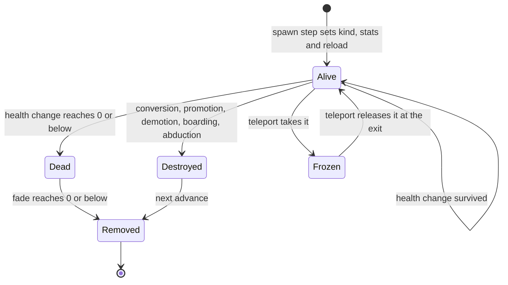
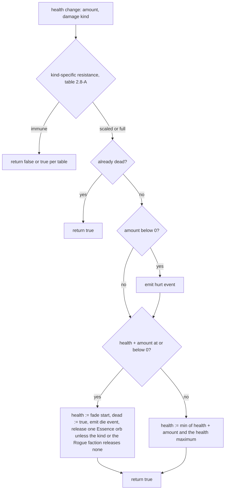
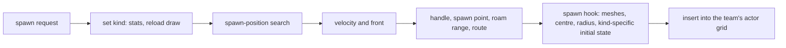

# Units

> Status: Reference · Prefix: R-UNIT · Related: [00 Reference overview](../00_reference_overview.md) · [05 Population flow](../05_population_flow.md) · [04 Supply crates, powers and weapons](../04_supply_crates_powers_and_weapons/README.md) · [06 Controls, camera and commands](../06_controls_camera_and_commands/README.md) · [12 Simulation model](../12_simulation_model/README.md)

This folder specifies every mobile actor of a reference match. This README is the folder index, the unit catalogue, the conventions that every unit document shares, and the base behaviour and stats of every actor kind.

| Document | Content |
|---|---|
| [README.md](README.md) | catalogue of actor kinds, shared conventions, base actor behaviour, the actor stat table, cross-kind summaries |
| [worker.md](worker.md) | the Worker, the crowd unit: stats, per-tick pipeline, behaviour states, task search, targeting, combat, movement, status effects, death, control and presentation |
| [leader_and_formations.md](leader_and_formations.md) | the Leader: signpost orders, formations, formation slots, order markers, bot hook, death and presentation |
| [essence_orbs.md](essence_orbs.md) | the Essence orb released by deaths |
| [strike_team.md](strike_team.md) | the Strike team and its Troopers |
| [transport.md](transport.md) | the Transport |
| [collector.md](collector.md) | the Collector |
| [builder.md](builder.md) | the Builder |
| [creatures.md](creatures.md) | the creatures: Seed Pod, Crawler egg, Crawler, Brood Drifter, centipede, ant, spider and Reaper Serpent, with the procedural legs and the Wisp |
| [hazards_and_projectiles.md](hazards_and_projectiles.md) | the event hazards: the airstrike flights and their Bombers, the barrage missile, the meteor and the Abductor |

## 1 Purpose and player experience

A reference match has no build queue and no per-unit command of the population. Almost every body on the map is a **Worker**: a small autonomous figure that wanders, mans the ports of structures, opens Supply crates, carries Relics, raises flags, boards Launch Vessels and fights on its own. The player steers this crowd indirectly: by selecting a circle of Workers and sending them somewhere, by promoting a Worker to a **Leader** that redirects passing Workers or marches them in formation, by loading them into a **Transport**, and by placing Powers. A few special units (Strike team, Transport, Collector, Builder) arrive only as Powers and are driven more directly. Creatures and hazards (Crawlers, spiders, centipedes, ants, Brood Drifters, Reaper Serpents, Seed Pods, Crawler eggs, meteors, the Abductor, airstrike Bombers and barrage missiles) come from Supply crates and act on their own.

Every unit shares one model: three stats (health, speed, rate) from a typed stat table, one health-change rule with per-kind resistances, a corpse that fades in a fixed number of ticks, and, for most kinds, one Essence orb released on death that feeds the population flow of [reference/05](../05_population_flow.md). The simulation-wide contracts (object identity, containers, update order, the actor grid, falling, water, obstacle push and explosions) belong to [reference/12](../12_simulation_model/README.md); this folder specifies everything that is particular to a unit kind.

## 2 Rules

### 2.1 Actor kinds in scope

**R-UNIT-001** (MUST) The actor kinds of a reference match are exactly those of table 2.1-A. Each kind is a typed schema entry with its own stat record; a missing record or an unknown kind is a content-build error (DEC-019). Actor kinds that no match creates are not specified (DEC-062). The order of the kinds carries no meaning, and the kind enumeration itself belongs to [reference/12](../12_simulation_model/03_entity_model_and_identity.md).

Table 2.1-A Actor kinds.

| Kind | Identifier | Document | How a match obtains it | Essence orb on death | Map instant unit |
|---|---|---|---|---|---|
| Worker | `Worker` | [worker.md](worker.md) | Spawn Node production; one Worker for each port on the Spawn Nodes and Solar Arrays that a team owns at match start, placed directly into the manning state; the map's instant units; Transit Gate reinforcement waves; Collector and Builder deliveries; the Reinforcements outcome; Seed Pods of the Worker kind; conversions (Convert laser bolts, the Visitor faction's Core Device pulse wave, the Swarm streak); Leader demotion; the Abductor's drop of Visitor faction Workers | yes | allowed |
| Leader | `Leader` | [leader_and_formations.md](leader_and_formations.md) | promotion of a Worker by a player or a bot | yes | not allowed |
| Trooper | `Trooper` | [strike_team.md](strike_team.md) | the Strike team outcome, which creates one Strike team of Troopers | **no** | allowed |
| Transport | `Transport` | [transport.md](transport.md) | the Transport outcome; Transit Gate Transport reinforcements; the map's instant units, granted as a Power | **no** | allowed |
| Collector | `Collector` | [collector.md](collector.md) | the Collector outcome | **no** | allowed |
| Builder | `Builder` | [builder.md](builder.md) | the Builder outcome; the map's instant units, granted as a Power | **no** | allowed |
| Bomber | `Bomber` | [hazards_and_projectiles.md](hazards_and_projectiles.md) | each airstrike target marker summons one airstrike flight of 2 Bombers (airstrike and Firebomb Run outcomes, including their unopened-crate variants) | **no** | not allowed |
| barrage missile | `BarrageMissile` | [hazards_and_projectiles.md](hazards_and_projectiles.md) | the Missile Barrage outcome, which launches 10 barrage missiles | yes in principle; its own advance never checks for death | not allowed |
| meteor | `MeteorRock` | [hazards_and_projectiles.md](hazards_and_projectiles.md) | the meteor shower outcome (5 to 9 meteors); bot meteor use | none: removed on impact | not allowed |
| Abductor | `Abductor` | [hazards_and_projectiles.md](hazards_and_projectiles.md) | the Abductor outcome of an unopened Supply crate, at most once per match and never in Siege | none: invulnerable | not allowed |
| Crawler | `Crawler` | [creatures.md](creatures.md) | Seed Pods of the Crawler kind (also the fallback for a refused Reaper Serpent); hatching Crawler eggs; the Swarm streak's conversion of Essence orbs | yes | allowed |
| Crawler egg | `CrawlerEgg` | [creatures.md](creatures.md) | laid by Brood Drifters and spiders; thrown by Seed Pods of the egg kind | **no** | not allowed |
| Brood Drifter | `BroodDrifter` | [creatures.md](creatures.md) | Seed Pods of the Brood Drifter kind | yes | allowed |
| centipede | `CentipedeCreature` | [creatures.md](creatures.md) | Seed Pods of the centipede kind (one actor group of 5 to 14 segments); growth by eating Essence orbs | yes, one per segment | allowed |
| spider | `SpiderCreature` | [creatures.md](creatures.md) | Seed Pods of the spider kind; the Swarm streak's conversion of Essence orbs | yes | allowed |
| ant | `AntCreature` | [creatures.md](creatures.md) | released by a Hive; one wake-up ant from the Hive outcome; Seed Pods of the ant kind | yes | not allowed |
| Reaper Serpent | `ReaperSerpent` | [creatures.md](creatures.md) | Seed Pods of the Reaper Serpent kind, for the Rogue faction, with at most 2 alive and never in Siege | yes | allowed |
| Seed Pod | `SeedPod` | [creatures.md](creatures.md) | launched by Spitter Plants; the Brood outcome; nested Seed Pods of the Seed Pod kind | yes | not allowed |
| bot controller | `BotController` | [../07_bots/README.md](../07_bots/README.md) | one per bot team, including the Rogue and Visitor factions, created when the team is initialised in the match world | none: invulnerable | not allowed |

**R-UNIT-002** (MUST) A map definition may place actors through its instant units only of the kinds marked "allowed" in table 2.1-A. A kind marked "not allowed" is never placed by a map but is still created at run time by the rules listed for it. An instant unit of a kind that a Power delivers (Transport, Builder) may be marked to arrive as a granted Power instead of as an actor. The reference maps place 269 Workers and 7 Transports, the Transports on four Siege maps and granted as Powers, and no instant unit of any other kind ([reference/08](../08_maps_and_level_design/README.md)).

**R-UNIT-003** (MUST) Every actor kind has a display name keyed by the string id `<string-id prefix>.name` of its ledger entry, for example `unit.worker.name`, `unit.leader.name`, `creature.crawler.name` and `creature.seed_pod.name`. The display text is new Species text. A lookup with no entry shows the kind's identifier.

### 2.2 Simulated objects and helper records that are not actor kinds

**R-UNIT-004** (MUST) These simulated objects and helper records serve the units of this folder. Each is specified in the document named.

| Object | Identifier | Kind | Role | Document |
|---|---|---|---|---|
| simulated-object handle | `SimObjectId` | value type | weak handle to any simulated object | [reference/12](../12_simulation_model/03_entity_model_and_identity.md) |
| simulated object | `SimObject` | base | position, velocity and kind of every simulated object | [reference/12](../12_simulation_model/03_entity_model_and_identity.md) |
| map light | `MapLight` | render data | a light of the map (colour and direction) | [reference/12](../12_simulation_model/03_entity_model_and_identity.md) |
| actor | `Actor` | base | stats, damage, death, water, teleports, team-tinted meshes | this document |
| actor stat table | `ActorStatTable` | static data | health, speed and rate per actor kind | this document, §4.1 |
| Essence orb | `EssenceOrb` | simulated object held by value | the orb released by a death | [essence_orbs.md](essence_orbs.md) |
| formation slot | `FormationSlot` | record | one member slot of a Leader's formation | [leader_and_formations.md](leader_and_formations.md) |
| order marker | `OrderMarker` | effect | the marker that travels a Leader's waypoint route | [leader_and_formations.md](leader_and_formations.md) |
| order trail mark | `OrderTrailMark` | effect | the arrow mark an order marker leaves on the ground | [leader_and_formations.md](leader_and_formations.md) |
| Strike team | `StrikeTeam` | actor group | the group of Troopers | [strike_team.md](strike_team.md) |
| trail point | `TrailPoint` | record | breadcrumb of a Strike team | [strike_team.md](strike_team.md) |
| airstrike flight | `AirstrikeFlight` | actor group | the group of Bombers of one airstrike target marker | [hazards_and_projectiles.md](hazards_and_projectiles.md) |
| Crawler group | `CrawlerGroup` | actor group | the group of Crawlers drawn together | [creatures.md](creatures.md) |
| Crawler trail sample | `CrawlerTrailSample` | record | one sample of a Crawler's trail | [creatures.md](creatures.md) |
| spider gait | `SpiderGait` | record | a gait parameter set of the spider | [creatures.md](creatures.md) |
| procedural leg, procedural foot | `ProceduralLeg`, `ProceduralFoot` | helpers | the procedural legs of the spider | [creatures.md](creatures.md) |
| Wisp | `Wisp` | effect | the ghost left by a Worker that a Reaper Serpent kills | [creatures.md](creatures.md) |

### 2.3 Ticks, timers and game speed

**R-UNIT-005** (MUST) Every unit timer, cooldown, lifetime and per-tick probability is an integer number of ticks or a per-tick value, never a floating-point countdown (DEC-002). The tick period, dt = `ref.sim.tick_period` (0.1 s of game time), is defined in [reference/12](../12_simulation_model/01_tick_timing_and_main_loop.md). A unit timer whose nominal length is given in seconds lasts the reference tick count that its owning tuning table states. That count follows the reference conversion of a countdown that loses 0.1 s per tick and ends at or below 0, so several nominal durations last one tick more than ten ticks per second; the conversion vectors are in AC-UNIT-02. In particular, every unit timer that the reference states as "every 1 s" (the Leader's bot timer, the Transport and Trooper retarget timers) fires every 11 ticks.

**R-UNIT-006** (MUST) Game speed is tick scheduling: every tick has the same length and the same arithmetic at every game speed, and game speed changes only how many ticks run per unit of real time (DEC-039, [reference/12](../12_simulation_model/01_tick_timing_and_main_loop.md)). Every per-tick constant of the units is therefore a per-second rate scheduled in ticks and scales with game speed like every other rule (DEC-092). The unit rules of this kind are: the Seed Pod's gravity, the spider's pounce gravity, the Transport's fall, the Leader's corpse sink, the centipede's and the Reaper Serpent's per-tick retreat rolls, the ant's per-tick bite, the Crawler's per-tick bite, the Abductor's integration and the sick Worker's per-tick stop roll. The lightning strike roll and the empty-Hive counter, which are not units, follow the same rule in their own documents.

**R-UNIT-007** (MUST) Two Worker rules read the game speed *s* of the tick clock directly: the burning damage roll and the fire roll outside a formation ([worker.md](worker.md)); the carried-structure lift test of the Worker also scales by *s*. These rules keep the reference formulas. They are never evaluated at *s* = 0, because no world tick runs while the world is held, and each division by *s* carries an explicit guard (DEC-653).

### 2.4 Research levels in a match

**R-UNIT-008** (MUST) Match start sets the research levels of every team after any research setting of the match setup has been applied, so the match setup's research settings have no effect in a match. Every research level is set to `ref.sim.init.power_level_default` (3); then the Strike team level to `ref.sim.init.power_level.strike_team` (1); the laser, grenade, rocket and airstrike levels to `ref.sim.init.power_level.laser`, `ref.sim.init.power_level.grenade`, `ref.sim.init.power_level.rocket` and `ref.sim.init.power_level.airstrike` (2 each); and the Worker level to `ref.sim.init.power_level.worker` (4). These keys belong to [reference/12](../12_simulation_model/02_match_lifecycle_and_state_reset.md). The fixed levels are the reference default of DEC-115, and the match-setup side is specified in [reference/09](../09_front_end_and_match_flow/README.md).

**R-UNIT-009** (MUST) The fixed research levels have these consequences for units. Each value is owned by the document named.

| Research item | Level in a match | Consequence | Owning document |
|---|---|---|---|
| Strike team | 1 | a Strike team has 2 + level = 3 Troopers | [strike_team.md](strike_team.md) |
| laser | 2 | a laser bolt lives 0.6 s, so a Worker's laser reaches about 90 wu | [reference/04](../04_supply_crates_powers_and_weapons/weapons_and_projectiles.md) |
| grenade | 2 | the throw force of a grenade is capped at 110 | [reference/04](../04_supply_crates_powers_and_weapons/weapons_and_projectiles.md) |
| rocket | 2 | a rocket lives 0.75 s | [reference/04](../04_supply_crates_powers_and_weapons/weapons_and_projectiles.md) |
| airstrike | 2 | each airstrike target marker summons 2 Bombers | [hazards_and_projectiles.md](hazards_and_projectiles.md) |
| Transport | 3 | none in a match: the turret-round lifetime that this level selects is overridden in a match | [reference/04](../04_supply_crates_powers_and_weapons/weapons_and_projectiles.md) |
| Leader | 3 | none in a match: Leaders have no mode cycling in a match | [leader_and_formations.md](leader_and_formations.md) |
| Collector | 3 | a Collector holds 100 Essence orbs | [collector.md](collector.md) |
| Builder | 3 | a Builder holds 25 Essence orbs | [builder.md](builder.md) |
| Worker | 4 | every Worker is a soldier (it fights and may be brave) and carries grenades | [worker.md](worker.md) |
| every other item | 3 | no unit consequence | — |

**R-UNIT-010** (MUST) A Strike team always throws grenades as its secondary weapon in a match. No match input cycles the Strike team's weapon, and no map sets another weapon for a Strike team (DEC-117; [strike_team.md](strike_team.md)).

### 2.5 Stats

**R-UNIT-011** (MUST) Each actor has three stats: health, speed (wu/s of game time) and rate (seconds between shots, scheduled in ticks). Its kind sets them from the actor stat table (§4.1) when the actor is spawned ([reference/12](../12_simulation_model/03_entity_model_and_identity.md)). Stats are floating-point values, and every speed multiplier (×2, ×1.5, ×0.75, ÷2) applies exactly, without truncation (DEC-090). A unit document that changes a stat for a running actor, such as a Power's speed multiplier, states the multiplier and the condition, and restores the stat from the actor stat table when the effect ends.

**R-UNIT-012** (MUST) An actor's health never exceeds `ref.unit.health_max` (255): every health change clamps the result to it.

**R-UNIT-013** (MUST) The Abductor's speed stat is `ref.unit.abductor.speed` (244), its effective reference speed (DEC-090). The meteor reads its speed stat `ref.unit.meteor.speed` (350) directly. Neither value is truncated.

**R-UNIT-014** (MUST) A Trooper's own reload timer uses the per-actor rate `ref.unit.trooper.actor_rate` (0), so the reload gate never delays a single Trooper's shot. The Strike team's fire accumulator reads the Trooper's table rate `ref.unit.trooper.rate` (0.5) ([strike_team.md](strike_team.md)). Both values are kept, so the Strike team's rate of fire is the reference rate under floating-point stats.

**R-UNIT-015** (MUST) Setting an actor's kind draws its initial reload timer uniformly from [0, rate) from the simulation generator, once per spawn (DEC-652; [reference/12](../12_simulation_model/03_entity_model_and_identity.md)). The reload timer counts down by one tick per tick in the base actor advance and stops at 0; an actor may fire only while it is 0.

**R-UNIT-016** (MUST) Actor speeds are the stat-table values at difficulty level 0. No process-global difficulty level exists, and no unit rule scales a stat by one (DEC-010). Every unit rule that reads a difficulty factor reads the value 0; the Brood Drifter's egg timing is such a rule ([creatures.md](creatures.md)).

**R-UNIT-017** (MUST) A stat that table 4.1 marks "unused" is read by no rule of that kind. The unit documents state any rule that replaces a stat, for example the Reaper Serpent's fixed speed and the centipede's health scaling by segment size.

### 2.6 Spawning, ownership and containers

**R-UNIT-018** (MUST) Every actor is created by the spawn step of the match world, with the arguments position, team, actor group or none, kind, count, velocity, spread, roam range (or none), route (or none) and route waypoint (or none), in the order of [reference/12](../12_simulation_model/03_entity_model_and_identity.md). Spawning for the Rogue faction or the Visitor faction first initialises that faction's team if its slot is unused ([reference/12](../12_simulation_model/06_teams_and_player_commands.md)). An actor spawned with no actor group joins its team's ungrouped actors; one spawned into a group joins that group, and the group then recomputes its formation offsets.

**R-UNIT-019** (MUST) The spawn step sets an actor's facing from its velocity: for a velocity whose squared length is above 0, the front is the normalised velocity, its vertical component included, and no value is drawn. Only for a zero velocity is the front `ref.sim.spawn.default_front` (1, 0, 0); a Worker spawned with zero velocity then draws a random horizontal front instead ([worker.md](worker.md)).

**R-UNIT-020** (MUST) An actor's spawn point is the position **requested** from the spawn step, not the position that the spawn-position search returns after its jitter or its edge clamp. Its roam range is the requested roam range, or the spread when none is given. Every rule that homes on the spawn point uses the requested point: the roaming and return rules of the ant, the centipede, the Reaper Serpent, the spider, the Brood Drifter and the Crawler. Following a route moves the spawn point to the current route waypoint (R-UNIT-024).

**R-UNIT-021** (MUST) The spawn step does not test the population cap. Caps are enforced only where [reference/05](../05_population_flow.md) states (DEC-453).

**R-UNIT-022** (MUST) A team keeps its actors in these lists (DEC-117).

| List | Members | Used by |
|---|---|---|
| ungrouped actors | every actor spawned with no actor group: Workers, Leaders, Transports, Collectors, Builders, barrage missiles, meteors, the Abductor, spiders, Brood Drifters, Reaper Serpents, Seed Pods, Crawler eggs, ants that no Hive group holds, and the team's bot controller | the Worker searches, selection, bots |
| actor groups | Strike teams, airstrike flights, Crawler groups, centipedes and Hive ant groups | the group-level advance and render |
| special units | the handles of every Leader, Transport, Collector and Builder of the team, registered when it spawns and removed when it is removed | the Worker's Leader and Transport searches, the bot's special-unit loop |

**R-UNIT-023** (MUST) Only these actors are selectable: a Worker that is not manning a port, not burning and not inside a Transport; a Leader; a Transport; a Collector; a Builder; and a Strike team as a group. No other actor is selectable.

### 2.7 Base actor advance per kind

**R-UNIT-024** (MUST) The base actor advance of [reference/12](../12_simulation_model/03_entity_model_and_identity.md) (R-SIM-111) runs for each kind as table 2.7-A states. Following a route in the base advance sets the actor's waypoint to the current route waypoint, moves its spawn point there, steps to the next waypoint once the actor is within `ref.unit.route.trigger_distance` (10 wu) of a waypoint that is not a structure, and clears the route past its end; a waypoint that is a teleport structure is never passed, because the teleport creates the actor anew at its exit and the new actor continues. The Worker follows routes by its own rule ([worker.md](worker.md)).

Table 2.7-A Where each kind runs the base advance.

| Placement | Kinds |
|---|---|
| before its own steps | Worker, Leader (after its airborne step), ant |
| after its own steps | Transport, Builder, spider, Crawler egg, Collector, Trooper, Crawler, Brood Drifter, Reaper Serpent, Seed Pod, Abductor |
| never | Bomber, barrage missile, centipede (which runs the dead advance itself for its dead segments), meteor, bot controller |

A kind that never runs the base advance gets no world clamp, no reload countdown, no base water handling and no base route following. The hooks that each kind provides are in §2.17.


### 2.8 Damage model

**R-UNIT-025** (MUST) A health change carries one of five damage kinds: **unresistable** (the default, which kills outright), **laser**, **explosive**, **turret round** and **fire**. The order of the damage kinds carries no meaning.

**R-UNIT-026** (MUST) The amount of a health change is an integer; a fractional damage value is truncated toward zero before it is applied (DEC-241). The base health change ignores the damage kind and runs:

```
ApplyHealthChange(amount, kind = unresistable):     # base rule; kind is ignored here
    if not dead:
        if amount < 0: emit presentation event <kind>.hurt
        if health + amount <= 0:
            health := ref.unit.corpse.fade_start            # the health field becomes the fade counter
            dead := true
            emit presentation event <kind>.die
            release one Essence orb (R-UNIT-038)
        else if health + amount > ref.unit.health_max:
            health := ref.unit.health_max
        else:
            health := health + amount
    return true                                         # true = the hit registered
```

A caller applies its knock-back only when the health change returns true.

**R-UNIT-027** (MUST) Each kind resists damage as table 2.8-A states. "Full" means the base rule applies to that damage kind; "immune" means the health change does nothing for it. The Worker's modifiers are specified in [worker.md](worker.md).

Table 2.8-A Resistance and death rules per kind.

| Kind | Laser | Explosive | Turret round | Fire | Unresistable | Death rule | Returns |
|---|---|---|---|---|---|---|---|
| Worker | full | full; × `ref.unit.worker.formation_explosive_factor` (0.6) in a formation unless it is a Visitor faction Worker | full | full | full | base | true unless immune |
| Worker modifiers | Shield: immune to every kind but unresistable, and an explosive hit removes the Shield; inside a Transport: immune to every kind but unresistable; Fury: × 0.75; Visitor faction Worker: × 2.0 ([worker.md](worker.md)) | | | | | | |
| Leader | full | full | full | full | full | base | true |
| Trooper | full | full | full | full | full | at 0 or below: no Essence orb, the mesh shatters | **false** always, so a Trooper is never knocked back |
| Transport | **immune** | full | ÷ 3, by integer division | full | full | at 0: an explosion of range 20 wu and damage 50 for its own team, no Essence orb ([transport.md](transport.md)) | false for a laser, true otherwise |
| Collector | immune | immune | immune | immune | only while it is vulnerable | at 0: no Essence orb | true |
| Builder | **immune** | full | full | full | full | only when health + amount < 0 (strict): health becomes 0, no Essence orb | false for a laser |
| Bomber | immune | immune | full: one turret round kills it | immune | immune | no Essence orb | false unless a turret round |
| barrage missile | full | full | full | full | full | base; its own advance never checks for death | true |
| ant | full | full | full | full | full | base, plus a mesh shatter scaled by the ant's size; drops a carried Essence orb | true |
| Seed Pod | **immune** | full | full | full | full | base, plus a mesh shatter | false for a laser |
| Crawler egg | full | full | full | full | full | only when health + amount < 0 (strict); no Essence orb and no sound | true |
| Crawler | full | full | full | full | full | base | true |
| Brood Drifter | **immune** | amounts of −1 or above are ignored, otherwise full and the Brood Drifter panics | same as explosive | same | same | base | true |
| centipede | full | full | full | full | full | base, per segment; a segment panics when its health drops past a third | true |
| spider | **immune** | amounts of −1 or above are ignored, otherwise full | same as explosive | same | same | base | true |
| Reaper Serpent | **immune** | full, and it panics | full, and it panics | full, and it panics | full, and it panics | base | true |
| meteor | full | full | full | full | full | base; nothing targets it | true |
| Abductor, bot controller | immune | immune | immune | immune | immune | never die | false |

**R-UNIT-028** (MUST) Immunity exists only inside the health change. A conversion removes a Worker (its destroyed flag is set) and spawns a replacement without a health change, so the Shield, the in-Transport state, the formation factor and the Visitor faction factor play no part in it:

1. a Convert laser bolt converts any enemy Worker it hits ([reference/04](../04_supply_crates_powers_and_weapons/weapons_and_projectiles.md));
2. a Swarm streak that reaches its target replaces it, whatever its kind, by a Rogue faction Worker when the Worker research level is above 2 (always, at level 4) and a draw `NextUnit(10)` < 5 succeeds; otherwise it deals −999 unresistable damage ([reference/04](../04_supply_crates_powers_and_weapons/crates_and_powers.md));
3. the Allegiance Scrambler respawns every Worker in its range on a random team; it skips a Worker inside a Transport but not a Worker with a Shield ([reference/04](../04_supply_crates_powers_and_weapons/crates_and_powers.md)).

**R-UNIT-029** (MUST) A Worker inside a Transport stays registered in the actor grid at the Transport's position: the team advance moves only its grid entry. A Convert laser bolt or a Swarm streak that reaches a Transport's passengers therefore converts them.

**R-UNIT-030** (MUST) Every creature contact attack is a health change of the default unresistable kind, which the Shield does not block: the Crawler's bite (−20 per tick), the ant's bite (−1 per tick) and its kill of a carried Worker at the Hive, the centipede's and the Reaper Serpent's contact attacks and the spider's squash ([creatures.md](creatures.md)).

### 2.9 Explosions as they affect units

**R-UNIT-031** (MUST) Every explosive of this folder uses the explosion primitive of [reference/12](../12_simulation_model/05_space_routing_and_physics.md) (R-SIM-388) with the falloff of DEC-093; the per-weapon ranges and damages belong to [reference/04](../04_supply_crates_powers_and_weapons/weapons_and_projectiles.md) and to the document of the unit that explodes. Explosions hit every actor in reach, whatever its team, the exploding team's included. An explosion applies its explosive damage to each actor in reach and then knocks the actor back only when the health change returned true and the actor is neither a Trooper nor a Leader.

**R-UNIT-032** (MUST) An explosion counts as kills the actors that died in that explosion and whose team differs from the exploding team; it adds the number of Workers among them to the exploding team's kill counter when the exploding team is a real team ([reference/12](../12_simulation_model/06_teams_and_player_commands.md)).

**R-UNIT-033** (MUST) The shockwave ring that every explosion creates ([reference/04](../04_supply_crates_powers_and_weapons/weapons_and_projectiles.md)) damages the actors in its band, except that a Worker in the band instead catches fire with the ring's ignition chance and takes no damage on that tick. The ring knocks an actor back only when the health change returned true, the actor is on the ground, and it is neither a Trooper nor a Leader, so a Worker set on fire by the ring is not pushed. The explosion's particles and ring geometry are in §2.18.

### 2.10 Death, corpse fade and Essence orb release

**R-UNIT-034** (MUST) A dead actor stays in its container and in the actor grid while its corpse fades ([reference/12](../12_simulation_model/03_entity_model_and_identity.md)). Its health field starts at `ref.unit.corpse.fade_start` (100) and falls by `ref.unit.corpse.fade_ground_per_tick` (4) per tick on the ground and by `ref.unit.corpse.fade_air_per_tick` (2) per tick in the air; the actor is removed on the tick its fade reaches 0 or below. A corpse on the ground therefore fades in 25 ticks (2.5 s) and one in the air in 50 ticks (5.0 s), at every game speed (DEC-002, DEC-039).

**R-UNIT-035** (MUST) A kind whose death rule sets health to 0 (the Builder) is removed on its next advance, without a fade.

**R-UNIT-036** (MUST) An actor that dies in the air skips the landing test and keeps falling through the terrain while it fades, and it still counts in the approximate count queries while it is registered ([reference/12](../12_simulation_model/05_space_routing_and_physics.md)). This is the reference default of DEC-313.

**R-UNIT-037** (MUST) A Leader's corpse sinks: its vertical velocity falls by `ref.unit.leader.corpse_sink_per_tick` (20 wu/s) per tick while it fades ([leader_and_formations.md](leader_and_formations.md)). A Worker's corpse on the ground slides: its velocity is multiplied by 0.9 each tick and it moves by that velocity ([worker.md](worker.md)).

**R-UNIT-038** (MUST) An actor releases an Essence orb only through a death in the base health change, or in a kind's health change that calls it, and only one per death. The Rogue faction releases none (DEC-084). The orb's start position and velocity are those of [reference/05](../05_population_flow.md) (`ref.econ.orb.spawn_lift_wu`, `ref.econ.orb.death_velocity_factor`), and its life cycle is [essence_orbs.md](essence_orbs.md).

**R-UNIT-039** (MUST) These removals release no Essence orb, because they bypass the health change: a Worker's promotion to Leader; a Worker boarding a Launch Vessel; a Worker's abduction; a conversion by a Convert laser bolt, by the Swarm streak or by the Visitor faction's Core Device pulse wave; a Leader's demotion; a Reaper Serpent's kill (the orb is created and then deleted); and the death of every kind that table 2.8-A marks "no Essence orb".

### 2.11 Movement, obstacles and slopes

**R-UNIT-040** (MUST) Actors follow the falling, water, world-clamp, obstacle-push, bounce and teleport-entry rules of [reference/12](../12_simulation_model/05_space_routing_and_physics.md). The Worker replaces the water and obstacle-push rules with its own ([worker.md](worker.md)), and the Leader runs its water step twice per tick ([leader_and_formations.md](leader_and_formations.md)). A teleport structure is a Beam Dish.

**R-UNIT-041** (MUST) Actors never push each other apart and never push themselves away from cliffs; no separation step exists ([reference/12](../12_simulation_model/05_space_routing_and_physics.md), R-SIM-360).

**R-UNIT-042** (MUST) A walking actor of the kinds in table 2.11-A scales its speed by the slope factor f = 1 + (h_now − h_next) ÷ k, clamped to [f_min, f_max], where h_now is the terrain height at its position and h_next the terrain height at its next position. Uphill is slower and downhill faster.

Table 2.11-A Slope speed factors.

| Kind | k | f_min | f_max | Note |
|---|---|---|---|---|
| Worker | `ref.unit.worker.slope_divisor` (3) | `ref.unit.worker.slope_min` (0.3) | `ref.unit.worker.slope_max` (2.0) | |
| Leader | `ref.unit.leader.slope_divisor` (3) | `ref.unit.leader.slope_min` (0.1) | `ref.unit.leader.slope_max` (2.0) | |
| Trooper | `ref.unit.trooper.slope_divisor` (3) | `ref.unit.trooper.slope_min` (0.2) | `ref.unit.trooper.slope_max` (2.0) | 0 when the terrain normal's y component is below `ref.unit.trooper.slope_block_normal_y` (0.6) and the Trooper goes uphill |
| Crawler | `ref.unit.crawler.slope_divisor` (5) | `ref.unit.crawler.slope_min` (0.1) | `ref.unit.crawler.slope_max` (2.0) | |
| centipede | `ref.unit.centipede.slope_divisor` (10) | `ref.unit.centipede.slope_min` (0.6) | `ref.unit.centipede.slope_max` (1.0) | only uphill slows |

### 2.12 Team colouring

**R-UNIT-043** (MUST) An actor takes the colour of its team from the team colour table of [reference/12](../12_simulation_model/06_teams_and_player_commands.md) (`ref.sim.team_colour.*`). The Rogue faction is drawn in `ref.sim.team_colour.rogue.base` (10, 10, 10) and the Visitor faction in `ref.sim.team_colour.visitor.base` (200, 200, 200). An actor of the no-team value is drawn in its authored colours.

**R-UNIT-044** (MUST) A team-tinted unit mesh is tinted in one of two ways, with the tint regions marked explicitly in the asset (ADR-0020):

1. **whole-model tint**: every facet of the mesh takes the team colour, attenuated by `ref.unit.tint.attenuation` (0.7);
2. **region tint**: only the marked regions are tinted, with a luminance-preserving tint, team colour × (sum of the facet's authored red, green and blue ÷ sum of the team colour's red, green and blue), then attenuated by `ref.unit.tint.attenuation` (0.7); every other facet keeps its authored colour.

The tinted look is the same for every team slot, with one mesh asset serving every team.

**R-UNIT-045** (MUST) When a team's lobby colour id is 0, the Worker figure mesh `mesh.unit.worker_figure` halves the team colour before it applies the tint.

**R-UNIT-046** (MUST) Each kind is coloured as table 2.12-A states.

Table 2.12-A Colouring per kind.

| Kind | Colouring | Document |
|---|---|---|
| Worker | its card × team colour × (0.3 + 0.7 × health ÷ 50) | [worker.md](worker.md) |
| Leader | whole-model tint of `mesh.unit.leader_figure` | [leader_and_formations.md](leader_and_formations.md) |
| Trooper | no tint: authored colours `ref.unit.trooper.colour_primary` (228, 214, 153) and `ref.unit.trooper.colour_secondary` (177, 88, 26) | [strike_team.md](strike_team.md) |
| Transport | whole hull in team colour × `ref.unit.transport.hull_tint` (0.1) | [transport.md](transport.md) |
| Collector | whole-model tint; tractor rings in team colour | [collector.md](collector.md) |
| Builder | whole-model tint; a fixed blue beam | [builder.md](builder.md) |
| Bomber | no tint: authored grey `ref.unit.bomber.colour` (128, 128, 128) | [hazards_and_projectiles.md](hazards_and_projectiles.md) |
| barrage missile | launcher and warhead cards in team colour; the Rogue faction's are white and subtractive | [hazards_and_projectiles.md](hazards_and_projectiles.md) |
| ant, centipede, Reaper Serpent | region tint | [creatures.md](creatures.md) |
| spider, Seed Pod | whole-model tint | [creatures.md](creatures.md) |
| Brood Drifter | region tint of the body; tails in team colour | [creatures.md](creatures.md) |
| Crawler | body in team colour × health fraction; glow in team colour; the Rogue faction's are white or transparent | [creatures.md](creatures.md) |
| Crawler egg | its card drawn white | [creatures.md](creatures.md) |
| meteor, Abductor | authored colours; the Abductor's beam rings in team colour | [hazards_and_projectiles.md](hazards_and_projectiles.md) |

Cards, Essence orb quads, Crawler strips, laser bolts, barrage missile cards, Brood Drifter tails, Abductor beam rings and Collector beam rings take the team colour as their vertex colour; each document states the Rogue faction's variant.

### 2.13 Presentation binding

**R-UNIT-047** (MUST) Units raise sounds as presentation events named by source and event, for example `worker.attack` (DEC-007; [reference/10](../10_audio_design/README.md)). Every actor kind has the base events `<source>.spawn`, `<source>.attack`, `<source>.hurt`, `<source>.enter_gate`, `<source>.exit_gate`, `<source>.die` and `<source>.selected`. The base rules raise `spawn` in the spawn hook, `hurt` and `die` in the base health change, `attack` in the base attack and `enter_gate` on a successful teleport entry; the teleport raises `exit_gate`. Each unit document lists its further events and their triggers. A looping event is stopped by naming its source and event.

**R-UNIT-048** (MUST) Units create particles only as presentation, from the presentation generator (DEC-013). The particle roles that units use are: control flash, Worker fire, missile trail, Speed Boost trail, Sickness, blue spark, muzzle flash (`fx.muzzle_flash`), shell casing, fire, missile fire, rocket trail, explosion core, explosion debris and fireball ([../../architecture/components/animation_and_vfx/README.md](../../architecture/components/animation_and_vfx/README.md)).

**R-UNIT-049** (MUST) A unit mesh that takes damage or dies may shatter: the shatter effects (`ShatterEffects`) release a share of the mesh's facets as debris, given by the fraction the caller passes ([../../architecture/components/animation_and_vfx/README.md](../../architecture/components/animation_and_vfx/README.md)).

**R-UNIT-050** (MUST) A unit's ground shadow is a blob of `fx.glow_round` draped on the terrain, coloured (0.6, 0.6, 0.6, 0) and blended with source factor source alpha and destination factor one minus source colour.

**R-UNIT-051** (MUST) A unit flickers to show damage: each render frame it is drawn damaged when FxRng `NextUnit(ref.unit.flicker.chance_scale)` × (1 − |sin(presentation time + `ref.unit.flicker.phase_per_id` × unit id)| × `ref.unit.flicker.sine_weight`) > its health fraction, with chance scale 0.75, phase 10 per unit id and sine weight 0.8. The flicker is presentation state: it draws only from the presentation generator, reads only the presentation clock, and no simulation rule reads it (DEC-007, DEC-013).

### 2.14 Weapons used by units

**R-UNIT-052** (MUST) The base attack of an actor fires a laser bolt at a target point:

```
FireAtPoint(target):
    if reload > 0: return                                         # no shot
    aim := target + (NextSigned(ref.unit.attack.aim_jitter), 0, NextSigned(ref.unit.attack.aim_jitter))
                                                                   # each component in (-7.5, 7.5)
    from := position + (0, ref.unit.attack.muzzle_height, 0)
    fire a laser bolt from `from` with velocity (aim - from) scaled to ref.unit.attack.laser_speed, for the actor's team
    reload := rate                                                 # in ticks
    justFired := true
    emit presentation event <kind>.attack
```

The x draw comes before the z draw. The laser bolt's lifetime, damage, hit test and knock-back are those of [reference/04](../04_supply_crates_powers_and_weapons/weapons_and_projectiles.md); at laser level 2 the bolt lives 0.6 s, so a bolt of 150 wu/s reaches about 90 wu. That range is derived on flat terrain and is the reference value of DEC-111.

**R-UNIT-053** (MUST) The weapons that units use are those of table 2.14-A. The weapon parameters belong to [reference/04](../04_supply_crates_powers_and_weapons/weapons_and_projectiles.md) and to the unit document named.

Table 2.14-A Weapons used by units. The values are summaries; the owning document's key is authoritative.

| Weapon | Fired by | Damage | Reach or radius | Speed and life | Damage kind | Hits | Document |
|---|---|---|---|---|---|---|---|
| laser bolt (base attack) | Worker | 20 + `NextUnit(20)`, that is 20–39, one target; hit when the 2-D point-to-segment distance is below 5 wu and the height difference below 5 wu; knock-back `NextUnit(10)` along the bolt with a vertical component of 7 + `NextUnit(5)` | — | 150 wu/s for 0.6 s, about 90 wu | laser | enemies of the shooter only | R-UNIT-052, [worker.md](worker.md), [reference/04](../04_supply_crates_powers_and_weapons/weapons_and_projectiles.md) |
| Trooper laser bolt | Trooper | as the base laser bolt | — | 200 wu/s for 0.6 s, 120 wu | laser | enemies only | [strike_team.md](strike_team.md) |
| Convert laser bolt | a Worker under the Convert power, a Visitor faction Worker | none: it converts an enemy Worker | — | 75 wu/s for 1.2 s, about 90 wu | — | enemies only | [worker.md](worker.md), [reference/04](../04_supply_crates_powers_and_weapons/weapons_and_projectiles.md) |
| grenade | Worker (Worker research above 3), Trooper | 50 | explosion range 12.5 wu | throw force 8 × √distance, at most 110; 3 s fuse | explosive | every actor in reach | [reference/04](../04_supply_crates_powers_and_weapons/weapons_and_projectiles.md) |
| rocket | Workers of a team with the Rocket Troops upgrade | 25 | explosion range 15 wu | 50 wu/s, × 1.2 per tick (about 179 wu/s at most), 0.75 s | explosive | every actor in reach | [reference/04](../04_supply_crates_powers_and_weapons/weapons_and_projectiles.md) |
| airstrike bomb, firebomb | Bomber | 100; the firebomb ignites Workers within 62.5 wu | explosion range 25 wu | 1.5 s fuse | explosive, or fire for the firebomb | every actor in reach | [hazards_and_projectiles.md](hazards_and_projectiles.md) |
| contact attacks | Crawler (20 per tick), ant (1 per tick), centipede ((radius − d) × 10), Reaper Serpent ((25 − d) × 50), spider squash (100 × fraction, at most 20) | as stated | contact | — | unresistable | per kind | [creatures.md](creatures.md) |

### 2.15 Control model

**R-UNIT-054** (MUST) The reference has no build queue and no per-unit command of the population. Every player action reaches the simulation as a player command ([reference/12](../12_simulation_model/06_teams_and_player_commands.md), DEC-008), and each actor kind belongs to one control category of table 2.15-A. The input bindings are those of [reference/06](../06_controls_camera_and_commands/README.md).

Table 2.15-A Control category per kind.

| Kind | Category | Player inputs and effects | Document |
|---|---|---|---|
| Worker | indirect, by crowd order | select a circle of the team's Workers and order them to a point (a route, a waypoint order, or boarding a nearby Transport); promote one to a Leader; Workers obey Leaders they pass; Powers target areas | [worker.md](worker.md) |
| Leader | Leader orders and formation | a waypoint order to a far point (the Leader stays and redirects passing Workers); formation by a click close to the Leader (members march in a block with it); a move order for the Leader itself; demotion; while it waits for an order and stands nearly still, it faces the team's pointer | [leader_and_formations.md](leader_and_formations.md) |
| formation member | formation | follows the Leader's moves; volley fire; reduced explosive damage; no grenades | [leader_and_formations.md](leader_and_formations.md), [worker.md](worker.md) |
| Strike team | direct control | move, laser fire, grenade, gamepad stick control; autonomous when deselected; limited life | [strike_team.md](strike_team.md) |
| Transport | direct, with task-style orders | move; go to a point and load or unload; toggle loading and unloading; toggle the pending arrival action | [transport.md](transport.md) |
| Collector | direct move only | a move order, which deselects it; otherwise autonomous | [collector.md](collector.md) |
| Builder | direct move only | a move order, which deselects it | [builder.md](builder.md) |
| airstrike, Firebomb Run, Missile Barrage, meteor shower | targeted Power | the player chooses a target point once; the units then act on their own | [hazards_and_projectiles.md](hazards_and_projectiles.md), [reference/04](../04_supply_crates_powers_and_weapons/crates_and_powers.md) |
| Brood, Hive, Swarm and Blight Grove outcomes | targeted Power | the player chooses a point; the creatures act on their own (Brood creatures belong to the placing team, DEC-107; Hive ants and Swarm creatures to the Rogue faction) | [creatures.md](creatures.md), [reference/04](../04_supply_crates_powers_and_weapons/crates_and_powers.md) |
| creatures, Abductor, Wisp, Essence orb | none | — | [creatures.md](creatures.md), [hazards_and_projectiles.md](hazards_and_projectiles.md), [essence_orbs.md](essence_orbs.md) |
| bot controller | bot player | issues the same unit operations as a player through the bot hooks of special units and through waypoint orders to Workers | [../07_bots/README.md](../07_bots/README.md) |

**R-UNIT-055** (MUST) A command acts on the team it names and on that team's selected unit, and its handler first checks that a named actor exists, belongs to the team and is of the required kind; otherwise the command does nothing ([reference/12](../12_simulation_model/06_teams_and_player_commands.md), R-SIM-453; DEC-202).

**R-UNIT-056** (MUST) A bot controller is an invulnerable actor in its team's ungrouped actors and in the actor grid, and it counts towards its team's population (DEC-079). Whether target searches select it is DEC-311; the Worker threat search does not exclude it ([worker.md](worker.md)), and the nearest-enemy query does ([reference/12](../12_simulation_model/05_space_routing_and_physics.md)).

### 2.16 Reference values and quirks

**R-UNIT-057** (MUST) The tuning tables of this folder hold the reference values, which are the Species starting baseline (DEC-004). Where a unit document states a rule, that statement is the reference behaviour (DEC-005). A kept quirk is stated as an explicit rule with a named key (DEC-006).

### 2.17 Actor hooks

**R-UNIT-194** (MUST) Each actor kind provides the hooks of table 2.17-A; a kind that does not specify a hook has the default behaviour.

Table 2.17-A Actor hooks.

| Hook | Default | Contract |
|---|---|---|
| spawn hook | raises `<source>.spawn`; computes the centre and radius from the mesh | runs once, in the spawn step, after the handle and position are set and before the actor-grid insertion; team-tinted meshes are chosen here |
| advance | the base actor advance (R-UNIT-024) | requests removal when the actor is to be destroyed |
| dead advance | the corpse fade (R-UNIT-034) | |
| airborne step, water step | [reference/12](../12_simulation_model/05_space_routing_and_physics.md) | |
| bot hook | nothing | run by the team's bot controller for every special unit ([../07_bots/README.md](../07_bots/README.md)) |
| health change | the base rule (R-UNIT-026) | returns whether the hit registered |
| attack | the base attack (R-UNIT-052) | |
| set waypoint | nothing | used by base route following |
| obstacle push, teleport entry | [reference/12](../12_simulation_model/05_space_routing_and_physics.md) | |
| direct control | nothing | the Strike team's direct-control hook ([strike_team.md](strike_team.md)) |
| selectable | false | R-UNIT-023 |
| sound event list | the base events of R-UNIT-047 | each kind adds its own |
| ray hit | the mesh at transform (front, up, position), or a sphere of `ref.sim.ray.sprite_radius` (5 wu) without a mesh | picking and turret rounds ([reference/12](../12_simulation_model/05_space_routing_and_physics.md)) |
| camera focus point | position + velocity | the point the camera tracks ([reference/06](../06_controls_camera_and_commands/README.md)); presentation |
| render | nothing | presentation only (DEC-007) |

### 2.18 Explosion presentation and the shockwave ring

**R-UNIT-195** (MUST) Every explosion of this folder also creates presentation particles and a shockwave ring as [reference/04](../04_supply_crates_powers_and_weapons/weapons_and_projectiles.md) specifies: for an explosion of range R and damage D, about R × D × 0.01 explosion cores plus a presentation-random share of that count, and clamp(R × D × 0.01, 2, 30) debris particles; and a shockwave ring of size R ÷ 20 s, whose active radius is 35 + 40 × (size − remaining life) wu after the life is counted down at the start of each tick, which hits a target whose distance d satisfies |d − r| < 10 with 40 × (remaining life ÷ size) damage, and knocks it back by 25 × that fraction with a vertical component of 3. The ring radii and active ticks for the explosions of units are the vectors of AC-UNIT-14.

## 3 States and flows



Diagram 3-A Life cycle of an actor. A dead actor still occupies its container and the actor grid; a destroyed actor leaves on its next advance with no corpse and no Essence orb.



Diagram 3-B The health-change pipeline. The caller applies knock-back only when the result is true.



Diagram 3-C The spawn step as it applies to units ([reference/12](../12_simulation_model/03_entity_model_and_identity.md) states the full order).

## 4 Tuning table

### 4.1 Actor stat table

Speeds are at difficulty level 0 (DEC-010). Rates are the seconds between shots; a unit document converts a used rate to ticks.

| key | value | unit | range or notes | requirement | DEC |
|---|---|---|---|---|---|
| `ref.unit.worker.health` | 50 | health | | R-UNIT-011 | DEC-019 |
| `ref.unit.worker.speed` | 20 | wu/s | | R-UNIT-011 | DEC-019 |
| `ref.unit.worker.rate` | 3 | s | 30 ticks between shots | R-UNIT-011, R-UNIT-015 | DEC-030 |
| `ref.unit.leader.health` | 255 | health | | R-UNIT-011 | DEC-019 |
| `ref.unit.leader.speed` | 30 | wu/s | | R-UNIT-011 | DEC-019 |
| `ref.unit.leader.rate` | 3 | s | unused: a Leader never shoots | R-UNIT-017 | — |
| `ref.unit.trooper.health` | 75 | health | | R-UNIT-011 | — |
| `ref.unit.trooper.speed` | 30 | wu/s | | R-UNIT-011 | — |
| `ref.unit.trooper.rate` | 0.5 | s | read by the Strike team's fire accumulator only | R-UNIT-014 | DEC-090 |
| `ref.unit.trooper.actor_rate` | 0 | s | the Trooper's own reload timer | R-UNIT-014 | DEC-090 |
| `ref.unit.transport.health` | 200 | health | | R-UNIT-011 | — |
| `ref.unit.transport.speed` | 60 | wu/s | | R-UNIT-011 | — |
| `ref.unit.transport.rate` | 5 | s | unused | R-UNIT-017 | — |
| `ref.unit.collector.health` | 255 | health | | R-UNIT-011 | — |
| `ref.unit.collector.speed` | 28 | wu/s | | R-UNIT-011 | DEC-111 |
| `ref.unit.collector.rate` | 0 | s | | R-UNIT-011 | — |
| `ref.unit.builder.health` | 255 | health | | R-UNIT-011 | — |
| `ref.unit.builder.speed` | 28 | wu/s | | R-UNIT-011 | — |
| `ref.unit.builder.rate` | 0 | s | | R-UNIT-011 | — |
| `ref.unit.bomber.health` | 10 | health | | R-UNIT-011 | — |
| `ref.unit.bomber.speed` | 40 | wu/s | its cruise speed is a multiple of this stat ([creatures.md](creatures.md)) | R-UNIT-011 | — |
| `ref.unit.bomber.rate` | 1 | s | | R-UNIT-011 | — |
| `ref.unit.barrage_missile.health` | 255 | health | | R-UNIT-011 | — |
| `ref.unit.barrage_missile.speed` | 100 | wu/s | its flight speed rises from half of this to this ([hazards_and_projectiles.md](hazards_and_projectiles.md)) | R-UNIT-011 | — |
| `ref.unit.barrage_missile.rate` | 0 | s | | R-UNIT-011 | — |
| `ref.unit.meteor.health` | 255 | health | | R-UNIT-011 | — |
| `ref.unit.meteor.speed` | 350 | wu/s | read directly by the meteor | R-UNIT-013 | DEC-090 |
| `ref.unit.meteor.rate` | 0 | s | | R-UNIT-011 | — |
| `ref.unit.abductor.health` | 255 | health | invulnerable | R-UNIT-011 | — |
| `ref.unit.abductor.speed` | 244 | wu/s | the effective reference speed | R-UNIT-013 | DEC-090 |
| `ref.unit.abductor.rate` | 0 | s | | R-UNIT-011 | — |
| `ref.unit.crawler.health` | 10 | health | | R-UNIT-011 | — |
| `ref.unit.crawler.speed` | 32 | wu/s | | R-UNIT-011 | — |
| `ref.unit.crawler.rate` | 0 | s | | R-UNIT-011 | — |
| `ref.unit.crawler_egg.health` | 10 | health | also the scale of its dormant decay ([creatures.md](creatures.md)) | R-UNIT-011 | DEC-091 |
| `ref.unit.crawler_egg.speed` | 0 | wu/s | | R-UNIT-011 | — |
| `ref.unit.crawler_egg.rate` | 0 | s | | R-UNIT-011 | — |
| `ref.unit.brood_drifter.health` | 200 | health | | R-UNIT-011 | — |
| `ref.unit.brood_drifter.speed` | 20 | wu/s | | R-UNIT-011 | — |
| `ref.unit.brood_drifter.rate` | 10 | s | unused | R-UNIT-017 | — |
| `ref.unit.centipede.health` | 255 | health | scaled by 2 × segment size, capped at `ref.unit.health_max` ([creatures.md](creatures.md)) | R-UNIT-011, R-UNIT-017 | — |
| `ref.unit.centipede.speed` | 80 | wu/s | | R-UNIT-011 | — |
| `ref.unit.centipede.rate` | 1 | s | | R-UNIT-011 | — |
| `ref.unit.spider.health` | 200 | health | | R-UNIT-011 | — |
| `ref.unit.spider.speed` | 50 | wu/s | unused: the spider's gait sets its walking speed ([creatures.md](creatures.md)) | R-UNIT-017 | — |
| `ref.unit.spider.rate` | 1 | s | | R-UNIT-011 | — |
| `ref.unit.ant.health` | 20 | health | | R-UNIT-011 | — |
| `ref.unit.ant.speed` | 25 | wu/s | scaled per ant by a factor in [0.8, 1.2] ([creatures.md](creatures.md)) | R-UNIT-011 | — |
| `ref.unit.ant.rate` | 0 | s | | R-UNIT-011 | — |
| `ref.unit.reaper_serpent.health` | 255 | health | | R-UNIT-011 | — |
| `ref.unit.reaper_serpent.speed` | 150 | wu/s | unused: replaced by the Reaper Serpent's fixed speed of 130 wu/s ([creatures.md](creatures.md)) | R-UNIT-017 | — |
| `ref.unit.reaper_serpent.rate` | 1 | s | | R-UNIT-011 | — |
| `ref.unit.seed_pod.health` | 50 | health | | R-UNIT-011 | — |
| `ref.unit.seed_pod.speed` | 100 | wu/s | unused | R-UNIT-017 | — |
| `ref.unit.seed_pod.rate` | 1 | s | unused | R-UNIT-017 | — |
| `ref.unit.bot_controller.health` | 255 | health | unused: invulnerable | R-UNIT-017, R-UNIT-056 | DEC-311 |
| `ref.unit.bot_controller.speed` | 255 | wu/s | unused | R-UNIT-017 | — |
| `ref.unit.bot_controller.rate` | 255 | s | unused | R-UNIT-017 | — |

### 4.2 Shared unit constants

| key | value | unit | range or notes | requirement | DEC |
|---|---|---|---|---|---|
| `ref.unit.health_max` | 255 | health | every health change clamps to it | R-UNIT-012, R-UNIT-026 | DEC-090 |
| `ref.unit.corpse.fade_start` | 100 | health | the health field of a new corpse | R-UNIT-026, R-UNIT-034 | DEC-002 |
| `ref.unit.corpse.fade_ground_per_tick` | 4 | health per tick | 25 ticks (2.5 s) to removal | R-UNIT-034 | DEC-002 |
| `ref.unit.corpse.fade_air_per_tick` | 2 | health per tick | 50 ticks (5.0 s) to removal | R-UNIT-034, R-UNIT-036 | DEC-313 |
| `ref.unit.route.trigger_distance` | 10 | wu | base route following | R-UNIT-024 | — |
| `ref.unit.attack.aim_jitter` | 15 | wu | `NextSigned(15)`: (−7.5, 7.5) on x and on z | R-UNIT-052 | DEC-030 |
| `ref.unit.attack.muzzle_height` | 3 | wu | above the shooter's position | R-UNIT-052 | — |
| `ref.unit.attack.laser_speed` | 150 | wu/s | about 90 wu of range at a 0.6 s bolt life | R-UNIT-052 | DEC-111 |
| `ref.unit.tint.attenuation` | 0.7 | × colour | applied after the team tint | R-UNIT-044 | — |
| `ref.unit.flicker.chance_scale` | 0.75 | — | presentation only | R-UNIT-051 | DEC-007 |
| `ref.unit.flicker.phase_per_id` | 10 | rad per unit id | presentation only | R-UNIT-051 | DEC-007 |
| `ref.unit.flicker.sine_weight` | 0.8 | — | presentation only | R-UNIT-051 | DEC-007 |
| `ref.unit.trooper.slope_divisor` | 3 | wu | | R-UNIT-042 | — |
| `ref.unit.trooper.slope_min` | 0.2 | × speed | | R-UNIT-042 | — |
| `ref.unit.trooper.slope_max` | 2.0 | × speed | | R-UNIT-042 | — |
| `ref.unit.trooper.slope_block_normal_y` | 0.6 | normal y | uphill on steeper terrain stops a Trooper | R-UNIT-042 | — |
| `ref.unit.crawler.slope_divisor` | 5 | wu | | R-UNIT-042 | — |
| `ref.unit.crawler.slope_min` | 0.1 | × speed | | R-UNIT-042 | — |
| `ref.unit.crawler.slope_max` | 2.0 | × speed | | R-UNIT-042 | — |
| `ref.unit.centipede.slope_divisor` | 10 | wu | | R-UNIT-042 | — |
| `ref.unit.centipede.slope_min` | 0.6 | × speed | | R-UNIT-042 | — |
| `ref.unit.centipede.slope_max` | 1.0 | × speed | downhill never speeds a centipede up | R-UNIT-042 | — |
| `ref.unit.trooper.colour_primary` | 228, 214, 153 | RGB | authored, untinted | R-UNIT-046 | — |
| `ref.unit.trooper.colour_secondary` | 177, 88, 26 | RGB | authored, untinted | R-UNIT-046 | — |
| `ref.unit.transport.hull_tint` | 0.1 | × team colour | whole hull | R-UNIT-046 | — |
| `ref.unit.bomber.colour` | 128, 128, 128 | RGB | authored, untinted | R-UNIT-046 | — |

The Worker's slope factors and formation factor are keyed in [worker.md](worker.md) (`ref.unit.worker.slope_divisor`, `ref.unit.worker.slope_min`, `ref.unit.worker.slope_max`, `ref.unit.worker.formation_explosive_factor`), and the Leader's slope factors and corpse sink in [leader_and_formations.md](leader_and_formations.md) (`ref.unit.leader.slope_divisor`, `ref.unit.leader.slope_min`, `ref.unit.leader.slope_max`, `ref.unit.leader.corpse_sink_per_tick`).

### 4.3 Cross-check index of constants owned by other documents

This index is informative and defines no tuning key. It lists the named constants of the unit kinds so that each owning document can be checked against the reference values; the owner's tuning key is authoritative.

| Constant | Value | Owner |
|---|---|---|
| Essence orb: most nearby Crawler eggs considered | 8 | [essence_orbs.md](essence_orbs.md), [reference/05](../05_population_flow.md) |
| Strike team: gap between Troopers | 10 wu | [strike_team.md](strike_team.md) |
| Transport: unload period | 0.1 s (1 tick) | [transport.md](transport.md) |
| Collector: collection range | 75 wu | [collector.md](collector.md), [reference/05](../05_population_flow.md) |
| Builder: retarget period | 1.0 s (11 ticks) | [builder.md](builder.md) |
| Builder: search range | 200 wu | [builder.md](builder.md) |
| ant: search range | 10 wu | [creatures.md](creatures.md) |
| Seed Pod: bounce friction | 0.65 | [creatures.md](creatures.md) |
| Crawler egg: dormant life | 120 s | [creatures.md](creatures.md) |
| Crawler: search range | 30 wu to 60 wu | [creatures.md](creatures.md) |
| Crawler: tail length | 175 wu | [creatures.md](creatures.md) |
| Crawler: population limit | 250 per team | [creatures.md](creatures.md), [reference/05](../05_population_flow.md) |
| Brood Drifter: tails | 4 | [creatures.md](creatures.md) |
| Brood Drifter: hover height | 100 wu | [creatures.md](creatures.md) |
| Brood Drifter: egg-laying height | 20 wu | [creatures.md](creatures.md) |
| Brood Drifter: Essence orb search range | 200 wu | [creatures.md](creatures.md) |
| centipede: search range | 75 wu to 150 wu (each × size) | [creatures.md](creatures.md) |
| centipede: Essence orb eating range | 10 wu | [creatures.md](creatures.md) |
| centipede: Essence orbs per new segment | 4 | [creatures.md](creatures.md), [reference/05](../05_population_flow.md) |
| centipede: maximum size | 20 segments | [creatures.md](creatures.md) |
| spider: legs | 8 | [creatures.md](creatures.md) |
| spider: foot move threshold, emergency threshold | 5 wu, 12 wu | [creatures.md](creatures.md) |
| spider: foot damage radius, foot damage strength | 20 wu, 10 | [creatures.md](creatures.md) |
| spider: hover height, turn rate | 3 wu, 0.1 | [creatures.md](creatures.md) |
| spider: normal speed, attack speed | 300, 90 | [creatures.md](creatures.md) |
| spider: highest path height | 100 wu | [creatures.md](creatures.md) |
| spider: attack search range | 100 wu to 250 wu | [creatures.md](creatures.md) |
| spider: attack preamble | 5 s | [creatures.md](creatures.md) |
| spider: Essence orb search range | 30 wu to 100 wu | [creatures.md](creatures.md) |
| Reaper Serpent: search range | 200 wu to 300 wu | [creatures.md](creatures.md) |
| Reaper Serpent: damage range | 25 wu | [creatures.md](creatures.md) |
| Reaper Serpent: most Essence orbs held | 50 | [creatures.md](creatures.md) |
| Abductor: hover height | 500 wu | [hazards_and_projectiles.md](hazards_and_projectiles.md) |
| Abductor: abduction beam radius | 45 wu | [hazards_and_projectiles.md](hazards_and_projectiles.md) |
| bot navigation node: automatic link range | 600 wu | [../07_bots/README.md](../07_bots/README.md) |
| bounce restitution | 0.85 | [reference/12](../12_simulation_model/05_space_routing_and_physics.md) (`ref.sim.physics.restitution`) |
| handle limits: teams, groups, group members | 256, 65 536, 65 536 | [reference/12](../12_simulation_model/03_entity_model_and_identity.md) (`ref.sim.handle.*`) |

## 5 Edge cases and interactions

### 5.1 Who attacks whom

| Attacker | Selects targets by | Attack | Team filter | Document |
|---|---|---|---|---|
| Worker | its threat search: grenades and airstrike target markers within 60 wu (any team; it flees), burning trees, enemies within about 90 wu through the cached enemy query, excluding Crawler eggs, Collectors, Builders and moving Transports | laser bolt of 20–39 damage about every 4 s; grenade or rocket every 12–20 s at targets beyond 75 wu | enemies; a Worker driven insane by Sickness treats every team as an enemy | [worker.md](worker.md) |
| Trooper | the player's pointer, or the nearest enemy within 0–100 wu every 11 ticks when its Strike team is deselected | laser bolt of 20–39 damage, 6 shots per second per Strike team; grenade every 4 s | enemies | [strike_team.md](strike_team.md) |
| Bomber | the airstrike target marker's point | one bomb: explosion of range 25 wu and damage 100, or a firebomb | none: the explosion hits every actor | [hazards_and_projectiles.md](hazards_and_projectiles.md) |
| barrage missile | the chosen point ± 150 wu | explosion of range 50 wu and damage 100, with its shockwave | none | [hazards_and_projectiles.md](hazards_and_projectiles.md) |
| meteor | the chosen point ± 210 wu | explosion of range 50 wu and damage 100, with its shockwave | none | [hazards_and_projectiles.md](hazards_and_projectiles.md) |
| ant | its Hive's objectives; Essence orbs and enemies within 10 wu | captures Workers (killed at the Hive); bites other actors for 1 health per tick | enemies; never Collectors | [creatures.md](creatures.md) |
| Crawler | the nearest grounded enemy between 30 wu and 60 wu | 20 health per tick on contact | enemies | [creatures.md](creatures.md) |
| centipede | the nearest enemy between 75 × size and 150 × size wu | (radius − d) × 10 per tick per segment | enemies | [creatures.md](creatures.md) |
| spider | an enemy between 100 wu and 250 wu, at a snapshot of its position | pounce: 100 × fraction within 20 wu, push within 40 wu | enemies | [creatures.md](creatures.md) |
| Reaper Serpent | an enemy between 200 wu and 300 wu while it is at least 50 wu up | (25 − d) × 50 per tick; deletes the victim's Essence orb | enemies | [creatures.md](creatures.md) |
| Leader, Transport, Collector, Builder, Abductor, Brood Drifter, Crawler egg, Seed Pod, Wisp, bot controller | — | no attack | — | — |

### 5.2 How Workers react to each kind

| Target | Counted as a threat | Always flees | Grenade target | Notes |
|---|---|---|---|---|
| enemy Worker | yes | only when more than 5 enemies and no friends are near | when more than 5 enemies and fewer than 2 friends are within 50 wu of it | soldiers hover about 100 wu off and close to 20–40 wu when they stand higher |
| Leader | yes | no | by the crowd rule | |
| Trooper | yes | **yes** | **yes** | |
| Transport | only while it moves slower than 15 wu/s | **yes** | **yes** | |
| Collector, Builder | **no** | — | — | ignored entirely |
| Bomber | yes | **yes** | by the crowd rule | laser bolts cannot hurt it |
| barrage missile, meteor | yes, when in range | no | by the crowd rule | |
| ant, Crawler, centipede | yes | no | by the crowd rule | |
| spider, Brood Drifter, Seed Pod | yes | **yes** | **yes** | laser bolts cannot hurt them |
| Reaper Serpent | yes | **yes** | by the crowd rule | laser bolts cannot hurt it |
| Crawler egg | **no** | — | — | |
| Abductor | yes | no | **never** | invulnerable |
| bot controller | yes: not excluded (DEC-311) | no | by the crowd rule | invulnerable |
| grenade or airstrike target marker of any team | flees within 60 wu | yes | — | ignored while the Worker has Fury |
| burning tree | flees within twice the tree's burn range | yes | — | cancels a pending waypoint order |
| enemy Hive or Spitter Plant | a 1-in-500 chance per threat search to attack the structure | — | a grenade at the structure | [worker.md](worker.md) |

### 5.3 Essence orb interactions by kind

| Kind | Effect on Essence orbs and population | Document |
|---|---|---|
| any death through the base health change, outside the Rogue faction | one Essence orb of the dead actor's team | [essence_orbs.md](essence_orbs.md) |
| Trooper, Transport, Collector, Builder, Bomber, Crawler egg | die without an Essence orb | table 2.8-A |
| Collector | collects up to 100 floating Essence orbs of any team; each delivered orb becomes one Worker at a friendly Spawn Node, past the population cap and the activation delay | [collector.md](collector.md), [reference/05](../05_population_flow.md) |
| Builder | the same with 25 Essence orbs, delivered one by one in a train | [builder.md](builder.md) |
| ant | carries Essence orbs and captured Workers home to its Hive; Rogue faction Hives produce no Essence orbs | [creatures.md](creatures.md) |
| Crawler, Crawler egg | Crawlers ferry Essence orbs into Crawler eggs; one Essence orb becomes 4 Crawlers after 15 s | [creatures.md](creatures.md) |
| Brood Drifter | lays Crawler eggs; a quarter of them come with a newly created Essence orb | [creatures.md](creatures.md) |
| centipede | eats Essence orbs (chance size ÷ 2 per tick within 10 wu) and grows one segment per 4 | [creatures.md](creatures.md) |
| spider | lays one Crawler egg 45 wu beyond an Essence orb | [creatures.md](creatures.md) |
| Reaper Serpent | deletes the Essence orb of every victim; a Worker victim leaves a Wisp | [creatures.md](creatures.md) |
| Abductor | removes abducted Workers without Essence orbs and adds as many Visitor faction Workers, at most 100 | [hazards_and_projectiles.md](hazards_and_projectiles.md) |
| Swarm streak | deletes Essence orbs, spawning Rogue faction Crawlers (95 %) or spiders (5 %) | [reference/04](../04_supply_crates_powers_and_weapons/crates_and_powers.md) |

### 5.4 Further interactions

- A Transport's passengers are immune to damage but not to conversion (R-UNIT-028, R-UNIT-029).
- A Shield stops laser bolts, explosions, turret rounds and fire, but not creature contact attacks or conversions (R-UNIT-028, R-UNIT-030).
- A Trooper's or a Leader's death by explosion leaves it in place, because neither is knocked back (R-UNIT-031).
- A Builder never fades: it is removed on the tick after its death (R-UNIT-035).
- A falling corpse sinks through the terrain and still counts in approximate counts until it fades (R-UNIT-036, DEC-313).
- The bot controller can hold a Worker's attention without ever dying (R-UNIT-056, DEC-311).
- A ground target close to an explosion's centre (29 wu or less) is never hit by the shockwave ring, only by the explosion itself (R-UNIT-195, AC-UNIT-14).

## 6 Acceptance criteria

**AC-UNIT-01 — Stat table completeness** (R-UNIT-001, R-UNIT-011). Given the content build, when the actor stat schema is validated, then every kind of table 2.1-A has exactly one record with health, speed and rate, a kind without a record fails the build, and no record names a kind outside table 2.1-A.

**AC-UNIT-02 — Timer conversion** (R-UNIT-005). A nominal duration counted down by 0.1 s per tick until it is at or below 0 lasts these tick counts, and each unit tuning table that states such a duration in seconds lists this count:

| Nominal duration (s) | Ticks |
|---|---|
| 0.5 | 6 |
| 1.0 | 11 |
| 1.5 | 15 |
| 2.0 | 20 |
| 3.0 | 30 |
| 4.0 | 40 |
| 5.0 | 51 |
| 6.0 | 61 |
| 10.0 | 101 |
| 15.0 | 151 |
| 20.0 | 200 |
| 60.0 | 600 |

**AC-UNIT-03 — Health clamp** (R-UNIT-012, R-UNIT-026). Given a Leader at 250 health, when a health change of +20 applies, then its health is 255 and the change returns true; given a Worker at 50 health, when −50 applies, then it is dead with health 100, one `worker.die` event and one Essence orb.

**AC-UNIT-04 — Resistances** (R-UNIT-027). Given a Transport at 200 health, when a laser hit of −30 applies, then health stays 200 and the result is false; when a turret round of −50 applies, then health is 184 (−50 ÷ 3 truncated to −16) and the result is true. Given a Brood Drifter at 200 health, when an explosive change of −1 applies, then health stays 200; when −2 applies, then health is 198 and it panics. Given a Builder at 10 health, when −10 applies, then it is alive at 0 health; when −11 applies, then it is dead with health 0 and it is removed on its next advance.

**AC-UNIT-05 — Corpse fade** (R-UNIT-034). Given a Worker that dies on the ground at tick t, then it is removed at tick t + 25, and given one that dies in the air, then it is removed at tick t + 50, at game speeds 0.3, 1.0 and 1.3 alike.

**AC-UNIT-06 — Spawn facing** (R-UNIT-019). Given a Transport spawned with velocity (0, 0, 0), then its front is (1, 0, 0) and no draw is made; given one spawned with velocity (3, 4, 0), then its front is (0.6, 0.8, 0).

**AC-UNIT-07 — Spawn point** (R-UNIT-020). Given a spider spawned at a requested point in water, so that the spawn-position search moves it, then its spawn point is the requested point and its roam rules home on that point.

**AC-UNIT-08 — Conversion bypasses immunity** (R-UNIT-028, R-UNIT-029). Given an enemy Worker with a Shield and an enemy Worker inside a Transport, when a Convert laser bolt reaches each, then both are replaced by Workers of the shooter's team and neither releases an Essence orb.

**AC-UNIT-09 — Explosion exclusions** (R-UNIT-031, R-UNIT-033). Given a Leader, a Trooper and a Worker each within 1.5 r of a grenade, when it explodes, then the Leader and the Worker take the full damage, the Worker is knocked back, the Leader is not, and the Trooper takes the damage without knock-back.

**AC-UNIT-10 — Kill credit** (R-UNIT-032). Given an explosion of team 0 that kills two Workers of team 1, one Worker of team 0 and one ant of the Rogue faction, then team 0's kill counter rises by 2.

**AC-UNIT-11 — Slope factor** (R-UNIT-042). Given a Worker at height 10 whose next position is at height 13, then its slope factor is 0.3 (1 − 3 ÷ 3 = 0, clamped); at a next height of 7 it is 2.0; a centipede going down by 5 wu keeps factor 1.0.

**AC-UNIT-12 — Research levels** (R-UNIT-008). Given a match setup that sets every research level to 0, when the match starts, then the Worker level is 4, the Strike team level 1, the laser, grenade, rocket and airstrike levels 2 and every other level 3.

**AC-UNIT-13 — Trooper rate** (R-UNIT-014). Given a spawned Trooper, then its reload timer is 0 after the spawn step and stays 0 after each shot, while its Strike team reads a rate of 0.5 s.

**AC-UNIT-14 — Explosions caused by units** (R-UNIT-031). With the falloff of DEC-093 and the structure reach of three ranges, these explosions have these reaches (owners: [reference/04](../04_supply_crates_powers_and_weapons/weapons_and_projectiles.md) for the grenade and the rocket, [transport.md](transport.md) for the Transport, [hazards_and_projectiles.md](hazards_and_projectiles.md) for the airstrike bomb, the barrage missile and the meteor, [worker.md](worker.md) for the Sickness explosion):

| Explosion | Range r | Damage | Full damage up to | Zero at | Structures within | Shockwave ring radii (active ticks) |
|---|---|---|---|---|---|---|
| grenade | 12.5 | 50 | 18.75 | 25 | 37.5 | 39 to 59 (6) |
| airstrike bomb | 25 | 100 | 37.5 | 50 | 75 | 39 to 83 (12) |
| rocket | 15 | 25 | 22.5 | 30 | 45 | 39 to 63 (7) |
| Transport death | 20 | 50 | 30 | 40 | 60 | 39 to 75 (10) |
| barrage missile | 50 | 100 | 75 | 100 | 150 | 39 to 131 (24) |
| meteor | 50 | 100 | 75 | 100 | 150 | 39 to 131 (24) |
| Sickness explosion | 5 | 25 | 7.5 | 10 | 15 | 39 to 43 (2) |

The ring grows by 4 wu per tick, so a stationary target at distance d is hit once for every ring radius r with r − 10 < d < r: two or three times inside the ring's reach, once for 29 < d ≤ 33 and once within 4 wu below the last radius, and never at d ≤ 29.

**AC-UNIT-15 — No difficulty scaling** (R-UNIT-016). Given any match, when an actor is spawned, then its speed equals the stat-table value of its kind.

## 7 Dependencies

- **Reference documents:** [worker.md](worker.md), [leader_and_formations.md](leader_and_formations.md), [essence_orbs.md](essence_orbs.md), [strike_team.md](strike_team.md), [transport.md](transport.md), [collector.md](collector.md), [builder.md](builder.md), [creatures.md](creatures.md), [hazards_and_projectiles.md](hazards_and_projectiles.md); [reference/05](../05_population_flow.md) (Essence orb release, population cap); [reference/04](../04_supply_crates_powers_and_weapons/README.md) (weapons, projectiles, Powers, conversions); [reference/06](../06_controls_camera_and_commands/README.md) (bindings); [reference/07](../07_bots/README.md) (bot controller, bot hooks); [reference/08](../08_maps_and_level_design/README.md) (instant units); [reference/09](../09_front_end_and_match_flow/README.md) (research settings of the match setup); [reference/10](../10_audio_design/README.md) (sound events); [reference/12](../12_simulation_model/README.md) (entity model, spawn order, base advance, actor grid, physics, explosions, team colours, commands).
- **Engine components:** [../../architecture/components/data_schemas/README.md](../../architecture/components/data_schemas/README.md) (actor stat schema), [../../architecture/components/animation_and_vfx/README.md](../../architecture/components/animation_and_vfx/README.md) (particles, shatter effects), [../../architecture/components/renderer/entity_and_overlay_renderers.md](../../architecture/components/renderer/entity_and_overlay_renderers.md) (unit rendering, shadows, flicker).
- **ADRs:** ADR-0020 (flat shading and team tint), ADR-0021 (mesh socket schema).
- **Assets:** `mesh.unit.worker_figure`, `mesh.unit.leader_figure`, `fx.glow_round`, `fx.muzzle_flash`.

## 8 Open decisions

| DEC | Topic | Default specified in §2 |
|---|---|---|
| DEC-094 | Exact or approximate actor-grid queries | the cached and approximate queries ([worker.md](worker.md)) |
| DEC-111 | Values derived from flat-terrain calculation | the derived laser range of about 90 wu (R-UNIT-052) |
| DEC-115 | Fixed match research levels | the fixed levels override the match setup (R-UNIT-008) |
| DEC-241 | Numeric semantics that reference rules depend on | integer health changes, truncated toward zero (R-UNIT-026) |
| DEC-311 | Bot controller as a target | the Worker threat search does not exclude it (R-UNIT-056) |
| DEC-313 | Dead airborne actors | corpses sink and still count (R-UNIT-036) |
| DEC-079 | Per-team population cap | the bot controller counts towards its team (R-UNIT-056) |
| DEC-202 | Command validation and authority | handlers check the named actor (R-UNIT-055) |

Resolved and Dropped decisions applied here: DEC-002, DEC-004, DEC-005, DEC-006, DEC-007, DEC-010, DEC-013, DEC-019, DEC-039, DEC-062, DEC-084, DEC-090, DEC-092, DEC-093, DEC-107, DEC-117, DEC-453, DEC-652, DEC-653.
