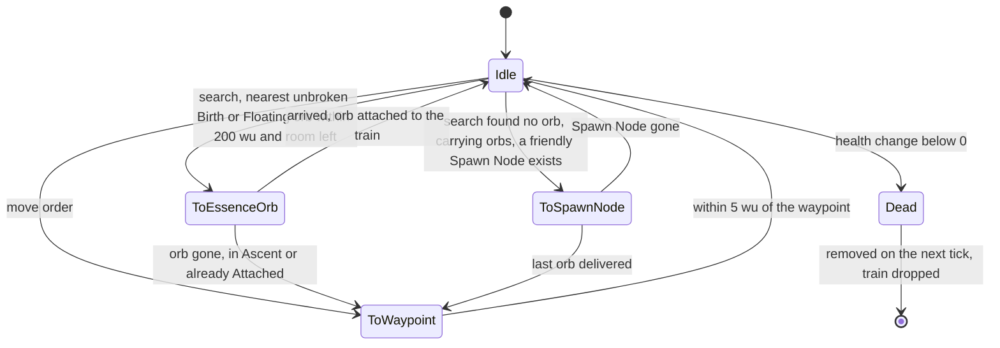
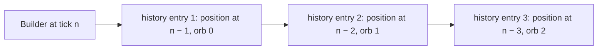

# Builder

> Status: Reference · Prefix: R-UNIT · Related: [Units](README.md) · [Essence orbs](essence_orbs.md) · [Collector](collector.md) · [Worker](worker.md) · [Population flow](../05_population_flow.md) · [Crates and powers](../04_supply_crates_powers_and_weapons/crates_and_powers.md) · [Teams and player commands](../12_simulation_model/06_teams_and_player_commands.md) · [Bots](../07_bots/README.md)

## 1 Purpose and player experience

The Builder is a small hovering drone that a basic Supply crate grants. It seeks out Essence orbs one at a time, picks each up and tows it behind it, so that a loaded Builder trails a little snake of glowing orbs. When it finds no more orbs nearby, it flies to a friendly Spawn Node and hands the orbs over one per tick, each becoming a new Worker. It ignores laser fire, but explosions and fire bring it down, and when it dies its train of orbs drops back into the air.

This document specifies the Builder (`Builder`, an actor) as it acts in a match: acquisition, stats, states, the orb train, delivery, movement, damage, control, the bot hook and presentation.

## 2 Rules

### 2.1 Baseline

**R-UNIT-446** (MUST) The values of §4 are the reference tuning baseline (DEC-004), and the rules of this document are the specification of record for the Builder (DEC-005). Every reference behaviour that looks accidental and is kept is stated as an explicit rule with a named key (DEC-006). The Builder is part of the kept roster (DEC-019).

### 2.2 Role, acquisition and end

**R-UNIT-447** (MUST) A Builder is an ungrouped actor of its team and a special unit: it registers in its team's special-unit list when it starts and unregisters when it is removed ([teams and player commands](../12_simulation_model/06_teams_and_player_commands.md) R-SIM-400, DEC-117). It collects Essence orbs of any team one at a time, carries them in a train behind it and returns each to a friendly Spawn Node, where it becomes one Worker (R-UNIT-457, see DEC-085). It is not a combat unit.

**R-UNIT-448** (MUST) A Builder is created when the Builder outcome's Power is targeted at a ground position (`PlayerCommand::TargetPower`): it appears at the position raised by `ref.unit.builder.spawn_height` (10 wu) and is selected on its team inside the same simulation step. The Builder outcome is a basic outcome, valid only on maps with Spawn Nodes; its validity and its placement sound belong to [crates and powers](../04_supply_crates_powers_and_weapons/crates_and_powers.md). A map may also place a Builder as a starting unit that runs as a Power; no reference map does.

**R-UNIT-449** (MUST) A Builder's Power ends when the Builder is dead. Stopping the Power changes the Builder's health by −`ref.unit.builder.stop_damage` (1000), which kills it (R-UNIT-461).

### 2.3 Stats

**R-UNIT-450** (MUST) A Builder has these stats:

| Stat | Value | Key |
|---|---|---|
| health | 255 | `ref.unit.builder.health` |
| speed | 28 wu/s, × `ref.unit.builder.idle_speed_factor` (0.25) while Idle, so 7 wu/s | `ref.unit.builder.speed` |
| capacity | 25 Essence orbs at the match power level 3 (`ref.sim.init.power_level_default`); 0, 10, 15, 25 and 30 for levels 0 to 4 | `ref.econ.builder.capacity` |
| orb search range | 200 wu | `ref.econ.builder.search_range_wu` |
| search interval while Idle | 11 ticks (nominal 1.0 s) | `ref.unit.builder.retarget_ticks` |
| hover height | 15 wu above max(terrain height, sea level) | `ref.unit.builder.hover_height` |
| heading blend | 0.3 per tick (3 per second) | `ref.unit.builder.turn_rate` |
| arrival distance | 5 wu, measured horizontally | `ref.unit.builder.arrival_distance` |
| idle wander distance | 30 wu | `ref.unit.builder.wander_distance` |
| delivery offset | 50 wu along the Spawn Node's front | `ref.unit.builder.delivery_offset` |

Actor stats are floating-point values (DEC-090).

**R-UNIT-451** (MUST) In its spawn step a Builder makes one simulation draw from `ref.unit.builder.idle_spin_range` (U[−0.25, 0.25]), its idle rotation rate, which it stores and which no rule reads. The draw belongs to the spawn step, never to a constructor (DEC-652, [randomness and integrity](../12_simulation_model/07_randomness_and_integrity.md) R-SIM-626).

**R-UNIT-452** (MUST) A Builder is drawn with the mesh `mesh.unit.builder_body`, which has no sockets.

### 2.4 States

**R-UNIT-453** (MUST) A Builder is in one of the states `BuilderState::Idle`, `ToWaypoint`, `ToEssenceOrb` and `ToSpawnNode`. It starts Idle. It holds its carried orbs in collection order, its chosen orb, its chosen Spawn Node with the delivery point there, its search timer and its position history (R-UNIT-458).

**R-UNIT-454** (MUST) **Idle.** An Idle Builder moves towards its waypoint at its Idle speed. Every `ref.unit.builder.retarget_ticks` (11 ticks) it searches, in this order:

1. if it carries fewer orbs than its capacity, the nearest Essence orb in Birth or Floating that is not broken within `ref.econ.builder.search_range_wu` (200 wu), of any team ([essence_orbs.md](essence_orbs.md) R-UNIT-308, R-UNIT-325); if one is found, it becomes ToEssenceOrb;
2. otherwise, if it carries orbs, the nearest Spawn Node, by plain distance, whose owner is a friend of the Builder's team; if one is found, it becomes ToSpawnNode with its delivery point at that node's position + the node's front × `ref.unit.builder.delivery_offset` (50 wu), pushed out of obstacles ([space, routing and physics](../12_simulation_model/05_space_routing_and_physics.md) R-SIM-383);
3. otherwise it wanders: its waypoint becomes a point `ref.unit.builder.wander_distance` (30 wu) away in a uniformly drawn horizontal direction (one simulation draw).

**R-UNIT-455** (MUST) **ToWaypoint.** The Builder flies to its waypoint at full speed and becomes Idle within `ref.unit.builder.arrival_distance` (5 wu) of it.

**R-UNIT-456** (MUST) **ToEssenceOrb.** The Builder's target is its chosen orb's position. If the orb no longer exists, is in Ascent or is already Attached, the Builder becomes ToWaypoint. On arrival within 5 wu, it attaches the orb ([essence_orbs.md](essence_orbs.md) R-UNIT-313), which raises the orb's collected sound, adds it to the end of its train and becomes Idle.

**R-UNIT-457** (MUST) **ToSpawnNode.** The Builder's target is its delivery point. On arrival within 5 wu, each tick it removes one carried orb, the first in its train, and the Spawn Node spawns one Worker of its current owner at its door ([population flow](../05_population_flow.md) R-ECON-043), raising the Builder's drop event (unbound, DEC-565). As for the Collector, this spawn checks neither the population cap nor the Spawn Node's activation delay, and a node that has no team spawns nothing (DEC-453). When it has delivered its last orb, the Builder becomes ToWaypoint; if its Spawn Node no longer exists, it becomes Idle (see DEC-085).

**R-UNIT-458** (MUST) **Orb train.** A Builder records its position every tick in a position history of capacity + 1 entries. Its carried orb i (counting from 0) is placed each tick at the history entry i + 1, the Builder's position i + 1 ticks ago, so the orbs follow it one tick apart in a train. Attached orbs have no timer, so a Builder's orbs never expire while it carries them ([essence_orbs.md](essence_orbs.md) R-UNIT-313).

**R-UNIT-459** (MUST) A Builder runs its state step before the base actor advance, also on the tick on which it died. When it is removed, it drops every carried orb ([essence_orbs.md](essence_orbs.md) R-UNIT-313), which become Floating with the timer they had when they were attached. A carried entry whose orb no longer exists is removed without effect, so the drop ends after one pass over the train (DEC-014, [population flow](../05_population_flow.md) R-ECON-081).

### 2.5 Movement

**R-UNIT-460** (MUST) While its target is more than 5 wu away horizontally, a Builder blends its facing towards the target direction by `ref.unit.builder.turn_rate` × `ref.sim.tick_period` (0.3) per tick and moves along it at its speed (Idle: × 0.25). Its height is `ref.unit.builder.hover_height` (15 wu) above max(terrain height, `ref.sim.physics.sea_level`), so it crosses water. It never calls the obstacle push for its own position: only its delivery point is pushed out of obstacles (R-UNIT-454). Its x and z stay inside the map.

### 2.6 Damage and death

**R-UNIT-461** (MUST) A Builder ignores laser damage. Every other damage type applies in full. A non-lethal hit emits a muzzle-flash particle at the Builder (presentation). A Builder dies only when its health + the change is below 0, so a change that brings it to exactly 0 leaves it alive with 0 health. When it dies, its health becomes 0, it raises the die sound event, it releases **no** Essence orb of its own, and its advance on the next tick requests its removal, with no corpse fade. Whenever its health crosses a multiple of `ref.unit.builder.shatter_band` (50 health), and at death, its mesh sheds debris (presentation).

### 2.7 Targeting, control and bot hook

**R-UNIT-462** (MUST) A Builder targets nothing but Essence orbs. Workers never choose a Builder as a threat ([worker.md](worker.md)).

**R-UNIT-463** (MUST) A player controls a Builder only by selecting it (`PlayerCommand::Select`) and giving it a move order: a team command state with `move_target` while the Builder is the team's selected actor ([teams and player commands](../12_simulation_model/06_teams_and_player_commands.md) R-SIM-442) sets its waypoint to `pointer_position`, makes it ToWaypoint and clears the team's selection inside the same step. Secondary fire with a Builder selected has no effect. Cancelling its Power is R-UNIT-449.

**R-UNIT-464** (MUST) A bot team's Builder thinks every `ref.unit.builder.bot_think_ticks` (11 ticks): when it is Idle, its waypoint becomes the position of the nearest Essence orb anywhere on the map, in any state ([bots](../07_bots/README.md)).

### 2.8 Presentation and sound

**R-UNIT-465** (MUST) A Builder's whole mesh takes its team colour: every facet has tint weight 1, with the team colour × `ref.unit.builder.tint_scale` (0.7) (ADR-020). Its render path reads the presentation clock only ([randomness and integrity](../12_simulation_model/07_randomness_and_integrity.md) R-SIM-701).

**R-UNIT-466** (MUST) A Builder shows its activity with these string ids: `unit.builder.action.idle` (new text "Idle") while Idle; `unit.builder.action.to_waypoint` (new text "Moving to waypoint") while ToWaypoint; `unit.builder.action.to_essence_orb` (new text "Fetching an Essence orb") while ToEssenceOrb; `unit.builder.action.delivering` (new text "Delivering Essence orbs") while ToSpawnNode.

**R-UNIT-467** (MUST) A Builder raises these sound events (reference/10):

| Event | When | Binding |
|---|---|---|
| presence | while the Builder exists | `sfx.unit.builder.presence_loop` |
| hurt | a health loss that does not kill | `sfx.unit.builder.hurt` |
| die | death (R-UNIT-461) | `sfx.unit.builder.die` |
| drop | each orb delivered (R-UNIT-457) | unbound (DEC-565) |
| selected | the Builder is selected | unbound (DEC-565) |

The attached orb raises its own collected sound ([essence_orbs.md](essence_orbs.md) R-UNIT-333).

## 3 States and flows

*Figure 1 — Builder states (R-UNIT-453 to R-UNIT-459, R-UNIT-461). A move order and death act from every state.*

*Figure 2 — The orb train: carried orb i sits at the Builder's position i + 1 ticks ago (R-UNIT-458).*

## 4 Tuning table

| key | value | unit | range or notes | requirement | DEC |
|---|---|---|---|---|---|
| `ref.unit.builder.spawn_height` | 10 | wu | above the targeted position | R-UNIT-448 | — |
| `ref.unit.builder.stop_damage` | 1000 | health | when the Power stops | R-UNIT-449 | — |
| `ref.unit.builder.health` | 255 | health | | R-UNIT-450 | DEC-090 |
| `ref.unit.builder.speed` | 28 | wu/s | | R-UNIT-450, R-UNIT-460 | DEC-090 |
| `ref.unit.builder.idle_speed_factor` | 0.25 | × speed | while Idle | R-UNIT-450, R-UNIT-460 | — |
| `ref.unit.builder.retarget_ticks` | 11 | ticks | nominal 1.0 s | R-UNIT-450, R-UNIT-454 | DEC-002 |
| `ref.unit.builder.hover_height` | 15 | wu | above max(terrain, sea level) | R-UNIT-450, R-UNIT-460 | — |
| `ref.unit.builder.turn_rate` | 3 | per second | heading blend 0.3 per tick | R-UNIT-450, R-UNIT-460 | — |
| `ref.unit.builder.arrival_distance` | 5 | wu | horizontal | R-UNIT-450, R-UNIT-455, R-UNIT-456, R-UNIT-457, R-UNIT-460 | — |
| `ref.unit.builder.wander_distance` | 30 | wu | | R-UNIT-450, R-UNIT-454 | — |
| `ref.unit.builder.delivery_offset` | 50 | wu | along the Spawn Node's front | R-UNIT-450, R-UNIT-454 | — |
| `ref.unit.builder.idle_spin_range` | [−0.25, 0.25] | rad/s | one draw at spawn; read by no rule | R-UNIT-451 | DEC-652 |
| `ref.unit.builder.shatter_band` | 50 | health | | R-UNIT-461 | — |
| `ref.unit.builder.bot_think_ticks` | 11 | ticks | nominal 1.0 s | R-UNIT-464 | DEC-002 |
| `ref.unit.builder.tint_scale` | 0.7 | × team colour | whole-mesh tint | R-UNIT-465 | DEC-029 |

Keys cited from other documents (their values are defined there):

| Owning document | Keys | Used by |
|---|---|---|
| [population flow](../05_population_flow.md) | `ref.econ.builder.capacity`, `ref.econ.builder.search_range_wu` | R-UNIT-450, R-UNIT-454 |
| [match lifecycle and state reset](../12_simulation_model/02_match_lifecycle_and_state_reset.md) | `ref.sim.init.power_level_default` | R-UNIT-450 |
| [tick timing](../12_simulation_model/01_tick_timing_and_main_loop.md) | `ref.sim.tick_period` | R-UNIT-460 |
| [space, routing and physics](../12_simulation_model/05_space_routing_and_physics.md) | `ref.sim.physics.sea_level` | R-UNIT-460 |

## 5 Edge cases and interactions

1. **Collect before delivering.** A Builder delivers only when its search finds no orb it can take, so near a battle it keeps collecting until its train holds 25 orbs (R-UNIT-454).
2. **Birth orbs.** Unlike the Collector, a Builder takes orbs in Birth; an orb it drops returns to Floating with the remaining birth time, so a Builder killed soon after collecting fresh orbs leaves orbs that ascend almost at once (R-UNIT-454, R-UNIT-459).
3. **Enemy orbs.** A Builder's orbs become Workers of the Spawn Node's owner, whatever team they came from (R-UNIT-457, DEC-080).
4. **Exactly zero health.** A hit that brings a Builder to exactly 0 health leaves it alive; the next hit of any non-laser damage kills it (R-UNIT-461).
5. **Over water.** A Builder flies over the sea at 15 wu above sea level and cannot drown (R-UNIT-460).
6. **Cap bypass.** Builder deliveries, like Collector deliveries, are not checked against the population cap (R-UNIT-457, DEC-453).
7. **Secondary fire.** A player's secondary fire with a Builder selected changes nothing (R-UNIT-463).

## 6 Acceptance criteria

**AC-BU-01 — Train** (R-UNIT-456, R-UNIT-458). Given a Builder that has attached three orbs and moves in a straight line at 28 wu/s, then its orbs lie 2.8, 5.6 and 8.4 wu behind it along its path.

**AC-BU-02 — Delivery** (R-UNIT-454, R-UNIT-457). Given a Builder carrying 10 orbs, no orb within 200 wu and a friendly active Spawn Node, then within 11 ticks it is ToSpawnNode heading for the node's position + front × 50 wu, and once there one Worker of the node's owner appears per tick for 10 ticks.

**AC-BU-03 — Lasers** (R-UNIT-461). Given a Builder at 255 health, when 10 laser bolts hit it, then its health stays 255; when a 300-damage explosion hits it, then it dies and no Essence orb of its own appears.

**AC-BU-04 — Exactly zero** (R-UNIT-461). Given a Builder at 50 health, a 50-damage explosion leaves it alive at 0; a further 1-damage fire hit kills it.

**AC-BU-05 — Drop on death** (R-UNIT-459). Given a Builder carrying 5 orbs attached while Floating, when it dies, then on its removal the 5 orbs are Floating with the timers they had when attached.

**AC-BU-06 — Spawn draw** (R-UNIT-451). Given a counting simulation generator, the spawn step of a Builder makes exactly one draw.

**AC-BU-07 — Bot hook** (R-UNIT-464). Given an Idle bot Builder and a single orb in Ascent 800 wu away, its waypoint becomes that orb's position within 11 ticks.

## 7 Dependencies

- **Reference documents:** [Units](README.md) (base advance); [essence_orbs.md](essence_orbs.md); [collector.md](collector.md); [worker.md](worker.md) (threat search exclusion); [population flow](../05_population_flow.md) §2.19 (Builder as an orb taker); [crates and powers](../04_supply_crates_powers_and_weapons/crates_and_powers.md) (the Builder outcome, its validity, Power stop); [economy and spawn objects](../03_buildings_and_world_objects/economy_and_spawn_objects.md) (Spawn Node door spawn); [bots](../07_bots/README.md); [teams and player commands](../12_simulation_model/06_teams_and_player_commands.md); [space, routing and physics](../12_simulation_model/05_space_routing_and_physics.md) (structure push of the delivery point); [randomness and integrity](../12_simulation_model/07_randomness_and_integrity.md); reference/10 (audio events).
- **Engine components:** [renderer](../../architecture/components/renderer/README.md) (whole-mesh tint, ADR-020); [animation and VFX](../../architecture/components/animation_and_vfx/README.md) (debris, muzzle flash); [audio engine](../../architecture/components/audio_engine.md); [UI framework](../../architecture/components/ui_framework/README.md) (status text).
- **Assets:** `mesh.unit.builder_body`; `icon.power.builder` (the Builder Power; also drawn over the Builder); `sfx.unit.builder.presence_loop`, `sfx.unit.builder.hurt`, `sfx.unit.builder.die`.

## 8 Open decisions

| DEC | Title | Default specified in §2 |
|---|---|---|
| DEC-085 | Builder Essence-orb collection without a destination | in a match the Builder delivers its orbs to the nearest friendly Spawn Node, where each becomes a Worker (R-UNIT-447, R-UNIT-454, R-UNIT-457) |
| DEC-080 | Collector collection of any team's Essence orbs | the Builder, like every taker, ignores an orb's team (R-UNIT-454) |
| DEC-453 | Population-cap enforcement points and uncapped sources | Builder deliveries are uncapped (R-UNIT-457) |
| DEC-565 | Sounds for the other silent gameplay events | the delivery and selection are silent (R-UNIT-467) |
