# Creatures

> Status: Reference · Prefix: R-UNIT · Related: [units](README.md), [hazards and projectiles](hazards_and_projectiles.md), [Worker](worker.md), [Essence orbs](essence_orbs.md), [Collector](collector.md), [Builder](builder.md), [crates and powers](../04_supply_crates_powers_and_weapons/crates_and_powers.md), [defences and props](../03_buildings_and_world_objects/defences_and_props.md), [population flow](../05_population_flow.md), [simulation model](../12_simulation_model/README.md)

## 1 Purpose and player experience

Creatures are the wildcards of a match. Supply crate outcomes release them, and none of them is under a player's direct control: a creature acts on its own rules from the moment it hatches. Together they are a second, hostile economy beside the Workers. Crawlers ferry Essence orbs into Crawler eggs and breed; Brood Drifters and spiders lay eggs near orbs; centipedes eat orbs and grow; Hive ants carry orbs and captured Workers home; and the Reaper Serpent destroys the Essence orb of everything it kills, so those Workers never return to anyone's economy.

This document also holds the rules that every creature and hazard shares (§2.1). The event hazards (the Abductor, the airstrike with its Bombers, the Missile Barrage and the meteor shower) are specified in [hazards and projectiles](hazards_and_projectiles.md). The stats, resistances, death rules, slope factors and tint kind of every kind are in the [units README](README.md); this document gives their behaviour. The Summoner, the Tri-walker and the Rift Horror are not part of the reference (DEC-062).

Table 1-A Creatures.

| Species term | Type | Family | Created in a match by | Owner | Section |
|---|---|---|---|---|---|
| Seed Pod | `SeedPod` | actor | Spitter Plants, the Brood outcome, a bursting Seed Pod | the launching team | §2.2 |
| Crawler egg | `CrawlerEgg` | actor | Brood Drifters, spiders, Seed Pods | the layer's team | §2.3 |
| Crawler, Crawler group, Crawler trail sample | `Crawler`, `CrawlerGroup`, `CrawlerTrailSample` | actor, actor group, record | Seed Pods, Crawler eggs, Swarm streaks; a Crawler group only by map placement | the source's team | §2.4 |
| Brood Drifter | `BroodDrifter` | actor | Seed Pods | the Seed Pod's team | §2.5 |
| centipede | `CentipedeCreature` | one actor per segment, in an actor group | Seed Pods; growth | the Seed Pod's team | §2.6 |
| ant | `AntCreature` | actor | Hives, the Hive outcome, Seed Pods | the Hive's or the Seed Pod's team | §2.7 |
| spider, spider gait | `SpiderCreature`, `SpiderGait` | actor, record | Seed Pods, Swarm streaks | the source's team | §2.8 |
| procedural leg, procedural foot | `ProceduralLeg`, `ProceduralFoot` | presentation helpers | eight per spider | — | §2.9 |
| Reaper Serpent | `ReaperSerpent` | actor | Seed Pods | always the Rogue faction | §2.10 |
| Wisp | `Wisp` | effect | a Worker killed by a Reaper Serpent or by a Blight Grove tree | the victim's team | §2.11 |

How players meet them:

- **Swarm pressure.** Crawlers arrive in tens, bite for 20 health per tick on contact and breed through eggs, up to 250 per team.
- **Big threats.** A spider pounces from 150 wu and crushes a cluster; a centipede of up to 20 segments crushes everything it brushes and splits in two when a middle segment dies; the Reaper Serpent dives through crowds and kills almost anything it touches.
- **Breeders.** Brood Drifters and spiders turn floating Essence orbs into Crawler eggs, so a battlefield left full of orbs breeds Crawlers.
- **Thieves.** Hive ants run out, grab Essence orbs and single Workers, and carry them home.
- **Ghosts.** Workers that a Reaper Serpent kills leave pale Wisps that drift away over ten minutes.

## 2 Rules

### 2.1 Rules shared by every creature and hazard

**R-UNIT-500** (MUST) The values of §4 are the reference tuning baseline (DEC-004), and the rules of this document and of [hazards and projectiles](hazards_and_projectiles.md) are the specification of record for creatures and hazards (DEC-005). Every reference quirk that they keep is an explicit rule with a named key (DEC-006). The roster of Table 1-A and of the hazards is kept with its behaviour (DEC-019).

**R-UNIT-501** (MUST) The stats of each kind are the keys `ref.unit.<kind>.health`, `ref.unit.<kind>.speed` and `ref.unit.<kind>.rate` of the actor stat table in the [units README](README.md) (R-UNIT-011), floating-point values to which every multiplier applies exactly (DEC-090), at difficulty level 0 (R-UNIT-016, DEC-010). Resistances and death rules are table 2.8-A of the README (R-UNIT-027), and every creature contact attack is an unresistable health change (R-UNIT-030). A rule below that replaces or scales a stat says so.

**R-UNIT-502** (MUST) The tick rules of the README (R-UNIT-005, R-UNIT-006) apply: dt in a formula is `ref.sim.tick_period` (0.1 s); a speed of v wu/s moves v × dt per tick; a rule stated per tick applies once per tick and scales with game speed through tick scheduling (DEC-039, DEC-092). A random duration is base + ⌈`SimRng::NextUnit`(spread)⌉ ticks, with base and spread in ticks, drawn at the step that starts it. A fixed duration is the reference tick count of its key (DEC-002).

**R-UNIT-503** (MUST) Every draw written `SimRng::NextUint`, `SimRng::NextUnit(r)` or `SimRng::NextSigned(r)` is a simulation draw with the forms of [reference/12](../12_simulation_model/07_randomness_and_integrity.md) R-SIM-605: `NextUnit(r)` is uniform over [0, r) and `NextSigned(r)` over [−r/2, r/2). A vector draw takes x, then y, then z, and each draw is its own statement. The draws that initialise a new object happen once, in the step that spawns it (DEC-652). Every draw that these documents mark *cosmetic* is a presentation draw from `FxRng` and never reaches simulation state (DEC-013, R-SIM-622).

**R-UNIT-504** (MUST) Every rejection loop of these documents has a capped number of attempts and a deterministic fallback (DEC-014): the Abductor's arrival and wander searches and the barrage launcher's sea search ([hazards and projectiles](hazards_and_projectiles.md)). The Brood kind choice and the nested Seed Pod kind choice (§2.2) draw directly from their candidate lists. A **cell fallback** is the qualifying cell centre of the terrain height field nearest to the last drawn point, with ties going to the lowest row-major cell index. The content validator runs every such search on every map at build time and rejects a map on which a search has no qualifying cell.

**R-UNIT-505** (MUST) Meshes, cards, colours, particles, shatter effects and sounds are presentation. The simulation emits a presentation event at the tick where a rule fires, and no simulation rule reads presentation state (DEC-007). The tint kind of each mesh is table 2.12-A of the README (R-UNIT-046). Sounds name their asset ids; a cue that these documents call silent has no sound (DEC-565).

**R-UNIT-506** (MUST) Which creature kinds a map may place as instant units is R-UNIT-002 of the README. A map-placed centipede is always inside an actor group (§2.6), and a map may place Crawlers inside a Crawler group (§2.4).

**R-UNIT-507** (MUST) A creature that dies through a death rule that releases an Essence orb releases exactly one, of its own team, unless the team is the Rogue faction, whose Essence orb spawns are always refused (R-UNIT-038, DEC-084, [reference/12](../12_simulation_model/03_entity_model_and_identity.md) R-SIM-126). Its corpse then fades by `ref.unit.corpse.fade_ground_per_tick` on the ground and `ref.unit.corpse.fade_air_per_tick` in the air (R-UNIT-034).

**R-UNIT-508** (MUST) The hostile Supply crate outcomes and the Hive creatures belong to the Rogue faction (team slot `ref.sim.team.rogue_slot`, 4), and the Abductor and the Workers it drops to the Visitor faction (`ref.sim.team.visitor_slot`, 5). Neither faction can win a match or block an elimination win (DEC-082), and each runs the full bot controller (DEC-558).

**R-UNIT-509** (MUST) A creature's enemy search uses the actor-grid queries of [reference/12](../12_simulation_model/05_space_routing_and_physics.md) with the ranges and exclusions stated for it, and no other exclusion; in particular it does not exclude a bot controller (DEC-311).

**R-UNIT-510** (MUST) A Seed Pod burst, a Crawler egg hatch and the Brood outcome check no population cap: they add their creatures and Workers whatever the team's count. Only the Crawler limit `ref.unit.crawler.team_limit` (R-UNIT-529) limits Crawlers (DEC-453, [population flow](../05_population_flow.md)).

### 2.2 Seed Pod

A Seed Pod is a timed pod that tumbles, bounces and bursts into a group of creatures of its kind. The Spitter Plant that launches it is a world object ([defences and props](../03_buildings_and_world_objects/defences_and_props.md)).

**R-UNIT-511** (MUST) A Spitter Plant of the Spitter Plants outcome launches Seed Pods ([crates and powers](../04_supply_crates_powers_and_weapons/crates_and_powers.md) gives the outcome, which only an unopened Supply crate yields; [defences and props](../03_buildings_and_world_objects/defences_and_props.md) gives the plant, its pod count and its choice of kind, which excludes kinds 3 and 4 of R-UNIT-519). Each launched pod has size 1 + `SimRng::NextSigned`(`ref.unit.seed_pod.launch_size_spread`) and velocity = launch socket forward × plant force × plant size × (1 + `SimRng::NextSigned`(`ref.unit.seed_pod.launch_speed_spread`)), and its burst timer is replaced by R-UNIT-515.

**R-UNIT-512** (MUST) The Brood outcome, placed at a target point by a player or a bot, creates `ref.unit.seed_pod.group_count_min` + (`SimRng::NextUint` mod `ref.unit.seed_pod.group_count_spread`) Seed Pods (2 to 4), owned by the team that placed the power (DEC-107). Each starts at the target + (0, `ref.unit.seed_pod.brood_start_height`, 0) with velocity normalise(`SimRng::NextSigned(1)`, `ref.unit.seed_pod.brood_lift`, `SimRng::NextSigned(1)`) × (`ref.unit.seed_pod.brood_speed_min` + `SimRng::NextUnit`(`ref.unit.seed_pod.brood_speed_spread`)), takes its kind by R-UNIT-513, and has its burst timer replaced by R-UNIT-515. The released creatures use the fixed roam ranges of R-UNIT-519, not a roam range of the outcome.

**R-UNIT-513** (MUST) The Brood kind is one `SimRng::NextUint` draw modulo 5 over the list (Crawlers, centipede, spider, Seed Pods, Brood Drifter), which are kinds 0, 1, 2, 5 and 7 of R-UNIT-519. This equals the reference distribution, which re-draws `NextUint` mod 10 until the kind is none of Essence orbs, Crawler eggs, Reaper Serpent, ants and Workers, and it needs no loop (DEC-014).

**R-UNIT-514** (MUST) A Seed Pod of kind 5 (nested pods) releases `ref.unit.seed_pod.group_count_min` + (`SimRng::NextUint` mod `ref.unit.seed_pod.group_count_spread`) Seed Pods at speed `ref.unit.seed_pod.nested_speed_min` + `SimRng::NextUnit`(`ref.unit.seed_pod.nested_speed_spread`). Each takes its kind by one `SimRng::NextUint` draw modulo 9 over kinds 0 to 8 (never Workers). When the Reaper Serpent is not allowed at that draw (R-UNIT-520), the kind is one `SimRng::NextUint` draw modulo 8 over kinds 0 to 7 instead, which equals the reference re-draw of the Reaper Serpent result (DEC-014). A nested pod keeps its default burst timer.

**R-UNIT-515** (MUST) The spawn step of every Seed Pod draws its default burst timer, `ref.unit.seed_pod.default_burst_base` + ⌈`SimRng::NextUnit`(`ref.unit.seed_pod.default_burst_spread`)⌉ ticks (200 to 300 ticks, 20 to 30 s). A Spitter Plant launch (R-UNIT-511) and the Brood outcome (R-UNIT-512) then replace it with `ref.unit.seed_pod.launch_burst_base` + ⌈`SimRng::NextUnit`(`ref.unit.seed_pod.launch_burst_spread`)⌉ ticks (40 to 80 ticks, 4 to 8 s).

**R-UNIT-516** (MUST) A Seed Pod has health `ref.unit.seed_pod.health` (50); its speed `ref.unit.seed_pod.speed` and rate `ref.unit.seed_pod.rate` are unused (R-UNIT-017). It is immune to laser bolts (R-UNIT-027). At 0 health it releases its Essence orb (R-UNIT-507) and a shatter effect and is removed on the next tick without a corpse fade.

**R-UNIT-517** (MUST) A Seed Pod starts with force f = `ref.unit.seed_pod.initial_force` (1.0) and moves each tick by:

```
v.y -= ref.unit.seed_pod.gravity_per_tick * f        # 9.8 wu/s per tick at f = 1, about 98 wu/s^2
p += v * dt
if p.y < ground(p) + ref.unit.seed_pod.bounce_clearance:          # 3 wu
    Bounce()                                          # reference/12 R-SIM-385, restitution 0.85
    f *= ref.unit.seed_pod.bounce_friction            # 0.65
    v *= f
    p.y = max(p.y, ground(p) + ref.unit.seed_pod.bounce_clearance)
    if f > ref.unit.seed_pod.bounce_sound_force: emit bounce sound     # 0.1
up = rotate(up, axis = normalise(up x v), angle = f^2 * ref.unit.seed_pod.tumble_rate * dt)   # tumble, 30
if up.y < ref.unit.seed_pod.self_right_up and f < ref.unit.seed_pod.self_right_force:          # 0.3, 0.4
    up = (0, 1, 0)                                    # it rights itself
```

It bounces off the terrain only, never off structures, and bursts wherever it lies.

**R-UNIT-518** (MUST) When its burst timer has elapsed, a Seed Pod emits a shatter effect, releases its kind by R-UNIT-519, emits the burst-open sound and is removed.

**R-UNIT-519** (MUST) The release of a Seed Pod depends on its kind. The kind numbers carry meaning, because the kind choices of R-UNIT-511, R-UNIT-513 and R-UNIT-514 index this list. Every released actor belongs to the pod's team unless the row says otherwise, and spawns at the pod with spawn spread `ref.unit.seed_pod.release_spread` (0 wu):

| Kind | Releases | Count | Velocity | Roam range |
|---|---|---|---|---|
| 0 | Crawlers | `ref.unit.seed_pod.crawlers_min` + (`SimRng::NextUint` mod `ref.unit.seed_pod.crawlers_spread`), 20 to 39; none when the team already has `ref.unit.crawler.team_limit` (250) Crawlers or more | — | `ref.unit.seed_pod.crawlers_roam` (100 wu) |
| 1 | one centipede: an actor group of n segments (§2.6) | n = `ref.unit.seed_pod.centipede_size_min` + (`SimRng::NextUint` mod `ref.unit.seed_pod.centipede_size_spread`), 5 to 14 | — | `ref.unit.seed_pod.centipede_roam` (200 wu) |
| 2 | a spider | 1 | — | `ref.unit.seed_pod.spider_roam` (150 wu) |
| 3 | Essence orbs ([Essence orbs](essence_orbs.md)) | `ref.unit.seed_pod.orbs_min` + (`SimRng::NextUint` mod `ref.unit.seed_pod.orbs_spread`), 5 to 9 | horizontal speed `ref.unit.seed_pod.orb_speed_min` + `SimRng::NextUnit`(`ref.unit.seed_pod.orb_speed_spread`) | — |
| 4 | Crawler eggs | `ref.unit.seed_pod.eggs_min` + (`SimRng::NextUint` mod `ref.unit.seed_pod.eggs_spread`), 5 to 9 | upward plus a random component, length `ref.unit.seed_pod.egg_speed_min` + `SimRng::NextUnit`(`ref.unit.seed_pod.egg_speed_spread`) | `ref.unit.seed_pod.thrown_roam` (0) |
| 5 | Seed Pods | R-UNIT-514, 2 to 4 | R-UNIT-514 | `ref.unit.seed_pod.thrown_roam` (0) |
| 6 | ants, with no Hive (they start with NoOrders, §2.7) | `ref.unit.seed_pod.ants_min` + (`SimRng::NextUint` mod `ref.unit.seed_pod.ants_spread`), 20 to 29 | thrown upward at `ref.unit.seed_pod.throw_speed_min` + `SimRng::NextUnit`(`ref.unit.seed_pod.throw_speed_spread`) | `ref.unit.seed_pod.thrown_roam` (0) |
| 7 | a Brood Drifter | 1 | — | `ref.unit.seed_pod.brood_drifter_roam` (200 wu) |
| 8 | a Reaper Serpent of the Rogue faction, whatever the pod's team (R-UNIT-520) | 1 | — | `ref.unit.seed_pod.reaper_serpent_roam` (200 wu) |
| 9 | Workers | `ref.unit.seed_pod.workers_min` + (`SimRng::NextUint` mod `ref.unit.seed_pod.workers_spread`), 10 to 19 | thrown upward at `ref.unit.seed_pod.throw_speed_min` + `SimRng::NextUnit`(`ref.unit.seed_pod.throw_speed_spread`) | `ref.unit.seed_pod.thrown_roam` (0) |

**R-UNIT-520** (MUST) Kind 8 releases a Reaper Serpent only when the mode is not Siege and fewer than `ref.unit.reaper_serpent.alive_limit` (2) Reaper Serpents are alive in the match; otherwise the pod releases kind 0 instead, with the Crawler limit and roam range of kind 0.

**R-UNIT-521** (MUST) Presentation: the Seed Pod uses `mesh.creature.seed_pod`, tinted entirely in its team colour. Its drawn size pulses as size + |sin(`ref.unit.seed_pod.pulse_rate` × t)| × (1 − age) × `ref.unit.seed_pod.pulse_amplitude`, with t the presentation time and age its age fraction, and its shadow is size × `ref.unit.seed_pod.shadow_scale` wu. Sounds: `sfx.creature.seed_pod.spawn` when it is created, `sfx.creature.seed_pod.bounce`, `sfx.creature.seed_pod.burst_open`, and on death the shared group `sfx.creature.reaper_serpent.die`.

### 2.3 Crawler egg

A Crawler egg is a small egg that, once an Essence orb is placed inside it, hatches 4 Crawlers: the creatures' own way of turning orbs into bodies.

**R-UNIT-522** (MUST) Crawler eggs are laid by Brood Drifters (R-UNIT-544) and spiders (R-UNIT-573) and released by Seed Pods of kind 4 (R-UNIT-519). Neither the Brood kind list nor a Spitter Plant's choice includes kind 4, so in a match kind 4 comes only from nested Seed Pods. An egg is fertilised by a Crawler that carries an Essence orb (R-UNIT-533) or, at laying, by a Brood Drifter (R-UNIT-544). Each Essence orb keeps a list of the dormant eggs near it ([Essence orbs](essence_orbs.md)), so Crawlers fetch only orbs that have an egg nearby.

**R-UNIT-523** (MUST) A Crawler egg has health `ref.unit.crawler_egg.health` (10), speed `ref.unit.crawler_egg.speed` (0) and rate `ref.unit.crawler_egg.rate` (0) (R-UNIT-501). Its states are Dormant and Fertilised.

**R-UNIT-524** (MUST) Fertilising an egg sets the orb to InEgg, holds the orb's handle, sets the egg's timer to 0 and the state to Fertilised. Every tick, when the egg's held orb handle is not a valid Essence orb, the egg becomes Dormant and its timer is set to 0. While Fertilised, the timer counts ticks and the orb is held `ref.unit.crawler_egg.orb_hold_height` (3 wu) above the egg. When the timer reaches `ref.unit.crawler_egg.hatch_ticks` (151 ticks, nominal 15.0 s), the orb is removed and, if the egg's team has fewer than `ref.unit.crawler.team_limit` (250) Crawlers, `ref.unit.crawler_egg.hatch_crawlers` (4) Crawlers of the egg's team spawn at the egg with spread 0 and roam range `ref.unit.crawler_egg.hatch_roam` (200 wu); the orb is consumed in either case, and the egg is removed.

**R-UNIT-525** (MUST) A dormant Crawler egg never decays. A dormant egg holds no orb, so R-UNIT-524 resets its timer every tick, and the dormant lifetime `ref.unit.crawler_egg.dormant_lifetime` (1201 ticks, 120 s), with its decay of health to at most 10 × (1 − timer ÷ 120 s), never takes effect (DEC-091).

**R-UNIT-526** (MUST) An egg moves by the airborne step of [reference/12](../12_simulation_model/05_space_routing_and_physics.md) (R-SIM-370) until it is on the ground. On the ground it is held to the terrain height each tick, becomes airborne again when the ground drops away beneath it, and moves by p += v × dt. An egg at or below sea level (`ref.sim.physics.sea_level`) takes `ref.unit.crawler_egg.water_damage` (500).

**R-UNIT-527** (MUST) Any damage kind hurts a Crawler egg. A hit of amount a (negative) kills it only when health + a < 0 (R-UNIT-027), so a hit equal to its remaining health leaves it alive at 0. Its death releases no Essence orb and plays no sound; a held orb returns to Floating ([Essence orbs](essence_orbs.md)); the corpse fades (R-UNIT-034) and is removed. Workers never treat an egg as a threat, so eggs die only incidentally, mostly to explosions.

**R-UNIT-528** (MUST) Presentation: an egg is a camera-facing additive card `sprite.crawler_egg.body` of `ref.unit.crawler_egg.card_size` (8 × 8 wu), with alpha health ÷ 10, at least `ref.unit.crawler_egg.min_alpha` (0.1). A fertilised egg adds two throbbing cards that grow over its hatch time. A dead egg breaks into `ref.unit.crawler_egg.fragments` (3) drifting quarter-card fragments. The egg is drawn white whatever its team colour. It has no sound of its own.

### 2.4 Crawler, Crawler group and Crawler trail sample

Crawlers are fast worm creatures with a glowing trail. They bite enemies on contact and ferry Essence orbs into Crawler eggs to breed more Crawlers: the swarm unit of the creature outcomes.

**R-UNIT-529** (MUST) Crawlers are released by Seed Pods of kind 0, also when a refused Reaper Serpent falls back to kind 0 (R-UNIT-519, R-UNIT-520), by hatching Crawler eggs (R-UNIT-524) and by Swarm streaks, which turn an Essence orb into a Rogue faction Crawler with roam range 200 wu, or into a spider ([crates and powers](../04_supply_crates_powers_and_weapons/crates_and_powers.md)). Every match source spawns Crawlers without an actor group, among the team's ungrouped actors. The match world counts each team's Crawlers from the spawn step until removal, a fading corpse included, and every rule that releases Crawlers checks this count against `ref.unit.crawler.team_limit` (250) as it states. Crawlers are not counted against the population cap ([population flow](../05_population_flow.md) R-ECON-050).

**R-UNIT-530** (MUST) A Crawler has health `ref.unit.crawler.health` (10), speed `ref.unit.crawler.speed` (32 wu/s) and rate `ref.unit.crawler.rate` (0). It moves toward its target position, or along its idle compass direction, at speed × its slope factor (R-UNIT-042), `ref.unit.crawler.hover_height` (0.1 wu) above the terrain. It is never pushed by obstacles and takes no water damage, so Crawlers cross water and pass through structures; the world clamp applies. While above the terrain it falls with `ref.unit.crawler.fall_gravity` (10 wu/s²) and lands at `ref.unit.crawler.land_height` (2 wu) above the ground.

**R-UNIT-531** (MUST) A Crawler's states are Idle, Attacking, ToOrb and ToEgg. Its retarget timer starts at ⌈`SimRng::NextUnit`(`ref.unit.crawler.first_retarget_spread`)⌉ ticks (0 to 20), drawn at spawn, and restarts at `ref.unit.crawler.retarget_ticks` (11 ticks, nominal 1.0 s). When it expires in Idle, the Crawler tries in this order and takes the first that succeeds:

1. if it carries an Essence orb: the dormant, grounded Crawler eggs of its own team within `ref.unit.crawler.egg_search_range` (60 wu); with n found it picks the egg at index ⌊`SimRng::NextUnit`(n)⌋ and enters ToEgg;
2. if enemies are present (for a member of a Crawler group, only when the group's pre-check of R-UNIT-538 found any): the nearest enemy that is alive and on the ground at a distance from `ref.unit.crawler.search_min` (30 wu) to `ref.unit.crawler.search_max` (60 wu); it enters Attacking;
3. the nearest Essence orb of any team in Birth or Floating within `ref.unit.crawler.orb_search_range` (60 wu) whose nearby-egg list is not empty ([Essence orbs](essence_orbs.md) R-UNIT-309); it enters ToOrb;
4. otherwise it picks a new idle direction by R-UNIT-534.

**R-UNIT-532** (MUST) In Attacking, a Crawler whose target is gone or dead returns to Idle. On arrival at its target it bites: the target takes `ref.unit.crawler.bite_damage` (20) as an unresistable health change, three muzzle flashes appear (cosmetic) and the attack sound plays. It then searches for the nearest enemy at least `ref.unit.crawler.search_min` (30 wu) away, up to `ref.unit.crawler.search_max`; if it finds none it keeps its current target and, being on top of it, bites again on the next tick. A Crawler in contact therefore deals 20 per tick, 200 health per second.

**R-UNIT-533** (MUST) In ToOrb, a Crawler whose orb is gone, dying, Attached or InEgg returns to Idle. On arrival it attaches the orb (Attached, [Essence orbs](essence_orbs.md) R-UNIT-313), picks an egg as in step 1 of R-UNIT-531 and enters ToEgg. In ToEgg, when no egg is found, the egg is gone or the orb is no longer valid, it drops the orb and returns to Idle; on arrival at the egg it fertilises it with the orb (R-UNIT-524) and returns to Idle. A carried orb follows the Crawler at its position + (0, `ref.unit.crawler.orb_carry_height`, 0) (2 wu), and a Crawler that dies drops it.

**R-UNIT-534** (MUST) A new idle direction is chosen as follows, with d the Crawler's distance from its spawn point (R-UNIT-020) and R its roam range:

1. the return chance is d ÷ R, or 0 when d ÷ R is below `ref.unit.crawler.return_threshold` (0.75); with that chance, tested against `SimRng::NextUnit(1)`, it takes the one of the 8 compass directions that points most nearly toward its spawn point;
2. otherwise it makes up to `ref.unit.crawler.direction_tries` (3) tries of the compass direction (trunc(`SimRng::NextUnit(3)`) − 1, 0, trunc(`SimRng::NextUnit(3)`) − 1) and takes the first whose end point, speed × retarget time ahead, lies above sea level.

Each new direction records a required trail sample (R-UNIT-535) and plays the change-direction sound.

**R-UNIT-535** (MUST) A Crawler keeps a position history of Crawler trail samples, newest first. It records a required sample at each new direction and state change, a sample every `ref.unit.crawler.sample_ticks` (6 ticks, nominal 0.5 s) while not Idle, and extra non-required samples whenever its height differs by more than `ref.unit.crawler.sample_height_step` (3 wu) from the last sample. The history is trimmed from the oldest end once its summed length exceeds `ref.unit.crawler.tail_length` (175 wu). A Crawler trail sample holds: its world position; the strip's width direction, perpendicular to the segment on the terrain normal; the step vector of `ref.unit.crawler.glow_step` (10 wu) toward the previous sample, for the glow strip; the distance to the previous sample, for the trail length and the alpha falloff; and whether it is required.

**R-UNIT-536** (MUST) A laser bolt that hits a Crawler damages it but never pushes or turns it ([weapons and projectiles](../04_supply_crates_powers_and_weapons/weapons_and_projectiles.md)).

**R-UNIT-537** (MUST) A Crawler dies by the base death rule (R-UNIT-507, its die sound): its velocity becomes 0 and its corpse fades in place. Its trail does not scatter.

**R-UNIT-538** (MUST) A Crawler group exists only when a map places Crawlers as a group (R-UNIT-506); no match rule creates one. In each advance the group first tests whether enemies are present within its radius + `ref.unit.crawler.group_enemy_margin` (60 wu) of its centre, as a pre-check for its members' enemy searches, and then advances as an actor group ([reference/12](../12_simulation_model/06_teams_and_player_commands.md)). It draws its members in one additive batch with the render detail of R-UNIT-539.

**R-UNIT-539** (MUST) Presentation: a Crawler is drawn from `sprite.crawler.segment` as a worm strip of half-width `ref.unit.crawler.worm_half_width` (3 wu) along its trail, with alpha = worm alpha − cumulative distance, plus a glow strip of half-width `ref.unit.crawler.glow_half_width` (12 wu). The worm colour is the team colour × health fraction with alpha `ref.unit.crawler.worm_alpha` (200); the glow is the team colour with alpha `ref.unit.crawler.glow_alpha` (150). A Rogue faction Crawler is drawn with worm colour `ref.unit.crawler.rogue_worm_colour` (255, 255, 255, 0) and glow `ref.unit.crawler.rogue_glow_colour` (200, 200, 200, 50); a dead Crawler fades toward white. Render detail 1 to 4: detail 4 skips the glow strip, and each detail above 1 drops the non-required samples and draws only 1 − `ref.unit.crawler.detail_history_step` (0.25) × min(detail − 1, 2) of the history. A Crawler group takes its detail from the render-detail option and the camera distance: option 1 gives detail 2 beyond `ref.unit.crawler.detail_far` (1000 wu); option 2 gives detail 3 beyond 1000 wu and detail 2 beyond `ref.unit.crawler.detail_near` (500 wu); option 3 gives detail 4; otherwise detail 1. Ungrouped Crawlers are drawn by the team's Crawler crowd pass ([renderer](../../architecture/components/renderer/README.md)). Sounds: `sfx.creature.crawler.turn` (change direction), `sfx.creature.crawler.attack`, `sfx.creature.crawler.hurt`, `sfx.creature.crawler.die`.

### 2.5 Brood Drifter

A Brood Drifter is a hovering creature with four tails. It drifts around its spawn point and lays Crawler eggs near floating Essence orbs and at random: a slow breeding engine that turns orbs into Crawlers.

**R-UNIT-540** (MUST) Brood Drifters are released by Seed Pods of kind 7 with roam range 200 wu (R-UNIT-519). A Brood Drifter has health `ref.unit.brood_drifter.health` (200) and speed `ref.unit.brood_drifter.speed` (20 wu/s); its rate is unused. It spawns at ground level, and its hover height `ref.unit.brood_drifter.hover_height` (100 wu) applies only to the targets it picks, so it rises toward them. It never attacks.

**R-UNIT-541** (MUST) A Brood Drifter flies with no terrain or structure collision. Each tick:

```
desired = normalise(target - p) * speed
if |target - p| < ref.unit.brood_drifter.slow_radius:        # 50 wu
    desired *= |target - p| / ref.unit.brood_drifter.slow_radius
v = v * (1 - dt * ref.unit.brood_drifter.steer_blend) + desired * dt * ref.unit.brood_drifter.steer_blend   # 0.5
v = rotate(v, axis = right, angle = sin(ref.unit.brood_drifter.wobble_rate * t) * dt * ref.unit.brood_drifter.wobble_amplitude)   # 3, 1.5
p += v * dt
```

where t is match time, so the wobble is deterministic. It has arrived when it is within `ref.unit.brood_drifter.arrival` (10 wu) of its target.

**R-UNIT-542** (MUST) Its states are Idle, EggLaying and Panic. In Idle it retargets every `ref.unit.brood_drifter.retarget_ticks` (61 ticks, nominal 6.0 s): it looks for a Floating Essence orb within `ref.unit.brood_drifter.orb_search_range` (200 wu) that is above height 0 and has fewer than `ref.unit.brood_drifter.max_nearby_eggs` (3) eggs in its nearby-egg list; with one it enters EggLaying toward it; otherwise it picks a random target by R-UNIT-543.

**R-UNIT-543** (MUST) A random target is, with the return chance d ÷ R (d the distance from its spawn point, R its roam range, tested against `SimRng::NextUnit(1)`), a point `ref.unit.brood_drifter.random_step` (200 wu) from it toward its spawn point; otherwise a point within a box of side `ref.unit.brood_drifter.random_step` centred on it. The target height is `ref.unit.brood_drifter.hover_height` × (1 ± `ref.unit.brood_drifter.hover_spread`), 100 wu ± 15 %. A random target picked in Idle or on arrival in EggLaying draws the lay roll: when `SimRng::NextUnit(100)` < `ref.unit.brood_drifter.random_lay_chance` (10, at difficulty 0, R-UNIT-016), the Brood Drifter lays eggs at that target (EggLaying); otherwise it flies there in Idle.

**R-UNIT-544** (MUST) The lay target for an orb is the orb's position + (`SimRng::NextSigned`(`ref.unit.brood_drifter.lay_offset`), 0, `SimRng::NextSigned`(`ref.unit.brood_drifter.lay_offset`)), ±30 wu on x and z, at `ref.unit.brood_drifter.egg_lay_height` (20 wu) up. While it is within `ref.unit.brood_drifter.slow_radius` (50 wu) of its lay target, it lays one Crawler egg every `ref.unit.brood_drifter.egg_interval_base` + ⌈`SimRng::NextUnit`(`ref.unit.brood_drifter.egg_interval_spread`)⌉ ticks (20 to 40 ticks, at difficulty 0): the egg appears at the `egg_spawn` socket of its mesh with the Brood Drifter's velocity and team, and the lay-egg sound plays. When `SimRng::NextUint` mod `ref.unit.brood_drifter.prefertilise_one_in` (4) is 0, a new Essence orb of the Brood Drifter's team is spawned into the egg and fertilises it; for the Rogue faction the spawn is refused (R-UNIT-507) and the egg stays dormant. On arrival at the lay target it searches for an orb again (R-UNIT-542), or else picks a random target with the lay roll; a random target without the lay roll returns it to Idle.

**R-UNIT-545** (MUST) A hit that registers (R-UNIT-546) starts Panic for `ref.unit.brood_drifter.panic_ticks` (101 ticks, nominal 10 s) and sets its velocity to up × speed × `ref.unit.brood_drifter.panic_speed_factor` (3). While panicking, its target is moved each tick by (`SimRng::NextSigned`(`ref.unit.brood_drifter.panic_jitter`), 0, `SimRng::NextSigned`(`ref.unit.brood_drifter.panic_jitter`)), ±50 wu; when the panic ends it returns to Idle.

**R-UNIT-546** (MUST) A Brood Drifter is immune to laser bolts and ignores every health change of −1 or above (R-UNIT-027). A larger hit applies the base rule, shatters the fraction of its mesh that matches the health lost, and starts Panic. Its death releases an Essence orb (R-UNIT-507) and plays its die sound.

**R-UNIT-547** (MUST) Presentation: `mesh.creature.brood_drifter_body` with region tint, and `ref.unit.brood_drifter.tail_count` (4) tails, each a strip of `ref.unit.brood_drifter.tail_segments` (3) segments in team colour from the sockets `tail_01` to `tail_04`, animated with sine offsets and with one smoothed velocity that all Brood Drifters share; a damaged flicker; a shadow of `ref.unit.brood_drifter.shadow_size` (20 wu). Sounds: `sfx.creature.brood_drifter.presence_loop` from its creation, `sfx.creature.spider.lay_egg` (shared group) when it lays, `sfx.creature.brood_drifter.hurt`, `sfx.creature.brood_drifter.die`.

### 2.6 centipede

A centipede is a chain of linked segments, one actor per segment, all in one plain actor group. Its head hunts enemies, eats floating Essence orbs and grows; every segment crushes the enemies it touches; killing a middle segment splits it in two.

**R-UNIT-548** (MUST) A centipede is created only inside an actor group. A Seed Pod of kind 1 creates one group of n segments with spread 0 and roam range 200 wu (R-UNIT-519); a map may place one as a group (R-UNIT-506); eating Essence orbs adds segments (R-UNIT-554). Centipede segments live in their actor group and are not counted against the population cap (DEC-117).

**R-UNIT-549** (MUST) When a segment begins without a leader, every segment of its group is relinked in member-slot order: the first member is the **head**, with no segment in front of it, and each next member follows the one before it. The head's size is min(`ref.unit.centipede.tail_size` × `ref.unit.centipede.size_ratio`^N, `ref.unit.centipede.head_size_cap`), with N the number of segments (0.2 × 1.1^N, at most 10), and each following segment's size is the size of the one in front ÷ `ref.unit.centipede.size_ratio` (1.1). A segment's contact radius is `ref.unit.centipede.contact_radius_factor` × its size at that moment (10 × size), and it keeps that radius.

**R-UNIT-550** (MUST) A segment's maximum health is `ref.unit.centipede.health` × `ref.unit.centipede.health_size_factor` × size (255 × 2 × size), clamped to [0, `ref.unit.health_max`]: 255 for a size of 0.5 or more, 102 for the tail size 0.2. Each tick a segment's target size is `ref.unit.centipede.tail_size` (0.2) for the last segment and min(`ref.unit.centipede.size_ratio` × the size of the segment behind it, `ref.unit.centipede.size_cap`) for every other segment (1.1 × behind, at most 1.0). When its size differs from the target by more than `ref.unit.centipede.size_tolerance` (0.01), the size moves `ref.unit.centipede.size_blend` (10 %) of the way toward it, and the health is rescaled to keep the same fraction of the maximum. The steady state is a tail of 0.2 growing by ×1.1 per segment toward the head, capped at 1.0.

**R-UNIT-551** (MUST) Every segment records its position every tick and keeps its last `ref.unit.centipede.history_samples` (3) positions, newest first. A trailing segment does not steer: with its leader's samples h[0], h[1], h[2], and k = 0 when the leader's member index is greater than its own (the leader has not yet advanced this tick) or k = 1 otherwise, it sets

```
p = h[k+1] + (h[k] - h[k+1]) * (1 - size)
v = (h[k] - h[k+1]) / dt
```

and takes its leader's panic timer. It is drawn linked to its leader only when the leader is linked and it has at least 2 samples of its own. When its leader dies, it becomes a head.

**R-UNIT-552** (MUST) A head moves at `ref.unit.centipede.speed` (80 wu/s) × its slope factor (R-UNIT-042), on the terrain. It turns its front toward its target with the blend front = normalise(front × (1 − b) + direction × b), b = dt × `ref.unit.centipede.head_turn` (3); a trailing segment that steers uses b = dt × `ref.unit.centipede.trail_turn` (1.5). It has arrived when it is within `ref.unit.centipede.arrival` (20 wu) of its target. A target below height 0, or a structure within `ref.unit.centipede.structure_lookahead` (150 wu) ahead along its front, counts as arrived and forces a new target, so a centipede refuses water and steers away from structures; it is otherwise never pushed by structures. A centipede gets no world clamp.

**R-UNIT-553** (MUST) The head's states are Roam, Hunt, SeekOrb and Panic. Whenever it has no target or has arrived, outside Panic, it searches in this order:

1. the nearest enemy at a distance from `ref.unit.centipede.search_min` × size to `ref.unit.centipede.search_max` × size (75 × size to 150 × size wu, with the head's size): it enters Hunt, and the enemy-sighted cue is silent;
2. while the centipede has at most `ref.unit.centipede.max_segments` (20) segments, a Floating Essence orb at a distance from `ref.unit.centipede.search_min` to `ref.unit.centipede.search_max` (75 wu to 150 wu, not scaled): it enters SeekOrb;
3. otherwise a random position in Roam: with the return chance d ÷ R (d the distance from its spawn point, R its roam range, tested against `SimRng::NextUnit(1)`) a step of `ref.unit.centipede.wander_step` (100 wu) toward its spawn point, otherwise a step of 100 wu in a random direction.

In Hunt the target position is refreshed every tick to the enemy's position at ground height, and the head searches again when the enemy is gone or reached; SeekOrb ends on arrival. While its panic timer is above 0 the head is in Panic: each tick, when `SimRng::NextUnit(1)` < `ref.unit.centipede.retreat_chance` (0.5), it takes a retreat point `ref.unit.centipede.retreat_distance` (50 wu) directly away from the nearest enemy within `ref.unit.centipede.search_max` × size, turned by `SimRng::NextSigned(π)` (±90°); at 0 it returns to Roam. Every tick, in every state, the head eats (R-UNIT-554) and every segment attacks (R-UNIT-555).

**R-UNIT-554** (MUST) While the centipede has at most `ref.unit.centipede.max_segments` segments, its head eats Floating Essence orbs of any team within `ref.unit.centipede.eat_range` (10 wu, horizontal): each candidate is eaten when `SimRng::NextUnit(1)` < size ÷ `ref.unit.centipede.eat_chance_divisor` (size ÷ 2), at most one per tick, and an eaten orb is removed. When the head has eaten at least `ref.unit.centipede.orbs_per_segment` (4) orbs, ⌊eaten ÷ 4⌋ segments are appended behind the current tail and 4 orbs are used up for each: each new segment is a new member of the group, with the tail's size (at least 0.2), placed at the centipede's spawn point, from where it follows by R-UNIT-551. The grow cue is silent.

**R-UNIT-555** (MUST) Every tick, every live segment pushes each enemy within its contact radius r out to distance r, updating that actor's grid entry itself ([reference/12](../12_simulation_model/03_entity_model_and_identity.md) R-SIM-115), and deals trunc((r − d) × `ref.unit.centipede.contact_damage_factor`) as an unresistable health change (R-UNIT-030), with d the distance before the push; each contact plays the attack sound.

**R-UNIT-556** (MUST) Every damage kind hurts a centipede segment (R-UNIT-027). When a hit drops a segment's health from one third of its maximum into a lower third (`ref.unit.centipede.panic_bands`, 3), the segment panics for `ref.unit.centipede.panic_base` + ⌈`SimRng::NextUnit`(`ref.unit.centipede.panic_spread`)⌉ ticks (20 to 40), and so does every segment in front of it, up to the head. The panic cue is silent.

**R-UNIT-557** (MUST) A segment dies by the base rule: it releases an Essence orb (R-UNIT-507) and a shatter effect scaled by its size, and unlinks from both neighbours. When a middle segment dies, the centipede splits into two independent centipedes: the segment behind the dead one becomes a head. A dead segment runs only its corpse fade. A segment's size count is the number of segments from it backward to the tail.

**R-UNIT-558** (MUST) Presentation: `mesh.creature.centipede_head_segment` for a head and `mesh.creature.centipede_segment` for every other segment, with region tint, aligned to the terrain normal. Sounds: `sfx.creature.centipede.presence_loop` from creation, `sfx.creature.centipede.attack` per contact, `sfx.creature.centipede.hurt`, `sfx.creature.centipede.die`; the panic, enemy-sighted and grow cues are silent (DEC-565).

### 2.7 ant

An ant is a small, fast creature that leaves its Hive on an objective, collects floating Essence orbs and captures Workers, which it carries back and kills at the Hive, and bites any other enemy it meets.

**R-UNIT-559** (MUST) Ants come from three sources:

1. **a Hive** ([defences and props](../03_buildings_and_world_objects/defences_and_props.md)) releases its ants one by one into its shared ant group, each with the ScoutArea order toward an objective that the Hive chooses, one ant per `ref.econ.hive.sortie_interval_ticks` ([population flow](../05_population_flow.md)); the population cap is checked at each sortie (DEC-453), the Hive's own ants are not counted (DEC-084), and a burning Hive releases an ant only while its ant count is above zero (DEC-460);
2. **the Hive outcome** spawns one wake-up ant on the Rogue faction; the outcome's Hives always belong to the Rogue faction, whoever opened the Supply crate ([crates and powers](../04_supply_crates_powers_and_weapons/crates_and_powers.md));
3. **a Seed Pod of kind 6** releases 20 to 29 ants of the pod's team, thrown upward, with no Hive (R-UNIT-519); they start with NoOrders and take a friendly Hive within 500 wu or become HiveLost (R-UNIT-561).

**R-UNIT-560** (MUST) An ant has health `ref.unit.ant.health` (20). Its spawn step draws its speed, `ref.unit.ant.speed` × (1 + `SimRng::NextSigned`(`ref.unit.ant.speed_spread`)) (20 to 30 wu/s), and its scale, 1 + `SimRng::NextSigned`(`ref.unit.ant.scale_spread`) (0.55 to 1.45), which sizes its mesh and its death shatter. Its speed is × `ref.unit.ant.hurry_factor` (2) while its order is CollectWorker or AttackEnemy.

**R-UNIT-561** (MUST) An ant's orders are NoOrders, ScoutArea, CollectOrb, CollectWorker, AttackEnemy, ReturnToBase and HiveLost, with these transitions:

| Order | Event | Next order |
|---|---|---|
| NoOrders | its Hive exists, or a friendly Hive is found within `ref.unit.ant.hive_search` (500 wu) | ReturnToBase |
| NoOrders | no Hive | HiveLost |
| ScoutArea | arrived, and its objective target is a Worker | CollectWorker |
| ScoutArea | arrived, and its objective target is another actor or a structure | AttackEnemy |
| ScoutArea | arrived, and its objective target is gone | ReturnToBase |
| any order | the search of R-UNIT-562 finds an Essence orb | CollectOrb |
| any order | the search of R-UNIT-562 finds an enemy | AttackEnemy |
| CollectOrb | arrived and the orb is attached, or the orb is gone, dying, Attached to another carrier or InEgg | ReturnToBase |
| CollectWorker | arrived and the Worker is captured, or the Worker is dead or already captured | ReturnToBase |
| AttackEnemy | at the target: it bites (R-UNIT-564) | AttackEnemy |
| AttackEnemy | the target is dead or gone | ReturnToBase |
| ReturnToBase | arrived at its Hive | delivered and removed (R-UNIT-566) |
| ReturnToBase | arrived, its Hive is gone, and a friendly Hive is found within `ref.unit.ant.hive_search` | ReturnToBase, to that Hive |
| ReturnToBase | arrived, its Hive is gone, and no other Hive is found | HiveLost |
| HiveLost | arrived | HiveLost, with a new random position (R-UNIT-567) |

**R-UNIT-562** (MUST) While an ant has no found target, it searches every tick, Essence orbs first: an orb of any team in Birth or Floating within `ref.unit.ant.search_range` (10 wu); then the best enemy within `ref.unit.ant.search_range` that is neither a Worker nor a Collector. A found target is not searched again until a failure clears it. The search can interrupt any order, the trip home included.

**R-UNIT-563** (MUST) An ant walks in a straight line toward its waypoint at its speed, with its height set to the terrain height, and is never pushed by obstacles, so ants walk through structures. Its heading turns by `SimRng::NextSigned`(`ref.unit.ant.heading_jitter`) rad (±0.1) every tick. It has arrived when the remaining distance is below |v| × dt or below `ref.unit.ant.arrival_min` (1 wu). An ant that is not on the ground (a Seed Pod throws its ants) moves by the airborne step of [reference/12](../12_simulation_model/05_space_routing_and_physics.md) (R-SIM-370).

**R-UNIT-564** (MUST) At its target in AttackEnemy, an ant bites every tick: the target takes `ref.unit.ant.bite_damage` (1) as an unresistable health change (R-UNIT-030), about 10 health per second; three muzzle flashes appear (cosmetic); the attack sound plays. A Builder is attacked at the ground point beneath it. An ant's attack on a structure identifies the structure by its handle (DEC-105).

**R-UNIT-565** (MUST) On arrival in CollectOrb the ant attaches the orb ([Essence orbs](essence_orbs.md) R-UNIT-313); on arrival in CollectWorker the Worker enters its captured state ([Worker](worker.md)). Every tick the carried orb and the captured Worker are moved to the ant's `carry` socket. When the ant dies, a captured Worker returns to its idle state and the carried orb is dropped with the ant's velocity.

**R-UNIT-566** (MUST) On arrival at its Hive in ReturnToBase, the Hive's ant count rises by 1; a carried orb that is still Attached is removed and the Hive's orb count rises by 1; a carried Worker that is still captured is killed by a health change of −2 × its health, so its Essence orb is released at the Hive; and the ant is removed.

**R-UNIT-567** (MUST) An ant in HiveLost, on arrival, picks a new random position: with the chance d ÷ `ref.unit.ant.stray_return_range` (d its distance from its spawn point, 400 wu, tested against `SimRng::NextUnit(1)`) a position toward its spawn point, otherwise a random step of `ref.unit.ant.wander_step` (100 wu).

**R-UNIT-568** (MUST) An ant dies by the base rule: it releases an Essence orb (R-UNIT-507), so a Hive's Rogue faction ants release none while ants of a player team from a Brood Seed Pod do, and it shatters at its scale and drops a carried orb (R-UNIT-565).

**R-UNIT-569** (MUST) Presentation: three variants of `mesh.creature.ant_body`, with region tint; every tick an ant shows a variant different from its last one, re-drawn until it differs (a cosmetic draw, DEC-222). Sounds: `sfx.creature.ant.presence_loop` from creation, `sfx.creature.ant.attack` per bite, `sfx.creature.ant.hurt`, `sfx.creature.ant.die`.

### 2.8 spider and spider gait

A spider is a large walker on eight procedurally animated legs. It pounces on enemies from up to 150 wu away, crushing everything where it lands, and lays Crawler eggs near Essence orbs.

**R-UNIT-570** (MUST) Spiders are released by Seed Pods of kind 2 with roam range 150 wu (R-UNIT-519) and by Swarm streaks, which turn an Essence orb into a Rogue faction spider with roam range 200 wu ([crates and powers](../04_supply_crates_powers_and_weapons/crates_and_powers.md)). A spider has health `ref.unit.spider.health` (200); its speed stat is unused (R-UNIT-017): it walks at min(distance to its target, `ref.unit.spider.walk_speed_cap`) wu/s (at most 30), and only while the dot product of its front and the direction to its target exceeds `ref.unit.spider.move_dot` (0.5).

**R-UNIT-571** (MUST) On the ground the spider's body height moves each tick the fraction dt of the way to the terrain height + `ref.unit.spider.hover_height` (3 wu). Facing a target turns its front by `ref.unit.spider.turn_rate` (0.1 rad) per tick, or by `ref.unit.spider.fine_turn_rate` (0.05 rad) once the dot product exceeds `ref.unit.spider.fine_turn_dot` (0.9), and succeeds when the dot product reaches `ref.unit.spider.face_dot` (0.999).

**R-UNIT-572** (MUST) A spider's states are Idle, EggLaying, Attack and Pouncing. Its retarget timer restarts at `ref.unit.spider.retarget_ticks` (51 ticks, nominal 5 s) in Idle and EggLaying, is set to `ref.unit.spider.pounce_retarget_ticks` (30 ticks) when it pounces and to `ref.unit.spider.land_retarget_ticks` (61 ticks) when it lands. When it expires in Idle the spider tries, in order:

1. the nearest enemy at a distance from `ref.unit.spider.attack_search_min` (100 wu) to `ref.unit.spider.attack_search_max` (250 wu): it enters Attack with that enemy's position at this moment as its pounce target; the spider never tracks the moving enemy;
2. an Essence orb at a distance from `ref.unit.spider.orb_search_min` (30 wu) to `ref.unit.spider.orb_search_max` (100 wu), at a height above `ref.unit.spider.orb_min_height` (10 wu), with fewer than `ref.unit.spider.max_nearby_eggs` (3) eggs in its nearby-egg list: it enters EggLaying with a target `ref.unit.spider.egg_offset` (45 wu) beyond the orb on the line from the spider;
3. otherwise a random point within its roam range of its spawn point, accepted only when the terrain along the straight path stays between `ref.unit.spider.path_height_min` (0.1 wu) and `ref.unit.spider.path_height_max` (100 wu), with up to `ref.unit.spider.wander_tries` (10) tries; with no accepted point it stays where it is.

**R-UNIT-573** (MUST) In EggLaying the spider walks to its target. When its retarget timer expires there it searches for an enemy as in step 1 of R-UNIT-572 and enters Attack if one is found. On arrival within `ref.unit.spider.egg_arrival` (5 wu) it lays one Crawler egg of its team at its `egg_lay` socket, plays the lay-egg sound and returns to Idle.

**R-UNIT-574** (MUST) In Attack the spider turns to face its pounce target and walks toward it while it is farther than `ref.unit.spider.pounce_range` (150 wu). When it faces the target (R-UNIT-571) and is within 150 wu, it pounces: with u the horizontal unit direction to the pounce target and D the distance to it,

```
v = normalise((u.x, ref.unit.spider.pounce_lift, u.z)) * ref.unit.spider.pounce_speed_factor * sqrt(D)    # lift 0.5, factor 24
```

it plays the attack and pounce sounds and enters Pouncing.

**R-UNIT-575** (MUST) In Pouncing, v.y falls by `ref.unit.spider.pounce_gravity_per_tick` (40 wu/s) every tick and p += v × dt. The spider lands when its height is below the terrain height + `ref.unit.spider.land_clearance` (1 wu). On landing, for every enemy within `ref.unit.spider.squash_radius` (40 wu) at distance d:

```
fraction = (40 - d) / 40 * (1 + SimRng::NextUnit(ref.unit.spider.squash_spread))       # 0.3
if d < ref.unit.spider.crush_radius:                                                   # 20 wu
    unresistable health change of -(ref.unit.spider.crush_damage * fraction)            # 100
push = front with y := ref.unit.spider.push_lift * |front|                               # 5
push length := min(ref.unit.spider.push_factor * fraction, ref.unit.spider.push_cap)    # 30, 20
the enemy is pushed by push and becomes airborne
```

Then the spider returns to Idle; the landing cue is silent (DEC-565).

**R-UNIT-576** (MUST) Each tick the spider looks for other spiders within `ref.unit.spider.avoid_radius` (22 wu) of p + v. The query returns n neighbours; for each of them that is a spider, the escape vector adds p minus the position of the neighbour at index `SimRng::NextUint` mod n, not of the spider found. When at least one spider was found, the spider retargets `ref.unit.spider.avoid_step` (40 wu) along the normalised escape vector.

**R-UNIT-577** (MUST) A spider is immune to laser bolts and ignores every health change of −1 or above (R-UNIT-027); a larger hit applies the base rule and shatters the fraction of its mesh that matches the health lost. Its death releases an Essence orb (R-UNIT-507) and plays its die sound. A spider never stomps with its feet and has no separate patrol or attack speed and no attack preamble: the constants `ref.unit.spider.foot_damage_radius` (20 wu), `ref.unit.spider.foot_damage_strength` (10), `ref.unit.spider.normal_speed` (300), `ref.unit.spider.attack_speed` (90) and `ref.unit.spider.attack_preamble` (5 s) are read by no rule.

**R-UNIT-578** (MUST) The spider's `ref.unit.spider.legs` (8) legs are procedural legs (§2.9) driven after the state rule of each tick, entirely in presentation on the presentation clock (DEC-007, ADR-0035): foot state never changes the body, a draw or any simulation rule. While Pouncing, each leg takes its pounce pose with f = `ref.unit.spider.pounce_pose_rate` × the time since the pounce in seconds (2 ×). On the ground, the gait lifts at most `ref.unit.spider.max_lifts_per_tick` (2) feet per tick: any planted foot whose desire to move exceeds `ref.unit.spider.foot_emergency` (12 wu) is lifted at once; otherwise the planted foot with the highest desire above `ref.unit.spider.foot_move` (5 wu) is lifted, and further such lifts are locked out for the active gait set's delay between lifts. The active spider gait is the set of R-UNIT-579 whose ideal speed is nearest |v|, and each leg takes its lift, swing duration and look-ahead from it, and its ideal slope × `ref.unit.spider.gait_slope_factor` (2.5). Every foot plant plays the footstep sound.

**R-UNIT-579** (MUST) A spider has three spider gait sets and starts with set `ref.unit.spider.gait_start_set` (2):

| Set | Ideal speed | Leg lift | Ideal leg slope | Swing duration | Delay between lifts | Look-ahead |
|---|---|---|---|---|---|---|
| 0 | `ref.unit.spider.gait.0.ideal_speed` (10 wu/s) | `ref.unit.spider.gait.leg_lift` (3.0 wu) | `ref.unit.spider.gait.ideal_slope` (2.6) | `ref.unit.spider.gait.0.swing` (0.4 s) | `ref.unit.spider.gait.0.lift_delay` (0.11 s) | `ref.unit.spider.gait.0.look_ahead` (0.75) |
| 1 | `ref.unit.spider.gait.1.ideal_speed` (30 wu/s) | 3.0 wu | 2.6 | `ref.unit.spider.gait.1.swing` (0.25 s) | `ref.unit.spider.gait.1.lift_delay` (0.06 s) | `ref.unit.spider.gait.1.look_ahead` (0.3) |
| 2 | `ref.unit.spider.gait.2.ideal_speed` (50 wu/s) | 3.0 wu | 2.6 | `ref.unit.spider.gait.2.swing` (0.25 s) | `ref.unit.spider.gait.2.lift_delay` (0.04 s) | `ref.unit.spider.gait.2.look_ahead` (0.2) |

Gait durations are presentation-clock seconds.

**R-UNIT-580** (MUST) Presentation: `mesh.creature.spider_body` with whole-model tint and the sockets `egg_lay` and `leg_00` to `leg_07`; legs of `mesh.creature.spider_thigh` and `mesh.creature.spider_shin`, not tinted; a damaged flicker that scales the body. Sounds: `sfx.creature.spider.presence_loop` from creation, `sfx.creature.spider.pounce` (also for the attack sound), `sfx.creature.spider.footstep`, `sfx.creature.spider.lay_egg`, `sfx.creature.spider.hurt`, `sfx.creature.spider.die`.

### 2.9 Procedural leg and procedural foot

The procedural leg is the presentation helper that animates each spider leg. It uses no draw and reads only the presentation view of its spider.

**R-UNIT-581** (MUST) A procedural foot holds its position, its target position, its state (OnGround, Swinging or Pouncing), the presentation time at which it left the ground, its last ground position and its body-to-foot vector, used while pouncing. A procedural leg holds its tuning (leg lift, ideal leg slope, where 0 is vertical and 1 is 45°, swing duration and look-ahead), its leg number, its foot, its root socket on the body mesh, its thigh and shin meshes and their lengths (each the distance to the mesh's `segment_end` socket), and its spider.

**R-UNIT-582** (MUST) The leg root is the root socket transformed by the body's frame (front, up, position). The foot's home for a body hover height h is root + horizontal(root − body centre) × the terrain normal's y × (ideal slope × h), then lowered by h: the foot splays outward in proportion to body height. A foot's desire to move is its distance from its home.

**R-UNIT-583** (MUST) Lifting a foot sets its target to home + the body's velocity rotated by half the expected yaw (`ref.unit.spider.leg.yaw_prediction` × angular velocity y × 0.5, with 1.2) × look-ahead, with y on the terrain; sets the state to Swinging; and records the lift time and the last ground position. While Swinging, with t = (now − lift time) ÷ swing duration:

```
f = 2 t^2                     if t < 0.5
f = 1 - 2 (1 - t)^2           if 0.5 <= t <= 1
f = ref.unit.spider.leg.swing_done (1.0001)          once the swing duration has passed
pos = lerp(last ground, target, f) + (0, arc, 0)
arc = 3 f lift                in the first third of f
arc = 3 (1 - f) lift          in the last third
arc = lift                    in between
```

When f > 1 the foot is planted: its position becomes the target and its state OnGround.

**R-UNIT-584** (MUST) The knee is found by rotating the vector from foot to root, scaled to the shin length, about the horizontal axis perpendicular to the line from body centre to root by θ = −acos(min(1, `ref.unit.spider.leg.knee_factor` × |root − foot| ÷ thigh length)) (factor 0.4). The shin is drawn from foot to knee and the thigh from knee to root. The Species engine solves the leg with segments of fixed length (ADR-0035).

**R-UNIT-585** (MUST) In the pounce pose with parameter f, foot = body − body-to-foot × (1 − f for f < 0.5, else f) + body velocity × f × `ref.unit.spider.leg.pounce_velocity_factor` (0.05), and its last ground position and target are set to that point.

### 2.10 Reaper Serpent

The Reaper Serpent is a fast flying serpent, a head with a tail drawn from its own position history, that dives through enemies, killing them and destroying their Essence orbs. It is the strongest creature.

**R-UNIT-586** (MUST) Reaper Serpents are released only by Seed Pods of kind 8 (R-UNIT-519, R-UNIT-520): by the pods of Spitter Plants, whose choice includes kind 8, and by nested Seed Pods, since the Brood kind list excludes it. A Reaper Serpent always belongs to the Rogue faction, never appears in Siege, and at most `ref.unit.reaper_serpent.alive_limit` (2) are alive at once. The match world counts live Reaper Serpents from their spawn step until their removal; the count starts at 0 in every match (DEC-011).

**R-UNIT-587** (MUST) A Reaper Serpent has health `ref.unit.reaper_serpent.health` (255); its speed stat is unused (R-UNIT-017) and it flies at `ref.unit.reaper_serpent.fixed_speed` (130 wu/s). Its hit radius is its mesh radius × `ref.unit.reaper_serpent.hit_radius_factor` (1.5). It spawns at terrain height and rises from there.

**R-UNIT-588** (MUST) Each tick it turns toward its target with the blend b = dt × `ref.unit.reaper_serpent.turn_blend` (2). Without a target actor its heading weaves: the direction to its target is rotated about its right axis by sin(`ref.unit.reaper_serpent.weave_rate` × t) × `ref.unit.reaper_serpent.weave_amplitude` rad (6 and 1.5), with t the match time. When the point `ref.unit.reaper_serpent.ground_lookahead` (50 wu) ahead along the direction to its target lies below the terrain, it steers straight up. It has arrived within `ref.unit.reaper_serpent.arrival` (40 wu) of its target, and it retargets on arrival and every `ref.unit.reaper_serpent.retarget_ticks` (51 ticks, nominal 5 s).

**R-UNIT-589** (MUST) Its states are Wander, Hunt and Panic. When it retargets while at least `ref.unit.reaper_serpent.acquire_height` (50 wu) above the terrain, it takes the nearest enemy, of any actor kind, at a distance from `ref.unit.reaper_serpent.search_min` (200 wu) to `ref.unit.reaper_serpent.search_max` (300 wu), enters Hunt and plays the enemy-sighted sound. In Hunt it steers to the target's position and drops the target when it is gone or beyond `ref.unit.reaper_serpent.search_max`. Otherwise it wanders: with the return chance d ÷ R (d its horizontal distance from its spawn point, R its roam range, tested against `SimRng::NextUnit(1)`) its new wander point is a step of `ref.unit.reaper_serpent.wander_step` (160 wu) toward its spawn point, otherwise a step of 160 wu in a random direction, at a height of `ref.unit.reaper_serpent.wander_height` + `SimRng::NextSigned`(`ref.unit.reaper_serpent.wander_height_spread`) above the terrain (100 ± 50 wu).

**R-UNIT-590** (MUST) Every tick in which its panic timer is below `ref.unit.reaper_serpent.attack_panic_threshold` (1 tick), every enemy within `ref.unit.reaper_serpent.damage_range` (25 wu) is pushed out to that distance, with its grid entry updated by the Reaper Serpent ([reference/12](../12_simulation_model/03_entity_model_and_identity.md) R-SIM-115), and takes trunc((25 − d) × `ref.unit.reaper_serpent.damage_factor`) (× 50) as an unresistable health change (R-UNIT-030): a direct hit deals about 1250, which kills any actor. Each contact plays the attack sound.

**R-UNIT-591** (MUST) When its contact damage kills an actor, the Reaper Serpent removes the Essence orb that this death has just released ([Essence orbs](essence_orbs.md) R-UNIT-326), so the victim feeds no economy. When the victim is a Worker, it also creates a Wisp at the corpse (§2.11) with front = the victim's front, up = (0, 1, 0) tilted by `SimRng::NextSigned`(`ref.unit.reaper_serpent.wisp_tilt`) (1), velocity = `ref.unit.reaper_serpent.wisp_velocity_factor` (0.5) × its own velocity with y := `ref.unit.reaper_serpent.wisp_rise_base` + `SimRng::NextUnit`(`ref.unit.reaper_serpent.wisp_rise_spread`) (20 + 0 to 25 wu/s), and the victim's team. It also adds the eaten orb to its eaten-orb display (presentation): at most `ref.unit.reaper_serpent.max_eaten` (50) entries, with a full list overwriting a slot chosen by a cosmetic draw, each drawn as a fading red-brown card orbiting the head for `ref.unit.reaper_serpent.eaten_display_ticks` (600 ticks of presentation time).

**R-UNIT-592** (MUST) Every registered hit that is not a laser bolt (R-UNIT-027) starts Panic for `ref.unit.reaper_serpent.panic_base` + ⌈`SimRng::NextUnit`(`ref.unit.reaper_serpent.panic_spread`)⌉ ticks (20 to 40). While panicking it does not attack, and each tick, when `SimRng::NextUnit(1)` < `ref.unit.reaper_serpent.retreat_chance` (0.5), it takes a retreat point `ref.unit.reaper_serpent.retreat_distance` (50 wu) directly away from the nearest enemy within `ref.unit.reaper_serpent.retreat_search` (300 wu), turned by `SimRng::NextSigned(π)` (±90°), with its height capped at `ref.unit.reaper_serpent.retreat_height_cap` (300 wu). When the timer expires it returns to Wander. The panic cue is silent (DEC-565).

**R-UNIT-593** (MUST) A Reaper Serpent is immune to laser bolts and processes only negative health changes. Its death follows the base rule; it is always of the Rogue faction, so it releases no Essence orb (R-UNIT-507). Every registered hit shatters every tail segment (presentation), not only its death.

**R-UNIT-594** (MUST) Its tail is drawn from its last clamp(R ÷ `ref.unit.reaper_serpent.tail_divisor`, `ref.unit.reaper_serpent.tail_min`, `ref.unit.reaper_serpent.tail_max`) positions of its `tail` socket (R ÷ 30 within [9, 25]; 9 for roam range 200). Presentation: `mesh.creature.reaper_serpent_head` and `mesh.creature.reaper_serpent_tail` with region tint; tail segment i of n is scaled max(`ref.unit.reaper_serpent.tail_scale_max` × (1 − i ÷ n), `ref.unit.reaper_serpent.tail_scale_min`) (1.5 and 0.5), the last one `ref.unit.reaper_serpent.tail_scale_last` (0.8); shadows of `ref.unit.reaper_serpent.head_shadow` (50 wu) under the head and `ref.unit.reaper_serpent.tail_shadow` (20 wu) × scale under each segment. Sounds: `sfx.creature.reaper_serpent.presence_loop` from creation, `sfx.creature.reaper_serpent.enemy_sighted`, `sfx.creature.reaper_serpent.attack`, `sfx.creature.reaper_serpent.hurt`, `sfx.creature.reaper_serpent.die`.

### 2.11 Wisp

A Wisp is a purely visual ghost. A Worker killed by a Reaper Serpent (R-UNIT-591) or by a tree of the Blight Grove outcome ([defences and props](../03_buildings_and_world_objects/defences_and_props.md)) leaves one. No rule reads a Wisp.

**R-UNIT-595** (MUST) A Wisp is an effect. Its spawn step draws its position offset `SimRng::NextUnit`(`ref.unit.wisp.offset_spread`) (10) and three axis rates `SimRng::NextUnit`(`ref.unit.wisp.axis_rate_max`) (2) (DEC-652). It lives `ref.unit.wisp.life_ticks` (6000 ticks, nominal 600 s) and is then removed.

**R-UNIT-596** (MUST) Each tick its velocity is multiplied by `ref.unit.wisp.damping` (0.9) and it wobbles like an Essence orb ([Essence orbs](essence_orbs.md)): each axis rate takes a cosmetic random walk of `FxRng::NextSigned`(`ref.unit.wisp.rate_walk`) (1) per tick, held within [0, `ref.unit.wisp.axis_rate_max`], and its hover is sin(position offset) × rate.

**R-UNIT-597** (MUST) Presentation: an inner card of `ref.unit.wisp.inner_size` (5 wu) and an outer card of `ref.unit.wisp.outer_size` (10 wu) of `sprite.wisp.body`, colour `ref.unit.wisp.colour` (0.9, 0.9, 1.0), with alpha = clamp(1 − age ÷ `ref.unit.wisp.alpha_period` (10 s), `ref.unit.wisp.alpha_min` (0.1), `ref.unit.wisp.alpha_max` (0.7)) and outer alpha (0.7 − alpha) × `ref.unit.wisp.outer_alpha_factor` (0.1), both fading to 0 over its last `ref.unit.wisp.fade_ticks` (1000 ticks). It has no sound.

## 3 States and flows

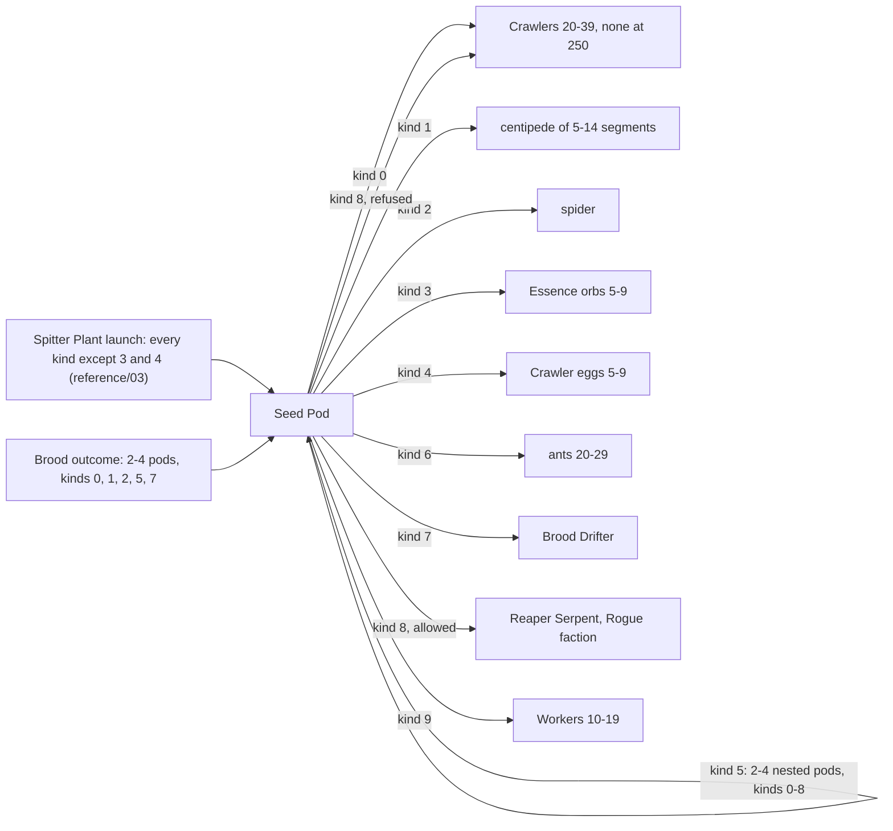

Caption: Figure 3-1, the sources and kinds of a Seed Pod (R-UNIT-511 to R-UNIT-520). A Spitter Plant never chooses kind 3 or kind 4.

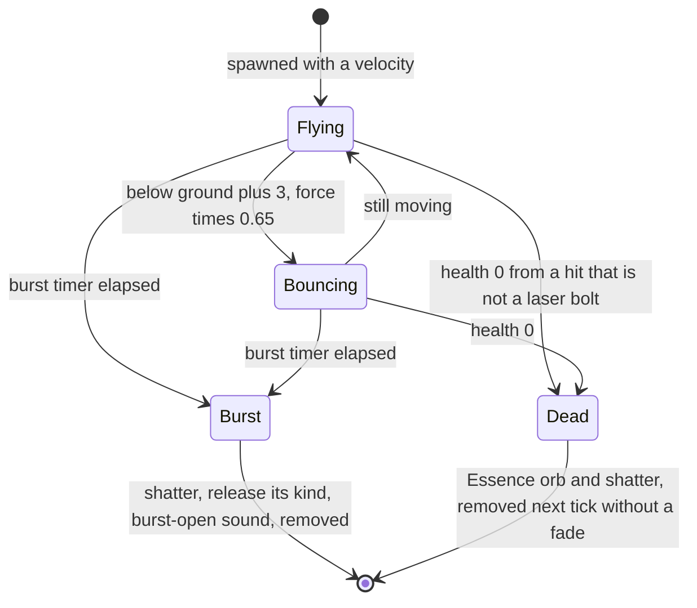

Caption: Figure 3-2, Seed Pod states (R-UNIT-515 to R-UNIT-518).

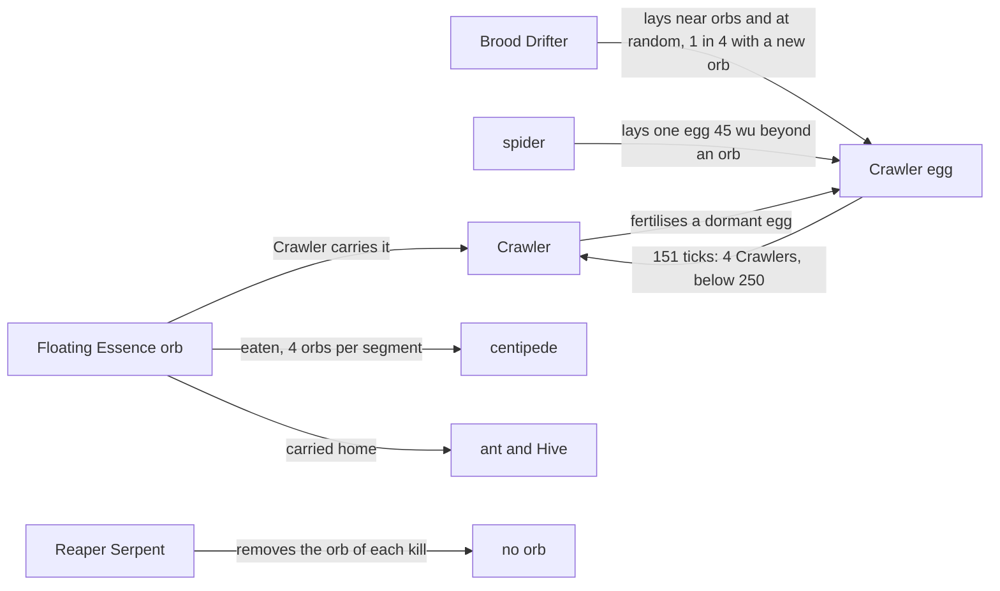

Caption: Figure 3-3, how creatures turn Essence orbs into creatures (R-UNIT-524, R-UNIT-533, R-UNIT-544, R-UNIT-554, R-UNIT-566, R-UNIT-591).

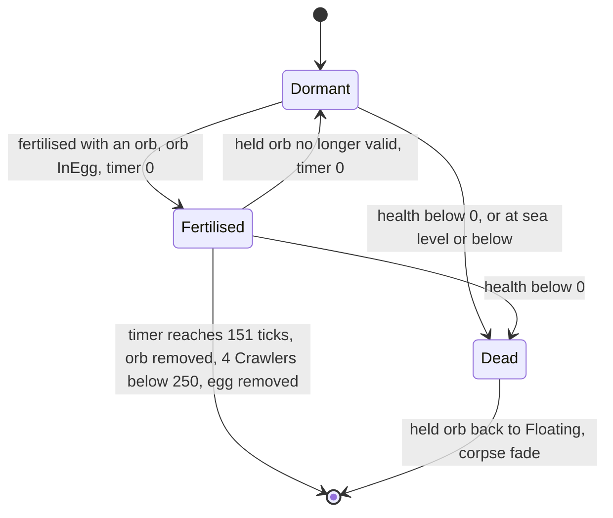

Caption: Figure 3-4, Crawler egg states (R-UNIT-524 to R-UNIT-527). A dormant egg never decays (DEC-091).

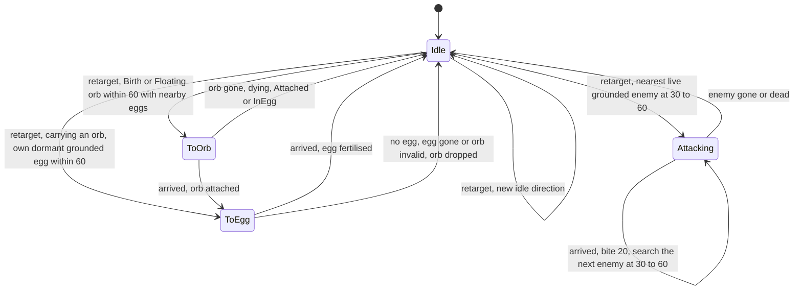

Caption: Figure 3-5, Crawler states (R-UNIT-531 to R-UNIT-534).

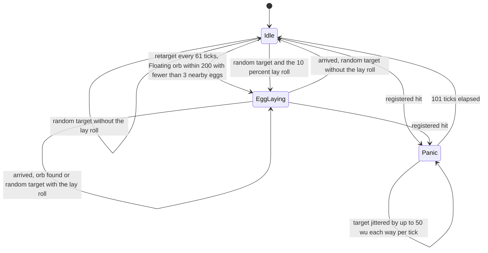

Caption: Figure 3-6, Brood Drifter states (R-UNIT-542 to R-UNIT-545).

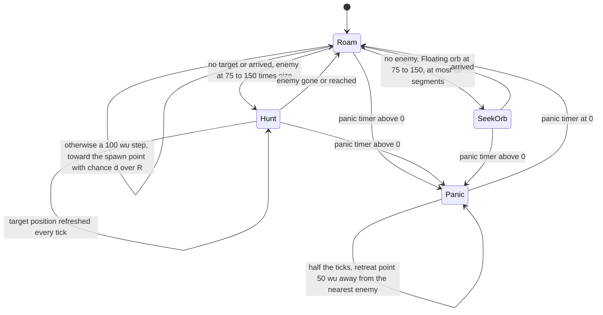

Caption: Figure 3-7, centipede head states (R-UNIT-553). Every tick, in every state, the head eats and every segment attacks.

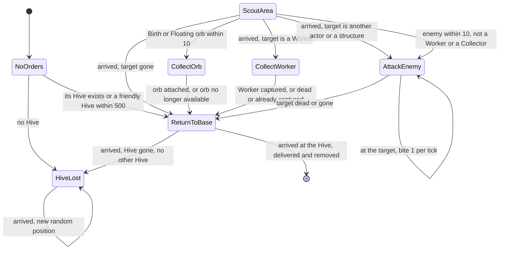

Caption: Figure 3-8, ant orders (R-UNIT-561 to R-UNIT-567). The search of R-UNIT-562 can interrupt every order.

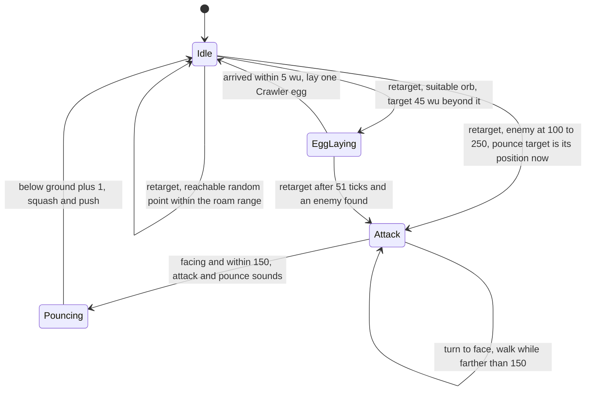

Caption: Figure 3-9, spider states (R-UNIT-572 to R-UNIT-575).

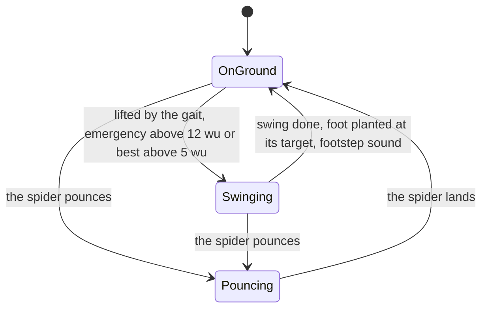

Caption: Figure 3-10, procedural foot states, presentation only (R-UNIT-578, R-UNIT-581 to R-UNIT-585).

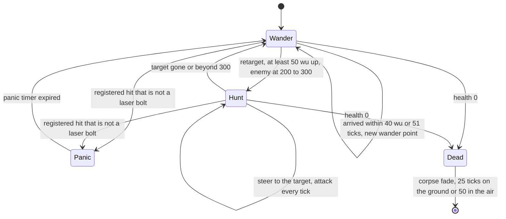

Caption: Figure 3-11, Reaper Serpent states (R-UNIT-588 to R-UNIT-593).

## 4 Tuning table

Every value is a reference value adopted as the Species starting value (DEC-004). Tick counts are the reference counts (DEC-002); a nominal duration in seconds is shown beside them. Keys cited here and defined elsewhere are listed in §4.12.

### 4.1 Seed Pod

| key | value | unit | range or notes | requirement | DEC |
|---|---|---|---|---|---|
| `ref.unit.seed_pod.launch_size_spread` | 0.3 | — | size 1 ± 0.15 | R-UNIT-511 | — |
| `ref.unit.seed_pod.launch_speed_spread` | 0.2 | — | speed × (1 ± 0.1) | R-UNIT-511 | — |
| `ref.unit.seed_pod.group_count_min` | 2 | pods | | R-UNIT-512, R-UNIT-514 | — |
| `ref.unit.seed_pod.group_count_spread` | 3 | pods | count 2 to 4 | R-UNIT-512, R-UNIT-514 | — |
| `ref.unit.seed_pod.brood_start_height` | 20 | wu | above the target point | R-UNIT-512 | — |
| `ref.unit.seed_pod.brood_lift` | 4 | — | y of the launch direction before normalising | R-UNIT-512 | — |
| `ref.unit.seed_pod.brood_speed_min` | 50 | wu/s | | R-UNIT-512 | — |
| `ref.unit.seed_pod.brood_speed_spread` | 50 | wu/s | 50 to 100 | R-UNIT-512 | — |
| `ref.unit.seed_pod.nested_speed_min` | 75 | wu/s | | R-UNIT-514 | — |
| `ref.unit.seed_pod.nested_speed_spread` | 50 | wu/s | 75 to 125 | R-UNIT-514 | — |
| `ref.unit.seed_pod.default_burst_base` | 200 | ticks | 20 s | R-UNIT-515 | DEC-652 |
| `ref.unit.seed_pod.default_burst_spread` | 100 | ticks | 200 to 300 ticks | R-UNIT-515 | — |
| `ref.unit.seed_pod.launch_burst_base` | 40 | ticks | 4 s | R-UNIT-515 | — |
| `ref.unit.seed_pod.launch_burst_spread` | 40 | ticks | 40 to 80 ticks | R-UNIT-515 | — |
| `ref.unit.seed_pod.initial_force` | 1.0 | — | | R-UNIT-517 | — |
| `ref.unit.seed_pod.gravity_per_tick` | 9.8 | wu/s per tick × force | about 98 wu/s² at force 1 | R-UNIT-517 | DEC-092 |
| `ref.unit.seed_pod.bounce_clearance` | 3 | wu | above the terrain | R-UNIT-517 | — |
| `ref.unit.seed_pod.bounce_friction` | 0.65 | × force | per bounce | R-UNIT-517 | — |
| `ref.unit.seed_pod.bounce_sound_force` | 0.1 | force | no bounce sound at or below it | R-UNIT-517 | — |
| `ref.unit.seed_pod.tumble_rate` | 30 | rad/s × force² | | R-UNIT-517 | — |
| `ref.unit.seed_pod.self_right_up` | 0.3 | up.y | | R-UNIT-517 | — |
| `ref.unit.seed_pod.self_right_force` | 0.4 | force | | R-UNIT-517 | — |
| `ref.unit.seed_pod.release_spread` | 0 | wu | spawn spread of every release | R-UNIT-519 | — |
| `ref.unit.seed_pod.crawlers_min` | 20 | Crawlers | | R-UNIT-519 | — |
| `ref.unit.seed_pod.crawlers_spread` | 20 | Crawlers | 20 to 39 | R-UNIT-519 | — |
| `ref.unit.seed_pod.crawlers_roam` | 100 | wu | | R-UNIT-519, R-UNIT-520 | — |
| `ref.unit.seed_pod.centipede_size_min` | 5 | segments | | R-UNIT-519 | — |
| `ref.unit.seed_pod.centipede_size_spread` | 10 | segments | 5 to 14 | R-UNIT-519 | — |
| `ref.unit.seed_pod.centipede_roam` | 200 | wu | | R-UNIT-519 | — |
| `ref.unit.seed_pod.spider_roam` | 150 | wu | | R-UNIT-519 | — |
| `ref.unit.seed_pod.orbs_min` | 5 | Essence orbs | | R-UNIT-519 | — |
| `ref.unit.seed_pod.orbs_spread` | 5 | Essence orbs | 5 to 9 | R-UNIT-519 | — |
| `ref.unit.seed_pod.orb_speed_min` | 20 | wu/s | horizontal | R-UNIT-519 | — |
| `ref.unit.seed_pod.orb_speed_spread` | 20 | wu/s | 20 to 40 | R-UNIT-519 | — |
| `ref.unit.seed_pod.eggs_min` | 5 | Crawler eggs | | R-UNIT-519 | — |
| `ref.unit.seed_pod.eggs_spread` | 5 | Crawler eggs | 5 to 9 | R-UNIT-519 | — |
| `ref.unit.seed_pod.egg_speed_min` | 20 | wu/s | | R-UNIT-519 | — |
| `ref.unit.seed_pod.egg_speed_spread` | 20 | wu/s | 20 to 40 | R-UNIT-519 | — |
| `ref.unit.seed_pod.ants_min` | 20 | ants | | R-UNIT-519 | — |
| `ref.unit.seed_pod.ants_spread` | 10 | ants | 20 to 29 | R-UNIT-519 | — |
| `ref.unit.seed_pod.throw_speed_min` | 10 | wu/s | ants and Workers | R-UNIT-519 | — |
| `ref.unit.seed_pod.throw_speed_spread` | 20 | wu/s | 10 to 30 | R-UNIT-519 | — |
| `ref.unit.seed_pod.thrown_roam` | 0 | wu | eggs, nested pods, ants, Workers | R-UNIT-519 | — |
| `ref.unit.seed_pod.brood_drifter_roam` | 200 | wu | | R-UNIT-519 | — |
| `ref.unit.seed_pod.reaper_serpent_roam` | 200 | wu | | R-UNIT-519 | — |
| `ref.unit.seed_pod.workers_min` | 10 | Workers | | R-UNIT-519 | DEC-453 |
| `ref.unit.seed_pod.workers_spread` | 10 | Workers | 10 to 19 | R-UNIT-519 | DEC-453 |
| `ref.unit.seed_pod.pulse_rate` | 2 | rad/s | presentation | R-UNIT-521 | DEC-007 |
| `ref.unit.seed_pod.pulse_amplitude` | 0.4 | × size | presentation | R-UNIT-521 | DEC-007 |
| `ref.unit.seed_pod.shadow_scale` | 10 | wu per size | presentation | R-UNIT-521 | DEC-007 |

### 4.2 Crawler egg

| key | value | unit | range or notes | requirement | DEC |
|---|---|---|---|---|---|
| `ref.unit.crawler_egg.orb_hold_height` | 3 | wu | | R-UNIT-524 | — |
| `ref.unit.crawler_egg.hatch_ticks` | 151 | ticks | nominal 15.0 s | R-UNIT-524 | DEC-002 |
| `ref.unit.crawler_egg.hatch_crawlers` | 4 | Crawlers | per Essence orb | R-UNIT-524 | — |
| `ref.unit.crawler_egg.hatch_roam` | 200 | wu | | R-UNIT-524 | — |
| `ref.unit.crawler_egg.dormant_lifetime` | 1201 | ticks | nominal 120 s; no effect in the reference default | R-UNIT-525 | DEC-091 |
| `ref.unit.crawler_egg.water_damage` | 500 | health | at or below sea level | R-UNIT-526 | — |
| `ref.unit.crawler_egg.card_size` | 8 | wu | card edge; presentation | R-UNIT-528 | DEC-007 |
| `ref.unit.crawler_egg.min_alpha` | 0.1 | alpha | presentation | R-UNIT-528 | DEC-007 |
| `ref.unit.crawler_egg.fragments` | 3 | fragments | presentation | R-UNIT-528 | DEC-007 |

### 4.3 Crawler

| key | value | unit | range or notes | requirement | DEC |
|---|---|---|---|---|---|
| `ref.unit.crawler.team_limit` | 250 | Crawlers per team | fading corpses count | R-UNIT-510, R-UNIT-519, R-UNIT-524, R-UNIT-529 | DEC-453 |
| `ref.unit.crawler.hover_height` | 0.1 | wu | | R-UNIT-530 | — |
| `ref.unit.crawler.fall_gravity` | 10 | wu/s² | | R-UNIT-530 | — |
| `ref.unit.crawler.land_height` | 2 | wu | above the terrain | R-UNIT-530 | — |
| `ref.unit.crawler.first_retarget_spread` | 20 | ticks | first retarget 0 to 20 ticks | R-UNIT-531 | DEC-652 |
| `ref.unit.crawler.retarget_ticks` | 11 | ticks | nominal 1.0 s | R-UNIT-531 | DEC-002 |
| `ref.unit.crawler.egg_search_range` | 60 | wu | | R-UNIT-531 | — |
| `ref.unit.crawler.search_min` | 30 | wu | | R-UNIT-531, R-UNIT-532 | — |
| `ref.unit.crawler.search_max` | 60 | wu | | R-UNIT-531, R-UNIT-532 | — |
| `ref.unit.crawler.orb_search_range` | 60 | wu | | R-UNIT-531 | — |
| `ref.unit.crawler.bite_damage` | 20 | health per bite | one bite per tick in contact, 200 per second | R-UNIT-532 | — |
| `ref.unit.crawler.orb_carry_height` | 2 | wu | | R-UNIT-533 | — |
| `ref.unit.crawler.return_threshold` | 0.75 | d ÷ R | no return below it | R-UNIT-534 | — |
| `ref.unit.crawler.direction_tries` | 3 | tries | | R-UNIT-534 | — |
| `ref.unit.crawler.sample_ticks` | 6 | ticks | nominal 0.5 s | R-UNIT-535 | DEC-002 |
| `ref.unit.crawler.sample_height_step` | 3 | wu | | R-UNIT-535 | — |
| `ref.unit.crawler.tail_length` | 175 | wu | | R-UNIT-535 | — |
| `ref.unit.crawler.glow_step` | 10 | wu | | R-UNIT-535 | — |
| `ref.unit.crawler.group_enemy_margin` | 60 | wu | | R-UNIT-538 | — |
| `ref.unit.crawler.worm_half_width` | 3 | wu | presentation | R-UNIT-539 | DEC-007 |
| `ref.unit.crawler.glow_half_width` | 12 | wu | presentation | R-UNIT-539 | DEC-007 |
| `ref.unit.crawler.worm_alpha` | 200 | alpha (0 to 255) | presentation | R-UNIT-539 | DEC-007 |
| `ref.unit.crawler.glow_alpha` | 150 | alpha (0 to 255) | presentation | R-UNIT-539 | DEC-007 |
| `ref.unit.crawler.rogue_worm_colour` | 255, 255, 255, 0 | RGBA | presentation | R-UNIT-539 | DEC-007 |
| `ref.unit.crawler.rogue_glow_colour` | 200, 200, 200, 50 | RGBA | presentation | R-UNIT-539 | DEC-007 |
| `ref.unit.crawler.detail_history_step` | 0.25 | history fraction | presentation | R-UNIT-539 | DEC-007 |
| `ref.unit.crawler.detail_far` | 1000 | wu | presentation | R-UNIT-539 | DEC-007 |
| `ref.unit.crawler.detail_near` | 500 | wu | presentation | R-UNIT-539 | DEC-007 |

### 4.4 Brood Drifter

| key | value | unit | range or notes | requirement | DEC |
|---|---|---|---|---|---|
| `ref.unit.brood_drifter.hover_height` | 100 | wu | of its targets, not of its spawn | R-UNIT-540, R-UNIT-543 | — |
| `ref.unit.brood_drifter.slow_radius` | 50 | wu | also the laying radius | R-UNIT-541, R-UNIT-544 | — |
| `ref.unit.brood_drifter.steer_blend` | 0.5 | per s | velocity blend dt × 0.5 | R-UNIT-541 | — |
| `ref.unit.brood_drifter.wobble_rate` | 3 | rad/s of match time | | R-UNIT-541 | — |
| `ref.unit.brood_drifter.wobble_amplitude` | 1.5 | rad/s | | R-UNIT-541 | — |
| `ref.unit.brood_drifter.arrival` | 10 | wu | | R-UNIT-541 | — |
| `ref.unit.brood_drifter.retarget_ticks` | 61 | ticks | nominal 6.0 s | R-UNIT-542 | DEC-002 |
| `ref.unit.brood_drifter.orb_search_range` | 200 | wu | | R-UNIT-542 | — |
| `ref.unit.brood_drifter.max_nearby_eggs` | 3 | eggs | fewer than this | R-UNIT-542 | — |
| `ref.unit.brood_drifter.random_step` | 200 | wu | return step and box side | R-UNIT-543 | — |
| `ref.unit.brood_drifter.hover_spread` | 0.15 | × hover height | ±15 % | R-UNIT-543 | — |
| `ref.unit.brood_drifter.random_lay_chance` | 10 | per 100 | at difficulty 0 | R-UNIT-543 | DEC-010 |
| `ref.unit.brood_drifter.lay_offset` | 60 | wu | `NextSigned(60)`: ±30 on x and z | R-UNIT-544 | — |
| `ref.unit.brood_drifter.egg_lay_height` | 20 | wu | | R-UNIT-544 | — |
| `ref.unit.brood_drifter.egg_interval_base` | 20 | ticks | 2 s at difficulty 0 | R-UNIT-544 | DEC-010 |
| `ref.unit.brood_drifter.egg_interval_spread` | 20 | ticks | 20 to 40 ticks | R-UNIT-544 | — |
| `ref.unit.brood_drifter.prefertilise_one_in` | 4 | — | 1 in 4 eggs | R-UNIT-544 | DEC-084 |
| `ref.unit.brood_drifter.panic_ticks` | 101 | ticks | nominal 10 s | R-UNIT-545 | DEC-002 |
| `ref.unit.brood_drifter.panic_speed_factor` | 3 | × speed | upward | R-UNIT-545 | — |
| `ref.unit.brood_drifter.panic_jitter` | 100 | wu | `NextSigned(100)`: ±50 per tick | R-UNIT-545 | DEC-092 |
| `ref.unit.brood_drifter.tail_count` | 4 | tails | presentation | R-UNIT-547 | DEC-007 |
| `ref.unit.brood_drifter.tail_segments` | 3 | segments | presentation | R-UNIT-547 | DEC-007 |
| `ref.unit.brood_drifter.shadow_size` | 20 | wu | presentation | R-UNIT-547 | DEC-007 |

### 4.5 centipede

| key | value | unit | range or notes | requirement | DEC |
|---|---|---|---|---|---|
| `ref.unit.centipede.tail_size` | 0.2 | size | the tail's target size and the base of the head size | R-UNIT-549, R-UNIT-550 | — |
| `ref.unit.centipede.size_ratio` | 1.1 | × size | per segment toward the head | R-UNIT-549, R-UNIT-550 | — |
| `ref.unit.centipede.head_size_cap` | 10 | size | initial head size | R-UNIT-549 | — |
| `ref.unit.centipede.contact_radius_factor` | 10 | wu per size | fixed at begin | R-UNIT-549 | — |
| `ref.unit.centipede.health_size_factor` | 2 | × size | | R-UNIT-550 | — |
| `ref.unit.centipede.size_cap` | 1.0 | size | | R-UNIT-550 | — |
| `ref.unit.centipede.size_tolerance` | 0.01 | size | | R-UNIT-550 | — |
| `ref.unit.centipede.size_blend` | 0.1 | fraction per tick | | R-UNIT-550 | DEC-092 |
| `ref.unit.centipede.history_samples` | 3 | positions | | R-UNIT-551 | — |
| `ref.unit.centipede.head_turn` | 3 | per s | blend dt × 3 | R-UNIT-552 | — |
| `ref.unit.centipede.trail_turn` | 1.5 | per s | blend dt × 1.5 | R-UNIT-552 | — |
| `ref.unit.centipede.arrival` | 20 | wu | | R-UNIT-552 | — |
| `ref.unit.centipede.structure_lookahead` | 150 | wu | | R-UNIT-552 | — |
| `ref.unit.centipede.search_min` | 75 | wu | × head size for enemies | R-UNIT-553 | — |
| `ref.unit.centipede.search_max` | 150 | wu | × head size for enemies and retreats | R-UNIT-553 | — |
| `ref.unit.centipede.max_segments` | 20 | segments | no orb seeking or eating above it | R-UNIT-553, R-UNIT-554 | — |
| `ref.unit.centipede.wander_step` | 100 | wu | | R-UNIT-553 | — |
| `ref.unit.centipede.retreat_chance` | 0.5 | per tick | | R-UNIT-553 | DEC-092 |
| `ref.unit.centipede.retreat_distance` | 50 | wu | | R-UNIT-553 | — |
| `ref.unit.centipede.eat_range` | 10 | wu | horizontal | R-UNIT-554 | — |
| `ref.unit.centipede.eat_chance_divisor` | 2 | — | chance size ÷ 2 per candidate per tick | R-UNIT-554 | DEC-092 |
| `ref.unit.centipede.orbs_per_segment` | 4 | Essence orbs | | R-UNIT-554 | — |
| `ref.unit.centipede.contact_damage_factor` | 10 | health per wu | per tick | R-UNIT-555 | DEC-092 |
| `ref.unit.centipede.panic_bands` | 3 | bands | thirds of maximum health | R-UNIT-556 | — |
| `ref.unit.centipede.panic_base` | 20 | ticks | 2 s | R-UNIT-556 | — |
| `ref.unit.centipede.panic_spread` | 20 | ticks | 20 to 40 ticks | R-UNIT-556 | — |

### 4.6 ant

| key | value | unit | range or notes | requirement | DEC |
|---|---|---|---|---|---|
| `ref.unit.ant.speed_spread` | 0.4 | — | speed × (1 ± 0.2): 20 to 30 wu/s | R-UNIT-560 | — |
| `ref.unit.ant.scale_spread` | 0.9 | — | scale 0.55 to 1.45 | R-UNIT-560 | — |
| `ref.unit.ant.hurry_factor` | 2 | × speed | CollectWorker and AttackEnemy | R-UNIT-560 | DEC-090 |
| `ref.unit.ant.hive_search` | 500 | wu | | R-UNIT-561 | — |
| `ref.unit.ant.search_range` | 10 | wu | Essence orbs and enemies on the way | R-UNIT-562 | — |
| `ref.unit.ant.heading_jitter` | 0.2 | rad | `NextSigned(0.2)` per tick | R-UNIT-563 | DEC-092 |
| `ref.unit.ant.arrival_min` | 1 | wu | | R-UNIT-563 | — |
| `ref.unit.ant.bite_damage` | 1 | health per tick | about 10 per second | R-UNIT-564 | DEC-092 |
| `ref.unit.ant.stray_return_range` | 400 | wu | | R-UNIT-567 | — |
| `ref.unit.ant.wander_step` | 100 | wu | | R-UNIT-567 | — |

### 4.7 spider

| key | value | unit | range or notes | requirement | DEC |
|---|---|---|---|---|---|
| `ref.unit.spider.walk_speed_cap` | 30 | wu/s | walking speed min(distance, 30) | R-UNIT-570 | — |
| `ref.unit.spider.move_dot` | 0.5 | dot product | | R-UNIT-570 | — |
| `ref.unit.spider.hover_height` | 3 | wu | | R-UNIT-571 | — |
| `ref.unit.spider.turn_rate` | 0.1 | rad per tick | | R-UNIT-571 | DEC-092 |
| `ref.unit.spider.fine_turn_rate` | 0.05 | rad per tick | | R-UNIT-571 | DEC-092 |
| `ref.unit.spider.fine_turn_dot` | 0.9 | dot product | | R-UNIT-571 | — |
| `ref.unit.spider.face_dot` | 0.999 | dot product | | R-UNIT-571 | — |
| `ref.unit.spider.retarget_ticks` | 51 | ticks | nominal 5 s | R-UNIT-572 | DEC-002 |
| `ref.unit.spider.pounce_retarget_ticks` | 30 | ticks | nominal 3 s | R-UNIT-572 | DEC-002 |
| `ref.unit.spider.land_retarget_ticks` | 61 | ticks | nominal 6 s | R-UNIT-572 | DEC-002 |
| `ref.unit.spider.attack_search_min` | 100 | wu | | R-UNIT-572 | — |
| `ref.unit.spider.attack_search_max` | 250 | wu | | R-UNIT-572 | — |
| `ref.unit.spider.orb_search_min` | 30 | wu | | R-UNIT-572 | — |
| `ref.unit.spider.orb_search_max` | 100 | wu | | R-UNIT-572 | — |
| `ref.unit.spider.orb_min_height` | 10 | wu | | R-UNIT-572 | — |
| `ref.unit.spider.max_nearby_eggs` | 3 | eggs | fewer than this | R-UNIT-572 | — |
| `ref.unit.spider.egg_offset` | 45 | wu | beyond the orb | R-UNIT-572 | — |
| `ref.unit.spider.path_height_min` | 0.1 | wu | | R-UNIT-572 | — |
| `ref.unit.spider.path_height_max` | 100 | wu | | R-UNIT-572 | — |
| `ref.unit.spider.wander_tries` | 10 | tries | | R-UNIT-572 | — |
| `ref.unit.spider.egg_arrival` | 5 | wu | | R-UNIT-573 | — |
| `ref.unit.spider.pounce_range` | 150 | wu | | R-UNIT-574 | — |
| `ref.unit.spider.pounce_lift` | 0.5 | — | y of the pounce direction before normalising | R-UNIT-574 | — |
| `ref.unit.spider.pounce_speed_factor` | 24 | wu/s per √wu | | R-UNIT-574 | — |
| `ref.unit.spider.pounce_gravity_per_tick` | 40 | wu/s per tick | 400 wu/s² | R-UNIT-575 | DEC-092 |
| `ref.unit.spider.land_clearance` | 1 | wu | | R-UNIT-575 | — |
| `ref.unit.spider.squash_radius` | 40 | wu | | R-UNIT-575 | — |
| `ref.unit.spider.squash_spread` | 0.3 | — | fraction × (1 + 0 to 0.3) | R-UNIT-575 | — |
| `ref.unit.spider.crush_radius` | 20 | wu | | R-UNIT-575 | — |
| `ref.unit.spider.crush_damage` | 100 | health × fraction | | R-UNIT-575 | — |
| `ref.unit.spider.push_lift` | 5 | × front length | | R-UNIT-575 | — |
| `ref.unit.spider.push_factor` | 30 | wu/s × fraction | | R-UNIT-575 | — |
| `ref.unit.spider.push_cap` | 20 | wu/s | | R-UNIT-575 | — |
| `ref.unit.spider.avoid_radius` | 22 | wu | | R-UNIT-576 | — |
| `ref.unit.spider.avoid_step` | 40 | wu | | R-UNIT-576 | — |
| `ref.unit.spider.foot_damage_radius` | 20 | wu | read by no rule | R-UNIT-577 | — |
| `ref.unit.spider.foot_damage_strength` | 10 | health | read by no rule | R-UNIT-577 | — |
| `ref.unit.spider.normal_speed` | 300 | — | read by no rule | R-UNIT-577 | — |
| `ref.unit.spider.attack_speed` | 90 | — | read by no rule | R-UNIT-577 | — |
| `ref.unit.spider.attack_preamble` | 5 | s | read by no rule | R-UNIT-577 | — |
| `ref.unit.spider.legs` | 8 | legs | | R-UNIT-578 | — |
| `ref.unit.spider.pounce_pose_rate` | 2 | per s | presentation | R-UNIT-578 | DEC-007 |
| `ref.unit.spider.max_lifts_per_tick` | 2 | feet | presentation | R-UNIT-578 | DEC-007 |
| `ref.unit.spider.foot_move` | 5 | wu | presentation | R-UNIT-578 | DEC-007 |
| `ref.unit.spider.foot_emergency` | 12 | wu | presentation | R-UNIT-578 | DEC-007 |
| `ref.unit.spider.gait_slope_factor` | 2.5 | × ideal slope | presentation | R-UNIT-578 | DEC-007 |
| `ref.unit.spider.gait_start_set` | 2 | set | presentation | R-UNIT-579 | DEC-007 |
| `ref.unit.spider.gait.leg_lift` | 3.0 | wu | every set; presentation | R-UNIT-579 | DEC-007 |
| `ref.unit.spider.gait.ideal_slope` | 2.6 | slope | every set; presentation | R-UNIT-579 | DEC-007 |
| `ref.unit.spider.gait.0.ideal_speed` | 10 | wu/s | presentation | R-UNIT-579 | DEC-007 |
| `ref.unit.spider.gait.0.swing` | 0.4 | s | presentation clock | R-UNIT-579 | DEC-007 |
| `ref.unit.spider.gait.0.lift_delay` | 0.11 | s | presentation clock | R-UNIT-579 | DEC-007 |
| `ref.unit.spider.gait.0.look_ahead` | 0.75 | — | presentation | R-UNIT-579 | DEC-007 |
| `ref.unit.spider.gait.1.ideal_speed` | 30 | wu/s | presentation | R-UNIT-579 | DEC-007 |
| `ref.unit.spider.gait.1.swing` | 0.25 | s | presentation clock | R-UNIT-579 | DEC-007 |
| `ref.unit.spider.gait.1.lift_delay` | 0.06 | s | presentation clock | R-UNIT-579 | DEC-007 |
| `ref.unit.spider.gait.1.look_ahead` | 0.3 | — | presentation | R-UNIT-579 | DEC-007 |
| `ref.unit.spider.gait.2.ideal_speed` | 50 | wu/s | presentation | R-UNIT-579 | DEC-007 |
| `ref.unit.spider.gait.2.swing` | 0.25 | s | presentation clock | R-UNIT-579 | DEC-007 |
| `ref.unit.spider.gait.2.lift_delay` | 0.04 | s | presentation clock | R-UNIT-579 | DEC-007 |
| `ref.unit.spider.gait.2.look_ahead` | 0.2 | — | presentation | R-UNIT-579 | DEC-007 |

### 4.8 Procedural leg

| key | value | unit | range or notes | requirement | DEC |
|---|---|---|---|---|---|
| `ref.unit.spider.leg.yaw_prediction` | 1.2 | × angular velocity | presentation | R-UNIT-583 | DEC-007 |
| `ref.unit.spider.leg.swing_done` | 1.0001 | swing fraction | presentation | R-UNIT-583 | DEC-007 |
| `ref.unit.spider.leg.knee_factor` | 0.4 | — | presentation | R-UNIT-584 | DEC-007 |
| `ref.unit.spider.leg.pounce_velocity_factor` | 0.05 | s | presentation | R-UNIT-585 | DEC-007 |

### 4.9 Reaper Serpent

| key | value | unit | range or notes | requirement | DEC |
|---|---|---|---|---|---|
| `ref.unit.reaper_serpent.alive_limit` | 2 | Reaper Serpents per match | | R-UNIT-520, R-UNIT-586 | — |
| `ref.unit.reaper_serpent.fixed_speed` | 130 | wu/s | replaces the unused speed stat | R-UNIT-587 | DEC-090 |
| `ref.unit.reaper_serpent.hit_radius_factor` | 1.5 | × mesh radius | | R-UNIT-587 | DEC-012 |
| `ref.unit.reaper_serpent.turn_blend` | 2 | per s | blend dt × 2 | R-UNIT-588 | — |
| `ref.unit.reaper_serpent.weave_rate` | 6 | rad/s of match time | | R-UNIT-588 | — |
| `ref.unit.reaper_serpent.weave_amplitude` | 1.5 | rad | | R-UNIT-588 | — |
| `ref.unit.reaper_serpent.ground_lookahead` | 50 | wu | | R-UNIT-588 | — |
| `ref.unit.reaper_serpent.arrival` | 40 | wu | | R-UNIT-588 | — |
| `ref.unit.reaper_serpent.retarget_ticks` | 51 | ticks | nominal 5 s | R-UNIT-588 | DEC-002 |
| `ref.unit.reaper_serpent.acquire_height` | 50 | wu | above the terrain | R-UNIT-589 | — |
| `ref.unit.reaper_serpent.search_min` | 200 | wu | | R-UNIT-589 | — |
| `ref.unit.reaper_serpent.search_max` | 300 | wu | also the drop distance | R-UNIT-589 | — |
| `ref.unit.reaper_serpent.wander_step` | 160 | wu | | R-UNIT-589 | — |
| `ref.unit.reaper_serpent.wander_height` | 100 | wu | above the terrain | R-UNIT-589 | — |
| `ref.unit.reaper_serpent.wander_height_spread` | 100 | wu | `NextSigned(100)`: ±50 | R-UNIT-589 | — |
| `ref.unit.reaper_serpent.attack_panic_threshold` | 1 | ticks | attacks only below one tick of panic | R-UNIT-590 | — |
| `ref.unit.reaper_serpent.damage_range` | 25 | wu | | R-UNIT-590 | — |
| `ref.unit.reaper_serpent.damage_factor` | 50 | health per wu | per tick | R-UNIT-590 | DEC-092 |
| `ref.unit.reaper_serpent.wisp_tilt` | 1 | — | `NextSigned(1)` | R-UNIT-591 | — |
| `ref.unit.reaper_serpent.wisp_velocity_factor` | 0.5 | × velocity | | R-UNIT-591 | — |
| `ref.unit.reaper_serpent.wisp_rise_base` | 20 | wu/s | | R-UNIT-591 | — |
| `ref.unit.reaper_serpent.wisp_rise_spread` | 25 | wu/s | 20 to 45 | R-UNIT-591 | — |
| `ref.unit.reaper_serpent.max_eaten` | 50 | entries | presentation | R-UNIT-591 | DEC-007 |
| `ref.unit.reaper_serpent.eaten_display_ticks` | 600 | ticks | 60 s of presentation time | R-UNIT-591 | DEC-007 |
| `ref.unit.reaper_serpent.panic_base` | 20 | ticks | 2 s | R-UNIT-592 | — |
| `ref.unit.reaper_serpent.panic_spread` | 20 | ticks | 20 to 40 ticks | R-UNIT-592 | — |
| `ref.unit.reaper_serpent.retreat_chance` | 0.5 | per tick | | R-UNIT-592 | DEC-092 |
| `ref.unit.reaper_serpent.retreat_distance` | 50 | wu | | R-UNIT-592 | — |
| `ref.unit.reaper_serpent.retreat_search` | 300 | wu | | R-UNIT-592 | — |
| `ref.unit.reaper_serpent.retreat_height_cap` | 300 | wu | | R-UNIT-592 | — |
| `ref.unit.reaper_serpent.tail_divisor` | 30 | wu per sample | | R-UNIT-594 | — |
| `ref.unit.reaper_serpent.tail_min` | 9 | samples | | R-UNIT-594 | — |
| `ref.unit.reaper_serpent.tail_max` | 25 | samples | | R-UNIT-594 | — |
| `ref.unit.reaper_serpent.tail_scale_max` | 1.5 | × | presentation | R-UNIT-594 | DEC-007 |
| `ref.unit.reaper_serpent.tail_scale_min` | 0.5 | × | presentation | R-UNIT-594 | DEC-007 |
| `ref.unit.reaper_serpent.tail_scale_last` | 0.8 | × | presentation | R-UNIT-594 | DEC-007 |
| `ref.unit.reaper_serpent.head_shadow` | 50 | wu | presentation | R-UNIT-594 | DEC-007 |
| `ref.unit.reaper_serpent.tail_shadow` | 20 | wu × scale | presentation | R-UNIT-594 | DEC-007 |

### 4.10 Wisp

| key | value | unit | range or notes | requirement | DEC |
|---|---|---|---|---|---|
| `ref.unit.wisp.offset_spread` | 10 | rad | | R-UNIT-595 | DEC-652 |
| `ref.unit.wisp.axis_rate_max` | 2 | — | initial draw and walk bound | R-UNIT-595, R-UNIT-596 | DEC-652 |
| `ref.unit.wisp.life_ticks` | 6000 | ticks | nominal 600 s | R-UNIT-595 | DEC-002 |
| `ref.unit.wisp.damping` | 0.9 | × velocity per tick | | R-UNIT-596 | DEC-092 |
| `ref.unit.wisp.rate_walk` | 1 | — | cosmetic `NextSigned(1)` per tick | R-UNIT-596 | DEC-013 |
| `ref.unit.wisp.inner_size` | 5 | wu | presentation | R-UNIT-597 | DEC-007 |
| `ref.unit.wisp.outer_size` | 10 | wu | presentation | R-UNIT-597 | DEC-007 |
| `ref.unit.wisp.colour` | 0.9, 0.9, 1.0 | RGB | presentation | R-UNIT-597 | DEC-007 |
| `ref.unit.wisp.alpha_period` | 10 | s | presentation | R-UNIT-597 | DEC-007 |
| `ref.unit.wisp.alpha_min` | 0.1 | alpha | presentation | R-UNIT-597 | DEC-007 |
| `ref.unit.wisp.alpha_max` | 0.7 | alpha | presentation | R-UNIT-597 | DEC-007 |
| `ref.unit.wisp.outer_alpha_factor` | 0.1 | — | presentation | R-UNIT-597 | DEC-007 |
| `ref.unit.wisp.fade_ticks` | 1000 | ticks | nominal 100 s; presentation | R-UNIT-597 | DEC-007 |

### 4.11 Derived values

These follow from the keys above and are given for tests and balance; they are not tuning keys.

| Value | Derivation |
|---|---|
| Crawler contact damage | 20 per tick, 200 per second (R-UNIT-532) |
| Crawler egg output | 1 Essence orb → 4 Crawlers in 151 ticks (R-UNIT-524) |
| centipede segment health | 255 at size ≥ 0.5; 102 at size 0.2 (R-UNIT-550) |
| centipede steady-state sizes | the k-th segment ahead of the tail has size min(0.2 × 1.1^k, 1.0); the cap is reached at k = 17, so only centipedes of 18 or more segments have full-size segments (R-UNIT-550) |
| Reaper Serpent direct hit | (25 − 0) × 50 = 1250 (R-UNIT-590) |
| spider pounce speed at 150 wu | 24 × √150 ≈ 294 wu/s (R-UNIT-574) |
| ant bite | 1 per tick, about 10 per second (R-UNIT-564) |

### 4.12 Keys cited here and defined elsewhere

- [units README](README.md): `ref.unit.<kind>.health`, `ref.unit.<kind>.speed`, `ref.unit.<kind>.rate` for the Seed Pod, Crawler egg, Crawler, Brood Drifter, centipede, ant, spider and Reaper Serpent; `ref.unit.health_max`; `ref.unit.corpse.fade_ground_per_tick`, `ref.unit.corpse.fade_air_per_tick`; the slope keys `ref.unit.crawler.slope_*` and `ref.unit.centipede.slope_*`.
- [reference/12 tick timing](../12_simulation_model/01_tick_timing_and_main_loop.md): `ref.sim.tick_period`.
- [reference/12 space, routing and physics](../12_simulation_model/05_space_routing_and_physics.md): `ref.sim.physics.sea_level`.
- [reference/12 teams and player commands](../12_simulation_model/06_teams_and_player_commands.md): `ref.sim.team.rogue_slot`, `ref.sim.team.visitor_slot`.
- [population flow](../05_population_flow.md): `ref.econ.hive.sortie_interval_ticks`.

## 5 Edge cases and interactions

- **Workers and creatures.** Workers always flee a Reaper Serpent; they treat spiders, Brood Drifters and Seed Pods as threats worth a grenade; they fight ants, Crawlers and centipedes normally; they never treat a Crawler egg as a threat; and they attack enemy Hives through their threat search ([Worker](worker.md)). Laser bolts cannot hurt spiders, Brood Drifters, Seed Pods or Reaper Serpents (R-UNIT-027), so a crowd needs explosions against them.
- **Crawler limit is all or nothing.** A Seed Pod of kind 0 releases no Crawler at all when its team already has 250 or more, but 20 to 39 when it has 249, so a team can exceed 250 (R-UNIT-519). A hatching egg at the limit still consumes its orb (R-UNIT-524).
- **Idle Crawler standing still.** The compass draw of R-UNIT-534 can give (0, 0, 0); the Crawler then stays in place until its next retarget.
- **Crawlers are a meat grinder.** A Crawler in contact bites every tick while no other enemy is 30 to 60 wu away, so ten Crawlers on a Worker kill it in one tick (R-UNIT-532).
- **Dormant eggs pile up.** A dormant egg never decays (R-UNIT-525, DEC-091), so a long match fills with eggs that wait for orbs; only explosions and water clear them.
- **Eggs in water.** An egg at or below sea level takes 500 damage and dies, so eggs thrown into the sea are lost; their held orb returns to Floating (R-UNIT-526, R-UNIT-527).
- **Rogue faction breeders.** A Rogue faction Brood Drifter's pre-fertilised eggs stay dormant, because the Rogue faction's orb spawns are refused (R-UNIT-544).
- **Reaper Serpent fallback.** The nested kind draw already avoids kind 8 when a Reaper Serpent is not allowed (R-UNIT-514), so the kind 0 fallback of R-UNIT-520 applies when the conditions change between the draw and the burst, and to Spitter Plant pods.
- **Seed Pod chains.** A nested pod can itself be of kind 5 (1 in 9, or 1 in 8 while a Reaper Serpent is not allowed), so chains of nested pods are possible; each link is drawn independently.
- **centipede split and member order.** After a split or a growth, a segment can come before its leader in member order; it then interpolates with k = 0 (R-UNIT-551). Member order is the stable order of reference/12 (DEC-016). Both halves of a split stay in the same actor group.
- **centipede growth position.** A new segment is placed at the centipede's spawn point, not at its tail, and takes its trail position on its next advance (R-UNIT-554).
- **Ants walk through structures** and through each other; a captured Worker whose ant dies returns to its idle state where it falls (R-UNIT-563, R-UNIT-565).
- **Hive ants and the cap.** A Hive's ants live in its group and are not counted; the cap check at each sortie sees only the Rogue faction's other bodies (DEC-084, DEC-453).
- **Spider snapshot.** A spider pounces at the position its target had when it was chosen, so a moving target can escape the squash (R-UNIT-572).
- **Spider avoidance draws.** The avoidance rule makes one simulation draw per spider found near p + v, so the number of draws depends on how many spiders are close (R-UNIT-576).
- **Bot controller.** A creature's enemy search can choose a bot controller, which cannot be killed (DEC-311).
- **Brood ownership.** Brood creatures belong to the team that placed the power, so they attack that team's enemies and leave its own units alone, while Reaper Serpents from any Seed Pod are always Rogue faction (R-UNIT-512, R-UNIT-519, DEC-107).

## 6 Acceptance criteria

- **AC-CRE-01** (R-UNIT-513) Given 100,000 Brood kind draws, then each of the kinds 0, 1, 2, 5 and 7 has a frequency of 20 % ± 1 %, and no draw gives kind 3, 4, 6, 8 or 9.
- **AC-CRE-02** (R-UNIT-514, R-UNIT-520) Given a match in Siege, when a nested pod's kind is drawn, then the kind is one of 0 to 7, uniform; given a match outside Siege with 2 Reaper Serpents alive, then the same; given 1 alive outside Siege, then the kind is one of 0 to 8, uniform.
- **AC-CRE-03** (R-UNIT-515) Given Seed Pods from each source, then a nested pod bursts 200 to 300 ticks after its spawn and a Brood or Spitter Plant pod 40 to 80 ticks after its spawn.
- **AC-CRE-04** (R-UNIT-517) Given a pod with f = 1 that falls below ground + 3, when it bounces, then f becomes 0.65, its speed after the bounce is 0.85 × 0.65 = 0.5525 of its speed before, its height is at least ground + 3 and the bounce sound plays; the bounce sound plays on the first five bounces (f = 0.65, 0.4225, 0.2746, 0.1785, 0.1160) and not from the sixth (f = 0.0754).
- **AC-CRE-05** (R-UNIT-519, R-UNIT-529) Given a team with 250 Crawlers, when its Seed Pod of kind 0 bursts, then no Crawler is released; given 249, then 20 to 39 are released.
- **AC-CRE-06** (R-UNIT-524) Given an egg fertilised at tick T and a team with fewer than 250 Crawlers, then at tick T + 151 the orb is removed, 4 Crawlers of the egg's team spawn and the egg is removed; with 250 Crawlers, the orb is removed and none spawn.
- **AC-CRE-07** (R-UNIT-525) Given a dormant egg at 10 health, when 2000 ticks pass with no damage, then it is alive at 10 health.
- **AC-CRE-08** (R-UNIT-527) Given an egg at 10 health, when −10 applies, then it is alive at 0; when a further −1 applies, then it dies, releases no orb and plays no sound.
- **AC-CRE-09** (R-UNIT-532) Given a Worker at 50 health in contact with one Crawler and no other enemy 30 to 60 wu from the Crawler, then the Worker dies on the third consecutive tick of contact.
- **AC-CRE-10** (R-UNIT-534) Given a Crawler with d ÷ R = 0.5, then its return chance is 0; with d ÷ R = 0.8, then 0.8.
- **AC-CRE-11** (R-UNIT-544, R-UNIT-546) Given a Brood Drifter of a player team laying 400 eggs, then about 100 are fertilised at laying; given one of the Rogue faction, then none are; given a Brood Drifter, when −1 applies, then health is unchanged and it does not panic; when −2 applies, it loses 2 and panics for 101 ticks.
- **AC-CRE-12** (R-UNIT-549, R-UNIT-550) Given a new centipede of 5 segments, then its initial sizes from head to tail are 0.322, 0.293, 0.266, 0.242 and 0.220 (±0.001), and after 500 ticks each lies within 0.01 of 0.293, 0.266, 0.242, 0.220 and 0.200; a segment of size 0.2 has a maximum health of 102.
- **AC-CRE-13** (R-UNIT-555) Given a segment of size 1.0 at its creation and an enemy 4 wu from it, then the enemy takes 60 and ends 10 wu from the segment.
- **AC-CRE-14** (R-UNIT-554) Given a head that has eaten 9 orbs, then 2 segments are appended and 1 eaten orb remains counted.
- **AC-CRE-15** (R-UNIT-557) Given a centipede of 8 segments whose fourth segment dies, then two centipedes remain, of 3 and 4 segments, the fifth segment is a head, and the dead segment released one Essence orb unless the team is the Rogue faction.
- **AC-CRE-16** (R-UNIT-566) Given an ant carrying a captured Worker at 50 health, when it arrives at its Hive, then the Worker takes −100 and dies, its Essence orb is released at the Hive, the Hive's ant count rises by 1 and the ant is removed.
- **AC-CRE-17** (R-UNIT-560) Given 1000 spawned ants, then every speed lies in [20, 30) wu/s and every scale in [0.55, 1.45); an ant in AttackEnemy moves at twice its speed.
- **AC-CRE-18** (R-UNIT-574, R-UNIT-575) Given a spider facing a target 100 wu away, then it launches at 240 wu/s; on landing, an enemy 10 wu away takes 75 to 97 (trunc of 100 × fraction) and an enemy 30 wu away takes no damage and is pushed with a speed of 7.5 to 9.75 wu/s.
- **AC-CRE-19** (R-UNIT-576) Given a spider whose avoidance query returns 3 neighbours of which 2 are spiders, then it makes exactly 2 `SimRng::NextUint` draws for the escape vector.
- **AC-CRE-20** (R-UNIT-590, R-UNIT-591) Given a Reaper Serpent not panicking and a Worker 20 wu from it, then the Worker takes 250; given a Worker it kills, then that Worker's Essence orb no longer exists at the end of the tick and a Wisp of the Worker's team exists at the corpse.
- **AC-CRE-21** (R-UNIT-594) Given roam ranges 200, 600 and 1000 wu, then the tail has 9, 20 and 25 samples.
- **AC-CRE-22** (R-UNIT-503, R-UNIT-578, R-UNIT-596) Given two runs of one match, one with presentation disabled, then the per-tick simulation hashes are identical: spider legs, Wisp wobble and ant variants draw nothing from the simulation generator.

## 7 Dependencies

- **Reference documents:** [units README](README.md) (stats, resistances, death, slope, tint, cross-kind tables); [Worker](worker.md) (threat reactions, captured and abducted states); [Essence orbs](essence_orbs.md) (orb states, nearby-egg list, attach, drop, remove); [hazards and projectiles](hazards_and_projectiles.md); [crates and powers](../04_supply_crates_powers_and_weapons/crates_and_powers.md) (Brood, Spitter Plants, Hive and Swarm outcomes); [defences and props](../03_buildings_and_world_objects/defences_and_props.md) (Spitter Plant, Hive, Blight Grove trees); [population flow](../05_population_flow.md); [maps](../08_maps_and_level_design/README.md) (instant units); [reference/12](../12_simulation_model/README.md) (tick timing, actor grid, airborne step, bounce, actor groups, randomness).
- **Engine components:** [renderer](../../architecture/components/renderer/README.md) (crowd passes, strips, tint); [animation and VFX](../../architecture/components/animation_and_vfx.md) (procedural legs, trails, shatter effects); [audio engine](../../architecture/components/audio_engine.md); [data schemas](../../architecture/components/data_schemas/README.md) (actor kinds and tuning records). ADR-0020 (flat shading and team tint), ADR-0035 (procedural animation runtime), ADR-0036 (presentation clock).
- **Assets:** `mesh.creature.seed_pod`, `mesh.creature.brood_drifter_body`, `mesh.creature.centipede_head_segment`, `mesh.creature.centipede_segment`, `mesh.creature.ant_body`, `mesh.creature.spider_body`, `mesh.creature.spider_thigh`, `mesh.creature.spider_shin`, `mesh.creature.reaper_serpent_head`, `mesh.creature.reaper_serpent_tail`, `sprite.crawler.segment`, `sprite.crawler_egg.body`, `sprite.wisp.body`; `sfx.creature.seed_pod.spawn`, `sfx.creature.seed_pod.bounce`, `sfx.creature.seed_pod.burst_open`, `sfx.creature.crawler.turn`, `sfx.creature.crawler.attack`, `sfx.creature.crawler.hurt`, `sfx.creature.crawler.die`, `sfx.creature.brood_drifter.presence_loop`, `sfx.creature.brood_drifter.hurt`, `sfx.creature.brood_drifter.die`, `sfx.creature.centipede.presence_loop`, `sfx.creature.centipede.attack`, `sfx.creature.centipede.hurt`, `sfx.creature.centipede.die`, `sfx.creature.ant.presence_loop`, `sfx.creature.ant.attack`, `sfx.creature.ant.hurt`, `sfx.creature.ant.die`, `sfx.creature.spider.presence_loop`, `sfx.creature.spider.pounce`, `sfx.creature.spider.footstep`, `sfx.creature.spider.lay_egg`, `sfx.creature.spider.hurt`, `sfx.creature.spider.die`, `sfx.creature.reaper_serpent.presence_loop`, `sfx.creature.reaper_serpent.enemy_sighted`, `sfx.creature.reaper_serpent.attack`, `sfx.creature.reaper_serpent.hurt`, `sfx.creature.reaper_serpent.die`.

## 8 Open decisions

- DEC-084 — Hive Essence orbs and Hive ants (default: the Rogue faction releases no orbs, Hive ants are not counted).
- DEC-091 — dormant Crawler egg lifetime (default: dormant eggs never decay).
- DEC-107 — hostile outcome ownership (default: Brood creatures belong to the placing team).
- DEC-222 — simulation and presentation boundary (default: the cosmetic draws of these documents are presentation draws).
- DEC-311 — bot controller as a target (default: creature searches do not exclude it).
- DEC-453 — population-cap enforcement points (default: Seed Pods, egg hatches and the Brood outcome are uncapped).
- DEC-558 — bot controller of the Rogue and Visitor factions (default: the full bot controller).
- DEC-565 — silent creature cues (default: the cues these documents call silent stay silent).
