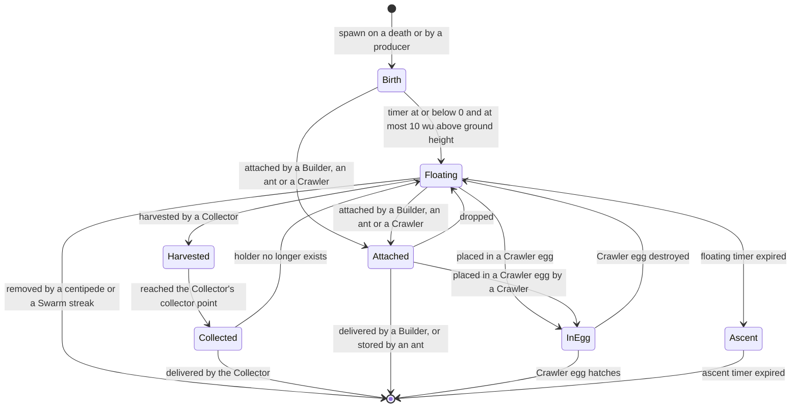
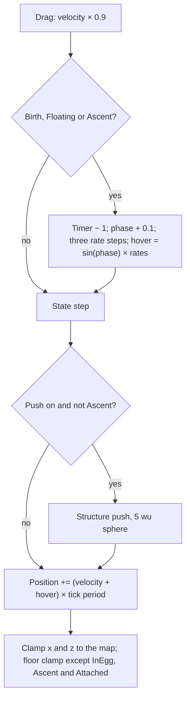

# Essence orbs

> Status: Reference · Prefix: R-UNIT · Related: [Units](README.md) · [Collector](collector.md) · [Builder](builder.md) · [Worker](worker.md) · [Creatures and hazards](README.md) · [Population flow](../05_population_flow.md) · [Entity model](../12_simulation_model/03_entity_model_and_identity.md) · [Randomness and integrity](../12_simulation_model/07_randomness_and_integrity.md)

## 1 Purpose and player experience

An Essence orb is the small glowing light that a unit leaves when it dies. It rises from the body, hangs in the air with a lazy wobble for half a minute or so, and then drifts slowly upwards and fades away. While it floats it is a resource: a Collector sucks it up and turns it into a new Worker for its own side, a Builder tows it away, and several creatures feed on it. Nothing about an orb checks whose it was, so a battlefield full of the enemy's dead is a harvest for whoever brings a Collector.

This document specifies the Essence orb object: its creation, its states and timers, its per-tick motion, its random draws, the operations that takers use, and its look and sound. The population-flow view of the same object (who produces orbs, conversion ratios and the cap) is in [population flow](../05_population_flow.md) §2.15 to §2.20; the takers are specified in their own documents.

## 2 Rules

### 2.1 Baseline

**R-UNIT-300** (MUST) The values of §4 are the reference tuning baseline (DEC-004), and the rules of this document are the specification of record for Essence orbs (DEC-005). Every reference behaviour that looks accidental and is kept is stated as an explicit rule with a named key (DEC-006).

### 2.2 Identity and storage

**R-UNIT-301** (MUST) An Essence orb (`EssenceOrb`) is a simulated object but not an actor. It is held by value in the match world's Essence-orb pool, which starts with `ref.sim.container.orb_presize` slots and grows by `ref.sim.container.orb_step` ([containers and update order](../12_simulation_model/04_containers_and_update_order.md)). Its handle carries its team, the pool marker, its slot and the slot's generation ([entity model](../12_simulation_model/03_entity_model_and_identity.md) R-SIM-126, R-SIM-127). Every live orb advances exactly once per tick, in world sub-step 3 (Essence orbs) of each update slice, in slot order ([tick timing](../12_simulation_model/01_tick_timing_and_main_loop.md) R-SIM-512). Orbs are never registered in the actor grid (R-SIM-303).

**R-UNIT-302** (MUST) An Essence orb is the essence an actor releases when it dies through the standard damage path. It is the input of the population flow (DEC-018): a Collector collects floating orbs and converts each into one new Worker at a friendly Spawn Node ([collector.md](collector.md)); a Builder collects orbs and returns them to a friendly Spawn Node ([builder.md](builder.md)); Crawlers ferry orbs into Crawler eggs, centipedes eat them, ants carry them home, and a Reaper Serpent removes the orbs of the actors it kills ([README.md](README.md)). An orb that nothing takes ascends and is removed.

### 2.3 Creation

**R-UNIT-303** (MUST) The Essence-orb spawn operation takes a position, a velocity, a team and an owner handle (the actor that released it). For the Rogue faction it creates nothing and returns "none" (DEC-084). Otherwise it takes a free slot of the pool, places the orb at the given position raised by `ref.sim.spawn.orb_lift` (1 wu), stores the velocity, the team and the owner, and runs the orb's start step (R-UNIT-307). The owner handle lets the owner search of [entity model](../12_simulation_model/03_entity_model_and_identity.md) R-SIM-135 find the orb that a given actor released.

**R-UNIT-304** (MUST) Essence orbs are created only by these producers:

| Producer | Velocity | Owning document |
|---|---|---|
| an actor that dies through the standard damage path, unless its kind or its team releases none | the corpse velocity × `ref.econ.orb.death_velocity_factor` (0.5) | [Units](README.md), [population flow](../05_population_flow.md) R-ECON-067 |
| a tree of the Essence Grove outcome while it is healthy | as that rule states | [population flow](../05_population_flow.md) R-ECON-067, [crates and powers](../04_supply_crates_powers_and_weapons/crates_and_powers.md) |
| a Brood Drifter laying a Crawler egg that it fertilises at once | as that rule states | [creatures.md](creatures.md) |
| a Seed Pod of the essence kind; no outcome launches an essence-kind Seed Pod directly, but the nested Seed Pods (kind 5, whose kinds are drawn from 0 to 8) of the Brood and Spitter Plants outcomes can be of the essence kind ([creatures.md](creatures.md) R-UNIT-514) | as that rule states | [creatures.md](creatures.md) |
| a destroyed Hive, one orb per ant and per orb inside; a Hive always belongs to the Rogue faction, so this creates none | — | [trees and crate structures](../03_buildings_and_world_objects/trees_and_crate_structures.md) |

Troopers, Transports, Collectors and Builders release no Essence orb when they die ([strike_team.md](strike_team.md), [transport.md](transport.md), [collector.md](collector.md), [builder.md](builder.md)).

**R-UNIT-305** (MUST) An orb's team is the team slot that the producer passes, and may be any slot from 0 to 5 except the Rogue faction slot. An Essence Grove orb takes a team drawn uniformly from team slots 0 to 3 whatever the map's player count, so on a 2-player or 3-player map it can belong to a slot that is not in play; such an orb behaves like every other orb, because no rule of this document or of any taker reads the orb's team (see DEC-305). The team decides only the orb's colour (R-UNIT-330).

### 2.4 State data

**R-UNIT-306** (MUST) An Essence orb holds:

| Field | Start value | Meaning |
|---|---|---|
| team | the producer's team | render colour only (R-UNIT-305) |
| state | Birth (R-UNIT-307) | one of the states of R-UNIT-310 |
| owner | the producer's actor handle | the actor that released it; read by the owner search |
| nearby eggs | empty, count 0, search tick none | up to `ref.econ.crawler.egg_cache_max` (8) handles of Crawler eggs (R-UNIT-309) |
| broken | unset | the broken marker (R-UNIT-308) |
| holder | none | the Collector that holds it in Harvested or Collected |
| timer | `ref.econ.orb.birth_ticks` (61 ticks) | the state timer, counting down (R-UNIT-311 to R-UNIT-315) |
| hover | (0, 0, 0) | the wobble velocity in wu/s (R-UNIT-320) |
| phase | a draw from `ref.unit.essence_orb.wobble_phase_range` | the wobble phase (R-UNIT-320) |
| axis rates | three draws from `ref.econ.orb.wobble_rate_range` | the wobble amplitudes of x, y and z (R-UNIT-320) |
| ground height | the terrain height at the creation point | the floor reference; it is not updated while the orb drifts (R-UNIT-322) |
| push | on | whether the structure push runs (R-UNIT-321) |

**R-UNIT-307** (MUST) The start step of an orb sets its state to Birth and its timer to `ref.econ.orb.birth_ticks` (61 ticks, nominal 6.0 s); it then makes four simulation draws, one statement each, in this order: the phase from `ref.unit.essence_orb.wobble_phase_range` (U[0, 10)), then the x, y and z axis rates from `ref.econ.orb.wobble_rate_range` (U[0, 2)). It records the terrain height under the orb as its ground height and turns the structure push on. These draws belong to the spawn step that creates the orb, never to a constructor (DEC-652, [randomness and integrity](../12_simulation_model/07_randomness_and_integrity.md) R-SIM-626).

**R-UNIT-308** (MUST) An Essence orb carries a broken marker, unset at creation. The Collector and the Builder skip an orb whose marker is set when they search ([collector.md](collector.md), [builder.md](builder.md)). No rule in a match sets the marker, so every orb is unbroken and the test never excludes one; the break operation that would set it is outside the reference (DEC-871, Dropped).

**R-UNIT-309** (MUST) An orb answers the question "which Crawler eggs are near me" from its nearby-egg list. When asked, it rebuilds the list if `ref.unit.essence_orb.egg_search_ticks` (30 ticks, nominal 3.0 s) have passed since its last rebuild, or if it has never built one: the list then holds up to `ref.econ.crawler.egg_cache_max` (8) dormant Crawler eggs that rest on the ground within `ref.econ.crawler.egg_cache_range_wu` (60 wu, measured horizontally) of the orb. Crawlers use the list to choose orbs ([README.md](README.md), [population flow](../05_population_flow.md) R-ECON-083).

### 2.5 States and timers

**R-UNIT-310** (MUST) The states of an Essence orb form the enumeration `EssenceOrbState` with the members Birth, Floating, Attached, InEgg, Ascent, Harvested and Collected; the order of the enumeration carries no meaning. The rules of R-UNIT-311 to R-UNIT-317 run in the state step of the per-tick advance (R-UNIT-319 step 3). Only the timed states (Birth, Floating, Ascent) count the timer down; every other state leaves it unchanged.

**R-UNIT-311** (MUST) **Birth.** Each tick the orb's vertical hover becomes max(hover.y, U[0, `ref.unit.essence_orb.birth_hover_max`)) (0.5 wu/s), so it rises slowly. Then, with h the orb's height above its ground height:

- if h > `ref.econ.orb.birth_max_height_wu` (10 wu), the hover is pulled down: hover.y := −(`ref.unit.essence_orb.birth_pull_base` (10 wu/s) + U[0, `ref.unit.essence_orb.birth_pull_range`) (10 wu/s)) × min(h ÷ `ref.unit.essence_orb.birth_pull_scale_height` (100 wu), 1);
- otherwise, when the timer is at or below 0, the orb becomes Floating and its timer is set to a draw from `ref.econ.orb.floating_ticks` (301 to 500 ticks, nominal 30 to 50 s).

An orb therefore leaves Birth only on a tick on which it is no more than 10 wu above its ground height, and after 61 ticks at the earliest.

**R-UNIT-312** (MUST) **Floating.** The orb wobbles (R-UNIT-320) and can be taken by every taker of R-UNIT-326. When its timer is at or below 0, it becomes Ascent and its timer is set to `ref.econ.orb.ascent_ticks` (901 ticks, nominal 90.1 s).

**R-UNIT-313** (MUST) **Attached.** A taker that carries the orb itself (a Builder, an ant or a Crawler) attaches it with the attach operation (R-UNIT-324): the orb becomes Attached and the collected sound plays (R-UNIT-333). An Attached orb has no timer, no wobble and no floor clamp; its carrier sets its position, and the structure push of R-UNIT-321 still applies while the orb's push is on. The drop operation returns it to Floating: the structure push is turned on again, its ground height becomes the terrain height under its current position, and its velocity and hover become zero. The timer keeps the value it had when the orb was attached, so an orb attached in Birth floats only for the rest of its birth time after it is dropped.

**R-UNIT-314** (MUST) **InEgg.** An orb that fertilises a Crawler egg is InEgg: no timer, no wobble, no floor clamp. When the egg is destroyed, the orb returns to Floating with its timer unchanged; when the egg hatches, the egg removes the orb ([README.md](README.md)).

**R-UNIT-315** (MUST) **Ascent.** Each tick the vertical hover becomes max(hover.y, `ref.unit.essence_orb.ascent_rise_min` (2 wu/s) + U[0, `ref.unit.essence_orb.ascent_rise_range`) (2 wu/s)), so the orb rises at 2 to 4 wu/s. When the timer is at or below 0, the orb's advance requests its removal. An Ascent orb has no structure push and no floor clamp, and no taker takes it (R-UNIT-326).

**R-UNIT-316** (MUST) **Harvested.** A Collector harvests a Floating orb with the harvest operation (R-UNIT-324): the orb becomes Harvested, its holder becomes that Collector, and its hover becomes zero. A Harvested orb has no timer and no wobble; the Collector moves it each tick ([collector.md](collector.md)). When the Collector's transport rule finds the orb close enough, the orb becomes Collected. A Harvested orb has no rule for a holder that no longer exists: it keeps its state, its position and its slot (R-UNIT-327, see DEC-307).

**R-UNIT-317** (MUST) **Collected.** A Collected orb has no timer and no wobble; each tick its velocity becomes its holder's velocity, so it rides with the Collector. If the holder no longer exists, the orb returns to Floating, with the timer value it had when it was harvested. A Collector removes a Collected orb when it delivers it ([collector.md](collector.md)).

**R-UNIT-318** (MUST) An orb that nothing takes lives `ref.econ.orb.birth_ticks` + `ref.econ.orb.floating_ticks` + `ref.econ.orb.ascent_ticks` = 61 + (301 to 500) + 901 = 1263 to 1462 ticks (nominal 126 to 146 s), of which it is collectable by a Collector for the 301 to 500 ticks of Floating ([population flow](../05_population_flow.md) R-ECON-069). The Birth time is longer by every tick on which the orb is more than 10 wu above its ground height.

### 2.6 Per-tick motion

**R-UNIT-319** (MUST) Each tick an Essence orb advances in this order:

```
# 1 drag
vel := vel × ref.unit.essence_orb.drag_per_tick                       # 0.9
# 2 timer and wobble, skipped in Attached, InEgg, Harvested and Collected
if state in {Birth, Floating, Ascent}:
    timer := timer − 1
    phase := phase + ref.unit.essence_orb.phase_step                  # 0.1 per tick
    for axis in (x, y, z):                                            # one draw per axis, in this order
        rate[axis] := clamp(rate[axis] + U(ref.econ.orb.wobble_offset_range), ref.unit.essence_orb.wobble_rate_clamp)
    hover := sin(phase) × (rate.x, rate.y, rate.z)                    # one phase for all three axes
# 3 state step: R-UNIT-311 to R-UNIT-317
# 4 structure push (R-UNIT-321), if push is on and state is not Ascent
# 5 integration (R-UNIT-322)
pos := pos + (vel + hover) × ref.sim.tick_period
clamp pos.x and pos.z to the map
if state not in {InEgg, Ascent, Attached}:
    pos.y := max(pos.y, groundHeight + ref.unit.essence_orb.floor_height)
if the state step requested removal: request removal
```

**R-UNIT-320** (MUST) The wobble of step 2 is the same at every game speed: each axis rate takes one step of U[−0.5, 0.5) per tick and stays within `ref.unit.essence_orb.wobble_rate_clamp` ([0, 2]), and the phase advances by `ref.unit.essence_orb.phase_step` (0.1) per tick. Game speed changes how many ticks run per second, never the step (DEC-039, DEC-092). The three axes share the phase, so the hover is the vector of axis rates scaled by one sine.

**R-UNIT-321** (MUST) The structure push keeps a new orb from staying inside a structure. While the orb's push is on and it is not Ascent, in every other state, for every structure of the obstacle cell under the orb whose hit volume a sphere of radius `ref.unit.essence_orb.push_radius` (5 wu) at the orb hits, the orb's velocity gains (orb position − structure position) × `ref.unit.essence_orb.push_gain` (0.1), its vertical velocity becomes 0 and its speed is limited to `ref.unit.essence_orb.push_speed_max` (10 wu/s). When no structure is hit and the orb's speed is below `ref.unit.essence_orb.push_stop_speed` (1 wu/s), the push turns off for good; only the drop operation turns it on again (R-UNIT-313). The push looks structures up in the obstacle grid ([space, routing and physics](../12_simulation_model/05_space_routing_and_physics.md) R-SIM-326).

**R-UNIT-322** (MUST) An orb moves by its velocity plus its hover. Its x and z stay inside the map. In every state except InEgg, Ascent and Attached its height stays at least `ref.unit.essence_orb.floor_height` (2 wu) above the ground height recorded at its creation or at its last drop, whatever the terrain under its present position. An orb never drowns and is never pushed by terrain.

### 2.7 Random draws

**R-UNIT-323** (MUST) An Essence orb draws from the simulation generator as follows, each draw its own statement, in the order given (DEC-013, [randomness and integrity](../12_simulation_model/07_randomness_and_integrity.md) R-SIM-621):

| Situation | Draws | Values |
|---|---|---|
| start step (R-UNIT-307) | 4 | phase, then the x, y and z axis rates |
| every tick in Birth, Floating and Ascent (R-UNIT-319 step 2) | 3 | the x, y and z rate steps |
| Birth, each tick, after the rate steps | 1, then either 1 more on each tick on which the orb is more than 10 wu above its ground height, or 1 more on the tick it becomes Floating | the hover floor; then the pull-down, or the floating time |
| Ascent, each tick, after the rate steps | 1 | the rise |
| Floating, Attached, InEgg, Harvested and Collected, beyond the above | 0 | — |

A live orb therefore makes 0, 3, 4 or 5 draws per tick, and the number of orbs is the largest population-dependent load on the simulation generator ([population flow](../05_population_flow.md) R-ECON-071).

### 2.8 Operations used by takers

**R-UNIT-324** (MUST) An Essence orb offers these operations to its takers; each acts at once, inside the taker's advance:

| Operation | Effect | Used by |
|---|---|---|
| harvest (Collector handle) | state Harvested, holder := the Collector, hover := 0 (R-UNIT-316) | Collector |
| attach | state Attached, collected sound (R-UNIT-313) | Builder, ant, Crawler |
| drop | state Floating; push on; ground height := terrain under the orb; velocity and hover := 0 (R-UNIT-313) | Builder, ant, Crawler |
| place in egg | state InEgg (R-UNIT-314) | Crawler egg |
| egg destroyed | state Floating (R-UNIT-314) | Crawler egg |
| nearby eggs | the nearby-egg list (R-UNIT-309) | Crawler |
| remove | the orb is removed from the pool at once | the Collector's delivery, the centipede, the Swarm streak, the Reaper Serpent, the Crawler egg's hatch |

**R-UNIT-325** (MUST) No taker tests an orb's team. Every taker chooses orbs by state and distance only, so an orb of any team, the enemy's included, feeds the taker's own team (DEC-080).

**R-UNIT-326** (MUST) The takers of Essence orbs, the states they take an orb in, and their owning documents are:

| Taker | States taken | How | Owning document |
|---|---|---|---|
| Collector | Floating | harvest, then remove on delivery | [collector.md](collector.md) |
| Builder | Birth, Floating | attach; drop when it dies; remove on delivery | [builder.md](builder.md) |
| Crawler | Birth, Floating, and only an orb whose nearby-egg list is not empty | attach, then place in an egg | [README.md](README.md) |
| ant | Birth, Floating | attach, then store in its Hive | [README.md](README.md) |
| centipede | Floating | remove (eaten) | [README.md](README.md) |
| Swarm streak | Floating | remove, and release a creature | [crates and powers](../04_supply_crates_powers_and_weapons/crates_and_powers.md) |
| Reaper Serpent | the orb of each actor it kills, found by the owner search | remove | [README.md](README.md) |

**R-UNIT-327** (MUST) When a Collector is removed by a path that does not release its orbs (the end or cancellation of its power), its Collected orbs return to Floating by R-UNIT-317, and its Harvested orbs stay Harvested, with no timer and no holder, until the match ends (see DEC-307). When a Collector is destroyed by a grenade, it releases every orb it holds first ([collector.md](collector.md)).

### 2.9 Terrain, removal and control

**R-UNIT-328** (MUST) An Essence orb has no health, takes no damage and is never targeted by a weapon. It is removed only by the end of Ascent (R-UNIT-315) or by a taker's remove operation (R-UNIT-324). No player command or control state acts on an orb.

**R-UNIT-329** (MUST) An Essence orb that the spawn operation places inside a structure leaves it by the structure push (R-UNIT-321) and never re-enters the push afterwards unless it is dropped. The terrain under a drifting orb never changes its floor (R-UNIT-322).

### 2.10 Presentation and sound

**R-UNIT-330** (MUST) An Essence orb is drawn as two camera-facing quads of the round glow `fx.glow_round`, both centred on the orb: an inner quad of size `ref.unit.essence_orb.inner_size` (0.5 wu) at opacity `ref.unit.essence_orb.inner_alpha` (127 of 255) and an outer quad of size `ref.unit.essence_orb.outer_size` (1.5 wu) at opacity `ref.unit.essence_orb.outer_alpha` (50 of 255). Both take the orb's team colour; an orb with no team is drawn white. The orbs are drawn together in one batch.

**R-UNIT-331** (MUST) In Birth both quads grow: their size is multiplied by `ref.unit.essence_orb.birth_scale_offset` (1.2) − (remaining timer ÷ `ref.unit.essence_orb.birth_scale_ticks` (60 ticks)). In Ascent both quads shrink and fade by the factor remaining timer ÷ `ref.unit.essence_orb.ascent_fade_ticks` (900 ticks). Presentation reads these values from the orb's state and never writes them (DEC-007).

**R-UNIT-332** (MUST) An orb is drawn at its position extrapolated to the presentation time minus one tick period (`ref.sim.tick_period`), one tick behind the other simulated objects.

**R-UNIT-333** (MUST) The attach operation raises the orb's collected sound event, `sfx.unit.essence_orb.collected`, at the orb (reference/10). The harvest operation raises none, and an orb's creation and the start of its ascent raise no sound event.

## 3 States and flows



*Figure 1 — Essence orb states (R-UNIT-310 to R-UNIT-317). A Reaper Serpent can remove its victim's orb in any state (R-UNIT-326). A Harvested orb whose Collector is removed without releasing it stays Harvested (R-UNIT-327).*



*Figure 2 — The per-tick advance of an Essence orb (R-UNIT-319).*

## 4 Tuning table

| key | value | unit | range or notes | requirement | DEC |
|---|---|---|---|---|---|
| `ref.unit.essence_orb.wobble_phase_range` | [0, 10) | rad | one draw at the start step | R-UNIT-306, R-UNIT-307 | DEC-013 |
| `ref.unit.essence_orb.egg_search_ticks` | 30 | ticks | nominal 3.0 s; least interval between two rebuilds of the nearby-egg list | R-UNIT-309 | DEC-002 |
| `ref.unit.essence_orb.birth_hover_max` | 0.5 | wu/s | upper bound of the Birth hover floor U[0, 0.5) | R-UNIT-311 | — |
| `ref.unit.essence_orb.birth_pull_base` | 10 | wu/s | fixed part of the Birth pull-down | R-UNIT-311 | — |
| `ref.unit.essence_orb.birth_pull_range` | 10 | wu/s | random part U[0, 10) of the Birth pull-down | R-UNIT-311 | — |
| `ref.unit.essence_orb.birth_pull_scale_height` | 100 | wu | the pull-down reaches full strength at this height above the ground height | R-UNIT-311 | — |
| `ref.unit.essence_orb.ascent_rise_min` | 2 | wu/s | fixed part of the Ascent rise | R-UNIT-315 | — |
| `ref.unit.essence_orb.ascent_rise_range` | 2 | wu/s | random part U[0, 2) of the Ascent rise; rise 2 to 4 wu/s | R-UNIT-315 | — |
| `ref.unit.essence_orb.drag_per_tick` | 0.9 | × velocity | 10 % drag per tick | R-UNIT-319 | DEC-092 |
| `ref.unit.essence_orb.phase_step` | 0.1 | rad per tick | one tick period of phase | R-UNIT-319, R-UNIT-320 | DEC-039 |
| `ref.unit.essence_orb.wobble_rate_clamp` | [0, 2] | wu/s | each axis rate stays in this range | R-UNIT-319, R-UNIT-320 | — |
| `ref.unit.essence_orb.push_radius` | 5 | wu | sphere tested against structure hit volumes | R-UNIT-321 | DEC-012 |
| `ref.unit.essence_orb.push_gain` | 0.1 | per tick | × (orb − structure position), added to the velocity | R-UNIT-321 | — |
| `ref.unit.essence_orb.push_speed_max` | 10 | wu/s | speed limit while pushed | R-UNIT-321 | — |
| `ref.unit.essence_orb.push_stop_speed` | 1 | wu/s | below this, with no hit, the push turns off for good | R-UNIT-321 | — |
| `ref.unit.essence_orb.floor_height` | 2 | wu | above the recorded ground height | R-UNIT-319, R-UNIT-322 | — |
| `ref.unit.essence_orb.inner_size` | 0.5 | wu | inner glow quad | R-UNIT-330 | DEC-029 |
| `ref.unit.essence_orb.inner_alpha` | 127 | of 255 | inner glow quad opacity | R-UNIT-330 | DEC-029 |
| `ref.unit.essence_orb.outer_size` | 1.5 | wu | outer glow quad | R-UNIT-330 | DEC-029 |
| `ref.unit.essence_orb.outer_alpha` | 50 | of 255 | outer glow quad opacity | R-UNIT-330 | DEC-029 |
| `ref.unit.essence_orb.birth_scale_offset` | 1.2 | × size | Birth size factor = 1.2 − remaining ÷ 60 | R-UNIT-331 | — |
| `ref.unit.essence_orb.birth_scale_ticks` | 60 | ticks | nominal 6.0 s | R-UNIT-331 | — |
| `ref.unit.essence_orb.ascent_fade_ticks` | 900 | ticks | nominal 90.0 s; Ascent size and opacity factor = remaining ÷ 900 | R-UNIT-331 | — |

Keys cited from other documents (their values are defined there):

| Owning document | Keys | Used by |
|---|---|---|
| [containers and update order](../12_simulation_model/04_containers_and_update_order.md) | `ref.sim.container.orb_presize`, `ref.sim.container.orb_step` | R-UNIT-301 |
| [containers and update order](../12_simulation_model/04_containers_and_update_order.md) | `ref.sim.spawn.orb_lift` | R-UNIT-303 |
| [tick timing](../12_simulation_model/01_tick_timing_and_main_loop.md) | `ref.sim.tick_period` | R-UNIT-319, R-UNIT-332 |
| [population flow](../05_population_flow.md) | `ref.econ.orb.death_velocity_factor`, `ref.econ.orb.birth_ticks`, `ref.econ.orb.birth_max_height_wu`, `ref.econ.orb.floating_ticks`, `ref.econ.orb.ascent_ticks`, `ref.econ.orb.wobble_rate_range`, `ref.econ.orb.wobble_offset_range` | R-UNIT-304, R-UNIT-306, R-UNIT-307, R-UNIT-311, R-UNIT-312, R-UNIT-318, R-UNIT-319 |
| [population flow](../05_population_flow.md) | `ref.econ.crawler.egg_cache_max`, `ref.econ.crawler.egg_cache_range_wu` | R-UNIT-306, R-UNIT-309 |

## 5 Edge cases and interactions

1. **Rogue faction deaths.** An actor of the Rogue faction leaves no orb, so a destroyed Hive and its ants feed nobody (R-UNIT-303, R-UNIT-304, DEC-084).
2. **Born high.** An orb created more than 10 wu above the terrain under it, for example by a death in the air, is pulled down until it is within 10 wu of its ground height, and stays in Birth while it is above that height, however long its timer has expired (R-UNIT-311).
3. **Attached in Birth.** A Builder, an ant or a Crawler can take an orb in Birth; if it drops the orb, the orb floats only for the rest of its birth timer, which can be 0, so it starts to ascend on the next tick (R-UNIT-313).
4. **Floor from the creation point.** An orb that drifts over a hill can sink into it, and one that drifts over a valley floats high above it, because the floor follows the ground height recorded at creation or at the last drop (R-UNIT-322).
5. **Orbs of slots not in play.** Essence Grove orbs of a team slot that is not in play are collected, eaten and ascend like any other orb, and are drawn in that slot's colour (R-UNIT-305, DEC-305).
6. **Enemy orbs.** A Collector or a Builder parked near a battle converts the enemy's dead into its own side's Workers (R-UNIT-325, DEC-080).
7. **Stranded Harvested orbs.** An orb that is still being drawn in when its Collector's power ends stays Harvested in place for the rest of the match, without a timer, and keeps its pool slot (R-UNIT-316, R-UNIT-327, DEC-307).
8. **Push only at birth.** An orb leaves a structure that it was created inside, and the push then turns off; an orb that later drifts into a structure stays inside it (R-UNIT-321, R-UNIT-329).
9. **Same-tick advance.** An orb created during a tick advances in that tick when its slot lies after the last slot already advanced in sub-step 3 (DEC-455); this changes its timer by one tick at most.

## 6 Acceptance criteria

**AC-ORB-01 — Lifetime without takers** (R-UNIT-311, R-UNIT-312, R-UNIT-315, R-UNIT-318). Given an orb created on flat ground at height 0 with velocity 0 and nothing near it, when the match runs, then it is Floating from tick 61, Ascent from tick 61 + F, where F is its floating draw in 301 to 500, and is removed at tick 61 + F + 901.

**AC-ORB-02 — Rogue faction** (R-UNIT-303). Given a Rogue faction actor that dies through the standard damage path, when its death is processed, then the Essence-orb pool holds no new orb and the spawn operation returns "none".

**AC-ORB-03 — No team test** (R-UNIT-325, R-UNIT-326). Given a Floating orb of team 1 within the collection range of an idle Collector of team 0, when the Collector next searches, then it harvests the orb and later delivers it as a team-0 Worker at a team-0 Spawn Node.

**AC-ORB-04 — Draw counts** (R-UNIT-307, R-UNIT-323). Given one orb and a counting simulation generator, then its spawn step makes 4 draws; a Floating tick makes 3; an Ascent tick 4; a Birth tick 4 while at most 10 wu above ground and the timer above 0, 5 while above 10 wu or on its transition tick; and an Attached, InEgg, Harvested or Collected tick 0.

**AC-ORB-05 — Push turns off** (R-UNIT-321). Given an orb created at a structure's centre, when it advances, then it moves away from the structure at no more than 10 wu/s, and on the first tick on which no structure is hit and its speed is below 1 wu/s its push turns off; a later contact with a structure changes nothing.

**AC-ORB-06 — Removed Collector** (R-UNIT-316, R-UNIT-317, R-UNIT-327). Given a Collector holding two Collected and one Harvested orb, when its power is cancelled and it is removed, then on the next tick the two Collected orbs are Floating with their remaining timers and the Harvested orb is still Harvested and does not move.

**AC-ORB-07 — Floor** (R-UNIT-322). Given a Floating orb whose ground height is 10 wu and whose hover points down, then its height never falls below 12 wu, whatever the terrain under it.

**AC-ORB-08 — Wobble at any game speed** (R-UNIT-320). Given the same orb, seed and tick count at game speed 1 and under Time Rush, then its position after the same number of ticks is identical.

**AC-ORB-09 — Collected sound** (R-UNIT-333). Given a Floating orb, when a Builder attaches it, then one collected sound event is raised at the orb; when a Collector harvests an orb, no sound event is raised by the orb.

## 7 Dependencies

- **Reference documents:** [Units](README.md) (death path, kinds that release no orb); [collector.md](collector.md); [builder.md](builder.md); [README.md](README.md) (Crawler, Crawler egg, ant, centipede, Reaper Serpent, Brood Drifter, Seed Pod); [population flow](../05_population_flow.md) §2.15 to §2.20 (producers, timers, conversions); [crates and powers](../04_supply_crates_powers_and_weapons/crates_and_powers.md) (Essence Grove, Swarm streak); [defences and props](../03_buildings_and_world_objects/defences_and_props.md) (Hive); [entity model](../12_simulation_model/03_entity_model_and_identity.md) (handles, owner search); [containers and update order](../12_simulation_model/04_containers_and_update_order.md) (the pool, sub-step order); [space, routing and physics](../12_simulation_model/05_space_routing_and_physics.md) (obstacle grid); [randomness and integrity](../12_simulation_model/07_randomness_and_integrity.md) (draw discipline); reference/10 (audio events).
- **Engine components:** [renderer](../../architecture/components/renderer/README.md) (camera-facing glow batches, team colours); [animation and VFX](../../architecture/components/animation_and_vfx/README.md); [audio engine](../../architecture/components/audio_engine.md).
- **Assets:** `fx.glow_round` (the orb glow quads), `sfx.unit.essence_orb.collected` (the collected sound).

## 8 Open decisions

| DEC | Title | Default specified in §2 |
|---|---|---|
| DEC-080 | Collector collection of any team's Essence orbs | no taker tests an orb's team (R-UNIT-325) |
| DEC-305 | Essence Grove orbs of team slots not in play | such orbs behave like every other orb (R-UNIT-305) |
| DEC-307 | Essence orbs held by a removed Collector | Collected orbs float again; Harvested orbs stay stranded (R-UNIT-316, R-UNIT-327) |
| DEC-455 | Same-tick advance of objects created or handed over during a tick | slot-order same-tick advance (§5 item 9) |
| DEC-871 | Essence orb break operation (Dropped) | no match breaks an orb, so the broken marker stays clear (R-UNIT-308) |
