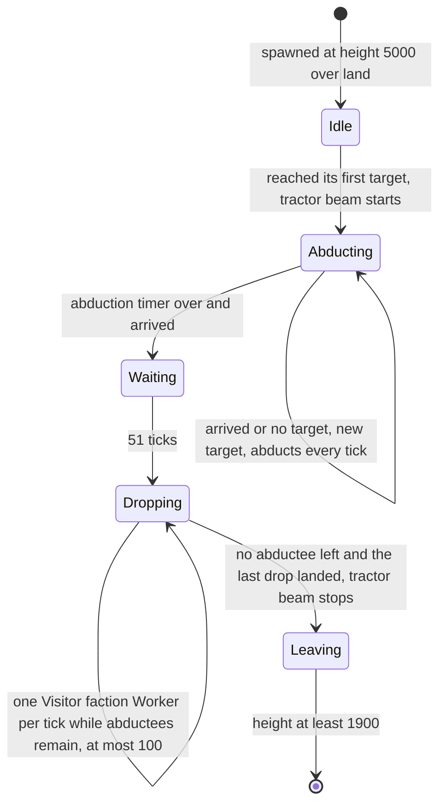
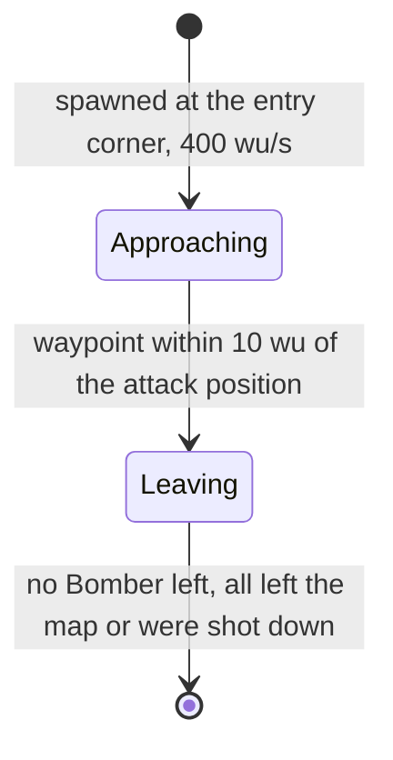
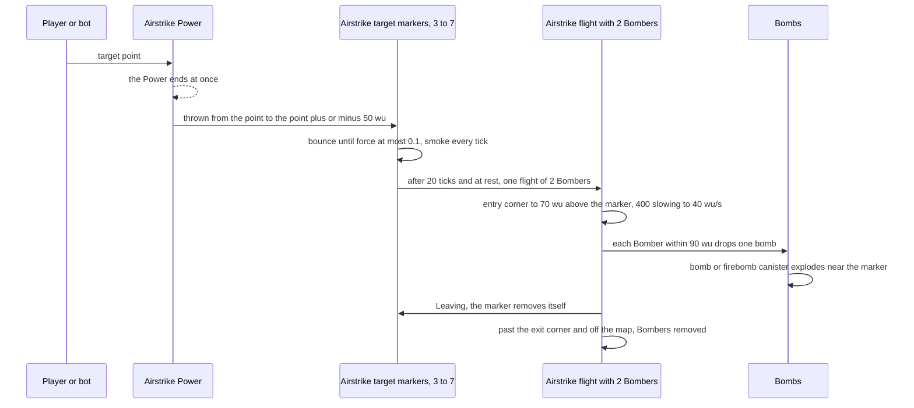
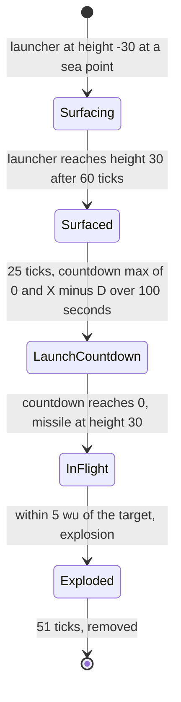
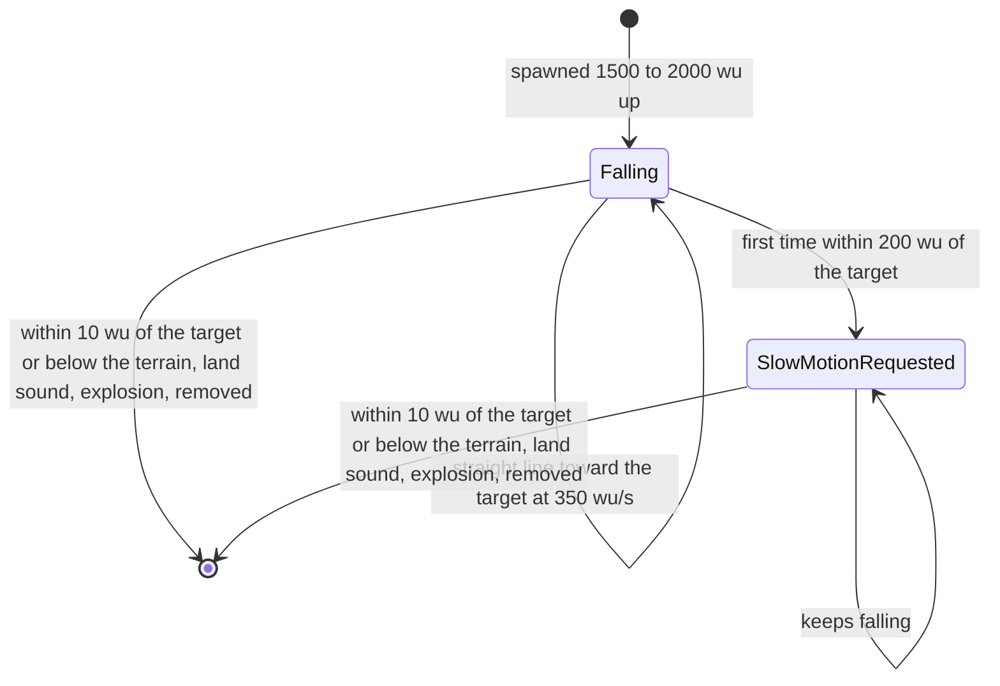
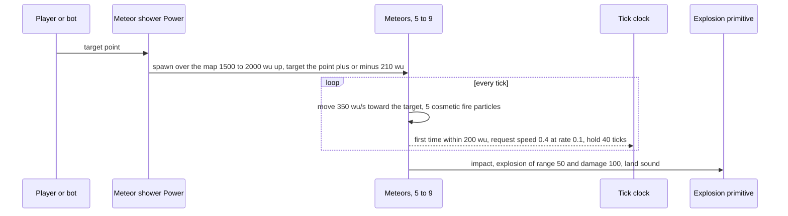

# Hazards and projectiles

> Status: Reference · Prefix: R-UNIT · Related: [units](README.md), [creatures](creatures.md), [Worker](worker.md), [crates and powers](../04_supply_crates_powers_and_weapons/crates_and_powers.md), [weapons and projectiles](../04_supply_crates_powers_and_weapons/weapons_and_projectiles.md), [population flow](../05_population_flow.md), [simulation model](../12_simulation_model/README.md)

## 1 Purpose and player experience

The event hazards are the big set pieces of a match. A player who opens a Supply crate may receive an airstrike, a Firebomb Run, a Missile Barrage or a meteor shower as a Power, aims it at one point and then watches it play out; the bad branch of an opened Supply crate can instead release the Abductor.

- **Airstrike and Firebomb Run.** 3 to 7 smoke markers scatter around the target; each summons a pair of Bombers that fly in from a corner of the map, drop one bomb or firebomb each on their marker and fly off the map.
- **Missile Barrage.** Ten launchers surface at sea, wait, and launch lofted missiles; the first strikes the chosen point exactly and nine scatter around it. Every team is hit, the launching team's own units included, and the nearer launchers strike first.
- **Meteor shower.** 5 to 9 meteors fall in straight lines from high above onto points around the target and explode; the whole game slows to 0.4× as the first one nears the ground.
- **Abductor.** A large craft descends from high above, lifts the Workers of every team under its beam for one to two minutes, drops up to as many Visitor faction Workers and leaves.

Table 1-A Hazards.

| Species term | Type | Family | Created in a match by | Owner | Section |
|---|---|---|---|---|---|
| Abductor | `Abductor` | actor | the Abductor outcome of the bad branch of an opened Supply crate | the Visitor faction | §2.2 |
| airstrike flight, Bomber | `AirstrikeFlight`, `Bomber` | actor group, actor | the airstrike and Firebomb Run Powers | the Power's owner, or the Transit Gate's owner for a reinforcement airstrike | §2.3 |
| barrage missile | `BarrageMissile` | actor | the Missile Barrage power | the power's owner | §2.4 |
| meteor | `MeteorRock` | actor | the meteor shower power | the power's owner | §2.5 |

The projectiles that these hazards release, the airstrike target marker, the airstrike bomb, the firebomb canister and the shockwave ring, are specified in [weapons and projectiles](../04_supply_crates_powers_and_weapons/weapons_and_projectiles.md); the outcomes themselves, their probabilities, validity, announcements and Power targeting are in [crates and powers](../04_supply_crates_powers_and_weapons/crates_and_powers.md).

## 2 Rules

### 2.1 Shared rules

**R-UNIT-700** (MUST) The shared rules R-UNIT-500 to R-UNIT-510 of [creatures](creatures.md) apply to every hazard of this document: baseline values, stats from the [units README](README.md), tick timing, draw forms and cosmetic draws, bounded searches with the cell fallback, presentation events, factions and population.

**R-UNIT-701** (MUST) A hazard that a Power delivers is aimed once: the player, or a bot ([reference/07](../07_bots/README.md)), chooses a target point, the Power ends at once, and nobody controls the hazard afterwards ([reference/06](../06_controls_camera_and_commands/README.md)). The hazards' units are not selectable.

### 2.2 Abductor

**R-UNIT-702** (MUST) Only the bad branch of an opened Supply crate yields the Abductor outcome: bad outcomes fire when a crate opens, an expired crate yields nothing, and an opening team never receives the Abductor as a Power ([crates and powers](../04_supply_crates_powers_and_weapons/crates_and_powers.md) R-CRATE-120, R-CRATE-121). It occurs at most once per match, and never in Siege. The once-per-match flag is match state and starts clear in every match (DEC-011). The outcome searches an arrival point: each attempt draws (`SimRng::NextUnit`(X), `SimRng::NextUnit`(Z)), with X and Z the map size, and accepts it when the terrain there is at least `ref.unit.abductor.arrival_min_terrain` (10 wu) high; after `ref.unit.abductor.arrival_attempts` (256) attempts it takes the cell fallback of R-UNIT-504 (DEC-014, DEC-857). It spawns one Abductor of the Visitor faction at that point at height `ref.unit.abductor.start_height` (5000 wu), sets the flag, emits the outcome's announcement and plays `sfx.crate.outcome.abductor` with no team.

**R-UNIT-703** (MUST) The Abductor is invulnerable (R-UNIT-027) and has the speed stat `ref.unit.abductor.speed` (244, DEC-090, R-UNIT-013). It never collides with anything. While it works it holds `ref.unit.abductor.hover_height` (500 wu) above the terrain beneath its target.

**R-UNIT-704** (MUST) Its states are Idle (the descent), Abducting, Waiting, Dropping and Leaving. Its spawn step picks its first target by R-UNIT-706 and draws its abduction timer, `ref.unit.abductor.abduction_base` + ⌈`SimRng::NextUnit`(`ref.unit.abductor.abduction_spread`)⌉ ticks (600 to 1200 ticks, 60 to 120 s). It has arrived within `ref.unit.abductor.arrival` (100 wu) of its target.

1. **Idle:** it descends toward its first target; on arrival it enters Abducting and starts the tractor-beam loop.
2. **Abducting:** it abducts every tick (R-UNIT-707) and counts the abduction timer down; on arrival, or with no target, it picks a new target by R-UNIT-706. When the timer has run out and it has arrived, it enters Waiting.
3. **Waiting:** after `ref.unit.abductor.wait_ticks` (51 ticks, nominal 5 s) it enters Dropping.
4. **Dropping:** it drops Workers by R-UNIT-708. When no abductee remains and the last Worker it dropped has landed, it stops the tractor-beam loop, takes the leave waypoint (`SimRng::NextUnit`(X), `ref.unit.abductor.leave_height`, `SimRng::NextUnit`(Z)) (2000 wu) and enters Leaving.
5. **Leaving:** it is removed when its height reaches `ref.unit.abductor.remove_height` (1900 wu).

**R-UNIT-705** (MUST) Each tick the Abductor turns its facing by `ref.unit.abductor.yaw_per_tick` (0.01 rad) about the vertical axis and moves by:

```
s = speed stat                                                       # 244
if |target - p| > ref.unit.abductor.brake_distance:                  # 200 wu
    speed = min(speed + ref.unit.abductor.acceleration * dt, ref.unit.abductor.speed_cap_factor * s)     # 100 wu/s per s, 2 x s
else:
    speed = max(speed - ref.unit.abductor.acceleration * dt, ref.unit.abductor.speed_floor_factor * s)   # 0.1 x s
if state == Idle and p.y > ref.unit.abductor.descent_height:         # 1000 wu
    speed = max((p.y - 1000) / ref.unit.abductor.descent_range * ref.unit.abductor.descent_speed, 2 * s)  # 5000, 8000
heading = normalise(heading * (1 - ref.unit.abductor.heading_blend) + normalise(target - p) * ref.unit.abductor.heading_blend)   # 0.1
v = heading * speed * dt
p += v * dt
```

The position step applies dt twice, so the Abductor's effective velocity is speed × dt wu/s, a tenth of its speed value: at most 48.8 wu/s when cruising and about 640 wu/s at the start of its descent from 5000 wu. This double step is a kept reference rule (DEC-006, see DEC-855).

**R-UNIT-706** (MUST) A new target is drawn as (`SimRng::NextSigned`(X), `SimRng::NextSigned`(Z)), on the terrain, and accepted when the terrain height there is at least `ref.unit.abductor.wander_min_terrain` (30 wu). The height query reads a point with a negative coordinate as the map's edge cell 0 on that axis, which is sea on every reference map, so the Abductor accepts targets only in the quarter where x is in [0, X/2) and z is in [0, Z/2) (DEC-113). After `ref.unit.abductor.wander_attempts` (2000) attempts it takes the cell fallback of R-UNIT-504, restricted to cells of that quarter (DEC-014, DEC-857). On every reference map both searches end: their lowest acceptance rates are 0.76 % of wander draws and 6.3 % of arrival draws.

**R-UNIT-707** (MUST) Every tick in Abducting, every Worker within the beam, at a horizontal distance of at most `ref.unit.abductor.beam_radius` (45 wu) from the Abductor at any height, that is not of the Visitor faction and not inside a Transport, enters the abducted state of [Worker](worker.md): it spirals up to the Abductor and, on reaching it, is removed without an Essence orb (R-UNIT-039) and adds 1 to the Abductor's abductee count. Workers that are still rising when the Abductor leaves Abducting return to their idle state.

**R-UNIT-708** (MUST) Each tick in Dropping, while abductees remain: when the terrain under the Abductor is at least `ref.unit.abductor.drop_min_terrain` (20 wu) high, one Visitor faction Worker spawns at the Abductor, airborne, and falls by the airborne step of [reference/12](../12_simulation_model/05_space_routing_and_physics.md) with no fall damage, and the abductee count falls by 1; at most `ref.unit.abductor.drop_cap` (100) Workers are dropped in all, and further abductees are lost. When the terrain under it is lower than 20 wu, as over water, no Worker is dropped and the abductees are lost.

**R-UNIT-709** (MUST) The dropped Workers belong to the Visitor faction, count against its population ([population flow](../05_population_flow.md) R-ECON-119), follow its bot controller (DEC-558) and fight with Convert laser bolts ([Worker](worker.md)). The Visitor faction cannot win a match or block an elimination win (DEC-082).

**R-UNIT-710** (MUST) Presentation: `mesh.creature.abductor_hull` in its authored colours, lit with the special lights of the renderer. Its beam is `ref.unit.abductor.beam_rings` (30) stacked rings of `fx.abductor_beam_ring` in the Visitor faction's colour, scrolling up while Abducting and down while Dropping at `ref.unit.abductor.beam_scroll_speed` (50 wu/s). Each of the four sockets `engine_01` to `engine_04` emits, per tick, `ref.unit.abductor.engine_sparks` (1) blue spark of size `ref.unit.abductor.engine_spark_size_min` to `ref.unit.abductor.engine_spark_size_max` (80 to 160) and `ref.unit.abductor.engine_fire_particles` (11) blue fire particles of size `ref.unit.abductor.engine_fire_size` (500), with × `ref.unit.abductor.leaving_fire_factor` (2.5) velocity while Leaving (all cosmetic). Sounds ([event catalogue](../10_audio_design/event_catalogue.md) table 2.3-H): `abductor.spawn` from its creation, with the looped layers `sfx.creature.abductor.presence_loop`, `sfx.creature.abductor.presence_loop_b`, `sfx.creature.abductor.presence_loop_c` and `sfx.unit.collector.presence_loop`; `abductor.tractor_beam` (`sfx.creature.abductor.tractor_beam`) looped from the start of Abducting until it leaves.

### 2.3 Airstrike: airstrike flight and Bomber

An airstrike is a bombing run delivered by a Power. Each airstrike target marker summons one airstrike flight of 2 Bombers, and each Bomber drops one bomb on its marker, so a strike of 3 to 7 markers drops 6 to 14 bombs.

**R-UNIT-711** (MUST) An airstrike runs only from these sources:

| Source | Bombs | Owner of the Bombers |
|---|---|---|
| the airstrike Power from an opened Supply crate, aimed at a point | airstrike bombs | the opening team |
| the Firebomb Run Power from an opened Supply crate, aimed at a point | firebomb canisters | the opening team |
| an airstrike Power granted by a Transit Gate reinforcement wave ([population flow](../05_population_flow.md) R-ECON-104) | as the granted option | the gate's owner |

A bot uses its airstrike Powers by the rules of [reference/07](../07_bots/README.md).

**R-UNIT-712** (MUST) An airstrike at a point P throws `ref.hazard.airstrike.marker_count_base` + (`SimRng::NextUint` mod `ref.hazard.airstrike.marker_count_spread`) airstrike target markers (3 to 7); in a tutorial every airstrike throws `ref.hazard.airstrike.tutorial_marker_count` (10) markers ([reference/11](../11_tutorial_and_help.md) table 2.8-A). Each marker is thrown by the throw helper of [weapons and projectiles](../04_supply_crates_powers_and_weapons/weapons_and_projectiles.md) from P itself to P + (`SimRng::NextSigned`(`ref.hazard.airstrike.marker_scatter`), 0, `SimRng::NextSigned`(`ref.hazard.airstrike.marker_scatter`)), ±50 wu, with force `ref.hazard.airstrike.throw_force_factor` × √distance (at most about 67), and carries the firebomb flag of its source. The run emits the outcome's announcement, places the map marker `icon.power.airstrike` and plays `sfx.crate.outcome.airstrike`.

**R-UNIT-713** (MUST) A marker that is at least `ref.hazard.airstrike.marker_summon_delay` (20 ticks, nominal 2.0 s) old and at rest, with its force at most `ref.hazard.airstrike.marker_rest_force` (0.1), creates one airstrike flight of `ref.sim.init.power_level.airstrike` (2) Bombers of the marker's team at its position ([reference/12](../12_simulation_model/02_match_lifecycle_and_state_reset.md)). The flight holds the marker's handle and its firebomb flag. The marker removes itself once its flight is gone or Leaving; whether it advances in the tick it is created in is DEC-455.

**R-UNIT-714** (MUST) A new flight sets its attack position to the marker's position with y = the ground height + `ref.hazard.airstrike.attack_height` (70 wu), and its speed to the Bomber speed `ref.unit.bomber.speed` × `ref.hazard.airstrike.cruise_factor` (40 × 10 = 400 wu/s). Its four candidate corners lie at height `ref.hazard.airstrike.corner_height` (500 wu), inset `ref.hazard.airstrike.corner_inset` (100 wu) from the map edges, in this order: (100, 500, 100), (100, 500, Z − 100), (X − 100, 500, Z − 100), (X − 100, 500, 100). Its **exit** is the corner nearest the attack position and its **entry** the second nearest; a tie goes to the earlier corner of that order (DEC-016). Its waypoint starts at the entry, its front is normalise(map centre at height 0 − entry), pointing down and inward, and its Bombers spawn at the entry.

**R-UNIT-715** (MUST) Each tick, while the marker's handle is valid, the flight re-reads the marker's position, which may still be rolling, and sets its attack position 70 wu above the ground there. It then moves toward its target T (the attack position while Approaching, the exit while Leaving):

```
a = dt                                                    # a blend of 10 % per tick
front = normalise(front * (1 - a) + normalise(T - waypoint) * a)
desired = ref.unit.bomber.speed                           # 40 wu/s
if (Approaching and |waypoint - attack| > ref.hazard.airstrike.approach_fast_distance) or \
   (Leaving and |waypoint - attack| > ref.hazard.airstrike.leave_fast_distance):        # 600 wu, 100 wu
    desired *= ref.hazard.airstrike.cruise_factor         # 400 wu/s
speed = speed * (1 - a) + desired * a
waypoint += front * speed * dt
arrived = |T - waypoint| < ref.hazard.airstrike.arrival                                  # 10 wu
```

**R-UNIT-716** (MUST) A flight starts Approaching and becomes Leaving when it arrives at its attack position. While Leaving it ignores its arrival result; with a turn blend of only 10 % per tick at about 400 wu/s it overshoots the exit corner and crosses the map boundary, where every Bomber removes itself. No other rule removes a Bomber that has not been shot down. The flight is removed when it has no Bomber left.

**R-UNIT-717** (MUST) Each tick a Bomber: (1) is removed if it is dead; (2) takes the position flight waypoint + its formation offset of the airstrike formation, rows of `ref.sim.group.airstrike_row_length` (4) offset 24 wu on x and z and 12 wu on y ([reference/12](../12_simulation_model/06_teams_and_player_commands.md) R-SIM-430), its velocity = displacement ÷ dt and the flight's front; (3) while armed and less than `ref.hazard.airstrike.bomb_release_distance` (90 wu, three-dimensional) from the attack position, creates one bomb at its position − `ref.hazard.airstrike.bomb_drop_offset` (12 wu) × up with velocity front × |v|, in the effect pool of its team: an airstrike bomb, or a firebomb canister when the flight carries the firebomb flag ([weapons and projectiles](../04_supply_crates_powers_and_weapons/weapons_and_projectiles.md)); raises `bomber.drop_bomb`; and is no longer armed; (4) is removed when it is outside the map bounds. A Bomber carries `ref.hazard.airstrike.bombs_per_bomber` (1) bomb, and its bombs raise no creation event. Bombers do not target, ignore the terrain (they fly at the waypoint height; the bombs bounce off the terrain) and avoid no obstacle. The airstrike formation's jitter table is regenerated in every match (R-SIM-431).

**R-UNIT-718** (MUST) Only turret rounds hurt a Bomber; every other damage kind is ignored and registers no hit (R-UNIT-027). A hit of amount a kills it when its health `ref.unit.bomber.health` (10) + a < 0, so one gun-turret round kills it; its health is then 0, `bomber.die` is raised and it releases no Essence orb. While it is alive each hit shows one muzzle flash. A shatter effect shows on death and whenever a hit crosses a band of `ref.hazard.airstrike.shatter_band` (50) health, with the shattered fraction computed against `ref.hazard.airstrike.shatter_reference_health` (255), not against its own health (presentation; see DEC-856).

**R-UNIT-719** (MUST) On flat terrain and maps 1500 to 3000 wu wide, these timings follow from R-UNIT-714 to R-UNIT-717 (DEC-111): the waypoint comes within 90 wu of the attack point 53 to 69 ticks after the flight spawns, at about 44 wu/s; the flight leaves the map 135 to 154 ticks after it spawns; a bomb inherits about 44 wu/s from about 70 wu up, falls for about 12 ticks under the thrown-weapon gravity `ref.sim.physics.thrown_gravity` and lands about 50 wu past its release point, close to the marker.

**R-UNIT-720** (MUST) Presentation: `mesh.unit.bomber_body` drawn at × `ref.hazard.airstrike.bomber_render_scale` (2), untinted in `ref.unit.bomber.colour`; while armed it carries `mesh.projectile.thrown_weapon` 12 wu below it. Sounds ([event catalogue](../10_audio_design/event_catalogue.md) table 2.2-G): `bomber.spawn` (`sfx.unit.bomber.presence_loop`, looped) from its creation and `bomber.drop_bomb` (`sfx.unit.bomber.drop_bomb`); `bomber.hurt` and `bomber.die` are silent (DEC-565).

### 2.4 Missile Barrage: barrage missile

A Missile Barrage is ten barrage missiles. Each launcher surfaces at sea, waits, and launches a lofted missile whose warhead explodes at its target; the first strikes the chosen point exactly and nine scatter within ±150 wu.

**R-UNIT-721** (MUST) Only the Missile Barrage Power of an opened Supply crate creates barrage missiles: the player or a bot aims it at a point P and the Power ends at once (R-UNIT-701); the bad branch of a Supply crate never creates them. The Power creates `ref.hazard.missile_barrage.missile_count` (10) barrage missiles of the Power's team, emits the outcome's announcement naming the team, places the map marker `icon.power.missile_barrage` and plays `sfx.crate.outcome.missile_barrage`.

**R-UNIT-722** (MUST) Each missile's launcher starts at a sea point: each attempt draws (`SimRng::NextUnit`(X − `ref.hazard.missile_barrage.start_margin`), 0, `SimRng::NextUnit`(Z − `ref.hazard.missile_barrage.start_margin`)) (margin 100 wu) and accepts it when the terrain height there is at most `ref.sim.physics.sea_level`; after `ref.hazard.missile_barrage.sea_attempts` (256) attempts it takes the cell fallback of R-UNIT-504 over sea cells (DEC-014, DEC-857). Every reference map is at least 26.2 % sea. Missile 0 targets exactly P and draws the ground marker; missiles 1 to 9 target P + (`SimRng::NextSigned`(`ref.hazard.missile_barrage.target_scatter`), 0, `SimRng::NextSigned`(`ref.hazard.missile_barrage.target_scatter`)) (±150 wu). Every target's height is the ground height − `ref.hazard.missile_barrage.target_depth` (5 wu).

**R-UNIT-723** (MUST) A barrage missile has the stats `ref.unit.barrage_missile.health` (255), `ref.unit.barrage_missile.speed` (100 wu/s) and `ref.unit.barrage_missile.rate` (0), and radius `ref.hazard.missile_barrage.radius` (5 wu). It gets no world clamp. It never checks its own dead flag: a death through the base rule releases its Essence orb (R-UNIT-507) and changes nothing else, so the missile keeps flying and still explodes (see DEC-855).

**R-UNIT-724** (MUST) Its states are Surfacing, Surfaced, LaunchCountdown, InFlight and Exploded:

1. **Surfacing:** the launcher starts at height `ref.hazard.missile_barrage.launcher_start_height` (−30 wu) and rises by `ref.hazard.missile_barrage.launcher_step_per_tick` (1 wu) per tick to `ref.hazard.missile_barrage.launcher_surface_height` (30 wu), in 60 ticks.
2. **Surfaced:** it waits `ref.hazard.missile_barrage.surfaced_wait` (25 ticks, nominal 2.5 s), then sets the launch countdown to max(0, (X − D) ÷ `ref.hazard.missile_barrage.launch_delay_divisor`) s, converted by R-UNIT-502, with D the distance from the launcher to the target (divisor 100 wu per second), so farther launchers launch sooner.
3. **LaunchCountdown:** when the countdown reaches 0, the missile is placed at the launcher's position at height 30 wu and enters InFlight.
4. **InFlight:** it flies by R-UNIT-725 and records a trail sample every `ref.hazard.missile_barrage.trail_sample_ticks` (6 ticks, nominal 0.5 s). Within `ref.hazard.missile_barrage.arrival` (5 wu) of its target it explodes by R-UNIT-726 and enters Exploded.
5. **Exploded:** the launcher sinks by 1 wu per tick toward `ref.hazard.missile_barrage.launcher_sink_height` (−35 wu); after `ref.hazard.missile_barrage.linger_ticks` (51 ticks, nominal 5 s) the missile is removed, with the launcher at about −20 wu.

**R-UNIT-725** (MUST) In flight, each tick, with L the launcher's position, T the target, r the remaining distance to T and R0 the total distance from the launch point to T:

```
f = 1 - r / R0
speed = ref.unit.barrage_missile.speed * (ref.hazard.missile_barrage.min_speed_fraction + (1 - ref.hazard.missile_barrage.min_speed_fraction) * f^2)   # 50 to 100 wu/s
height_factor = |L - T| / ref.hazard.missile_barrage.loft_divisor                                                                                       # 3
n = max(ref.hazard.missile_barrage.loft_min, ref.hazard.missile_barrage.loft_factor * p.y / height_factor)                                              # 2, 5
axis = normalise(normalise(T - L) x up)                   # right-handed cross product
front = rotate(normalise(T - p), axis, pi / n)            # right-hand rule
front = rotate(front, axis, -f * pi / n)
p += front * speed * dt
```

The net pitch-up is (1 − f) × π ÷ n, at most 90°, falling to 0 at the target: a lofted arc that starts vertical, because n = 2 at launch. The arc ignores the terrain until the missile is within 5 wu of its target.

**R-UNIT-726** (MUST) A missile explodes with the explosion primitive of [reference/12](../12_simulation_model/05_space_routing_and_physics.md) (R-SIM-388) at the ground position under it, with range `ref.hazard.missile_barrage.explosion_range` (50 wu), damage `ref.hazard.missile_barrage.explosion_damage` (100) and no team: every actor of every team takes the full 100 within 75 wu, falling linearly to 0 at 100 wu, and every structure within 150 wu takes 100 × (1 − d ÷ 150), with the shockwave ring of every explosion. Every actor this explosion kills, of any team and the launching team's own included, adds to the launching team's kill counter (see DEC-855). `barrage_missile.explode` plays.

**R-UNIT-727** (MUST) In a co-op match, when a Spawn Node friendly to the launching team lies within `ref.hazard.missile_barrage.friendly_fire_radius` (120 wu) of a missile's target as it explodes, the Friendly Fire achievement event (`Achievement::FriendlyFire`) is emitted for the launching team, with its message ([reference/09](../09_front_end_and_match_flow/README.md)).

**R-UNIT-728** (MUST) Because the countdown compensates only by distance ÷ 100 wu/s while the lofted flight averages about 47 wu/s, arrival is not simultaneous: a missile strikes about 2.5 + (X − D) ÷ 100 + D ÷ 47 s after surfacing, so nearer launchers strike first; on a map 2000 wu wide, D = 500, 1000 and 1500 wu give about 28, 34 and 39 s. On flat terrain the apex is about 0.31 × D and the flight lasts about D ÷ 47 s: 6.0 s with apex 94 wu for D = 300, 21.1 s and 310 wu for 1000, 42.6 s and 620 wu for 2000. These values are derived (DEC-111), and the staggered arrival is the reference default of DEC-303.

**R-UNIT-729** (MUST) Presentation: the launcher is two camera-facing cards of `ref.hazard.missile_barrage.launcher_card_size` (100 wu), `sprite.missile_barrage.launcher_shadow` (subtractive) and `sprite.missile_barrage.launcher` in team colour, with alpha max(launcher height, 0) ÷ `ref.hazard.missile_barrage.launcher_surface_height`. The warhead is the additive card `sprite.missile_barrage.missile` of size `ref.hazard.missile_barrage.warhead_size` × (1 + `ref.hazard.missile_barrage.warhead_size_step` × ((missile index × handle serial) mod 10)) (10 and 0.03) in team colour; the Rogue faction's are white and subtractive. The trail draws the trail samples as three stacked ribbons of `fx.beam_short`, `ref.hazard.missile_barrage.trail_width` (10 wu) wide, with fading alpha. Missile 0's ground marker is `marker.barrage_target` in `ref.hazard.missile_barrage.marker_colour` (200, 20, 20), drawn on the terrain at size `ref.hazard.missile_barrage.marker_size` + `ref.hazard.missile_barrage.marker_pulse` × sin(t) (40 + 25 × sin(t), t the presentation time), over a shadow of the same symbol blurred with radius `ref.hazard.missile_barrage.marker_shadow_blur` (10 px), which uses `marker.barrage_target.shadow`. Sounds ([event catalogue](../10_audio_design/event_catalogue.md) table 2.4-A): `barrage_missile.spawn` (`sfx.weapon.barrage_missile.presence_loop`, looped) from its creation; `barrage_missile.explode` (`sfx.weapon.barrage_missile.explode`, with `sfx.weapon.barrage_missile.explode_b` as layer 2) when it explodes; `barrage_missile.hurt` and `barrage_missile.die` are silent (DEC-565).

### 2.5 Meteor shower: meteor

A meteor is one rock of a meteor shower. It falls in a straight line from high above the map onto a point near the target and explodes like a barrage missile.

**R-UNIT-730** (MUST) Only the meteor shower Power of an opened Supply crate creates meteors: the player or a bot aims it at a point P (R-UNIT-701); the bad branch of a Supply crate never creates them. The Power creates `ref.hazard.meteor_shower.count_base` + (`SimRng::NextUint` mod `ref.hazard.meteor_shower.count_spread`) meteors (5 to 9), owned by the Power's team for kill credit, places the map marker `icon.power.meteor_shower`, emits the outcome's announcement and plays `sfx.crate.outcome.meteor_shower`.

**R-UNIT-731** (MUST) Each meteor's target is P + (`SimRng::NextSigned`(`ref.hazard.meteor_shower.target_spread`), 0, `SimRng::NextSigned`(`ref.hazard.meteor_shower.target_spread`)), a square of 420 wu (±210 wu): `ref.hazard.meteor_shower.target_spread` is 6 × the Power effect range `ref.power.effect_range` (70 wu, [reference/04 README](../04_supply_crates_powers_and_weapons/README.md)), at the terrain height − `ref.hazard.meteor_shower.target_depth` (10 wu). It starts at the vector draw (`SimRng::NextUnit`(X), `ref.hazard.meteor_shower.start_height` + `SimRng::NextUnit`(`ref.hazard.meteor_shower.start_height_spread`), `SimRng::NextUnit`(Z)): anywhere over the map, 1500 to 2000 wu up.

**R-UNIT-732** (MUST) A meteor flies in a straight line from its start to its target at its speed stat `ref.unit.meteor.speed` (350 wu/s, R-UNIT-013), each step capped at the remaining distance, so its flight time is distance ÷ 350 (about 5.7 s for a 2 km diagonal). It has radius `ref.hazard.meteor_shower.radius` (20 wu), health `ref.unit.meteor.health`, no world clamp, and nothing targets it.

**R-UNIT-733** (MUST) The first time a meteor comes within `ref.sim.speed.meteor_trigger_distance` (200 wu) of its target, it requests the game speed `ref.sim.speed.meteor_target` (0.4) at the blend rate `ref.sim.speed.meteor_rate` (0.1) with the hold `ref.sim.speed.meteor_hold` (40 ticks) ([reference/12](../12_simulation_model/01_tick_timing_and_main_loop.md) R-SIM-556). Each meteor requests once; a later request replaces an earlier one (DEC-039).

**R-UNIT-734** (MUST) A meteor impacts when it is within `ref.hazard.meteor_shower.impact_distance` (10 wu) of its target or below the terrain height, so terrain between its start and its target stops it early. It then raises `meteor.land`, explodes with the explosion primitive (R-SIM-388) at its position with range `ref.hazard.meteor_shower.explosion_range` (50 wu), damage `ref.hazard.meteor_shower.explosion_damage` (100) and its owner's team, and is removed at once. The explosion is not filtered by team: every actor of every team takes the full 100 within 75 wu, falling linearly to 0 at 100 wu, the owner's own units included, and structures within 150 wu take 100 × (1 − d ÷ 150) (DEC-107); kills of other teams count for the owner (R-UNIT-032).

**R-UNIT-735** (MUST) Presentation: `mesh.projectile.meteor_rock` in its authored colours, tumbling at `ref.hazard.meteor_shower.tumble_rate` (5 rad/s of presentation time), with `ref.hazard.meteor_shower.flare_count` (10) orbiting additive `fx.starburst` cards of colour `ref.hazard.meteor_shower.flare_colour` (0.8, 0.2, 0.1, 0.35) and size `ref.hazard.meteor_shower.flare_size_factor` × radius (4 × 20 = 80 wu). It emits `ref.hazard.meteor_shower.fire_particles` (5) fire particles per tick of size `ref.hazard.meteor_shower.fire_size` + `FxRng::NextSigned`(`ref.hazard.meteor_shower.fire_size_spread`) (300 ± 30), cosmetic. Sounds ([event catalogue](../10_audio_design/event_catalogue.md) table 2.4-B): `meteor.spawn` (`sfx.weapon.meteor.presence_loop`, with `sfx.unit.collector.presence_loop` as layer 2) from its creation; `meteor.land` (`sfx.weapon.meteor.land`, with `sfx.weapon.meteor.land_b` as layer 2) at impact; `meteor.hurt` and `meteor.die` are silent (DEC-565).

## 3 States and flows



Caption: Figure 3-1, Abductor states (R-UNIT-704 to R-UNIT-708).



Caption: Figure 3-2, airstrike flight states (R-UNIT-714 to R-UNIT-716).



Caption: Figure 3-3, airstrike timeline (R-UNIT-712 to R-UNIT-717).



Caption: Figure 3-4, barrage missile states (R-UNIT-724 to R-UNIT-726).



Caption: Figure 3-5, meteor states (R-UNIT-732 to R-UNIT-734).



Caption: Figure 3-6, meteor shower timeline (R-UNIT-730 to R-UNIT-734).

## 4 Tuning table

Every value is a reference value adopted as the Species starting value (DEC-004). Tick counts are the reference counts (DEC-002); a nominal duration in seconds is shown beside them. The attempt caps are the Species bounds of DEC-014, sized so that a search fails to find a point by drawing in fewer than one case in a million at the lowest acceptance rate measured on the reference maps. Keys cited here and defined elsewhere are listed in §4.6.

### 4.1 Abductor

| key | value | unit | range or notes | requirement | DEC |
|---|---|---|---|---|---|
| `ref.unit.abductor.arrival_min_terrain` | 10 | wu | terrain height | R-UNIT-702 | — |
| `ref.unit.abductor.arrival_attempts` | 256 | attempts | Species cap; failure (1 − 0.063)^256 ≈ 6 × 10⁻⁸ | R-UNIT-702 | DEC-014, DEC-857 |
| `ref.unit.abductor.start_height` | 5000 | wu | | R-UNIT-702 | — |
| `ref.unit.abductor.hover_height` | 500 | wu | above the terrain while it works | R-UNIT-703 | — |
| `ref.unit.abductor.abduction_base` | 600 | ticks | 60 s | R-UNIT-704 | DEC-652 |
| `ref.unit.abductor.abduction_spread` | 600 | ticks | 600 to 1200 ticks; counts only while Abducting | R-UNIT-704 | — |
| `ref.unit.abductor.arrival` | 100 | wu | | R-UNIT-704 | — |
| `ref.unit.abductor.wait_ticks` | 51 | ticks | nominal 5 s | R-UNIT-704 | DEC-002 |
| `ref.unit.abductor.leave_height` | 2000 | wu | | R-UNIT-704 | — |
| `ref.unit.abductor.remove_height` | 1900 | wu | | R-UNIT-704 | — |
| `ref.unit.abductor.yaw_per_tick` | 0.01 | rad per tick | | R-UNIT-705 | DEC-092 |
| `ref.unit.abductor.brake_distance` | 200 | wu | | R-UNIT-705 | — |
| `ref.unit.abductor.acceleration` | 100 | speed per s | | R-UNIT-705 | — |
| `ref.unit.abductor.speed_cap_factor` | 2 | × speed stat | 488 | R-UNIT-705 | DEC-090 |
| `ref.unit.abductor.speed_floor_factor` | 0.1 | × speed stat | 24.4 | R-UNIT-705 | DEC-090 |
| `ref.unit.abductor.descent_height` | 1000 | wu | | R-UNIT-705 | — |
| `ref.unit.abductor.descent_range` | 5000 | wu | | R-UNIT-705 | — |
| `ref.unit.abductor.descent_speed` | 8000 | speed | 6400 at height 5000, about 640 wu/s effective | R-UNIT-705 | — |
| `ref.unit.abductor.heading_blend` | 0.1 | per tick | | R-UNIT-705 | DEC-092 |
| `ref.unit.abductor.wander_min_terrain` | 30 | wu | terrain height | R-UNIT-706 | DEC-113 |
| `ref.unit.abductor.wander_attempts` | 2000 | attempts | Species cap; failure (1 − 0.0076)^2000 ≈ 2 × 10⁻⁷ | R-UNIT-706 | DEC-014, DEC-857 |
| `ref.unit.abductor.beam_radius` | 45 | wu | horizontal | R-UNIT-707 | — |
| `ref.unit.abductor.drop_min_terrain` | 20 | wu | terrain height | R-UNIT-708 | — |
| `ref.unit.abductor.drop_cap` | 100 | Workers | one per tick | R-UNIT-708 | DEC-453 |
| `ref.unit.abductor.beam_rings` | 30 | rings | presentation | R-UNIT-710 | DEC-007 |
| `ref.unit.abductor.beam_scroll_speed` | 50 | wu/s | presentation | R-UNIT-710 | DEC-007 |
| `ref.unit.abductor.engine_sparks` | 1 | per engine per tick | cosmetic | R-UNIT-710 | DEC-013 |
| `ref.unit.abductor.engine_spark_size_min` | 80 | particle size | cosmetic | R-UNIT-710 | DEC-013 |
| `ref.unit.abductor.engine_spark_size_max` | 160 | particle size | cosmetic | R-UNIT-710 | DEC-013 |
| `ref.unit.abductor.engine_fire_particles` | 11 | per engine per tick | cosmetic | R-UNIT-710 | DEC-013 |
| `ref.unit.abductor.engine_fire_size` | 500 | particle size | cosmetic | R-UNIT-710 | DEC-013 |
| `ref.unit.abductor.leaving_fire_factor` | 2.5 | × particle velocity | cosmetic | R-UNIT-710 | DEC-013 |

### 4.2 Airstrike

| key | value | unit | range or notes | requirement | DEC |
|---|---|---|---|---|---|
| `ref.hazard.airstrike.marker_count_base` | 3 | markers | | R-UNIT-712 | — |
| `ref.hazard.airstrike.marker_count_spread` | 5 | markers | 3 to 7 | R-UNIT-712 | — |
| `ref.hazard.airstrike.tutorial_marker_count` | 10 | markers | every airstrike in a tutorial | R-UNIT-712 | — |
| `ref.hazard.airstrike.marker_scatter` | 100 | wu | `NextSigned(100)`: ±50 on x and z | R-UNIT-712 | — |
| `ref.hazard.airstrike.throw_force_factor` | 8 | force per √wu | at most about 67 | R-UNIT-712 | — |
| `ref.hazard.airstrike.marker_summon_delay` | 20 | ticks | nominal 2.0 s | R-UNIT-713 | DEC-455 |
| `ref.hazard.airstrike.marker_rest_force` | 0.1 | force | | R-UNIT-713 | — |
| `ref.hazard.airstrike.attack_height` | 70 | wu | above the ground at the marker | R-UNIT-714 | — |
| `ref.hazard.airstrike.cruise_factor` | 10 | × Bomber speed | 400 wu/s | R-UNIT-714, R-UNIT-715 | — |
| `ref.hazard.airstrike.corner_height` | 500 | wu | | R-UNIT-714 | — |
| `ref.hazard.airstrike.corner_inset` | 100 | wu | | R-UNIT-714 | — |
| `ref.hazard.airstrike.approach_fast_distance` | 600 | wu | | R-UNIT-715 | — |
| `ref.hazard.airstrike.leave_fast_distance` | 100 | wu | | R-UNIT-715 | — |
| `ref.hazard.airstrike.arrival` | 10 | wu | | R-UNIT-715, R-UNIT-716 | — |
| `ref.hazard.airstrike.bomb_release_distance` | 90 | wu | three-dimensional | R-UNIT-717 | — |
| `ref.hazard.airstrike.bomb_drop_offset` | 12 | wu | below the Bomber | R-UNIT-717, R-UNIT-720 | — |
| `ref.hazard.airstrike.bombs_per_bomber` | 1 | bombs | | R-UNIT-717 | — |
| `ref.hazard.airstrike.shatter_band` | 50 | health | presentation | R-UNIT-718 | DEC-007 |
| `ref.hazard.airstrike.shatter_reference_health` | 255 | health | presentation | R-UNIT-718 | DEC-007 |
| `ref.hazard.airstrike.bomber_render_scale` | 2 | × | presentation | R-UNIT-720 | DEC-007 |

### 4.3 Missile Barrage

| key | value | unit | range or notes | requirement | DEC |
|---|---|---|---|---|---|
| `ref.hazard.missile_barrage.missile_count` | 10 | missiles | | R-UNIT-721 | — |
| `ref.hazard.missile_barrage.start_margin` | 100 | wu | | R-UNIT-722 | — |
| `ref.hazard.missile_barrage.sea_attempts` | 256 | attempts | Species cap; every reference map is at least 26.2 % sea | R-UNIT-722 | DEC-014, DEC-857 |
| `ref.hazard.missile_barrage.target_scatter` | 300 | wu | `NextSigned(300)`: ±150 on x and z | R-UNIT-722 | DEC-303 |
| `ref.hazard.missile_barrage.target_depth` | 5 | wu | below the ground | R-UNIT-722 | — |
| `ref.hazard.missile_barrage.radius` | 5 | wu | | R-UNIT-723 | — |
| `ref.hazard.missile_barrage.launcher_start_height` | −30 | wu | | R-UNIT-724 | — |
| `ref.hazard.missile_barrage.launcher_step_per_tick` | 1 | wu per tick | rise and sink | R-UNIT-724 | DEC-092 |
| `ref.hazard.missile_barrage.launcher_surface_height` | 30 | wu | also the launch height and the card fade | R-UNIT-724, R-UNIT-729 | — |
| `ref.hazard.missile_barrage.surfaced_wait` | 25 | ticks | nominal 2.5 s | R-UNIT-724 | DEC-002 |
| `ref.hazard.missile_barrage.launch_delay_divisor` | 100 | wu per s | | R-UNIT-724 | DEC-303 |
| `ref.hazard.missile_barrage.trail_sample_ticks` | 6 | ticks | nominal 0.5 s | R-UNIT-724 | DEC-002 |
| `ref.hazard.missile_barrage.arrival` | 5 | wu | | R-UNIT-724 | DEC-039 |
| `ref.hazard.missile_barrage.launcher_sink_height` | −35 | wu | | R-UNIT-724 | — |
| `ref.hazard.missile_barrage.linger_ticks` | 51 | ticks | nominal 5 s | R-UNIT-724 | DEC-002 |
| `ref.hazard.missile_barrage.min_speed_fraction` | 0.5 | × speed stat | 50 wu/s at launch | R-UNIT-725 | DEC-090 |
| `ref.hazard.missile_barrage.loft_divisor` | 3 | — | | R-UNIT-725 | — |
| `ref.hazard.missile_barrage.loft_min` | 2 | — | a vertical launch | R-UNIT-725 | — |
| `ref.hazard.missile_barrage.loft_factor` | 5 | — | | R-UNIT-725 | — |
| `ref.hazard.missile_barrage.explosion_range` | 50 | wu | full damage to 75 wu, none beyond 100 wu | R-UNIT-726 | DEC-107 |
| `ref.hazard.missile_barrage.explosion_damage` | 100 | health | | R-UNIT-726 | DEC-107 |
| `ref.hazard.missile_barrage.friendly_fire_radius` | 120 | wu | co-op only | R-UNIT-727 | — |
| `ref.hazard.missile_barrage.launcher_card_size` | 100 | wu | presentation | R-UNIT-729 | DEC-007 |
| `ref.hazard.missile_barrage.warhead_size` | 10 | wu | presentation | R-UNIT-729 | DEC-007 |
| `ref.hazard.missile_barrage.warhead_size_step` | 0.03 | × | presentation | R-UNIT-729 | DEC-007 |
| `ref.hazard.missile_barrage.trail_width` | 10 | wu | presentation | R-UNIT-729 | DEC-007 |
| `ref.hazard.missile_barrage.marker_colour` | 200, 20, 20 | RGB | presentation | R-UNIT-729 | DEC-007 |
| `ref.hazard.missile_barrage.marker_size` | 40 | wu | presentation | R-UNIT-729 | DEC-007 |
| `ref.hazard.missile_barrage.marker_pulse` | 25 | wu | presentation | R-UNIT-729 | DEC-007 |
| `ref.hazard.missile_barrage.marker_shadow_blur` | 10 | px | presentation | R-UNIT-729 | DEC-007 |

### 4.4 Meteor shower

| key | value | unit | range or notes | requirement | DEC |
|---|---|---|---|---|---|
| `ref.hazard.meteor_shower.count_base` | 5 | meteors | | R-UNIT-730 | — |
| `ref.hazard.meteor_shower.count_spread` | 5 | meteors | 5 to 9 | R-UNIT-730 | — |
| `ref.hazard.meteor_shower.target_spread` | 420 | wu | `NextSigned(420)`: ±210 on x and z; 6 × `ref.power.effect_range` (70 wu) | R-UNIT-731 | — |
| `ref.hazard.meteor_shower.target_depth` | 10 | wu | below the terrain | R-UNIT-731 | — |
| `ref.hazard.meteor_shower.start_height` | 1500 | wu | | R-UNIT-731 | — |
| `ref.hazard.meteor_shower.start_height_spread` | 500 | wu | 1500 to 2000 | R-UNIT-731 | — |
| `ref.hazard.meteor_shower.radius` | 20 | wu | | R-UNIT-732, R-UNIT-735 | — |
| `ref.hazard.meteor_shower.impact_distance` | 10 | wu | | R-UNIT-734 | — |
| `ref.hazard.meteor_shower.explosion_range` | 50 | wu | full damage to 75 wu, none beyond 100 wu | R-UNIT-734 | DEC-107 |
| `ref.hazard.meteor_shower.explosion_damage` | 100 | health | | R-UNIT-734 | DEC-107 |
| `ref.hazard.meteor_shower.tumble_rate` | 5 | rad/s | presentation | R-UNIT-735 | DEC-007 |
| `ref.hazard.meteor_shower.flare_count` | 10 | cards | presentation | R-UNIT-735 | DEC-007 |
| `ref.hazard.meteor_shower.flare_colour` | 0.8, 0.2, 0.1, 0.35 | RGBA | presentation | R-UNIT-735 | DEC-007 |
| `ref.hazard.meteor_shower.flare_size_factor` | 4 | × radius | presentation | R-UNIT-735 | DEC-007 |
| `ref.hazard.meteor_shower.fire_particles` | 5 | per tick | cosmetic | R-UNIT-735 | DEC-013 |
| `ref.hazard.meteor_shower.fire_size` | 300 | particle size | cosmetic | R-UNIT-735 | DEC-013 |
| `ref.hazard.meteor_shower.fire_size_spread` | 60 | particle size | cosmetic `NextSigned(60)` | R-UNIT-735 | DEC-222 |

### 4.5 Derived values

These follow from the keys above, on flat terrain where stated, and are not tuning keys (DEC-111).

| Value | Derivation |
|---|---|
| bombs of one airstrike | 2 Bombers × 1 bomb × 3 to 7 markers = 6 to 14 |
| airstrike approach | within 90 wu of the attack point 53 to 69 ticks after the flight spawns, at about 44 wu/s |
| airstrike exit | off the map 135 to 154 ticks after the flight spawns |
| airstrike bomb fall | about 12 ticks from about 70 wu, landing about 50 wu past the release point |
| Abductor effective speed | speed × dt: at most 48.8 wu/s cruising, about 640 wu/s at the start of the descent |
| Abductor lifetime | descent + 600 to 1200 ticks + 51 ticks + drop + climb |
| barrage missile arrival after surfacing | about 2.5 + (X − D) ÷ 100 + D ÷ 47 s; 28, 34 and 39 s for D = 500, 1000 and 1500 wu on a 2000 wu map |
| barrage missile flight | about D ÷ 47 s, apex about 0.31 × D: 6.0 s and 94 wu for D = 300; 21.1 s and 310 wu for 1000; 42.6 s and 620 wu for 2000 |
| meteor flight | distance ÷ 350 wu/s, about 5.7 s for a 2 km diagonal |

### 4.6 Keys cited here and defined elsewhere

- [units README](README.md): `ref.unit.abductor.speed`; `ref.unit.bomber.health`, `ref.unit.bomber.speed`, `ref.unit.bomber.colour`; `ref.unit.barrage_missile.health`, `ref.unit.barrage_missile.speed`, `ref.unit.barrage_missile.rate`; `ref.unit.meteor.health`, `ref.unit.meteor.speed`.
- [reference/12 match lifecycle](../12_simulation_model/02_match_lifecycle_and_state_reset.md): `ref.sim.init.power_level.airstrike`.
- [reference/12 teams and player commands](../12_simulation_model/06_teams_and_player_commands.md): `ref.sim.group.airstrike_row_length`.
- [reference/04 README](../04_supply_crates_powers_and_weapons/README.md): `ref.power.effect_range`.
- [reference/12 tick timing](../12_simulation_model/01_tick_timing_and_main_loop.md): `ref.sim.speed.meteor_trigger_distance`, `ref.sim.speed.meteor_target`, `ref.sim.speed.meteor_rate`, `ref.sim.speed.meteor_hold`.
- [reference/12 space, routing and physics](../12_simulation_model/05_space_routing_and_physics.md): `ref.sim.physics.sea_level`, `ref.sim.physics.thrown_gravity`.
- [creatures](creatures.md) §4.12: the shared keys of R-UNIT-500 to R-UNIT-510.

## 5 Edge cases and interactions

- **Workers and hazards.** Workers treat Bombers as threats and flee from airstrike target markers of every team, their own included; they never treat the Abductor as a threat ([Worker](worker.md)). Only turret rounds hurt a Bomber, so a crowd cannot stop an airstrike with lasers (R-UNIT-718).
- **No hostile airstrike.** The bad branch of an opened Supply crate never yields an airstrike or a Firebomb Run; every airstrike belongs to the team that targets its Power (R-UNIT-711; [crates and powers](../04_supply_crates_powers_and_weapons/crates_and_powers.md) R-CRATE-122).
- **Rolling markers.** A flight re-reads its marker's position every tick, so it follows a marker that is still rolling; a marker counts as at rest only once its force is at most 0.1 (R-UNIT-713, R-UNIT-715).
- **Bombers leave only by the map edge.** No timer removes a flight; it leaves when its Bombers cross the boundary past the exit corner (R-UNIT-716).
- **Abductor corner.** Under the reference default, every target after the arrival point lies in the quarter of the map nearest the origin, so the Abductor spends its whole visit there wherever it arrived (R-UNIT-706, DEC-113).
- **Abductor over water.** Abducted Workers are removed without Essence orbs as they reach the Abductor; if it is over terrain lower than 20 wu when it drops, no Worker comes back (R-UNIT-708). More than 100 abductees are lost as well.
- **Safe in a Transport.** A Worker inside a Transport is never abducted (R-UNIT-707).
- **Self-damage.** The Missile Barrage and the meteor shower hit every team, the owner's own units included; the barrage even counts its own team's losses as the owner's kills (R-UNIT-726, R-UNIT-734, DEC-107).
- **Staggered barrage.** Nearer launchers strike first, so the barrage reads as a rolling bombardment; missile 0 strikes the chosen point exactly (R-UNIT-728, DEC-303).
- **Launch area.** Launchers start in [0, X − 100) × [0, Z − 100), so the sea strips along the far edges of the map never hold a launcher (R-UNIT-722).
- **A missile cannot be stopped.** A barrage missile that reaches 0 health keeps flying and explodes at its target (R-UNIT-723).
- **Meteors and mountains.** A meteor that meets terrain on its straight path explodes there, short of its target (R-UNIT-734).
- **Repeated slow motion.** Each meteor requests the slow-motion phase once, and each request replaces the running one, which also ends a running Time Rush hold ([reference/12](../12_simulation_model/01_tick_timing_and_main_loop.md) §5, R-UNIT-733).

## 6 Acceptance criteria

- **AC-HAZ-01** (R-UNIT-702) Given a test map with a single cell of land of height 10 or more, when the Abductor outcome runs, then the arrival search ends within 256 attempts and, if none was accepted, the Abductor arrives over that cell; given a reference map, then the arrival point has terrain of height 10 or more.
- **AC-HAZ-02** (R-UNIT-706) Given 10,000 wander targets on a reference map, then every accepted target has x in [0, X/2) and z in [0, Z/2) and terrain of height 30 or more.
- **AC-HAZ-03** (R-UNIT-705) Given an Abductor with speed value 488 flying straight, then it moves 4.88 wu per tick; given it in Idle at height 5000, then its speed value is 6400 and it descends at about 64 wu per tick.
- **AC-HAZ-04** (R-UNIT-707, R-UNIT-708) Given an Abductor that abducted 120 Workers and drops over land, then 100 Visitor faction Workers are dropped, one per tick; given it drops over water, then none are dropped.
- **AC-HAZ-05** (R-UNIT-707) Given Workers 44 wu and 46 wu from the Abductor horizontally, then the first is abducted and the second is not; a Worker inside a Transport and a Visitor faction Worker under the beam are not abducted.
- **AC-HAZ-06** (R-UNIT-703) Given an Abductor, when any damage kind applies, then its health is unchanged and the health change returns false.
- **AC-HAZ-07** (R-UNIT-712) Given 10,000 airstrikes, then the marker counts 3 to 7 each occur with frequency 20 % ± 1 %, and every marker's throw target lies within ±50 wu of the target point on x and z.
- **AC-HAZ-08** (R-UNIT-714) Given a 2000 × 2000 wu map and an attack position at (300, h, 400), then the exit corner is (100, 500, 100) and the entry corner is (100, 500, 1900).
- **AC-HAZ-09** (R-UNIT-717, R-UNIT-718) Given an armed Bomber, then it releases its bomb on the first tick on which it is less than 90 wu from the attack position, and never a second bomb; given a laser hit, then nothing changes; given a turret round of 15, then it dies with no Essence orb.
- **AC-HAZ-10** (R-UNIT-719) Given flat test maps 1500 and 3000 wu wide, then the flight's waypoint first comes within 90 wu of the attack point 53 to 69 ticks after it spawns, and the flight is removed 135 to 154 ticks after it spawns, each ±2 ticks.
- **AC-HAZ-11** (R-UNIT-722) Given a Missile Barrage at P, then missile 0 targets P exactly, missiles 1 to 9 target points within ±150 wu of P, every target lies 5 wu below the ground, and every launcher starts on a sea cell.
- **AC-HAZ-12** (R-UNIT-724) Given a 2000 wu map and a launcher 500 wu from its target, then it surfaces in 60 ticks, waits 25 ticks and counts down 150 ticks before launch.
- **AC-HAZ-13** (R-UNIT-725) Given a missile at launch, then its front is vertical and its speed 50 wu/s; at its target its speed is 100 wu/s.
- **AC-HAZ-14** (R-UNIT-726) Given a barrage explosion, then actors 70 wu away take 100 and actors 87.5 wu away take 50, of every team, and every actor it kills adds to the launching team's kill counter, its own included.
- **AC-HAZ-15** (R-UNIT-723) Given a barrage missile brought to 0 health in flight, then it releases one Essence orb and still explodes at its target.
- **AC-HAZ-16** (R-UNIT-731, R-UNIT-732) Given 1,000 meteors, then every start height lies in [1500, 2000) wu, every target within ±210 wu of the chosen point, and each flight lasts its straight-line distance ÷ 350 wu/s, rounded up to whole ticks.
- **AC-HAZ-17** (R-UNIT-733) Given a meteor shower of 6 meteors, then 6 speed requests of (0.4, 0.1, 40 ticks) are made, one per meteor, each on the first tick its meteor is within 200 wu of its target.
- **AC-HAZ-18** (R-UNIT-734) Given a meteor whose straight path crosses a hill, then it explodes where it first goes below the terrain; given the owner's Workers 50 wu from an impact, then they take 100.

## 7 Dependencies

- **Reference documents:** [units README](README.md) (stats, resistances, colours, explosions as they affect units); [creatures](creatures.md) (shared rules R-UNIT-500 to R-UNIT-510); [Worker](worker.md) (abducted state, threat reactions, Convert laser bolts of the Visitor faction); [crates and powers](../04_supply_crates_powers_and_weapons/crates_and_powers.md) (outcomes, validity, announcements, Power effect range); [weapons and projectiles](../04_supply_crates_powers_and_weapons/weapons_and_projectiles.md) (airstrike target marker, airstrike bomb, firebomb canister, shockwave ring, throw helper); [population flow](../05_population_flow.md) (Transit Gate airstrike grants, Visitor faction population); [reference/06](../06_controls_camera_and_commands/README.md) (Power targeting); [reference/07](../07_bots/README.md) (bot use of these Powers); [reference/09](../09_front_end_and_match_flow/README.md) (achievement events); [reference/11](../11_tutorial_and_help.md) (tutorial airstrike); [reference/12](../12_simulation_model/README.md) (tick timing and speed requests, airborne step, explosion primitive, airstrike formation, randomness); [event catalogue](../10_audio_design/event_catalogue.md) (sound events).
- **Engine components:** [renderer](../../architecture/components/renderer/README.md) (cards, ribbons, special lights, beam rings); [animation and VFX](../../architecture/components/animation_and_vfx/README.md) (particles, shatter effects); [audio engine](../../architecture/components/audio_engine/README.md); ADR-010 (GPU particles and shatter debris), ADR-036 (presentation clock).
- **Assets:** `mesh.creature.abductor_hull`, `fx.abductor_beam_ring`, `sfx.creature.abductor.presence_loop`, `sfx.creature.abductor.presence_loop_b`, `sfx.creature.abductor.presence_loop_c`, `sfx.unit.collector.presence_loop`, `sfx.creature.abductor.tractor_beam`, `sfx.crate.outcome.abductor`; `mesh.unit.bomber_body`, `mesh.projectile.thrown_weapon`, `sfx.unit.bomber.presence_loop`, `sfx.unit.bomber.drop_bomb`, `icon.power.airstrike`, `sfx.crate.outcome.airstrike`; `sprite.missile_barrage.launcher`, `sprite.missile_barrage.launcher_shadow`, `sprite.missile_barrage.missile`, `marker.barrage_target`, `marker.barrage_target.shadow`, `fx.beam_short`, `sfx.weapon.barrage_missile.presence_loop`, `sfx.weapon.barrage_missile.explode`, `sfx.weapon.barrage_missile.explode_b`, `icon.power.missile_barrage`, `sfx.crate.outcome.missile_barrage`; `mesh.projectile.meteor_rock`, `fx.starburst`, `sfx.weapon.meteor.presence_loop`, `sfx.weapon.meteor.land`, `sfx.weapon.meteor.land_b`, `icon.power.meteor_shower`, `sfx.crate.outcome.meteor_shower`.

## 8 Open decisions

- DEC-107 — hostile outcome ownership and filtering (default: the Missile Barrage and the meteor shower are not filtered by team).
- DEC-111 — values derived from flat-terrain calculation (default: the airstrike and barrage timings of §4.5 are the specification).
- DEC-855 — creature and hazard rule quirks (default: the Abductor's double time step, every barrage kill credited, a missile at 0 health keeps flying, R-UNIT-705, R-UNIT-723, R-UNIT-726).
- DEC-856 — creature presentation quirks (default: the Bomber's shatter fraction against 255 health, R-UNIT-718).
- DEC-113 — Abductor wander-target area (default: the quarter x in [0, X/2), z in [0, Z/2)).
- DEC-222 — simulation and presentation boundary (default: the meteor fire size is a cosmetic draw).
- DEC-303 — Missile Barrage arrival spread (default: staggered arrival).
- DEC-455 — same-tick advance of new objects (default: the airstrike target marker advances in its creation tick when its slot comes later).
- DEC-558 — bot controller of the Visitor faction (default: the full bot controller).
- DEC-565 — silent hazard cues (default: Bomber, barrage missile and meteor damage and death cues stay silent).

Resolved decisions applied here: DEC-014 and DEC-857 (the attempt caps of R-UNIT-702, R-UNIT-706 and R-UNIT-722).
