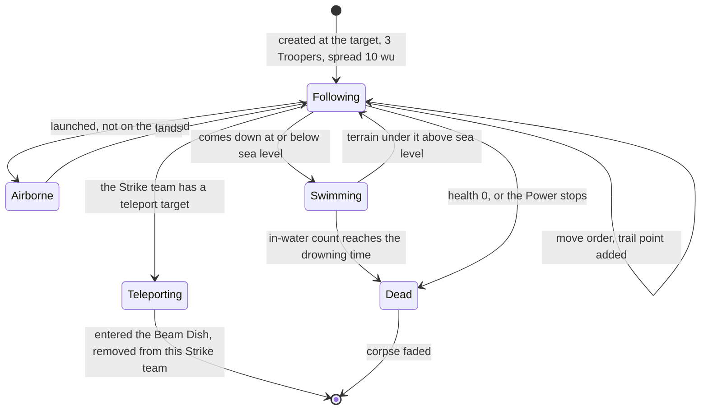
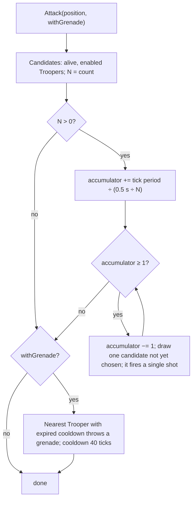
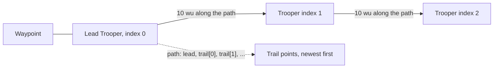

# Strike team

> Status: Reference · Prefix: R-UNIT · Related: [Units](README.md) · [Worker](worker.md) · [Leader and formations](leader_and_formations.md) · [Essence orbs](essence_orbs.md) · [Teams and player commands](../12_simulation_model/06_teams_and_player_commands.md) · [Space, routing and physics](../12_simulation_model/05_space_routing_and_physics.md) · [Crates and powers](../04_supply_crates_powers_and_weapons/crates_and_powers.md) · [Weapons and projectiles](../04_supply_crates_powers_and_weapons/weapons_and_projectiles.md) · [Controls, camera and commands](../06_controls_camera_and_commands.md) · [Bots](../07_bots.md)

## 1 Purpose and player experience

The Strike team is the one combat unit that the player steers directly. A Supply crate grants it as a Power; the player drops it on the map and three Troopers appear. They walk in single file behind their lead Trooper, stepping in his footprints. While the player holds the fire control they pour lasers at the pointer, two shots a second each, and with both fire controls held one of them lobs a grenade. Left alone, they pick their own targets and fire at them. After 600 ticks (one minute at normal speed) the Power runs out and the Troopers fall.

This document specifies the Strike team (`StrikeTeam`, an actor group) and its members, the Troopers (`Trooper`, an actor): acquisition and lifetime, stats, movement and formation, combat, player control, the bot behaviour, death and presentation.

## 2 Rules

### 2.1 Baseline

**R-UNIT-334** (MUST) The values of §4 are the reference tuning baseline (DEC-004), and the rules of this document are the specification of record for the Strike team (DEC-005). Every reference behaviour that looks accidental and is kept is stated as an explicit rule with a named key (DEC-006). The Strike team is part of the kept roster (DEC-019).

### 2.2 Role, acquisition and lifetime

**R-UNIT-335** (MUST) A Strike team is an actor group of one team whose members are Troopers ([teams and player commands](../12_simulation_model/06_teams_and_player_commands.md) R-SIM-424, [entity model](../12_simulation_model/03_entity_model_and_identity.md) R-SIM-102). Its Troopers are not ungrouped actors (DEC-117). It is the only combat unit that the player steers directly: the Troopers follow their lead Trooper in single file, fire laser bolts at the player's pointer on command, throw a grenade on command, and fight on their own while the Strike team is not selected.

**R-UNIT-336** (MUST) A Strike team is created when the Strike team outcome's Power is targeted at a ground position (`PlayerCommand::TargetPower`, [crates and powers](../04_supply_crates_powers_and_weapons/crates_and_powers.md)). The team creates an actor group of `ref.unit.strike_team.size_base` (2) + the Strike team power level (`ref.sim.init.power_level.strike_team`, 1) = 3 Troopers at the target position, scattered by `ref.unit.strike_team.spawn_spread` (10 wu), and selects the new Strike team inside the same simulation step ([teams and player commands](../12_simulation_model/06_teams_and_player_commands.md) R-SIM-401). The outcome's announcement sting belongs to [crates and powers](../04_supply_crates_powers_and_weapons/crates_and_powers.md). Whether the targeting player's camera starts tracking the new Strike team is a presentation preference of that player ([controls, camera and commands](../06_controls_camera_and_commands.md)) and never reaches the simulation (DEC-008).

**R-UNIT-337** (MUST) A map may also place a Strike team as starting units that run as a Power ([population flow](../05_population_flow.md) R-ECON-109); no reference map does. Such a Strike team has no life limit (see DEC-551).

**R-UNIT-338** (MUST) A Strike team's Power starts with a life of `ref.unit.strike_team.life_ticks` (600 ticks, nominal 60 s). The life counts down by 1 tick per tick while it is above 0. When it reaches 0, or when the player cancels the Power (`PlayerCommand::CancelPower`), the Power stops: every Trooper of the Strike team takes a health change of −`ref.unit.strike_team.stop_damage` (1000), which kills it. The Power also ends when the Strike team has no live Trooper.

**R-UNIT-339** (MUST) A Strike team whose Troopers leave through a Beam Dish is registered again as a new Power: it receives a new Power id and the last slot position. If that registration fails because the team's Power slots have dropped to two on elimination, the Strike team carries on with no Power: it has no life limit, occupies no slot and cannot be cancelled from the power bar (see DEC-551, [crates and powers](../04_supply_crates_powers_and_weapons/crates_and_powers.md)).

### 2.3 Trooper stats

**R-UNIT-340** (MUST) A Trooper has health `ref.unit.trooper.health` (75) and a ground speed of `ref.unit.trooper.speed` (30 wu/s) times its slope factor (R-UNIT-347). Its stat-table fire rate is `ref.unit.trooper.fire_rate_s` (0.5 s), used only by the Strike team's fire accumulator (R-UNIT-352). Actor stats are floating-point values (DEC-090).

**R-UNIT-341** (MUST) A Trooper's own reload interval is `ref.unit.trooper.reload_ticks` (0 ticks): no Trooper is ever reloading, so its own reload never blocks a shot, and the Strike team's fire rate comes from the accumulator alone (R-UNIT-352). This is an explicit rule, not a consequence of the stat-table rate (DEC-006).

**R-UNIT-342** (MUST) A Trooper is drawn with the mesh `mesh.unit.trooper_figure`, whose `muzzle` socket is the origin of its laser bolts and grenades and whose `casing_eject` socket is the origin of its shell casings. The content build rejects a Trooper mesh without both sockets (DEC-015, ADR-0021).

### 2.4 Movement and formation

**R-UNIT-343** (MUST) A move order to position p sets the Strike team's waypoint and focus to p, sets its target direction towards p ([teams and player commands](../12_simulation_model/06_teams_and_player_commands.md) R-SIM-425) and recalculates the formation indices (R-UNIT-345). It then adds a trail point (`TrailPoint`) at the front of the Strike team's trail: the current position of the lead Trooper, or p when the Strike team has no enabled lead Trooper. The trail is ordered newest first and is never shortened during the Strike team's life. If a Beam Dish that is linked to a receiving dish stands within `ref.unit.strike_team.dish_snap_range` (5 wu) of p, the Strike team takes that Beam Dish as its teleport target and its waypoint becomes the dish's entrance.

**R-UNIT-344** (MUST) A trail point holds a position and an id. The id is a serial from a per-match counter that starts at 0 at match-world creation ([match lifecycle and state reset](../12_simulation_model/02_match_lifecycle_and_state_reset.md), DEC-011); no rule reads it.

**R-UNIT-345** (MUST) The lead Trooper is the Trooper with formation index 0. Recalculating the formation indices gives the live Troopers the indices 0 to n − 1 in member-slot order ([teams and player commands](../12_simulation_model/06_teams_and_player_commands.md) R-SIM-432); it runs after a move order and whenever a Trooper dies, so the survivors close up behind a new lead.

**R-UNIT-346** (MUST) The Strike team gives each Trooper its target position. The lead Trooper heads straight for the waypoint. The Trooper with formation index i > 0 heads for TargetAt(`ref.unit.strike_team.trooper_spacing` × i), that is 10 wu × i along the path behind the lead:

```
TargetAt(d):
    if d <= 0 or the Strike team has a teleport target: return waypoint
    path := [lead position, trail[0], trail[1], ..., trail[last]]      # newest trail point first
    walk along path from its start, summing segment lengths
    return the point at path distance d; if the path is shorter than d, return trail[last]
```

The Troopers therefore walk in single file in the lead Trooper's footsteps, and each turns where the lead turned when the order was given.

**R-UNIT-347** (MUST) A Trooper that is alive, on the ground and out of the water moves towards its target position each tick at `ref.unit.trooper.speed` × its slope factor. The slope factor is 1 + (h_now − h_next) ÷ `ref.unit.trooper.slope_divisor` (3), where h_now is the terrain height at the Trooper and h_next at its next position, clamped to `ref.unit.trooper.slope_factor_range` ([0.2, 2.0]); it is 0 when the step goes uphill and the y component of the terrain normal at the Trooper is below `ref.unit.trooper.climb_normal_min` (0.6), so a Trooper cannot climb a steep slope. A Trooper closer to its target than one step stops on the target. The step then passes through the obstacle push `PushFromObstacles` ([space, routing and physics](../12_simulation_model/05_space_routing_and_physics.md) R-SIM-380), so an enemy enabled Barrier Emitter kills it (R-SIM-381), and the Trooper's height becomes the terrain height + `ref.unit.trooper.ground_offset` (0.1 wu). Its x and z stay inside the map.

**R-UNIT-348** (MUST) A Trooper's facing turns only about the vertical axis, with angular velocity `ref.unit.trooper.turn_gain` (4) × the vertical component of (facing × desired facing), limited to `ref.unit.trooper.turn_rate_max` (20 rad/s). Its desired facing is:

- while its Strike team is its team's current selection: towards its team's current pointer position, which the team command state carries ([teams and player commands](../12_simulation_model/06_teams_and_player_commands.md) R-SIM-442);
- while the Strike team has a teleport target: towards its target position;
- otherwise: along its velocity, after which it runs its autonomous behaviour (R-UNIT-353) and turns towards its current enemy if it has one.

**R-UNIT-349** (MUST) A Trooper that comes down at or below sea level (`ref.sim.physics.sea_level`) starts its in-water count at a head start drawn from `ref.unit.trooper.water_head_start` (U[0, 30) ticks) and then advances by the swimming step ([space, routing and physics](../12_simulation_model/05_space_routing_and_physics.md) R-SIM-376): it drowns `ref.sim.water.drown_after` (100 ticks) after the start of the count, so 70 to 100 ticks after it entered the water. It leaves the water when the terrain under it rises above sea level. A Trooper that is not on the ground advances by the airborne step (R-SIM-370, R-SIM-373).

**R-UNIT-350** (MUST) While its Strike team has a teleport target, a Trooper that reaches the Beam Dish entrance tries to enter it (`TryEnterTeleport` with that dish required, [space, routing and physics](../12_simulation_model/05_space_routing_and_physics.md) R-SIM-386). On success the Trooper is removed from this Strike team; the Beam Dish carries it and re-creates it at the far side in a Strike team of the same team, which keeps the secondary weapon kind ([buildings and world objects](../03_buildings_and_world_objects/README.md)), and the Power registration of R-UNIT-339 applies. The Trooper's entry and exit raise the enter-gate and exit-gate sound events (R-UNIT-366).

**R-UNIT-351** (MUST) A Trooper is never knocked back. A laser bolt hit pushes it not at all, because a Trooper's health change never reports a knock-back, and an explosion never makes it airborne (R-SIM-374).

### 2.5 Combat

**R-UNIT-352** (MUST) **Primary fire.** `Attack(position, withGrenade)` on a Strike team runs the primary fire every time, and the secondary fire (R-UNIT-355) as well when withGrenade is set. The primary fire takes as candidates the alive, enabled Troopers that are not reloading (every live Trooper, by R-UNIT-341), with N their number. The fire accumulator grows by `ref.sim.tick_period` ÷ (`ref.unit.trooper.fire_rate_s` ÷ N), that is 0.2 × N per tick; while the accumulator is at least 1, it is reduced by 1 and one candidate, chosen by a simulation draw from the candidates not yet chosen in this call, fires a single shot (R-UNIT-354) at the position. A full Strike team therefore fires 6 shots per second, 2 per Trooper, spread evenly over the ticks. With no candidate, no Trooper fires and no draw is made ([teams and player commands](../12_simulation_model/06_teams_and_player_commands.md) R-SIM-428).

**R-UNIT-353** (MUST) **Autonomous behaviour.** A Trooper whose Strike team is not its team's current selection chooses its own enemy: every `ref.unit.trooper.target_interval_ticks` (11 ticks, nominal 1.0 s) it sets its current enemy to `NearestEnemy(x, z, 0, ref.unit.trooper.target_range, team)` (100 wu, [space, routing and physics](../12_simulation_model/05_space_routing_and_physics.md) R-SIM-311). Each tick in which it has a live current enemy at distance d, it draws a value from U[0, d × `ref.unit.trooper.auto_fire_scale`) (d ÷ 2) and fires a single shot at the enemy when the draw is below `ref.unit.trooper.auto_fire_threshold` (2): a chance of min(1, 4 ÷ d) per tick, for example 10 % per tick at 40 wu and every tick within 4 wu.

**R-UNIT-354** (MUST) **Single shot.** A Trooper's shot fires one laser bolt from the world position of its `muzzle` socket at `ref.unit.trooper.laser_speed` (200 wu/s) towards the target position displaced by two draws from `ref.unit.trooper.aim_jitter` (U[−3.5, 3.5] wu), first on x, then on z. The bolt's lifetime, damage and ricochet are those of the laser bolt ([weapons and projectiles](../04_supply_crates_powers_and_weapons/weapons_and_projectiles.md)), which give the Trooper a reach of `ref.unit.trooper.laser_range` (120 wu). The shot also ejects a shell casing from the `casing_eject` socket with velocity front × (`ref.unit.trooper.casing_speed_base` (5) + U[0, `ref.unit.trooper.casing_speed_range`) (10)) + U[−2.5, 2.5] wu/s on each axis; the casing's draws are presentation draws ([randomness and integrity](../12_simulation_model/07_randomness_and_integrity.md) R-SIM-622). The shot raises the attack and fire-laser sound events (R-UNIT-366).

**R-UNIT-355** (MUST) **Secondary fire.** With withGrenade set, the alive, enabled Trooper nearest the target position whose secondary cooldown has expired throws the Strike team's secondary weapon at the position, provided the team's power level for that weapon is above 0. Its secondary cooldown is then `ref.unit.trooper.grenade_cooldown_ticks` (40 ticks, nominal 4.0 s); when the cooldown expires the Trooper raises the weapon-ready sound event (R-UNIT-366). Each Trooper has its own cooldown, so one Trooper throws per call at most.

**R-UNIT-356** (MUST) In a match a Strike team's secondary weapon is always the grenade: weapon cycling is not available in matches and no map sets another weapon (DEC-117). The grenade is thrown from the `muzzle` socket at the target position by the thrown-weapon rules, with the grenade's maximum throw force, fuse, explosion radius and damage at the grenade power level `ref.sim.init.power_level.grenade` ([weapons and projectiles](../04_supply_crates_powers_and_weapons/weapons_and_projectiles.md)).

### 2.6 Player control

**R-UNIT-357** (MUST) A player controls a Strike team through these commands and control-state fields ([teams and player commands](../12_simulation_model/06_teams_and_player_commands.md) R-SIM-439, R-SIM-450; bindings in [controls, camera and commands](../06_controls_camera_and_commands.md)):

| Input | Command or field | Effect |
|---|---|---|
| select the Strike team | `PlayerCommand::Select` naming the group | the Strike team becomes the team's current selection; its Troopers face the pointer (R-UNIT-348) |
| move order (primary pointer action without primary fire) | `PlayerCommand::ControlState` with `move_target` | a move order to `pointer_position` (R-UNIT-343); the sender's ground marker is presentation |
| primary fire held | `ControlState` with `primary_fire`, every tick | `Attack(pointer_position, false)` (R-UNIT-352) |
| primary and secondary fire held | `ControlState` with `primary_fire` and `secondary_fire` | `Attack(pointer_position, true)`: lasers and one grenade (R-UNIT-352, R-UNIT-355) |
| gamepad direct control | `ControlState` with `direct_move`, `target_directed`, `secondary_fire_directed` | R-UNIT-358 |
| cancel the Power | `PlayerCommand::CancelPower` | the Power stops and every Trooper dies (R-UNIT-338) |

**R-UNIT-358** (MUST) **Direct control.** Direct control of a selected Strike team runs only while the sender's team command state reports camera tracking (`camera_tracking`); the sender folds its look-around state into that flag and converts every stick vector to world space before sending, so the simulation never reads a camera (DEC-008, [randomness and integrity](../12_simulation_model/07_randomness_and_integrity.md) R-SIM-661). It then:

1. with `direct_move`, moves the Strike team's waypoint from the lead Trooper's position by `direct_move_vector`; if a Beam Dish linked to a receiving dish stands in the obstacle cell of the new waypoint, the waypoint snaps to that dish as in R-UNIT-343;
2. with `target_directed`, attacks along `direct_target_vector` (as the point (x, 0, z) of the vector) without a grenade;
3. with `secondary_fire_directed`, attacks along it with a grenade.

A handle found in the obstacle cell of a point off the map is resolved like every other handle, and a stale one is a failed look-up ([space, routing and physics](../12_simulation_model/05_space_routing_and_physics.md) R-SIM-325). The gamepad never sets `move_target` while a Strike team is selected (R-SIM-439).

### 2.7 Bot behaviour

**R-UNIT-359** (MUST) A bot team's Strike team runs its own bot behaviour each tick (the bot controller acts directly and sends no commands, [teams and player commands](../12_simulation_model/06_teams_and_player_commands.md) R-SIM-438; strategy in [bots](../07_bots.md)). Its engagement range is `ref.unit.strike_team.bot_engage_range` (254.4 wu): the approximate maximum range of a grenade thrown at the grenade's maximum force at the match grenade power level (`ref.unit.strike_team.bot_range_factor` (2.3125) × that force of 110, derived on flat terrain, see DEC-111).

**R-UNIT-360** (MUST) Every `ref.unit.strike_team.bot_scan_ticks` (11 ticks), the bot Strike team scans the enemies within `ref.unit.strike_team.bot_scan_range` (500 wu) of its centre, nearest first, and picks the first enemy that has at least `ref.unit.strike_team.bot_cluster_min` (20) enemies within `ref.unit.strike_team.bot_cluster_radius` (75 wu), counted with the cell-granular count `CountEnemiesInCells` ([space, routing and physics](../12_simulation_model/05_space_routing_and_physics.md) R-SIM-313, DEC-094). With such an enemy at direction dir from the centre, it orders a move to the enemy's position − `ref.unit.strike_team.bot_standoff_factor` (0.8) × the engagement range × dir, so it stands about 204 wu short of the cluster. Otherwise it orders a move to the walkable neighbour, with the highest priority for its team, of the bot navigation node nearest its centre, or to that node itself ([bots](../07_bots.md)).

**R-UNIT-361** (MUST) Every tick, when enemies lie within the engagement range of its centre, the bot Strike team aims at their centroid displaced by two draws from `ref.unit.strike_team.bot_aim_jitter` (U[−15, 15] wu), first on x, then on z; if that point is within the engagement range, it calls `Attack(point, withGrenade)` with withGrenade true when a simulation integer draw modulo `ref.unit.strike_team.bot_grenade_modulus` (5) is 0, a chance of 20 % per tick that the grenade cooldown still gates (R-UNIT-355).

### 2.8 Death and presentation

**R-UNIT-362** (MUST) Every damage type affects a Trooper alike. A Trooper whose health reaches 0 or below dies: its health becomes the corpse fade value `ref.unit.base.corpse_fade_start` and it fades by the base corpse rule (`ref.unit.base.corpse_fade_ground_ticks`, [Units](README.md); airborne, `ref.sim.physics.dead_fade_per_tick`), it raises the die sound event, and its mesh shatters into debris ([animation and VFX](../../architecture/components/animation_and_vfx.md)). A Trooper releases **no** Essence orb, so a Strike team adds nothing to the essence economy ([essence_orbs.md](essence_orbs.md) R-UNIT-304).

**R-UNIT-363** (MUST) A Trooper is not team-coloured. Its mesh keeps its authored colours, a sand colour (228, 214, 153) and a rust colour (177, 88, 26), and carries no team tint weight (ADR-0020). A Strike team's team is shown only by the selection interface and the world markers ([controls, camera and commands](../06_controls_camera_and_commands.md)).

**R-UNIT-364** (MUST) A Trooper is drawn as a lit mesh. While damaged it flickers by the base damaged-flicker rule, which uses the presentation generator and the presentation clock ([Units](README.md), DEC-007).

**R-UNIT-365** (MUST) A Strike team stays selected only while it exists; destroying the actor group clears its team's selection of it ([teams and player commands](../12_simulation_model/06_teams_and_player_commands.md) R-SIM-426).

**R-UNIT-366** (MUST) A Trooper raises these sound events, bound as listed (reference/10):

| Event | When | Binding |
|---|---|---|
| presence | while the Trooper exists | `sfx.unit.trooper.presence_loop` |
| hurt | a health loss that does not kill | `sfx.unit.trooper.hurt` |
| die | death (R-UNIT-362) | `sfx.unit.trooper.die` |
| enter gate, exit gate | entering and leaving a Beam Dish (R-UNIT-350) | `sfx.unit.trooper.enter_gate`, `sfx.unit.trooper.exit_gate` |
| fire laser | each shot (R-UNIT-354) | `sfx.unit.trooper.fire_laser` |
| attack | each shot | unbound |
| weapon ready | the secondary cooldown expires (R-UNIT-355) | `sfx.unit.trooper.weapon_ready` |
| throw grenade | a grenade throw | decided with the audio corrections of reference/10 (DEC-097) |
| selected | the Strike team is selected | a selection sound plays only for the local player's own selection (DEC-564) |

## 3 States and flows



*Figure 1 — Trooper movement states (R-UNIT-346 to R-UNIT-350, R-UNIT-362).*



*Figure 2 — A Strike team attack call (R-UNIT-352, R-UNIT-355).*



*Figure 3 — Single-file formation: each follower targets a point on the path from the lead Trooper back through the trail (R-UNIT-343, R-UNIT-346).*

## 4 Tuning table

| key | value | unit | range or notes | requirement | DEC |
|---|---|---|---|---|---|
| `ref.unit.strike_team.size_base` | 2 | Troopers | size = 2 + Strike team power level (1) = 3 | R-UNIT-336 | DEC-115 |
| `ref.unit.strike_team.spawn_spread` | 10 | wu | scatter of the created Troopers | R-UNIT-336 | — |
| `ref.unit.strike_team.life_ticks` | 600 | ticks | nominal 60 s; counts down only while above 0 | R-UNIT-338 | DEC-002, DEC-551 |
| `ref.unit.strike_team.stop_damage` | 1000 | health | applied to every Trooper when the Power stops | R-UNIT-338 | — |
| `ref.unit.strike_team.dish_snap_range` | 5 | wu | a linked Beam Dish this close to the ordered point becomes the teleport target | R-UNIT-343 | — |
| `ref.unit.strike_team.trooper_spacing` | 10 | wu | path distance between consecutive Troopers | R-UNIT-346 | — |
| `ref.unit.trooper.health` | 75 | health | | R-UNIT-340 | DEC-090 |
| `ref.unit.trooper.speed` | 30 | wu/s | × slope factor | R-UNIT-340, R-UNIT-347 | DEC-090 |
| `ref.unit.trooper.fire_rate_s` | 0.5 | s | stat-table rate; used only by the accumulator | R-UNIT-340, R-UNIT-352 | DEC-090 |
| `ref.unit.trooper.reload_ticks` | 0 | ticks | a Trooper never reloads on its own | R-UNIT-341 | DEC-006 |
| `ref.unit.trooper.slope_divisor` | 3 | wu | slope factor = 1 + Δh ÷ 3 | R-UNIT-347 | — |
| `ref.unit.trooper.slope_factor_range` | [0.2, 2.0] | × speed | clamp of the slope factor | R-UNIT-347 | — |
| `ref.unit.trooper.climb_normal_min` | 0.6 | normal y | uphill steps on terrain whose normal y is below this have factor 0 | R-UNIT-347 | — |
| `ref.unit.trooper.ground_offset` | 0.1 | wu | height above the terrain while walking | R-UNIT-347 | — |
| `ref.unit.trooper.turn_gain` | 4 | — | angular velocity = 4 × (facing × desired).y | R-UNIT-348 | — |
| `ref.unit.trooper.turn_rate_max` | 20 | rad/s | | R-UNIT-348 | — |
| `ref.unit.trooper.water_head_start` | [0, 30) | ticks | uniform; nominal 0 to 3 s already in the water | R-UNIT-349 | DEC-002 |
| `ref.unit.trooper.target_interval_ticks` | 11 | ticks | nominal 1.0 s | R-UNIT-353 | DEC-002 |
| `ref.unit.trooper.target_range` | 100 | wu | maximum range of the autonomous enemy search; minimum 0 | R-UNIT-353 | — |
| `ref.unit.trooper.auto_fire_scale` | 0.5 | × distance | upper bound of the autonomous fire draw | R-UNIT-353 | — |
| `ref.unit.trooper.auto_fire_threshold` | 2 | — | fire when the draw is below this: chance min(1, 4 ÷ d) | R-UNIT-353 | — |
| `ref.unit.trooper.laser_speed` | 200 | wu/s | 20 wu per tick | R-UNIT-354 | — |
| `ref.unit.trooper.aim_jitter` | [−3.5, 3.5] | wu | one draw on x, one on z | R-UNIT-354 | — |
| `ref.unit.trooper.laser_range` | 120 | wu | derived: 20 wu per tick × the laser bolt's lifetime of 6 ticks | R-UNIT-354 | DEC-111 |
| `ref.unit.trooper.casing_speed_base` | 5 | wu/s | along the facing | R-UNIT-354 | DEC-013 |
| `ref.unit.trooper.casing_speed_range` | 10 | wu/s | U[0, 10) added along the facing; plus U[−2.5, 2.5] per axis | R-UNIT-354 | DEC-013 |
| `ref.unit.trooper.grenade_cooldown_ticks` | 40 | ticks | nominal 4.0 s, per Trooper | R-UNIT-355 | DEC-002 |
| `ref.unit.strike_team.bot_engage_range` | 254.4 | wu | derived: 2.3125 × 110 | R-UNIT-359, R-UNIT-360, R-UNIT-361 | DEC-111 |
| `ref.unit.strike_team.bot_range_factor` | 2.3125 | wu per unit of force | approximate flat-terrain range of a throw | R-UNIT-359 | DEC-111 |
| `ref.unit.strike_team.bot_scan_ticks` | 11 | ticks | nominal 1.0 s | R-UNIT-360 | DEC-002 |
| `ref.unit.strike_team.bot_scan_range` | 500 | wu | from the Strike team's centre | R-UNIT-360 | — |
| `ref.unit.strike_team.bot_cluster_radius` | 75 | wu | | R-UNIT-360 | DEC-094 |
| `ref.unit.strike_team.bot_cluster_min` | 20 | enemies | at least this many | R-UNIT-360 | DEC-094 |
| `ref.unit.strike_team.bot_standoff_factor` | 0.8 | × engagement range | stand-off distance ≈ 204 wu | R-UNIT-360 | — |
| `ref.unit.strike_team.bot_aim_jitter` | [−15, 15] | wu | one draw on x, one on z | R-UNIT-361 | — |
| `ref.unit.strike_team.bot_grenade_modulus` | 5 | — | grenade when a draw modulo 5 is 0: 20 % per tick | R-UNIT-361 | — |

Keys cited from other documents (their values are defined there):

| Owning document | Keys | Used by |
|---|---|---|
| [match lifecycle and state reset](../12_simulation_model/02_match_lifecycle_and_state_reset.md) | `ref.sim.init.power_level.strike_team`, `ref.sim.init.power_level.grenade` | R-UNIT-336, R-UNIT-356 |
| [tick timing](../12_simulation_model/01_tick_timing_and_main_loop.md) | `ref.sim.tick_period` | R-UNIT-352 |
| [space, routing and physics](../12_simulation_model/05_space_routing_and_physics.md) | `ref.sim.physics.sea_level`, `ref.sim.water.drown_after`, `ref.sim.physics.dead_fade_per_tick` | R-UNIT-349, R-UNIT-362 |
| [Units](README.md) | `ref.unit.base.corpse_fade_start`, `ref.unit.base.corpse_fade_ground_ticks` | R-UNIT-362 |

## 5 Edge cases and interactions

1. **Lead Trooper dies.** The formation indices are recalculated, the next Trooper in member-slot order becomes the lead and heads straight for the waypoint, and the trail path now starts at the new lead (R-UNIT-345, R-UNIT-346).
2. **Long trail.** Trail points are never removed during the 600-tick life, so a Strike team that has received many orders keeps a long trail; a follower whose path distance exceeds the trail's length heads for the oldest trail point (R-UNIT-343, R-UNIT-346).
3. **Steep slopes.** On terrain whose normal y is below 0.6 a Trooper cannot step uphill and stands still while its target lies uphill (R-UNIT-347).
4. **Barrier Emitters.** An enemy enabled Barrier Emitter on the path kills each Trooper that touches it; a friendly one is passed through (R-UNIT-347, R-SIM-381).
5. **No orbs.** A Strike team that is wiped out leaves nothing for Collectors (R-UNIT-362).
6. **Beam Dish transit after elimination.** A Strike team that passes through a Beam Dish while its team has only two Power slots, both full, keeps fighting with no life limit and cannot be cancelled (R-UNIT-339, DEC-551).
7. **Fire rate after losses.** With 2 Troopers the accumulator grows by 0.4 per tick and the Strike team fires 4 shots per second; with 1 it fires 2 (R-UNIT-352).
8. **Selected and autonomous.** A selected Strike team fires only on its player's command; the moment it is deselected its Troopers resume the autonomous search, with their next enemy evaluation at the latest 11 ticks later (R-UNIT-348, R-UNIT-353).
9. **Remote look-around.** One player's free-look never changes another team's Strike team, because only the sender's own control state carries the camera-tracking flag (R-UNIT-358, DEC-008).
10. **Grenade in a Collector's field.** A grenade a Trooper throws can land near a harvesting Collector and be drawn up into it, destroying the Collector ([collector.md](collector.md)).

## 6 Acceptance criteria

**AC-ST-01 — Size and life** (R-UNIT-336, R-UNIT-338). Given the Strike team power level 1, when the Power is targeted, then 3 Troopers exist within 10 wu of the target and the Strike team is the team's selection; after 600 ticks every Trooper is dead.

**AC-ST-02 — Fire rate** (R-UNIT-341, R-UNIT-352). Given a full Strike team with primary fire held for 100 ticks, then exactly 60 laser bolts are fired, and no Trooper is ever excluded as reloading.

**AC-ST-03 — Single file** (R-UNIT-343, R-UNIT-346). Given a Strike team at rest at (0, 0, 0) with its lead at the origin, when a move order to (100, 0, 0) is given and then, after the lead has reached (50, 0, 0), a move order to (50, 0, 100), then follower 1 targets the point 10 wu behind the lead along the path lead → (50, 0, 0) → (0, 0, 0) and turns at (50, 0, 0).

**AC-ST-04 — Autonomous fire chance** (R-UNIT-353). Given an unselected Trooper whose enemy is 40 wu away, over 10,000 ticks it fires in 10 % ± 1 % of the ticks; given an enemy 3 wu away, it fires every tick.

**AC-ST-05 — Grenade only with both controls** (R-UNIT-355, R-UNIT-356, R-UNIT-357). Given a selected Strike team, when `secondary_fire` is set without `primary_fire`, then no grenade is thrown; with both set, one grenade is thrown by the Trooper nearest the pointer, and the next is thrown no earlier than 40 ticks later by that Trooper.

**AC-ST-06 — Slope stop** (R-UNIT-347). Given a Trooper on terrain with normal y 0.5 and its target uphill, then its position does not change; with its target downhill it moves at up to 60 wu/s.

**AC-ST-07 — No orb** (R-UNIT-362). Given a Strike team, when every Trooper dies, then the Essence-orb pool holds no new orb.

**AC-ST-08 — Direct control needs camera tracking** (R-UNIT-358). Given a selected Strike team and a control state with `direct_move` set and `camera_tracking` clear, then its waypoint is unchanged; with `camera_tracking` set, its waypoint becomes the lead Trooper's position plus the movement vector.

**AC-ST-09 — Bot engagement** (R-UNIT-359, R-UNIT-360, R-UNIT-361). Given a bot Strike team and a cluster of 25 enemies whose nearest member is 400 wu from its centre, when its scan runs, then its waypoint lies 203.5 ± 0.5 wu short of that enemy on the line from the centre; and, once enemies are within 254.4 wu, over 1,000 ticks it attempts a grenade on 20 % ± 3 % of the ticks.

**AC-ST-10 — Drowning window** (R-UNIT-349). Given a Trooper pushed into deep water, it drowns between 70 and 100 ticks after it came down in the water.

## 7 Dependencies

- **Reference documents:** [Units](README.md) (damage types, corpse fade, damaged flicker); [essence_orbs.md](essence_orbs.md); [crates and powers](../04_supply_crates_powers_and_weapons/crates_and_powers.md) (the Strike team outcome, Power slots, cancellation); [weapons and projectiles](../04_supply_crates_powers_and_weapons/weapons_and_projectiles.md) (laser bolt, grenade, thrown weapons, shell casings); [buildings and world objects](../03_buildings_and_world_objects/README.md) (Beam Dish transit); [controls, camera and commands](../06_controls_camera_and_commands.md) (bindings, camera tracking); [bots](../07_bots.md) (navigation nodes and priorities); [teams and player commands](../12_simulation_model/06_teams_and_player_commands.md) (actor groups, commands, control state); [space, routing and physics](../12_simulation_model/05_space_routing_and_physics.md) (obstacle push, airborne and swimming steps, grid queries, teleport entry); [match lifecycle and state reset](../12_simulation_model/02_match_lifecycle_and_state_reset.md) (power levels, trail-point counter); [randomness and integrity](../12_simulation_model/07_randomness_and_integrity.md); reference/10 (audio events).
- **Engine components:** [renderer](../../architecture/components/renderer/README.md) (mesh, no team tint, ADR-0020); [animation and VFX](../../architecture/components/animation_and_vfx.md) (shatter debris, shell casings); [audio engine](../../architecture/components/audio_engine.md); [input](../../architecture/components/input.md) (world-space conversion of stick vectors).
- **Assets:** `mesh.unit.trooper_figure`; `icon.power.strike_team` (the Strike team Power); `icon.power.grenade` (the Strike team's grenade weapon); `sfx.unit.trooper.presence_loop`, `sfx.unit.trooper.hurt`, `sfx.unit.trooper.die`, `sfx.unit.trooper.enter_gate`, `sfx.unit.trooper.exit_gate`, `sfx.unit.trooper.fire_laser`, `sfx.unit.trooper.weapon_ready`.

## 8 Open decisions

| DEC | Title | Default specified in §2 |
|---|---|---|
| DEC-551 | Units that outlive their Power slot | a Beam Dish transit re-registers the Strike team as a new Power; map-placed Strike teams have no life limit (R-UNIT-337, R-UNIT-338, R-UNIT-339) |
| DEC-094 | Exact or approximate actor-grid queries | the bot cluster test uses the cell-granular count (R-UNIT-360) |
| DEC-111 | Values derived from flat-terrain calculation | the bot engagement range and the laser reach are derived values (R-UNIT-354, R-UNIT-359) |
