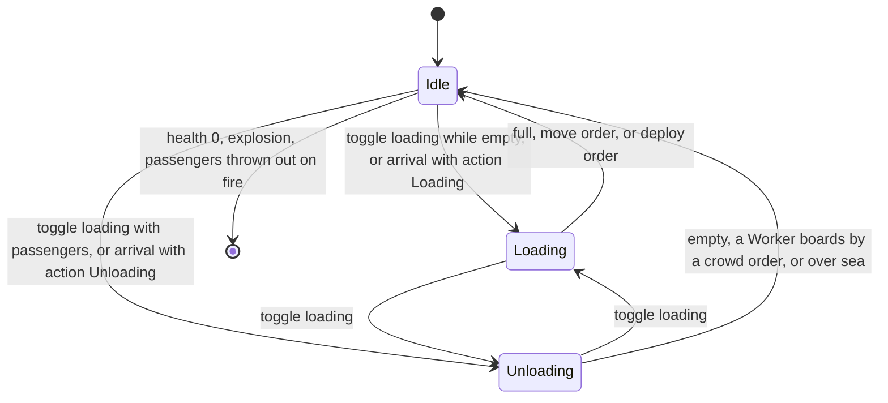
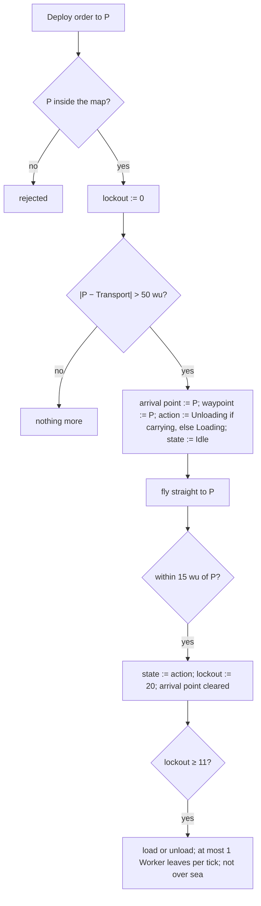
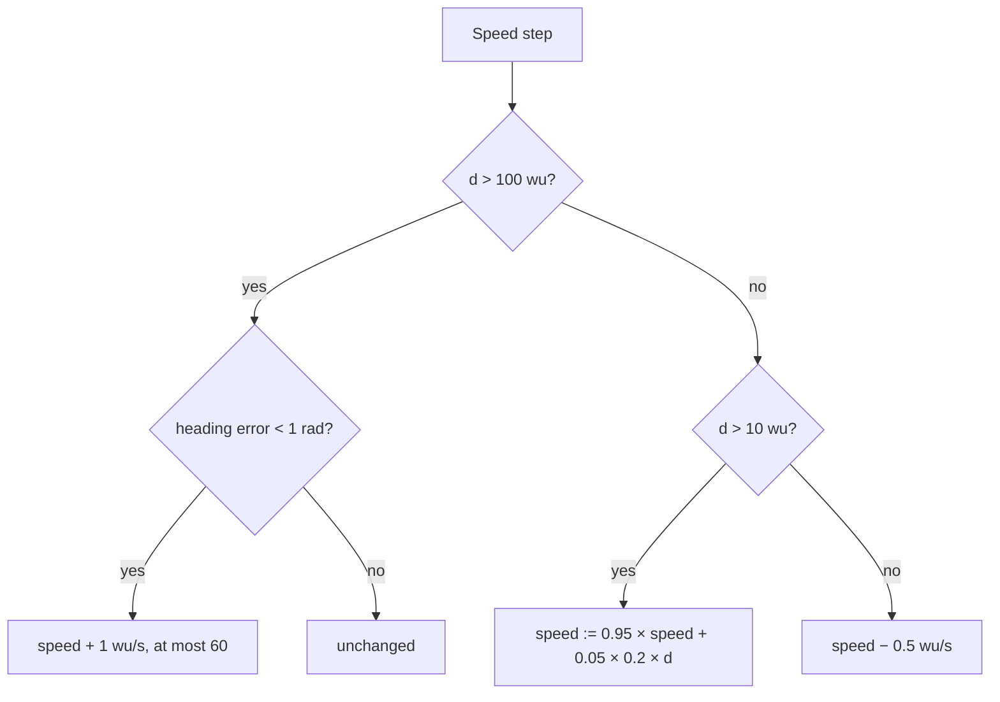

# Transport

> Status: Reference · Prefix: R-UNIT · Related: [Units](README.md) · [Worker](worker.md) · [Strike team](strike_team.md) · [Teams and player commands](../12_simulation_model/06_teams_and_player_commands.md) · [Space, routing and physics](../12_simulation_model/05_space_routing_and_physics.md) · [Population flow](../05_population_flow.md) · [Crates and powers](../04_supply_crates_powers_and_weapons/crates_and_powers.md) · [Controls, camera and commands](../06_controls_camera_and_commands.md) · [Bots](../07_bots.md)

## 1 Purpose and player experience

The Transport is a hovering troop carrier. It skims over land and sea alike, carries up to 100 Workers, and has no weapon of its own: its value is that it puts a crowd where the crowd could not walk, across water or behind the enemy's lines. The player points it at a spot with the deploy order; it flies there in a straight line and, on arrival, either opens its door and lets idle Workers nearby run aboard, or drops its passengers one by one. A burst of turret fire or a grenade can destroy it, and then its passengers tumble out burning.

This document specifies the Transport (`Transport`, an actor): acquisition, stats, damage, movement, its states and orders, passenger accounting, player control, its bot behaviour and its presentation. The Worker's side of boarding and leaving is in [worker.md](worker.md).

## 2 Rules

### 2.1 Baseline

**R-UNIT-367** (MUST) The values of §4 are the reference tuning baseline (DEC-004), and the rules of this document are the specification of record for the Transport (DEC-005). Every reference behaviour that looks accidental and is kept is stated as an explicit rule with a named key (DEC-006). The Transport is part of the kept roster (DEC-019).

### 2.2 Role, acquisition and lifetime

**R-UNIT-368** (MUST) A Transport is an ungrouped actor of its team and a special unit: it registers in its team's special-unit list when it starts and unregisters when it is removed ([teams and player commands](../12_simulation_model/06_teams_and_player_commands.md) R-SIM-400, DEC-117). It carries up to `ref.unit.transport.capacity` (100) Workers over land and sea, and it has no weapon. Its life has no limit.

**R-UNIT-369** (MUST) A Transport enters a match only in these ways:

| Source | Rule |
|---|---|
| the Transport outcome | its Power, targeted at a ground position (`PlayerCommand::TargetPower`), creates one Transport there and selects it on its team inside the same simulation step ([crates and powers](../04_supply_crates_powers_and_weapons/crates_and_powers.md)) |
| a Transit Gate reinforcement wave | the wave grants a Transport Power while the team holds fewer Transport Powers than `ref.econ.gate.transport_cap`, or the cap is 0, and targets it at the gate position + its front × `ref.econ.gate.transport_target_wu`, `ref.econ.gate.transport_target_height_wu` above the ground ([population flow](../05_population_flow.md) R-ECON-093 step 3) |
| a map's starting units marked to run as a Power | each becomes a Transport Power targeted at the unit's position, with no life limit on the Power ([population flow](../05_population_flow.md) R-ECON-109); the reference maps place 7 such Transports in total, all on four Siege maps |

The Supply crate validity rule that excludes the Transport outcome in Launch Race and on maps with a Transit Gate Transport cap belongs to [crates and powers](../04_supply_crates_powers_and_weapons/crates_and_powers.md).

**R-UNIT-370** (MUST) A Transport's Power ends when the Transport is dead or no longer exists. Cancelling a Transport's Power frees its Power slot and leaves the Transport in the world, where it stays with no slot (see DEC-551).

### 2.3 Stats

**R-UNIT-371** (MUST) A Transport has health `ref.unit.transport.health` (200), kept within `ref.unit.transport.health_range` ([0, 255]), and a maximum speed of `ref.unit.transport.speed_max` (60 wu/s). Its stat-table rate `ref.unit.transport.fire_rate_s` (5 s) is read by no rule. Actor stats are floating-point values (DEC-090).

**R-UNIT-372** (MUST) A Transport is drawn with the mesh `mesh.unit.transport_hull`. Its `entrance` socket is the door that Workers board and leave by (R-UNIT-397, R-UNIT-398) and the point of the entrance clearance test (R-UNIT-382); the content build rejects a Transport mesh without it (DEC-015, ADR-0021). Nothing is drawn at its `flag` socket.

### 2.4 Damage and death

**R-UNIT-373** (MUST) A Transport takes damage by damage type:

| Damage type | Effect |
|---|---|
| laser | none, and no knock-back |
| turret round | the damage ÷ `ref.unit.transport.turret_round_divisor` (3), truncated to an integer: a 15-damage round deals 5 |
| explosive, fire, unresistable | the full damage |

**R-UNIT-374** (MUST) Whenever a health change carries a Transport's health across a multiple of `ref.unit.transport.shatter_band` (20 health), its hull sheds debris with the shatter fraction `ref.unit.transport.shatter_scale` (0.5) × (1 − health ÷ `ref.unit.transport.health`), and with fraction 1.0 at death; every turret-round hit adds a puff of fraction `ref.unit.transport.round_puff` (0.05). The debris is presentation ([animation and VFX](../../architecture/components/animation_and_vfx.md)).

**R-UNIT-375** (MUST) A Transport whose health reaches 0 dies: it raises the die sound event and explodes with `Explode(position, ref.unit.transport.death_explosion_range (20 wu), ref.unit.transport.death_explosion_damage (50), its own team)` ([space, routing and physics](../12_simulation_model/05_space_routing_and_physics.md) R-SIM-388; team filter in [weapons and projectiles](../04_supply_crates_powers_and_weapons/weapons_and_projectiles.md)); the explosion damages actors of every team, its own included. It releases **no** Essence orb, has no corpse fade, and its advance on the next tick requests its removal.

**R-UNIT-376** (MUST) When a Transport dies, every Worker inside it finds it dead and is thrown out on fire, so most passengers die and release their Essence orbs ([worker.md](worker.md)). A turret round that kills a Transport credits its owner with 1 + the passenger count kills ([weapons and projectiles](../04_supply_crates_powers_and_weapons/weapons_and_projectiles.md)).

**R-UNIT-377** (MUST) A Transport whose hull touches an enemy enabled Barrier Emitter is killed outright by the Barrier Emitter rule ([space, routing and physics](../12_simulation_model/05_space_routing_and_physics.md) R-SIM-381), although the Transport discards the position that the obstacle push returns (R-UNIT-380).

### 2.5 Movement

**R-UNIT-378** (MUST) **Turning.** While its waypoint is more than `ref.unit.transport.turn_min_distance` (10 wu) away, a Transport turns its facing each tick by `ref.unit.transport.turn_fraction` (5 %) of the remaining angle towards the horizontal direction of its waypoint (about 40 % per second), and keeps the vertical component of its facing within ±`ref.unit.transport.facing_pitch_max` (0.1).

**R-UNIT-379** (MUST) **Speed.** With d the horizontal distance to its waypoint, a Transport's speed changes each tick as follows:

| Distance | Speed change per tick |
|---|---|
| d > `ref.unit.transport.cruise_distance` (100 wu), heading error below `ref.unit.transport.cruise_heading_max` (1 rad) | + `ref.unit.transport.acceleration` (10 wu/s²) × `ref.sim.tick_period`, that is +1 wu/s, up to `ref.unit.transport.speed_max` |
| d > 100 wu, heading error at least 1 rad | unchanged |
| `ref.unit.transport.brake_distance` (10 wu) < d ≤ 100 wu | speed := `ref.unit.transport.approach_keep` (0.95) × speed + (1 − 0.95) × (`ref.unit.transport.approach_gain` (0.2 per second) × d) |
| d ≤ 10 wu | − `ref.unit.transport.deceleration` (5 wu/s²) × `ref.sim.tick_period`, that is −0.5 wu/s |

**R-UNIT-380** (MUST) **Step.** Each tick a Transport moves by facing × speed × `ref.sim.tick_period`. It then calls the obstacle push `PushFromObstacles` on the new position and **discards** the result ([space, routing and physics](../12_simulation_model/05_space_routing_and_physics.md) R-SIM-380): a Transport is never pushed out of structures, and only the push's side effects remain, the shore-search draw (R-SIM-379) and the Barrier Emitter kill (R-UNIT-377). Its ground level is max(terrain height, `ref.sim.physics.sea_level`), so it hovers over water at sea level. Then:

- at or below its ground level, its height moves `ref.unit.transport.ground_ease` (0.5) of the way to the ground level each tick, its up vector moves 0.5 of the way to the terrain normal, and its horizontal step this tick is limited to speed × `ref.sim.tick_period`;
- above its ground level, its vertical velocity decreases by `ref.unit.transport.fall_per_tick` (5 wu/s) each tick, it never ends below the ground level, and its up vector moves `ref.unit.transport.air_up_ease` (0.05) of the way to the terrain normal.

Its velocity is then (new position − old position) ÷ `ref.sim.tick_period`.

**R-UNIT-381** (MUST) A Transport's facing is horizontal apart from the pitch of R-UNIT-378, and its up vector follows the terrain normal as R-UNIT-380 states; neither depends on presentation.

**R-UNIT-382** (MUST) **Collisions.** Only while its speed is below `ref.unit.transport.collision_speed_max` (5 wu/s), each tick a Transport:

1. moves away from every other live Transport within `ref.unit.transport.separation_range` (40 wu) by `ref.unit.transport.separation_gain` (0.02) × (40 − d) wu, where d is their distance;
2. if a sphere of radius `ref.unit.transport.entrance_test_radius` (20 wu) at its `entrance` socket hits a structure, moves away from that structure in steps of `ref.unit.transport.entrance_shift_step` (3 wu) until a sphere of `ref.unit.transport.entrance_clear_radius` (5 wu) at the entrance is clear;
3. moves its waypoint by the same displacement when the waypoint is within `ref.unit.transport.waypoint_carry_range` (40 wu).

**R-UNIT-383** (MUST) **Routes.** Only a bot's arrival point creates a route for a Transport (R-UNIT-403). The route is the straight line when the sea-route-clear test (R-UNIT-384) passes, and otherwise a route on the sea route graph built with `permitClimbing` and `noRounding` ([space, routing and physics](../12_simulation_model/05_space_routing_and_physics.md) R-SIM-353), which the Transport then follows point by point (R-SIM-354). A player's order never gives a Transport a route to follow: a player-driven Transport flies straight at its waypoint, and the land route built while the player has it selected is a highlight for display (R-SIM-353). A Transport's sea routes are the only simulation routes that are freed before the match world is destroyed (R-SIM-357, see DEC-651).

**R-UNIT-384** (MUST) The sea-route-clear test between two points samples the segment every `ref.unit.transport.route_clear_step` (20 wu) and fails if the segment crosses an enabled Barrier Emitter that is not a friend of the Transport's team. The sea route graph uses this test for its edges ([space, routing and physics](../12_simulation_model/05_space_routing_and_physics.md) R-SIM-342).

**R-UNIT-385** (MUST) A Transport's ray hit, which turret rounds use, tests the hull at its drawn height: its position raised by `ref.unit.transport.bob_amplitude` (2 wu) × sin(t + serial), where t is the simulation time in seconds from the tick counter (DEC-009) and serial is the Transport's object serial, so rounds hit the hull the player sees (R-UNIT-410).

### 2.6 States and orders

**R-UNIT-386** (MUST) A Transport is in one of the states `TransportState::Idle`, `TransportState::Loading` and `TransportState::Unloading`. It also holds an **arrival point**, which may be none, with an **arrival action** that takes one of the same three values (Idle meaning no action), and an **order lockout** count in ticks.

**R-UNIT-387** (MUST) **Move order.** A move order to a position outside the map is rejected. Otherwise it clears the arrival point and the arrival action, sets the waypoint to the position at the terrain height, and turns Loading into Idle.

**R-UNIT-388** (MUST) **Deploy order.** A deploy order to a position outside the map is rejected. Otherwise it sets the order lockout to 0 and, if the position is more than `ref.unit.transport.deploy_min_distance` (50 wu) from the Transport, sets the arrival point and the waypoint to the position, sets the arrival action to Unloading if the Transport carries passengers and to Loading if it is empty, and sets the state to Idle. A deploy order within 50 wu of the Transport does nothing; the player toggles a nearby Transport by clicking it (R-UNIT-390).

**R-UNIT-389** (MUST) **Arrival.** When a Transport with an arrival point is within `ref.unit.transport.arrival_distance` (15 wu) of it, its state becomes the arrival action if that action is not Idle, its order lockout becomes `ref.unit.transport.arrival_lockout_ticks` (20 ticks), and the arrival point is cleared.

**R-UNIT-390** (MUST) **Toggle loading.** Toggling a Transport's loading changes its state: Idle becomes Unloading if it carries passengers and Loading if it is empty; Unloading becomes Loading; Loading becomes Unloading. The toggle also clears the arrival action.

**R-UNIT-391** (MUST) **Toggle arrival action.** Toggling a Transport's arrival action changes the action: Idle becomes Unloading if it carries passengers and Loading if it is empty; Loading becomes Idle; Unloading becomes Loading if the Transport is not full and Idle if it is. If the new action is Idle, the arrival point is cleared; otherwise the arrival point becomes the current waypoint and the state becomes Idle.

**R-UNIT-392** (MUST) **Automatic changes.** Each tick, a Loading Transport whose passenger count equals its capacity becomes Idle, and an Unloading Transport whose passenger count is 0 becomes Idle.

**R-UNIT-393** (MUST) **Order lockout.** The order lockout grows by 1 each tick. A Transport loads or unloads only while its lockout is at least `ref.unit.transport.orders_lockout_ticks` (11 ticks, more than 1.0 s), so a deploy order pauses loading and unloading for 11 ticks, while an arrival (R-UNIT-389) permits them at once.

**R-UNIT-394** (MUST) **Direct orders.** The `NextMode` and `PreviousMode` commands give a selected Transport a direct order, which toggles its loading (R-UNIT-390) only when more than `ref.sim.state.transport_cycle_debounce` (3 ticks) have passed since that same Transport's previous direct-order toggle; the debounce belongs to each Transport for one match (DEC-011, [match lifecycle and state reset](../12_simulation_model/02_match_lifecycle_and_state_reset.md) R-SIM-021). No reference input issues these commands ([teams and player commands](../12_simulation_model/06_teams_and_player_commands.md) R-SIM-452).

### 2.7 Passengers

**R-UNIT-395** (MUST) A Transport's passenger count is rebuilt every tick. Each Worker inside registers with its Transport when the Worker advances. At the end of the Transport's own advance its count becomes the number of registrations made since its previous advance, and the registration and overflow counts are reset to 0. Boarding registers the Worker and also adds 1 to the overflow count, so a boarding counts at once; the count that every rule reads is the rebuilt count + the overflow count. A Worker leaving, or killed inside, subtracts 1 and records the tick of the last exit.

**R-UNIT-396** (MUST) A Transport is **loading** when it is Loading, its count is below its capacity and its order lockout permits it (R-UNIT-393). It is **unloading** when it is Unloading, its count is above 0, its order lockout permits it and at least `ref.unit.transport.unload_interval_ticks` (1 tick, nominal 0.1 s) has passed since the last exit, so at most one Worker leaves per tick (10 per second).

**R-UNIT-397** (MUST) **Boarding.** Workers board by the Worker rules ([worker.md](worker.md)): an idle Worker within `ref.unit.worker.transport_search_range` (150 wu) of a loading friendly Transport may choose it; a crowd order whose target lies within `ref.unit.worker.transport_order_range` (30 wu) of a friendly Transport with room sends the ordered Workers to board it, also when that Transport is Unloading, which then becomes Idle; a Worker boards when the entrance socket is within `ref.unit.worker.transport_board_distance` (20 wu) or it has arrived. Inside, a Worker's position is held at the Transport.

**R-UNIT-398** (MUST) **Leaving.** While its Transport is unloading and the terrain under the entrance socket is above sea level, one Worker per tick jumps out of the entrance by the Worker's exit jump ([worker.md](worker.md)).

**R-UNIT-399** (MUST) **No unloading over sea.** While the terrain under the entrance socket is at or below sea level, a Worker inside an unloading Transport does not register for that tick, so the Transport's rebuilt count drops to 0 and the automatic change of R-UNIT-392 makes it Idle; the passengers register again on the next tick. A Transport therefore never unloads over sea: an unload order there is lost, and the Transport is Idle with its passengers still inside (see DEC-302).

**R-UNIT-400** (MUST) A Worker that boards raises the Transport's boarding event, and a Worker that leaves raises its leaving event; neither event has a sound binding (DEC-565).

### 2.8 Player control

**R-UNIT-401** (MUST) A player controls a Transport through these commands ([teams and player commands](../12_simulation_model/06_teams_and_player_commands.md) R-SIM-450, R-SIM-452; bindings and control schemes in [controls, camera and commands](../06_controls_camera_and_commands.md)):

| Input | Command | Effect |
|---|---|---|
| select the Transport | `PlayerCommand::Select` naming it | it becomes the team's current actor |
| move order (primary pointer action on the terrain) | `PlayerCommand::OrderUnit` with move-only set | move order to the position (R-UNIT-387) |
| deploy order (special-orders pointer action on the terrain) | `PlayerCommand::OrderUnit` with move-only clear | deploy order to the position (R-UNIT-388); the Transport raises its ordered sound event; an order-marker presentation event is emitted for every viewer whose team is a friend of the commanding team; the Transport is deselected and its land route is highlighted |
| click the Transport | `PlayerCommand::ToggleUnit`, secondary flag clear | toggle loading (R-UNIT-390); the match UI plays its unit-toggle sound for the local player |
| click the Transport's order marker | `PlayerCommand::ToggleUnit`, secondary flag set | toggle the arrival action (R-UNIT-391), and the Transport is deselected |
| weapon-cycle keys | none sent | no effect (R-UNIT-394) |
| cancel the Power | `PlayerCommand::CancelPower` | the slot is freed; the Transport stays (R-UNIT-370) |

An order always carries the straight-route flag (R-SIM-450).

### 2.9 Bot behaviour

**R-UNIT-402** (MUST) A bot team's Transport thinks at an interval set by the bot's difficulty: `ref.unit.transport.bot_think_hard_ticks` (11 ticks) for the hard bot, `ref.unit.transport.bot_think_standard_ticks` (101 ticks; `ref.unit.transport.bot_think_standard_siege_ticks`, 51 ticks, in Siege) for the standard bot, and `ref.unit.transport.bot_think_easy_ticks` (200 ticks; `ref.unit.transport.bot_think_easy_siege_ticks`, 101 ticks, in Siege) for the easy bot (DEC-022). While it moves it re-checks its route every `ref.unit.transport.bot_route_check_ticks` (11 ticks). It runs the behaviour of its mode: Launch Race (R-UNIT-407), Siege (R-UNIT-405), Flag Chain (R-UNIT-406), and the standard behaviour (R-UNIT-404) in every other mode. Strategy context is in [bots](../07_bots.md).

**R-UNIT-403** (MUST) A bot sets a Transport's arrival point by pushing the chosen point out of obstacles, displacing it by two draws from `ref.unit.transport.bot_point_jitter` (U[−5, 5] wu), first on x, then on z, and building its route by R-UNIT-383. Every count that these behaviours make with "within" uses the cell-granular counts of [space, routing and physics](../12_simulation_model/05_space_routing_and_physics.md) R-SIM-313 (DEC-094). "Nobody approaching" means that no Worker is on its way to board the Transport.

**R-UNIT-404** (MUST) **Standard behaviour.**

1. A Transport heading for a self-destruct target that is within `ref.unit.transport.bot_self_destruct_distance` (10 wu) of it changes its own health by −`ref.unit.transport.bot_self_destruct_damage` (1000), and dies with its explosion (R-UNIT-375).
2. An empty Idle Transport sets an arrival point to load at the position of its team's nearest Spawn Node + that node's front × `ref.unit.transport.bot_node_offset` (100 wu).
3. A Transport with more than `ref.unit.transport.bot_standard_full` (50) passengers and no arrival point sets an arrival point to unload behind the nearest enemy Spawn Node, at its position − its front × 100 wu.
4. A Transport that has just emptied by unloading makes one simulation integer draw; if the draw modulo 2 is 0 (50 %), it takes the nearest enemy Spawn Node farther than `ref.unit.transport.bot_self_destruct_min_range` (200 wu) as its self-destruct target and drives into it; otherwise it stays Idle.

**R-UNIT-405** (MUST) **Siege behaviour.** The Siege behaviour runs in every Siege match (DEC-087).

1. When the bot's Siege objectives include Transport objectives, an empty Transport whose current objective has no Transport marker becomes a mobile bomb: it drives to the nearest enemy gun turret or Spawn Node and self-destructs as in R-UNIT-404 item 1 within `ref.unit.transport.bot_bomb_distance` (20 wu).
2. A stopped Transport with more than `ref.unit.transport.bot_carry_threshold` (20) passengers and nobody approaching unloads at the current objective's Transport marker, or else at a random valid objective marker: one that is not friendly for an attacker, any for a defender.
3. An empty or Idle Transport looks for a pickup point: a bot objective marker that offers pickup, is marked as a Transport objective, lies more than `ref.unit.transport.bot_pickup_min_range` (225 wu) away and has more than `ref.unit.transport.bot_pickup_friends` (25) friends within `ref.unit.transport.bot_pickup_radius` (150 wu); or else its own Transit Gate's position + front × `ref.unit.transport.bot_gate_offset` (75 wu). The point is jittered by R-UNIT-403.
4. A Transport within 150 wu of its pickup point becomes Loading.
5. A carrying Transport within `ref.unit.transport.bot_siege_unload_range` (75 wu) of its arrival point becomes Unloading.

**R-UNIT-406** (MUST) **Flag Chain behaviour.**

1. A carrying Transport within `ref.unit.transport.bot_flag_unload_range` (100 wu) of its arrival point becomes Unloading and, to rush a turret, keeps driving to a point `ref.unit.transport.bot_rush_forward` (100 wu) ahead and `ref.unit.transport.bot_rush_right` (50 wu) to the right, so its passengers drop onto the turret.
2. An empty Transport loads in front of one of its team's Transit Gates that has more than `ref.unit.transport.bot_gate_friends` (20) friends within `ref.unit.transport.bot_gate_radius` (200 wu).
3. A stationary Transport with more than 20 passengers and nobody approaching chooses an enemy Flag post linked to one of its team's Flag posts, preferring a linked enemy Home post whose team is not eliminated. When its own Home post is under threat, the easy bot always, and the standard bot with a 50 % draw, chooses instead among the Flag posts linked to its own Home post. The choice among the candidates is random. The easy bot drives to the chosen Flag post's centre; the other bots drive to its drop point: the last enemy gun turret found within `ref.unit.transport.bot_turret_search_factor` (1.2) × the Flag post's size, which is `ref.unit.transport.bot_turret_search_default` (200 wu) for a default Flag post, so that it rushes that turret.

**R-UNIT-407** (MUST) **Launch Race behaviour.**

1. A Transport does not start loading while another Transport of its team within `ref.unit.transport.bot_overlap_radius` (150 wu) is loading.
2. While its team's Launch Vessel is in its loading state, the Transport ferries: it collects from the bot navigation node that has the most idle Workers of its team, provided they number more than `ref.unit.transport.bot_ferry_min_idle` (10), the node is more than `ref.unit.transport.bot_ferry_min_range` (400 wu) from the vessel and no other Transport of its team is loading or heading for an arrival point within `ref.unit.transport.bot_ferry_exclusion` (100 wu) of it; or else at its team's Transit Gate. It drops at the vessel, on a ring of `ref.unit.transport.bot_ring_radius` (100 wu) round it for the standard and hard bots.
3. Otherwise it picks up, in this order of preference, at its team's Transit Gate, at a bot navigation node within `ref.unit.transport.bot_vessel_node_range` (250 wu) of the vessel, or at a Spawn Node of its team with more than 20 friends within 200 wu (at the node's position + front × 100 wu).
4. A stationary Transport with more than 20 passengers and nobody approaching chooses its drop-off point, in this order: an enemy Launch Vessel holding at least `ref.unit.transport.bot_enemy_fuel_min` (75) fuel and more fuel than its own; else an uncontrolled Solar Array objective; else the enemy-held Solar Array group with the most arrays where enemies exceed `ref.unit.transport.bot_enemy_ratio` (1.3) × friends; else the friendly Solar Array group with the fewest friends, preferring groups with at most `ref.unit.transport.bot_friends_per_array` (5) friends per array. The standard and hard bots add a random offset on the 100 wu ring, drawn again until the point is walkable; the redraw is bounded with a deterministic fallback (DEC-014).

### 2.10 Presentation and sound

**R-UNIT-408** (MUST) A Transport's whole hull takes its team colour: every facet has tint weight 1, and the tinted colour is the team colour × `ref.unit.transport.tint_scale` (0.1), which the lighting brightens (ADR-0020). No banner is drawn.

**R-UNIT-409** (MUST) Each tick a Transport emits 1 + trunc(speed ÷ `ref.unit.transport.exhaust_speed_step` (20 wu/s)) exhaust smoke particles; their direction and size are presentation draws ([randomness and integrity](../12_simulation_model/07_randomness_and_integrity.md) R-SIM-622).

**R-UNIT-410** (MUST) A Transport is drawn raised by `ref.unit.transport.bob_amplitude` × sin(t + serial), as R-UNIT-385 states for its hit test, with its up vector wobbling by up to `ref.unit.transport.up_wobble` (0.05).

**R-UNIT-411** (MUST) A Transport's Power slot shows its state with `icon.hud.transport_state`: the boarding icon while it is Loading, the unloading icon while it is Unloading and the travelling icon while it is Idle ([crates and powers](../04_supply_crates_powers_and_weapons/crates_and_powers.md)).

**R-UNIT-412** (MUST) A Transport raises these sound events, bound as listed (reference/10):

| Event | When | Binding |
|---|---|---|
| spawn | the Transport appears | `sfx.unit.transport.spawn` |
| presence | while the Transport exists | `sfx.unit.transport.presence_loop` |
| hurt | a health loss that does not kill | `sfx.unit.transport.hurt` |
| die | death (R-UNIT-375) | `sfx.unit.transport.die` |
| ordered | a deploy order (R-UNIT-401) | `sfx.unit.transport.ordered` |
| boarding, leaving | a Worker boards or leaves (R-UNIT-400) | unbound (DEC-565) |
| selected | the Transport is selected | unbound (DEC-565) |

## 3 States and flows

*Figure 1 — Transport states (R-UNIT-386 to R-UNIT-392, R-UNIT-397, R-UNIT-399). A deploy order sets the state to Idle from any state and stores the arrival action (R-UNIT-388).*

*Figure 2 — A deploy order from command to unloading (R-UNIT-388, R-UNIT-389, R-UNIT-393, R-UNIT-396, R-UNIT-399).*

*Figure 3 — The Transport speed law (R-UNIT-379).*

## 4 Tuning table

| key | value | unit | range or notes | requirement | DEC |
|---|---|---|---|---|---|
| `ref.unit.transport.capacity` | 100 | Workers | | R-UNIT-368, R-UNIT-392, R-UNIT-396 | — |
| `ref.unit.transport.health` | 200 | health | also the divisor of the shatter fraction | R-UNIT-371, R-UNIT-374 | DEC-090 |
| `ref.unit.transport.health_range` | [0, 255] | health | clamp after every health change | R-UNIT-371 | DEC-241 |
| `ref.unit.transport.speed_max` | 60 | wu/s | | R-UNIT-371, R-UNIT-379 | DEC-090 |
| `ref.unit.transport.fire_rate_s` | 5 | s | stat-table rate; no rule reads it | R-UNIT-371 | — |
| `ref.unit.transport.turret_round_divisor` | 3 | — | integer truncation of the result | R-UNIT-373 | — |
| `ref.unit.transport.shatter_band` | 20 | health | | R-UNIT-374 | — |
| `ref.unit.transport.shatter_scale` | 0.5 | fraction | × (1 − health ÷ 200) | R-UNIT-374 | — |
| `ref.unit.transport.round_puff` | 0.05 | fraction | per turret-round hit | R-UNIT-374 | — |
| `ref.unit.transport.death_explosion_range` | 20 | wu | | R-UNIT-375 | DEC-093 |
| `ref.unit.transport.death_explosion_damage` | 50 | health | | R-UNIT-375 | DEC-093 |
| `ref.unit.transport.turn_min_distance` | 10 | wu | no turning closer to the waypoint | R-UNIT-378 | — |
| `ref.unit.transport.turn_fraction` | 0.05 | of the remaining angle per tick | about 40 % per second | R-UNIT-378 | DEC-092 |
| `ref.unit.transport.facing_pitch_max` | 0.1 | facing y | | R-UNIT-378 | — |
| `ref.unit.transport.cruise_distance` | 100 | wu | | R-UNIT-379 | — |
| `ref.unit.transport.cruise_heading_max` | 1 | rad | | R-UNIT-379 | — |
| `ref.unit.transport.acceleration` | 10 | wu/s² | +1 wu/s per tick | R-UNIT-379 | — |
| `ref.unit.transport.brake_distance` | 10 | wu | | R-UNIT-379 | — |
| `ref.unit.transport.approach_keep` | 0.95 | — | share of the old speed kept per tick | R-UNIT-379 | — |
| `ref.unit.transport.approach_gain` | 0.2 | per second | target speed = 0.2 × distance | R-UNIT-379 | — |
| `ref.unit.transport.deceleration` | 5 | wu/s² | −0.5 wu/s per tick | R-UNIT-379 | — |
| `ref.unit.transport.ground_ease` | 0.5 | per tick | height and up vector at or below the ground level | R-UNIT-380 | — |
| `ref.unit.transport.fall_per_tick` | 5 | wu/s per tick | above the ground level | R-UNIT-380 | DEC-092 |
| `ref.unit.transport.air_up_ease` | 0.05 | per tick | up vector above the ground level | R-UNIT-380 | — |
| `ref.unit.transport.collision_speed_max` | 5 | wu/s | collision handling only below this speed | R-UNIT-382 | — |
| `ref.unit.transport.separation_range` | 40 | wu | | R-UNIT-382 | — |
| `ref.unit.transport.separation_gain` | 0.02 | per tick | × (40 − d) wu | R-UNIT-382 | — |
| `ref.unit.transport.entrance_test_radius` | 20 | wu | sphere at the entrance socket | R-UNIT-382 | DEC-012 |
| `ref.unit.transport.entrance_shift_step` | 3 | wu | | R-UNIT-382 | — |
| `ref.unit.transport.entrance_clear_radius` | 5 | wu | | R-UNIT-382 | — |
| `ref.unit.transport.waypoint_carry_range` | 40 | wu | | R-UNIT-382 | — |
| `ref.unit.transport.route_clear_step` | 20 | wu | sample spacing of the sea-route-clear test | R-UNIT-384 | — |
| `ref.unit.transport.bob_amplitude` | 2 | wu | hit test and drawing | R-UNIT-385, R-UNIT-410 | DEC-009 |
| `ref.unit.transport.deploy_min_distance` | 50 | wu | a deploy order closer than this does nothing | R-UNIT-388 | — |
| `ref.unit.transport.arrival_distance` | 15 | wu | | R-UNIT-389 | — |
| `ref.unit.transport.arrival_lockout_ticks` | 20 | ticks | nominal 2.0 s; the lockout value set on arrival | R-UNIT-389, R-UNIT-393 | DEC-002 |
| `ref.unit.transport.orders_lockout_ticks` | 11 | ticks | more than 1.0 s | R-UNIT-393, R-UNIT-396 | DEC-002 |
| `ref.unit.transport.unload_interval_ticks` | 1 | ticks | nominal 0.1 s; at most 10 Workers per second | R-UNIT-396 | DEC-002, DEC-092 |
| `ref.unit.transport.bot_think_hard_ticks` | 11 | ticks | nominal 1 s | R-UNIT-402 | DEC-022 |
| `ref.unit.transport.bot_think_standard_ticks` | 101 | ticks | nominal 10 s | R-UNIT-402 | DEC-022 |
| `ref.unit.transport.bot_think_standard_siege_ticks` | 51 | ticks | nominal 5 s | R-UNIT-402 | DEC-022 |
| `ref.unit.transport.bot_think_easy_ticks` | 200 | ticks | nominal 20 s | R-UNIT-402 | DEC-022 |
| `ref.unit.transport.bot_think_easy_siege_ticks` | 101 | ticks | nominal 10 s | R-UNIT-402 | DEC-022 |
| `ref.unit.transport.bot_route_check_ticks` | 11 | ticks | nominal 1 s, while moving | R-UNIT-402 | DEC-002 |
| `ref.unit.transport.bot_point_jitter` | [−5, 5] | wu | one draw on x, one on z | R-UNIT-403 | — |
| `ref.unit.transport.bot_self_destruct_distance` | 10 | wu | | R-UNIT-404 | — |
| `ref.unit.transport.bot_self_destruct_damage` | 1000 | health | | R-UNIT-404, R-UNIT-405 | — |
| `ref.unit.transport.bot_node_offset` | 100 | wu | along the Spawn Node's front | R-UNIT-404, R-UNIT-407 | — |
| `ref.unit.transport.bot_standard_full` | 50 | passengers | more than this | R-UNIT-404 | — |
| `ref.unit.transport.bot_self_destruct_min_range` | 200 | wu | | R-UNIT-404 | — |
| `ref.unit.transport.bot_bomb_distance` | 20 | wu | | R-UNIT-405 | — |
| `ref.unit.transport.bot_carry_threshold` | 20 | passengers | more than this | R-UNIT-405, R-UNIT-406, R-UNIT-407 | — |
| `ref.unit.transport.bot_pickup_min_range` | 225 | wu | | R-UNIT-405 | — |
| `ref.unit.transport.bot_pickup_friends` | 25 | Workers | more than this | R-UNIT-405 | DEC-094 |
| `ref.unit.transport.bot_pickup_radius` | 150 | wu | also the loading distance to the pickup point | R-UNIT-405 | DEC-094 |
| `ref.unit.transport.bot_gate_offset` | 75 | wu | along the Transit Gate's front | R-UNIT-405 | — |
| `ref.unit.transport.bot_siege_unload_range` | 75 | wu | | R-UNIT-405 | — |
| `ref.unit.transport.bot_flag_unload_range` | 100 | wu | | R-UNIT-406 | — |
| `ref.unit.transport.bot_rush_forward` | 100 | wu | | R-UNIT-406 | — |
| `ref.unit.transport.bot_rush_right` | 50 | wu | | R-UNIT-406 | — |
| `ref.unit.transport.bot_gate_friends` | 20 | Workers | more than this | R-UNIT-406, R-UNIT-407 | DEC-094 |
| `ref.unit.transport.bot_gate_radius` | 200 | wu | | R-UNIT-406, R-UNIT-407 | DEC-094 |
| `ref.unit.transport.bot_turret_search_factor` | 1.2 | × Flag post size | | R-UNIT-406 | — |
| `ref.unit.transport.bot_turret_search_default` | 200 | wu | the search radius for a default Flag post | R-UNIT-406 | — |
| `ref.unit.transport.bot_overlap_radius` | 150 | wu | | R-UNIT-407 | — |
| `ref.unit.transport.bot_ferry_min_idle` | 10 | Workers | more than this | R-UNIT-407 | — |
| `ref.unit.transport.bot_ferry_min_range` | 400 | wu | from the Launch Vessel | R-UNIT-407 | — |
| `ref.unit.transport.bot_ferry_exclusion` | 100 | wu | | R-UNIT-407 | — |
| `ref.unit.transport.bot_ring_radius` | 100 | wu | drop ring for the standard and hard bots | R-UNIT-407 | DEC-014 |
| `ref.unit.transport.bot_vessel_node_range` | 250 | wu | | R-UNIT-407 | — |
| `ref.unit.transport.bot_enemy_fuel_min` | 75 | fuel | | R-UNIT-407 | — |
| `ref.unit.transport.bot_enemy_ratio` | 1.3 | × friends | | R-UNIT-407 | — |
| `ref.unit.transport.bot_friends_per_array` | 5 | Workers per Solar Array | preferred at most | R-UNIT-407 | — |
| `ref.unit.transport.tint_scale` | 0.1 | × team colour | whole-hull tint | R-UNIT-408 | DEC-029 |
| `ref.unit.transport.exhaust_speed_step` | 20 | wu/s | one extra particle per 20 wu/s | R-UNIT-409 | DEC-013 |
| `ref.unit.transport.up_wobble` | 0.05 | up-vector units | drawing only | R-UNIT-410 | — |

Keys cited from other documents (their values are defined there):

| Key | Owning document | Used by |
|---|---|---|
| `ref.econ.gate.transport_cap`, `ref.econ.gate.transport_target_wu`, `ref.econ.gate.transport_target_height_wu` | [population flow](../05_population_flow.md) | R-UNIT-369 |
| `ref.sim.tick_period` | [tick timing](../12_simulation_model/01_tick_timing_and_main_loop.md) | R-UNIT-379, R-UNIT-380 |
| `ref.sim.physics.sea_level` | [space, routing and physics](../12_simulation_model/05_space_routing_and_physics.md) | R-UNIT-380, R-UNIT-398, R-UNIT-399 |
| `ref.sim.state.transport_cycle_debounce` | [match lifecycle and state reset](../12_simulation_model/02_match_lifecycle_and_state_reset.md) | R-UNIT-394 |
| `ref.unit.worker.transport_search_range`, `ref.unit.worker.transport_order_range`, `ref.unit.worker.transport_board_distance` | [worker.md](worker.md) | R-UNIT-397 |

## 5 Edge cases and interactions

1. **Unloading at sea.** A deploy order whose point lies over the sea brings the Transport there with the action Unloading; on arrival it is Unloading for at most one tick and then Idle with every passenger aboard (R-UNIT-399, DEC-302).
2. **Deploy near the Transport.** A deploy order within 50 wu of the Transport does nothing at all, not even a move; the lockout is still reset (R-UNIT-388).
3. **Loading pause after an order.** A deploy order resets the lockout, so a Transport that is already Loading takes no Workers aboard for 11 ticks (R-UNIT-388, R-UNIT-393).
4. **Flying through structures.** A Transport is never pushed out of structures; it passes over and through them, apart from the entrance clearance shift while it is nearly stopped (R-UNIT-380, R-UNIT-382).
5. **Barrier Emitters.** Touching an enemy enabled Barrier Emitter destroys the Transport, and a bot route avoids crossing one (R-UNIT-377, R-UNIT-384).
6. **Death over the sea.** Passengers thrown out over the sea land in the water and die by the Worker's water rules ([worker.md](worker.md)).
7. **Own explosion.** The death explosion damages the Transport's own team, including Workers thrown out beside it (R-UNIT-375, R-UNIT-376).
8. **Cancelled Power.** A cancelled Transport Power leaves the Transport in the world, outside the Power-slot limit (R-UNIT-370, DEC-551).
9. **Weapon-cycle keys.** Pressing the weapon-cycle keys with a Transport selected sends nothing; a participant that sends `NextMode` or `PreviousMode` anyway toggles loading at most once per 3 ticks per Transport (R-UNIT-394).
10. **Lasers.** Worker and Trooper lasers cannot harm a Transport; turret rounds, grenades, airstrikes, fire and explosions can (R-UNIT-373).

## 6 Acceptance criteria

**AC-TR-01 — Damage table** (R-UNIT-373, R-UNIT-375). Given a Transport at 200 health, a laser hit leaves 200; a 15-damage turret round leaves 195; a 50-damage explosion leaves 150; at 0 it explodes with range 20 wu and damage 50 and no Essence orb appears.

**AC-TR-02 — Speed law** (R-UNIT-379). Given a Transport at speed 0 facing its waypoint 500 wu away, after 60 ticks its speed is 60 wu/s; given speed 60 at d = 50, after one tick its speed is 0.95 × 60 + 0.05 × 10 = 57.5 wu/s.

**AC-TR-03 — Hover over sea** (R-UNIT-380). Given a Transport over terrain of height −20, its height converges to sea level 0 and it never descends below it.

**AC-TR-04 — Deploy and arrive** (R-UNIT-388, R-UNIT-389, R-UNIT-393). Given an empty Transport, when a deploy order 300 wu away executes, then its state is Idle with action Loading; on arrival within 15 wu its state becomes Loading and Workers may board at once.

**AC-TR-05 — Toggle vectors** (R-UNIT-390, R-UNIT-391).

| Before | Passengers | Toggle loading | Toggle arrival action (from action) |
|---|---|---|---|
| Idle | 0 | Loading | Idle → Loading |
| Idle | 10 | Unloading | Idle → Unloading |
| Loading | 10 | Unloading | Loading → Idle (arrival point cleared) |
| Unloading | 10 | Loading | Unloading → Loading |
| Unloading | 100 | Loading | Unloading → Idle (full) |

**AC-TR-06 — Unload rate** (R-UNIT-396, R-UNIT-398). Given a Transport over land, Unloading with 100 passengers and its lockout permitting it, then exactly one Worker leaves per tick and the Transport is Idle after 100 ticks.

**AC-TR-07 — No unloading at sea** (R-UNIT-399). Given an Unloading Transport with 40 passengers whose entrance is over the sea, then after one tick it is Idle, still holds 40 passengers, and no Worker has left.

**AC-TR-08 — Passenger count** (R-UNIT-395). Given a Transport with 30 registered passengers, when 2 Workers board during a tick, then every rule in that tick reads 32, and after the Transport's next advance the rebuilt count is 32 and the overflow 0.

**AC-TR-09 — Per-Transport debounce** (R-UNIT-394). Given two selected Transports of different teams, when each team sends `NextMode` in the same tick, then both toggle; a second `NextMode` for the first Transport 2 ticks later does not toggle it, and one 4 ticks later does.

**AC-TR-10 — Bot think interval** (R-UNIT-402). Given an easy bot Transport in Siege, its behaviour runs every 101 ticks; in Spawn Control, every 200 ticks.

**AC-TR-11 — Straight player flight** (R-UNIT-383). Given a player-ordered Transport whose straight path crosses an island and a wall, it follows the straight line and holds no sea route.

## 7 Dependencies

- **Reference documents:** [Units](README.md); [worker.md](worker.md) (boarding, inside, leaving, thrown out on fire); [essence_orbs.md](essence_orbs.md); [crates and powers](../04_supply_crates_powers_and_weapons/crates_and_powers.md) (the Transport outcome, its validity, Power slots); [weapons and projectiles](../04_supply_crates_powers_and_weapons/weapons_and_projectiles.md) (explosion filters, turret-round credit); [population flow](../05_population_flow.md) (Transit Gate waves, starting units); [controls, camera and commands](../06_controls_camera_and_commands.md) (bindings, control schemes); [bots](../07_bots.md) (difficulty, navigation nodes, objective markers); [mode objects](../03_buildings_and_world_objects/mode_objects.md) (Launch Vessel, Solar Arrays, Flag posts); [teams and player commands](../12_simulation_model/06_teams_and_player_commands.md); [space, routing and physics](../12_simulation_model/05_space_routing_and_physics.md) (obstacle push, sea route graph, route lifetime, explosion); [match lifecycle and state reset](../12_simulation_model/02_match_lifecycle_and_state_reset.md) (per-Transport debounce); [randomness and integrity](../12_simulation_model/07_randomness_and_integrity.md); reference/10 (audio events).
- **Engine components:** [renderer](../../architecture/components/renderer/README.md) (whole-hull tint, ADR-0020; route highlight); [animation and VFX](../../architecture/components/animation_and_vfx.md) (exhaust smoke, debris); [audio engine](../../architecture/components/audio_engine.md); [UI framework](../../architecture/components/ui_framework/README.md) (Power slot state icon).
- **Assets:** `mesh.unit.transport_hull`; `icon.power.transport` (the Transport Power); `icon.hud.transport_state` (3 files: boarding, travelling, unloading); `sfx.unit.transport.spawn`, `sfx.unit.transport.presence_loop`, `sfx.unit.transport.hurt`, `sfx.unit.transport.die`, `sfx.unit.transport.ordered`.

## 8 Open decisions

| DEC | Title | Default specified in §2 |
|---|---|---|
| DEC-302 | Transport unload order over sea | the order is lost and the Transport goes Idle (R-UNIT-399) |
| DEC-551 | Units that outlive their Power slot | a cancelled Transport Power frees its slot and the Transport stays (R-UNIT-370) |
| DEC-651 | Lifetime of simulation routes | only a Transport's sea routes are freed before the match world is destroyed (R-UNIT-383) |
| DEC-565 | Sounds for the other silent gameplay events | boarding, leaving and selection are silent (R-UNIT-400, R-UNIT-412) |
| DEC-094 | Exact or approximate actor-grid queries | the bot counts are cell-granular (R-UNIT-403) |
