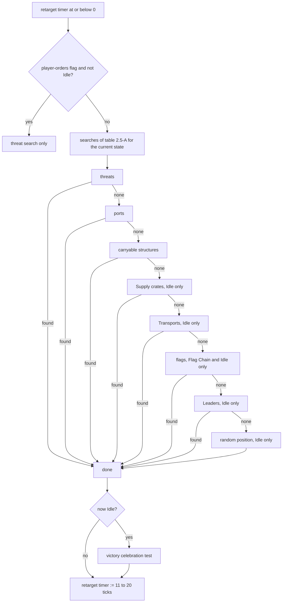
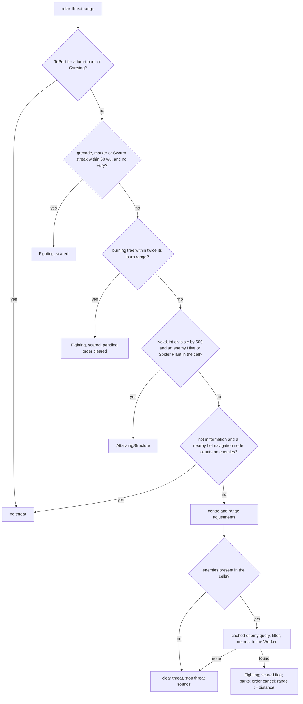
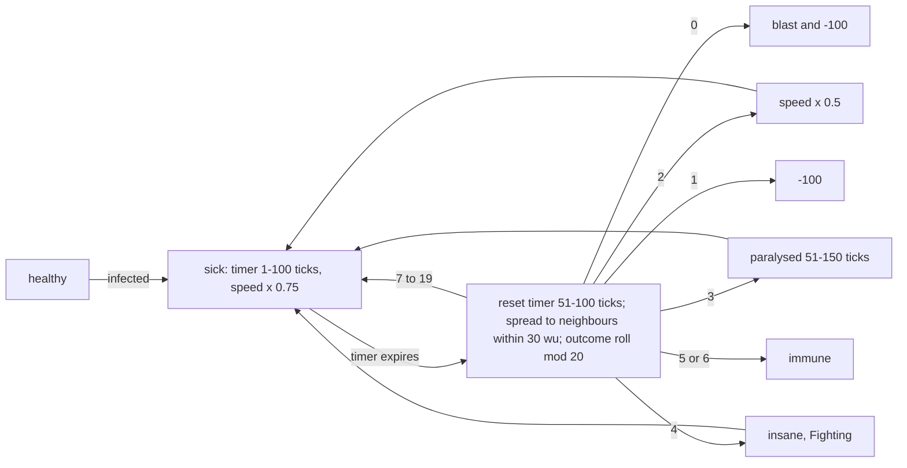

# Worker

> Status: Reference · Prefix: R-UNIT · Related: [Units](README.md) · [Leader and formations](leader_and_formations.md) · [Transport](transport.md) · [Essence orbs](essence_orbs.md) · [05 Population flow](../05_population_flow.md) · [06 Controls, camera and commands](../06_controls_camera_and_commands.md) · [12 Simulation model](../12_simulation_model/README.md)

## 1 Purpose and player experience

The Worker is the population unit of every mode. It is never built and never commanded one by one. Each Worker runs its own prioritised task search every 11 to 20 ticks, staggered across the crowd: it mans the ports of structures and so captures them, carries Relics and Breach Charges, opens Supply crates, raises Flag Chain flags, boards Launch Vessels, follows Leaders and fights. Every Worker in a match is armed, with a laser and with grenades.

The player steers the crowd indirectly: a selection circle and a crowd order send Workers along a route; a Leader redirects or gathers the Workers that pass it; a Transport carries them; Powers change them (Shield, Speed Boost, Fury, Convert) or harm them (Sickness). A crowd left alone keeps doing useful local work, flees grenades and heavy units, and fights enemy Workers at about 100 wu, closing in when the enemy stands higher.

The Worker's stats are in the actor stat table of [README.md](README.md) §4.1: `ref.unit.worker.health` (50), `ref.unit.worker.speed` (20 wu/s) and `ref.unit.worker.rate` (3 s, 30 ticks).

## 2 Rules

### 2.1 Role and acquisition

**R-UNIT-058** (MUST) A Worker is an ungrouped actor of its team. The rules that create Workers are listed in table 2.1-A of [README.md](README.md); each spawns the Worker through the spawn step with no actor group.

**R-UNIT-059** (MUST) A Worker spawned with zero velocity draws a random horizontal front: two simulation draws `NextSigned(1)`, first for x and then for z, give the vector (x, 0, z), which is normalised. The Workers spawned with zero velocity are those of the match-start port fill and of the Abductor's drop. Every other creator passes a velocity, so the Worker faces along it and makes no front draw: the Reinforcements outcome, which then clears the vertical component of the front; Seed Pods of the Worker kind; Spawn Node doors ([reference/05](../05_population_flow.md)); Transit Gate reinforcements; the passengers released from a Launch Vessel; and demotions and conversions, which pass the velocity of the actor they replace.

**R-UNIT-060** (MUST) A Worker's spawn step makes its draws in this order, each once per spawn (DEC-652): the initial reload timer, uniform in [0, `ref.unit.worker.rate`) (README R-UNIT-015); the first grenade timer `ref.unit.worker.grenade_first_ticks`; the idle timer, `ref.unit.worker.idle_timer` + `NextUnit(60)` seconds; then the spawn-position search and the front draw of R-UNIT-059.

**R-UNIT-061** (MUST) The Worker's spawn hook raises `worker.spawn`, sets the Worker on the ground, sets its waypoint to its position, sets its centre to `ref.unit.worker.centre_height` (2 wu) above its position and its radius to `ref.unit.worker.radius` (4 wu), and sets its **Visitor flag** when its team is the Visitor faction or the map option that names a Visitor team position names this team's position. A creator that wants an airborne Worker clears the on-ground flag after the spawn step ([reference/05](../05_population_flow.md) states which creators do). The Worker's distance scale factor is presentation state, read from the player's display setting, and no simulation rule reads it (DEC-010).

### 2.2 Combat class and constants

**R-UNIT-062** (MUST) A Worker is a **soldier** when its team's Worker research level is above `ref.unit.worker.soldier_level` (2), and **carries grenades** when it is above `ref.unit.worker.grenade_level` (3). The Worker level is 4 in every match (README R-UNIT-008), so every Worker in a match is a soldier with grenades (DEC-030).

**R-UNIT-063** (MUST) A Worker has no lifetime limit. Its speed is the stat-table speed, multiplied by `ref.unit.worker.idle_speed_factor` (0.2, giving 4 wu/s) while it is Idle, by the slope factor of README table 2.11-A, and by d ÷ `ref.unit.worker.arrival_slow_radius` within that distance (10 wu) of its waypoint. The Powers and Sickness change its speed stat as §2.11 states.

**R-UNIT-064** (MUST) A Worker's state holds the fields of table 2.2-A. Fields marked "presentation" are never read by a simulation rule (DEC-007).

Table 2.2-A Worker state.

| Field | Initial value | Meaning |
|---|---|---|
| behaviour state | Idle | §2.4 |
| promoted flag | false | set when a player promotes the Worker; its next advance removes it |
| waypoint | its spawn position | the movement target; the zero vector means "do not move" |
| retarget timer | 0 ticks | ticks to the next task search |
| threat | none | the current threat: an actor, an effect or a structure |
| Transport | none | the Transport it approaches or rides |
| Leader | none | the Leader it follows |
| target structure, port index | none | the structure and the port index of its current task: a port's owner, a Supply crate, a Flag post, a carryable structure, a fuel depot or a structure under attack |
| Abductor | none | the Abductor that is lifting it |
| threat range | `ref.unit.worker.threat_range` (90 wu) | the adaptive threat search radius |
| scared flag | true | flee rather than fight |
| under-control flag | false | member of its team's current crowd selection |
| player-orders flag | false | its current order came directly from the player and it obeys that order to the exclusion of everything but threats |
| manual-approach flag | false | the player sent it to a Transport |
| idle timer | R-UNIT-060 | set to `ref.unit.worker.idle_timer` every tick, so it never expires in a match |
| pending order: position, structure, set flag | none, none, false | a waypoint order not yet completed, and the teleport structure to enter at its end |
| grenade timer | R-UNIT-060 | ticks to the next grenade decision |
| follow timer | 0 ticks | the retarget timer while it follows a Leader |
| Power links: Shield, Speed Boost, Convert, Fury | none | the ids of the Powers acting on it |
| Sickness state | healthy | healthy, sick or immune |
| Sickness timer | 0 ticks | ticks to its next Sickness event |
| paralysis timer | none | while above 0 it cannot move |
| insane flag | false | set by Sickness |
| fire damage | 0 | accumulated flame damage |
| Visitor flag | R-UNIT-061 | Visitor faction behaviour |
| threat-sound latch | false | set when a threat sound starts; cleared when the threat ends |
| wall hits | 0 | wall collisions, read by the bot controller ([reference/07](../07_bots.md)) |
| previous team, colour timer | none | presentation: the colour cross-fade after a conversion |
| distance scale factor | the display setting | presentation |

### 2.3 Per-tick pipeline

**R-UNIT-065** (MUST) A Worker advances once per tick in this order:

1. If its destroyed flag or its promoted flag is set, request removal and stop; no Essence orb is released.
2. Run the base actor advance (README R-UNIT-024): the corpse fade if it is dead, the reload countdown, the presentation flicker, the world clamp, and route following while it has a route.
3. If it is alive, on the ground and not Burning:
   1. count the retarget timer down by one tick; when it is at or below 0, run the task search (§2.5); if the Worker is then Idle, run the victory celebration test (R-UNIT-088); and set the retarget timer to `ref.unit.worker.retarget_ticks` (11 + ⌊10 × `NextUnit(1)`⌋, that is 11 to 20 ticks);
   2. set the idle timer to `ref.unit.worker.idle_timer`;
   3. run the per-tick behaviour of its state (§2.4) for every state except Drowning, CaughtInVortex and InAbductionBeam; a Burning Worker never reaches this step.
4. In every case, airborne or dead included: in CaughtInVortex run the vortex step (R-UNIT-083); in InAbductionBeam run the abduction step (R-UNIT-084).
5. If it is not on the ground and not in InAbductionBeam, run the airborne step of [reference/12](../12_simulation_model/05_space_routing_and_physics.md).
6. If it did not die earlier in this tick: in Burning run the burning step (R-UNIT-079); in Drowning run the drowning step (R-UNIT-080); while it is sick run the Sickness step (R-UNIT-130).
7. If its y is below `ref.sim.physics.sea_level` (0) and it is not InTransport, set its state to Drowning and clear its on-ground flag; it dies on the next tick and releases an Essence orb.
8. If it is dead and on the ground, its corpse slides: velocity × `ref.unit.worker.corpse_slide` (0.9), then position += velocity × dt.
9. Check its Power links (R-UNIT-124): each link is cleared unless its team's Power slots still hold a Power with that id and of that kind; while a Speed Boost link holds, run the Speed Boost step; when a Speed Boost or Fury link is cleared, set its speed back to the stat-table speed.
10. Count its paralysis timer down by one tick.
11. Run the Core Device pulse-wave test (R-UNIT-133).
12. If it is removed while InTransport, its Transport removes it from its passengers.

**R-UNIT-066** (MUST) A Worker whose under-control flag is set reports itself to its team, which counts the controlled Workers and their mean position in update slice 0 of each tick ([reference/12](../12_simulation_model/06_teams_and_player_commands.md)). The team has a controlled-Worker centre only while at least one Worker is controlled (DEC-653).

### 2.4 Behaviour states

**R-UNIT-067** (MUST) A Worker is always in exactly one of the behaviour states of table 2.4-A. The order of the states carries no meaning. Calls from other rules can move a Worker from any state except InTransport into Burning, Drowning, CaughtInVortex, InAbductionBeam, BoardingVessel or AttackingStructure.

Table 2.4-A Worker behaviour states.

| State | Entered by | Per-tick behaviour | Exits |
|---|---|---|---|
| Idle | the default; most failure paths | R-UNIT-068 | by the task search |
| ToPort | the port search | R-UNIT-069 | Idle, Manning |
| Manning | arrival at a port; the match-start port fill | R-UNIT-070 | Idle |
| ToTransport | the Transport search; a crowd order onto a Transport | R-UNIT-071 | Idle, InTransport |
| InTransport | arrival at a Transport | R-UNIT-072 | Idle, Burning |
| OnWaypointOrder | a waypoint order (R-UNIT-111); a Leader signpost or a pending order in the Leader search | R-UNIT-073 | Idle |
| FollowingLeader | the Leader search, for a Leader in follow mode | R-UNIT-074 | Idle |
| Fighting | a successful threat search; Sickness insanity | §2.8 | FollowingLeader when its Leader is still valid, otherwise Idle |
| CarriedByAnt | an ant's capture ([creatures_and_hazards.md](creatures_and_hazards.md)) | R-UNIT-075 | Idle, death |
| BoardingVessel | a fuel depot or a Launch Vessel calling it to board (Launch Race) | R-UNIT-076 | Idle, removal |
| AttackingStructure | a Launch Vessel calling it to attack; the Hive and Spitter Plant check of the threat search | R-UNIT-077 | Idle |
| Burning | being set on fire (R-UNIT-121) | R-UNIT-079 | death only |
| Drowning | its y falling below sea level | R-UNIT-080 | death only |
| ToCarryable | the carryable search | R-UNIT-081 | Idle, Carrying |
| Carrying | its carryable structure becoming its team's | R-UNIT-082 | Idle |
| OpeningCrate | the Supply crate search | R-UNIT-078 | Idle |
| CaughtInVortex | a dust vortex ([reference/08](../08_maps_and_level_design/README.md)) | R-UNIT-083 | Idle |
| InAbductionBeam | an Abductor's beam ([creatures_and_hazards.md](creatures_and_hazards.md)) | R-UNIT-084 | removal, Idle |
| ClaimingFlag | the flag search (Flag Chain) | R-UNIT-085 | Idle |

**R-UNIT-068** (MUST) **Idle.** The Worker walks towards its waypoint at the Idle speed (R-UNIT-063); the random-position search of R-UNIT-097 sets that waypoint. The Worker leaves Idle only through the task search.

**R-UNIT-069** (MUST) **ToPort.** If the target structure no longer exists, or its target port is occupied by another Worker, the Worker becomes Idle. Otherwise it calls the structure's port-operation step for its port and team every tick, which is its contribution to the port's reservation and capture ([reference/03](../03_buildings_and_world_objects/README.md), [reference/05](../05_population_flow.md)), and walks to the port. On arrival it turns to face the port's front, sets its velocity to 0 and becomes Manning.

**R-UNIT-070** (MUST) **Manning.** If the target structure no longer exists, or the structure's occupant of the target port is not this Worker, the Worker becomes Idle. Otherwise its velocity is 0. Port occupancy is exact: the occupant is the first operating Worker within 5 wu of the port in actor-grid result order (DEC-094, DEC-016; [reference/05](../05_population_flow.md)). A manning Worker runs no task search, so it never flees or fights, except through the player-orders rule of R-UNIT-089.

**R-UNIT-071** (MUST) **ToTransport.** The Worker becomes Idle if its Transport no longer exists; or the Transport is not loading and the manual-approach flag is clear; or the Transport is full (its passenger count is at least its capacity); or the manual-approach flag is clear and the Transport's entrance is more than `ref.unit.worker.transport_search_range` (150 wu) away. Otherwise it walks to the Transport's entrance at ground height. When it arrives, or comes within `ref.unit.worker.transport_board_distance` (20 wu), the Transport adds it as a passenger and it becomes InTransport; a manual approach clears the manual-approach flag, and a Transport that is unloading is switched to idle ([transport.md](transport.md)).

**R-UNIT-072** (MUST) **InTransport.** If its Transport no longer exists or is dead, the Worker is ejected: its velocity becomes (`NextSigned(1)`, 1, `NextSigned(1)`) scaled to the length `ref.unit.worker.eject_speed_base` + `NextUnit(ref.unit.worker.eject_speed_spread)` (20 + [0, 20) wu/s), it is airborne, and it becomes **Burning**. Otherwise its position and velocity are the Transport's. If the Transport is unloading and the terrain under the Transport's entrance is above sea level, the Transport removes it as a passenger; it leaves along the Transport's exit direction rotated about the vertical by `NextSigned(π/2)`, with velocity exit direction × `ref.unit.worker.unload_speed` (10 wu/s) and vertical velocity `ref.unit.worker.unload_rise_base` + `NextUnit(ref.unit.worker.unload_rise_spread)` (5 + [0, 10) wu/s), from the entrance position, airborne, with its pending order cleared, and it becomes Idle. If the Transport unloads over water, the Worker neither leaves nor registers ([transport.md](transport.md)); otherwise it registers itself as a passenger for this tick. An InTransport Worker is immune to every damage kind but unresistable (README R-UNIT-027), is not drawn and is not selectable; conversions still reach it (README R-UNIT-028, R-UNIT-029), and the Allegiance Scrambler skips it.

**R-UNIT-073** (MUST) **OnWaypointOrder.** The Worker walks to its waypoint and follows its route (R-UNIT-110). If its pending order names a teleport structure, it tries the teleport entry for that structure every tick ([reference/12](../12_simulation_model/05_space_routing_and_physics.md)); a successful entry clears its under-control flag and counts as arrival. On arrival with a pending teleport structure: if the teleport is not connected, the Worker forgets the structure; otherwise it moves its waypoint to the structure's entrance plus a random point of a disc of radius `ref.unit.worker.teleport_wiggle_radius` (10 wu; radius `NextUnit(10)`, then angle `NextUnit(2π)`), so it keeps nudging into the entrance. On arrival without a pending teleport structure it becomes Idle, sets its retarget timer to 0, and clears its pending-order set flag and its player-orders flag.

**R-UNIT-074** (MUST) **FollowingLeader.** The Worker becomes Idle if its Leader no longer exists, is dead or is not in follow mode, or if the Leader is in formation mode, its formation is full and this Worker holds no slot in it. Each tick it counts its follow timer down by one tick; when the timer is at or below 0 it resets it to `ref.unit.worker.follow_retarget_ticks` (51 ticks, nominal 5 s) and tests whether the Leader is walkable from its position: if not, it follows the Leader into the teleport structure the Leader last used, if any (its pending order takes that structure and its waypoint becomes the structure's entrance), and otherwise becomes Idle; if the Leader is walkable, its waypoint becomes the Leader's position plus a random point of a disc of radius `ref.unit.worker.follow_disc_radius` (40 wu; radius, then angle). Then, while the Leader is in formation mode, the Worker registers with the formation and its waypoint becomes its formation position, every tick ([leader_and_formations.md](leader_and_formations.md)); when it arrives there it turns to face along the Leader's front. It follows routes by R-UNIT-110.

**R-UNIT-075** (MUST) **CarriedByAnt.** If the ant no longer exists or is dead, the Worker becomes Idle. Otherwise its position and velocity are those of the ant's carry socket; the ant kills it at the Hive with an unresistable health change, which releases an Essence orb ([creatures_and_hazards.md](creatures_and_hazards.md)).

**R-UNIT-076** (MUST) **BoardingVessel.** The target structure must be a fuel depot that is loading and whose linked Launch Vessel holds fewer passengers than its capacity of 100; otherwise the Worker becomes Idle. The Worker walks to the fuel depot's entrance; on arrival it boards the Launch Vessel, which counts it, and it is removed without an Essence orb ([reference/03](../03_buildings_and_world_objects/mode_objects.md)).

**R-UNIT-077** (MUST) **AttackingStructure.** If the target structure no longer exists, the Worker becomes Idle. Otherwise every tick its waypoint becomes the structure's position plus the direction away from the structure × (`ref.unit.worker.attack_standoff_base` + `NextUnit(ref.unit.worker.attack_standoff_spread)`) (100 + [0, 50) wu); within `ref.unit.worker.attack_throw_range` (200 wu) it throws one grenade at the structure's position + (0, `ref.unit.worker.attack_aim_height`, 0) (50 wu up), for its own team (DEC-105), and becomes Idle.

**R-UNIT-078** (MUST) **OpeningCrate.** If the Supply crate no longer exists, the Worker becomes Idle. Otherwise it walks to its scatter point (R-UNIT-094); on arrival it turns to face the crate; within `ref.unit.worker.crate_spark_factor` × the crate scan range (1.1 × 35 wu) it emits team-coloured blue sparks (presentation). The crate computes its own capture progress from the Workers near it ([reference/04](../04_supply_crates_powers_and_weapons/crates_and_powers.md)).

**R-UNIT-079** (MUST) **Burning.** Every tick while it is on the ground, the Worker's waypoint becomes its position + (`NextSigned(ref.unit.worker.burn_wander)`, 0, `NextSigned(ref.unit.worker.burn_wander)`), each component in (−50, 50) wu, so it runs in panic at full speed; it emits fire particles (presentation); and it loses `ref.unit.worker.burn_damage` (2) health when `NextUnit(10)` < `ref.unit.worker.burn_chance` ÷ *s* (2.0 ÷ game speed). At game speed 1 that is a 20 % chance per tick, about 4 health per second, about 12.5 s from full health. A Burning Worker never leaves the state except by death.

**R-UNIT-080** (MUST) **Drowning.** The Worker loses `ref.unit.worker.drown_damage` (999) health in an unresistable health change and dies, releasing an Essence orb. Workers never use the swimming step of [reference/12](../12_simulation_model/05_space_routing_and_physics.md).

**R-UNIT-081** (MUST) **ToCarryable.** If the carryable structure no longer exists, the Worker becomes Idle; if it now belongs to the Worker's team, the Worker becomes Carrying. If its waypoint is more than `ref.unit.worker.carryable_mill_distance` (60 wu) from the carryable, its waypoint becomes the carryable's position plus `ref.unit.worker.carryable_mill_radius` (30 wu) in the direction of angle `NextUnit(2π)`; on arrival it runs the random-position search (R-UNIT-097) and mills around.

**R-UNIT-082** (MUST) **Carrying.** If the carryable no longer exists or no longer belongs to the Worker's team, the Worker becomes Idle. Its target is the carryable's carry position for this Worker; a zero carry position makes it Idle. It is **lifting** when it has arrived at the carry position or is within `ref.unit.worker.lift_radius` × *s* × (current speed ÷ stat-table speed) of it (20 wu at game speed 1 and normal speed); a lifting Worker adds 1 to the carryable's lifter count for this tick ([reference/03](../03_buildings_and_world_objects/mode_objects.md)). A Carrying Worker raises `worker.lift_relic` on ticks where the tick count modulo f is 0 and `worker.ordered_by_player` on ticks where it equals ⌊f ÷ 2⌋, with f = `ref.unit.worker.lift_sound_base` + ⌊(1 − min(1, lifters ÷ maximum lifters)) × `ref.unit.worker.lift_sound_spread`⌋ (15 + up to 20). A waypoint order given while Carrying is passed to the carryable, which takes the target and route as its own waypoint (a Breach Charge always takes a straight route), and the Worker's state is unchanged.

**R-UNIT-083** (MUST) **CaughtInVortex.** A dust vortex catches every Worker on the ground within `ref.unit.worker.vortex_catch_radius` (50 wu) of its ground point. A caught Worker spirals upwards: its speed is max(`ref.unit.worker.vortex_speed_factor` × y, `ref.unit.worker.vortex_speed_min`) (0.1 × y, at least 30 wu/s), its orbit radius is `ref.unit.worker.vortex_orbit_factor` × y (0.3 × y), its orbit angle is the match time + unit id × `ref.unit.worker.vortex_angle_per_id` (20), and its target height is min(y + `ref.unit.worker.vortex_climb`, `ref.unit.worker.vortex_ceiling` + `ref.unit.worker.vortex_ceiling_per_id` × (unit id mod 100)) (min(y + 50, 500 + 5 × (unit id mod 100))). When the vortex ends, the Worker becomes Idle and its velocity is scaled to `ref.unit.worker.vortex_fling_speed` (50 wu/s), so it is flung and then falls.

**R-UNIT-084** (MUST) **InAbductionBeam.** The Worker is airborne. While its Abductor exists and is abducting, its velocity moves towards v_target = (unit vector towards the Abductor) × `ref.unit.worker.abduction_pull_factor` × speed (2 × its speed) + (horizontal unit vector towards the Abductor) × |Abductor velocity| + tangent × `ref.unit.worker.abduction_tangent_speed` (50 wu/s), by v := v + (v_target − v) × k with k = dt × `ref.unit.worker.abduction_blend` + (unit id mod 10) × `ref.unit.worker.abduction_blend_per_id` × dt (0.25 dt + (unit id mod 10) × 0.1 dt). Each tick a presentation roll of 1 in 2 emits a blue spark. When it comes within `ref.unit.worker.abduction_capture_distance` (20 wu) of the Abductor or rises above it, the Abductor counts one abductee and the Worker is removed without an Essence orb. If the Abductor no longer exists or stops abducting, the Worker becomes Idle.

**R-UNIT-085** (MUST) **ClaimingFlag.** The target must be a Flag post that is not the Worker's team's and is not locked; otherwise the Worker becomes Idle. The Worker walks to it and on arrival turns to face it; the Flag post computes its own capture ([reference/01](../01_skirmish_rules_and_modes/flag_chain.md)).

**R-UNIT-086** (MUST) A Worker never enters the launch-watching behaviour in a match: the spectacle in which nearby Workers turn to watch a launching Launch Vessel is inactive (DEC-009).

### 2.5 Task search

**R-UNIT-087** (MUST) The task search runs when the retarget timer expires (R-UNIT-065 step 3), so only while the Worker is alive, on the ground and not Burning. It tries the searches of table 2.5-A for the Worker's current state in the order given; the first search that succeeds ends the task search.

Table 2.5-A Searches per state, in priority order.

| Current state | Searches |
|---|---|
| Idle | threats → ports → carryable structures → Supply crates → Transports → flags (Flag Chain only) → Leaders → random position (always succeeds) |
| ToTransport, OnWaypointOrder, FollowingLeader | threats → ports → carryable structures |
| ToPort, OpeningCrate, Fighting, ToCarryable | threats |
| Manning, BoardingVessel, Burning, Carrying, InTransport, CarriedByAnt, AttackingStructure, Drowning, CaughtInVortex, InAbductionBeam, ClaimingFlag | none |

**R-UNIT-088** (MUST) **Victory celebration.** After a task search that leaves the Worker Idle, a Worker of team slot 0 that is on the ground draws `NextUnit(ref.unit.worker.victory_chance)`; if the draw is below 1, its y is above `ref.unit.worker.victory_min_height` (10 wu) and every primary objective of the map is complete, it hops: vertical velocity += `ref.unit.worker.victory_hop_base` + `NextUnit(ref.unit.worker.victory_hop_spread)` (15 + [0, 15) wu/s), and it raises `worker.victory_jump`. A map with no primary objectives receives one objective that never completes, so the celebration never starts on it; every reference map's objectives never complete, so it never starts in a reference match, while each Idle Worker of team slot 0 still makes the draw at every retarget (DEC-331).

**R-UNIT-089** (MUST) While the player-orders flag is set and the Worker is not Idle, the task search tries only the threat search, whatever the state.

**R-UNIT-090** (MUST) **Port search.** The candidates are the structures with ports whose distance minus their radius is less than `ref.unit.worker.port_search_range` (100 wu), that have at least one unoccupied port, and that are walkable from the Worker ([reference/12](../12_simulation_model/05_space_routing_and_physics.md)). A `NextUint` pick among the candidates is drawn and then overridden by the nearest candidate. On that structure the candidate ports are those that are unoccupied and whose reservation count for the Worker's team is below `ref.econ.port.reservation_limit` (1, [reference/05](../05_population_flow.md)); one is chosen by a further `NextUint` draw. The waypoint becomes the port's position, the Worker records the structure and port, and it becomes ToPort.

**R-UNIT-091** (MUST) **Carryable search.** The candidates are the carryable structures whose distance minus their radius is less than `ref.unit.worker.carryable_search_range` (150 wu), skipping one that already belongs to the Worker's team and has at least its maximum number of lifters. One is chosen by a `NextUint` draw, and the Worker becomes ToCarryable.

**R-UNIT-092** (MUST) **Supply crate search.** The candidate is the first Supply crate in structure order that is on the ground, closer than `ref.unit.worker.crate_search_range` (150 wu) and walkable from the Worker. The Worker becomes OpeningCrate with the scatter point of R-UNIT-094.

**R-UNIT-093** (MUST) **Transport search.** The candidates are the Transports among the team's special units that are alive, within `ref.unit.worker.transport_search_range` (150 wu) and loading. One is chosen by a `NextUint` draw, and the Worker becomes ToTransport.

**R-UNIT-094** (MUST) **Supply crate scatter point.** With R the crate scan range (35 wu, [reference/04](../04_supply_crates_powers_and_weapons/crates_and_powers.md)): if the Worker is closer than R to the crate, its waypoint is its own position. Otherwise its waypoint is the point at distance R ÷ 3 + `NextUnit(2R ÷ 3)` from the crate in the direction of the Worker, plus a random offset of angle `NextUnit(2π)` and length `NextUnit(R ÷ 3)`.

**R-UNIT-095** (MUST) **Flag search** (Flag Chain only). The candidate is the first Flag post that is not the Worker's team's, is not locked, and is closer than its own size to the Worker. If the Worker is within the Flag post capture range (20 wu, [reference/01](../01_skirmish_rules_and_modes/flag_chain.md)), its waypoint is its own position; otherwise the Flag post's position + (`NextSigned(20)`, 0, `NextSigned(20)`), each offset in (−10, 10) wu. The Worker becomes ClaimingFlag.

**R-UNIT-096** (MUST) **Leader search.** In this order:

1. If the Worker's pending-order set flag is set, it resumes its pending order: its waypoint becomes the pending order position, or the current waypoint of its route when it has one, plus a random point of a disc of radius `ref.unit.worker.order_disc_radius` (20 wu; radius, then angle), and it becomes OnWaypointOrder.
2. Otherwise, among the Leaders of the team's special units in follow mode within `ref.unit.worker.leader_follow_range` (150 wu) whose formation is not full, the nearest is chosen; if it is walkable from the Worker, cliffs included, the Worker becomes FollowingLeader with that Leader, its follow timer set to `ref.unit.worker.follow_retarget_ticks` (51) and its waypoint the Leader's position plus a random point of a disc of radius `ref.unit.worker.follow_disc_radius` (40 wu).
3. Otherwise, among the Leaders with a waypoint order within `ref.unit.worker.leader_signpost_range` (100 wu), one is chosen by `NextUint` modulo their count. The Worker copies the Leader's order position, order route (with its route waypoint reset to the start) and order structure into its pending order, sets its waypoint to the order position plus a random point of a disc of radius `ref.unit.worker.order_disc_radius` (20 wu), becomes OnWaypointOrder, and raises `worker.ordered`.

Step 3 is the **signpost** mechanic: a Leader with a waypoint order redirects every Idle Worker that passes within 100 wu of it (DEC-031).

**R-UNIT-097** (MUST) **Random-position search.** The Worker draws `NextUnit(1)`; if the draw is below `ref.unit.worker.wander_chance` (0.7), its waypoint becomes the point `ref.unit.worker.wander_distance` (20 wu) away at angle `NextSigned(2π)`, passed through the obstacle push (R-UNIT-115). The search always succeeds.

### 2.6 Threat search

**R-UNIT-098** (MUST) The threat search runs these steps in order; the first step that decides returns:

1. **Range relaxation.** The threat range becomes `ref.unit.worker.threat_range` × r + threat range × (1 − r), with r = `ref.unit.worker.threat_range_relax` (0.1), so it relaxes back towards 90 wu at every search. A Worker in a formation sets it to `ref.unit.worker.threat_range` (90 wu).
2. **Task priority.** A Worker in ToPort for a turret port, or in Carrying, finds no threat.
3. **Projectile threats** (skipped while the Worker has Fury). The nearest effect within `ref.unit.worker.projectile_threat_range` (60 wu) that is a grenade or an airstrike target marker of **any** team, its own included, or an enemy Swarm streak, becomes the threat: the Worker becomes Fighting, sets its scared flag, and raises `worker.flee_bark` when the threat changed. Workers have no threat reaction to turret aiming markers in a match (DEC-052).
4. **Burning trees.** Any tree on fire within `ref.unit.worker.burning_tree_range_factor` × its burn range (2 × burn range) becomes the threat: the Worker becomes Fighting, sets its scared flag, raises `worker.flee_bark` when the threat changed, and clears its pending order, so it does not walk back into the fire.
5. **Hive and Spitter Plant check.** The Worker draws `NextUint`; when it is divisible by `ref.unit.worker.structure_attack_odds` (500), an enemy Hive or Spitter Plant in the Worker's obstacle cell within its threat range is attacked: the Worker becomes AttackingStructure with that structure as its target (DEC-105). The draw is made at every search that reaches this step.
6. **Bot census shortcut** (not in a formation). For each bot navigation node within the node's range of the Worker, if that node's enemy count for the Worker's team is 0, the search finds no threat ([reference/07](../07_bots.md)).
7. **Search centre and range.** The centre is the Worker's position and the range is its threat range, with these adjustments: in Manning, the range × `ref.unit.worker.manning_range_factor` (0.5), and 0 when the port belongs to a turret; in a formation, the centre moves `ref.unit.worker.formation_search_offset` × range (0.66 × 90 = 59 wu) ahead along the Leader's front (DEC-031).
8. **Enemy query.** If `EnemiesInCells(centre, range, team)` is true, the candidates are the result of `CachedEnemies(centre, range, team)` ([reference/12](../12_simulation_model/05_space_routing_and_physics.md); DEC-094). The filter keeps a candidate that is alive and is not a burning Worker, not a Crawler egg, not a Collector and not a Builder, and keeps a Transport only while its speed is below `ref.unit.worker.transport_threat_speed` (15 wu/s). The Worker counts the kept candidates as the enemy count and takes the one nearest to **its own position** as the threat. The bot controller is not excluded (DEC-311).
9. **Threat found.** The Worker becomes Fighting. Its scared flag is set in this order: a non-soldier is scared; a soldier is scared when the enemy count is above `ref.unit.worker.scared_enemy_count` (5) and `FriendsInCells(position, range, team)` is false; the flag is cleared for a Worker with a Shield; then the flag is set whenever the threat is a Brood Drifter, a spider, a Reaper Serpent, a Seed Pod, a Trooper, a Transport or a Bomber. The combat step clears it again for a Worker with a Shield (R-UNIT-101). When the threat is new and the threat-sound latch is clear, it raises `worker.flee_bark` if scared and `worker.attack_bark` if brave; a brave Worker also raises `worker.attack_horn` when a presentation draw `NextUnit(ref.unit.worker.horn_odds)` is below 1 and at least `ref.unit.worker.horn_cooldown` (40 ticks of game time) have passed since any Worker of the match last raised it (a presentation-side timer). If its pending order is set, the Worker is within `ref.unit.worker.order_cancel_radius` (50 wu) of the order position and the order did not come from the player, the pending order is cleared. The threat range becomes the distance to the threat.
10. **No threat.** Otherwise the Worker clears its threat, stops its threat sounds, and the search finds no threat.

**R-UNIT-099** (MUST) Because of R-UNIT-098, Workers flee from every grenade and airstrike target marker, their own team's included; they ignore Collectors, Builders and Crawler eggs; and they always run from heavy units (Transports, Troopers, spiders, Reaper Serpents, Bombers, Brood Drifters, Seed Pods) rather than fight them, while still throwing grenades at them (R-UNIT-104). README §5.2 summarises the reaction to each kind.

### 2.7 Targeting while insane

**R-UNIT-100** (MUST) A Worker that Sickness has driven insane and that has no threat takes as its threat the nearest actor within 0 to `ref.unit.worker.threat_range` (90 wu) of **any** team, its own included: `NearestEnemy(position, 0, 90, none)`, where the no-team value is nobody's friend ([reference/12](../12_simulation_model/05_space_routing_and_physics.md)).

### 2.8 Combat

**R-UNIT-101** (MUST) In Fighting the Worker resolves its threat as an actor, an effect or a structure. If the threat no longer exists or is dead, the Worker becomes FollowingLeader when its Leader is still valid and Idle otherwise, sets its retarget timer to 0, and stops its threat sounds. A Worker with a Shield is never scared. A Worker in a formation registers with its formation every tick ([leader_and_formations.md](leader_and_formations.md)).

**R-UNIT-102** (MUST) **Movement in combat.** Each tick in Fighting:

- in a formation, the waypoint is the Worker's formation position, so it holds its place even against grenades;
- a soldier that is not scared retreats when the threat is closer than `ref.unit.worker.retreat_range` (100 wu) and the Worker's height minus the threat's height is above `ref.unit.worker.retreat_height_diff` (−25 wu): its waypoint becomes its position + `ref.unit.worker.combat_step` (30 wu) × the direction away from the threat rotated about the vertical by `NextSigned(π/2)`. Otherwise it closes in: its waypoint becomes its position + the direction to the threat rotated by `NextSigned(π/2)`, scaled to the distance − (`ref.unit.worker.standoff_base` + `NextUnit(ref.unit.worker.standoff_spread)`) (distance − (20 + [0, 20)) wu). Soldiers therefore hover about 100 wu from a target that stands level with them, and close to 20–40 wu of a target that stands more than 25 wu higher;
- a scared Worker whose threat is farther than `ref.unit.worker.fear_range` (200 wu) stops being scared and forgets its threat; otherwise it flees: its waypoint becomes its position + `ref.unit.worker.combat_step` (30 wu) × the direction away from the threat rotated by `NextSigned(π/2)`.

Each waypoint passes through the obstacle push with kill set (R-UNIT-115) and is snapped to the ground, and the Worker then moves (R-UNIT-108).

**R-UNIT-103** (MUST) **Shooting.** A soldier whose threat is an actor shoots at the threat's position + (0, `ref.unit.worker.aim_height`, 0) (2 wu up):

- In a formation the Worker fires by the volley rhythm: with i its formation index, n = min(`ref.unit.worker.volley_size_cap` (90), the formation's slot count including gaps) and t the tick count of the match, it fires on a tick where (`ref.unit.worker.volley_divisor` × (t + i)) mod n < `ref.unit.worker.volley_divisor` (4), and with Fury also on a tick where (`ref.unit.worker.volley_divisor_fury` × (t + i)) mod n < `ref.unit.worker.volley_divisor_fury` (16). The rhythm is evaluated exactly in integer arithmetic (DEC-104; DEC-241). A formation of fewer than 4 slots fires on every tick.
- Outside a formation: with Fury it fires every tick and makes no fire-roll draw; otherwise, with a = `ref.unit.worker.attack_divisor` (10), or `ref.unit.worker.attack_divisor_shield` (7) with a Shield, or `ref.unit.worker.attack_divisor_visitor` (3) for a Visitor faction Worker, divided by the game speed *s*, it fires when a ≥ 1 and `NextUint` mod ⌊a⌋ is 0. At game speed 1 that is about one attempt per second.
- A shot is a Convert laser bolt when the Worker has a Convert link or is a Visitor faction Worker (R-UNIT-126), and otherwise the base attack (README R-UNIT-052). With Fury the aim point gains (`NextSigned(ref.unit.worker.fury_scatter)`, 0, `NextSigned(ref.unit.worker.fury_scatter)`), each in (−30, 30) wu, and the reload timer is cleared after the shot, so a Worker with Fury fires 10 laser bolts per second.
- Both shots fire only while the reload timer is 0 (30 ticks after the last shot), so outside Fury a Worker fires about one laser bolt every 4 s.

The divisions by *s* are never evaluated at *s* = 0 and carry an explicit guard (DEC-653).

**R-UNIT-104** (MUST) **Grenades and rockets.** A Worker may throw while it carries grenades (R-UNIT-062), is not in a formation, has no Convert link, is not a Visitor faction Worker, and is not in the second tutorial before that tutorial's bot is released ([reference/11](../11_tutorial_and_help.md)). Each Fighting tick it counts its grenade timer down by one tick; when it is at or below 0 the timer is reset to `ref.unit.worker.grenade_interval_ticks` (121 + ⌊10 × `NextUnit(8)`⌋, that is 121 to 200 ticks) and the Worker decides:

1. an insane Worker always throws, whatever the range, terrain and target;
2. otherwise the threat must be farther than `ref.unit.worker.grenade_min_distance` (75 wu), the terrain normals under the Worker and under the threat must both have a y component above `ref.unit.worker.grenade_normal_min` (0.7), and the Worker's height minus the threat's height must be above `ref.unit.worker.grenade_height_diff_min` (−50 wu);
3. then it throws at a Brood Drifter, a spider, a Seed Pod, a Trooper or a Transport when the target is less than `ref.unit.worker.grenade_heavy_max_height` (40 wu) above its ground; at any other target when `CountEnemiesInCells(target, ref.unit.worker.grenade_crowd_radius, team)` is above `ref.unit.worker.grenade_crowd_enemies` (5) and `CountFriendsInCells(target, ref.unit.worker.grenade_crowd_radius, team)` is below `ref.unit.worker.grenade_crowd_friends` (2), with a radius of 50 wu, counted over whole cells (DEC-094); and never at an Abductor.

A throw is a rocket when the Worker's team has the Rocket Troops upgrade ([reference/04](../04_supply_crates_powers_and_weapons/crates_and_powers.md)): fired from the Worker's position at the target + (0, `ref.unit.worker.rocket_aim_height`, 0) (10 wu up), for the Worker's team, carrying the Worker's sick flag ([reference/04](../04_supply_crates_powers_and_weapons/weapons_and_projectiles.md)); an insane Worker adds to x and to z each `NextUnit(ref.unit.worker.rocket_insane_jitter)` − 2 (±2 wu). Otherwise it is a grenade thrown from the Worker's position at the target, for the Worker's team.

### 2.9 Movement, routes and orders

**R-UNIT-105** (MUST) The Worker's movement step `MoveToWaypoint` returns whether the Worker has arrived:

```
MoveToWaypoint():
    if paralysisTimer > 0 or waypoint == (0, 0, 0): return false                 # no movement
    if sick and NextUint() mod ref.unit.worker.sick_stop_odds == 0:              # 1 in 20 per tick
        velocity := 0; waypoint := position; return true
    d := horizontal distance to waypoint
    if d == 0: velocity := 0; return true
    if d < ref.unit.worker.snap_distance:                                         # 1 wu
        velocity := (waypoint - position) / dt; position := waypoint; return false   # arrival reported next tick
    speed := current speed stat
    if state == Idle: speed *= ref.unit.worker.idle_speed_factor
    dir := normalise(front * (1 - ref.unit.worker.turn_blend) + unit(waypoint - position) * ref.unit.worker.turn_blend)
    speed *= slope factor (README table 2.11-A)
    if d < ref.unit.worker.arrival_slow_radius: speed *= d / ref.unit.worker.arrival_slow_radius
    newPos := WorkerPush(position + dir * speed * dt, kill = true)
    clamp newPos - position to length speed * dt
    velocity := (newPos - position) / dt
    front := normalise(newPos - position)
    position := newPos
    return false
```

The turn blend `ref.unit.worker.turn_blend` (0.4) is 4 × dt. A Worker never pushes itself away from cliffs.

**R-UNIT-106** (MUST) The movement step is used by every state that walks. The arrival test of a state is the result of the movement step.

**R-UNIT-107** (MUST) The Worker's waypoint "zero vector" (0, 0, 0) means "do not move"; a carry position of zero in Carrying makes the Worker Idle (R-UNIT-082).

**R-UNIT-108** (MUST) A walking Worker in any state other than Idle moves at its current speed stat with the slope factor and the arrival slow-down; in Idle at the Idle factor; a Burning Worker runs at its full current speed (R-UNIT-079).

**R-UNIT-109** (MUST) A waypoint that a rule computes for a Worker passes through the Worker's obstacle push with kill set, unless the rule states kill clear (R-UNIT-115).

**R-UNIT-110** (MUST) **Route following** applies in OnWaypointOrder and FollowingLeader, on routes of the land route graph ([reference/12](../12_simulation_model/05_space_routing_and_physics.md)). The first step jumps to route waypoint 1 (waypoint 0 is the start). The Worker then steps to the next route waypoint when it is within `ref.unit.worker.route_reach_radius` (20 wu) of its waypoint. Each new waypoint is jittered by a random point of a disc of radius `ref.unit.worker.route_jitter_radius` (40 wu; radius `NextUnit(40)`, then angle `NextUnit(2π)`) and passed through the obstacle push with kill clear. Past the last route waypoint the route is cleared, and the waypoint keeps the last jittered point.

**R-UNIT-111** (MUST) **Waypoint order.** Giving a Worker a waypoint order with a target and a route (or none):

```
GiveWaypointOrder(target, route = none):
    pendingOrder.position := target; pendingOrder.set := true; pendingOrder.structure := none
    if state == Carrying:
        pass target and route to the carryable (a Breach Charge always takes a straight route); return   # state unchanged
    if a Beam Dish stands within ref.unit.worker.beam_dish_order_radius (5 wu) of target:
        pendingOrder.structure := that Beam Dish; pendingOrder.position := its entrance
        waypoint := its entrance                                         # no jitter
    else:
        waypoint := WorkerPush(target + random point of a disc of radius ref.unit.worker.order_disc_radius, kill = false)
    route := route; routeWaypoint := before the start
    state := OnWaypointOrder
```

The disc point draws its radius `NextUnit(20)` and then its angle `NextUnit(2π)`. The callers are the crowd order (R-UNIT-140), the bot controller and its Leader logic ([reference/07](../07_bots.md)), and the map's instant units that start with a waypoint order.

### 2.10 Terrain and obstacles

**R-UNIT-112** (MUST) A Worker replaces the obstacle push of [reference/12](../12_simulation_model/05_space_routing_and_physics.md) with its own `WorkerPush(candidate, kill = true)`, which returns the position the Worker may take:

1. If the Worker is on the ground, the candidate's y becomes the terrain height.
2. **Water.** If the candidate's y is at or below `ref.unit.worker.shore_height` (1 wu), the Worker draws a = `NextSigned(1)`; for d = `ref.unit.worker.shore_search_start` (40 wu) to `ref.unit.worker.shore_search_end` (95 wu) in steps of `ref.unit.worker.shore_search_step` (5 wu), the point at distance d in the direction of angle d × a × π is sampled, and the first point whose terrain height is above the shore height becomes the candidate. A Worker therefore never walks into the sea of its own accord; only falling or being flung into it kills it.
3. **Structures** of the obstacle cell under the candidate, each in cell order, as R-UNIT-113 and R-UNIT-114 state.

**R-UNIT-113** (MUST) For an enabled Barrier Emitter of a team that is not a friend of the Worker's team, with closest = `ref.unit.worker.emitter_margin_base` + (unit id mod `ref.unit.worker.emitter_margin_spread`) (5 + (unit id mod 10) wu):

- if the emitter's line hits a sphere of radius `ref.unit.worker.emitter_contact_radius` (1 wu) at the Worker's **current** position and kill is set, the Worker is set on fire (R-UNIT-121) and the emitter's electrocution effect plays at its position; a Worker is never killed outright by an emitter;
- otherwise, if the line hits the candidate within closest, the candidate is pushed perpendicular to the emitter line, in steps of `ref.unit.worker.emitter_push_step` (20 wu), until it is clear; the push direction is the cross product of the emitter line (from this emitter to its linked emitter) with the up vector, with its sign chosen by the cross product with the vector to the emitter's centre.

A friendly or disabled emitter is passed through.

**R-UNIT-114** (MUST) For a wall hit within `ref.unit.worker.wall_hit_radius` (4 wu), the candidate is pushed by `ref.unit.worker.wall_push_step` (5 wu) along the wall's front, towards the side of the wall the Worker is on, until a sphere of radius `ref.unit.worker.wall_clear_radius` (1 wu) no longer hits it, and the Worker's wall-hit count rises by 1. For any other structure whose centre is within `ref.unit.worker.structure_push_range` (30 wu), the candidate is pushed by `ref.unit.worker.structure_push_step` (4 wu) directly away from the structure's centre in the horizontal plane while a sphere of radius `ref.unit.worker.structure_clear_radius` (2 wu) at the candidate hits the structure, and its y is re-snapped to the terrain after each step. The bot controller resets a Worker with more than 10 wall hits to Idle ([reference/07](../07_bots.md)).

**R-UNIT-115** (MUST) Rules that compute a waypoint for an order or a route call `WorkerPush` with kill clear, so that planning a path through a Barrier Emitter never sets a Worker on fire. Every push loop of R-UNIT-112 to R-UNIT-114 moves the candidate a fixed distance away from a finite hit volume or along a finite search, so it terminates; an implementation bounds each loop with a deterministic fallback that keeps the last candidate (DEC-014).

### 2.11 Damage, status effects and Powers

**R-UNIT-116** (MUST) A Worker's health change applies, in this order:

1. InTransport, and the damage kind is not unresistable: the change does nothing and returns false.
2. With a Shield link, and the damage kind is not unresistable: the change does nothing and returns false; an **explosive** hit also clears the Shield link.
3. In a formation, not a Visitor faction Worker, and the damage kind is explosive: amount × `ref.unit.worker.formation_explosive_factor` (0.6), truncated toward zero.
4. With Fury: amount × `ref.unit.worker.fury_damage_factor` (0.75); as a Visitor faction Worker: amount × `ref.unit.worker.visitor_damage_factor` (2.0); each truncated toward zero.
5. The base health change (README R-UNIT-026), without the damage kind: death at 0 or below releases an Essence orb.

**R-UNIT-117** (MUST) A Worker has no invincibility test outside its health change: the conversions of README R-UNIT-028 bypass the Shield, InTransport, the formation factor and the Visitor factor alike.

**R-UNIT-118** (MUST) The Worker's draws for damage and status effects are only those that this section states; the shockwave ring's ignition chance is drawn by the ring ([reference/04](../04_supply_crates_powers_and_weapons/weapons_and_projectiles.md)).

**R-UNIT-119** (MUST) **Fire damage.** A flame weapon adds its amount to the Worker's fire damage; once the fire damage is at least `ref.unit.worker.fire_ignition` (100), the Worker is set on fire and the attacking team's kill counter rises by 1. The kill counter rises again on every later fire-damage call to the same Worker, so one Worker can count as several kills. This kill count is a kept quirk (DEC-006).

**R-UNIT-120** (MUST) Flame weapons, lightning strikes, burning trees, the shockwave ring's ignition, enemy Barrier Emitters and a Launch Vessel's release of passengers ([reference/05](../05_population_flow.md)) set Workers on fire by R-UNIT-121. The destruction of a ridden Transport puts its passengers into Burning directly (R-UNIT-072).

**R-UNIT-121** (MUST) Setting a Worker on fire does nothing while it is InTransport, while it has a Shield link, or when it belongs to the Rogue faction; otherwise it becomes Burning.

**R-UNIT-122** (MUST) **Shield.** A Shield Power ([reference/04](../04_supply_crates_powers_and_weapons/crates_and_powers.md)) links the Workers it reaches, except a Worker that is InTransport. A Worker with a Shield is immune to every damage kind except unresistable, so not to creature contact attacks or conversions (README R-UNIT-028, R-UNIT-030); one explosive hit removes its Shield; it is never scared; its attack divisor is 7; it cannot be set on fire; and it is drawn inside a bubble (R-UNIT-147).

**R-UNIT-123** (MUST) **Speed Boost.** A Speed Boost Power links the Workers it reaches; on linking, a Worker's speed stat is multiplied by `ref.unit.worker.speed_boost_factor` (2) when its current speed ÷ its stat-table speed is below `ref.unit.worker.speed_boost_cap_ratio` (3.5), so repeated Speed Boosts give 20, 40 and then 80 wu/s. Every tick while linked, the Speed Boost step emits trail particles (presentation) and damages every tree within `ref.unit.worker.speed_boost_tree_radius` (2 wu) by `ref.unit.worker.speed_boost_tree_damage` (1.0), which sets forests alight. When the link is cleared, the speed returns to the stat-table speed.

**R-UNIT-124** (MUST) **Power links.** A Worker holds at most one link of each kind: Shield, Speed Boost, Convert and Fury. Each tick a link is cleared unless the team's Power slots hold a Power with the linked id and of the linked kind ([reference/04](../04_supply_crates_powers_and_weapons/crates_and_powers.md); each of these Powers lasts 30 s there).

**R-UNIT-125** (MUST) **Fury.** A Fury Power links the Workers it reaches, and every Worker has Fury while the Frenzy outcome's match-wide timer runs ([reference/04](../04_supply_crates_powers_and_weapons/crates_and_powers.md)). On linking a Fury Power, a Worker's speed stat is multiplied by `ref.unit.worker.fury_speed_factor` (1.5) when its current speed ÷ its stat-table speed is below `ref.unit.worker.fury_cap_ratio` (3), giving 30, 45 and then 67.5 wu/s; the Frenzy timer gives every other effect of Fury but no speed change. A Worker with Fury takes 0.75 of its damage (R-UNIT-116), ignores projectile threats (R-UNIT-098 step 3), fires every tick with scatter and no reload (R-UNIT-103), fires denser formation volleys (R-UNIT-103), and is drawn pulsing in size (R-UNIT-147). When the link is cleared, the speed returns to the stat-table speed.

**R-UNIT-126** (MUST) **Convert.** A Worker's Convert link, its convert tag, is set only by the Convert Power: placing the Power tags the placing team's own Workers within the Power's effect range; the Power lasts 30 s and ends early when no tagged Worker remains; and a Worker clears its tag once the Power has ended (DEC-331). A tagged Worker fires Convert laser bolts, which convert an enemy Worker they hit into a Worker of the shooter's team without an Essence orb ([reference/04](../04_supply_crates_powers_and_weapons/weapons_and_projectiles.md)), throws no grenades, and is drawn with the state overlay (R-UNIT-147). A converted Worker cross-fades from its previous team's colour over `ref.unit.worker.convert_fade` (4 s), which is presentation state.

**R-UNIT-127** (MUST) **Sickness infection.** The Sickness outcome infects the Workers within its radius ([reference/04](../04_supply_crates_powers_and_weapons/crates_and_powers.md)), and sick Workers spread it. Infecting a healthy Worker makes it sick: its Sickness timer becomes 1 + ⌊10 × `NextUnit(10)`⌋ ticks (`ref.unit.worker.sickness_first_ticks`, 1 to 100) and its speed stat is multiplied by `ref.unit.worker.sickness_speed_factor` (0.75). Infecting a sick or immune Worker changes nothing.

**R-UNIT-128** (MUST) A sick Worker stops dead on a tick of its movement with a chance of 1 in `ref.unit.worker.sick_stop_odds` (20) (R-UNIT-105). Rockets that a sick Worker fires carry the spiral flight flag ([reference/04](../04_supply_crates_powers_and_weapons/weapons_and_projectiles.md)).

**R-UNIT-129** (MUST) A paralysed Worker does not move, and an insane Worker targets everyone (R-UNIT-100) and always throws grenades or rockets (R-UNIT-104).

**R-UNIT-130** (MUST) **Sickness step.** Each tick a sick Worker counts its Sickness timer down by one tick; when it is at or below 0:

1. the timer is reset to `ref.unit.worker.sickness_interval_ticks` (51 + ⌊10 × `NextUnit(5)`⌋, that is 51 to 100 ticks);
2. every live Worker of any team within `ref.unit.worker.sickness_spread_radius` (30 wu), in actor-grid result order, draws `NextUint` and is infected (R-UNIT-127) when the draw is divisible by 2;
3. the Worker draws o = `NextUint` mod `ref.unit.worker.sickness_roll` (20) and applies table 2.11-A.

Table 2.11-A Sickness outcomes.

| o | Outcome |
|---|---|
| 0 | an explosion of range `ref.unit.worker.sickness_blast_range` (5 wu) and damage `ref.unit.worker.sickness_blast_damage` (25) for no team at its position, then a health change of −`ref.unit.worker.sickness_damage` (100) |
| 1 | a health change of −`ref.unit.worker.sickness_damage` (100) |
| 2 | its speed stat × `ref.unit.worker.sickness_slow_factor` (0.5) |
| 3 | paralysed for `ref.unit.worker.paralysis_ticks` (51 + ⌊10 × `NextUnit(10)`⌋, that is 51 to 150 ticks) |
| 4 | insane, and it becomes Fighting |
| 5, 6 | immune: its speed returns to the stat-table speed and it no longer spreads Sickness |
| 7 to 19 | nothing |

**R-UNIT-131** (MUST) A paralysed Worker is drawn grey (R-UNIT-146).

**R-UNIT-132** (MUST) **Visitor faction Workers.** A Worker with the Visitor flag fires Convert laser bolts with attack divisor 3 (R-UNIT-103), takes double damage (R-UNIT-116), throws no grenades, does not take the formation's explosive reduction, and is drawn with the Visitor faction card and a glow (R-UNIT-146).

**R-UNIT-133** (MUST) **Core Device pulse wave** (Siege only). Each tick, if the match mode is Siege, the Worker is alive, a Core Device pulse wave exists, the wave's team is not a friend of the Worker's team and the Worker is inside the wave's radius ([reference/03](../03_buildings_and_world_objects/mode_objects.md)):

- if the wave team's position equals the map option's Visitor team position, one Worker of the wave's team is spawned at the Worker's position with its velocity, and the Worker dies silently: it is marked dead and removed, without an Essence orb;
- otherwise its velocity becomes the direction away from the wave × `ref.unit.worker.pulse_push_speed` (20 wu/s), and it takes a health change of −`ref.unit.worker.pulse_damage` (1000), which releases an Essence orb.

### 2.12 Death

**R-UNIT-134** (MUST) A Worker leaves the match by the paths of table 2.12-A.

Table 2.12-A Worker deaths and removals.

| Cause | Essence orb | Path |
|---|---|---|
| health at 0 or below through any health change: laser bolts, fire, drowning, Sickness, explosions, a pulse wave that does not convert, an ant's kill at the Hive | **yes**: one orb of its team, none for the Rogue faction (README R-UNIT-038) | the corpse fades for 25 ticks on the ground and 50 in the air, then the Worker is removed |
| promotion to Leader | no | removed on its next advance |
| boarding a Launch Vessel | no | removed; the Launch Vessel counts it |
| abduction | no | removed; the Abductor counts it |
| conversion by a Convert laser bolt or the Swarm streak | no | its destroyed flag is set, and a new Worker of the converter's team is spawned |
| conversion by the Visitor faction's pulse wave | no | marked dead and removed |
| a Reaper Serpent's kill | the orb is created and deleted; a Wisp appears | [creatures_and_hazards.md](creatures_and_hazards.md) |

### 2.13 Player control

**R-UNIT-135** (MUST) Workers accept no per-unit command. The player influences them through the channels of this section; the bindings are in [reference/06](../06_controls_camera_and_commands.md).

**R-UNIT-136** (MUST) **Crowd selection.** `PlayerCommand::SelectWorkers(team, centre, radius)` sets the under-control flag on every Worker of the team within the circle, found through the actor grid, that is not Manning, not Burning and not InTransport, and raises `worker.selected` for the local team only (DEC-564). The selection circle grows as [reference/06](../06_controls_camera_and_commands.md) states (DEC-032).

**R-UNIT-137** (MUST) **Selection clearing.** Any selection change of a team clears the under-control flag on every Worker of the team while the team has at least one Worker selected. A Worker that enters a teleport structure also clears its own flag.

**R-UNIT-138** (MUST) A Worker selected before it started manning a port keeps its under-control flag, so a crowd order reaches it as it reaches every other controlled Worker; this is the reference default of DEC-308.

**R-UNIT-139** (MUST) **Promotion.** `PlayerCommand::PromoteWorker(team, actor)` on a Worker of the team that is not Burning creates a Leader and selects it, and sets the Worker's promoted flag, so its next advance removes it without an Essence orb ([leader_and_formations.md](leader_and_formations.md)).

**R-UNIT-140** (MUST) **Crowd order.** `PlayerCommand::OrderWorkers(team, straight, position)` acts on the team's controlled Workers at the tick of execution ([reference/12](../12_simulation_model/06_teams_and_player_commands.md)):

1. a connected Beam Dish whose radius contains the position captures the target: the target becomes the Beam Dish;
2. a route is built from the controlled Workers' mean position to the target on the land route graph, straight when the command says so, and is highlighted for the local team;
3. if a friendly Transport with free capacity stands within `ref.unit.worker.order_transport_radius` (30 wu) of the target, every controlled Worker becomes ToTransport for it with its manual-approach flag set, and a Transport that is unloading is switched to idle;
4. otherwise every controlled Worker receives a waypoint order to the target along the route (R-UNIT-111) and sets its player-orders flag;
5. `worker.ordered_by_player` is raised.

With no controlled Worker left at the tick of execution, the order does nothing (DEC-555, DEC-653). A team issues crowd orders at most once per 1.0 s ([reference/06](../06_controls_camera_and_commands.md), DEC-032).

**R-UNIT-141** (MUST) Leaders redirect and gather Workers by R-UNIT-096 ([leader_and_formations.md](leader_and_formations.md)); Transports load and unload them by R-UNIT-071 and R-UNIT-072 ([transport.md](transport.md)); and the Shield, Speed Boost, Fury and Convert Powers act on the Workers near the targeted point ([reference/04](../04_supply_crates_powers_and_weapons/crates_and_powers.md)).

### 2.14 Colouring, rendering and effects

The rules of this section are presentation: they never write simulation state (DEC-007), and their random choices draw from the presentation generator (DEC-013).

**R-UNIT-142** (MUST) A Worker is drawn as a camera-facing card `sprite.worker.front` of half-width `ref.unit.worker.card_half_width` (3.0 wu) and height `ref.unit.worker.card_height` (6 wu), scaled per individual by 1 + `ref.unit.worker.card_variation` × ((slot index × unit id) mod 10) (0.03 per step). Beyond `ref.unit.worker.card_scale_start` (100 wu) from the camera its size is multiplied by 1 + scale factor × (camera distance − 100) ÷ `ref.unit.worker.card_scale_divisor` (1000), with the player's distance scale factor; beyond `ref.unit.worker.card_face_start` (300 wu) it turns progressively towards the camera, with blend (camera distance − 300) ÷ 1000.

**R-UNIT-143** (MUST) The card is oriented by the terrain normal and the Worker's front. An airborne Worker tumbles, with a rotation proportional to presentation time × (unit id mod 10) × `ref.unit.worker.tumble_rate` (0.1). A Worker in Manning or OpeningCrate sways by up to `ref.unit.worker.sway_angle` (0.3 rad).

**R-UNIT-144** (MUST) When the card is seen edge-on, that is |front × direction to the camera| > `ref.unit.worker.side_view_threshold` (0.95), the side card `sprite.worker.side` is drawn instead.

**R-UNIT-145** (MUST) A Burning Worker and every Rogue faction Worker are drawn with the hurt pose `sprite.worker.hurt` variant 04. A share `ref.unit.worker.air_corpse_hurt_share` (0.3) of airborne corpses, chosen by unit id, is drawn with variants 01 to 03. A Visitor faction Worker is drawn with `sprite.visitor.front` and the glow `fx.glow_round`.

**R-UNIT-146** (MUST) A Worker's colour is team colour × (`ref.unit.worker.colour_base` + `ref.unit.worker.colour_health_weight` × health ÷ `ref.unit.worker.health`) (0.3 + 0.7 × health ÷ 50). After a conversion the colour blends from the previous team's colour over the convert fade (R-UNIT-126). A dead Worker is drawn in colour × `ref.unit.worker.corpse_colour` (0.2) at alpha `ref.unit.worker.corpse_alpha_per_health` × health (2.5 × health), as `ref.unit.worker.corpse_fragments` (3) drifting fragments. A paralysed Worker is drawn in `ref.unit.worker.paralysed_colour` (150, 150, 150).

**R-UNIT-147** (MUST) Overlays on a Worker: a pulsing additive blue glow, never below `ref.unit.worker.control_glow_min` (0.3), while it is selected or controlled by the local team; a glow while it has Fury, together with the size pulse; the glow `fx.glow_round` in `ref.unit.worker.sickness_bubble_colour` (90, 130, 10) while it is sick; the bubble `fx.bubble_sphere` in its team colour while it has a Shield; the state overlay `sprite.worker.state_overlay` while it has a Convert link; the crate capture beam `fx.beam_short` while it opens a Supply crate; and the ground blob shadow of README R-UNIT-050 at alpha `ref.unit.worker.shadow_alpha` (150) × the detail level (× `ref.unit.worker.shadow_rogue_factor` (0.3) for the Rogue faction), within `ref.unit.worker.shadow_range` (2000 wu) of the camera.

**R-UNIT-148** (MUST) While the seasonal theme is on (DEC-101, DEC-118), every Worker whose unit id is divisible by `ref.unit.worker.seasonal_hat_period` (3) is drawn with `sprite.worker.seasonal_hat`.

**R-UNIT-149** (MUST) A Worker emits these particles: control flash on being controlled and on promotion; Worker fire and missile trail while Burning, and a burst of 20 of each when a Power reaches it; the Speed Boost trail; Sickness particles while sick; blue sparks while opening a Supply crate and while abducted.

**R-UNIT-150** (MUST) The `mesh.unit.worker_figure` mesh is drawn with the team-tint rules of README R-UNIT-044 and R-UNIT-045.

### 2.15 Sounds

**R-UNIT-151** (MUST) A Worker raises the presentation events of table 2.15-A ([reference/10](../10_audio_design.md)). Its threat sounds (`worker.flee_bark`, `worker.attack_bark`, `worker.attack_horn`) are stopped when its threat ends. Worker creation and Worker attack sounds play only from their nearest emitter (DEC-109).

Table 2.15-A Worker sound events.

| Event | Trigger | Sample groups |
|---|---|---|
| `worker.spawn` | the spawn hook | `sfx.unit.worker.spawn` |
| `worker.attack` | a laser bolt or a Convert laser bolt fired | `sfx.unit.worker.attack`, `sfx.unit.worker.attack_b` |
| `worker.hurt` | any damage | `sfx.unit.worker.hurt` |
| `worker.enter_gate` | a successful teleport entry | none (silent) |
| `worker.exit_gate` | raised by the teleport at its exit ([reference/03](../03_buildings_and_world_objects/README.md)) | none (silent) |
| `worker.die` | death | `sfx.unit.worker.die`, `sfx.unit.worker.die_b` |
| `worker.selected` | crowd selection, local team only | `sfx.unit.worker.selected` |
| `worker.attack_bark` | a brave reaction to a new threat | `sfx.unit.worker.attack_bark` |
| `worker.attack_horn` | a rare brave reaction: presentation chance 1 in 200, shared 40-tick cooldown | `sfx.unit.worker.attack_horn` |
| `worker.flee_bark` | a scared reaction; a grenade or marker; a burning tree | `sfx.unit.worker.flee_bark`, `sfx.unit.worker.flee_bark_b` |
| `worker.ordered` | a Leader signpost hands it an order | `sfx.unit.leader.spawn` |
| `worker.ordered_by_player` | a crowd order; also alternating with `worker.lift_relic` while Carrying | `sfx.unit.worker.selected` |
| `worker.victory_jump` | the victory celebration hop | `sfx.unit.worker.victory_jump` |
| `worker.burning` | while Burning, a presentation chance of 1 in `ref.unit.worker.burning_sound_odds` (30) per tick | `sfx.unit.worker.burning` |
| `worker.lift_relic` | while Carrying a Relic or another carryable structure | `sfx.unit.worker.lift_relic` |

## 3 States and flows

```mermaid
stateDiagram-v2
    [*] --> Idle
    Idle --> Fighting: threat search
    Idle --> ToPort: port search
    Idle --> ToCarryable: carryable search
    Idle --> OpeningCrate: Supply crate search
    Idle --> ToTransport: Transport search or crowd order
    Idle --> ClaimingFlag: flag search, Flag Chain
    Idle --> FollowingLeader: follow-mode Leader within 150 wu
    Idle --> OnWaypointOrder: signpost Leader within 100 wu, pending order, waypoint order
    ToPort --> Manning: arrived
    ToPort --> Idle: port taken or structure gone
    Manning --> Idle: displaced or structure gone
    ToTransport --> InTransport: arrived or within 20 wu
    ToTransport --> Idle: Transport gone, full, not loading or too far
    InTransport --> Idle: unloaded over land
    InTransport --> Burning: Transport destroyed
    OnWaypointOrder --> Idle: arrived or teleported
    OnWaypointOrder --> Fighting: threat
    FollowingLeader --> Idle: Leader lost, not follow mode, formation full
    FollowingLeader --> Fighting: threat
    Fighting --> FollowingLeader: threat gone and Leader valid
    Fighting --> Idle: threat gone
    ToCarryable --> Carrying: carryable now the team's
    ToCarryable --> Idle: carryable gone
    Carrying --> Idle: carryable lost
    OpeningCrate --> Idle: crate gone
    ClaimingFlag --> Idle: flag the team's, locked or gone
    AttackingStructure --> Idle: grenade thrown or structure gone
    Idle --> AttackingStructure: Hive or Spitter Plant check, Launch Vessel
    Idle --> CarriedByAnt: ant capture
    CarriedByAnt --> Idle: ant died
    CarriedByAnt --> [*]: killed at the Hive
    Idle --> BoardingVessel: fuel depot or Launch Vessel call
    BoardingVessel --> [*]: boarded, removed
    BoardingVessel --> Idle: depot not loading or vessel full
    Idle --> InAbductionBeam: Abductor beam
    InAbductionBeam --> [*]: abducted, removed
    InAbductionBeam --> Idle: Abductor gone
    Idle --> CaughtInVortex: dust vortex
    CaughtInVortex --> Idle: vortex ends
    Idle --> Burning: set on fire
    Fighting --> Burning: set on fire
    Burning --> [*]: dies, Essence orb
    Idle --> Drowning: y below sea level
    Drowning --> [*]: dies, Essence orb
```



Diagram 3-A Worker behaviour states. Calls from other rules can move a Worker from any state except InTransport into Burning, Drowning, CaughtInVortex, InAbductionBeam, BoardingVessel or AttackingStructure; those edges are drawn from Idle and Fighting for readability.



Diagram 3-B The task search. A state whose row in table 2.5-A ends earlier stops at that search.



Diagram 3-C The threat search (R-UNIT-098).



Diagram 3-D Sickness on a Worker (R-UNIT-127 to R-UNIT-130).

## 4 Tuning table

| key | value | unit | range or notes | requirement | DEC |
|---|---|---|---|---|---|
| `ref.unit.worker.centre_height` | 2 | wu | | R-UNIT-061 | — |
| `ref.unit.worker.radius` | 4 | wu | actor-grid footprint | R-UNIT-061 | DEC-650 |
| `ref.unit.worker.soldier_level` | 2 | research level | soldier above this level | R-UNIT-062 | DEC-030 |
| `ref.unit.worker.grenade_level` | 3 | research level | grenades above this level | R-UNIT-062 | DEC-030 |
| `ref.unit.worker.idle_speed_factor` | 0.2 | × speed | 4 wu/s | R-UNIT-063, R-UNIT-105 | — |
| `ref.unit.worker.arrival_slow_radius` | 10 | wu | speed × d ÷ 10 inside it | R-UNIT-063, R-UNIT-105 | — |
| `ref.unit.worker.snap_distance` | 1 | wu | | R-UNIT-105 | — |
| `ref.unit.worker.turn_blend` | 0.4 | per tick | 4 × dt | R-UNIT-105 | DEC-092 |
| `ref.unit.worker.slope_divisor` | 3 | wu | | README R-UNIT-042 | — |
| `ref.unit.worker.slope_min` | 0.3 | × speed | | README R-UNIT-042 | — |
| `ref.unit.worker.slope_max` | 2.0 | × speed | | README R-UNIT-042 | — |
| `ref.unit.worker.retarget_ticks` | 11–20 | ticks | 11 + ⌊10 × NextUnit(1)⌋; nominal 1–2 s | R-UNIT-065 | DEC-002, DEC-030 |
| `ref.unit.worker.idle_timer` | 60 | s | 600 ticks; the spawn draw adds NextUnit(60) s; reset every tick | R-UNIT-060, R-UNIT-065 | — |
| `ref.unit.worker.grenade_first_ticks` | 1–50 | ticks | 1 + ⌊10 × NextUnit(5)⌋; nominal U[0, 5) s | R-UNIT-060 | DEC-002 |
| `ref.unit.worker.grenade_interval_ticks` | 121–200 | ticks | 121 + ⌊10 × NextUnit(8)⌋; nominal 12 + U[0, 8) s | R-UNIT-104 | DEC-002 |
| `ref.unit.worker.grenade_min_distance` | 75 | wu | strict | R-UNIT-104 | — |
| `ref.unit.worker.grenade_normal_min` | 0.7 | normal y | strict, under thrower and target | R-UNIT-104 | — |
| `ref.unit.worker.grenade_height_diff_min` | −50 | wu | thrower height minus target height, strict | R-UNIT-104 | — |
| `ref.unit.worker.grenade_heavy_max_height` | 40 | wu | above the target's ground, strict | R-UNIT-104 | — |
| `ref.unit.worker.grenade_crowd_radius` | 50 | wu | whole-cell counts | R-UNIT-104 | DEC-094 |
| `ref.unit.worker.grenade_crowd_enemies` | 5 | actors | more than | R-UNIT-104 | DEC-094 |
| `ref.unit.worker.grenade_crowd_friends` | 2 | actors | fewer than | R-UNIT-104 | DEC-094 |
| `ref.unit.worker.rocket_aim_height` | 10 | wu | | R-UNIT-104 | — |
| `ref.unit.worker.rocket_insane_jitter` | 4 | wu | NextUnit(4) − 2 on x and on z | R-UNIT-104 | — |
| `ref.unit.worker.aim_height` | 2 | wu | above the threat | R-UNIT-103 | — |
| `ref.unit.worker.attack_divisor` | 10 | — | ÷ game speed; 1 in ⌊a⌋ per tick | R-UNIT-103 | DEC-653 |
| `ref.unit.worker.attack_divisor_shield` | 7 | — | with a Shield | R-UNIT-103, R-UNIT-122 | — |
| `ref.unit.worker.attack_divisor_visitor` | 3 | — | Visitor faction Worker | R-UNIT-103, R-UNIT-132 | — |
| `ref.unit.worker.fury_scatter` | 60 | wu | NextSigned(60): (−30, 30) on x and on z | R-UNIT-103 | — |
| `ref.unit.worker.volley_divisor` | 4 | — | fire when (4 × (t + i)) mod n < 4 | R-UNIT-103 | DEC-104, DEC-241 |
| `ref.unit.worker.volley_divisor_fury` | 16 | — | also when (16 × (t + i)) mod n < 16 | R-UNIT-103 | DEC-104 |
| `ref.unit.worker.volley_size_cap` | 90 | slots | n = min(90, slot count) | R-UNIT-103 | DEC-104 |
| `ref.unit.worker.threat_range` | 90 | wu | the relaxation target | R-UNIT-098, R-UNIT-100 | DEC-030 |
| `ref.unit.worker.threat_range_relax` | 0.1 | per search | dt | R-UNIT-098 | — |
| `ref.unit.worker.projectile_threat_range` | 60 | wu | grenades and markers of any team | R-UNIT-098 | — |
| `ref.unit.worker.burning_tree_range_factor` | 2 | × burn range | | R-UNIT-098 | — |
| `ref.unit.worker.structure_attack_odds` | 500 | — | 1 in 500 per search | R-UNIT-098 | DEC-105 |
| `ref.unit.worker.manning_range_factor` | 0.5 | × range | 0 for a turret port | R-UNIT-098 | — |
| `ref.unit.worker.formation_search_offset` | 0.66 | × range | 59 wu ahead of a formation member | R-UNIT-098 | DEC-031 |
| `ref.unit.worker.transport_threat_speed` | 15 | wu/s | a Transport is a threat only below this speed | R-UNIT-098 | — |
| `ref.unit.worker.scared_enemy_count` | 5 | actors | more than, with no friends present | R-UNIT-098 | DEC-094 |
| `ref.unit.worker.horn_odds` | 200 | — | presentation draw | R-UNIT-098 | DEC-013 |
| `ref.unit.worker.horn_cooldown` | 40 | ticks | 4 s of game time; shared by every Worker of the match | R-UNIT-098 | DEC-007 |
| `ref.unit.worker.order_cancel_radius` | 50 | wu | | R-UNIT-098 | — |
| `ref.unit.worker.retreat_range` | 100 | wu | strict | R-UNIT-102 | — |
| `ref.unit.worker.retreat_height_diff` | −25 | wu | Worker height minus threat height, strict | R-UNIT-102 | — |
| `ref.unit.worker.combat_step` | 30 | wu | retreat and flee step | R-UNIT-102 | — |
| `ref.unit.worker.standoff_base` | 20 | wu | | R-UNIT-102 | — |
| `ref.unit.worker.standoff_spread` | 20 | wu | NextUnit(20) | R-UNIT-102 | — |
| `ref.unit.worker.fear_range` | 200 | wu | a scared Worker forgets a threat beyond it | R-UNIT-102 | — |
| `ref.unit.worker.port_search_range` | 100 | wu | distance minus structure radius | R-UNIT-090 | DEC-018 |
| `ref.unit.worker.carryable_search_range` | 150 | wu | distance minus structure radius | R-UNIT-091 | — |
| `ref.unit.worker.carryable_mill_distance` | 60 | wu | | R-UNIT-081 | — |
| `ref.unit.worker.carryable_mill_radius` | 30 | wu | | R-UNIT-081 | — |
| `ref.unit.worker.lift_radius` | 20 | wu | × game speed × speed ratio | R-UNIT-082 | — |
| `ref.unit.worker.lift_sound_base` | 15 | ticks | | R-UNIT-082 | DEC-007 |
| `ref.unit.worker.lift_sound_spread` | 20 | ticks | | R-UNIT-082 | DEC-007 |
| `ref.unit.worker.crate_search_range` | 150 | wu | strict | R-UNIT-092 | — |
| `ref.unit.worker.crate_spark_factor` | 1.1 | × crate scan range | presentation | R-UNIT-078 | — |
| `ref.unit.worker.transport_search_range` | 150 | wu | also the give-up distance | R-UNIT-071, R-UNIT-093 | — |
| `ref.unit.worker.transport_board_distance` | 20 | wu | | R-UNIT-071 | — |
| `ref.unit.worker.eject_speed_base` | 20 | wu/s | | R-UNIT-072 | — |
| `ref.unit.worker.eject_speed_spread` | 20 | wu/s | NextUnit(20) | R-UNIT-072 | — |
| `ref.unit.worker.unload_speed` | 10 | wu/s | | R-UNIT-072 | — |
| `ref.unit.worker.unload_rise_base` | 5 | wu/s | | R-UNIT-072 | — |
| `ref.unit.worker.unload_rise_spread` | 10 | wu/s | NextUnit(10) | R-UNIT-072 | — |
| `ref.unit.worker.leader_signpost_range` | 100 | wu | | R-UNIT-096 | DEC-031 |
| `ref.unit.worker.leader_follow_range` | 150 | wu | | R-UNIT-096 | DEC-031 |
| `ref.unit.worker.follow_retarget_ticks` | 51 | ticks | nominal 5 s | R-UNIT-074, R-UNIT-096 | DEC-002 |
| `ref.unit.worker.follow_disc_radius` | 40 | wu | | R-UNIT-074, R-UNIT-096 | — |
| `ref.unit.worker.order_disc_radius` | 20 | wu | | R-UNIT-096, R-UNIT-111 | — |
| `ref.unit.worker.teleport_wiggle_radius` | 10 | wu | | R-UNIT-073 | — |
| `ref.unit.worker.route_reach_radius` | 20 | wu | | R-UNIT-110 | — |
| `ref.unit.worker.route_jitter_radius` | 40 | wu | | R-UNIT-110 | — |
| `ref.unit.worker.beam_dish_order_radius` | 5 | wu | | R-UNIT-111 | — |
| `ref.unit.worker.order_transport_radius` | 30 | wu | | R-UNIT-140 | — |
| `ref.unit.worker.wander_chance` | 0.7 | probability | | R-UNIT-097 | — |
| `ref.unit.worker.wander_distance` | 20 | wu | | R-UNIT-097 | — |
| `ref.unit.worker.victory_chance` | 5 | — | NextUnit(5) < 1 | R-UNIT-088 | DEC-331 |
| `ref.unit.worker.victory_min_height` | 10 | wu | strict | R-UNIT-088 | DEC-331 |
| `ref.unit.worker.victory_hop_base` | 15 | wu/s | | R-UNIT-088 | — |
| `ref.unit.worker.victory_hop_spread` | 15 | wu/s | NextUnit(15) | R-UNIT-088 | — |
| `ref.unit.worker.attack_standoff_base` | 100 | wu | | R-UNIT-077 | — |
| `ref.unit.worker.attack_standoff_spread` | 50 | wu | NextUnit(50) every tick | R-UNIT-077 | — |
| `ref.unit.worker.attack_throw_range` | 200 | wu | | R-UNIT-077 | DEC-105 |
| `ref.unit.worker.attack_aim_height` | 50 | wu | | R-UNIT-077 | — |
| `ref.unit.worker.burn_wander` | 100 | wu | NextSigned(100): (−50, 50) | R-UNIT-079 | — |
| `ref.unit.worker.burn_damage` | 2 | health | per successful roll | R-UNIT-079 | — |
| `ref.unit.worker.burn_chance` | 2.0 | — | NextUnit(10) < 2.0 ÷ game speed | R-UNIT-079 | DEC-653 |
| `ref.unit.worker.drown_damage` | 999 | health | unresistable | R-UNIT-080 | — |
| `ref.unit.worker.corpse_slide` | 0.9 | × velocity per tick | | R-UNIT-065 | — |
| `ref.unit.worker.vortex_catch_radius` | 50 | wu | | R-UNIT-083 | — |
| `ref.unit.worker.vortex_speed_factor` | 0.1 | wu/s per wu of height | | R-UNIT-083 | — |
| `ref.unit.worker.vortex_speed_min` | 30 | wu/s | | R-UNIT-083 | — |
| `ref.unit.worker.vortex_orbit_factor` | 0.3 | wu per wu of height | | R-UNIT-083 | — |
| `ref.unit.worker.vortex_angle_per_id` | 20 | rad per unit id | | R-UNIT-083 | — |
| `ref.unit.worker.vortex_climb` | 50 | wu | | R-UNIT-083 | — |
| `ref.unit.worker.vortex_ceiling` | 500 | wu | | R-UNIT-083 | — |
| `ref.unit.worker.vortex_ceiling_per_id` | 5 | wu | × (unit id mod 100) | R-UNIT-083 | — |
| `ref.unit.worker.vortex_fling_speed` | 50 | wu/s | | R-UNIT-083 | — |
| `ref.unit.worker.abduction_pull_factor` | 2 | × speed | | R-UNIT-084 | — |
| `ref.unit.worker.abduction_tangent_speed` | 50 | wu/s | | R-UNIT-084 | — |
| `ref.unit.worker.abduction_blend` | 0.25 | × dt | | R-UNIT-084 | — |
| `ref.unit.worker.abduction_blend_per_id` | 0.1 | × dt per (unit id mod 10) | | R-UNIT-084 | — |
| `ref.unit.worker.abduction_capture_distance` | 20 | wu | | R-UNIT-084 | — |
| `ref.unit.worker.shore_height` | 1 | wu | at or below triggers the shore search | R-UNIT-112 | — |
| `ref.unit.worker.shore_search_start` | 40 | wu | | R-UNIT-112 | — |
| `ref.unit.worker.shore_search_end` | 95 | wu | | R-UNIT-112 | — |
| `ref.unit.worker.shore_search_step` | 5 | wu | 12 samples | R-UNIT-112 | DEC-014 |
| `ref.unit.worker.emitter_margin_base` | 5 | wu | | R-UNIT-113 | — |
| `ref.unit.worker.emitter_margin_spread` | 10 | — | + (unit id mod 10) wu | R-UNIT-113 | — |
| `ref.unit.worker.emitter_contact_radius` | 1 | wu | | R-UNIT-113 | — |
| `ref.unit.worker.emitter_push_step` | 20 | wu | | R-UNIT-113 | DEC-014 |
| `ref.unit.worker.wall_hit_radius` | 4 | wu | | R-UNIT-114 | — |
| `ref.unit.worker.wall_push_step` | 5 | wu | | R-UNIT-114 | DEC-014 |
| `ref.unit.worker.wall_clear_radius` | 1 | wu | | R-UNIT-114 | — |
| `ref.unit.worker.structure_push_range` | 30 | wu | | R-UNIT-114 | — |
| `ref.unit.worker.structure_push_step` | 4 | wu | | R-UNIT-114 | DEC-014 |
| `ref.unit.worker.structure_clear_radius` | 2 | wu | | R-UNIT-114 | — |
| `ref.unit.worker.formation_explosive_factor` | 0.6 | × damage | not for Visitor faction Workers | R-UNIT-116, README R-UNIT-027 | DEC-031 |
| `ref.unit.worker.fury_damage_factor` | 0.75 | × damage | | R-UNIT-116, R-UNIT-125 | — |
| `ref.unit.worker.visitor_damage_factor` | 2.0 | × damage | | R-UNIT-116, R-UNIT-132 | — |
| `ref.unit.worker.fire_ignition` | 100 | fire damage | | R-UNIT-119 | DEC-006 |
| `ref.unit.worker.speed_boost_factor` | 2 | × speed | | R-UNIT-123 | DEC-090 |
| `ref.unit.worker.speed_boost_cap_ratio` | 3.5 | × stat-table speed | applies below this ratio | R-UNIT-123 | DEC-090 |
| `ref.unit.worker.speed_boost_tree_radius` | 2 | wu | | R-UNIT-123 | — |
| `ref.unit.worker.speed_boost_tree_damage` | 1.0 | per tick | | R-UNIT-123 | DEC-092 |
| `ref.unit.worker.fury_speed_factor` | 1.5 | × speed | | R-UNIT-125 | DEC-090 |
| `ref.unit.worker.fury_cap_ratio` | 3 | × stat-table speed | applies below this ratio | R-UNIT-125 | DEC-090 |
| `ref.unit.worker.convert_fade` | 4 | s | presentation | R-UNIT-126 | DEC-007 |
| `ref.unit.worker.sickness_first_ticks` | 1–100 | ticks | 1 + ⌊10 × NextUnit(10)⌋ | R-UNIT-127 | DEC-002 |
| `ref.unit.worker.sickness_speed_factor` | 0.75 | × speed | on infection | R-UNIT-127 | DEC-090 |
| `ref.unit.worker.sick_stop_odds` | 20 | — | 1 in 20 per movement tick | R-UNIT-105, R-UNIT-128 | DEC-092 |
| `ref.unit.worker.sickness_interval_ticks` | 51–100 | ticks | 51 + ⌊10 × NextUnit(5)⌋; nominal 5 + U[0, 5) s | R-UNIT-130 | DEC-002 |
| `ref.unit.worker.sickness_spread_radius` | 30 | wu | | R-UNIT-130 | — |
| `ref.unit.worker.sickness_roll` | 20 | outcomes | | R-UNIT-130 | — |
| `ref.unit.worker.sickness_blast_range` | 5 | wu | | R-UNIT-130 | DEC-093 |
| `ref.unit.worker.sickness_blast_damage` | 25 | damage | | R-UNIT-130 | — |
| `ref.unit.worker.sickness_damage` | 100 | health | | R-UNIT-130 | — |
| `ref.unit.worker.sickness_slow_factor` | 0.5 | × speed | | R-UNIT-130 | DEC-090 |
| `ref.unit.worker.paralysis_ticks` | 51–150 | ticks | 51 + ⌊10 × NextUnit(10)⌋; nominal 5 + U[0, 10) s | R-UNIT-130 | DEC-002 |
| `ref.unit.worker.pulse_push_speed` | 20 | wu/s | | R-UNIT-133 | — |
| `ref.unit.worker.pulse_damage` | 1000 | health | | R-UNIT-133 | — |
| `ref.unit.worker.card_half_width` | 3.0 | wu | presentation | R-UNIT-142 | DEC-029 |
| `ref.unit.worker.card_height` | 6 | wu | presentation | R-UNIT-142 | DEC-029 |
| `ref.unit.worker.card_variation` | 0.03 | per step | presentation | R-UNIT-142 | — |
| `ref.unit.worker.card_scale_start` | 100 | wu | presentation | R-UNIT-142 | — |
| `ref.unit.worker.card_scale_divisor` | 1000 | wu | presentation; also the face-camera blend divisor | R-UNIT-142 | — |
| `ref.unit.worker.card_face_start` | 300 | wu | presentation | R-UNIT-142 | — |
| `ref.unit.worker.tumble_rate` | 0.1 | per (unit id mod 10) | presentation | R-UNIT-143 | — |
| `ref.unit.worker.sway_angle` | 0.3 | rad | presentation | R-UNIT-143 | — |
| `ref.unit.worker.side_view_threshold` | 0.95 | — | presentation | R-UNIT-144 | — |
| `ref.unit.worker.air_corpse_hurt_share` | 0.3 | share | presentation | R-UNIT-145 | — |
| `ref.unit.worker.colour_base` | 0.3 | × team colour | presentation | R-UNIT-146 | — |
| `ref.unit.worker.colour_health_weight` | 0.7 | × team colour | presentation | R-UNIT-146 | — |
| `ref.unit.worker.corpse_colour` | 0.2 | × colour | presentation | R-UNIT-146 | — |
| `ref.unit.worker.corpse_alpha_per_health` | 2.5 | alpha per health | presentation | R-UNIT-146 | — |
| `ref.unit.worker.corpse_fragments` | 3 | fragments | presentation | R-UNIT-146 | — |
| `ref.unit.worker.paralysed_colour` | 150, 150, 150 | RGB | presentation | R-UNIT-146 | — |
| `ref.unit.worker.control_glow_min` | 0.3 | alpha | presentation | R-UNIT-147 | — |
| `ref.unit.worker.sickness_bubble_colour` | 90, 130, 10 | RGB | presentation | R-UNIT-147 | — |
| `ref.unit.worker.shadow_alpha` | 150 | alpha | × detail level; presentation | R-UNIT-147 | — |
| `ref.unit.worker.shadow_rogue_factor` | 0.3 | × alpha | presentation | R-UNIT-147 | — |
| `ref.unit.worker.shadow_range` | 2000 | wu | presentation | R-UNIT-147 | — |
| `ref.unit.worker.seasonal_hat_period` | 3 | unit ids | presentation | R-UNIT-148 | DEC-101 |
| `ref.unit.worker.burning_sound_odds` | 30 | — | presentation, per tick | R-UNIT-151 | DEC-013 |

## 5 Edge cases and interactions

- **Own grenades.** A Worker flees its own team's grenades and airstrike target markers within 60 wu, so a Worker that throws a grenade can scatter its own crowd (R-UNIT-098).
- **Fleeing is a Fighting state.** A Worker fleeing a grenade, a marker or a burning tree is in Fighting with its scared flag set; when the effect ends, it returns to FollowingLeader or Idle (R-UNIT-101).
- **Manning Workers hold.** A manning Worker never runs the threat search unless it still carries the player-orders flag of an earlier crowd order, in which case its threat range is halved, and 0 on a turret port (R-UNIT-070, R-UNIT-089, R-UNIT-098).
- **Formations are weak from behind.** A formation member searches for threats only in a circle centred 59 wu ahead of its Leader along the Leader's front, at the full 90 wu range, so it ignores most enemies behind the formation (R-UNIT-098, DEC-031).
- **Cached threats.** A threat search can return actors from a cached list up to 11 ticks old and outside the requested range; the nearest-to-the-Worker rule and the alive filter run on that list (R-UNIT-098, DEC-094).
- **Unkillable target.** An enemy bot controller can hold a Worker's attention, because the threat search does not exclude it (R-UNIT-098, DEC-311).
- **Transports.** A moving Transport (15 wu/s or faster) is not a threat at all; a slow or stopped one is a threat that Workers always flee and grenade (R-UNIT-098, R-UNIT-104).
- **Insanity.** An insane Worker attacks its own team and always throws, so a Sickness outbreak can make a crowd fight itself (R-UNIT-100, R-UNIT-104).
- **Ejected passengers burn.** Destroying a Transport sets every passenger on fire, and a Burning Worker never recovers (R-UNIT-072, R-UNIT-079).
- **Rogue faction Workers never burn** (R-UNIT-121).
- **Fire kill over-count.** A Worker that keeps receiving flame damage after its fire damage reached 100 adds a kill to the attacker each time (R-UNIT-119).
- **Selection survives manning.** A Worker selected while walking keeps its flag when it starts manning a port, so a crowd order can pull it off the port (R-UNIT-138, DEC-308).
- **Victory celebration.** The draw of R-UNIT-088 is made by team slot 0 Workers in every match, although the hop never happens on a reference map.
- **Speed caps.** Speed Boost and Fury stack multiplicatively until their cap ratios: Speed Boost after Fury from 30 wu/s gives 60 (ratio 1.5 < 3.5) and then 120 (ratio 3 < 3.5); Fury after two Speed Boosts (80 wu/s, ratio 4) does nothing; when either link ends the speed returns to 20 wu/s, cancelling the other's multiplier as well (R-UNIT-123, R-UNIT-125).
- **Sickness slow-down.** The Sickness factors multiply the current speed stat, and immunity restores the stat-table speed, which also cancels any running Speed Boost or Fury multiplier (R-UNIT-127, R-UNIT-130).
- **Drowning is instant.** A Worker below sea level dies on the next tick, wherever it fell (R-UNIT-065 step 7, R-UNIT-080).

## 6 Acceptance criteria

**AC-UNIT-W01 — Retarget schedule** (R-UNIT-065). Given a Worker spawned on the ground, then its first task search runs on its first advance; given the draw `NextUnit(1)` = 0.55 at that search, then the next search runs 16 advances later.

**AC-UNIT-W02 — Timer vectors** (R-UNIT-060, R-UNIT-104, R-UNIT-127, R-UNIT-130):

| Timer | Draw | Ticks |
|---|---|---|
| retarget | NextUnit(1) = 0.0 | 11 |
| retarget | NextUnit(1) = 0.999 | 20 |
| first grenade | NextUnit(5) = 0.0 | 1 |
| first grenade | NextUnit(5) = 4.99 | 50 |
| grenade interval | NextUnit(8) = 0.0 | 121 |
| grenade interval | NextUnit(8) = 7.99 | 200 |
| Sickness interval | NextUnit(5) = 2.5 | 76 |
| paralysis | NextUnit(10) = 9.99 | 150 |

**AC-UNIT-W03 — Port priority** (R-UNIT-087, R-UNIT-090). Given an Idle Worker 50 wu from a Spawn Node with a free port and no threat within range, when its task search runs, then it becomes ToPort, and given the same Worker also 80 wu from a Supply crate, then it still becomes ToPort.

**AC-UNIT-W04 — Signpost** (R-UNIT-096). Given an Idle Worker 90 wu from a Leader with a waypoint order and no port, carryable, Supply crate, Transport or flag in range, when its task search runs, then it becomes OnWaypointOrder, its pending order equals the Leader's order, and `worker.ordered` is raised; at 110 wu it wanders instead.

**AC-UNIT-W05 — Fleeing own grenades** (R-UNIT-098). Given a Worker without Fury 50 wu from a grenade of its own team, when its threat search runs, then it is Fighting and scared, and `worker.flee_bark` is raised once; given the same Worker with Fury, then the grenade is ignored.

**AC-UNIT-W06 — Heavy threats** (R-UNIT-098). Given a soldier Worker 60 wu from a stopped enemy Transport and no other enemy, then it becomes Fighting and scared; given the Transport moving at 20 wu/s, then it finds no threat.

**AC-UNIT-W07 — Ignored kinds** (R-UNIT-098). Given a Worker with only an enemy Collector, an enemy Builder and an enemy Crawler egg within 50 wu, then its threat search finds no threat.

**AC-UNIT-W08 — Combat distance** (R-UNIT-102). Given a brave soldier Worker 80 wu from an enemy Worker at the same height, then its waypoint lies 30 wu from it, away from the enemy within ±45°; given the enemy 30 wu higher, then its waypoint lies between 20 wu and 40 wu short of the enemy, towards it within ±45°.

**AC-UNIT-W09 — Fire rate** (R-UNIT-103). Given a Worker outside a formation at game speed 1, over 10 000 Fighting ticks with a reachable enemy, then the shot attempts average 0.1 per tick and the shots at most one per 30 ticks; with Fury, then it fires on every tick.

**AC-UNIT-W10 — Volley rhythm** (R-UNIT-103). Given a formation of 30 slots, then the member of index 2 fires at the ticks t where (4 × (t + 2)) mod 30 < 4, for example at t = 13 (4 × 15 = 60, and 60 mod 30 = 0) and not at t = 5 (4 × 7 = 28, and 28 mod 30 = 28); given a formation of 3 slots, then every member fires on every tick its reload allows.

**AC-UNIT-W11 — Grenade crowd rule** (R-UNIT-104). Given a Worker whose grenade timer expires with an enemy Worker 100 wu away on flat ground, when the cells around the enemy hold 6 enemies and 1 friend, then it throws a grenade at the enemy; with 2 friends, then it does not throw.

**AC-UNIT-W12 — Grenade at heavy units** (R-UNIT-104). Given a Worker whose grenade timer expires 100 wu from an enemy spider standing on the ground, then it throws; given an enemy Abductor at that distance, then it never throws.

**AC-UNIT-W13 — Health modifiers** (R-UNIT-116). Given a Worker at 50 health in a formation, when an explosive change of −50 applies, then its health is 20; given one with Fury, when a laser change of −30 applies, then its health is 28 (−22.5 truncated to −22); given a Visitor faction Worker at 50 health, when −25 applies, then it dies (−50).

**AC-UNIT-W14 — Shield** (R-UNIT-122, R-UNIT-116). Given a Worker with a Shield, when a laser change of −30 applies, then its health is unchanged and the Shield holds; when an explosive change applies, then its health is unchanged and the Shield link is cleared; when a Crawler's bite applies, then it takes the damage.

**AC-UNIT-W15 — Burning** (R-UNIT-079, R-UNIT-121). Given a Worker set on fire at full health at game speed 1, then it never leaves Burning and its expected time to death is about 125 ticks; given a Rogue faction Worker or one with a Shield, then setting it on fire does nothing.

**AC-UNIT-W16 — Drowning** (R-UNIT-065, R-UNIT-080). Given a Worker flung so that its y falls below 0 at tick t, then it is Drowning at tick t and dies at tick t + 1, releasing one Essence orb.

**AC-UNIT-W17 — Ejection** (R-UNIT-072). Given a Transport carrying 5 Workers that is destroyed, then on their next advance every passenger is airborne, Burning, and has a speed between 20 wu/s and 40 wu/s.

**AC-UNIT-W18 — Crowd order onto a Transport** (R-UNIT-140). Given 10 controlled Workers and a friendly Transport with free capacity 25 wu from the order target, when the order executes, then every controlled Worker is ToTransport with its manual-approach flag set and no waypoint order is given.

**AC-UNIT-W19 — Empty crowd order** (R-UNIT-140). Given a team whose controlled Workers all died before the order's tick, when the order executes, then no route is created and no Worker changes state.

**AC-UNIT-W20 — Speed multipliers** (R-UNIT-123, R-UNIT-125). Given a Worker at 20 wu/s, when three Speed Boosts reach it, then its speed is 40, 80 and still 80; given one at 20 wu/s, when four Fury Powers reach it, then its speed is 30, 45, 67.5 and still 67.5.

**AC-UNIT-W21 — Sickness outcomes** (R-UNIT-130). Given a sick Worker whose timer expires with outcome draw 3, then it is paralysed for 51 to 150 ticks; with outcome 5, then it is immune and its speed is the stat-table speed; with outcome 0, then an explosion of range 5 and damage 25 occurs at its position and it then takes −100.

**AC-UNIT-W22 — Pulse wave conversion** (R-UNIT-133). Given a Siege match whose map names a Visitor team position, and an enemy Worker inside that team's pulse wave, then the Worker is replaced by a Worker of the wave's team and no Essence orb is released; for a wave of another team, then the Worker is pushed away at 20 wu/s and dies with an Essence orb.

**AC-UNIT-W23 — Victory celebration draw** (R-UNIT-088). Given a reference map and an Idle Worker of team slot 0 on the ground, when its task search runs, then one `NextUnit(5)` draw is made and no hop happens; for a Worker of team slot 1, then no draw is made.

**AC-UNIT-W24 — Worker push vectors** (R-UNIT-112, R-UNIT-114). Given a candidate in water whose samples at 40, 45 and 50 wu are water and whose sample at 55 wu is land, then the candidate moves to the 55 wu sample, and with no land sample it stays where it is; given a candidate 20 wu from a structure centre that it overlaps, then it moves away in 4 wu steps until a 2 wu sphere no longer hits the structure.

## 7 Dependencies

- **Reference documents:** [README.md](README.md) (stats, damage model, death, slope factors, base attack, colouring); [leader_and_formations.md](leader_and_formations.md) (signposts, formations, formation positions); [transport.md](transport.md) (loading and unloading); [essence_orbs.md](essence_orbs.md); [creatures_and_hazards.md](creatures_and_hazards.md) (ant capture, Abductor, Reaper Serpent, Crawler eggs); [reference/01 flag_chain.md](../01_skirmish_rules_and_modes/flag_chain.md) (Flag posts); [reference/03](../03_buildings_and_world_objects/README.md) (ports, Barrier Emitters, walls, trees, carryable structures, fuel depots, Launch Vessels, Core Device pulse wave, teleports); [reference/04](../04_supply_crates_powers_and_weapons/README.md) (Supply crates, Powers, laser bolts, grenades, rockets, shockwave ring, Sickness outcome, Swarm streak); [reference/05](../05_population_flow.md) (port reservation, Spawn Node doors, Launch Vessel release); [reference/06](../06_controls_camera_and_commands.md) (selection circle and crowd-order bindings); [reference/07](../07_bots.md) (bot census, wall-hit reset, bot orders); [reference/08](../08_maps_and_level_design/README.md) (dust vortex, map options); [reference/10](../10_audio_design.md) (sound events); [reference/11](../11_tutorial_and_help.md) (second tutorial); [reference/12](../12_simulation_model/README.md) (actor grid and cache, routes, walkability, airborne step, commands).
- **Engine components:** [../../architecture/components/renderer/entity_and_overlay_renderers.md](../../architecture/components/renderer/entity_and_overlay_renderers.md) (Worker cards and overlays), [../../architecture/components/animation_and_vfx.md](../../architecture/components/animation_and_vfx.md) (particles), [../../architecture/components/audio_engine.md](../../architecture/components/audio_engine.md) (sound events).
- **ADRs:** ADR-0009 (instanced crowds, sprite cards and shadows), ADR-0020 (team tint).
- **Assets:** `sprite.worker.front`, `sprite.worker.side`, `sprite.worker.hurt`, `sprite.worker.state_overlay`, `sprite.worker.seasonal_hat`, `sprite.visitor.front`, `mesh.unit.worker_figure`, `fx.glow_round`, `fx.bubble_sphere`, `fx.beam_short`, `icon.power.workers`, `sfx.unit.worker.spawn`, `sfx.unit.worker.attack`, `sfx.unit.worker.attack_b`, `sfx.unit.worker.hurt`, `sfx.unit.worker.die`, `sfx.unit.worker.die_b`, `sfx.unit.worker.selected`, `sfx.unit.worker.attack_bark`, `sfx.unit.worker.attack_horn`, `sfx.unit.worker.flee_bark`, `sfx.unit.worker.flee_bark_b`, `sfx.unit.worker.victory_jump`, `sfx.unit.worker.burning`, `sfx.unit.worker.lift_relic`, `sfx.unit.leader.spawn`. The selected-Workers cursor badge and power icon `icon.power.workers` is drawn by [reference/06](../06_controls_camera_and_commands.md).

## 8 Open decisions

| DEC | Topic | Default specified in §2 |
|---|---|---|
| DEC-094 | Exact or approximate actor-grid queries | the cached enemy query, cell-based presence and counts (R-UNIT-098, R-UNIT-104) |
| DEC-311 | Bot controller as a target | the threat search does not exclude it (R-UNIT-098) |
| DEC-308 | Orders to Workers that operate a port | a selected Worker keeps its flag while manning (R-UNIT-138) |
| DEC-101 | Seasonal theme | the hat on every third Worker while the theme is on (R-UNIT-148) |
| DEC-109 | Crowd-sound audibility radius | nearest-emitter Worker creation and attack sounds (R-UNIT-151) |
| DEC-241 | Numeric semantics that reference rules depend on | truncating health changes; integer volley rhythm (R-UNIT-103, R-UNIT-116) |

Resolved and Dropped decisions applied here: DEC-002, DEC-006, DEC-007, DEC-009, DEC-010, DEC-013, DEC-014, DEC-016, DEC-030, DEC-031, DEC-032, DEC-052, DEC-090, DEC-092, DEC-104, DEC-105, DEC-118, DEC-331, DEC-555, DEC-564, DEC-650, DEC-652, DEC-653.
