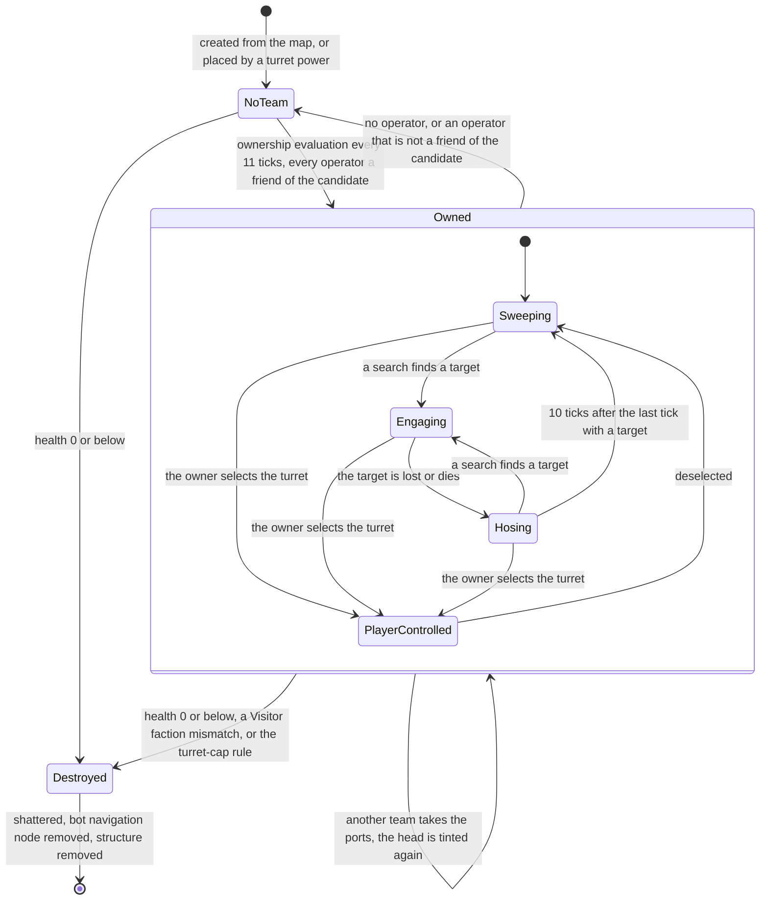
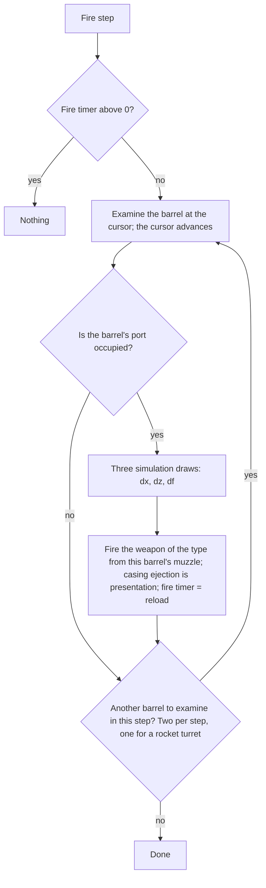
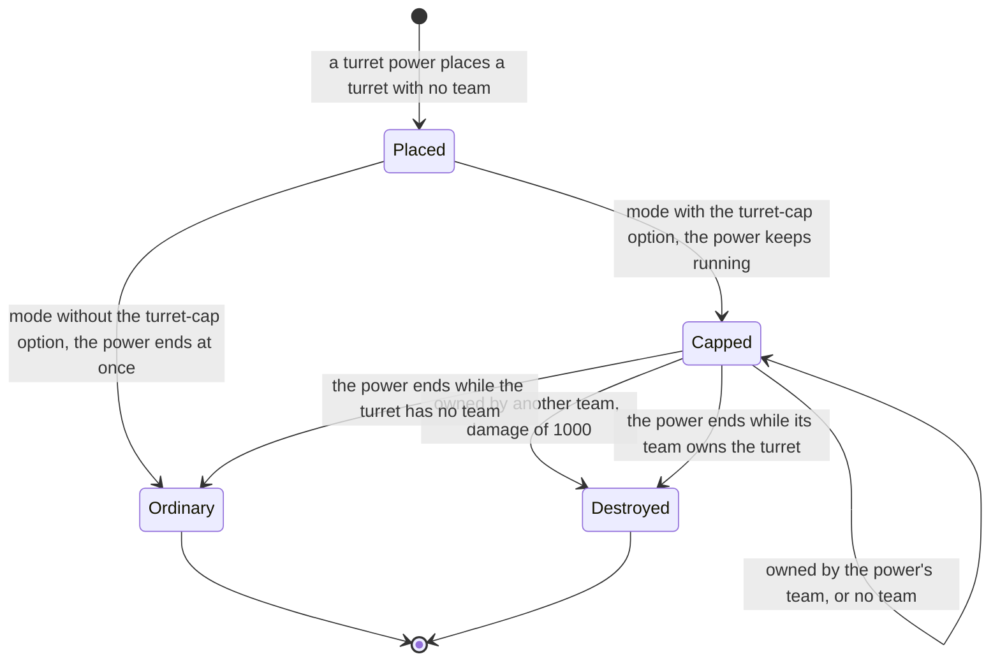
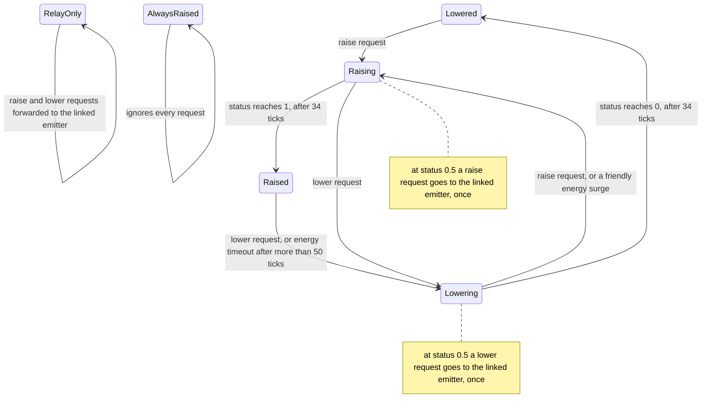
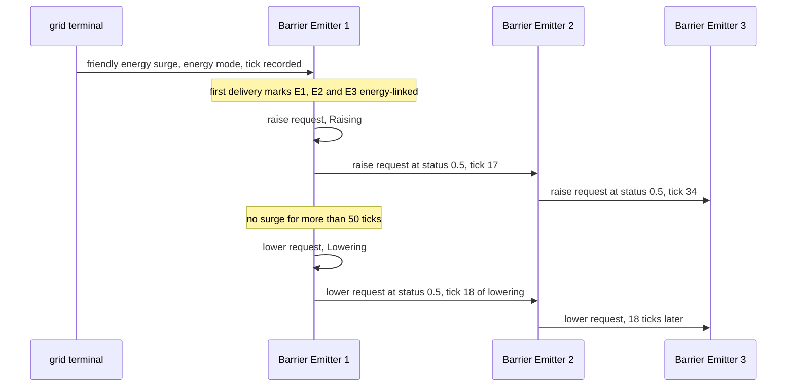
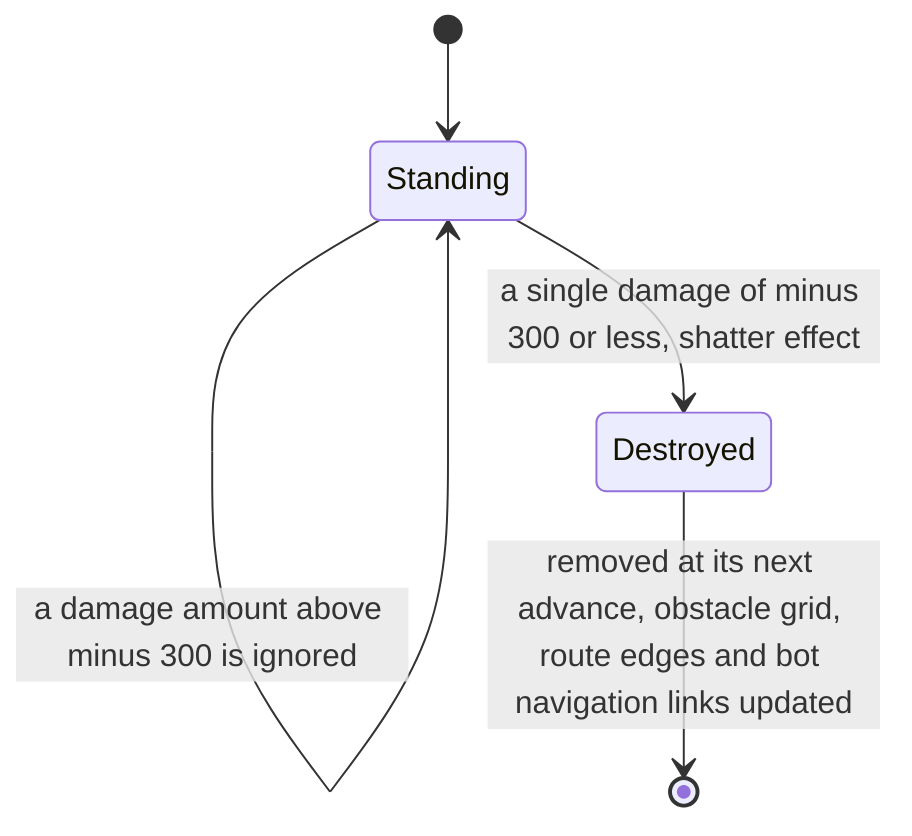
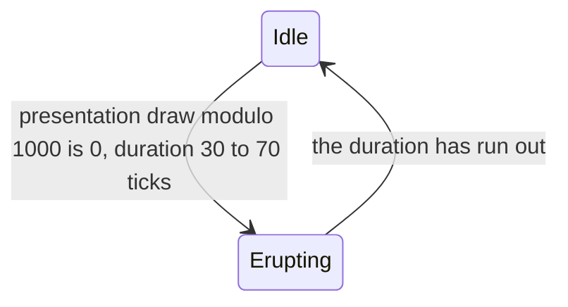
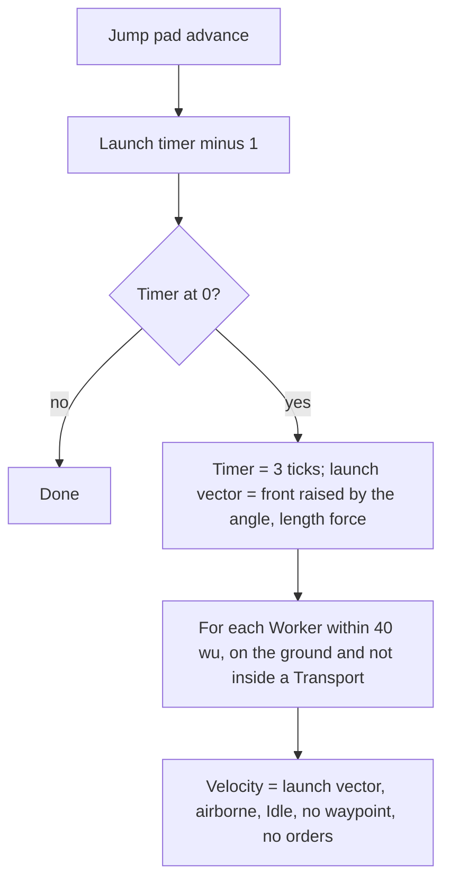

# Defences and props

> Status: Reference · Prefix: R-BLDG · Related: [Buildings and world objects](README.md) · [Trees and crate structures](trees_and_crate_structures.md) · [Economy and spawn objects](economy_and_spawn_objects.md) · [Mode objects](mode_objects.md) · [02 Worker](../02_units/worker.md) · [02 Transport](../02_units/transport.md) · [04 Crates and powers](../04_supply_crates_powers_and_weapons/crates_and_powers.md) · [04 Weapons and projectiles](../04_supply_crates_powers_and_weapons/weapons_and_projectiles.md) · [05 Population flow](../05_population_flow.md) · [07 Bots](../07_bots/README.md) · [08 Maps and level design](../08_maps_and_level_design/README.md) · [12 Simulation model](../12_simulation_model/README.md)

## 1 Purpose and player experience

This document and its companion specify the defences, the scenery and the crate-spawned structures of the reference game. The rules that every structure shares (ports, capture model, lifecycle, damage, hit tests, presentation and sound events) are in the [folder README](README.md); these two documents give each kind's own behaviour. The topic is split in two files to respect the size limit:

| File | Objects | Requirement IDs |
|---|---|---|
| defences_and_props.md (this document) | the rules shared by both files; turrets of the four types and the Convert Turret, the turret aim marker, Barrier Emitters, walls, scenery meshes, exclusion zones, smoke columns, volcano vents and jump pads | R-BLDG-400 to R-BLDG-599 |
| [trees_and_crate_structures.md](trees_and_crate_structures.md) | trees (including the trees of the Essence Grove and Blight Grove outcomes), Hives, Spitter Plants and the Allegiance Scrambler effect | R-BLDG-600 to R-BLDG-799 |

Table 1-A The objects of both files.

| Object | Identifier | Kind of object | Placed by | Owner | Section |
|---|---|---|---|---|---|
| turret (gun, rocket, mortar, flame) and Convert Turret | `Turret`, `TurretType::Gun`, `TurretType::Rocket`, `TurretType::Mortar`, `TurretType::Flame`, `TurretType::Convert` | structure | maps; turret powers from Supply crates and Transit Gate waves | the team that mans its ports | §2.2 |
| turret aim marker | — | effect | each turret | the turret's team, gun turrets only | §2.2.11 |
| Barrier Emitter | `BarrierEmitter` | structure | maps | fixed by the map | §2.3 |
| wall | `WallObject` | structure | maps | no team | §2.4 |
| scenery mesh | `SceneryMesh` | structure | maps | no team | §2.5 |
| exclusion zone | `ExclusionZone` | structure | maps | no team | §2.6 |
| smoke column | `SmokeColumn` | structure | maps | no team | §2.7 |
| volcano vent | `VolcanoVent` | structure | maps | no team | §2.8 |
| jump pad | `JumpPadObject` | structure | maps | no team; works for every team | §2.9 |
| tree | `TreeObject` | structure | maps; the Essence Grove and Blight Grove outcomes; other trees (offspring) | no team | [companion](trees_and_crate_structures.md) §2.2 |
| Hive | `Hive` | structure | the Hive outcome; a map may place one | the Rogue faction | [companion](trees_and_crate_structures.md) §2.3 |
| Spitter Plant | `SpitterPlant` | structure | the Spitter Plants outcome; a map may place one | the Rogue faction | [companion](trees_and_crate_structures.md) §2.4 |
| Allegiance Scrambler effect | `AllegianceScramblerEffect` | effect | the Allegiance Scrambler outcome | — | [companion](trees_and_crate_structures.md) §2.5 |

**Player experience.**

- **Turrets** are the strongest static weapons on a map. A turret belongs to whoever stands on its four ports; a single Worker is enough. It finds the nearest enemy on its own, sprays it with fire while the target wobbles in its sights, and keeps hosing for a moment after the target is gone. Its owner can also take direct control and aim it with the pointer. Siege maps ring the defenders' base with neutral gun turrets that either side can man; Supply crates and Transit Gate waves hand out gun, rocket and flame turrets that the player places where they are needed.
- **Barrier Emitters** are posts that raise lethal energy fields between them. An enemy that walks into a raised field dies (a Worker catches fire), and every raised field blocks walking routes. On the reference maps the fields stay up only while friendly Solar Arrays keep sending energy surges down the energy grid, so knocking out the Solar Arrays brings the barriers down, post by post along the line.
- **Walls** block movement and fire and shrug off ordinary weapons; only the Breach Charge or the defenders' own scuttle explosion brings one down. They make Siege a battle for a breach.
- **Scenery meshes, exclusion zones, smoke columns and volcano vents** are props: solid rocks and ruins, invisible zones where no Supply crate lands, rising smoke that is also an invisible obstacle, and an erupting vent.
- **Jump pads** fling every Worker that stands on them through the air along a fixed arc, whatever its team.
- Trees, Hives, Spitter Plants and the Allegiance Scrambler are described in the [companion](trees_and_crate_structures.md).

## 2 Rules

### 2.1 Rules shared by these objects

**R-BLDG-400** (MUST) The rules of §2.1 apply to every object of table 1-A, in this document and in its [companion](trees_and_crate_structures.md). The values of both files are the reference tuning baseline that Species may adopt (DEC-004), and the two files are the specification of record for these objects (DEC-005). Every reference behaviour that looks accidental and that no Resolved decision corrects is stated as an explicit rule with a named key (DEC-006). The function, capture rules, ports and links of these kinds are kept, with the structure corrections applied (DEC-020, DEC-088).

**R-BLDG-401** (MUST) The shared structure rules of the [README](README.md) apply to every structure of table 1-A: one advance per tick (R-BLDG-001, R-BLDG-002); integer tick timers, each with its own key in the file that owns the structure (R-BLDG-003); game speed as tick scheduling (R-BLDG-004); teams and friendship (R-BLDG-005 to R-BLDG-008); the damage sign convention (R-BLDG-009); ports, occupancy and reservation (R-BLDG-019 to R-BLDG-025); the lifecycle (R-BLDG-028 to R-BLDG-032); damage and destruction (R-BLDG-034 to R-BLDG-037); ownership changes (R-BLDG-038, R-BLDG-039); hit tests and meshes (R-BLDG-041 to R-BLDG-044); presentation (R-BLDG-045 to R-BLDG-048); sound events (R-BLDG-049); and map records (R-BLDG-050). This document states only what each kind adds or changes.

**R-BLDG-402** (MUST) The notation of the README applies: `U[a, b)` is a uniform real draw and `U{a..b}` a uniform integer draw, both from the simulation generator unless a rule names the presentation generator. Every draw is its own statement, made in the step that the rule names, and the draws of one step are made in the order in which the rule lists them (DEC-013, DEC-652). Cosmetic draws (particles, sparks, smoke, flicker, sound choice) come from the presentation generator and never reach simulation state (DEC-013, DEC-222; reference/12 R-SIM-622 and R-SIM-640). The simulation draws of these objects are listed in reference/12 R-SIM-630 Table 1.

**R-BLDG-403** (MUST) "Match time" is the tick count since match start × `ref.sim.tick_period` (R-BLDG-004), in seconds; "presentation time" is the presentation clock of the renderer. A rule that compares match time with a deadline is written here in ticks: a deadline of T seconds is T ÷ `ref.sim.tick_period` ticks (0.1 s per tick), and a random duration base + U[0, s) seconds is drawn as base ÷ `ref.sim.tick_period` + ⌈U[0, s ÷ `ref.sim.tick_period`)⌉ ticks, which keeps the reference distribution.

**R-BLDG-404** (MUST) No step of these objects stores a non-finite value (DEC-653). Where the reference divides by a length or takes an arccosine, the rule states the guard: the turret aim cosine is clamped to [−1, 1] before its arccosine (DEC-653 item 8); a direction normalised from a zero vector is (0, 0, 1) (the tree generator's rule, [trees and crate structures](trees_and_crate_structures.md) R-BLDG-605); and a line-of-sight test over less than one step needs no division (R-BLDG-413).

### 2.2 Turret

#### 2.2.1 Structure and types

**R-BLDG-405** (MUST) A turret (`Turret`) is a manned weapon emplacement. It consists of a fixed mount, `mesh.structure.turret_mount`, which carries `ref.bldg.turret.ports` (4) port sockets `port_01` to `port_04` and the status sockets `status_01` to `status_04`; a head, `mesh.structure.turret_head`, which turns towards the aim point and carries the sockets `barrel_mount` and `kill_counter`, with the collision asset `mesh.collision.turret_head`; and a barrel set chosen by the turret's type, one variant of `mesh.structure.turret_barrel`, with `ref.bldg.turret.barrels` (4) barrels and the matching member of `mesh.collision.turret_barrel` (README table 2.12-B). Barrel i belongs to port i. The turret is owned by the team that mans its ports (R-BLDG-408), engages enemies on its own (§2.2.3, §2.2.4) and can be aimed by its owner (§2.2.8).

**R-BLDG-406** (MUST) A turret has one of five types (`TurretType`), listed in this order, which is also the order of the type field of its map record (R-BLDG-407). The display name of each type is new text under the string id given.

Table 2.2-A Turret types.

| Type | Name string id | Barrel mesh variant | Weapon of each fired barrel | Reload | Minimum range | Maximum range | Barrels examined per fire step |
|---|---|---|---|---|---|---|---|
| gun turret (`TurretType::Gun`) | `building.turret.gun.name` | gun barrel (`casing_eject_01` to `casing_eject_04`, `muzzle_01` to `muzzle_04`) | a turret round (R-BLDG-420), or a Convert laser bolt from a tagged operator (R-BLDG-421) | `ref.bldg.turret.gun.reload_ticks` (1 tick) | `ref.bldg.turret.gun.min_range` (50 wu) | `ref.bldg.turret.gun.max_range` (225 wu) | `ref.bldg.turret.barrels_per_fire_step` (2) |
| rocket turret (`TurretType::Rocket`) | `building.turret.rocket.name` | rocket barrel | a rocket | `ref.bldg.turret.rocket.reload_ticks` (15 ticks) | `ref.bldg.turret.rocket.min_range` (100 wu) | `ref.bldg.turret.rocket.max_range` (200 wu) | `ref.bldg.turret.rocket.barrels_per_fire_step` (1) |
| mortar turret (`TurretType::Mortar`) | `building.turret.mortar.name` | gun barrel | a grenade thrown into the mortar target area | `ref.bldg.turret.mortar.reload_ticks` (40 ticks) | none: area-targeted (R-BLDG-411) | none: area-targeted (R-BLDG-411) | `ref.bldg.turret.barrels_per_fire_step` (2) |
| flame turret (`TurretType::Flame`) | `building.turret.flame.name` | flame barrel | a fireball | `ref.bldg.turret.flame.reload_ticks` (1 tick) | `ref.bldg.turret.flame.min_range` (10 wu) | `ref.bldg.turret.flame.max_range` (150 wu) | `ref.bldg.turret.barrels_per_fire_step` (2) |
| Convert Turret (`TurretType::Convert`) | `building.turret.convert.name` | cannon barrel | a Convert laser bolt | `ref.bldg.turret.convert.reload_ticks` (6 ticks) | `ref.bldg.turret.convert.min_range` (10 wu) | `ref.bldg.turret.convert.max_range` (150 wu) | `ref.bldg.turret.barrels_per_fire_step` (2) |

The reload tick counts are those of DEC-002 (rocket turret 1.5 s = 15 ticks, Convert Turret 0.5 s = 6 ticks, mortar turret 4.0 s = 40 ticks; gun and flame turrets 0.1 s = 1 tick).

**R-BLDG-407** (MUST) A turret's map record holds the base fields (R-BLDG-050) and then, each optional with its default:

| Field | Default | Meaning |
|---|---|---|
| type | gun turret | one of table 2.2-A |
| mortar target x | `ref.bldg.turret.default_mortar_value` (0) | x offset of the mortar target point from the turret, in wu |
| mortar target z | `ref.bldg.turret.default_mortar_value` (0) | z offset of the mortar target point |
| mortar target radius | `ref.bldg.turret.default_mortar_value` (0) | the mortar's search radius and scatter width, in wu |
| mortar force | `ref.bldg.turret.default_mortar_value` (0) | the mortar's throw force |

The four mortar fields are given together or not at all. A turret ignores the facing of its map record: initialisation sets its up to (0, 1, 0) and its front to (0, 0, 1), whatever the map says (see DEC-462). Its centre is its position and its radius is `ref.bldg.turret.radius` (30 wu). Its sphere and mesh tests are against its meshes; its ray test hits the head mesh, the barrel mesh or a sphere of radius `ref.bldg.turret.ray_sphere_radius` (12 wu) centred `ref.bldg.turret.ray_sphere_height` (10 wu) above its position, and picking a turret uses this ray test (README table 2.12-A).

**R-BLDG-408** (MUST) A turret is a structure of the README's capture model (table 2.7-A). Its ownership evaluation runs on its first advance and then every `ref.bldg.turret.recount_ticks` (11 ticks, the tick count of a 1.0 s countdown, DEC-002): it counts the operators of its four ports per team; the candidate is the first team in slot order with at least one operator, replaced by any later team with strictly more operators; if any operator is not a friend of the candidate, the result is no team; with no operator at all the result is no team. A single Worker therefore owns a turret, and co-op allies may man it together. The result is applied through the team-assignment operation (R-BLDG-038).

**R-BLDG-409** (MUST) A Convert Turret owned by a team that is not the Visitor faction, and a turret of any other type owned by the Visitor faction, damages itself by −`ref.bldg.turret.self_destruct_damage` (1000) at that ownership evaluation and is destroyed (R-BLDG-423).

#### 2.2.2 The turret step

**R-BLDG-410** (MUST) Each tick a turret's advance runs these steps in order:

1. On its first advance, it creates its bot navigation node (R-BLDG-426).
2. Its ownership timer counts down; at 0 it runs the ownership evaluation (R-BLDG-408) and restarts at `ref.bldg.turret.recount_ticks`.
3. Its fire timer decreases by 1 tick.
4. While it has a team and is not selected by its owner: targeting, aiming and the automatic fire decision (§2.2.3 and §2.2.4).
5. While it is selected by its owner: player control (§2.2.8).
6. Aim clamping and turning (R-BLDG-416).
7. The flame turret's friendly-fire guard (R-BLDG-417).
8. The overheat presentation (R-BLDG-430).
9. The base advance (R-BLDG-031), which evaluates its ports and requests its removal once it is destroyed.

A turret with no team only evaluates ownership and its ports; it neither searches nor fires.

#### 2.2.3 Targeting

**R-BLDG-411** (MUST) A turret with a team searches for a target on its first eligible advance and then every `ref.bldg.turret.recount_ticks` (11 ticks):

- **Mortar turret.** The target point is the turret's position + (mortar target x, 0, mortar target z). The target is `NearestEnemy(target point, 0, mortar target radius, team)` of the actor grid (reference/12 R-SIM-311): the nearest living enemy that is not a bot controller, the first in result order on equal distance. While it has a target, its aim point is the target point.
- **Every other type.** When `EnemiesInCells(position, maximum range, team)` reports no enemy (reference/12 R-SIM-313), there is no target. Otherwise it takes the exact enemy list `Enemies(position, maximum range, team)` in result order, skips every bot controller, every Collector and every dead actor, and keeps the nearest candidate whose distance is at least the type's minimum range and to which the line of sight is clear (R-BLDG-413). A candidate replaces the best so far only when it is strictly nearer, so on equal distance the first in result order wins.

When the chosen target differs from the previous one, the turret raises `turret.target_sighted`. Because both searches skip bot controllers, a turret never locks onto one (see DEC-311).

**R-BLDG-412** (MUST) When a search of a turret with a team finds no target, the turret sweeps idly. Its first idle aim point is drawn once, at its initialisation (DEC-652; reference/12 R-SIM-626): an angle U[0, 2π), a distance `ref.bldg.turret.sweep_distance_base` + U[0, `ref.bldg.turret.sweep_distance_spread`) (200 to 400 wu) and a height U[0, `ref.bldg.turret.sweep_height_first`) (0 to 100 wu), drawn in this order. Every later search without a target rotates the current aim direction about the vertical by U[−`ref.bldg.turret.sweep_turn` ÷ 2, `ref.bldg.turret.sweep_turn` ÷ 2) (±π/4) and moves the aim height by U[−`ref.bldg.turret.sweep_height_change` ÷ 2, `ref.bldg.turret.sweep_height_change` ÷ 2) (±25 wu).

**R-BLDG-413** (MUST) The line-of-sight test from a turret at p to a target at t samples the line from the turret towards the target (DEC-088): with d = |t − p| and n = ⌊d ÷ `ref.bldg.turret.los_step`⌋ (30 wu), the sample points are p + (t − p) × k ÷ n for k = 0 to n, or p and t when n = 0. For every structure other than the turret itself that is registered in the obstacle-grid cell of any sample point, the structure's ray test along the unit direction from p to t with length d is evaluated (R-BLDG-041); a hit blocks the line of sight. Walls, Barrier Emitters, trees, scenery meshes, smoke columns and other turrets therefore block a turret's shots.

#### 2.2.4 Aiming and the automatic fire decision

**R-BLDG-414** (MUST) While a turret has a target that exists and is alive, its aim point is the target's position + (`ref.bldg.turret.wobble_xz` × sin(`ref.bldg.turret.wobble_rate_xz` × t), |`ref.bldg.turret.wobble_y` × sin(`ref.bldg.turret.wobble_rate_y` × t)|, `ref.bldg.turret.wobble_xz` × cos(`ref.bldg.turret.wobble_rate_xz` × t)), with t the match time in seconds (R-BLDG-403): a wobble of ±20 wu in x and z and 0 to 10 wu up, at 3 and 2 rad per second. The mortar turret's aim point is its target point (R-BLDG-411).

**R-BLDG-415** (MUST) The automatic fire decision runs the fire step (R-BLDG-418) when the turret has a target, the horizontal angle between its front and the direction to its aim point is below `ref.bldg.turret.fire_cone` (0.3 rad), and its friendly-fire flag is clear. The angle is the arccosine of the dot product of the two horizontal unit vectors, clamped to [−1, 1] before the arccosine (DEC-653 item 8). Every tick on which the turret has a target records that tick; for `ref.bldg.turret.hose_window_ticks` (10 ticks) after the last such tick the turret keeps running the fire step at its last aim point although it has no target ("hosing", see DEC-859).

**R-BLDG-416** (MUST) Every tick, an aim point closer than `ref.bldg.turret.min_aim_distance` (75 wu) to the turret is moved outward along the direction from the turret to `ref.bldg.turret.min_aim_distance`. The head then turns towards the aim point by `ref.bldg.turret.yaw_gain` (0.2) × the horizontal angle between its front and the aim direction, and the barrel's up vector blends towards the aim direction as up = up × (1 − `ref.bldg.turret.pitch_blend`) + aim direction × `ref.bldg.turret.pitch_blend` (0.2 per tick, 2 per second × the tick period). The muzzle sockets follow the head and the barrels.

**R-BLDG-417** (MUST) A flame turret sets its friendly-fire flag every tick when `CountFriendsInCells(position + front × ref.bldg.turret.flame.guard_offset, ref.bldg.turret.flame.guard_radius, team)` exceeds `ref.bldg.turret.flame.guard_friends` (more than 10 friends within 20 wu of the point 60 wu ahead), and clears it otherwise. The count is the cell-granular count of reference/12 R-SIM-312, so it includes friends up to about 45 wu beyond the radius. While the flag is set, the automatic fire decision does not fire and the kill counter shows the warning text (R-BLDG-427). The flag is evaluated after the fire decision of the same tick (R-BLDG-410), so the decision reads the flag of the previous tick. Other turret types have no friendly-fire guard.

#### 2.2.5 The fire step

**R-BLDG-418** (MUST) The fire step does nothing while the fire timer is above 0. Otherwise it examines barrels from its barrel cursor: two barrels, the cursor's barrel and the next one, or one barrel for the rocket turret (table 2.2-A). The cursor advances by one, modulo 4, past every examined barrel, whether or not its port is occupied. For each examined barrel whose port has an occupant (R-BLDG-021), in order:

1. three simulation draws (`ref.sim.rng.turret_sim_draws_per_barrel`, 3; reference/12 R-SIM-630): dx = U[−r ÷ 2, r ÷ 2), dz = U[−r ÷ 2, r ÷ 2) and df = U[−`ref.bldg.turret.mortar.force_spread` ÷ 2, `ref.bldg.turret.mortar.force_spread` ÷ 2), with r the mortar target radius. Every turret type makes these draws; only the mortar turret uses them;
2. the barrel fires its type's weapon from its own muzzle socket (`muzzle_0i` of the turret's own barrel mesh, DEC-461), carrying the turret's handle for kill credit (R-BLDG-420);
3. the casing ejection, which is presentation and draws from the presentation generator (`ref.sim.rng.turret_casing_draws_per_barrel`, 4; DEC-461): a gun turret ejects a shell casing (`mesh.projectile.shell_casing`) from the barrel's `casing_eject_0i` socket; the other types eject none;
4. the fire timer is set to the type's reload.

The second examined barrel fires in the same step even though the first has set the fire timer. An examined barrel whose port is unoccupied draws nothing and fires nothing.

**R-BLDG-419** (MUST) These cadences follow from R-BLDG-418, and the acceptance criteria test them: a gun or flame turret fires each manned barrel on every second tick, `ref.bldg.turret.gun.reload_ticks` = 1, so it fires 5 shots per second per manned port, up to 20 with all four ports manned; a mortar turret fires up to two grenades every 40 ticks; a Convert Turret fires up to two laser bolts every 6 ticks; a rocket turret fires one rocket every 15 ticks, and each examined unmanned barrel delays the next rocket by one more tick.

**R-BLDG-420** (MUST) Each fired barrel launches its type's weapon. The weapons' flight, damage, team filters, lifetimes and kill credit are specified in [04 Weapons and projectiles](../04_supply_crates_powers_and_weapons/weapons_and_projectiles.md); the turret supplies these launch values:

| Type | Weapon | Launch |
|---|---|---|
| gun turret | turret round (`TurretRound`, `mesh.projectile.turret_round`) of the turret's team | velocity v = barrel front × `ref.bldg.turret.gun.round_speed` (500 wu/s); start = muzzle − v × `ref.sim.tick_period` × `ref.bldg.turret.gun.start_back_fraction` (half a tick of travel behind the muzzle) |
| rocket turret | rocket (`RocketProjectile`) of the turret's team | from the muzzle towards the point muzzle + barrel front × `ref.bldg.turret.rocket.aim_distance` (500 wu), with a life of `ref.bldg.turret.rocket.life_ticks` (11 ticks: the first tick on which the rocket's age exceeds 1.0 s, as in R-CRATE-431) |
| mortar turret | grenade (`GrenadeProjectile`) of the turret's team | thrown from the muzzle at the point turret position + (mortar target x + dx, 0, mortar target z + dz) with force = mortar force + df (R-BLDG-418 step 1), a fuse of `ref.bldg.turret.mortar.fuse_ticks` (10,000 ticks, so it never times out in practice), exploding on impact |
| flame turret | fireball (`FireballProjectile`) with no team, so it harms every team | velocity barrel front × `ref.bldg.turret.flame.fireball_speed` (100 wu/s), with a life of `ref.bldg.turret.flame.fireball_life_ticks` (11 ticks) |
| Convert Turret | Convert laser bolt (`LaserBolt`, converting) of the turret's team | velocity barrel front × `ref.bldg.turret.convert.bolt_speed` (125 wu/s, a quarter of the turret-round speed); its life is the laser life `ref.weapon.laser.life_ticks` of reference/04 at the fixed match laser level (6 ticks) × 2, so 12 ticks and about 150 wu of range (see DEC-115) |

A turret round, a rocket and a grenade also create the shot's muzzle flash (reference/12 R-SIM-228).

**R-BLDG-421** (MUST) A gun turret fires a Convert laser bolt, launched as the Convert Turret's weapon of R-BLDG-420, instead of a turret round from every fired barrel whose port occupant carries a convert tag. The tag is set only by the Convert power and cleared by the Worker once that power has ended (DEC-331; [02 Worker](../02_units/worker.md) R-UNIT-126). The test is made per shot.

#### 2.2.6 Health, damage and destruction

**R-BLDG-422** (MUST) A turret has health `ref.bldg.turret.health` (60). Its damage operation adds the signed amount to its health (R-BLDG-009). Its damage comes from explosions (R-BLDG-035), from its own Visitor faction rule (R-BLDG-409) and from the turret-cap rule (R-BLDG-424).

**R-BLDG-423** (MUST) When a turret's health is at or below 0, it shatters its head and barrel meshes (shatter effects, presentation), sets its destroyed flag, destroys its bot navigation node (R-BLDG-426), and its advance requests its removal. Its weapons already in flight keep flying and keep their kill credit handle.

#### 2.2.7 Turrets placed by a power

**R-BLDG-424** (MUST) A turret placed by a turret power (the gun turret, rocket turret and flame turret outcomes of [04 Crates and powers](../04_supply_crates_powers_and_weapons/crates_and_powers.md), and the turret powers of Transit Gate waves, [05 Population flow](../05_population_flow.md) R-ECON-092 and R-ECON-104) is created at the power's target point with the power's turret type and **no team**, so it must be manned. The creation inserts it into the structure pool and updates the obstacle grid incrementally (R-BLDG-030), shatters its meshes once as a build-in effect (presentation), and shows the map marker `icon.power.gun_turret`; the outcome message is reference/04's. Then, by mode (R-MODE-077):

- **In a mode without the turret-cap option** (Spawn Control, Zone Control, Relic Run, Siege), the power ends at once. The turret still has no team, so ending the power leaves it standing, and it is an ordinary turret from then on.
- **In a mode with the turret-cap option** (Launch Race, Flag Chain), the power keeps running while the turret exists, and counts towards the cap ([01 README](../01_skirmish_rules_and_modes/README.md) R-MODE-077). Every tick of the running power, when the turret has a team and that team is not the power's team, the power damages the turret by −`ref.bldg.turret.self_destruct_damage` (1000), which destroys it. Ending the power destroys the turret the same way when the power's team owns it at that moment; a request to end the power is refused while another team owns the turret. Whether cancelling a power frees its Power slot when its turret stays is DEC-551.

A turret power's target point is invalid inside an exclusion zone that blocks powers (R-BLDG-464).

#### 2.2.8 Player control

**R-BLDG-425** (MUST) The owner of a turret may select it; the selection is local input of the owning team only, and the `Select` command sets the turret's fire timer to `ref.sim.team.turret_select_delay` (6 ticks) and puts the owner's camera into turret-aim mode (reference/12 R-SIM-405). While the turret is selected by its team, it makes no automatic search, aim or fire decision. Each tick its aim point is the `pointerPosition` of its team's command state, and the fire step runs when that state carries `moveTarget`, `primaryFire` or `primaryHeld` (reference/12 R-SIM-439). Player-controlled fire is not blocked by the friendly-fire flag. The aiming cursor is `cursor.turret_aim` ([06 Controls, camera and commands](../06_controls_camera_and_commands/README.md)). Deselecting returns the turret to automatic control.

#### 2.2.9 Bot navigation node and kill counter

**R-BLDG-426** (MUST) On its first advance a turret creates a bot navigation node (`BotNavNode`) at its own position, marked as a turret node, with a new serial, and the bot navigation links are recomputed ([07 Bots](../07_bots/README.md)), so that bots contest the turret. The node is destroyed with the turret.

**R-BLDG-427** (MUST) A turret keeps a kill count per team slot. A kill made by a weapon that carries the turret's handle adds 1 to the count of the turret's team when the victim is an enemy and subtracts 1 when the victim is a friend, and raises `turret.kill_tick` (presentation); the kill also counts for the team (reference/12 R-SIM-221). The kill sound of a turret round, `sfx.weapon.laser_bolt.kill`, is the weapon's own event ([04 Weapons and projectiles](../04_supply_crates_powers_and_weapons/weapons_and_projectiles.md) R-CRATE-451). The head's `kill_counter` socket shows the count of the turret's team at text size `ref.bldg.turret.kill_text_size` (2), or `ref.bldg.turret.kill_text_size_large` (1.5) when the count exceeds `ref.bldg.turret.kill_text_threshold` (999); while the friendly-fire flag is set it shows the new text `building.turret.friendly_fire_warning` ("Allies in the line of fire") instead.

#### 2.2.10 Presentation

**R-BLDG-428** (MUST) A turret with no team draws its head and barrels untinted. An owned turret draws its head tinted with its owner's team colour, scaled by `ref.bldg.turret.tint_weight` (0.2), with the co-op group shade variant of the colour (ADR-020), and its barrels untinted. The tinted variants of every team colour and group shade are prepared at match setup (reference/12 02, initialisation step 6).

**R-BLDG-429** (MUST) A turret's sound events, besides the base events of README table 2.14-A, are: `turret.target_sighted` when a search finds a new target (silent, see DEC-565); `turret.fire_gun` for each turret round or gun-turret Convert bolt; `turret.fire_rocket` for each rocket (silent, see DEC-565); `turret.fire_grenade` for each mortar grenade; `turret.fire_flame` for each fireball; and `turret.kill_tick` for each credited kill (§2.10).

**R-BLDG-430** (MUST) Overheating is presentation state of the turret, never read by a rule. Each fire step that passes the fire-timer check raises the heat by `ref.bldg.turret.heat_per_fire` (1), up to `ref.bldg.turret.heat_max` (40), and restarts the cooling pause. When more than `ref.bldg.turret.cool_pause_ticks` (2 ticks) have passed since the pause restarted, the heat falls by `ref.bldg.turret.cool_step` (0.3), not below 0, and the pause restarts: the heat falls by 1.5 per second while the turret is silent. Each cooling step releases, at each barrel's muzzle, a number of smoke particles drawn from the presentation generator as ⌊U[0, ⌊1 + heat ÷ `ref.bldg.turret.smoke_heat_divisor`⌋)⌋ (heat ÷ 10).

#### 2.2.11 Turret aim marker

**R-BLDG-431** (MUST) Every turret owns one turret aim marker, an effect in the match world's effect pool that takes a simulated-object handle and therefore shifts the serials of later effects (reference/12 R-SIM-138). Every tick the marker moves to its turret's aim point while any of the turret's ports is occupied, and to the world origin otherwise; it takes its turret's team when the turret is a gun turret; and it removes itself once its turret no longer exists. No rule of a match reads it: Workers have no threat reaction to it in a match (DEC-052).

### 2.3 Barrier Emitter

**R-BLDG-432** (MUST) A Barrier Emitter (`BarrierEmitter`) is a post, `mesh.structure.barrier_emitter` (sockets `field_anchor_01`, `field_anchor_02` and `light_01`; collision asset `mesh.collision.barrier_emitter`), that while raised projects an energy field to the **next** emitter named by its link; chains of linked emitters form barrier lines. An enemy actor that touches a raised field dies or, if it is a Worker, catches fire (R-BLDG-442); every raised field, of any team, blocks walking routes (R-BLDG-443). Its team comes from its map record and never changes; it has no ports and is never captured; it is indestructible (R-BLDG-034); it draws no lights (R-BLDG-045).

**R-BLDG-433** (MUST) A Barrier Emitter's map record holds the base fields and then:

| Field | Default | Meaning |
|---|---|---|
| link | absent: no next emitter, so the chain ends ([data schemas](../../architecture/components/data_schemas/map_structure_records.md) DAT-146) | the structure id of the next emitter; an emitter without a link ends the chain and draws and tests no field |
| scale | `ref.bldg.barrier_emitter.default_scale` (1.0) | uniform scale of the post, and so of the field height |
| initial mode | Lowered | one of the modes of R-BLDG-435 |

The content build rejects a link that names no structure or a structure that is not a Barrier Emitter (DEC-015), and a ring of linked emitters whose every emitter starts in RelayOnly mode, because a forwarded request would circle it without end (DEC-968). If such a link reached the simulation, every rule would treat it as no link; presentation never changes the link (DEC-007, DEC-222; reference/12 R-SIM-656).

**R-BLDG-434** (MUST) Initialisation copies the three fields, sets the field status to 1 when the mode is Raised or AlwaysRaised and to 0 otherwise, and draws the first spark delay ⌈U[0, `ref.bldg.barrier_emitter.first_spark_spread_ticks`)⌉ ticks (0 to 100 ticks) from the simulation generator (reference/12 R-SIM-630 Table 1).

**R-BLDG-435** (MUST) A Barrier Emitter is in one of these modes (`BarrierMode`):

| Mode | Field status | Meaning |
|---|---|---|
| Lowered | 0 | down; a raise request starts Raising |
| Raising | rising | the field rises at `ref.bldg.barrier_emitter.raise_rate` per tick |
| Raised | 1 | up |
| Lowering | falling | the field falls at `ref.bldg.barrier_emitter.raise_rate` per tick |
| RelayOnly | stays 0 | never raises; forwards every raise and lower request to its linked emitter at once; draws and tests no field; still sparks |
| AlwaysRaised | 1 | permanently up; raise, lower and toggle requests and the energy timeout have no effect |

An emitter is **raised** when its mode is Raising, Raised or AlwaysRaised.

**R-BLDG-436** (MUST) The requests on an emitter are:

- **raise:** RelayOnly forwards the request to the linked emitter; Raised and AlwaysRaised stay as they are; every other mode becomes Raising;
- **lower:** RelayOnly forwards the request to the linked emitter; Lowered and AlwaysRaised stay as they are; every other mode becomes Lowering;
- **toggle:** Lowered and Lowering raise; Raised and Raising lower; RelayOnly and AlwaysRaised stay as they are.

Every request clears the emitter's hand-off flag (R-BLDG-437).

**R-BLDG-437** (MUST) Each tick a Barrier Emitter's advance runs these steps in order:

1. On its first advance, when its link resolves, its centre becomes the midpoint of the two posts and its radius half the distance between them plus its own radius, so that the whole line is covered by the visibility test and the obstacle grid.
2. While its mode is not Lowered, the spark delay counts down; at 0 the emitter sparks (R-BLDG-447) and the next delay is `ref.bldg.barrier_emitter.spark_base_ticks` + ⌈U[0, `ref.bldg.barrier_emitter.spark_spread_ticks`)⌉ ticks (80 to 120 ticks), drawn from the presentation generator.
3. The energy control (R-BLDG-438).
4. The mode step: in Raising the status rises by `ref.bldg.barrier_emitter.raise_rate` (0.03 per tick, 0.3 per second); when the status is at least `ref.bldg.barrier_emitter.handoff_status` (0.5), the emitter has a link and its hand-off flag is clear, it sends a raise request to the linked emitter and sets the flag; at a status of at least 1 the status becomes 1 and the mode Raised. In Lowering, when the status is at or below `ref.bldg.barrier_emitter.handoff_status`, tested before this tick's decrease, and the emitter has a link and a clear hand-off flag, it sends a lower request to the linked emitter and sets the flag; the status then falls by `ref.bldg.barrier_emitter.raise_rate`; at or below 0 it becomes 0 and the mode Lowered. Raised and AlwaysRaised hold the status at 1, Lowered holds it at 0, and RelayOnly leaves it unchanged.
5. The base advance (R-BLDG-031); the emitter has no ports.

A full raise takes 34 ticks and passes the request on at its 17th tick; a full lowering takes 34 ticks and passes the request on at its 18th tick, so a line of n emitters rises from one end to the other with a delay of 17 ticks per post.

**R-BLDG-438** (MUST) An emitter that has received energy at least once (R-BLDG-439) is in energy mode. Each tick in energy mode: when more than `ref.bldg.barrier_emitter.energy_timeout_ticks` (50 ticks, 5.0 s) have passed since its last energy delivery, the emitter sends itself a lower request if it is raised or RelayOnly; otherwise it sends itself a raise request if it is not raised. An emitter that has never received energy keeps its map mode for the whole match.

**R-BLDG-439** (MUST) The energy grid is the only active switch of Barrier Emitters (DEC-020). A grid terminal delivers an energy surge to its linked emitter only when the surge's team and the emitter's team are friends ([economy and spawn objects](economy_and_spawn_objects.md) R-BLDG-186), so an emitter with no team is never powered. A delivery puts the emitter into energy mode and records the tick; the first delivery also marks the emitter and every emitter downstream along the links as energy-linked, stopping at an AlwaysRaised emitter or at one already marked, so the marking ends on every chain. Only the directly powered emitter runs the timeout of R-BLDG-438; the emitters downstream follow it through the chain hand-off of R-BLDG-437. The command catalogue's toggle command for a Barrier Emitter toggles it (reference/12 06, `PlayerCommand::ToggleBarrierEmitter`); no player or bot action sends that command in the reference.

**R-BLDG-440** (MUST) The field height of an emitter is h_full = the height of socket `field_anchor_02` above socket `field_anchor_01` of the scaled mesh, `ref.bldg.barrier_emitter.field_height` (48.28 wu × scale). The field of an emitter with a link and a status s > 0 is the quad between its post and the linked post: from b − (0, h ÷ 3, 0) to b + (0, h, 0) at its own base b, with h = its own h_full × s, and from b′ − (0, h′ ÷ 3, 0) to b′ + (0, h′, 0) at the linked base b′, with h′ = the linked emitter's h_full × s. The skirt below each base is `ref.bldg.barrier_emitter.skirt_fraction` (1/3) of the height. The collision field equals the drawn field (DEC-088).

**R-BLDG-441** (MUST) The hit tests of a Barrier Emitter override the defaults (README table 2.12-A):

- **Lowered, or in the map editor:** every test is against the scaled post mesh only.
- **Ray test otherwise:** when the emitter has a link and s > 0, the ray is tested against the two field triangles (p1, p2, p4) and (p4, p3, p1), with p1 = b − (0, h ÷ 3, 0), p2 = b + (0, h, 0), p3 = b′ − (0, h′ ÷ 3, 0) and p4 = b′ + (0, h′, 0) of R-BLDG-440, and the hit normal is Normalize((p1 − p3) × (p1 − p2)); when the field is not hit, the ray is tested against the scaled post mesh.
- **Sphere test otherwise:** the sphere (c, r) is approximated by two rays of length `ref.bldg.barrier_emitter.sphere_ray_factor` × r (2r) through c, one along +x and one along +z, each tested as above; then the post mesh.
- **Mesh test:** the sphere test with the other mesh's root sphere.

The obstacle grid registers a linked emitter along its whole line, as reference/12 R-SIM-322 specifies; the extra cells of that band only select candidates for these exact tests (DEC-088).

**R-BLDG-442** (MUST) A raised field acts on the actors that touch it, whatever its team, through the actor rules: an actor of a team that is not a friend of the emitter's team that touches a raised field with the kill flag set takes −`ref.sim.push.emitter_kill_damage` (9999) and is never pushed by the field (reference/12 R-SIM-381); a Worker is set on fire or pushed clear instead ([02 Worker](../02_units/worker.md) R-UNIT-113); a Transport is destroyed ([02 Transport](../02_units/transport.md) R-UNIT-377). Each kill raises `barrier_emitter.electrocute` at the actor's position. A friendly or lowered field is passed through.

**R-BLDG-443** (MUST) A raised field of any team blocks walking: the walkability test reports it, the walking cost treats it as an obstacle and the nearest-node scan does not take a node behind it (reference/12 R-SIM-335, R-SIM-338, R-SIM-346); a bot navigation link keeps the emitter it crosses whatever the emitter's state, and each bot rule that uses the link tests that emitter's current state and team by one of the use-time tests of [07 Bots](../07_bots/01_navigation_graph.md) R-BOT-033, so raising or lowering a field needs no rebuild (R-BOT-031, DEC-087); and the Transport's sea-route test refuses a crossing of a raised field of a team that is not a friend (R-UNIT-384). Raising or lowering a field rebuilds no route table (reference/12 R-SIM-343).

**R-BLDG-444** (MUST) A Barrier Emitter is in view during the grace period whatever the camera sees, and its translucent pass is depth-sorted at its centre (README table 2.9-A). Its drawing reads simulation state only (DEC-007).

**R-BLDG-445** (MUST) The field is drawn in the translucent pass only while the mode is neither Lowered nor RelayOnly and the emitter has a link, double-sided, alpha-blended, without depth writes. Its colour is `ref.bldg.barrier_emitter.neutral_rgb` (100, 100, 100) for an emitter with no team; for an energy-linked emitter, a pulse from `ref.bldg.barrier_emitter.energy_dark_rgb` (20, 20, 20) to `ref.bldg.barrier_emitter.energy_team_weight` (0.9) × the team colour with weight |sin(`ref.bldg.barrier_emitter.energy_pulse_rate` × t)| (4 rad/s over the presentation time t); and the team colour otherwise; the alpha is always `ref.bldg.barrier_emitter.field_alpha` (150 of 255). The drawn status is the status extrapolated by `ref.bldg.barrier_emitter.raise_rate` per tick over the presentation's extrapolation time, upward while Raising and downward while Lowering, and each post's own field height is used at its end of the quad (R-BLDG-440).

**R-BLDG-446** (MUST) While the structure-detail setting is below `ref.bldg.barrier_emitter.detail_layer_limit` (3), that is at high or medium detail (the structure-detail setting of reference/09 R-META-425: 1 high, 2 medium, 3 low; [README](README.md) §1.1), the field draws a base layer of `fx.barrier_field` combined with a multiplied layer of `fx.barrier_field_wide`, scrolling along the field by t ÷ `ref.bldg.barrier_emitter.scroll_divisor` (15), or by t ÷ `ref.bldg.barrier_emitter.energy_scroll_divisor` (1.5) with the texture repeated `ref.bldg.barrier_emitter.energy_tiling` (7) times for an energy-linked emitter. At every detail level it draws an additive layer of `fx.barrier_field_wide` and a smoothed line along the top edge, `ref.bldg.barrier_emitter.edge_width` (2.0) wide, or `ref.bldg.barrier_emitter.energy_edge_width` (0.5) for an energy-linked emitter. The visual change of each detail branch is decided with the renderer's quality levels (see DEC-327).

**R-BLDG-447** (MUST) A spark is presentation: it releases U{`ref.bldg.barrier_emitter.spark_count_min`..`ref.bldg.barrier_emitter.spark_count_max`} (5 to 10) spark particles of size U[25, 50) (`ref.bldg.barrier_emitter.spark_size_min`, `ref.bldg.barrier_emitter.spark_size_max`), flung perpendicular to the field at U[40, 60) wu/s (`ref.bldg.barrier_emitter.spark_speed_min`, `ref.bldg.barrier_emitter.spark_speed_max`) from a height U[0, `ref.bldg.barrier_emitter.spark_height` × scale) (50 wu × scale) above the post, all drawn from the presentation generator, and raises `barrier_emitter.spark`.

**R-BLDG-448** (MUST) A Barrier Emitter's sound events, besides the base events of README table 2.14-A, are `barrier_emitter.spark` (R-BLDG-447) and `barrier_emitter.electrocute` (R-BLDG-442; silent, see DEC-565). Its `barrier_emitter.spawn` event starts its presence loop, and its `barrier_emitter.damaged` event is raised by every damage, which changes nothing else (§2.10).

### 2.4 Wall

**R-BLDG-449** (MUST) A wall (`WallObject`) is a straight wall section, `mesh.structure.wall_section`, that blocks movement and the line of fire. It has no team that any rule reads (every reference wall has no team), no ports, and is never captured. Its main use is Siege, where the attackers breach the defenders' walls with the Breach Charge ([mode objects](mode_objects.md)).

**R-BLDG-450** (MUST) A wall's map record holds the base fields only. The bot-objective link field that reference map records carry has no effect and is not specified (DEC-466). A wall has scale 1.

**R-BLDG-451** (MUST) A wall's collision volume is a rectangle `ref.bldg.wall.length` (100 wu) long along right = Normalize(front × up) and `ref.bldg.wall.depth` (20 wu) deep along front, centred on its position, with a ray height of `ref.bldg.wall.height` × `ref.bldg.wall.ray_height_fraction` (75 wu × 0.5 = 37.5 wu) above its base. This footprint is larger than the drawn section, so actors stop short of the visible wall (§4.5).

**R-BLDG-452** (MUST) The hit tests of a wall override the defaults (README table 2.12-A):

- **Sphere test:** the four corners of the rectangle and the sphere centre are all moved to y = 0, and the sphere is tested against the two triangles (t1, t2, t3) and (t2, t3, t4) of the rectangle with an exact sphere-to-triangle test; the wall is therefore an infinitely tall vertical prism for spheres.
- **Ray test:** a vertical quad along right, `ref.bldg.wall.length` long, centred on the position, whose bottom corners lie on the terrain under each end and whose top edge lies at the position's height + 37.5 wu.
- **Mesh test:** exact against the wall mesh's collision asset `mesh.collision.wall_section` (DEC-012).

**R-BLDG-453** (MUST) A wall's advance requests its removal when its destroyed flag is set; it never runs the base advance (R-BLDG-031). The removal recomputes the bot navigation links at once and updates the obstacle grid and the affected route-graph edges (R-BLDG-032).

**R-BLDG-454** (MUST) A wall's damage operation destroys the wall when a single damage amount is at or below −`ref.bldg.wall.destroy_threshold` (300): it plays a shatter effect of its mesh with strength `ref.bldg.wall.shatter_strength` (3.0) and sets its destroyed flag. A smaller hit does nothing: damage never accumulates, and the wall raises no `wall.damaged` event, because it does not run the base damage operation (see DEC-043).

**R-BLDG-455** (MUST) Exactly two damage sources reach the wall threshold: the Breach Charge's breach, which deals a lethal hit to every wall within its break radius, and the Breach Charge's scuttle explosion, which destroys every wall whose base point lies within 60 wu of it, because 500 × (1 − d ÷ 150) ≥ 300 exactly when d ≤ 60 ([mode objects](mode_objects.md); R-BLDG-035). No other explosion of the reference deals 300 or more to a structure; barrage missiles and meteors deal at most 100 (DEC-020, DEC-043).

**R-BLDG-456** (MUST) A wall acts on actors and routes through their rules: a Worker that hits it is pushed along the wall's front and its wall-hit count rises ([02 Worker](../02_units/worker.md) R-UNIT-114); the walkability test and the walking cost treat a wall as impassable (reference/12 R-SIM-335, R-SIM-338); and no bot objective binds to a wall ([07 Bots](../07_bots/README.md)).

**R-BLDG-457** (MUST) A wall is drawn as its mesh at (front, up, position) until it is destroyed, and its destruction is the shatter effect of R-BLDG-454 ([animation and VFX](../../architecture/components/animation_and_vfx/README.md)).

### 2.5 Scenery mesh

**R-BLDG-458** (MUST) A scenery mesh (`SceneryMesh`) places one scenery mesh as a solid, non-interactive obstacle: rocks, ruins and other landmarks. It has no team that any rule reads (every reference scenery mesh has no team), no ports, is never captured and is indestructible (R-BLDG-034). A scenery mesh draws no lights (R-BLDG-045).

**R-BLDG-459** (MUST) A scenery mesh's map record holds the base fields and then its scale (default `ref.bldg.scenery_mesh.default_scale`, 1.0) and its mesh, one of the pieces of `mesh.scenery.prop` or none (the default). The content build rejects a record that names a mesh that does not exist (DEC-015).

**R-BLDG-460** (MUST) Initialisation copies the scale, assigns the mesh, and computes the centre and radius from the mesh at the scaled transform. Its advance is the base advance. Its hit tests are exact against the scaled collision asset of its mesh (DEC-012): the member of `mesh.collision.scenery_prop` for a `mesh.scenery.prop` piece, and `mesh.collision.abductor_hull` for the Abductor hull (README table 2.12-B); with no mesh they are the default tests with radius `ref.sim.structure.default_radius` (13 wu; R-BLDG-042). It is drawn as its scaled mesh with renormalised normals; with no mesh nothing is drawn in a match.

### 2.6 Exclusion zone

**R-BLDG-461** (MUST) An exclusion zone (`ExclusionZone`) is an invisible circle that keeps randomly placed Supply crates out of its area and, optionally, blocks the powers whose target area is the whole map inside it, for example on starting islands. It has no team, no ports and no collision, is never captured and is indestructible.

**R-BLDG-462** (MUST) An exclusion zone's map record holds the base fields and then its size, the horizontal radius (default `ref.bldg.exclusion_zone.default_size`, 300 wu), and its power flag (default false).

**R-BLDG-463** (MUST) Every exclusion zone joins the match world's exclusion-zone list when it is created and leaves it when it is destroyed (reference/12 02, per-match state). The exclusion test `IsExcluded(_point, _forPowers)` is true when some zone of the list lies at a horizontal distance below its size from the point (the zone's height replaces the point's) and either `_forPowers` is false or the zone's power flag is set.

**R-BLDG-464** (MUST) The exclusion test has exactly two callers: the random placement of a Supply crate, which rejects an excluded point with `_forPowers` false ([04 Crates and powers](../04_supply_crates_powers_and_weapons/crates_and_powers.md)); and power targeting, which rejects a target point with `_forPowers` true for the turret powers (gun turret, rocket turret and flame turret), as one of their placement conditions, and for the powers whose target area is the whole map: the airstrike, Firebomb Run, Missile Barrage, Swarm, Essence Grove, Blight Grove, Hive, Brood and meteor shower powers. The Shield, Speed Boost, Convert and Fury powers need an own actor near the target point and ignore exclusion zones ([04 README](../04_supply_crates_powers_and_weapons/README.md) table 2.5-A, R-CRATE-034).

**R-BLDG-465** (MUST) An exclusion zone's advance does nothing. Its sphere and mesh tests never hit and its ray test hits only in the map editor (README table 2.12-A); it is drawn only in the map editor.

### 2.7 Smoke column

**R-BLDG-466** (MUST) A smoke column (`SmokeColumn`) emits a continuous rising column of grey smoke. Its map record holds the base fields only; it has no team that any rule reads, no ports, is never captured and is indestructible. Its advance never runs the base advance (R-BLDG-031).

**R-BLDG-467** (MUST) A smoke column has no hit-test override, so the default tests of a structure without a mesh apply (R-BLDG-042): it is an invisible obstacle, a sphere of radius `ref.sim.structure.default_radius` (13 wu) at its position, registered in the obstacle grid like every structure. It pushes actors out and blocks rays, turret lines of sight included (reference/12 R-SIM-328; see DEC-089).

**R-BLDG-468** (MUST) Each tick a smoke column releases `ref.bldg.smoke_column.particles_per_tick` (3) missile-trail particles at its position, each with velocity (U[−s ÷ 2, s ÷ 2], 1, U[−s ÷ 2, s ÷ 2]), s = `ref.bldg.smoke_column.lateral_spread` (0.4), scaled to the length `ref.bldg.smoke_column.particle_speed` (50 wu/s) and size `ref.bldg.smoke_column.particle_size_base` + U[0, `ref.bldg.smoke_column.particle_size_spread`] (200 to 300), all from the presentation generator. The missile-trail particle kind is specified in [particles, shatter and screen effects](../../architecture/components/animation_and_vfx/particles_shatter_and_screen_effects.md) (`vfx.particle.missile_trail.*`); its values are listed in §4.7.

### 2.8 Volcano vent

**R-BLDG-469** (MUST) A volcano vent (`VolcanoVent`) is an atmospheric vent that erupts from time to time. It is visual only and deals no damage. Its map record holds the base fields only; it has no team that any rule reads, no ports, is never captured, is indestructible and never collides (README table 2.12-A). Its advance never runs the base advance (R-BLDG-031).

**R-BLDG-470** (MUST) A volcano vent's eruption state is presentation state. Each tick of the world step while it is idle, it starts an eruption when a presentation-generator integer draw modulo `ref.bldg.volcano_vent.eruption_odds` (1000) is 0 (a chance of 0.001 per tick, a mean wait of 1,000 ticks, 100 s at game speed 1); the eruption lasts `ref.bldg.volcano_vent.eruption_base_ticks` + ⌈U[0, `ref.bldg.volcano_vent.eruption_spread_ticks`)⌉ ticks (30 to 70 ticks), drawn from the presentation generator. The roll is made once per tick and therefore scales with game speed (DEC-092). Its draws are presentation draws (DEC-013, DEC-222; reference/12 R-SIM-622).

**R-BLDG-471** (MUST) Each tick of an eruption the vent releases `ref.bldg.volcano_vent.particles_per_tick` (10) volcano particles at its position, each with velocity (U[−s ÷ 2, s ÷ 2], 1, U[−s ÷ 2, s ÷ 2]), s = `ref.bldg.volcano_vent.lateral_spread` (1), scaled to `ref.bldg.volcano_vent.particle_speed` (100 wu/s) and size `ref.bldg.volcano_vent.particle_size_base` + U[0, `ref.bldg.volcano_vent.particle_size_spread`] (300 to 500), all from the presentation generator. The volcano particle kind is specified in [particles, shatter and screen effects](../../architecture/components/animation_and_vfx/particles_shatter_and_screen_effects.md) (`vfx.particle.volcano.*`); its values are listed in §4.7.

### 2.9 Jump pad

**R-BLDG-472** (MUST) A jump pad (`JumpPadObject`) launches the Workers that stand on it into a ballistic jump. It has no mesh, no team and no ports; it works for every team, is never captured and is indestructible. Its advance never runs the base advance (R-BLDG-031), so its destroyed flag is never honoured.

**R-BLDG-473** (MUST) A jump pad's map record holds the base fields and then its force, the launch speed in wu/s, and its angle, the elevation of the launch above its front in radians, both defaulting to `ref.bldg.jump_pad.default_value` (0).

**R-BLDG-474** (MUST) Each tick a jump pad's launch timer counts down; at 0 it restarts at `ref.bldg.jump_pad.launch_interval_ticks` (3 ticks, a 0.3 s countdown) and the pad launches. The launch vector is the pad's front rotated about the axis front × up by the angle, which raises it by the angle above the horizontal, scaled to the length force. Every Worker of every team within `ref.bldg.jump_pad.radius` (40 wu) of the pad (`InRange`, reference/12 R-SIM-311) that is on the ground and not inside a Transport gets: velocity = the launch vector, airborne, the Idle state, no waypoint and no orders. It then flies by the airborne step (reference/12 R-SIM-373).

**R-BLDG-475** (MUST) A jump pad's sphere and mesh tests never hit, and its ray test is against a sphere of radius `ref.sim.structure.default_radius` (13 wu; README table 2.12-A). It is drawn as an animated arrow strip of `marker.jump_pad`, `ref.bldg.jump_pad.arrow_length` (80 wu) long and ±`ref.bldg.jump_pad.arrow_half_width` (20 wu) wide along its launch direction, with brightness `ref.bldg.jump_pad.brightness_base` + `ref.bldg.jump_pad.brightness_pulse` × |sin t| (0.3 + 0.7 × |sin t|) over the presentation time t.

### 2.10 Presentation events of these objects

**R-BLDG-476** (MUST) The objects of this document raise the presentation events of table 2.10-A besides the base events of README table 2.14-A. The sample bindings are those of `assets/asset_manifest.csv` ([10 Audio design](../10_audio_design/README.md)); an event marked silent has no binding (see DEC-565).

Table 2.10-A Presentation events and their sample groups.

| Event | Trigger | Sample group |
|---|---|---|
| `turret.spawn` | initialisation | `sfx.building.turret.spawn` |
| `turret.target_sighted` | a search finds a new target (R-BLDG-411) | silent |
| `turret.fire_gun` | a turret round or a gun-turret Convert bolt (R-BLDG-420, R-BLDG-421) | `sfx.unit.trooper.fire_laser` |
| `turret.fire_rocket` | a rocket | silent |
| `turret.fire_grenade` | a mortar grenade | none: never raised in a match, because no reference map places a mortar turret and no power creates one ([10 Audio design](../10_audio_design/event_catalogue.md) R-AUD-136) |
| `turret.fire_flame` | a fireball | `sfx.building.turret.fire_flame` |
| `turret.kill_tick` | a credited kill (R-BLDG-427) | `sfx.ui.match_ui.countdown_tick` |
| `barrier_emitter.spawn` | initialisation; starts the presence loop | `sfx.building.barrier_emitter.presence_loop` |
| `barrier_emitter.spark` | a spark (R-BLDG-447) | `sfx.building.barrier_emitter.spark` |
| `barrier_emitter.electrocute` | a kill by a field (R-BLDG-442) | silent |
| `barrier_emitter.damaged` | any damage (R-BLDG-034) | `sfx.building.barrier_emitter.damaged` |

The wall, the scenery mesh, the exclusion zone, the smoke column, the volcano vent and the jump pad raise no events of their own. The events of trees, Hives and Spitter Plants are in [trees and crate structures](trees_and_crate_structures.md).

### 2.11 Reference map usage

**R-BLDG-477** (MUST) The reference maps use these kinds as follows; the per-mode map counts are in README table 2.4-A, and no reference map name is carried ([08 Maps and level design](../08_maps_and_level_design/README.md)). Map content is data, so these facts constrain the reference map set, not the rules.

| Kind | Reference map facts |
|---|---|
| turret | every map turret has no team at the start; the maps place only gun turrets and, on three Siege maps, 11 flame turrets; each Siege map places 12 to 40; no map places a rocket turret, a mortar turret or a Convert Turret |
| Barrier Emitter | 677 records on 14 maps, with map positions 0 to 3 and no team; over the 703 records of the reference and test maps: scale 0.30 to 2.50 (1.00 ×252, 2.00 ×137, 1.50 ×124); initial mode Raised 658, Lowered 20, RelayOnly 2, AlwaysRaised 23; 36 records end a chain |
| wall | 323 records on 9 maps: seven Siege maps (78, 14, 20, 29, 94, 25 and 34 walls), one Flag Chain map (17) and one Zone Control map (12) |
| scenery mesh | 193 records on 19 maps; scale 1.00 on 163, otherwise 0.83 to 1.76 and once 6.10; the seven `mesh.scenery.prop` pieces, and on one map the Abductor hull `mesh.creature.abductor_hull` |
| exclusion zone | 35 records on 14 maps; size 300 to 1118.8 wu; the power flag set on 9 |
| smoke column | 6 records, all on one Siege map |
| volcano vent | 1 record, on one Flag Chain map |
| jump pad | 23 records on 3 maps (one Siege map 3, one Flag Chain map 2, one Spawn Control map 18); force 76.17 to 227.38 wu/s; angle 0.51 to 1.08 rad |

## 3 States and flows

*Figure 1 — Turret ownership and engagement (R-BLDG-408 to R-BLDG-425).*

*Figure 2 — The turret fire step (R-BLDG-418).*

*Figure 3 — Turrets placed by a power (R-BLDG-424).*

*Figure 4 — Barrier Emitter modes (R-BLDG-435 to R-BLDG-438).*

*Figure 5 — Energy control along a Barrier Emitter chain (R-BLDG-437 to R-BLDG-439).*

*Figure 6 — Wall (R-BLDG-453 to R-BLDG-455).*

*Figure 7 — Volcano vent, presentation state only (R-BLDG-470, R-BLDG-471).*

*Figure 8 — Jump pad launch (R-BLDG-474).*

## 4 Tuning table

Every value is a reference tuning value that Species may adopt as its baseline (DEC-004). Durations are in ticks at `ref.sim.tick_period` (0.1 s); seconds are derived.

### 4.1 Turret

| key | value | unit | range or notes | requirement | DEC |
|---|---|---|---|---|---|
| `ref.bldg.turret.ports` | 4 | ports | sockets `port_01` to `port_04` | R-BLDG-405 | — |
| `ref.bldg.turret.barrels` | 4 | barrels | barrel i belongs to port i | R-BLDG-405 | DEC-461 |
| `ref.bldg.turret.radius` | 30 | wu | structure radius; the centre is the position | R-BLDG-407 | — |
| `ref.bldg.turret.default_mortar_value` | 0 | — | default of the four mortar fields | R-BLDG-407 | — |
| `ref.bldg.turret.ray_sphere_radius` | 12 | wu | ray-test and picking sphere | R-BLDG-407 | DEC-012 |
| `ref.bldg.turret.ray_sphere_height` | 10 | wu | above the position | R-BLDG-407 | DEC-012 |
| `ref.bldg.turret.gun.reload_ticks` | 1 | ticks | 0.1 s | R-BLDG-406, R-BLDG-418 | DEC-002 |
| `ref.bldg.turret.rocket.reload_ticks` | 15 | ticks | 1.5 s | R-BLDG-406, R-BLDG-418 | DEC-002 |
| `ref.bldg.turret.mortar.reload_ticks` | 40 | ticks | 4.0 s | R-BLDG-406, R-BLDG-418 | DEC-002 |
| `ref.bldg.turret.flame.reload_ticks` | 1 | ticks | 0.1 s | R-BLDG-406, R-BLDG-418 | DEC-002 |
| `ref.bldg.turret.convert.reload_ticks` | 6 | ticks | nominal 0.5 s | R-BLDG-406, R-BLDG-418 | DEC-002 |
| `ref.bldg.turret.gun.min_range` | 50 | wu | — | R-BLDG-406, R-BLDG-411 | — |
| `ref.bldg.turret.gun.max_range` | 225 | wu | — | R-BLDG-406, R-BLDG-411 | — |
| `ref.bldg.turret.rocket.min_range` | 100 | wu | | R-BLDG-406, R-BLDG-411 | — |
| `ref.bldg.turret.rocket.max_range` | 200 | wu | | R-BLDG-406, R-BLDG-411 | — |
| `ref.bldg.turret.flame.min_range` | 10 | wu | | R-BLDG-406, R-BLDG-411 | — |
| `ref.bldg.turret.flame.max_range` | 150 | wu | | R-BLDG-406, R-BLDG-411 | — |
| `ref.bldg.turret.convert.min_range` | 10 | wu | | R-BLDG-406, R-BLDG-411 | — |
| `ref.bldg.turret.convert.max_range` | 150 | wu | | R-BLDG-406, R-BLDG-411 | — |
| `ref.bldg.turret.barrels_per_fire_step` | 2 | barrels | every type except the rocket turret | R-BLDG-406, R-BLDG-418 | — |
| `ref.bldg.turret.rocket.barrels_per_fire_step` | 1 | barrels | | R-BLDG-406, R-BLDG-418 | — |
| `ref.bldg.turret.self_destruct_damage` | 1000 | health | the Visitor faction rule and the turret-cap rule | R-BLDG-409, R-BLDG-424 | — |
| `ref.bldg.turret.recount_ticks` | 11 | ticks | the countdown of the ownership evaluation and of the target search; the tick count of a 1.0 s countdown | R-BLDG-408, R-BLDG-410, R-BLDG-411 | DEC-002 |
| `ref.bldg.turret.sweep_distance_base` | 200 | wu | first idle aim distance 200 to 400 | R-BLDG-412 | DEC-652 |
| `ref.bldg.turret.sweep_distance_spread` | 200 | wu | | R-BLDG-412 | DEC-652 |
| `ref.bldg.turret.sweep_height_first` | 100 | wu | first idle aim height 0 to 100 | R-BLDG-412 | DEC-652 |
| `ref.bldg.turret.sweep_turn` | π/2 | rad | later turns ±π/4 | R-BLDG-412 | — |
| `ref.bldg.turret.sweep_height_change` | 50 | wu | later height changes ±25 | R-BLDG-412 | — |
| `ref.bldg.turret.los_step` | 30 | wu | line-of-sight sample spacing | R-BLDG-413 | DEC-088 |
| `ref.bldg.turret.wobble_xz` | 20 | wu | aim wobble in x and z | R-BLDG-414 | — |
| `ref.bldg.turret.wobble_y` | 10 | wu | aim wobble up, 0 to 10 | R-BLDG-414 | — |
| `ref.bldg.turret.wobble_rate_xz` | 3 | rad/s | over match time | R-BLDG-414 | — |
| `ref.bldg.turret.wobble_rate_y` | 2 | rad/s | over match time | R-BLDG-414 | — |
| `ref.bldg.turret.fire_cone` | 0.3 | rad | horizontal; cosine clamped | R-BLDG-415 | DEC-653 |
| `ref.bldg.turret.hose_window_ticks` | 10 | ticks | 1.0 s after the last tick with a target | R-BLDG-415 | DEC-002, DEC-859 |
| `ref.bldg.turret.min_aim_distance` | 75 | wu | | R-BLDG-416 | — |
| `ref.bldg.turret.yaw_gain` | 0.2 | per tick | × the remaining angle | R-BLDG-416 | — |
| `ref.bldg.turret.pitch_blend` | 0.2 | per tick | 2 per second × the tick period | R-BLDG-416 | — |
| `ref.bldg.turret.flame.guard_offset` | 60 | wu | ahead of the turret | R-BLDG-417 | — |
| `ref.bldg.turret.flame.guard_radius` | 20 | wu | cell-granular count | R-BLDG-417 | DEC-094 |
| `ref.bldg.turret.flame.guard_friends` | 10 | friends | the flag is set above this count | R-BLDG-417 | — |
| `ref.bldg.turret.mortar.force_spread` | 0.1 | — | df = U[−0.05, 0.05) | R-BLDG-418, R-BLDG-420 | DEC-013 |
| `ref.bldg.turret.gun.round_speed` | 500 | wu/s | | R-BLDG-420 | — |
| `ref.bldg.turret.gun.start_back_fraction` | 0.5 | ticks of travel | the round starts behind the muzzle | R-BLDG-420 | — |
| `ref.bldg.turret.rocket.aim_distance` | 500 | wu | ahead of the muzzle | R-BLDG-420 | — |
| `ref.bldg.turret.rocket.life_ticks` | 11 | ticks | nominal 1.0 s; the first tick on which the age exceeds 1.0 s | R-BLDG-420 | DEC-002 |
| `ref.bldg.turret.mortar.fuse_ticks` | 10000 | ticks | 1000 s; explodes on impact | R-BLDG-420 | — |
| `ref.bldg.turret.flame.fireball_speed` | 100 | wu/s | | R-BLDG-420 | — |
| `ref.bldg.turret.flame.fireball_life_ticks` | 11 | ticks | nominal 1.0 s; removed on the 11th tick | R-BLDG-420 | DEC-002 |
| `ref.bldg.turret.convert.bolt_speed` | 125 | wu/s | 500 ÷ 4 | R-BLDG-420 | DEC-115 |
| `ref.bldg.turret.health` | 60 | health | | R-BLDG-422 | — |
| `ref.bldg.turret.kill_text_size` | 2 | text size | | R-BLDG-427 | — |
| `ref.bldg.turret.kill_text_size_large` | 1.5 | text size | above the threshold | R-BLDG-427 | — |
| `ref.bldg.turret.kill_text_threshold` | 999 | kills | | R-BLDG-427 | — |
| `ref.bldg.turret.tint_weight` | 0.2 | — | head tint × team colour | R-BLDG-428 | — |
| `ref.bldg.turret.heat_per_fire` | 1 | heat | presentation | R-BLDG-430 | DEC-222 |
| `ref.bldg.turret.heat_max` | 40 | heat | presentation | R-BLDG-430 | DEC-222 |
| `ref.bldg.turret.cool_pause_ticks` | 2 | ticks | 0.2 s; presentation | R-BLDG-430 | DEC-222 |
| `ref.bldg.turret.cool_step` | 0.3 | heat | 1.5 per second; presentation | R-BLDG-430 | DEC-222 |
| `ref.bldg.turret.smoke_heat_divisor` | 10 | heat | smoke count bound ⌊1 + heat ÷ 10⌋ | R-BLDG-430 | DEC-222 |

### 4.2 Barrier Emitter

| key | value | unit | range or notes | requirement | DEC |
|---|---|---|---|---|---|
| `ref.bldg.barrier_emitter.default_scale` | 1.0 | — | reference maps 0.30 to 2.50 | R-BLDG-433 | — |
| `ref.bldg.barrier_emitter.first_spark_spread_ticks` | 100 | ticks | first spark 0 to 100 ticks; simulation draw | R-BLDG-434 | DEC-652 |
| `ref.bldg.barrier_emitter.raise_rate` | 0.03 | status per tick | 0.3 per second | R-BLDG-435, R-BLDG-437, R-BLDG-445 | DEC-092 |
| `ref.bldg.barrier_emitter.handoff_status` | 0.5 | status | | R-BLDG-437 | — |
| `ref.bldg.barrier_emitter.spark_base_ticks` | 80 | ticks | later sparks 80 to 120 ticks; presentation | R-BLDG-437 | DEC-222 |
| `ref.bldg.barrier_emitter.spark_spread_ticks` | 40 | ticks | presentation | R-BLDG-437 | DEC-222 |
| `ref.bldg.barrier_emitter.energy_timeout_ticks` | 50 | ticks | 5.0 s; lowered after more than this | R-BLDG-438 | DEC-020 |
| `ref.bldg.barrier_emitter.field_height` | 48.28 × scale | wu | from the mesh sockets | R-BLDG-440 | DEC-012 |
| `ref.bldg.barrier_emitter.skirt_fraction` | 1/3 | × height | below each base | R-BLDG-440, R-BLDG-441 | DEC-088 |
| `ref.bldg.barrier_emitter.sphere_ray_factor` | 2 | × radius | probe ray length | R-BLDG-441 | DEC-006 |
| `ref.bldg.barrier_emitter.neutral_rgb` | (100, 100, 100) | RGB8 | no team | R-BLDG-445 | — |
| `ref.bldg.barrier_emitter.energy_dark_rgb` | (20, 20, 20) | RGB8 | pulse low end | R-BLDG-445 | — |
| `ref.bldg.barrier_emitter.energy_team_weight` | 0.9 | × team colour | pulse high end | R-BLDG-445 | — |
| `ref.bldg.barrier_emitter.energy_pulse_rate` | 4 | rad/s | presentation time | R-BLDG-445 | — |
| `ref.bldg.barrier_emitter.field_alpha` | 150 | of 255 | | R-BLDG-445 | — |
| `ref.bldg.barrier_emitter.detail_layer_limit` | 3 | structure-detail level | textured layers below this level: at levels 1 (high) and 2 (medium) | R-BLDG-446 | DEC-327 |
| `ref.bldg.barrier_emitter.scroll_divisor` | 15 | s | scroll = t ÷ 15 | R-BLDG-446 | — |
| `ref.bldg.barrier_emitter.energy_scroll_divisor` | 1.5 | s | energy-linked | R-BLDG-446 | — |
| `ref.bldg.barrier_emitter.energy_tiling` | 7 | repeats | energy-linked | R-BLDG-446 | — |
| `ref.bldg.barrier_emitter.edge_width` | 2.0 | line width | | R-BLDG-446 | — |
| `ref.bldg.barrier_emitter.energy_edge_width` | 0.5 | line width | energy-linked | R-BLDG-446 | — |
| `ref.bldg.barrier_emitter.spark_count_min` | 5 | particles | presentation | R-BLDG-447 | DEC-013 |
| `ref.bldg.barrier_emitter.spark_count_max` | 10 | particles | presentation | R-BLDG-447 | DEC-013 |
| `ref.bldg.barrier_emitter.spark_size_min` | 25 | particle size | | R-BLDG-447 | — |
| `ref.bldg.barrier_emitter.spark_size_max` | 50 | particle size | | R-BLDG-447 | — |
| `ref.bldg.barrier_emitter.spark_speed_min` | 40 | wu/s | | R-BLDG-447 | — |
| `ref.bldg.barrier_emitter.spark_speed_max` | 60 | wu/s | | R-BLDG-447 | — |
| `ref.bldg.barrier_emitter.spark_height` | 50 | wu × scale | | R-BLDG-447 | — |

### 4.3 Wall

| key | value | unit | range or notes | requirement | DEC |
|---|---|---|---|---|---|
| `ref.bldg.wall.length` | 100 | wu | along right | R-BLDG-451, R-BLDG-452 | DEC-012 |
| `ref.bldg.wall.depth` | 20 | wu | along front | R-BLDG-451 | DEC-012 |
| `ref.bldg.wall.height` | 75 | wu | | R-BLDG-451 | DEC-012 |
| `ref.bldg.wall.ray_height_fraction` | 0.5 | × height | the ray quad reaches 37.5 wu | R-BLDG-451, R-BLDG-452 | DEC-006 |
| `ref.bldg.wall.destroy_threshold` | 300 | damage | one hit of at least this much | R-BLDG-454, R-BLDG-455 | DEC-043 |
| `ref.bldg.wall.shatter_strength` | 3.0 | — | shatter effect | R-BLDG-454 | — |

### 4.4 Scenery mesh, exclusion zone, smoke column, volcano vent and jump pad

| key | value | unit | range or notes | requirement | DEC |
|---|---|---|---|---|---|
| `ref.bldg.scenery_mesh.default_scale` | 1.0 | — | | R-BLDG-459 | — |
| `ref.bldg.exclusion_zone.default_size` | 300 | wu | horizontal radius | R-BLDG-462 | — |
| `ref.bldg.smoke_column.particles_per_tick` | 3 | particles | presentation | R-BLDG-468 | DEC-013 |
| `ref.bldg.smoke_column.lateral_spread` | 0.4 | — | x and z of the velocity direction ±0.2 | R-BLDG-468 | — |
| `ref.bldg.smoke_column.particle_speed` | 50 | wu/s | | R-BLDG-468 | — |
| `ref.bldg.smoke_column.particle_size_base` | 200 | particle size | | R-BLDG-468 | — |
| `ref.bldg.smoke_column.particle_size_spread` | 100 | particle size | | R-BLDG-468 | — |
| `ref.bldg.volcano_vent.eruption_odds` | 1000 | — | 0.001 per idle tick; presentation draw | R-BLDG-470 | DEC-092, DEC-222 |
| `ref.bldg.volcano_vent.eruption_base_ticks` | 30 | ticks | eruption 30 to 70 ticks | R-BLDG-470 | DEC-222 |
| `ref.bldg.volcano_vent.eruption_spread_ticks` | 40 | ticks | | R-BLDG-470 | DEC-222 |
| `ref.bldg.volcano_vent.particles_per_tick` | 10 | particles | | R-BLDG-471 | DEC-013 |
| `ref.bldg.volcano_vent.lateral_spread` | 1 | — | x and z of the velocity direction ±0.5 | R-BLDG-471 | — |
| `ref.bldg.volcano_vent.particle_speed` | 100 | wu/s | | R-BLDG-471 | — |
| `ref.bldg.volcano_vent.particle_size_base` | 300 | particle size | | R-BLDG-471 | — |
| `ref.bldg.volcano_vent.particle_size_spread` | 200 | particle size | | R-BLDG-471 | — |
| `ref.bldg.jump_pad.default_value` | 0 | — | default force and angle | R-BLDG-473 | — |
| `ref.bldg.jump_pad.launch_interval_ticks` | 3 | ticks | 0.3 s countdown | R-BLDG-474 | DEC-002 |
| `ref.bldg.jump_pad.radius` | 40 | wu | | R-BLDG-474 | — |
| `ref.bldg.jump_pad.arrow_length` | 80 | wu | | R-BLDG-475 | — |
| `ref.bldg.jump_pad.arrow_half_width` | 20 | wu | | R-BLDG-475 | — |
| `ref.bldg.jump_pad.brightness_base` | 0.3 | — | | R-BLDG-475 | — |
| `ref.bldg.jump_pad.brightness_pulse` | 0.7 | — | × \|sin t\| | R-BLDG-475 | — |

### 4.5 Derived values

These follow from the keys above and are given for tests and balance; they are not tuning keys.

| Value | Derivation |
|---|---|
| gun and flame turret fire rate | each manned barrel every second tick: 5 shots per second per manned port, 20 with all four ports (R-BLDG-419) |
| Convert Turret and mortar turret fire rate | up to 2 shots every 6 and every 40 ticks (R-BLDG-419) |
| rocket turret fire rate | 1 rocket per 15 ticks plus 1 tick per examined unmanned barrel (R-BLDG-419) |
| simulation draws per turret shot | 3 per fired barrel; 6 per gun-turret fire step with two manned barrels; 0 for an unmanned barrel (R-BLDG-418) |
| Barrier Emitter timing | full raise or lowering 34 ticks; raise hand-off at tick 17; lowering hand-off at tick 18 (R-BLDG-437) |
| Barrier Emitter field height | 48.28 wu at scale 1, 96.56 wu at scale 2; skirt 16.09 wu at scale 1 (R-BLDG-440) |
| wall reach of the scuttle explosion | walls within 60 wu (R-BLDG-455) |
| visible wall section | about ±40.6 wu along its length, 0 to 70.9 wu high and ±1.4 wu thick (`mesh.structure.wall_section`), against the 100 × 20 wu collision rectangle (R-BLDG-451) |
| volcano vent | mean wait 1000 ticks between eruptions at game speed 1 (R-BLDG-470) |
| jump pad launch on the reference maps | vertical speed 37 to 201 wu/s, horizontal speed 66 to 107 wu/s (force 76.17 to 227.38, angle 0.51 to 1.08) |

### 4.6 Keys cited here and defined elsewhere

| Owner | Keys |
|---|---|
| [12 tick timing](../12_simulation_model/01_tick_timing_and_main_loop.md) | `ref.sim.tick_period` |
| [12 entity model](../12_simulation_model/03_entity_model_and_identity.md) | `ref.sim.structure.default_radius` |
| [12 space, routing and physics](../12_simulation_model/05_space_routing_and_physics.md) | `ref.sim.push.emitter_kill_damage` |
| [12 teams and player commands](../12_simulation_model/06_teams_and_player_commands.md) | `ref.sim.team.turret_select_delay` |
| [12 randomness and integrity](../12_simulation_model/07_randomness_and_integrity.md) | `ref.sim.rng.turret_sim_draws_per_barrel`, `ref.sim.rng.turret_casing_draws_per_barrel` |
| [04 Weapons and projectiles](../04_supply_crates_powers_and_weapons/weapons_and_projectiles.md) | `ref.weapon.laser.life_ticks` |

### 4.7 Values that other documents own

These values are restated in the rules for readability; their owners define them.

| Value | Owner |
|---|---|
| the Breach Charge's breach and its scuttle explosion (range 50 wu, damage 500) | [mode objects](mode_objects.md) |
| the missile-trail particle `vfx.particle.missile_trail.*`: life 5.0 s, size 200, gravity 1.0, no friction, colour (100, 100, 100) to (200, 200, 200) | [particles, shatter and screen effects](../../architecture/components/animation_and_vfx/particles_shatter_and_screen_effects.md) |
| the volcano particle `vfx.particle.volcano.*`: life 12.0 s, size 400, gravity 10.0, no friction, colour (150, 50, 50) to (150, 120, 50), dies on touching the ground | [particles, shatter and screen effects](../../architecture/components/animation_and_vfx/particles_shatter_and_screen_effects.md) |

## 5 Edge cases and interactions

1. **One Worker owns a turret.** A single operator takes a turret; one enemy operator on any port makes it no team, so a contested turret is silent (R-BLDG-408).
2. **Turrets ignore bot controllers and Collectors.** The automatic search skips both, so a Collector is never targeted by a turret, although it can be caught by a turret's splash or by another target's explosion (R-BLDG-411, DEC-311).
3. **Too close to shoot.** A gun turret ignores targets nearer than 50 wu and a rocket turret those nearer than 100 wu; while hosing it still fires at the last aim point, and every aim point is pushed out to 75 wu (R-BLDG-411, R-BLDG-415, R-BLDG-416).
4. **Line of sight.** The samples run from the turret to the target, so an obstacle between them blocks the shot and one behind the target does not; the turret's own volume never blocks (R-BLDG-413, DEC-088).
5. **Flame guard.** The guard counts whole grid cells, so friends up to about 45 wu beyond its radius can hold a flame turret's automatic fire; a player who controls the turret is never held back and can burn friends (R-BLDG-417, R-BLDG-425).
6. **Draws depend on manning.** Every type spends three simulation draws per manned barrel it fires, the mortar values included, and none for an empty port, so the generator's position depends on which ports are manned, identically on every participant (R-BLDG-418).
7. **Rocket turret with one operator.** With only port 1 manned, the cursor passes three empty barrels before it returns, so the rockets come every 15 ticks plus the examinations of the empty barrels (R-BLDG-419).
8. **Convert operators.** A gun turret manned by Workers that carry the convert tag fires Convert laser bolts from those barrels only; other barrels keep firing turret rounds (R-BLDG-421).
9. **Visitor faction turrets.** A Visitor faction capture destroys any turret that is not a Convert Turret, and any other capture destroys a Convert Turret (R-BLDG-409).
10. **Captured power turrets.** In Launch Race and Flag Chain, taking an enemy's placed turret destroys it within a tick, and its owner cannot cancel the power while the enemy holds it; elsewhere a placed turret is a prize for whoever mans it (R-BLDG-424, DEC-551).
11. **The aim marker shifts serials.** Every turret's aim marker takes an effect handle, so adding or removing turrets shifts the serials of later effects (R-BLDG-431).
12. **Unpowered emitters.** An emitter that never receives a surge keeps its map mode forever, so Raised emitters on maps without a grid feed stay up, and an emitter with no team can never be powered (R-BLDG-438, R-BLDG-439).
13. **Energy relays.** A RelayOnly emitter in energy mode forwards a raise request every tick while powered and a lower request every tick after its timeout (R-BLDG-438).
14. **A raise during a lowering.** A friendly surge that arrives while an emitter lowers starts it raising again and clears its hand-off flag, so the chain downstream is raised again when the status passes 0.5 (R-BLDG-436, R-BLDG-437).
15. **Fields block every team's routes.** A raised field blocks walking routes for its own team too, although its own team's actors pass through it unharmed (R-BLDG-442, R-BLDG-443).
16. **Walls ignore ordinary weapons.** Damage never accumulates on a wall, so no number of grenades, missiles or meteors breaks it (R-BLDG-454, R-BLDG-455, DEC-043).
17. **Invisible walls of smoke.** A smoke column blocks movement and turret shots with a 13 wu sphere that nobody sees (R-BLDG-467, DEC-089).
18. **Jump pads launch every 3 ticks.** A Worker that reaches the pad between launches waits at most 3 ticks; a Worker in the air or inside a Transport is not launched, and a launched Worker loses its orders (R-BLDG-474).
19. **Exclusion zones are flat.** The test is horizontal, so a zone covers everything above and below its circle (R-BLDG-463).
20. **Vents may differ.** A volcano vent erupts on presentation draws, so participants may see different eruptions; nothing in the simulation depends on them (R-BLDG-470).

## 6 Acceptance criteria

All criteria run headless at game speed 1 with a fixed seed, unless they test presentation.

**AC-DP-01 Turret ownership** (R-BLDG-408). Given a neutral turret, when one team-1 Worker operates port 2, then the turret is team 1 at the next evaluation, at most 11 ticks later; when a team-2 Worker then operates port 3, it is no team at the next evaluation; given a co-op match in which teams 0 and 2 are friends with two operators of team 2 and one of team 0, then the owner is team 2.

**AC-DP-02 Visitor faction rule** (R-BLDG-409). Given a gun turret, when a Visitor faction Worker is its only operator, then at the ownership evaluation it takes 1000 damage and is removed; given a Convert Turret with a team-1 operator, the same.

**AC-DP-03 Target choice** (R-BLDG-411, R-BLDG-413). Given a gun turret of team 0, enemy Workers at 40 wu and 100 wu, a bot controller at 60 wu and a Collector at 70 wu, then it targets the Worker at 100 wu; given a wall between the turret and that Worker, then it has no target; given a wall 10 wu behind that Worker, then it targets the Worker.

**AC-DP-04 Fire cadence** (R-BLDG-418, R-BLDG-419). Given a gun turret with all four ports manned and a target in its cone, then it fires exactly 20 rounds in 10 ticks, two per tick, from barrels 1 and 2, then 3 and 4; with ports 1 and 3 manned, 10 rounds in 10 ticks; given a rocket turret with all ports manned, 1 rocket every 15 ticks.

**AC-DP-05 Turret draws** (R-BLDG-418). Given a flame turret with ports 1 and 2 manned and a target in its cone for 10 ticks, then it makes exactly 30 simulation draws, 6 on each tick that examines barrels 1 and 2, and the presentation draws of its casings change no simulation hash; given its ports empty, it makes none.

**AC-DP-06 Convert operators** (R-BLDG-421). Given a gun turret whose port-1 operator carries the convert tag, then barrel 1 fires Convert laser bolts at 125 wu/s and barrel 2 turret rounds at 500 wu/s.

**AC-DP-07 Hosing** (R-BLDG-415). Given a gun turret whose target dies at tick T, then it keeps firing at its last aim point on ticks T to T + 9 and fires no more from tick T + 10 until it has a new target.

**AC-DP-08 Flame guard** (R-BLDG-417, R-BLDG-425). Given a flame turret with 11 friendly Workers in the cells around the point 60 wu ahead, then the automatic fire decision does not fire and the kill counter shows `building.turret.friendly_fire_warning`; given the owner controls it with primary fire, then it fires.

**AC-DP-09 Turret-cap rule** (R-BLDG-424). Given Launch Race and a gun turret placed by a team-1 power, when team 2 captures it, then it is destroyed in the next tick of the power; given Spawn Control, when team 2 captures a placed turret, then it is team 2's and stands.

**AC-DP-10 Selection** (R-BLDG-425). Given a team-1 turret selected by team 1, then its fire timer is 6 ticks, it makes no automatic search, and it fires at the pointer position on a tick with `primaryFire` once the timer has run out.

**AC-DP-11 Barrier Emitter chain** (R-BLDG-437 to R-BLDG-439). Given three linked team-1 emitters, all Lowered, when a team-1 surge reaches the first, then the first is Raised 34 ticks after it starts raising, the second starts raising 17 ticks after the first and the third 17 ticks after the second (each within one tick, by structure order); when no further surge arrives, the first starts lowering on the first tick on which more than 50 ticks have passed since the surge, and the second starts lowering 18 ticks after the first; a team-2 surge has no effect, and an emitter with no team ignores every surge.

**AC-DP-12 Field contact** (R-BLDG-442). Given a raised team-1 field, an enemy ant that touches it dies with 9999 damage, a team-2 Worker that touches it is set on fire, and a team-1 Worker passes through; given the same field Lowered, every actor passes.

**AC-DP-13 Field geometry** (R-BLDG-440, R-BLDG-441). Given two linked emitters of scale 1 and 2 at status 0.5, then at the second post the field reaches 48.28 wu above its base and 16.09 wu below it, at the first post 24.14 wu above and 8.05 wu below, and a ray above those heights misses the field.

**AC-DP-14 Wall threshold** (R-BLDG-454, R-BLDG-455). Given a wall, when it takes −299 ten times, then it stands and raises no damage event; when it takes −300 once, then it is removed at its next advance and the bot navigation links are recomputed; given a scuttle explosion of range 50 and damage 500, then a wall 60 wu away falls and one 61 wu away stands.

**AC-DP-15 Smoke column obstacle** (R-BLDG-467). Given a smoke column, then a Worker walking through its position is pushed out of a 13 wu sphere and a turret behind it has no line of sight to a target on the other side.

**AC-DP-16 Jump pad** (R-BLDG-474). Given a jump pad of force 100 and angle 0.5, then every 3 ticks each grounded Worker within 40 wu, of any team, gets a velocity of length 100 at 0.5 rad above the pad's front, loses its orders and is airborne; a Worker inside a Transport is not launched.

**AC-DP-17 Exclusion zone** (R-BLDG-463, R-BLDG-464). Given a zone of size 300 with the power flag clear, then a point 299 wu away horizontally, at any height, is excluded for crates and not for powers; with the flag set, it is excluded for both.

## 7 Dependencies

- **Reference documents:** [README](README.md) (shared structure rules, ports, capture model, lifecycle, damage, hit tests, sockets, presentation, sound events); [trees and crate structures](trees_and_crate_structures.md); [economy and spawn objects](economy_and_spawn_objects.md) (the energy grid and grid terminals); [mode objects](mode_objects.md) (the Breach Charge); [01 Skirmish rules and modes](../01_skirmish_rules_and_modes/README.md) (the recount period, the turret-cap rule R-MODE-077); [02 Worker](../02_units/worker.md) (operating ports, the convert tag, the Barrier Emitter and wall push); [02 Transport](../02_units/transport.md) (Barrier Emitter contact and routes); [04 Crates and powers](../04_supply_crates_powers_and_weapons/crates_and_powers.md) (turret outcomes, Supply crate placement, power target areas); [04 Weapons and projectiles](../04_supply_crates_powers_and_weapons/weapons_and_projectiles.md) (turret rounds, rockets, grenades, fireballs, laser bolts); [05 Population flow](../05_population_flow.md) (reinforcement turrets); [06 Controls, camera and commands](../06_controls_camera_and_commands/README.md) (turret selection and aiming); [07 Bots](../07_bots/README.md) (turret navigation nodes, Barrier Emitter links); [08 Maps and level design](../08_maps_and_level_design/README.md); [10 Audio design](../10_audio_design/README.md); [12 Simulation model](../12_simulation_model/README.md) (actor-grid queries, obstacle grid, walkability, the obstacle push, the command catalogue, the randomness tables).
- **Engine components:** [renderer](../../architecture/components/renderer/README.md) (translucent passes, detail levels); [animation and VFX](../../architecture/components/animation_and_vfx/README.md) (shatter effects, particles); [audio engine](../../architecture/components/audio_engine/README.md); [data schemas](../../architecture/components/data_schemas/README.md) (map records); [asset pipeline and resources](../../architecture/components/asset_pipeline_and_resources.md) (mesh sockets and collision data). ADR-020 (flat shading and team tint), ADR-021 (mesh sockets), ADR-059 (content build validators).
- **Assets:** `mesh.structure.turret_mount`, `mesh.structure.turret_head`, `mesh.structure.turret_barrel`, `mesh.projectile.turret_round`, `mesh.projectile.shell_casing`, `cursor.turret_aim`, `icon.power.gun_turret`, `mesh.structure.barrier_emitter`, `fx.barrier_field`, `fx.barrier_field_wide`, `mesh.structure.wall_section`, `mesh.scenery.prop`, `mesh.creature.abductor_hull`, `marker.jump_pad`; the collision assets `mesh.collision.turret_head`, `mesh.collision.turret_barrel`, `mesh.collision.barrier_emitter`, `mesh.collision.wall_section`, `mesh.collision.scenery_prop`, `mesh.collision.abductor_hull` (and, for the companion's Hive and Spitter Plant, `mesh.collision.hive_mound` and `mesh.collision.spitter_plant_head`); `sfx.weapon.laser_bolt.kill`; `sfx.building.turret.spawn`, `sfx.building.turret.fire_flame`, `sfx.unit.trooper.fire_laser`, `sfx.ui.match_ui.countdown_tick`, `sfx.building.barrier_emitter.presence_loop`, `sfx.building.barrier_emitter.spark`, `sfx.building.barrier_emitter.damaged`.

## 8 Open decisions

Each default is the behaviour that §2 specifies.

- DEC-043 — wall destructibility (R-BLDG-454, R-BLDG-455).
- DEC-089 — the smoke-column obstacle (R-BLDG-467).
- DEC-094 — approximate actor-grid counts, used by the flame turret's guard (R-BLDG-417).
- DEC-115 — fixed match research levels and the Convert laser life (R-BLDG-420).
- DEC-222 — the simulation and presentation boundary; the cosmetic draws of this document are presentation draws (R-BLDG-402).
- DEC-311 — bot controller as a target; turret searches skip it (R-BLDG-411).
- DEC-327 — structure render-detail variants (R-BLDG-446).
- DEC-462 — turret facing from map data (R-BLDG-407).
- DEC-551 — units that outlive their Power slot (R-BLDG-424).
- DEC-565 — silent gameplay events: target sighted, rocket fired, electrocution (R-BLDG-429, R-BLDG-448).
- DEC-859 — tick counts chosen for reference durations: the turret's hosing window (R-BLDG-415).

Resolved decisions applied in this document: DEC-002, DEC-004, DEC-005, DEC-006, DEC-007, DEC-012, DEC-013, DEC-014, DEC-015, DEC-020, DEC-021, DEC-079, DEC-087, DEC-088, DEC-092, DEC-095, DEC-331, DEC-461, DEC-652, DEC-653 and DEC-968 (a ring of relay-only Barrier Emitters is a build error). Dropped entries applied: DEC-052 (no threat reaction to the turret aim marker in a match) and DEC-466 (the wall's bot-objective field).
