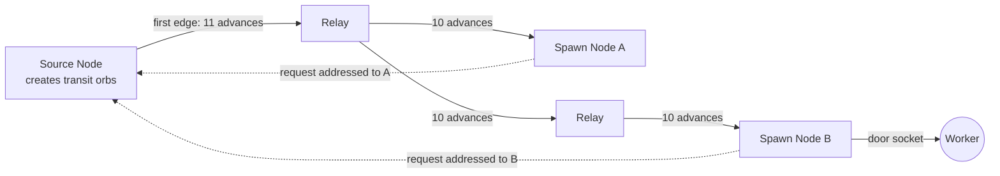
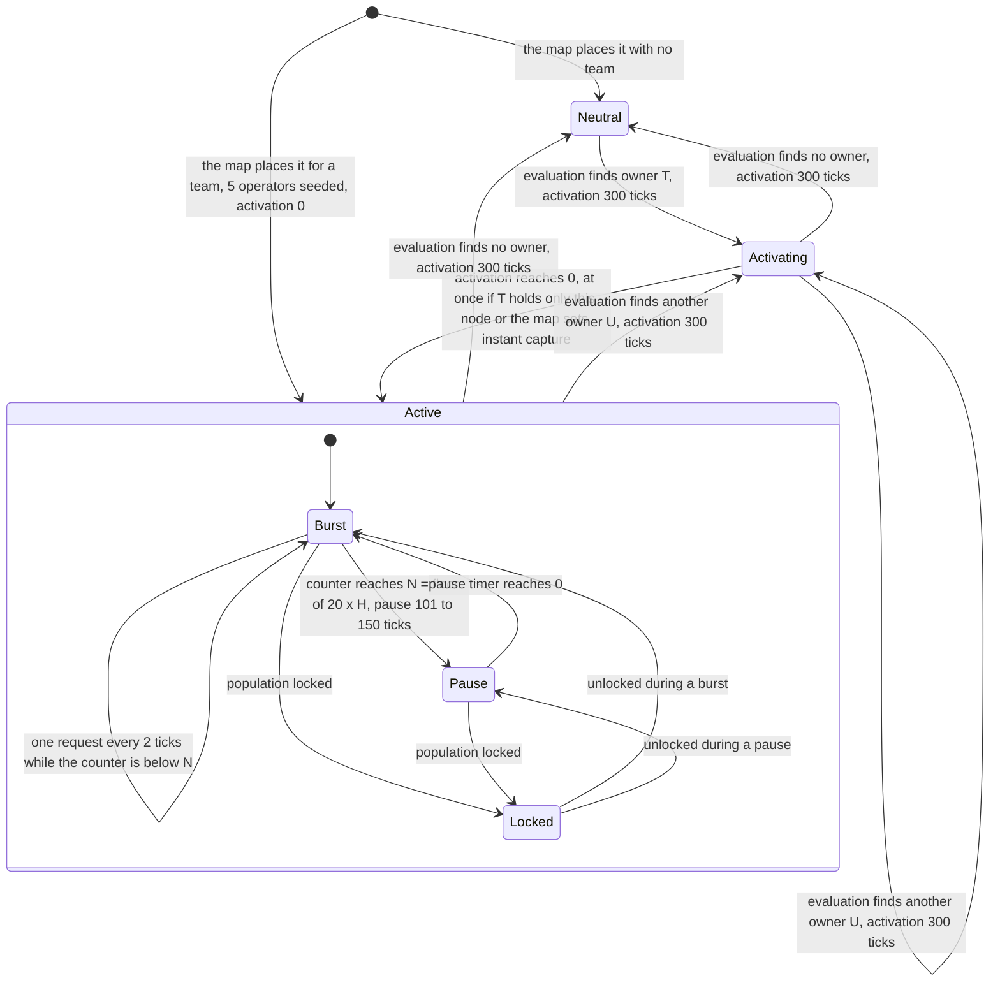
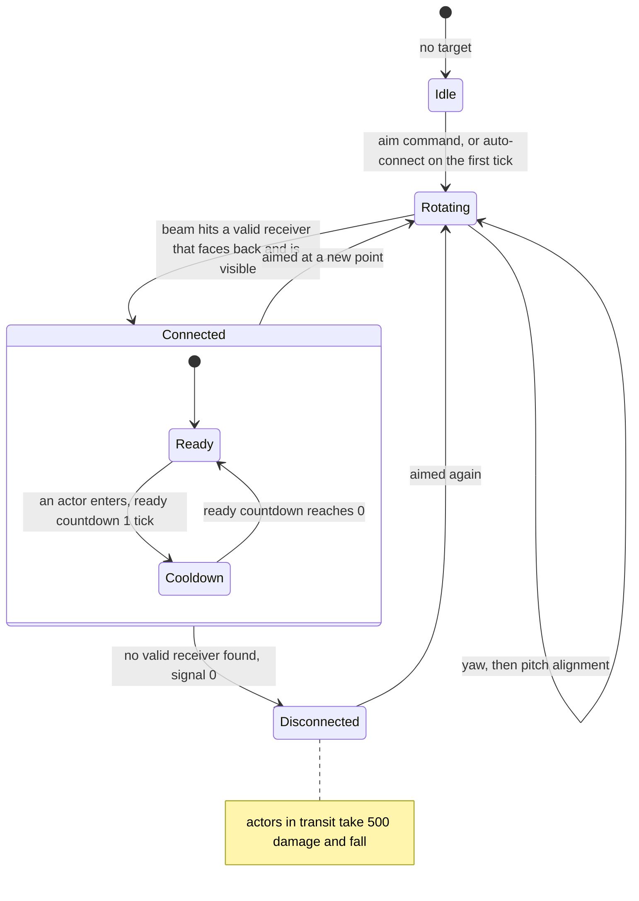
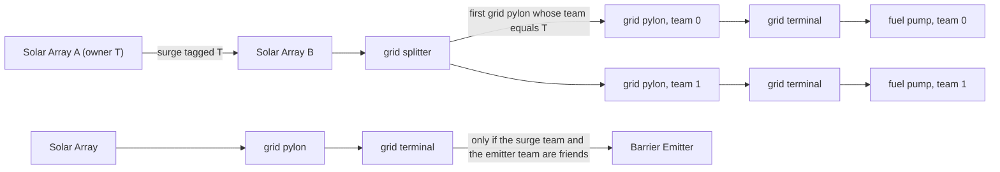
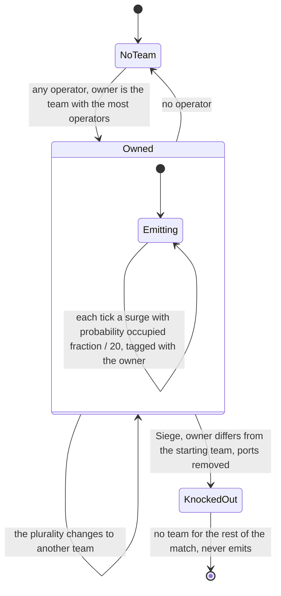
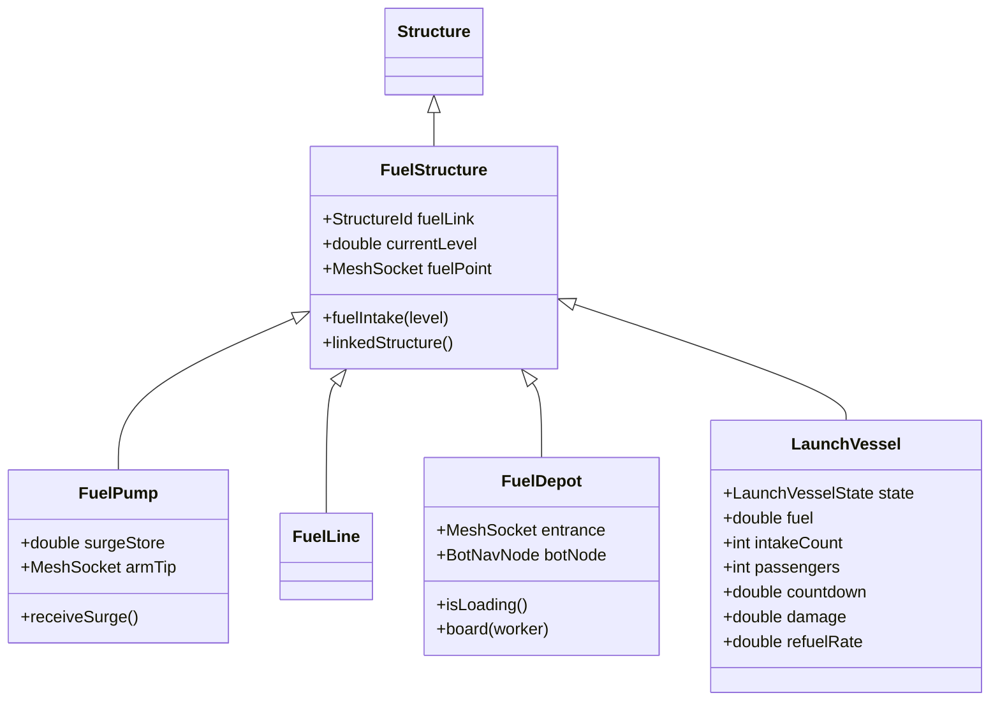

# Economy and spawn objects

> Status: Reference · Prefix: R-BLDG · Related: [Buildings and world objects](README.md) · [Mode objects](mode_objects.md) · [Defences and props](defences_and_props.md) · [05 Population flow](../05_population_flow.md) · [01 Skirmish rules and modes](../01_skirmish_rules_and_modes/README.md) · [07 Bots](../07_bots.md) · [12 Simulation model](../12_simulation_model/README.md)

## 1 Purpose and player experience

This file specifies the structures that move bodies and energy around a map:

- the **spawn network**: the Source Node, Relays and Spawn Nodes, linked into a tree along which transit orbs travel to owned Spawn Nodes;
- the **Population Limiter**, a regional population cap that takes effect only on maps without a population cap;
- the **Transit Gate**, a fixed reinforcement gate;
- the **Beam Dish**, a one-way long-range transporter that a Command Console can hand to a team;
- the **energy grid**: Solar Arrays, grid pylons, grid terminals and grid splitters, which carry team-tagged energy surges;
- the **fuel chain**: fuel pumps, fuel lines and fuel depots, which turn energy surges into fuel pressure for a Launch Vessel.

The economy formulas (burst and pause, the population cap, the Catch-up bonus, the Transit Gate waves and the Essence orb cycle) are specified in [05 Population flow](../05_population_flow.md); this file is the structure-level specification, and it cites the keys of reference/05 instead of repeating them.

For the player, a Spawn Node is a place to hold: three Workers on its ports make it the team's, and after a 300-tick wait it pours out Workers. Its output arrives through the spawn network, so a node deep in a long Relay chain delivers its Workers a few seconds later than one next to the Source Node. A Beam Dish carries a crowd across the map in seconds, but the crowd dies if the beam breaks under it. Solar Arrays are quiet capture points whose value shows elsewhere: in Siege and Flag Chain they keep the defenders' Barrier Emitters raised, and taking them (in Siege, knocking them out) starves the emitters, which fall a few seconds after the last friendly surge ([defences and props](defences_and_props.md)); in Launch Race they are shared, neutral objectives whose surges the grid splitters route to the capturing team's fuel pump.

## 2 Rules

### 2.1 The spawn network

**R-BLDG-100** (MUST) A map's spawn network is a directed tree of edges rooted at its Source Node, with Relays as inner nodes and Spawn Nodes as leaves; a Spawn Node may also have outgoing edges and relay (DEC-456). When an owned, active Spawn Node requests a Worker, the Source Node creates a transit orb addressed to it, the orb travels edge by edge to that Spawn Node, and the Spawn Node spawns one Worker at its door if it still has an owner (R-ECON-038 to R-ECON-041).

**R-BLDG-101** (MUST) Transit time does not depend on edge length. Each advance of the structure that holds an orb moves the orb's progress on the current edge on by one step, and the orb completes its first edge after `ref.econ.relay.first_hop_ticks` (11) advances and every later edge after `ref.econ.relay.later_hop_ticks` (10) advances, both keys of reference/05; a transit of h hops therefore needs 10h + 1 advances. These counts are the rule (DEC-002): they are the counts of the reference progress model, in which progress grows by one tick period per advance until it reaches 1 and the excess is carried to the next edge. When an orb is handed to a structure that comes later in structure order than the structure handing it on, it receives that structure's advance in the same tick, so a transit of h hops takes between 9h + 1 and 10h + 1 ticks (R-ECON-040; see DEC-455).

**R-BLDG-102** (MUST) Every reference map with Spawn Nodes has exactly one Source Node, no cycle, no self-link, no Spawn Node that the Source Node cannot reach, and exactly one path from the Source Node to each Spawn Node. Table 2.1-A gives the networks of the reference maps, grouped by the mode of the map's name and its player count.

Table 2.1-A Spawn networks of the reference maps (one row per map).

| Map family | Players | Spawn Nodes | Relays | Hops from the Source Node (min–max) | Transit advances 10h + 1 (min–max) |
|---|---|---|---|---|---|
| Spawn Control | 2 | 8 | 13 | 2–7 | 21–71 |
| Spawn Control | 2 | 8 | 7 | 2–5 | 21–51 |
| Spawn Control | 2 | 10 | 11 | 3–8 | 31–81 |
| Spawn Control | 3 | 10 | 14 | 4–9 | 41–91 |
| Spawn Control | 3 | 15 | 0 | 1–1 | 11–11 |
| Spawn Control | 4 | 10 | 18 | 2–10 | 21–101 |
| Spawn Control | 4 | 12 | 20 | 3–5 | 31–51 |
| Zone Control | 2 | 6 | 7 | 3–5 | 31–51 |
| Zone Control | 2 | 9 | 10 | 3–7 | 31–71 |
| Zone Control | 2 | 10 | 11 | 4–8 | 41–81 |
| Zone Control | 2 | 10 | 9 | 2–6 | 21–61 |
| Zone Control | 3 | 9 | 23 | 3–8 | 31–81 |
| Zone Control | 3 | 9 | 14 | 4–9 | 41–91 |
| Zone Control | 3 | 9 | 15 | 5–6 | 51–61 |
| Zone Control | 4 | 10 | 18 | 2–11 | 21–111 |
| Zone Control | 4 | 12 | 20 | 3–5 | 31–51 |
| Zone Control | 4 | 12 | 4 | 2–2 | 21–21 |
| Relic Run | 2 | 6 | 0 | 1–1 | 11–11 |
| Relic Run | 2 | 4 | 0 | 1–1 | 11–11 |
| Relic Run | 2 | 4 | 6 | 3–6 | 31–61 |
| Relic Run | 2 | 4 | 0 | 1–1 | 11–11 |
| Relic Run | 3 | 9 | 0 | 1–1 | 11–11 |
| Relic Run | 3 | 6 | 0 | 1–1 | 11–11 |
| Relic Run | 4 | 12 | 0 | 1–1 | 11–11 |
| Relic Run | 4 | 8 | 0 | 1–1 | 11–11 |
| Relic Run | 4 | 8 | 17 | 3–9 | 31–91 |
| Launch Race | 2 | 2 | 0 | 1–1 | 11–11 |
| Launch Race | 4 | 12 | 0 | 1–1 | 11–11 |
| Flag Chain | 2 | 4 | 9 | 3–8 | 31–81 |
| Flag Chain | 2 | 3 | 7 | 3–4 | 31–41 |
| Flag Chain | 2 | 1 | 0 | 1–1 | 11–11 |
| Flag Chain | 2 | 6 | 8 | 2–5 | 21–51 |

**R-BLDG-103** (MUST) 17 of the 49 reference maps have no spawn network: all 8 Siege maps, 3 Flag Chain maps, 5 Launch Race maps and 1 Zone Control map. Their Workers come from Transit Gate reinforcement waves and starting units ([05 Population flow](../05_population_flow.md)). Counted by the modes that list each map, Spawn Nodes appear on Spawn Control 9 of 9 maps, Zone Control 8 of 9, Relic Run 9 of 9, Flag Chain 4 of 7, Launch Race 2 of 7 and Siege 0 of 8.

### 2.2 Spawn-network structures

**R-BLDG-104** (MUST) A spawn-network structure (`SpawnStructure`) is the common base of the Relay, the Source Node and the Spawn Node; no structure is created as a plain spawn-network structure. It holds its outgoing edges; its `essence_link` socket, where edge beams start and end, which its mesh must carry (R-BLDG-044); and, for presentation, a culling sphere that covers the structure and every edge target, recomputed in the map editor.

**R-BLDG-105** (MUST) A spawn-network edge (`SpawnEdge`) holds its target structure, the direct neighbour; its downstream set, the ids of every Spawn Node reachable through it, filled by the link walk (R-BLDG-109); and the transit orbs travelling on it.

**R-BLDG-106** (MUST) A transit orb (`TransitOrb`) holds the id of the Spawn Node it is addressed to and its progress on its current edge. It is not a simulated object: it has no position and no collision, and it cannot be intercepted, collected or killed; it is only drawn (R-ECON-044).

**R-BLDG-107** (MUST) Adding a link to a spawn-network structure appends an edge to the named structure unless an edge to it already exists. A spawn-network link is a typed link: the content build rejects a map whose spawn-network link names a structure that is not a spawn-network structure, and at run time a missing or mismatched target counts as no link (DEC-457). Clearing the links removes every edge; only the map editor does so.

**R-BLDG-108** (MUST) A map record of a Relay, a Source Node or a Spawn Node ends with its links: the ids of its outgoing edge targets, repeated to the end of the record (no default; an empty list means no edge).

**R-BLDG-109** (MUST) The link walk of a spawn-network structure returns the structure's own id when it is a Spawn Node, plus, for each edge whose target exists and is a spawn-network structure, the ids that the target's walk returns; it stores that returned set as the edge's downstream set. The walk keeps a visited set, so it ends on any graph; the content build rejects a spawn network that contains a cycle or a self-link (DEC-456, DEC-015).

**R-BLDG-110** (MUST) Placing a transit orb on a spawn-network structure puts it, with the progress given, on the first outgoing edge, in edge order, whose downstream set contains the orb's address; on a tree at most one edge does. A transit orb is on exactly one edge at a time. When no edge's downstream set contains the address, the orb is discarded (DEC-456; R-ECON-038, R-ECON-042). A Spawn Node that receives an orb addressed to itself spawns instead (R-BLDG-123).

**R-BLDG-111** (MUST) The advance of a spawn-network structure moves every transit orb on every outgoing edge on by one step (R-BLDG-101). An orb that completes its edge leaves it and, with its excess progress, is placed on the edge's target (R-BLDG-110) when the target exists and is a spawn-network structure; otherwise it is discarded (R-ECON-039, R-ECON-042). The base advance (R-BLDG-031) then runs.

**R-BLDG-112** (MUST) Exactly the Spawn Node, the Relay and the Source Node are spawn-network structures.

**R-BLDG-113** (MUST) The translucent pass of a spawn-network structure draws each edge as a textured beam of `fx.beam_short` between the two `essence_link` sockets, `ref.bldg.spawn_network.beam_inner_width_wu` (1 wu) wide inside and `ref.bldg.spawn_network.beam_outer_width_wu` (3 wu) outside, and each transit orb as a diamond, `ref.bldg.spawn_network.orb_inner_size_wu` (2 wu) inside and `ref.bldg.spawn_network.orb_outer_size_wu` (6 wu) outside, in the **current** team colour of its addressed Spawn Node, or the grey `ref.bldg.spawn_network.orb_no_team_grey` (120, 120, 120) when that node has no team. It then draws the base lights and ports (R-BLDG-045, R-BLDG-046). The structure-detail branches are DEC-327.

### 2.3 Relay

**R-BLDG-114** (MUST) A Relay (`Relay`) is a pure inner node of the spawn network: it receives transit orbs and passes them on, 10 advances per edge and 11 on the first edge of a transit (R-BLDG-101). Its mesh is `mesh.structure.relay_mast`, with no ports and no lights. Its team comes from its map record and has no effect; it is never captured and is indestructible.

**R-BLDG-115** (MUST) A Relay's map record holds the base fields and its links (R-BLDG-108). 21 reference maps place Relays: Spawn Control 8 of 9, Zone Control 8 of 9, Flag Chain 3 of 7 and Relic Run 2 of 9, with 261 records in all.

### 2.4 Source Node

**R-BLDG-116** (MUST) The Source Node (`SourceNode`) is the source of every transit orb. Each of the 32 reference maps with a spawn network places exactly one.

**R-BLDG-117** (MUST) The Source Node registry id is match state, with the initial value "none". Each Source Node writes its own structure id into the registry at the start of each of its advances. A Spawn Node's request resolves the registry id by a structure look-up followed by a kind check; an id that names no live Source Node resolves to "no Source Node", and the request then creates nothing (DEC-011; R-SIM-024, R-ECON-032). A stale id therefore has no effect: no request is made before the first tick has ended, in which every Source Node has advanced, so the registry names the map's Source Node whenever a request reads it (R-SIM-024).

**R-BLDG-118** (MUST) On its first advance a Source Node runs the link walk (R-BLDG-109) once over its edges.

**R-BLDG-119** (MUST) A request addressed to Spawn Node n creates a transit orb with address n and progress 0 and places it on the Source Node (R-BLDG-110).

**R-BLDG-120** (MUST) A Source Node uses the mesh `mesh.structure.source_node`. It is drawn only when its global flag is set, or in the map editor (see DEC-309). The reference maps mostly leave the flag clear, so their Source Nodes are invisible; 11 reference map files set it.

**R-BLDG-121** (MUST) A Source Node is never captured and is indestructible. Its map record holds the base fields and its links (R-BLDG-108).

### 2.5 Spawn Node

**R-BLDG-122** (MUST) A Spawn Node (`SpawnNode`) is the territory node of the economy: while owned and active it requests transit orbs and turns each arriving orb into a Worker for its owner. Its ports and occupancy, its ownership evaluation, its activation delay, its Spawn Node count, its production cycle, the Catch-up bonus, Spawn Surge and its population lock are specified in [05 Population flow](../05_population_flow.md) §2.3 to §2.14 (R-ECON-012 to R-ECON-065); this section adds the structure-level rules.

**R-BLDG-123** (MUST) A Spawn Node that receives a transit orb addressed to itself spawns one Worker for its current owner when it has one, and removes the orb; with no team the orb is lost (R-ECON-041, R-ECON-042). Arrival does not check the population cap: only the request does (R-ECON-059; see DEC-453). The Worker appears at the `door` socket as R-ECON-043 specifies. An orb addressed to another node is passed on (R-BLDG-110).

**R-BLDG-124** (MUST) A Spawn Node uses the mesh `mesh.structure.spawn_node`, with `ref.econ.spawn_node.port_count` (5) port sockets, 3 light sockets, the `door` socket, which its mesh must carry, and the `essence_link` socket. The mesh `mesh.structure.spawn_node_alt` carries the same sockets; no reference match selects it.

**R-BLDG-125** (MUST) A Spawn Node evaluates its ownership as R-ECON-018 to R-ECON-022 specify: it belongs to the one team that operates at least `ref.econ.spawn_node.capture_min_operators` (3) of its 5 ports, provided no operator belongs to a team that is not a friend of that team; otherwise to no team. Allies do not pool: a team with 2 operators and an ally with 2 leave the node with no team.

**R-BLDG-126** (MUST) Every ownership change, to no team included, sets the activation delay to `ref.econ.spawn_node.activation_ticks` (300); the delay counts down only while the node has an owner, and it drops to 0 when the owner holds only this Spawn Node or the map sets instant capture; a node owned at match start starts with 0 (R-ECON-023, R-ECON-024, R-ECON-108).

**R-BLDG-127** (MUST) An owned Spawn Node with an activation delay of 0 that is not population-locked runs the production cycle of R-ECON-028 to R-ECON-033, which Spawn Surge overrides (R-ECON-045). Its population lock is decided by R-ECON-052. Neither the production timer nor the burst counter is reset by an ownership change.

**R-BLDG-128** (MUST) A Collector delivers its Essence orbs at the nearest Spawn Node whose owner is a friend of the Collector's team, and the node spawns one Worker for its owner per delivered orb, with no population-cap or activation check (R-ECON-074, R-ECON-075). A Spawn Node has outgoing edges only where the map gives them; leaf nodes normally have none.

**R-BLDG-129** (MUST) A Spawn Node is indestructible. The match keeps the 7 Spawn Node counts of R-ECON-026, which start at 0 in every match, team slot 5 included (R-SIM-020; DEC-011); a Spawn Node adds itself to its owner's entry when it is initialised and moves itself between entries when its ownership changes.

**R-BLDG-130** (MUST) A Spawn Node raises `spawn_node.activate` when an evaluation gives it an owner and `spawn_node.deactivate` when an evaluation leaves it with no team (R-ECON-021), bound to `sfx.building.spawn_node.activate` and `sfx.building.spawn_node.deactivate`, in addition to the base events (R-BLDG-049).

**R-BLDG-131** (MUST) A Spawn Node draws its ports itself: a status star of `fx.starburst` per port, in the grey `ref.bldg.spawn_node.port_star_empty_rgb` (150, 150, 150) when the port is unoccupied and in the occupant's team colour when occupied. Above the structure it draws glow blobs of `fx.glow_cloudy`: `ref.bldg.spawn_node.glow_blobs_by_detail` (20, 10 and 3 at structure-detail levels 1, 2 and 3), with an opacity of (occupied ports ÷ 5) and a colour that goes from `ref.econ.spawn_node.glow_start_rgba` (100, 100, 100, 200) of reference/05 to the owner's team colour as the activation delay runs from 300 to 0 (R-ECON-025).

**R-BLDG-132** (MUST) A Spawn Node's map record holds the base fields and its links (R-BLDG-108). Across the reference maps, 162 Spawn Nodes start owned by a map position (position 0: 53, position 1: 57, position 2: 33, position 3: 19) and 124 start with no team; none has its global flag set. A reference map places 1 to 15 Spawn Nodes. The hint overlay explains Spawn Node capture with the picture `help.hint.spawn_nodes` ([11 Tutorial and help](../11_tutorial_and_help.md)).

### 2.6 Population Limiter

**R-BLDG-133** (MUST) The Population Limiter (`PopulationLimiter`) is an invisible regional population limiter. It takes effect only in a match whose map sets no population cap (R-ECON-061; see DEC-454).

**R-BLDG-134** (MUST) A Population Limiter holds: its search radius (default `ref.econ.population_limiter.search_radius_wu`, 500 wu); its current maximum population (default `ref.econ.population_limiter.max_population`, 100); its authored maximum; a count for each team slot 0 to 5; its recount timer, first set to `ref.econ.population_limiter.first_recount_ticks` (1 to 100 ticks) in its initialisation step (DEC-652); and the team slot it recounts next, which starts beyond the last team slot. The match-level overpopulation value that all limiters share is per-match state, reset at match start (R-ECON-121; DEC-011).

**R-BLDG-135** (MUST) While the map sets a population cap, a Population Limiter's advance returns at once: it recounts nothing, its counts stay 0 and it does not run the base advance. Otherwise it runs the overpopulation computation of R-ECON-064 and the recount cycle of R-ECON-065, with the keys of reference/05.

**R-BLDG-136** (MUST) The lock checks of the Spawn Node and the Transit Gate, and the sortie check of a Hive, consult a Population Limiter as R-ECON-052, R-ECON-056 and R-ECON-062 specify: the first limiter in structure order whose search radius contains the structure, found on the first check and kept for the match; a limiter whose structure id is 0 is never consulted.

**R-BLDG-137** (MUST) A Population Limiter's team comes from its map record; no match rule reads it. It has no hit volume (table 2.12-A of the README). It is drawn only in the map editor, as a sphere of `ref.bldg.population_limiter.editor_sphere_wu` (30 wu) labelled with its values.

**R-BLDG-138** (MUST) A Population Limiter's map record holds the base fields, then its search radius (a decimal, default 500 wu) and its maximum population (an integer, default 100). 21 reference maps place Population Limiters (Zone Control 7, Relic Run 6, Flag Chain 4, Siege 2, Spawn Control 2; 86 records), and every one of them sets a population cap, so no reference Population Limiter takes effect.

### 2.7 Transit Gate

**R-BLDG-139** (MUST) A Transit Gate (`TransitGate`) is a fixed reinforcement gate: an owned Transit Gate releases reinforcement waves of Workers and grants Transport, turret and airstrike powers as [05 Population flow](../05_population_flow.md) §2.21 to §2.25 specify (R-ECON-088 to R-ECON-105).

**R-BLDG-140** (MUST) A Transit Gate uses the mesh `mesh.structure.transit_gate`, with the `gate_surface`, `gate_exit_01` and `gate_exit_02` sockets. The mesh `mesh.structure.transit_gate_alt` carries the same sockets and two light sockets; no reference match selects it.

**R-BLDG-141** (MUST) A Transit Gate's owner is fixed by its map record (its map position remapped to the match team), and it is never captured (R-ECON-089). Its team is set to no team, silently, by exactly these events (R-BLDG-039): the elimination of its owning team; the destruction of the Core Device, for every Transit Gate not owned by the defending team (@@ref:core_destroy@@); and the detonation of the Core Device, for every Transit Gate not owned by the Core Device's team (@@ref:core_detonate@@). A Transit Gate with no team never reinforces.

**R-BLDG-142** (MUST) A Transit Gate's population lock is decided like a Spawn Node's (R-ECON-052 rules 2 to 5; the tutorial rule 1 applies to Spawn Nodes only), with the Population Limiter found and kept as R-ECON-062 specifies. It is checked once per gate and wave, before the gate releases its whole count (R-ECON-095; see DEC-453).

**R-BLDG-143** (MUST) A Transit Gate advances exactly once per tick on every map (DEC-065); in a match its advance is the base advance. It is indestructible.

**R-BLDG-144** (MUST) A Transit Gate's translucent pass draws an animated portal surface over a grid of (`ref.bldg.transit_gate.surface_grid_max` ÷ structure-detail level) cells per side (16 at detail 1) around the `gate_surface` socket, computed once, textured with `fx.barrier_field` and `fx.glow_round` and tinted with its owner's team colour at an alpha of `ref.bldg.transit_gate.surface_alpha` (0.7). In a match the surface is always drawn.

**R-BLDG-145** (MUST) A Transit Gate's map record holds the base fields, with the global flag set (R-BLDG-015). 28 reference maps place Transit Gates: Siege 8 of 8, Flag Chain 7 of 7, Launch Race 7 of 7, Zone Control 4 of 9 and Spawn Control 2 of 9, with 109 records in all. Reinforcements flow only where the mode or the map's options enable them (R-ECON-088).

### 2.8 Teleport structures

**R-BLDG-146** (MUST) A teleport structure (`TeleportStructure`) is the base of the Beam Dish. It holds: its ready countdown, the number of ticks until the next actor may enter, counting down to 0; its send period, `ref.bldg.teleport.send_period_default_ticks` (11 ticks) unless its kind sets another; its entrance socket `gate_entrance`, which its mesh must carry; and the list of actors in transit inside it. The match's teleport transit table, which maps (team, source actor group) to the destination actor group on the far side, is per-match state (R-SIM-022; DEC-011).

**R-BLDG-147** (MUST) A teleport structure answers: connected (false unless its kind says otherwise); ready to send (its ready countdown is 0, and its kind may add conditions); its entrance; its exit; the start point and the end point of the transit; and the per-tick transit update of an actor, which every teleport kind defines.

**R-BLDG-148** (MUST) Entry is started by the actor: the movement steps of Workers, Leaders and Strike team members try teleport entry as reference/12 R-SIM-386 specifies. A Beam Dish qualifies when it is ready to send, the actor is less than `ref.sim.teleport.entry_distance` (15 wu) from its entrance and the dot product of the actor's front with the entrance's front is negative, that is, the actor walks into the door.

**R-BLDG-149** (MUST) When an actor enters a teleport structure, these steps run in order:

1. If the actor belongs to an actor group (a Strike team) and the entry is not marked as relayed, the destination group is the one that the teleport transit table gives for (team, source group), or, when there is none, a new group of the same kind and size, created at the structure's position and entered in the table. For a Strike team the Power that owns the group is registered again on the new group (see DEC-551): the old registration is removed, the remaining life is carried over, the Power is selected, and its weapon kind and controller are copied; the controller's route gains this structure as a waypoint. The new group takes over the source group's route at its next waypoint, or, with no route, receives a waypoint `ref.bldg.teleport.exit_waypoint_wu` (50 wu) beyond the exit, offset by a draw from `ref.bldg.teleport.exit_waypoint_jitter_wu` (U[−17.5, 17.5)). The actor is moved into the new group, with a new slot and serial, disabled, airborne and with velocity 0, and the group's formation offsets are recomputed.
2. The actor is placed at the start point and given one transit update; it is added to the structure's in-transit list; and the ready countdown is set to the send period.

**R-BLDG-150** (MUST) Each tick, the advance of a teleport structure reduces its ready countdown by 1, keeping it at 0 or above; gives every actor in transit its transit update and removes from the list each actor whose update reports arrival and each actor that no longer exists; removes from the teleport transit table every entry whose source group no longer exists; and then runs the base advance.

### 2.9 Beam Dish

**R-BLDG-151** (MUST) A Beam Dish (`BeamDish`) is a one-way long-range transporter: actors that walk into its door are carried along its beam to the receiving Beam Dish it is aimed at, and leave by the receiver's door. Its send period is `ref.bldg.beam_dish.send_period_ticks` (1 tick), so at most one actor enters a dish per tick (10 per second at game speed 1). It has no capacity limit.

**R-BLDG-152** (MUST) A Beam Dish has no capture rule of its own. A Command Console whose controlled structure it is sets its team to the console's new owner (@@ref:cc_capture@@). On the reference maps every Beam Dish starts with no team, except two dishes of team position 0 on one Siege map, which connect automatically and use the "Beam Dish team match" map option.

**R-BLDG-153** (MUST) A Beam Dish draws a per-instance copy of the mesh `mesh.structure.beam_dish`, recoloured to its team colour on every team change, and white while it has no team. The node `dish` pitches and the node `upper_mount` yaws; the `beam_focus` socket is the beam's origin and the `gate_entrance` socket its door. It has 2 light sockets and no ports.

**R-BLDG-154** (MUST) Aiming a Beam Dish at a world position p works as follows. When the dish has a list of valid receivers and its force-connection flag is set, the aim is ignored unless the ray from its `beam_focus` towards p hits the bounding sphere of one of the listed dishes and that dish is visible over the terrain from the focus. Otherwise the dish stores p as its target, clears its yaw-aligned and pitch-aligned flags and raises `beam_dish.rotate_start`.

**R-BLDG-155** (MUST) Aim requests come from the player command `PlayerCommand::AimBeamDish`, which aims only a structure that exists, is a Beam Dish and belongs to the commanding team ([12 teams and player commands](../12_simulation_model/06_teams_and_player_commands.md) R-SIM-453), and from the bots ([07 Bots](../07_bots.md)). A player can select only a Beam Dish of the player's own team, and none at all when the map sets the "no Beam Dish control" option ([06 Controls, camera and commands](../06_controls_camera_and_commands.md); DEC-008).

**R-BLDG-156** (MUST) While a target is set and the dish is not aligned, it turns towards the target, yaw first and then pitch, integrating each angular velocity over the tick period:

```
# yaw: node upper_mount
axis  ← horizontal(current front) × horizontal(target front)
axis.y ← axis.y ÷ ref.bldg.beam_dish.yaw_axis_divisor             # 4
if |axis.y| > ref.bldg.beam_dish.yaw_deadband_rad:                 # π / 3000
    upper_mount.angular_velocity.y ← sign(axis.y) × √|axis.y|
else: yaw aligned
# pitch: node dish, after the yaw is aligned
target_front.y ← clamp(target_front.y, ref.bldg.beam_dish.pitch_clamp)   # [−0.2, +0.3]
dish.angular_velocity ← dish.right × (world up of the dish · target_front)
if |dish.angular_velocity| < ref.bldg.beam_dish.pitch_stop: pitch aligned  # 0.001
```

When both are aligned it raises `beam_dish.rotate_stop`. The square root and the angle results follow the Species maths library at full precision, pinned by acceptance vectors (see DEC-241).

**R-BLDG-157** (MUST) Every tick once a target is set, the dish tests for a connection. Among all other Beam Dishes it takes those for which: the ray from its `beam_focus` along the focus front hits the other dish's bounding sphere; the other dish's focus front faces back (the dot product of the two fronts is negative); and the other dish's focus is visible over the terrain from its own focus. Of these it takes the nearest, comparing distances strictly in structure order so that the first of equal distances wins (DEC-016), and it accepts it only when the receiver validity test of R-BLDG-158 passes.

**R-BLDG-158** (MUST) A Beam Dish is a valid receiver when: on the tutorial map, it is not the structure with id 11, which is never valid ([11 Tutorial and help](../11_tutorial_and_help.md)); with the map option "Beam Dish team match", its team equals the sending dish's team; and otherwise, when the sending dish's list of valid receivers is empty, any dish is valid, and when it is not empty, only the listed dishes are.

**R-BLDG-159** (MUST) A connected Beam Dish holds its receiver, its range (the distance from focus to focus) and a signal of 1; it is connected while it has a receiver and a signal above 0, and ready to send while it is connected and its ready countdown is 0. Gaining a receiver raises `beam_dish.link_up`; a connection test that no longer finds a valid receiver clears the receiver, sets the signal to 0 and raises `beam_dish.link_lost`.

**R-BLDG-160** (MUST) An actor in transit moves along the beam at `ref.bldg.beam_dish.transport_speed_wu_s` (50 wu/s, so 5 wu per tick): its position grows by the focus front × 50 × the tick period each tick, it stays disabled and airborne, the position of its actor group follows it, and the dish keeps its actor-grid registration up to date (R-SIM-115). The travel time is range ÷ 50 seconds.

**R-BLDG-161** (MUST) When an actor has travelled the range, it is placed at the receiver's entrance, facing out of the door, enabled, on the ground and with velocity 0. A Worker enters the idle state, takes its own position as its waypoint and has its orders cleared; a Strike team member gives its group a waypoint at the exit. The actor is inserted into the actor grid again and raises `<source>.exit_gate` (R-UNIT-047).

**R-BLDG-162** (MUST) When the signal drops to 0, or while a Core Device pulse wave is active anywhere on the map, every actor in transit takes a health change of −`ref.bldg.beam_dish.beam_loss_damage` (500), which kills a Worker, is enabled again, receives a kick velocity drawn from `ref.bldg.beam_dish.fall_kick` (x from U[−5, 5), y from U[0, 10), z from U[−5, 5)) and falls from the beam.

**R-BLDG-163** (MUST) While a Beam Dish is connected, a bot navigation node is kept at its entrance and linked to the bot navigation node of its receiver; the node is removed when the connection is lost ([07 Bots](../07_bots.md)).

**R-BLDG-164** (MUST) A Beam Dish answers sphere tests against its mesh with the probe radius multiplied by `ref.bldg.beam_dish.probe_radius_factor` (1.5), so that its door registers in the obstacle-grid cells around it, and ray tests against its mesh with up (0, 1, 0) (README table 2.12-A). It is indestructible.

**R-BLDG-165** (MUST) The translucent pass of a connected Beam Dish draws its beam as 4 nested tubes with radii `ref.bldg.beam_dish.beam_tube_radii_wu` (10, 9, 8 and 4 wu) and alphas `ref.bldg.beam_dish.beam_tube_alphas` (0.4, 0.2, 0.2 and 0.5), textured with `fx.barrier_field` combined with `fx.dish_signal` and clipped by the planes of the two dishes. While its owner hovers over it or selects it, preview beams are drawn to every valid receiver ([renderer](../../architecture/components/renderer/README.md)).

**R-BLDG-166** (MUST) A Beam Dish's map record holds the base fields with the global flag set (R-BLDG-015), then: its force-connection flag (0 or 1, default 0; when 1, only listed dishes may be aimed at, R-BLDG-154); its auto-connect flag (0 or 1, default 0; when 1, the dish aims at its first valid receiver on its first tick); and the ids of its valid receivers, repeated (default none).

**R-BLDG-167** (MUST) A Beam Dish raises `beam_dish.rotate_start` (bound to `sfx.building.beam_dish.rotate_start` and its loop layer `sfx.building.beam_dish.rotate_start_b`), `beam_dish.rotate_stop` (`sfx.building.beam_dish.rotate_stop`), `beam_dish.link_up` (`sfx.building.beam_dish.link_up`) and `beam_dish.link_lost` (`sfx.building.beam_dish.link_lost`), in addition to the base events.

**R-BLDG-168** (MUST) 7 reference maps place Beam Dishes: Siege 3 of 8 (with 4, 2 and 6 dishes), Spawn Control 2 of 9 (8 and 6) and Zone Control 2 of 9 (12 and 8), 46 records in all. The reference maps use two patterns: sending dishes with the force-connection flag set and 1 to 3 valid receivers, usually with the auto-connect flag set; and plain receivers with both flags clear and no valid receivers. One Siege map sets the "Beam Dish team match" and "no Beam Dish control" options and uses auto-connected dishes of team position 0.

### 2.10 The energy grid

**R-BLDG-169** (MUST) Energy in the energy grid (`EnergyGrid`) is a stream of discrete energy surges (`EnergySurge`), each tagged with the team of the Solar Array that emitted it. Surges hop along the links of energy-grid structures to a grid terminal, which hands each surge to a consumer: a Barrier Emitter, which it keeps raised, only for a friend of the surge's team ([defences and props](defences_and_props.md)), or a fuel pump (R-BLDG-197).

**R-BLDG-170** (MUST) An energy-grid structure (`GridStructure`) is the base of the Solar Array, the grid pylon, the grid terminal and the grid splitter. It holds its grid link, the id of the next structure; its `grid_link` socket, which its mesh must carry; and its list of surges, each with a team and a progress.

**R-BLDG-171** (MUST) Triggering a surge on an energy-grid structure with progress p and team t inserts a new surge (t, p) at the **front** of its list and raises `<source>.surge` (`solar_array.surge`, bound to `sfx.building.solar_array.surge`; `grid_pylon.surge`, bound to `sfx.building.grid_pylon.surge`).

**R-BLDG-172** (MUST) Each tick the advance of an energy-grid structure moves every surge on by one step; a surge completes its hop after `ref.bldg.grid.hop_advances` (5) advances, the count of the reference progress model in which progress grows by two tick periods per advance until it reaches 1 (DEC-002). A surge that completes its hop is removed, and a surge with progress 0 and the same team is triggered on the linked structure, when the link resolves to an energy-grid structure; otherwise the surge ends (DEC-457). The base advance then runs. A surge handed to a structure that comes later in structure order receives that structure's advance in the same tick, so a hop takes 4 or 5 ticks (see DEC-455).

**R-BLDG-173** (MUST) The translucent pass of an energy-grid structure that stores surges draws a line beam between its `grid_link` socket and that of its linked structure, and each surge as a star sprite `ref.bldg.grid.surge_sprite_size_wu` (20 wu) across in the surge's team colour, with a trail of `ref.bldg.grid.trail_sprites` (3) sprites; surges of the Rogue and Visitor factions draw no trail.

**R-BLDG-174** (MUST) The link of an energy-grid structure is its grid link for the link get and set behaviour. Every energy-grid structure is indestructible. Its map record holds the base fields and then its grid link (an integer, mandatory).

### 2.11 Solar Array

**R-BLDG-175** (MUST) A Solar Array (`SolarArray`) is the capturable source of energy surges. Its mesh is `mesh.structure.solar_array`, with `ref.bldg.solar_array.port_count` (5) port sockets, the status sockets `status_01` to `status_05`, the glow sockets `glow_01` to `glow_04` and the `grid_link` socket. At initialisation its up vector is set to the terrain normal at its position and its front to (1, 0, 0) × that normal.

**R-BLDG-176** (MUST) A Solar Array records its starting team at initialisation: its team after the map-position remap, or no starting team when it starts with no team. The starting team and the current team use one no-team value (DEC-464).

**R-BLDG-177** (MUST) Each tick the advance of a Solar Array runs these steps in order, where the occupied fraction f is (occupied ports ÷ ports), from the occupants of the previous port evaluation:

1. the Siege knock-out check (R-BLDG-181);
2. the surge roll (R-BLDG-179) and the operating-state update (R-BLDG-180), with f computed before step 1;
3. the ownership recount (R-BLDG-178);
4. the energy-grid advance (R-BLDG-172), which also moves the surge emitted in step 2, and the base advance with its port evaluation.

**R-BLDG-178** (MUST) The ownership recount of a Solar Array runs every tick in a match. A Solar Array with no ports has no team. Otherwise its owner is the team with the most occupants, where a later team in slot order replaces the current leader only with strictly more occupants, so ties go to the lower team slot; with no occupant it has no team, set silently (R-BLDG-039). Operators of teams that are not friends may share the ports: no friendship test applies.

**R-BLDG-179** (MUST) The surge roll makes one draw from U[0, `ref.bldg.solar_array.surge_draw_range` (20)) every tick for every Solar Array, and when the draw is at most f it triggers a surge with progress 0 for the array's team before this tick's recount. The per-tick probability is f ÷ 20, so at game speed 1 the mean output is 0.5 × f surges per second: 0.5 per second with all 5 ports manned and 0.1 per second per manned port. The roll is a per-tick rule and scales with game speed like every timer (DEC-092).

**R-BLDG-180** (MUST) A Solar Array enters its operating state when f is above `ref.bldg.solar_array.operating_on_fraction` (0.6), which starts the loop `solar_array.charging` (bound to `sfx.building.solar_array.charging`), and leaves it when f is below `ref.bldg.solar_array.operating_off_fraction` (0.3), which stops the loop. The operating state is read only by presentation and by the bots.

**R-BLDG-181** (MUST) In Siege, a Solar Array that has a starting team, has a team now, has a team different from its starting team and still has ports loses all its ports at the start of its advance. The same tick's recount then gives it no team, while that tick's surge roll still uses the fraction f computed before the removal, and the array never produces again: the attackers knock the defenders' Solar Arrays out permanently (see DEC-301). A Solar Array that starts with no team has no starting team, so no capture knocks it out (DEC-464). Every reference Siege Solar Array names team position 0, 1 or 3, so it starts with no team only when no team holds that position.

**R-BLDG-182** (MUST) At team initialisation each Solar Array that a team owns receives one Worker per port in the operating-port state, and its ownership is evaluated at once (R-BLDG-026; R-ECON-108).

**R-BLDG-183** (MUST) A Solar Array draws its ports itself: green or red status lights at its status sockets for occupied and unoccupied ports (R-BLDG-046). While it is occupied and owned it draws `ref.bldg.solar_array.glow_count` (4) glow quads of `fx.glow_round`, `ref.bldg.solar_array.glow_quad_wu` (60 × 40 wu) each, at its glow sockets, in its team colour, with an alpha that pulses as `ref.bldg.solar_array.glow_pulse` (0.5 + 0.5 × |sin t|) over the presentation time t.

**R-BLDG-184** (MUST) A Solar Array's map record holds the base fields and its grid link (R-BLDG-174). 16 reference maps place Solar Arrays: Launch Race 7 of 7, Siege 5 of 8, Flag Chain 3 of 7 and Spawn Control 1 of 9, with 225 records.

### 2.12 Grid pylon, grid terminal and grid splitter

**R-BLDG-185** (MUST) A grid pylon (`GridPylon`) is a relay segment of the energy grid: it stores and passes on surges as R-BLDG-172 specifies. Its mesh is `mesh.structure.grid_pylon`, with 1 light socket and the `grid_link` socket. Its team comes from its map record and is never recomputed; on the Launch Race maps the pylons belong to teams, so that grid splitters can route by team. 16 reference maps place grid pylons (Launch Race 7, Siege 5, Flag Chain 3, Spawn Control 1; 296 records).

**R-BLDG-186** (MUST) A grid terminal (`GridTerminal`) ends a grid line. Triggering a surge on it stores nothing and raises no surge event: it delivers the surge at once to its linked structure, by the kind of that structure:

1. a fuel pump receives one surge (R-BLDG-197), with no team test;
2. a Barrier Emitter is powered only when the surge's team and the emitter's team are friends, so an emitter with no team is never powered and an enemy surge never powers an emitter ([defences and props](defences_and_props.md));
3. a structure of any other kind receives nothing.

**R-BLDG-187** (MUST) A grid terminal draws no translucent pass: no line beam and no surge sprite. Its team comes from its map record. 16 reference maps place grid terminals (86 records).

**R-BLDG-188** (MUST) A grid splitter (`GridSplitter`) routes surges by team. Triggering a surge on it stores nothing: it hands the surge at once, with its progress and team, to the **first** structure of its candidate list that is a grid pylon whose team **equals** the surge's team (equality, not friendship); when none does, the surge ends. Its own grid link is read from its map record but is not used for routing. It is drawn only in the map editor.

**R-BLDG-189** (MUST) A grid splitter's map record holds the base fields, its grid link (read, unused) and then the ids of its candidate grid pylons, repeated. Only the Launch Race maps place grid splitters (7 of 7, 26 records).

**R-BLDG-190** (MUST) The energy grids of the reference maps have this shape. Solar Arrays are daisy-chained: their links go to another Solar Array 155 times, to a grid pylon 35 times, to a grid splitter 39 times and to a grid terminal 2 times. Grid pylon links go to a grid pylon 211 times, to a grid terminal 87 times and to a grid splitter 3 times. Grid terminals feed a Barrier Emitter 31 times (Siege, Flag Chain and Spawn Control maps) or a fuel pump 57 times (Launch Race maps), and the 26 grid splitters of the Launch Race maps route to team pylons. A chain from a Solar Array to its grid terminal holds 3 to 14 structures.

### 2.13 The fuel chain

**R-BLDG-191** (MUST) On every Launch Race map the fuel chain runs: Solar Arrays (one or more, daisy-chained) → grid splitter → team grid pylon (one or more) → grid terminal → fuel pump → fuel line (one or more) → fuel depot → Launch Vessel. Each team has its own fuel pump, 3 fuel depots, each of whose fuel link is the team's Launch Vessel, and one Launch Vessel ([mode objects](mode_objects.md); DEC-561).

**R-BLDG-192** (MUST) A fuel-chain structure (`FuelStructure`) is the base of the fuel pump, the fuel line, the fuel depot and the Launch Vessel. It holds its fuel link, the id of the next structure downstream (default none); its current fuel level, from 0 to 1; and its `fuel_point` socket.

**R-BLDG-193** (MUST) Each tick the advance of a fuel-chain structure passes its current level to the fuel intake of its linked structure, when the link resolves to a fuel-chain structure; otherwise it passes nothing (DEC-457). The base advance then runs.

**R-BLDG-194** (MUST) The fuel intake of a fuel-chain structure, given a level L, blends L into its current level C:

```
f ← ref.bldg.fuel.blend_per_tick                 # 0.02 (0.2 per second × the tick period)
if L < C: f ← f × ref.bldg.fuel.fall_factor      # 3: a level falls faster than it rises
C ← clamp(C × (1 − f) + L × f, 0, 1)
```

It runs once for each structure that feeds it in a tick, so a Launch Vessel fed by 3 fuel depots blends three times per tick.

**R-BLDG-195** (MUST) Destroying a fuel-chain structure with an intensity also shatters the line mesh that connects it to its linked structure (R-BLDG-037). A fuel-chain structure's team comes from its map record and is never recomputed; only the Launch Vessel can be damaged ([mode objects](mode_objects.md)).

**R-BLDG-196** (MUST) The translucent pass of a fuel-chain structure draws the line mesh `mesh.structure.fuel_line_span` from its own `fuel_point` socket to that of its linked structure, and over it an animated beam of `fx.fuel_flow` in the colour `ref.bldg.fuel.beam_rgba` (1.0, 0.4, 0.1, 0.4 × C), with 1 to 3 scrolling loops by structure-detail level. Its map record holds the base fields and then its fuel link (an integer, mandatory).

### 2.14 Fuel pump

**R-BLDG-197** (MUST) A fuel pump (`FuelPump`) turns energy surges into fuel pressure. Its meshes are `mesh.structure.fuel_pump_housing`, with the `fuel_point` socket, and `mesh.structure.fuel_pump_arm`, with the `arm_tip` socket. Each surge that a grid terminal delivers adds 1 to its surge store, with no team test (R-BLDG-186).

**R-BLDG-198** (MUST) Each tick a fuel pump: reduces its surge store by `ref.bldg.fuel_pump.surge_decay_per_tick` (0.1, one surge per second) and keeps it between 0 and `ref.bldg.fuel_pump.max_surges` (20); passes the pressure (surge store ÷ 20) to its own fuel intake (R-BLDG-194), so that its current level follows the pressure; and then runs the fuel-chain advance, which passes that level down the line (R-BLDG-193). The simulation and the drawing of the pump use the one limit of 20 (DEC-463).

**R-BLDG-199** (MUST) A fuel pump's presentation animates the arm between two extremes, raising `fuel_pump.pump_up` (bound to `sfx.building.fuel_pump.pump_up` with the layer `sfx.building.fuel_pump.pump_up_b`) and `fuel_pump.pump_down` (bound to `sfx.building.fuel_pump.pump_down` with the layer `sfx.building.fuel_pump.pump_down_b`) at the extremes, and emits Worker-fire particles from the `arm_tip` socket from the presentation generator (DEC-013).

**R-BLDG-200** (MUST) A fuel pump's objective counter is the HUD text `building.fuel_pump.objective_counter`, new text "Fuel pressure: {percent}%", with percent = ⌊100 × current level⌋. Only the Launch Race maps place fuel pumps (7 of 7, 57 records).

### 2.15 Fuel line

**R-BLDG-201** (MUST) A fuel line (`FuelLine`) is a relay segment of the fuel chain with the fuel-chain behaviour only (R-BLDG-193, R-BLDG-194). Its mesh is `mesh.structure.fuel_line_foot`, with the `fuel_point` socket. It starts the loop `fuel_line.flow` (bound to `sfx.building.fuel_line.flow`) while its current level is above `ref.bldg.fuel_line.flow_sound_level` (0.2) and stops it at or below 0.2. Only the Launch Race maps place fuel lines (7 of 7, 178 records).

### 2.16 Fuel depot

**R-BLDG-202** (MUST) A fuel depot (`FuelDepot`) is the boarding gate of a Launch Vessel and the last hop of its fuel. Its mesh is `mesh.structure.fuel_depot`, with the `entrance` and `fuel_point` sockets. Its fuel link is its team's Launch Vessel.

**R-BLDG-203** (MUST) Each tick, while its linked Launch Vessel is in the Loading state (@@ref:lv_states@@), a fuel depot keeps a bot navigation node at its position with a priority modifier of `ref.bldg.fuel_depot.bot_node_priority` (1.0) ([07 Bots](../07_bots.md)), and it picks **one** actor of its own team within `ref.bldg.fuel_depot.boarding_radius_wu` (300 wu), uniformly by a U{0..n − 1} draw over the n found. When that actor is a Worker in the idle state or in the state of watching an Essence orb, the Worker is ordered to board ([02 Worker](../02_units/worker.md)): it walks to the `entrance` socket, and on arrival the depot boards it into the Launch Vessel, which adds 1 to its passengers only while it is Loading (@@ref:lv_boarding@@). Each boarding emits 4 to 7 control-flash particles from the presentation generator (DEC-013) and raises `fuel_depot.load_passenger` (bound to `sfx.building.fuel_depot.load_passenger`). While the vessel is not Loading, the depot removes its bot navigation node. The fuel-chain advance then passes the depot's level to the Launch Vessel.

**R-BLDG-204** (MUST) A fuel depot gives at most one boarding order per tick, so the 3 depots of a team give at most 30 boarding orders per second at game speed 1, fewer by the share of picks that are not idle Workers.

**R-BLDG-205** (MUST) While its Launch Vessel is in the Countdown state or in Flight, a fuel depot's translucent pass draws a screen of `ref.bldg.fuel_depot.countdown_screen_wu` (60 × 60 wu), `ref.bldg.fuel_depot.countdown_screen_height_wu` (150 wu) above it, on the panel `ui.panel_neutral`, showing ⌊countdown⌋ + 1 during the Countdown and a blinking 0 during Flight.

**R-BLDG-206** (MUST) A fuel depot's map record holds the base fields and its fuel link, the id of its Launch Vessel. Only the Launch Race maps place fuel depots (7 of 7, 57 records, 3 per team).

## 3 States and flows



*Figure 1 — The spawn network: requests go to the Source Node, and each transit orb travels the one path to its Spawn Node, 11 advances on its first edge and 10 on each later edge (R-BLDG-100, R-BLDG-101, R-BLDG-110).*



*Figure 2 — Spawn Node ownership and production, as reference/05 Figure 2 specifies (R-BLDG-125 to R-BLDG-127).*



*Figure 3 — Beam Dish states (R-BLDG-154 to R-BLDG-162).*



*Figure 4 — The energy grid: Solar Arrays emit team-tagged surges, grid splitters route by exact team, and grid terminals deliver to a fuel pump or, for friends only, to a Barrier Emitter (R-BLDG-169 to R-BLDG-189).*



*Figure 5 — Solar Array states (R-BLDG-177 to R-BLDG-181).*



*Figure 6 — The fuel-chain structures and their state (R-BLDG-192 to R-BLDG-206; the Launch Vessel is specified in mode objects).*

## 4 Tuning table

Every value is a reference tuning value that Species may adopt as its baseline (DEC-004). Values owned by another document are cited in the rules by that document's key and are not repeated here: `ref.econ.relay.first_hop_ticks`, `ref.econ.relay.later_hop_ticks`, `ref.econ.spawn_node.port_count`, `ref.econ.spawn_node.capture_min_operators`, `ref.econ.spawn_node.activation_ticks`, `ref.econ.spawn_node.glow_start_rgba`, `ref.econ.population_limiter.search_radius_wu`, `ref.econ.population_limiter.max_population` and `ref.econ.population_limiter.first_recount_ticks` (reference/05); `ref.sim.teleport.entry_distance` and `ref.sim.tick_period` (reference/12).

| key | value | unit | range or notes | requirement | DEC |
|---|---|---|---|---|---|
| `ref.bldg.spawn_network.beam_inner_width_wu` | 1 | wu | edge beam, inner | R-BLDG-113 | — |
| `ref.bldg.spawn_network.beam_outer_width_wu` | 3 | wu | edge beam, outer | R-BLDG-113 | — |
| `ref.bldg.spawn_network.orb_inner_size_wu` | 2 | wu | transit-orb diamond, inner | R-BLDG-113 | — |
| `ref.bldg.spawn_network.orb_outer_size_wu` | 6 | wu | transit-orb diamond, outer | R-BLDG-113 | — |
| `ref.bldg.spawn_network.orb_no_team_grey` | (120, 120, 120) | RGB8 | orb colour while its Spawn Node has no team | R-BLDG-113 | DEC-078 |
| `ref.bldg.spawn_node.port_star_empty_rgb` | (150, 150, 150) | RGB8 | unoccupied port star | R-BLDG-131 | — |
| `ref.bldg.spawn_node.glow_blobs_by_detail` | 20, 10, 3 | blobs | at structure-detail levels 1, 2, 3 | R-BLDG-131 | DEC-327 |
| `ref.bldg.population_limiter.editor_sphere_wu` | 30 | wu | map-editor drawing only | R-BLDG-137 | DEC-045 |
| `ref.bldg.transit_gate.surface_grid_max` | 16 | cells per side | divided by the structure-detail level | R-BLDG-144 | — |
| `ref.bldg.transit_gate.surface_alpha` | 0.7 | alpha | owner tint of the portal surface | R-BLDG-144 | — |
| `ref.bldg.teleport.send_period_default_ticks` | 11 | ticks | 1.0 s; the base default, which the Beam Dish replaces | R-BLDG-146 | DEC-002 |
| `ref.bldg.teleport.exit_waypoint_wu` | 50 | wu | beyond the exit, for a group with no route | R-BLDG-149 | — |
| `ref.bldg.teleport.exit_waypoint_jitter_wu` | U[−17.5, 17.5) | wu | one simulation draw | R-BLDG-149 | DEC-013 |
| `ref.bldg.beam_dish.send_period_ticks` | 1 | ticks | 0.1 s; at most 10 actors per second | R-BLDG-151 | DEC-002 |
| `ref.bldg.beam_dish.yaw_axis_divisor` | 4 | — | divides the vertical axis component | R-BLDG-156 | DEC-241 |
| `ref.bldg.beam_dish.yaw_deadband_rad` | π / 3000 | rad | ≈ 0.00105 | R-BLDG-156 | DEC-241 |
| `ref.bldg.beam_dish.pitch_clamp` | [−0.2, +0.3] | front y | target direction clamp | R-BLDG-156 | — |
| `ref.bldg.beam_dish.pitch_stop` | 0.001 | rad/s | pitch aligned below | R-BLDG-156 | — |
| `ref.bldg.beam_dish.transport_speed_wu_s` | 50 | wu/s | 5 wu per tick | R-BLDG-160 | — |
| `ref.bldg.beam_dish.beam_loss_damage` | 500 | health | lethal for a Worker | R-BLDG-162 | — |
| `ref.bldg.beam_dish.fall_kick` | (U[−5, 5), U[0, 10), U[−5, 5)) | wu/s | three simulation draws, x then y then z | R-BLDG-162 | DEC-013 |
| `ref.bldg.beam_dish.probe_radius_factor` | 1.5 | × probe radius | sphere test | R-BLDG-164 | DEC-012 |
| `ref.bldg.beam_dish.beam_tube_radii_wu` | 10, 9, 8, 4 | wu | 4 nested tubes | R-BLDG-165 | — |
| `ref.bldg.beam_dish.beam_tube_alphas` | 0.4, 0.2, 0.2, 0.5 | alpha | per tube | R-BLDG-165 | — |
| `ref.bldg.grid.hop_advances` | 5 | advances | one hop; 4 or 5 ticks by structure order | R-BLDG-172 | DEC-002, DEC-455 |
| `ref.bldg.grid.surge_sprite_size_wu` | 20 | wu | surge star sprite | R-BLDG-173 | — |
| `ref.bldg.grid.trail_sprites` | 3 | sprites | surge trail | R-BLDG-173 | — |
| `ref.bldg.solar_array.port_count` | 5 | ports | | R-BLDG-175 | — |
| `ref.bldg.solar_array.surge_draw_range` | 20 | — | per-tick probability = occupied fraction ÷ 20 | R-BLDG-179 | DEC-092 |
| `ref.bldg.solar_array.operating_on_fraction` | 0.6 | occupied fraction | operating above | R-BLDG-180 | — |
| `ref.bldg.solar_array.operating_off_fraction` | 0.3 | occupied fraction | not operating below | R-BLDG-180 | — |
| `ref.bldg.solar_array.glow_count` | 4 | quads | | R-BLDG-183 | — |
| `ref.bldg.solar_array.glow_quad_wu` | 60 × 40 | wu | | R-BLDG-183 | — |
| `ref.bldg.solar_array.glow_pulse` | 0.5 + 0.5 × \|sin t\| | alpha | presentation time | R-BLDG-183 | DEC-024 |
| `ref.bldg.fuel.blend_per_tick` | 0.02 | per tick | 0.2 per second × the tick period | R-BLDG-194 | — |
| `ref.bldg.fuel.fall_factor` | 3 | × | applied when the incoming level is lower | R-BLDG-194 | — |
| `ref.bldg.fuel.beam_rgba` | (1.0, 0.4, 0.1, 0.4 × level) | linear RGBA | fuel-flow beam | R-BLDG-196 | — |
| `ref.bldg.fuel_pump.max_surges` | 20 | surges | one constant for simulation and drawing | R-BLDG-198 | DEC-463 |
| `ref.bldg.fuel_pump.surge_decay_per_tick` | 0.1 | surges per tick | 1 surge per second | R-BLDG-198 | DEC-092 |
| `ref.bldg.fuel_line.flow_sound_level` | 0.2 | level | flow loop above | R-BLDG-201 | — |
| `ref.bldg.fuel_depot.bot_node_priority` | 1.0 | priority modifier | while the vessel is Loading | R-BLDG-203 | — |
| `ref.bldg.fuel_depot.boarding_radius_wu` | 300 | wu | own-team actors searched | R-BLDG-203 | — |
| `ref.bldg.fuel_depot.countdown_screen_wu` | 60 × 60 | wu | | R-BLDG-205 | — |
| `ref.bldg.fuel_depot.countdown_screen_height_wu` | 150 | wu | above the depot | R-BLDG-205 | — |

## 5 Edge cases and interactions

1. **Neutral on arrival.** A transit orb that arrives at a Spawn Node that has lost its owner during the transit is lost; an orb that arrives after the node changed hands produces a Worker for the new owner (R-BLDG-123; R-ECON-041).
2. **No Source Node.** On a map without a Source Node every request resolves to "no Source Node" and creates nothing, while the Spawn Nodes' timers and counters still run (R-BLDG-117; R-ECON-032).
3. **Two Source Nodes.** A map with two Source Nodes is not a reference map; requests then go to the Source Node that advanced last, because each writes the registry at the start of its advance (R-BLDG-117).
4. **Orb on a broken edge.** An orb whose edge target is not a spawn-network structure is discarded at the end of the edge; the content build rejects such a link, so this occurs only with a hand-edited map at run time (R-BLDG-107, R-BLDG-111).
5. **Beam Dish chain.** A Strike team that crosses two Beam Dishes is registered as a new Power at each dish; when the team cannot register it again (an eliminated team has only two Power slots), the Strike team carries on with no Power and no life limit (R-BLDG-149; DEC-551).
6. **Pulse wave and beams.** A Core Device pulse wave anywhere on the map kills every actor in transit on every Beam Dish while it is active, whatever the distance (R-BLDG-162).
7. **Retargeting.** Aiming a connected dish at a new point disconnects it only when the next connection test fails; actors already in transit continue while the signal stays at 1 (R-BLDG-157, R-BLDG-159, R-BLDG-162).
8. **Grid hand-off order.** A surge handed to a grid pylon that comes later in structure order receives the pylon's first advance in the hand-off tick, so a chain whose structures come in chain order is up to one tick per hop faster (R-BLDG-172; DEC-455).
9. **Splitter without a team pylon.** A surge at a grid splitter whose candidate list holds no pylon of the surge's team ends there, so a Solar Array captured by a team without a pylon in the splitter's list feeds nobody (R-BLDG-188).
10. **Shared Solar Arrays.** A Solar Array with 3 operators of team A and 2 of an enemy B belongs to A and emits A's surges at 0.5 per second, with B's operators raising A's output (R-BLDG-178, R-BLDG-179).
11. **Surge of an empty array.** With no occupant, f = 0 and a surge is emitted only when the draw is exactly 0; such a surge carries no team, powers no Barrier Emitter and still adds 1 to a fuel pump's store (R-BLDG-179, R-BLDG-186).
12. **Fuel steady state.** A fuel pump's store decays by 1 surge per second, so a sustained pressure needs at least 1 surge per second, at least two fully manned Solar Arrays routed to the team; with less inflow the pressure saws between 0 and 1/20 per surge (R-BLDG-179, R-BLDG-198).
13. **Population Limiter on a capped map.** A Population Limiter on a map with a population cap neither recounts nor locks, so its counts stay 0 for the whole match (R-BLDG-135).

## 6 Acceptance criteria

All criteria run headless at game speed 1 with a fixed seed; tick 0 is the first tick after the grace period.

**AC-ECO-01 Transit counts** (R-BLDG-101, R-BLDG-110, R-BLDG-111). Given a chain Source Node → Relay 1 → Relay 2 → Spawn Node (h = 3) and a request made in tick t: with the structure order Relay 2, Relay 1, Source Node, Spawn Node, the Worker spawns in tick t + 31 (10h + 1); with the structure order Spawn Node, Source Node, Relay 1, Relay 2, it spawns in tick t + 28 (9h + 1); in both cases the orb receives exactly 31 advances.

**AC-ECO-02 One edge per orb** (R-BLDG-109, R-BLDG-110; DEC-456). Given a Source Node with two edges whose downstream sets are {A} and {B}, an orb addressed to B is placed on the second edge only; an orb addressed to a Spawn Node C outside both sets is discarded; the content build rejects a map in which a Relay links back to the Source Node.

**AC-ECO-03 Registry** (R-BLDG-117). Given match 1 on a map with a Source Node of id 40 and match 2, in the same process, on a map without a Source Node whose structure 40 is a tree, then in match 2 every request resolves to "no Source Node" and creates no orb.

**AC-ECO-04 Population Limiter inert** (R-BLDG-135, R-BLDG-138). Given a map with a population cap and a Population Limiter, after 1,000 ticks the limiter's counts are all 0 and no Spawn Node consults it.

**AC-ECO-05 Beam Dish throughput** (R-BLDG-151, R-BLDG-160, R-BLDG-161). Given a connected dish pair 500 wu apart and 30 Workers walking into the door, at most one Worker enters per tick, each arrives at the receiver 100 ticks after entering, and every arrival leaves the Worker idle at the receiver's entrance with velocity 0.

**AC-ECO-06 Beam loss** (R-BLDG-159, R-BLDG-162). Given 10 Workers in transit, when the receiver is turned so that it no longer faces back, the next connection test raises `beam_dish.link_lost` and all 10 Workers take −500 health and die.

**AC-ECO-07 Receiver validity** (R-BLDG-154, R-BLDG-158). Given a dish with the force-connection flag and the valid list {12}, an aim at dish 13 is ignored; with the "Beam Dish team match" option, a dish of another team is never a receiver.

**AC-ECO-08 Surge rate** (R-BLDG-179). Given a Solar Array with all 5 ports manned by one team for 10⁶ ticks, the number of surges is 50,000 ± 700; with 1 port manned, 10,000 ± 310.

**AC-ECO-09 Knock-out** (R-BLDG-176, R-BLDG-181). In Siege, given a defenders' Solar Array captured by an attacker, then in that tick it loses its ports and has no team, and it emits no surge for the rest of the match; given a Solar Array that starts with no team, its first capture leaves its ports in place.

**AC-ECO-10 Friend-only power** (R-BLDG-186). Given a grid terminal linked to a Barrier Emitter of team 1, a surge of team 1 powers it, a surge of team 2 does not, and in a co-op match a surge of team 1's ally powers it; an emitter with no team is never powered.

**AC-ECO-11 Splitter routing** (R-BLDG-188). Given a splitter with candidates [pylon team 0, pylon team 1], a surge of team 1 goes to the second pylon in the same tick; a surge of team 1's ally goes nowhere.

**AC-ECO-12 Hop timing** (R-BLDG-172). Given grid pylons A → B → C and a surge that receives its first advance on A in tick t, the surge is triggered on C in tick t + 8 when B comes after A in structure order, and in tick t + 9 when B comes before A.

**AC-ECO-13 Fuel blending** (R-BLDG-194, R-BLDG-198). Given a fuel pump receiving no surges with a store of 20, its store is 19 after 10 ticks and 0 after 200 ticks; a fuel line fed with level 1.0 from level 0 reaches level 0.02 after 1 tick, and a line at level 1.0 fed with 0 falls to 0.94 after 1 tick.

**AC-ECO-14 Boarding** (R-BLDG-203, R-BLDG-204). Given a Loading Launch Vessel with 3 depots and 200 idle own-team Workers around each depot, at most 3 boarding orders are given per tick, and a depot whose pick is a Transport gives none in that tick.

## 7 Dependencies

- **Reference documents:** [README](README.md) (shared structure rules, ports, damage, hit tests, sockets); [mode objects](mode_objects.md) (Command Console, Core Device, Launch Vessel); [defences and props](defences_and_props.md) (Barrier Emitter, Hive); [01 Skirmish rules and modes](../01_skirmish_rules_and_modes/README.md) (map options, elimination); [02 Units](../02_units/README.md) (Worker boarding and operating states, Strike team, actor groups); [05 Population flow](../05_population_flow.md) (Spawn Node capture, activation, production, transit, population lock, Transit Gate waves, Collector delivery); [06 Controls, camera and commands](../06_controls_camera_and_commands.md) (Beam Dish selection and aiming); [07 Bots](../07_bots.md) (bot navigation nodes at Beam Dishes and fuel depots, bot aiming); [08 Maps and level design](../08_maps_and_level_design/README.md) (map records, Launch Race validation); [10 Audio design](../10_audio_design.md) (sound bindings); [11 Tutorial and help](../11_tutorial_and_help.md) (the Spawn Node hint, the tutorial dish); [12 Simulation model](../12_simulation_model/README.md) (registry, teleport transit table, teleport entry, structure order).
- **Engine components:** [data schemas](../../architecture/components/data_schemas.md) (typed links and records); [renderer](../../architecture/components/renderer/README.md) (beams, portal surface, glow, preview beams); [animation and VFX](../../architecture/components/animation_and_vfx.md) (particles, scrolling beams).
- **Assets:** `mesh.structure.spawn_node`, `mesh.structure.spawn_node_alt`, `mesh.structure.source_node`, `mesh.structure.relay_mast`, `mesh.structure.transit_gate`, `mesh.structure.transit_gate_alt`, `mesh.structure.beam_dish`, `mesh.structure.solar_array`, `mesh.structure.grid_pylon`, `mesh.structure.fuel_pump_housing`, `mesh.structure.fuel_pump_arm`, `mesh.structure.fuel_line_foot`, `mesh.structure.fuel_line_span`, `mesh.structure.fuel_depot`, `fx.beam_short`, `fx.starburst`, `fx.glow_cloudy`, `fx.glow_round`, `fx.barrier_field`, `fx.dish_signal`, `fx.fuel_flow`, `ui.panel_neutral`, `help.hint.spawn_nodes`, `sfx.building.spawn_node.activate`, `sfx.building.spawn_node.deactivate`, `sfx.building.beam_dish.rotate_start`, `sfx.building.beam_dish.rotate_start_b`, `sfx.building.beam_dish.rotate_stop`, `sfx.building.beam_dish.link_up`, `sfx.building.beam_dish.link_lost`, `sfx.building.solar_array.surge`, `sfx.building.solar_array.charging`, `sfx.building.grid_pylon.surge`, `sfx.building.fuel_pump.pump_up`, `sfx.building.fuel_pump.pump_up_b`, `sfx.building.fuel_pump.pump_down`, `sfx.building.fuel_pump.pump_down_b`, `sfx.building.fuel_line.flow`, `sfx.building.fuel_depot.load_passenger`.

## 8 Open decisions

Each default is the behaviour that §2 specifies.

- DEC-241 — numeric semantics; the Beam Dish yaw speed uses a rounded square root in the reference (R-BLDG-156).
- DEC-301 — the Solar Array knock-out in Siege (R-BLDG-181).
- DEC-309 — the global flag on Source Nodes (R-BLDG-120).
- DEC-453 — population-cap enforcement points; transit orbs already travelling are not checked on arrival (R-BLDG-123, R-BLDG-127).
- DEC-454 — the Population Limiter as a fallback cap (R-BLDG-133 to R-BLDG-138).
- DEC-455 — same-tick advance of objects handed over during a tick: spawn-network transit and energy-grid hops (R-BLDG-101, R-BLDG-172).
- DEC-551 — Strike teams registered again after a Beam Dish (R-BLDG-149).

Resolved decisions applied in this document: DEC-002, DEC-004, DEC-008, DEC-011, DEC-013, DEC-015, DEC-016, DEC-018, DEC-020, DEC-024, DEC-065, DEC-088, DEC-092, DEC-117, DEC-456, DEC-457, DEC-463, DEC-464, DEC-561 and DEC-652. DEC-306 is Dropped, superseded by DEC-455.
