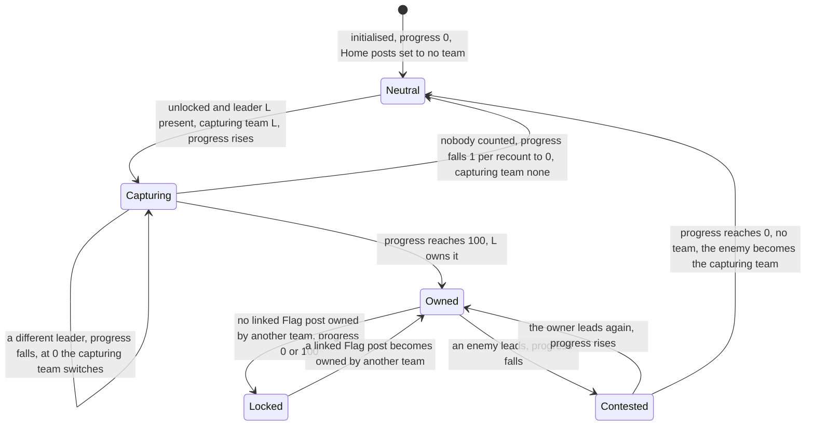
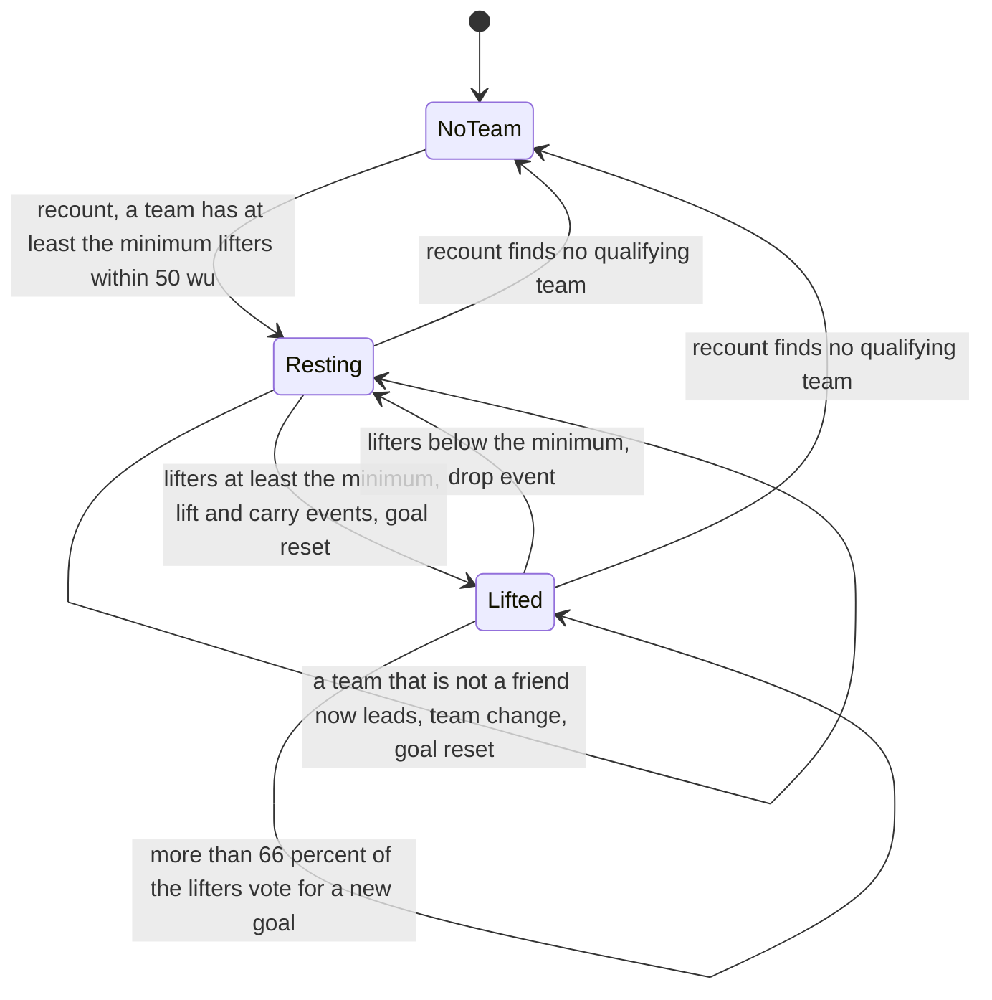
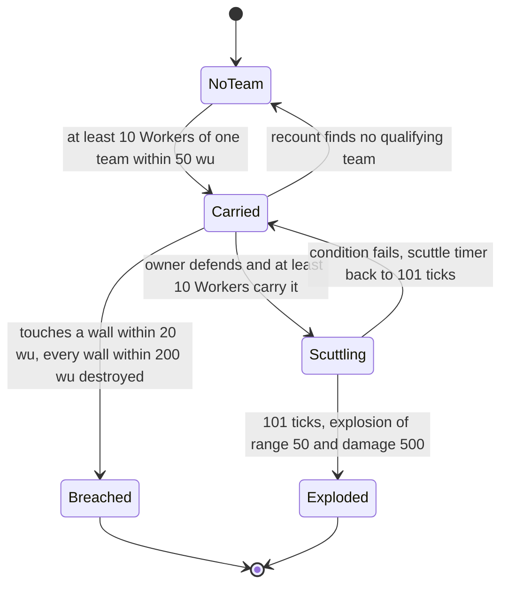
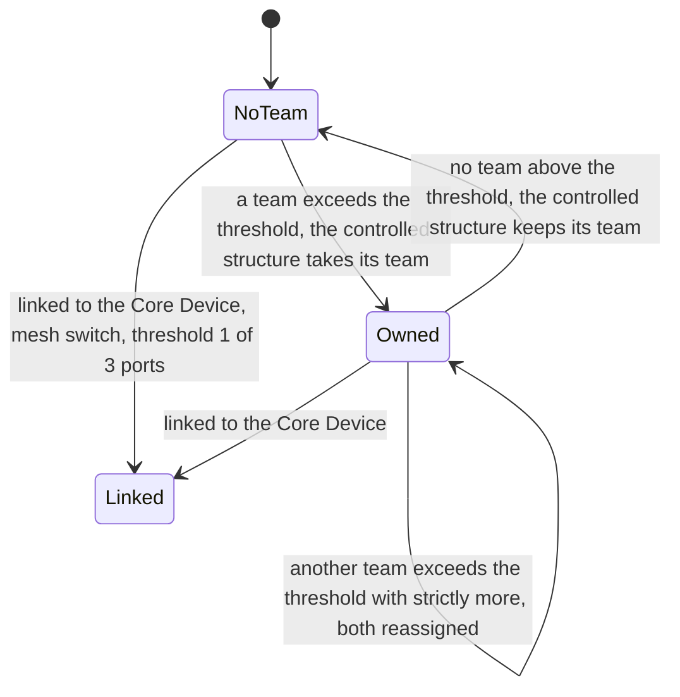
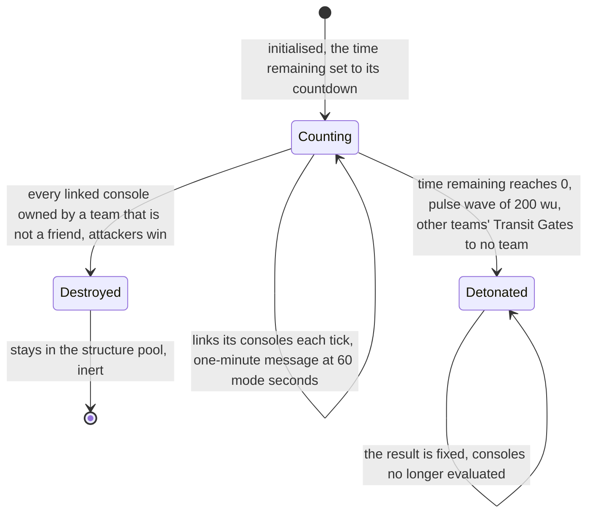
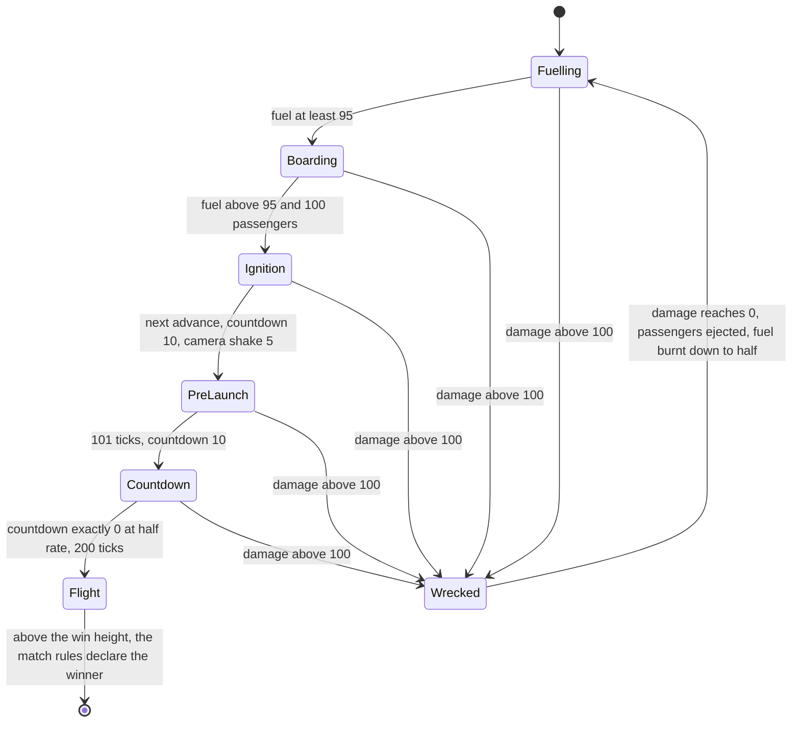

# Mode objects

> Status: Reference · Prefix: R-BLDG · Related: [Buildings and world objects](README.md) · [Economy and spawn objects](economy_and_spawn_objects.md) · [Defences and props](defences_and_props.md) · [01 Skirmish rules and modes](../01_skirmish_rules_and_modes/README.md) · [05 Population flow](../05_population_flow.md) · [07 Bots](../07_bots.md) · [08 Maps and level design](../08_maps_and_level_design/README.md)

## 1 Purpose and player experience

This file specifies the objects that the modes are played over:

- the **Control Zone**, one structure kind that is the Control Zone of Zone Control, the **Relic Base** and the **Relic Spawn Zone** of Relic Run, and the **Flag post** and **Home post** of Flag Chain, with the **cloth flag** that a Flag post flies;
- the **carryable structures**, the **Relic** of Relic Run and the **Breach Charge** of Siege, which crowds of Workers lift and carry;
- the **Command Console**, a port-operated console that hands its owner a Beam Dish or, in Siege, counts towards destroying the Core Device;
- the **Core Device**, the defenders' bomb in Siege, whose countdown is the match clock;
- the **Launch Vessel** of Launch Race, the end of the fuel chain ([economy and spawn objects](economy_and_spawn_objects.md)).

The mode rules that read these objects (scores, win conditions, timers) are specified in [01 Skirmish rules and modes](../01_skirmish_rules_and_modes/README.md); this file specifies the objects, and it owns the values that the mode files cite.

For the player, a Control Zone is a ring on the ground that belongs to whoever has the most Workers in it. A Flag post takes time to raise and can be contested only from a neighbouring post that someone else holds, so capture spreads outward from the Home posts along the chain. A Relic or a Breach Charge moves only while enough Workers of one team crowd around it, with a heave-ho rhythm, and it heads for its goal on its own: a Relic for its owner's Relic Base, a Breach Charge for the wall it is ordered to. A Command Console belongs to the team that mans most of its ports. The Core Device ticks down above the defenders' base, and a Launch Vessel fills with fuel and passengers, counts down and climbs, unless grenades wreck it first.

## 2 Rules

### 2.1 Control Zone

**R-BLDG-250** (MUST) The Control Zone (`ControlZone`) is one structure kind, a circular zone whose meaning depends on the mode of the match: in Zone Control it is a **Control Zone**, recounted by occupancy (§2.2); in Relic Run it is a **Relic Base** (`RelicBase`) when it has a team and a **Relic Spawn Zone** (`RelicSpawnZone`) when it has none (§2.3); in Flag Chain it is a **Flag post** (`FlagPost`), and the Flag post that the map gives to a team is that team's **Home post** (`HomePost`) (§2.4). In Spawn Control, Siege and Launch Race its advance does nothing.

**R-BLDG-251** (MUST) A Control Zone holds the state of table 2.1-A.

Table 2.1-A Control Zone state.

| Field | Default | Meaning |
|---|---|---|
| size | `ref.bldg.control_zone.default_size_wu` (50 wu) | the zone's radius: the Zone Control counting radius, the ring radius, and its structure radius after initialisation |
| recount timer | 0 | the tick of its next recount |
| total count, team counts | 0 | the counted Workers, in total and for each team slot 0 to 5 |
| Flag post links | empty | the ids of the linked Flag posts, from the map and made two-way at Flag Chain initialisation (R-BLDG-269) |
| capture progress | 0 | Flag Chain: 0 to `ref.bldg.flag_post.progress_max` (100) |
| capturing team | no team | Flag Chain: the team gaining or holding progress |
| trend | 0 | Flag Chain: −1, 0 or +1, the sign of the last progress change |
| locked | true | Flag Chain: a locked Flag post cannot be contested |
| under-attack throttle | 0 | Flag Chain: recounts until the next under-attack announcement may fire |
| cloth flag | none | Flag Chain: the cloth flag, `ref.bldg.flag_post.flag_size_wu` (50 wu), created when first drawn (presentation) |

The match also keeps, for each team slot, the id of its Home post, cleared at match-world initialisation step 3 (R-SIM-016).

**R-BLDG-252** (MUST) Initialising a Control Zone copies its size and its links, sets its structure radius to its size and its centre to its position raised by half its radius. In Flag Chain, a Control Zone whose map team names a team is recorded as that team's Home post and is then set to no team, so every Home post starts the match uncaptured.

**R-BLDG-253** (MUST) A Control Zone is never hit by sphere, mesh or ray tests in a match (README table 2.12-A). Its link get returns its first Flag post link, and its link set appends a link unless it is already present. It answers: the number of Control Zones that a given team owns; whether it is a Home post; and the team whose Home post it is.

**R-BLDG-254** (MUST) The advance of a Control Zone runs the step of the current mode (§2.2 to §2.4) and never runs the base advance (R-BLDG-031). The recount periods are `ref.mode.recount.one_second` (11 ticks) and `ref.mode.recount.two_second` (21 ticks) of reference/01 (DEC-064).

**R-BLDG-255** (MUST) A Control Zone's map record holds the base fields, then its size (a decimal, default 50 wu, kept at full precision, DEC-241) and then its Flag post links, repeated. 25 reference maps place Control Zones: Flag Chain 7 of 7, Relic Run 9 of 9 and Zone Control 9 of 9, with 152 records in all.

**R-BLDG-256** (MUST) The Control Zone counter that the match rules read is per-match state that starts at 0 in every match (R-SIM-019; DEC-011). The Zone Control scoring pass recomputes it ([01 Zone Control](../01_skirmish_rules_and_modes/zone_control.md)), and Flag Chain initialisation adds 1 for each Flag post (R-BLDG-269; R-ECON-104).

**R-BLDG-257** (MUST) A Control Zone is drawn as a ring of segments with an animated edge of `fx.beam_long` ([01 Zone Control](../01_skirmish_rules_and_modes/zone_control.md) R-MODE-261), and in Flag Chain with its cloth flag (§2.5). Its `control_zone.spawn` event binds the presence loop `sfx.building.control_zone.presence_loop`, and its `control_zone.owner_changed` event is bound to `sfx.building.control_zone.owner_changed` with the layer `sfx.building.control_zone.owner_changed_b` (R-BLDG-038, R-BLDG-049).

### 2.2 Control Zone in Zone Control

**R-BLDG-258** (MUST) In Zone Control a Control Zone recounts every `ref.mode.recount.one_second` (11 ticks). It counts, per team and in total, every Worker within its size that is not dead, not burning and not inside a Transport. Its owner becomes the team with the strictly highest count, a tie going to the lowest team slot (DEC-016), or no team when no Worker is counted, through the team-assignment operation (R-BLDG-038). There is no capture progress. Scoring is [01 Zone Control](../01_skirmish_rules_and_modes/zone_control.md).

**R-BLDG-259** (MUST) Several Control Zones may share a centre with different sizes; each recounts on its own (see DEC-315).

### 2.3 Relic Base and Relic Spawn Zone

**R-BLDG-260** (MUST) In Relic Run a Control Zone never changes its team. Every `ref.mode.recount.two_second` (21 ticks), a Control Zone that has a team, a Relic Base, destroys every Relic owned by its team whose position lies within `ref.bldg.relic_base.delivery_radius_wu` (30 wu, a three-dimensional distance) of the zone's position (R-BLDG-297); for each it awards its team `ref.mode.relic_run.points_per_delivery` (1) point of reference/01, emits a hint notification and the announcement `mode.relic_run.delivered` ([01 Relic Run](../01_skirmish_rules_and_modes/relic_run.md) R-MODE-303), and raises `control_zone.relic_scored`, bound to `sfx.building.control_zone.relic_scored` with the layers `sfx.building.control_zone.relic_scored_b` and `sfx.building.control_zone.relic_scored_c`.

**R-BLDG-261** (MUST) A Control Zone with no team is a Relic Spawn Zone, where the Relic Run rules create Relics; the spawn timer and the choice of zone are [01 Relic Run](../01_skirmish_rules_and_modes/relic_run.md). Several Relic Spawn Zones may share a place (DEC-315). The content build rejects a Relic Run map that does not have exactly one Relic Base per start position and at least one Relic Spawn Zone (DEC-561).

### 2.4 Flag post and Home post

**R-BLDG-262** (MUST) In Flag Chain a Flag post recounts every `ref.mode.recount.one_second` (11 ticks) and runs these steps in order at each recount; dt is the tick period `ref.sim.tick_period` (0.1 s), applied once per recount:

1. **Lock** (R-BLDG-263).
2. **Count.** When unlocked, it counts, per used team, the Workers within `ref.bldg.flag_post.capture_radius_wu` (40 wu, not its size) that are not dead, not burning and not inside a Transport; the leader is the team with the strictly highest count. When locked it counts nothing, keeps its previous counts and has no leader.
3. **Leader present.** With leader L, top = L's count and total = the total count, change = `ref.bldg.flag_post.capture_gain` (5.0) × top × (top ÷ total). When the Flag post has an owner, the capturing team becomes its owner. When L differs from the capturing team, progress falls by change × dt, and at 0 or below the Flag post takes no team (team assignment) and L becomes the capturing team. When L is the capturing team, progress rises by change × dt, and at 100 or above L becomes its owner (team assignment). Per recount the change is 0.5 × top × (top ÷ total) points.
4. **No leader.** A Flag post with no team loses `ref.bldg.flag_post.neutral_decay_per_s` (10) × dt, 1 point per recount, and at 0 or below its capturing team becomes no team. An owned Flag post does not regain progress.
5. **Clamp and trend.** Progress is clamped to 0 to 100 and the trend set to the sign of the change. While enemy Workers are within its size, the local team's own Home post emits `mode.flag_chain.base_under_attack` when its under-attack throttle is 0 and sets the throttle to `ref.mode.flag_chain.under_attack_throttle` (200 recounts) of reference/01; the throttle falls by 1 at each recount, so the announcement repeats at most every 200 recounts, 2,200 ticks. The announcement is presentation only.
6. **Bot priority** (R-BLDG-266).

**R-BLDG-263** (MUST) A Flag post is unlocked when it has no team and is a Home post, or when its progress is above 0 and below 100. Otherwise it is locked unless one of its linked Flag posts is owned by a team other than its own team; a Flag post with no team linked to another with no team stays locked, so neutral neighbours never unlock it.

**R-BLDG-264** (MUST) Capture therefore spreads along the links: a team first raises its own Home post, and a Flag post next to a post it holds then becomes contestable. 20 uncontested Workers raise a neutral, unlocked Flag post in 10 recounts (110 ticks); an enemy-owned Flag post takes twice as long, because it is driven to 0 first and then raised to 100.

**R-BLDG-265** (MUST) A Home post with no team never reports itself under threat to the Flag Chain status rules ([01 Flag Chain](../01_skirmish_rules_and_modes/flag_chain.md) R-MODE-462), and a structure's under-attack status is set while it is attacked (DEC-078).

**R-BLDG-266** (MUST) At each recount the bot navigation node nearest to the Flag post receives, for each team slot i, a priority p, and is marked as an objective of team i when p > 0 ([07 Bots](../07_bots.md)). For an Easy bot p = 1.0. For a Standard or Hard bot p is decided by the team's Flag Chain status ([01 Flag Chain](../01_skirmish_rules_and_modes/flag_chain.md) R-MODE-462), in this order:

1. status safe: 1.0 for a Flag post that the team does not own;
2. status enemy occupied, under attack or unoccupied: 1.0 for a Home post owned by a team in play;
3. status under threat: 1.0 for a Flag post linked to the team's Home post and not owned by the team;
4. finally, 0.0 for any Flag post other than a Home post that the team already owns.

**R-BLDG-267** (MUST) The trend and the lock select the picture of the cloth flag: raised, lowered or neutral by the trend, or locked when locked, from the four states of `marker.flag_post_state` ([01 Flag Chain](../01_skirmish_rules_and_modes/flag_chain.md) R-MODE-455).

**R-BLDG-268** (MUST) Every Flag post starts the match with progress 0, no capturing team, trend 0, locked, every count 0, its under-attack throttle at 0 and its recount timer at 0 ([01 Flag Chain](../01_skirmish_rules_and_modes/flag_chain.md) R-MODE-452).

**R-BLDG-269** (MUST) Flag post adjacency is one two-way relation (DEC-561): Flag Chain initialisation adds each missing reverse link, so every link is symmetric, and adds 1 to the Control Zone counter for each Flag post (R-BLDG-256). The counter starts at 0 in every match, so the airstrike threshold of the Flag Chain reinforcements, (counter + 1) ÷ 2 Flag posts, depends only on the current map (DEC-011; R-ECON-104).

**R-BLDG-270** (MUST) The content build rejects a Flag Chain map that does not have one Home post per start position and a connected Flag post graph (DEC-561).

### 2.5 Cloth flag

**R-BLDG-271** (MUST) The cloth flag (`ClothFlag`) is a presentation primitive, not a simulated object. Flag posts, Leaders and Transports fly one. It has no owner, no inputs, no outputs, no damage and no map fields, and it advances on the presentation clock, never on simulation state (DEC-007, DEC-024).

**R-BLDG-272** (MUST) A cloth flag is a grid of `ref.bldg.cloth_flag.resolution` (6) × 6 vertices laid out on its front and up plane. Each frame, column 0 is attached to the pole and every other vertex relaxes towards a target that trails the previous column by size ÷ 5, by the factor `ref.bldg.cloth_flag.relax_rate` (10) × frame time × (6 − x) ÷ 6 for column x; the factor is scaled by `ref.bldg.cloth_flag.damped_factor` (0.7) when the flag is larger than `ref.bldg.cloth_flag.damped_size_wu` (40 wu) or is highlighted or selected. A wind wobble of amplitude x ÷ 6 follows the cosine and the sine of the presentation time plus a per-column phase, scaled by `ref.bldg.cloth_flag.highlight_wobble` (0.3) when highlighted, and no link between vertices grows beyond size ÷ 2.

**R-BLDG-273** (MUST) A cloth flag draws a white pole quad `ref.bldg.cloth_flag.pole_width_wu` (0.4 wu) wide and size × `ref.bldg.cloth_flag.pole_height_factor` (1.5) tall, then the textured flag. In a match the flag texture is recoloured per team, the red area taking the team colour, the no-team variant grey and the selected variant brighter, and each recoloured variant, named by its team colour and co-op group position, is cached by (asset, variant) (DEC-098). A caption can be drawn on one cell of the flag. A pointer overlay `marker.flag_pointer` may be drawn on it. Clicking a Leader's or a Transport's flag is a local ray test: a sphere pre-test followed by a triangle test of each quad (DEC-008).

### 2.6 Carryable structures

**R-BLDG-274** (MUST) A carryable structure (`CarryableStructure`) is the base of the Relic and the Breach Charge; no map record names it. It holds the state of table 2.6-A.

Table 2.6-A Carryable structure state.

| Field | Default | Meaning |
|---|---|---|
| carry radius | set by the kind | radius of the carriers' ring; also the radius for collisions between carryable structures |
| scale | 1.0 | drawing scale; also the push force passed to the collision handler |
| lifters, lifters this tick | 0 | the carriers counted in the previous tick, and those being counted in this tick |
| minimum lifters, maximum lifters | set by the kind | lifters needed to move it; capacity of the ring |
| lifted | false | whether it is moving |
| recount timer | 0 | the tick of its next ownership recount |
| goal, route, route point | its position, none, none | where it is heading, and an optional route |
| speed scale | 1.0 | base speed multiplier |
| requested goal, requested route, requests | —, none, 0 | the carriers' votes for a new goal in this tick |

**R-BLDG-275** (MUST) Each tick the advance of a carryable structure runs these steps in order:

1. **Ownership**, every `ref.mode.recount.one_second` (11 ticks): for each used team it counts the living Workers of that team within `ref.bldg.carryable.ownership_radius_wu` (50 wu); the candidate is the team with the highest count, a later team in slot order replacing the current candidate only with a strictly higher count, when that count is at least the minimum lifters; otherwise the candidate is no team. The team changes to the candidate only when the candidate is not a friend of the current team, so a structure held by one ally never passes to another ally, and on a change the goal is reset to the current position. While the structure has no team its goal is reset to its position every tick, so a structure with no team never moves.
2. **Goal vote**: when requests > `ref.bldg.carryable.vote_share` (0.66) × lifters this tick, the requested goal and route are adopted. The requests are cleared every tick.
3. **Route**: along a route the goal moves to the next route point when the structure is within `ref.bldg.carryable.waypoint_reach_wu` (10 wu) of the current one; at the end of the route it stops.
4. **Lift and speed**: lifters = lifters this tick, then lifters this tick = 0. The carry share is lifters ÷ maximum lifters when lifters ≥ minimum lifters, otherwise 0. The speed is carry share × `ref.bldg.carryable.base_speed_wu_s` (16 wu/s) × speed scale × |sin t|, with t the match time in seconds (R-SIM-547), which gives the carriers a heave-ho rhythm (see DEC-241). When at least one carrier within `ref.bldg.carryable.speed_boost_radius_factor` (1.2) × carry radius has a Speed Boost, the speed scale is multiplied by the mean, over those carriers, of each carrier's speed stat ÷ its kind's base speed. Picking the structure up (lifters reaching the minimum) resets the goal and raises `<source>.lift` and the loop `<source>.carry`; setting it down raises `<source>.drop` and stops the loop.
5. **Move and collide** (R-BLDG-276).
6. The base advance (R-BLDG-031).

**R-BLDG-276** (MUST) A carryable structure moves towards its goal: the desired position is position + direction × speed × dt, with its height set to the terrain height, and it does not move when the step would not bring it closer to the goal. Its collision overlap is the sum, over every other carryable structure that overlaps it, of (its carry radius + the other's carry radius − their distance); the list of overlaps belongs to the call and has no fixed limit (R-SIM-026, DEC-028). It moves only when it overlaps nothing now or the move reduces the overlap; otherwise it stops and calls the collision handler of each overlapping carryable structure of an enemy team with the force scale ÷ number of such enemies, a handler that does nothing for every in-scope kind. Its up vector follows the terrain normal with the y component × `ref.bldg.carryable.up_y_factor` (1.5), normalised.

**R-BLDG-277** (MUST) A carryable structure cannot be damaged by weapons (base damage operation), is never hit in a match (README table 2.12-A) and is always in view. It is drawn scaled by its scale, raised by `ref.bldg.carryable.lift_display_wu` (5 wu) while lifted, with its up vector from the terrain normal.

**R-BLDG-278** (MUST) In a match a Worker looks for a carryable structure as the Worker document specifies ([02 Worker](../02_units/worker.md)): among the carryable structures whose distance minus their radius is below its carryable search range (150 wu, a value of reference/02), skipping those of its own team that already have their maximum lifters, it picks one by a simulation draw and approaches it.

**R-BLDG-279** (MUST) An approaching Worker walks to a point 30 wu from the structure in a direction drawn from U[0, 2π) and mills around there; these Workers are the ones that the ownership count of R-BLDG-275 step 1 sees. As soon as the structure's team equals the Worker's team, the Worker starts carrying it ([02 Worker](../02_units/worker.md)).

**R-BLDG-280** (MUST) A carrying Worker's target is its carry position: for a Worker with serial s, the point of the structure's carry ring at the angle s × `ref.bldg.carryable.ring_angle_rad` (123.467 rad), offset by the structure's velocity × `ref.bldg.carryable.ring_lead_s` (0.5 s) and set on the terrain; when the ring holds its maximum lifters the carry position is none and the Worker goes idle. The Worker counts as a lifter (lifters this tick + 1) once it is within its carry tolerance of that point, 20 wu × its speed ratio, a value of reference/02. It stops carrying when the structure passes to another team.

**R-BLDG-281** (MUST) An order given to a carrying Worker becomes a vote for the structure's goal (a requested goal and route, R-BLDG-275 step 2). A vote for a Breach Charge always uses a direct route, with no route graph ([06 Controls, camera and commands](../06_controls_camera_and_commands.md)).

### 2.7 Relic

**R-BLDG-282** (MUST) A Relic (`Relic`) is a carryable relic that scores 1 point when it is delivered to its team's Relic Base (R-BLDG-260). Only the Relic Run rules create Relics (R-BLDG-011): each new Relic is created at a Relic Spawn Zone with no team, a facing drawn at random by the simulation generator and a new structure id ([01 Relic Run](../01_skirmish_rules_and_modes/relic_run.md)).

**R-BLDG-283** (MUST) A Relic has `ref.bldg.relic.min_lifters` (20) minimum lifters, `ref.bldg.relic.max_lifters` (50) maximum lifters and a carry radius, which is also its structure radius, of `ref.bldg.relic.carry_radius_wu` (33 wu).

**R-BLDG-284** (MUST) At initialisation a Relic draws its mesh from the `ref.bldg.relic.mesh_variants` (8) variants of `mesh.relic.variant` by a U{0..7} draw of the simulation generator (DEC-012), and every variant draws its own mesh. Unless the match is in its grace period, the Relic appears with a shatter burst of `ref.bldg.relic.spawn_shatter_fraction` (0.5) of its mesh and raises `relic.spawn` (bound to `sfx.building.relic.spawn`). Relics are drawn with the renderer's special light set ([renderer](../../architecture/components/renderer/README.md)), and the HUD shows an off-screen marker `marker.relic` for each Relic.

**R-BLDG-285** (MUST) A Relic's ownership follows R-BLDG-275 step 1 with a minimum of 20 Workers. Its `relic.owner_changed` event is bound to `sfx.building.relic.owner_changed` with the layer that it shares with `sfx.building.control_zone.relic_scored`; `relic.drop` is bound to `sfx.building.relic.drop`; `relic.lift` and the loop `relic.carry` have no binding and are silent (see DEC-565).

**R-BLDG-286** (MUST) A Relic that has a team and whose goal is unset or reached generates, at most once every `ref.bldg.relic.route_retry_ticks` (11 ticks), a route ([12 space, routing and physics](../12_simulation_model/05_space_routing_and_physics.md)) to the nearest Relic Base owned by its team; a Relic owned by the Rogue faction or the Visitor faction instead routes to the nearest Relic Spawn Zone. The route is highlighted for the local team when the Relic is the local team's.

**R-BLDG-287** (MUST) On its first advance a Relic creates a bot navigation node with a priority modifier of `ref.bldg.relic.bot_node_priority` (1.0) that names the Relic; when the Relic has moved more than `ref.bldg.relic.bot_node_follow_factor` (1.5) × its carry radius from the node, the node is moved to the Relic and the bot navigation links are recomputed ([07 Bots](../07_bots.md)).

**R-BLDG-288** (MUST) A Relic is destroyed when its up vector's y component is below `ref.bldg.relic.tilt_limit` (0.7), when its height is below `ref.bldg.relic.water_height_wu` (0 wu, under water), or when a Relic Base takes delivery of it (R-BLDG-260). Destroying a Relic shatters its whole mesh, sets its destroyed flag and removes its bot navigation node.

**R-BLDG-289** (MUST) A Relic cannot be damaged by weapons and has no map fields of its own. It exists only in Relic Run.

### 2.8 Breach Charge

**R-BLDG-290** (MUST) A Breach Charge (`BreachCharge`) is a carryable explosive charge that breaches walls in Siege. Its mesh is `mesh.structure.breach_charge`, drawn at a scale of `ref.bldg.breach_charge.scale` (10).

**R-BLDG-291** (MUST) A Breach Charge has `ref.bldg.breach_charge.min_lifters` (10) minimum lifters, `ref.bldg.breach_charge.max_lifters` (30) maximum lifters, a speed scale of `ref.bldg.breach_charge.speed_scale` (0.6) and a carry radius, which is also its structure radius, of `ref.bldg.breach_charge.carry_radius_wu` (13 wu). Its ownership follows R-BLDG-275 step 1 with a minimum of 10 Workers.

**R-BLDG-292** (MUST) Every tick a Breach Charge tests the walls in its obstacle-grid cell: when the sphere test of a wall with the Breach Charge's position and a radius of `ref.bldg.breach_charge.trigger_radius_wu` (20 wu) hits, the Breach Charge shatters its whole mesh; breaks the walls, so that every wall within `ref.bldg.breach_charge.break_radius_wu` (200 wu) takes damage −`ref.bldg.breach_charge.break_damage` (1,000), a lethal hit ([defences and props](defences_and_props.md); DEC-043); runs an explosion of range `ref.bldg.breach_charge.breach_explosion_range_wu` (50 wu) and damage `ref.bldg.breach_charge.breach_explosion_damage` (150) at its position (R-SIM-388); destroys itself; and emits the announcement `building.breach_charge.breached` to every participant.

**R-BLDG-293** (MUST) While a Breach Charge is owned by a team whose map position does not attack and at least 10 Workers carry it, its scuttle timer of `ref.bldg.breach_charge.scuttle_ticks` (101 ticks, 10 s) counts down by 1 per tick; whenever the condition fails, the timer is set back to 101. When it reaches 0 the Breach Charge destroys itself with an explosion of range 50 wu and damage `ref.bldg.breach_charge.scuttle_explosion_damage` (500), which also destroys every wall within 60 wu, where the hit reaches the wall's destruction threshold ([defences and props](defences_and_props.md)). The defenders can thus scuttle the charge before it reaches their walls.

**R-BLDG-294** (MUST) A Breach Charge has no bot navigation node of its own. The Siege bot routes its own Breach Charges: when a charge's goal is unset or reached, at most once every `ref.bldg.breach_charge.bot_route_retry_ticks` (11 ticks), it generates a route ([12 space, routing and physics](../12_simulation_model/05_space_routing_and_physics.md)) to the nearest wall that lies within `ref.bldg.breach_charge.bot_wall_search_wu` (500 wu) of any marker of the bot's current bot objective ([07 Bots](../07_bots.md)).

**R-BLDG-295** (MUST) A Breach Charge cannot be damaged by weapons and has no map fields beyond the base fields. One reference Siege map places Breach Charges: 3 records, all with no team.

**R-BLDG-296** (MUST) The new text of `building.breach_charge.breached` is "The wall has been breached!".

**R-BLDG-297** (MUST) Delivery and destruction remove a carryable structure through its own destroy operation (R-BLDG-288, R-BLDG-292, R-BLDG-293), which sets its destroyed flag, so the next base advance removes it.

### 2.9 Command Console

**R-BLDG-298** (MUST) A Command Console (`CommandConsole`) is a port-operated console. Its owner is given to its controlled structure (a Beam Dish on the reference maps), and in Siege its owner counts towards destroying the Core Device (R-BLDG-311).

**R-BLDG-299** (MUST) An unlinked Command Console uses the mesh `mesh.structure.command_console`, with `ref.bldg.command_console.port_count` (5) port sockets. The first time it is linked to the Core Device it switches to the mesh `mesh.structure.command_console_linked`, with `ref.bldg.command_console.linked_port_count` (3) port sockets and the `dish_direction` socket: it clears its lights, releases its old ports and builds the new ones explicitly; it runs no second initialisation, so it raises no second `command_console.spawn` event and does not register itself again (DEC-458). Later link calls change nothing.

**R-BLDG-300** (MUST) The Command Consoles that a Core Device lists are linked to it at match-world initialisation, after every map structure exists (R-BLDG-028), and again by every advance of the Core Device, which changes nothing after the first link (R-BLDG-310).

**R-BLDG-301** (MUST) Every tick, before its port evaluation, and therefore from the occupants of the previous tick, a Command Console recomputes its owner. With count[t] the number of its ports that team t occupies and the threshold n = `ref.bldg.command_console.capture_threshold` (2), or `ref.bldg.command_console.linked_capture_threshold` (1) while linked:

```
winner ← no team
for t in 0 .. 5:                                  # slot order (DEC-016)
    if count[t] > n and (winner = no team or count[t] > count[winner]):
        winner ← t
if winner = no team:
    team assignment of the console ← no team      # the controlled structure keeps its team
else:
    team assignment of the console ← winner
    team assignment of the controlled structure ← winner
```

A team therefore needs at least 3 operators on an unlinked console and at least 2 on a linked one; operators of teams that are not friends may share the ports, and no friendship test applies.

**R-BLDG-302** (MUST) A Command Console's inputs are the Workers on its ports and its output is the ownership of itself and of its controlled structure. It is indestructible.

**R-BLDG-303** (MUST) A Command Console draws its ports itself: a light of `fx.starburst` per port, grey while unoccupied and in the occupant's team colour while occupied. While it is linked, owned, and its Core Device is not destroyed, it draws an animated beam in its team colour from its `dish_direction` socket towards the point `ref.bldg.command_console.beam_reach_fraction` (0.75) of the way to the Core Device, raised by `ref.bldg.command_console.beam_lift_wu` (100 wu). While linked it is always in view. Its `command_console.spawn` event binds the presence loop `sfx.building.command_console.presence_loop`.

**R-BLDG-304** (MUST) A Command Console's map record holds the base fields and then the id of its controlled structure (default none), a typed link (DEC-457). 9 reference maps place Command Consoles, 33 records: every Siege map (8 of 8) with 3 or 4 consoles linked to the Core Device and no controlled structure, and one Zone Control map with 6 consoles that control Beam Dishes.

### 2.10 Core Device

**R-BLDG-305** (MUST) The Core Device (`CoreDevice`) is the defenders' bomb in Siege. When its countdown expires it detonates and the defenders win; the attackers win by holding every linked Command Console at once, which destroys it ([01 Siege](../01_skirmish_rules_and_modes/siege.md)).

**R-BLDG-306** (MUST) The Core Device holds the state of table 2.10-A. The match also keeps, for each team slot, the id of its Core Device, cleared at match-world initialisation step 3 (R-SIM-016), and the Core Device default time, the first countdown of the match ([01 Skirmish rules and modes](../01_skirmish_rules_and_modes/README.md)).

Table 2.10-A Core Device state.

| Field | Default | Meaning |
|---|---|---|
| scale | `ref.bldg.core_device.scale` (0.75) | the scale of its mesh and of its radius |
| countdown | 0 | the countdown length, in mode seconds, from its map record |
| linked consoles | empty | the ids of its linked Command Consoles, without duplicates |
| detonation tick | none | the tick at which it detonated |
| warning given | false | whether its one-minute message has been emitted |
| destroyed | false | the destroyed flag; a destroyed Core Device stays in the structure pool, inert |

**R-BLDG-307** (MUST) Initialising the Core Device copies its countdown and its links and records its id as its team's Core Device. When a multi-round countdown is set for the round, it replaces the map countdown (see DEC-066). The first Core Device to initialise in a match sets the Core Device default time. The Core Device sets the match's time remaining to ⌊countdown⌋, so the Core Device countdown is the Siege match clock ([01 Siege](../01_skirmish_rules_and_modes/siege.md) R-MODE-351).

**R-BLDG-308** (MUST) The Core Device uses `mesh.structure.core_device` at its scale. Its height is snapped to the terrain and its centre and radius are computed from the scaled mesh; it has no ports. Its sphere, mesh and ray tests use the scaled mesh (README table 2.12-A).

**R-BLDG-309** (MUST) Each tick the advance of the Core Device returns at once when it is destroyed: a destroyed Core Device is never removed from the structure pool, but it no longer advances in effect and is no longer drawn. Otherwise it runs R-BLDG-310 to R-BLDG-313 in order. It never runs the base advance (R-BLDG-031).

**R-BLDG-310** (MUST) The Core Device links each of its linked Command Consoles to itself (R-BLDG-299).

**R-BLDG-311** (MUST) Until the Core Device has detonated, when every linked Command Console that exists has a team, and none of them has a team that is a friend of the Core Device's team, the Core Device is destroyed (R-BLDG-314) and the defence time, countdown − the precise time remaining in mode seconds, is recorded for the Core Device's team ([01 Siege](../01_skirmish_rules_and_modes/siege.md) R-MODE-359, R-MODE-360). A Core Device with no existing linked Command Console meets this condition on its first advance (see DEC-459). Once the Core Device has detonated, this test no longer runs and the Siege result is fixed (DEC-075).

**R-BLDG-312** (MUST) The first time the time remaining is at or below `ref.match.one_minute_warning` (60 mode seconds) of reference/01, the Core Device emits the announcement `mode.siege.one_minute_warning` once.

**R-BLDG-313** (MUST) When the time remaining is at or below 0 and the Core Device has not detonated, it records the full countdown as the defence time of its team, sets its detonation tick to the current tick, releases a Core Device pulse wave (`CorePulseWave`) of its team with an initial radius of `ref.bldg.core_device.pulse_radius_wu` (200 wu) ([04 weapons and projectiles](../04_supply_crates_powers_and_weapons/weapons_and_projectiles.md)), and sets every Transit Gate that its team does not own to no team, silently (R-BLDG-039).

**R-BLDG-314** (MUST) Destroying the Core Device shatters its whole mesh and sets its destroyed flag; finds the defending team, the last team slot below the map's player count that has a Core Device; sets every Transit Gate that the defending team does not own to no team, silently (R-BLDG-039); runs an explosion of range `ref.bldg.core_device.destroy_explosion_range_wu` (75 wu) and damage `ref.bldg.core_device.destroy_explosion_damage` (5) at its position (R-SIM-388); and emits the announcement `mode.siege.core_destroyed`.

**R-BLDG-315** (MUST) The Core Device cannot be damaged by weapons: it has no damage rule of its own (R-BLDG-034).

**R-BLDG-316** (MUST) The Core Device draws up to `ref.bldg.core_device.glow_blob_max` (20) glow blobs of `fx.glow_round` in its team colour, fewer at lower structure-detail levels (DEC-327), rising to `ref.bldg.core_device.glow_rise_wu` (200 wu) × (1 − time remaining ÷ countdown) above it and growing as they rise. While the time remaining is at most `ref.bldg.core_device.countdown_display_mode_seconds` (10), it draws a three-dimensional countdown screen on `ui.panel_neutral` in its team colour, `ref.bldg.core_device.countdown_screen_height_wu` (50 wu) above it. Its `core_device.spawn` event binds the presence loop that reference/10 shares with `sfx.building.launch_vessel.flight`.

**R-BLDG-317** (MUST) The Core Device's map record holds the base fields, then its countdown (a decimal, in mode seconds, default 0) and then the ids of its linked Command Consoles, repeated. Every reference Siege map places one Core Device, owned by a defending position, with 3 or 4 linked consoles and a countdown of 900 mode seconds; [01 Siege](../01_skirmish_rules_and_modes/siege.md) R-MODE-351 gives the countdowns of the reference maps. The content build rejects a Siege map that does not have one Core Device owned by a defending start position with at least three linked Command Consoles and a countdown equal to the match time limit (DEC-561).

### 2.11 Launch Vessel

**R-BLDG-318** (MUST) The Launch Vessel (`LaunchVessel`) is each team's Launch Race objective: it fills with fuel, boards `ref.bldg.launch_vessel.launch_passengers` (100) passengers and launches, and the first Launch Vessel above `ref.mode.launch_race.win_height` (600 wu) of reference/01 wins ([01 Launch Race](../01_skirmish_rules_and_modes/launch_race.md)). It is a fuel-chain structure (R-BLDG-192).

**R-BLDG-319** (MUST) A Launch Vessel draws a per-instance copy of the mesh `mesh.structure.launch_vessel`, recoloured in a match to its team colour × `ref.bldg.launch_vessel.colour_factor` (0.3), with the `thruster`, `window_01` to `window_03` and `fuel_point` sockets. Its owner is fixed by its map record and never recomputed.

**R-BLDG-320** (MUST) A Launch Vessel holds: its state (R-BLDG-321); its fuel, 0 to 100; its intake count; its passengers, 0 to 100; its countdown; its damage; its refuel rate; its fuel before the explosion; its attack-warning flag; and its attacker timer.

**R-BLDG-321** (MUST) The Launch Vessel states (`LaunchVesselState`) are, in this order, which carries meaning for the tests "before Wrecked": Fuelling, Boarding, Ignition, PreLaunch, Countdown, Wrecked and Flight.

**R-BLDG-322** (MUST) A Launch Vessel's fuel intake is the fuel-chain intake (R-BLDG-194), and each intake call with a level above `ref.bldg.launch_vessel.intake_level_min` (0.1) adds 1 to its intake count. Its passengers come from its fuel depots (R-BLDG-203). Explosions damage it (R-BLDG-323).

**R-BLDG-323** (MUST) Damaging a Launch Vessel with a negative amount d raises `launch_vessel.damaged` (bound to `sfx.building.launch_vessel.damaged`). Unless the vessel is Wrecked or in Flight (DEC-076): when its attack-warning flag is clear, its owner's participant receives the announcement `building.launch_vessel.attacked` and the flag is set; its damage grows by `ref.bldg.launch_vessel.damage_scale` (0.2) × |d|; and when the damage exceeds `ref.bldg.launch_vessel.wreck_damage` (100), it records its fuel as its fuel before the explosion, enters Wrecked, raises `launch_vessel.explode` (bound to `sfx.building.launch_vessel.explode`) and its owner's participant receives the announcement `building.launch_vessel.wrecked`.

**R-BLDG-324** (MUST) Every tick, in every state, a Launch Vessel's damage falls by `ref.bldg.launch_vessel.damage_decay_per_s` (0.33) × dt, 0.033 per tick; when it reaches 0 or below it is set to 0 and the attack-warning flag is cleared.

**R-BLDG-325** (MUST) In Fuelling, Boarding, PreLaunch and Countdown, while its state is before Wrecked and its fuel is above `ref.bldg.launch_vessel.attack_fuel` (33), a Launch Vessel draws attackers each time its attacker timer expires; the timer is then set to `ref.bldg.launch_vessel.attacker_interval_ticks` (U{11..30} ticks, 1 to 3 s). It finds the n enemy actors within `ref.bldg.launch_vessel.attacker_radius_wu` (150 wu), makes k = 1 + U{0..⌊n × `ref.bldg.launch_vessel.attacker_share` (0.05)⌋} picks among them, each a uniform draw, and orders each picked actor that is a living, unburnt Worker to attack the vessel.

**R-BLDG-326** (MUST) An attacking Worker runs to a point 100 to 150 wu from the vessel and, once within 200 wu, throws one grenade at the vessel's position raised by 50 wu, for its own team (DEC-105), and then returns to the idle state ([02 Worker](../02_units/worker.md)). A Worker grenade explodes with range 12.5 wu and damage 50 ([04 weapons and projectiles](../04_supply_crates_powers_and_weapons/weapons_and_projectiles.md)), measured to the vessel's base point (R-BLDG-035), so one grenade adds at most 50 × 0.2 = 10 damage, and only when it bursts within 37.5 wu of the base; a grenade that bursts near the aim point 50 wu up adds nothing. At least 11 well-placed grenades, less the decay, wreck a vessel. How long a besieged vessel survives follows from these rules (see DEC-108), and its values are derived on flat terrain (see DEC-111).

**R-BLDG-327** (MUST) A Launch Vessel is never hit by sphere or mesh tests in a match, and by ray tests only in the map editor (README table 2.12-A).

**R-BLDG-328** (MUST) A Launch Vessel's objective counter is the HUD text `building.launch_vessel.objective_counter`, new text "Fuel {fuel}%, passengers {passengers}%", with ⌊fuel⌋ and the passenger count.

**R-BLDG-329** (MUST) In **Fuelling** a Launch Vessel draws attackers (R-BLDG-325) and refuels (R-BLDG-330). When its fuel first exceeds `ref.bldg.launch_vessel.hint_fuel` (33) it emits a hint notification. When its fuel reaches `ref.bldg.launch_vessel.full_fuel` (95) or more it enters Boarding and emits, once per match, `mode.launch_race.fuelled` to its owner and `building.launch_vessel.other_fuelled` to every other participant.

**R-BLDG-330** (MUST) Refuelling, in Fuelling and in Boarding, runs:

```
target ← intake count × current level × ref.bldg.launch_vessel.refuel_gain        # 0.4
rate   ← ref.bldg.launch_vessel.refuel_keep × rate                               # 0.99
         + (1 − ref.bldg.launch_vessel.refuel_keep) × target                     # 0.01
fuel   ← min(fuel + rate × dt, 100)
intake count ← 0
```

With 3 depots at full pressure the steady rate is 1.2 fuel points per second, so fuel climbs from 0 to 95 in about 80 s plus about 10 s of smoothing lag.

**R-BLDG-331** (MUST) In **Boarding** a Launch Vessel draws attackers and refuels. When its fuel is above 95 and it has at least 100 passengers, it enters Ignition with its countdown set to `ref.bldg.launch_vessel.ignition_countdown` (18), a value that the Ignition step replaces before any rule reads it, and emits, once per match, `mode.launch_race.preparing` to its owner and `building.launch_vessel.other_preparing` to every other participant. No rule returns a Boarding vessel to Fuelling: its fuel can fall below 95 only through Wrecked.

**R-BLDG-332** (MUST) In **Ignition**, on its next advance, a Launch Vessel in a match sets its countdown to 0, enters PreLaunch at once with its countdown set to `ref.bldg.launch_vessel.display_countdown` (10) and starts a camera shake of `ref.bldg.launch_vessel.camera_shake` (5). Ignition therefore lasts exactly one tick.

**R-BLDG-333** (MUST) In **PreLaunch** a Launch Vessel draws attackers and counts down `ref.bldg.launch_vessel.prelaunch_ticks` (101 ticks, 10 s); then it enters Countdown with its countdown set to 10.

**R-BLDG-334** (MUST) In **Countdown** a Launch Vessel draws attackers, and its countdown falls by `ref.bldg.launch_vessel.countdown_rate` (0.5) × dt per tick, kept at 0 or above; when it is exactly 0, after `ref.bldg.launch_vessel.countdown_ticks` (200 ticks, 20 s of game time for the displayed 10 to 0), the vessel enters Flight.

**R-BLDG-335** (MUST) In **Flight** a Launch Vessel's thrust is max(2 × √(height − ground height), `ref.bldg.launch_vessel.min_thrust` (0.1)) wu/s, with the factor `ref.bldg.launch_vessel.thrust_factor` (2); its velocity is (0, thrust, 0) and its position grows by velocity × dt (drawn with velocity extrapolation). Flight cannot be damaged and is terminal: it ends only in the launch result (DEC-076).

**R-BLDG-336** (MUST) In **Wrecked** a Launch Vessel, each tick:

1. loses a further `ref.bldg.launch_vessel.wreck_decay_per_tick` (0.1) damage, on top of the decay of R-BLDG-324;
2. loses `ref.bldg.launch_vessel.wreck_fuel_loss_per_tick` (0.5) fuel, down to `ref.bldg.launch_vessel.wreck_fuel_floor` (0.5) × its fuel before the explosion;
3. ejects one passenger from a window drawn at random, as a Worker of its own team with an outward speed of `ref.bldg.launch_vessel.eject_speed_wu_s` (10 to 40 wu/s), set on fire with probability `ref.econ.launch_vessel.burning_share` (0.5) of reference/05, both by simulation draws (R-ECON-117, R-ECON-118, `ref.econ.launch_vessel.release_per_tick`);
4. sheds mesh debris while its fuel is above 0, and emits 3 fire and 3 smoke particles from the presentation generator (DEC-013);
5. once its passengers are 0 and its fuel is at its floor, loses a further `ref.bldg.launch_vessel.empty_decay_per_tick` (0.2) damage;
6. when its damage is 0 or below, sets its damage to 0 and its current fuel level to 0, and enters Fuelling: its passengers must board again and its fuel must reach 95 again.

From 100.5 damage a Wrecked vessel with 100 passengers and 100 fuel takes 362 ticks to return to Fuelling.

**R-BLDG-337** (MUST) After its state step, each tick, a Launch Vessel selects its sound loops, starting and stopping each by explicit events (DEC-323): in Fuelling `launch_vessel.refuelling` while its current level is above `ref.bldg.launch_vessel.hungry_level` (0.2), otherwise `launch_vessel.hungry` (bound to `sfx.building.launch_vessel.hungry`); in Boarding, Ignition, PreLaunch and Countdown `launch_vessel.fuelled` (bound to `sfx.building.launch_vessel.fuelled` with the layer `sfx.building.launch_vessel.fuelled_b`); in every state while its damage is at least `ref.bldg.launch_vessel.malfunction_damage` (75), `launch_vessel.malfunction` (bound to `sfx.building.launch_vessel.malfunction`); in Wrecked `launch_vessel.malfunction` while its fuel is above 0, otherwise `launch_vessel.hungry`; in Flight `launch_vessel.flight` (bound to `sfx.building.launch_vessel.flight`); and in PreLaunch, Countdown and Flight the loop `launch_vessel.engine_burn` (bound to `sfx.building.launch_vessel.engine_burn` with the layer `sfx.building.launch_vessel.engine_burn_b`).

**R-BLDG-338** (MUST) A Launch Vessel's presentation decays its camera shake; in PreLaunch, Countdown and Flight it emits `ref.bldg.launch_vessel.booster_particles` (15) booster particles per tick at its `thruster` socket, 11 missile-fire and 4 missile-trail particles of size 500, from the presentation generator (DEC-013); and it draws glow sprites of `fx.starburst` with an alpha of fuel ÷ 100. The launch spectacle, in which nearby Workers turn to watch a launching vessel, is inactive in matches (DEC-009).

**R-BLDG-339** (MUST) When the match rules look up a team's Launch Vessel, they take the last Launch Vessel of that team in structure order (DEC-016).

**R-BLDG-340** (MUST) A Launch Vessel's map record holds the base fields, then its fuel link (unused for the vessel; none on the reference maps), its starting fuel (a decimal, default 0) and its starting passengers (an integer, default 0). The Launch Race maps use none, 0 and 0. Every Launch Race map places one Launch Vessel per team (7 of 7 maps, 19 records), and the content build rejects a Launch Race map that does not have, for each start position, one Launch Vessel, three fuel depots and one Transit Gate (DEC-561).

**R-BLDG-341** (MUST) The announcements of the Launch Vessel have this new text: `building.launch_vessel.attacked`, "Your Launch Vessel is under attack!"; `building.launch_vessel.wrecked`, "Your Launch Vessel has been wrecked!"; `building.launch_vessel.other_fuelled`, "{team} has fuelled its Launch Vessel."; `building.launch_vessel.other_preparing`, "{team} is preparing to launch!".

### 2.12 Mode usage

**R-BLDG-342** (MUST) The mode objects appear on the reference maps as table 2.12-A gives ("rt" means created by a rule at run time).

Table 2.12-A Mode objects by mode (reference maps containing the object ÷ reference maps of the mode).

| Object | Spawn Control | Zone Control | Relic Run | Siege | Launch Race | Flag Chain |
|---|---|---|---|---|---|---|
| Control Zone | – | 9/9 Control Zones | 9/9 Relic Bases and Relic Spawn Zones | – | – | 7/7 Flag posts and Home posts |
| Relic | – | – | rt | – | – | – |
| cloth flag | Leaders and Transports | Leaders and Transports | Leaders and Transports | Leaders and Transports | Leaders and Transports | Flag posts, Leaders and Transports |
| carryable structures | – | – | Relic (rt) | Breach Charge 1/8 | – | – |
| Transit Gate ([economy and spawn objects](economy_and_spawn_objects.md)) | 2/9 | 4/9 | – | 8/8 | 7/7 | 7/7 |
| Core Device | – | – | – | 8/8 | – | – |
| Command Console | – | 1/9 (Beam Dish control) | – | 8/8 | – | – |
| fuel pump, fuel line, fuel depot, Launch Vessel | – | – | – | – | 7/7 | – |

## 3 States and flows



*Figure 1 — Flag post states (R-BLDG-262 to R-BLDG-264).*



*Figure 2 — Carryable structure states (R-BLDG-275).*



*Figure 3 — Breach Charge states (R-BLDG-291 to R-BLDG-293).*



*Figure 4 — Command Console states (R-BLDG-299 to R-BLDG-301).*



*Figure 5 — Core Device states (R-BLDG-309 to R-BLDG-314).*



*Figure 6 — Launch Vessel states (R-BLDG-321 to R-BLDG-336). Flight takes no damage (DEC-076).*

## 4 Tuning table

Every value is a reference tuning value that Species may adopt as its baseline (DEC-004). Values owned by another document are cited in the rules by that document's key and are not repeated here: `ref.mode.recount.one_second`, `ref.mode.recount.two_second`, `ref.mode.relic_run.points_per_delivery`, `ref.mode.flag_chain.under_attack_throttle`, `ref.mode.launch_race.win_height` and `ref.match.one_minute_warning` (reference/01); `ref.econ.launch_vessel.burning_share` and `ref.econ.launch_vessel.release_per_tick` (reference/05); `ref.sim.tick_period` (reference/12).

| key | value | unit | range or notes | requirement | DEC |
|---|---|---|---|---|---|
| `ref.bldg.control_zone.default_size_wu` | 50 | wu | radius; a map value, kept at full precision | R-BLDG-251, R-BLDG-255 | DEC-241 |
| `ref.bldg.relic_base.delivery_radius_wu` | 30 | wu | three-dimensional | R-BLDG-260 | — |
| `ref.bldg.flag_post.progress_max` | 100 | progress points | owner at 100, no team at 0 | R-BLDG-251, R-BLDG-262 | — |
| `ref.bldg.flag_post.flag_size_wu` | 50 | wu | cloth flag | R-BLDG-251 | — |
| `ref.bldg.flag_post.capture_radius_wu` | 40 | wu | not the Flag post's size | R-BLDG-262 | — |
| `ref.bldg.flag_post.capture_gain` | 5.0 | progress per second per Worker | change = 5 × top × top ÷ total, × dt per recount | R-BLDG-262 | — |
| `ref.bldg.flag_post.neutral_decay_per_s` | 10 | progress per second | × dt per recount: 1 point per recount | R-BLDG-262 | — |
| `ref.bldg.cloth_flag.resolution` | 6 | vertices per side | | R-BLDG-272 | — |
| `ref.bldg.cloth_flag.relax_rate` | 10 | per second | × (6 − x) ÷ 6 for column x | R-BLDG-272 | DEC-024 |
| `ref.bldg.cloth_flag.damped_factor` | 0.7 | × | large, highlighted or selected flags | R-BLDG-272 | — |
| `ref.bldg.cloth_flag.damped_size_wu` | 40 | wu | flags larger than this are damped | R-BLDG-272 | — |
| `ref.bldg.cloth_flag.highlight_wobble` | 0.3 | × | wobble while highlighted | R-BLDG-272 | — |
| `ref.bldg.cloth_flag.pole_width_wu` | 0.4 | wu | | R-BLDG-273 | — |
| `ref.bldg.cloth_flag.pole_height_factor` | 1.5 | × flag size | | R-BLDG-273 | — |
| `ref.bldg.carryable.ownership_radius_wu` | 50 | wu | living Workers counted | R-BLDG-275 | — |
| `ref.bldg.carryable.vote_share` | 0.66 | × lifters this tick | strictly more votes adopt a new goal | R-BLDG-275 | — |
| `ref.bldg.carryable.waypoint_reach_wu` | 10 | wu | route point reached | R-BLDG-275 | — |
| `ref.bldg.carryable.base_speed_wu_s` | 16 | wu/s | × carry share × speed scale × \|sin t\| | R-BLDG-275 | DEC-241 |
| `ref.bldg.carryable.speed_boost_radius_factor` | 1.2 | × carry radius | carriers sampled for the Speed Boost ratio | R-BLDG-275 | — |
| `ref.bldg.carryable.up_y_factor` | 1.5 | × | terrain normal y before normalising | R-BLDG-276 | — |
| `ref.bldg.carryable.lift_display_wu` | 5 | wu | drawn raised while lifted | R-BLDG-277 | — |
| `ref.bldg.carryable.ring_angle_rad` | 123.467 | rad per serial | carry position angle | R-BLDG-280 | — |
| `ref.bldg.carryable.ring_lead_s` | 0.5 | s × velocity | carry position lead | R-BLDG-280 | — |
| `ref.bldg.relic.min_lifters` | 20 | Workers | | R-BLDG-283, R-BLDG-285 | — |
| `ref.bldg.relic.max_lifters` | 50 | Workers | ring capacity | R-BLDG-283 | — |
| `ref.bldg.relic.carry_radius_wu` | 33 | wu | also the structure radius | R-BLDG-283 | — |
| `ref.bldg.relic.mesh_variants` | 8 | variants | U{0..7} simulation draw | R-BLDG-284 | DEC-012 |
| `ref.bldg.relic.spawn_shatter_fraction` | 0.5 | of the mesh | not during the grace period | R-BLDG-284 | — |
| `ref.bldg.relic.route_retry_ticks` | 11 | ticks | 1 s | R-BLDG-286 | DEC-002 |
| `ref.bldg.relic.bot_node_priority` | 1.0 | priority modifier | | R-BLDG-287 | — |
| `ref.bldg.relic.bot_node_follow_factor` | 1.5 | × carry radius | 49.5 wu | R-BLDG-287 | — |
| `ref.bldg.relic.tilt_limit` | 0.7 | up y | destroyed below | R-BLDG-288 | — |
| `ref.bldg.relic.water_height_wu` | 0 | wu | destroyed below | R-BLDG-288 | — |
| `ref.bldg.breach_charge.scale` | 10 | × | drawing scale and collision push | R-BLDG-290 | — |
| `ref.bldg.breach_charge.min_lifters` | 10 | Workers | | R-BLDG-291 | — |
| `ref.bldg.breach_charge.max_lifters` | 30 | Workers | | R-BLDG-291 | — |
| `ref.bldg.breach_charge.speed_scale` | 0.6 | × | | R-BLDG-291 | — |
| `ref.bldg.breach_charge.carry_radius_wu` | 13 | wu | also the structure radius | R-BLDG-291 | — |
| `ref.bldg.breach_charge.trigger_radius_wu` | 20 | wu | wall sphere test | R-BLDG-292 | — |
| `ref.bldg.breach_charge.break_radius_wu` | 200 | wu | walls broken | R-BLDG-292 | DEC-043 |
| `ref.bldg.breach_charge.break_damage` | 1000 | damage | per wall | R-BLDG-292 | DEC-043 |
| `ref.bldg.breach_charge.breach_explosion_range_wu` | 50 | wu | also the scuttle explosion range | R-BLDG-292, R-BLDG-293 | — |
| `ref.bldg.breach_charge.breach_explosion_damage` | 150 | damage | | R-BLDG-292 | — |
| `ref.bldg.breach_charge.scuttle_ticks` | 101 | ticks | 10 s | R-BLDG-293 | DEC-002 |
| `ref.bldg.breach_charge.scuttle_explosion_damage` | 500 | damage | | R-BLDG-293 | DEC-043 |
| `ref.bldg.breach_charge.bot_route_retry_ticks` | 11 | ticks | 1 s | R-BLDG-294 | DEC-002 |
| `ref.bldg.breach_charge.bot_wall_search_wu` | 500 | wu | from any marker of the bot objective | R-BLDG-294 | — |
| `ref.bldg.command_console.port_count` | 5 | ports | unlinked | R-BLDG-299 | — |
| `ref.bldg.command_console.linked_port_count` | 3 | ports | linked to the Core Device | R-BLDG-299 | DEC-458 |
| `ref.bldg.command_console.capture_threshold` | 2 | operators | strictly more: at least 3 | R-BLDG-301 | DEC-016 |
| `ref.bldg.command_console.linked_capture_threshold` | 1 | operators | strictly more: at least 2 | R-BLDG-301 | DEC-016 |
| `ref.bldg.command_console.beam_reach_fraction` | 0.75 | of the distance | towards the Core Device | R-BLDG-303 | — |
| `ref.bldg.command_console.beam_lift_wu` | 100 | wu | beam end raised | R-BLDG-303 | — |
| `ref.bldg.core_device.scale` | 0.75 | × | mesh and radius | R-BLDG-306, R-BLDG-308 | — |
| `ref.bldg.core_device.pulse_radius_wu` | 200 | wu | initial radius of the pulse wave | R-BLDG-313 | — |
| `ref.bldg.core_device.destroy_explosion_range_wu` | 75 | wu | reaches structures within 225 wu | R-BLDG-314 | — |
| `ref.bldg.core_device.destroy_explosion_damage` | 5 | damage | | R-BLDG-314 | — |
| `ref.bldg.core_device.glow_blob_max` | 20 | blobs | at the highest structure detail | R-BLDG-316 | DEC-327 |
| `ref.bldg.core_device.glow_rise_wu` | 200 | wu | × (1 − time remaining ÷ countdown) | R-BLDG-316 | — |
| `ref.bldg.core_device.countdown_display_mode_seconds` | 10 | mode seconds | the screen shows at or below | R-BLDG-316 | — |
| `ref.bldg.core_device.countdown_screen_height_wu` | 50 | wu | above the Core Device | R-BLDG-316 | — |
| `ref.bldg.launch_vessel.launch_passengers` | 100 | passengers | needed for Ignition; the passenger maximum | R-BLDG-318, R-BLDG-331 | — |
| `ref.bldg.launch_vessel.colour_factor` | 0.3 | × team colour | mesh recolour | R-BLDG-319 | — |
| `ref.bldg.launch_vessel.intake_level_min` | 0.1 | level | intake calls counted above | R-BLDG-322 | — |
| `ref.bldg.launch_vessel.damage_scale` | 0.2 | × incoming damage | | R-BLDG-323 | DEC-108 |
| `ref.bldg.launch_vessel.wreck_damage` | 100 | damage | Wrecked above | R-BLDG-323 | DEC-108 |
| `ref.bldg.launch_vessel.damage_decay_per_s` | 0.33 | damage per second | 0.033 per tick, every state | R-BLDG-324 | DEC-108 |
| `ref.bldg.launch_vessel.attack_fuel` | 33 | fuel | attackers drawn above | R-BLDG-325 | — |
| `ref.bldg.launch_vessel.attacker_interval_ticks` | U{11..30} | ticks | 1 to 3 s | R-BLDG-325 | DEC-002 |
| `ref.bldg.launch_vessel.attacker_radius_wu` | 150 | wu | enemy actors searched | R-BLDG-325 | — |
| `ref.bldg.launch_vessel.attacker_share` | 0.05 | × found | k = 1 + U{0..⌊n × 0.05⌋} | R-BLDG-325 | DEC-241 |
| `ref.bldg.launch_vessel.hint_fuel` | 33 | fuel | hint notification above | R-BLDG-329 | — |
| `ref.bldg.launch_vessel.full_fuel` | 95 | fuel | Boarding at or above; Ignition strictly above | R-BLDG-329, R-BLDG-331 | — |
| `ref.bldg.launch_vessel.refuel_gain` | 0.4 | fuel per second per intake | target rate factor | R-BLDG-330 | — |
| `ref.bldg.launch_vessel.refuel_keep` | 0.99 | per tick | rate smoothing; the target weight is 0.01 | R-BLDG-330 | — |
| `ref.bldg.launch_vessel.ignition_countdown` | 18 | countdown | replaced by the Ignition step | R-BLDG-331 | — |
| `ref.bldg.launch_vessel.display_countdown` | 10 | countdown | PreLaunch and Countdown start value | R-BLDG-332, R-BLDG-333 | — |
| `ref.bldg.launch_vessel.camera_shake` | 5 | shake | presentation | R-BLDG-332 | DEC-007 |
| `ref.bldg.launch_vessel.prelaunch_ticks` | 101 | ticks | 10 s | R-BLDG-333 | DEC-002 |
| `ref.bldg.launch_vessel.countdown_rate` | 0.5 | × dt | half rate | R-BLDG-334 | — |
| `ref.bldg.launch_vessel.countdown_ticks` | 200 | ticks | 20 s of game time | R-BLDG-334 | DEC-002 |
| `ref.bldg.launch_vessel.thrust_factor` | 2 | × √height | | R-BLDG-335 | DEC-241 |
| `ref.bldg.launch_vessel.min_thrust` | 0.1 | wu/s | | R-BLDG-335 | — |
| `ref.bldg.launch_vessel.wreck_decay_per_tick` | 0.1 | damage per tick | on top of the general decay: 1.33 per second | R-BLDG-336 | DEC-092 |
| `ref.bldg.launch_vessel.wreck_fuel_loss_per_tick` | 0.5 | fuel per tick | 5 per second | R-BLDG-336 | DEC-092 |
| `ref.bldg.launch_vessel.wreck_fuel_floor` | 0.5 | × fuel before the explosion | | R-BLDG-336 | — |
| `ref.bldg.launch_vessel.eject_speed_wu_s` | 10–40 | wu/s | outward, a simulation draw | R-BLDG-336 | DEC-013 |
| `ref.bldg.launch_vessel.empty_decay_per_tick` | 0.2 | damage per tick | once empty and at the fuel floor | R-BLDG-336 | DEC-092 |
| `ref.bldg.launch_vessel.hungry_level` | 0.2 | level | Fuelling loop choice | R-BLDG-337 | — |
| `ref.bldg.launch_vessel.malfunction_damage` | 75 | damage | malfunction loop at or above | R-BLDG-337 | — |
| `ref.bldg.launch_vessel.booster_particles` | 15 | particles per tick | 11 missile fire, 4 missile trail, size 500 | R-BLDG-338 | DEC-013 |

## 5 Edge cases and interactions

1. **Allies and carryables.** A Relic carried by team A does not pass to A's ally B even when B has more Workers around it, because the team changes only to a team that is not a friend of the current one (R-BLDG-275).
2. **Contested Relic at rest.** A Relic with no team never moves, and its goal is reset every tick, so a crowd of two teams that both fall short of 20 leaves it in place (R-BLDG-275).
3. **Locked counts.** A locked Flag post keeps its last counts but has no leader, so a post that locks while contested holds its progress (R-BLDG-262, R-BLDG-263).
4. **Home post neutral start.** Every Home post starts uncaptured; its own team must raise it first, and a neutral Home post is unlocked for every team (R-BLDG-252, R-BLDG-263).
5. **Console with allies.** A linked Command Console with 1 operator of team A and 1 of A's ally stays with no team, because no single team exceeds the threshold; operators do not pool (R-BLDG-301).
6. **Controlled structure on loss.** When a Command Console loses every qualifying team, its Beam Dish keeps its team, so a team keeps a captured dish until another team takes the console (R-BLDG-301).
7. **Core Device after detonation.** Capturing the consoles after the detonation changes nothing (R-BLDG-311, DEC-075).
8. **No linked console.** A Core Device that links no Command Console is destroyed on its first advance; map validation rejects such a Siege map (R-BLDG-311, R-BLDG-317, DEC-459, DEC-561).
9. **Two one-minute messages.** In Siege the match clock is the Core Device countdown, so both the match's one-minute warning and the Core Device's message fire at 60 mode seconds left ([01 Siege](../01_skirmish_rules_and_modes/siege.md)).
10. **Defender explosion on its own walls.** The scuttle explosion of a Breach Charge (damage 500) can destroy the defenders' own walls near it (R-BLDG-293).
11. **Breach Charge on its way.** A Breach Charge carried by defenders that touches a wall breaches it like an attacker's charge: the breach test does not look at the team (R-BLDG-292).
12. **Grenades at the nose.** A grenade that bursts at the aim point, 50 wu above the vessel's base, deals no damage to the vessel, because explosion distance is measured to the base and 50 wu is beyond the 37.5 wu reach (R-BLDG-326).
13. **Boarding while Wrecked.** Passengers board only while the vessel is Boarding; depots stop recruiting when the vessel is Wrecked, and the passengers already aboard are ejected (R-BLDG-203, R-BLDG-336).
14. **Simultaneous launches.** When two vessels are above the win height in the same evaluation, the lower team slot wins ([01 Launch Race](../01_skirmish_rules_and_modes/launch_race.md); DEC-016).

## 6 Acceptance criteria

All criteria run headless at game speed 1 with a fixed seed; tick 0 is the first tick after the grace period.

**AC-MODE-OBJ-01 Zone Control recount** (R-BLDG-258). Given a Control Zone of size 50 wu with 4 Workers of team 1, 4 of team 2 and 3 of team 0 inside it, then after the next recount it belongs to team 1; with one more team-2 Worker it belongs to team 2 at the next recount; with no Worker it has no team.

**AC-MODE-OBJ-02 Relic delivery** (R-BLDG-260, R-BLDG-288). Given a team-0 Relic at 29 wu from team 0's Relic Base, it is destroyed and team 0 scores 1 point at the next 21-tick check; at 31 wu, nothing happens; a team-1 Relic at 10 wu from team 0's base is not taken.

**AC-MODE-OBJ-03 Flag post capture** (R-BLDG-262 to R-BLDG-264). Given an unlocked neutral Flag post and 20 uncontested team-0 Workers within 40 wu, it is owned by team 0 after 10 recounts (110 ticks); with the same Workers at 45 wu, its progress does not change.

**AC-MODE-OBJ-04 Flag post lock** (R-BLDG-263). Given a neutral Flag post linked only to neutral Flag posts, it stays locked and its progress stays 0 with 50 Workers on it; when one linked Flag post becomes owned by team 1, it is unlocked at its next recount.

**AC-MODE-OBJ-05 Carry speed** (R-BLDG-275). Given a Relic with 50 lifters and speed scale 1, its speed is 16 × |sin t| wu/s; with 25 lifters 8 × |sin t|; with 19 lifters 0.

**AC-MODE-OBJ-06 Ally rule** (R-BLDG-275). In a co-op match, given a team-0 Relic and 40 Workers of team 0's ally team 2 within 50 wu and none of team 0, it keeps team 0 at the next recount; with 40 Workers of an enemy team 1 instead, it passes to team 1.

**AC-MODE-OBJ-07 Breach** (R-BLDG-292). Given a carried Breach Charge that comes within 20 wu of a wall, then in that tick every wall within 200 wu is destroyed, the charge is removed at its next base advance and the announcement `building.breach_charge.breached` is emitted once.

**AC-MODE-OBJ-08 Scuttle** (R-BLDG-293). Given a Breach Charge held by a defending team with 10 carriers for 101 ticks, it explodes in tick 101; with 9 carriers on tick 50, the timer restarts at 101.

**AC-MODE-OBJ-09 Command Console thresholds** (R-BLDG-301). Given an unlinked console with occupants [team 0: 2, team 1: 2, team 2: 1], it has no team; with [team 0: 3, team 1: 2], team 0; given a linked console with [team 0: 2, team 1: 1], team 0, and with [team 0: 2, team 1: 2] the earlier team 0 keeps it.

**AC-MODE-OBJ-10 Core Device destruction** (R-BLDG-311, R-BLDG-314). Given a Core Device of team 0 with 3 linked consoles held by attacking teams 1 and 2, then in that tick it is destroyed, every Transit Gate not owned by team 0 has no team, and `mode.siege.core_destroyed` is emitted; with one console held by team 0's ally, it is not destroyed.

**AC-MODE-OBJ-11 Detonation** (R-BLDG-313; DEC-075). Given a Core Device whose time remaining reaches 0, then on its next advance a pulse wave of radius 200 wu exists and every Transit Gate not owned by its team has no team; capturing all its consoles afterwards does not destroy it.

**AC-MODE-OBJ-12 Launch timeline** (R-BLDG-331 to R-BLDG-334). Given a Boarding vessel that reaches 100 passengers with fuel above 95 in tick t, it is in Ignition in tick t, PreLaunch in tick t + 1, Countdown in tick t + 102 and Flight in tick t + 302.

**AC-MODE-OBJ-13 Damage** (R-BLDG-323, R-BLDG-324, R-BLDG-326). Given a vessel in Fuelling with damage 0, a grenade burst at its base adds 10 damage; 10 such bursts in one tick leave it at 100 and not Wrecked; an eleventh makes it Wrecked; in Flight no burst changes its damage (DEC-076).

**AC-MODE-OBJ-14 Return from Wrecked** (R-BLDG-336). Given a vessel wrecked at 100.5 damage with 100 passengers and fuel 100, it ejects one passenger per tick, its fuel falls to 50 at 0.5 per tick, and it re-enters Fuelling once its damage reaches 0; it then holds 0 passengers and 50 fuel.

**AC-MODE-OBJ-15 Refuel rate** (R-BLDG-330). Given 3 depots each feeding level 1.0 and a vessel at current level 1.0 from fuel 0 and rate 0, its rate approaches 1.2 per second, and it reaches 95 fuel after 891 ticks.

## 7 Dependencies

- **Reference documents:** [README](README.md) (shared structure rules, team assignment, damage, hit tests, sockets); [economy and spawn objects](economy_and_spawn_objects.md) (fuel chain, fuel depots, Beam Dish, Transit Gate); [defences and props](defences_and_props.md) (walls and their damage, turrets); [01 Skirmish rules and modes](../01_skirmish_rules_and_modes/README.md), [01 Zone Control](../01_skirmish_rules_and_modes/zone_control.md), [01 Relic Run](../01_skirmish_rules_and_modes/relic_run.md), [01 Siege](../01_skirmish_rules_and_modes/siege.md), [01 Launch Race](../01_skirmish_rules_and_modes/launch_race.md), [01 Flag Chain](../01_skirmish_rules_and_modes/flag_chain.md) (scoring, timers, results, announcements); [02 Worker](../02_units/worker.md) (carrying, boarding and attacking Workers); [04 weapons and projectiles](../04_supply_crates_powers_and_weapons/weapons_and_projectiles.md) (grenade explosion, Core Device pulse wave); [05 Population flow](../05_population_flow.md) (Flag Chain airstrike threshold, Wrecked passenger release); [06 Controls, camera and commands](../06_controls_camera_and_commands.md) (orders to carriers); [07 Bots](../07_bots.md) (bot navigation nodes, Flag post priorities, Breach Charge routing); [08 Maps and level design](../08_maps_and_level_design/README.md) (map validation); [10 Audio design](../10_audio_design.md) (sound bindings); [12 Simulation model](../12_simulation_model/README.md) (match state, routing, explosion primitive).
- **Engine components:** [data schemas](../../architecture/components/data_schemas.md) (typed records and links); [renderer](../../architecture/components/renderer/README.md) (special lights, rings, countdown screens); [animation and VFX](../../architecture/components/animation_and_vfx.md) (cloth flag, shatter, particles).
- **Assets:** `mesh.relic.variant`, `mesh.structure.breach_charge`, `mesh.structure.command_console`, `mesh.structure.command_console_linked`, `mesh.structure.core_device`, `mesh.structure.launch_vessel`, `marker.relic`, `marker.flag_post_state`, `marker.flag_pointer`, `fx.beam_long`, `fx.glow_round`, `fx.starburst`, `ui.panel_neutral`, `sfx.building.command_console.presence_loop`, `sfx.building.control_zone.owner_changed`, `sfx.building.control_zone.owner_changed_b`, `sfx.building.control_zone.presence_loop`, `sfx.building.control_zone.relic_scored`, `sfx.building.control_zone.relic_scored_b`, `sfx.building.control_zone.relic_scored_c`, `sfx.building.relic.drop`, `sfx.building.relic.owner_changed`, `sfx.building.relic.spawn`, `sfx.building.launch_vessel.damaged`, `sfx.building.launch_vessel.engine_burn`, `sfx.building.launch_vessel.engine_burn_b`, `sfx.building.launch_vessel.explode`, `sfx.building.launch_vessel.flight`, `sfx.building.launch_vessel.fuelled`, `sfx.building.launch_vessel.fuelled_b`, `sfx.building.launch_vessel.hungry`, `sfx.building.launch_vessel.malfunction`.

## 8 Open decisions

Each default is the behaviour that §2 specifies.

- DEC-043 — wall destructibility; walls fall to the Breach Charge and the defenders' scuttle (R-BLDG-292, R-BLDG-293).
- DEC-066 — multi-round Siege, specified but not selectable (R-BLDG-307).
- DEC-108 — Launch Vessel survival under attack (R-BLDG-326).
- DEC-111 — values derived on flat terrain, Launch Vessel survival included (R-BLDG-326).
- DEC-241 — numeric semantics: the carried structure's heave and the Launch Vessel thrust (R-BLDG-275, R-BLDG-335).
- DEC-315 — level-design patterns: concentric Control Zones and duplicate Relic Spawn Zones (R-BLDG-259, R-BLDG-261).
- DEC-459 — a Core Device with no linked Command Console (R-BLDG-311).
- DEC-565 — silent gameplay events: lifting and carrying a Relic (R-BLDG-285).

Resolved decisions applied in this document: DEC-002, DEC-004, DEC-007, DEC-008, DEC-009, DEC-011, DEC-012, DEC-013, DEC-016, DEC-020, DEC-024, DEC-028, DEC-064, DEC-075, DEC-076, DEC-078, DEC-088, DEC-092, DEC-098, DEC-105, DEC-323, DEC-457, DEC-458 and DEC-561.
