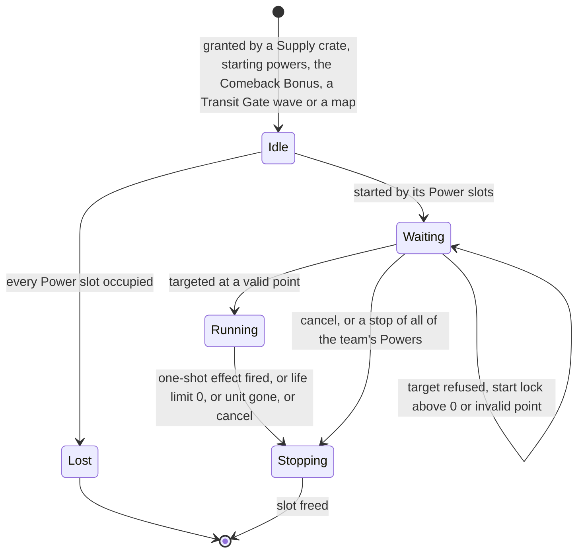
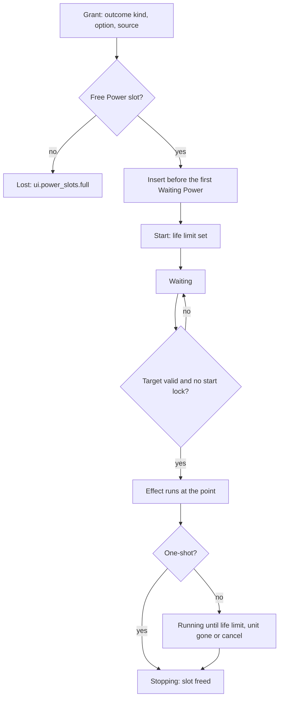

# Supply crates, powers and weapons

> Status: Reference · Prefix: R-CRATE · Related: [00 Reference overview](../00_reference_overview.md) · [01 Skirmish rules and modes](../01_skirmish_rules_and_modes/README.md) · [02 Units](../02_units/README.md) · [03 Buildings and world objects](../03_buildings_and_world_objects/README.md) · [05 Population flow](../05_population_flow.md) · [06 Controls, camera and commands](../06_controls_camera_and_commands/README.md) · [07 Bots](../07_bots/README.md) · [08 Maps and level design](../08_maps_and_level_design/README.md) · [12 Simulation model](../12_simulation_model/README.md)

This folder specifies the Supply crate, the 31 outcomes it can yield, the Powers that a team holds in its Power slots, and the weapons, projectiles and effect objects of a match. This file holds the folder index and the rules that every grant path shares: the outcome catalogue, the delivery modes, the Power slots, Power targeting, feedback, the map's excluded outcomes and the basic-outcomes option.

| File | Content | Requirement ids |
|---|---|---|
| [README.md](README.md) | conventions; the outcome catalogue; delivery modes; Power slots and the Power life cycle; Power targeting; feedback conventions; excluded outcomes; basic outcomes only; exclusion zones; bot use of Powers | R-CRATE-001 to R-CRATE-036 (numbers 001 to 099 reserved) |
| [crates_and_powers.md](crates_and_powers.md) | Supply crate options, drop timer, placement, falling, opening, expiry and resolution; outcome selection, validity and probabilities; starting powers; Comeback Bonus grants; the effect of every outcome; the counters matrix | R-CRATE-100 to R-CRATE-231 (numbers 100 to 399 reserved) |
| [weapons_and_projectiles.md](weapons_and_projectiles.md) | effect kinds, damage kinds and shot helpers; the explosion parameters; thrown weapons, grenades, firebomb canisters, airstrike target markers, rockets, laser bolts, turret rounds, shell casings, fireballs, shockwave rings, muzzle flashes, the Core Device pulse wave, Swarm streaks, lightning strikes, snowflakes, dust objects and the turret aim marker; the weapon summary | R-CRATE-400 to R-CRATE-511 (numbers 400 to 599 reserved) |

## 1 Purpose and player experience

The Supply crate is the strategic wildcard of a match. Crates fall from the sky at random intervals, drift slowly to the ground and are opened by the team that holds a strict local majority of Workers around them. Score-weighted placement drops them near trailing teams, so they also act as a catch-up lever. Nine crates in ten give the opening team a good outcome: a unit, a strike, a turret or a buff, usually held as a Power until the player aims it. One crate in ten turns into a bad outcome, a hazard owned by the Rogue faction (the Abductor: the Visitor faction) that threatens every team, the opener included.

A team holds its Powers in six Power slots, two while it is eliminated. A Power received while every slot is full is lost, so hoarding has a price. Starting powers and the Comeback Bonus hand out Powers through the same slots.

The weapons of this folder are the shared combat toolkit of units, turrets and outcomes: laser bolts for single targets, grenades, rockets and bombs that explode with one shared explosion model, piercing turret rounds, fireballs and firebombs that set Workers alight, and the shockwave ring that every explosion leaves behind.

### 1.1 Conventions used in this folder

- **Ticks and game speed.** The tick period is `ref.sim.tick_period` (0.1 s, 10 ticks per second at game speed 1), defined in [reference/12](../12_simulation_model/01_tick_timing_and_main_loop.md). Every simulation duration of this folder is an integer number of ticks, with seconds only as a derived display value (DEC-002). Game speed changes how many ticks run per unit of real time and never the tick arithmetic (DEC-039), so every per-tick rate, probability and growth of this folder scales with game speed (DEC-092). A duration written "n ticks (s s)" lasts n ticks at every speed.
- **Distances.** Distances are in world units (wu). "Horizontal" or "XZ" distance ignores height; "3-D" distance does not.
- **Draws.** `SimRng::NextUint`, `SimRng::NextUnit(r)` (uniform over [0, r)) and `SimRng::NextSigned(r)` (uniform over [−r/2, r/2)) are simulation draws in the forms of [reference/12](../12_simulation_model/07_randomness_and_integrity.md) R-SIM-605; each draw is its own statement, and a 3-vector draw takes x, then y, then z. `FxRng::*` draws are presentation draws. Every cosmetic effect of this folder draws from a presentation generator (DEC-013).
- **Teams.** Team slots 0 to 3 are player teams; `ref.sim.team.rogue_slot` (4) is the Rogue faction and `ref.sim.team.visitor_slot` (5) the Visitor faction ([reference/12 teams](../12_simulation_model/06_teams_and_player_commands.md)). "No team" means neutral. A team is **used** when its slot is not an unused slot.
- **Terms.** The **opening team** of a Supply crate is the team that owns the crate on the tick its opening completes. A **good outcome** goes to the opening team; a **bad outcome** is created for the Rogue faction, or the Visitor faction for the Abductor (R-CRATE-012). The **good pool** and the **bad pool** are the candidate lists of the two branches. A **basic outcome** is one of the seven outcomes marked basic in table 2.2-A; every other outcome is an **advanced outcome**.
- **Text.** Player-facing text is written as Species string ids; the new text of each id is in the string table of §4.2.

## 2 Rules

### 2.1 Shared conventions

**R-CRATE-001** (MUST) The values of the tuning tables of this folder are the reference tuning baseline (DEC-004), and the rules of this folder are the specification of record for Supply crates, Powers and weapons (DEC-005). A reference behaviour that looks accidental and that no Resolved decision corrects is stated as an explicit rule with a named key (DEC-006).

**R-CRATE-002** (MUST) Every Supply crate, Power and weapon rule draws only from the simulation generator for a gameplay decision and only from a presentation generator for a cosmetic effect (DEC-013). No object of this folder draws while it is constructed: every draw that initialises a new object is made once, in the explicit spawn step of the rule that creates it (DEC-652). A draw whose occurrence depends on a condition is its own statement inside that condition, and the owning rule states the condition.

**R-CRATE-003** (MUST) Every rejection loop and search of this folder has a capped number of attempts and a deterministic fallback; every outcome draw is a single draw over an explicit candidate list (DEC-014, DEC-021). When a candidate list is empty, the rule that draws from it grants nothing, and states so (see DEC-858).

**R-CRATE-004** (MUST) No rule of this folder stores a non-finite value: every division has an explicit guard, and the guarded sites keep the reference result wherever it is defined (DEC-653).

**R-CRATE-005** (MUST) All mutable state of this folder belongs to the match world: the live Supply crate count, the Abductor-used flag, the drop countdown, the Spawn Surge and Frenzy timers, every team's Power slots and the tick-clock speed state of Time Dilation and Time Rush. It is created at match start and never survives into the next match (DEC-011).

**R-CRATE-006** (MUST) Supply crates and every outcome exist only in a match. The Supply crate rules run in update slice `ref.sim.slice.supply_crates` (8), and the Power slots of each team advance in update slice `ref.sim.slice.power_slots` (1) ([reference/12](../12_simulation_model/04_containers_and_update_order.md) R-SIM-218).

### 2.2 The outcome catalogue

**R-CRATE-007** (MUST) A Supply crate yields one of the `ref.crate.outcome.count` (31) outcomes of table 2.2-A. The order of the table is the canonical outcome order: it is the order of every explicit candidate list that this folder builds (R-CRATE-003), the order of the map's exclusion list in the map editor, and the order of the outcome identifiers in the map schema. The outcome identifiers are those of the `CrateOutcome` enumeration ([CONVENTIONS](../../CONVENTIONS.md) §8.7); Species defines its own enumerator values, and no rule depends on them. The outcome catalogue is data: one entry per row of table 2.2-A, keyed by its identifier, with the fields of the catalogue schema ([data schemas](../../architecture/components/data_schemas/entity_audio_geometry_and_panel_schemas.md) DAT-264).

Table 2.2-A The outcome catalogue. "Good", "Bad", "Start" and "Comeback" give membership of the good pool (§2.10 of [crates and powers](crates_and_powers.md)), the bad pool, the starting-powers pool and the Comeback pool. "Power" delivery holds the outcome as a Power until its owner aims it; "immediate" applies it on the opening tick.

| # | Outcome | Identifier | Class | Good | Bad | Start | Comeback | Delivery as a good outcome |
|---|---|---|---|---|---|---|---|---|
| 1 | Strike team (outcome) | `CrateOutcome::StrikeTeam` | basic | yes | — | yes | — | Power: Strike team |
| 2 | Collector (outcome) | `CrateOutcome::Collector` | advanced | yes, while a Spawn Node exists | — | yes | — | Power: Collector |
| 3 | Builder (outcome) | `CrateOutcome::Builder` | basic | yes, while a Spawn Node exists | — | yes | — | Power: Builder |
| 4 | Transport (outcome) | `CrateOutcome::Transport` | basic | yes, except in Launch Race and on a map with a Transport cap | — | yes | — | Power: Transport |
| 5 | airstrike | `CrateOutcome::Airstrike` | basic | yes | — | yes | yes, twice | Power: airstrike, standard bombs |
| 6 | Missile Barrage | `CrateOutcome::MissileBarrage` | advanced | yes | — | yes | — | Power: Missile Barrage |
| 7 | Reinforcements | `CrateOutcome::Reinforcements` | basic | yes | — | — | — | immediate, at the crate |
| 8 | Shield | `CrateOutcome::Shield` | advanced | yes | — | yes | — | Power: Shield |
| 9 | Convert | `CrateOutcome::Convert` | advanced | yes | — | yes | — | Power: Convert |
| 10 | Speed Boost | `CrateOutcome::SpeedBoost` | advanced | yes | — | yes | — | Power: Speed Boost |
| 11 | gun turret (outcome) | `CrateOutcome::TurretGun` | basic | yes | — | yes | — | Power: turret, gun turret |
| 12 | Swarm | `CrateOutcome::Swarm` | advanced | never | yes | — | — | (forced only) Power: Swarm |
| 13 | Essence Grove | `CrateOutcome::EssenceGrove` | basic | yes | — | — | yes | immediate, at the crate; as a Comeback grant, Power: Essence Grove |
| 14 | Allegiance Scrambler | `CrateOutcome::AllegianceScrambler` | advanced | never | yes | — | — | (forced only) immediate, at the crate |
| 15 | Hive (outcome) | `CrateOutcome::Hive` | advanced | yes, below the Hive limit | yes | yes | — | Power: Hive |
| 16 | Sickness | `CrateOutcome::Sickness` | advanced | never | yes | — | — | none (R-CRATE-010) |
| 17 | Brood | `CrateOutcome::Brood` | advanced | yes | — | yes | yes | Power: Brood |
| 18 | meteor shower | `CrateOutcome::MeteorShower` | advanced | yes | — | yes | yes | Power: meteor shower |
| 19 | Blight Grove | `CrateOutcome::BlightGrove` | advanced | yes | yes | yes | yes | Power: Blight Grove |
| 20 | Supply Storm | `CrateOutcome::SupplyStorm` | advanced | yes, while fewer than 4 Supply crates exist | — | — | — | immediate, global |
| 21 | Spawn Surge | `CrateOutcome::SpawnSurge` | advanced | yes, while a Spawn Node exists | — | — | — | immediate, global |
| 22 | Frenzy | `CrateOutcome::Frenzy` | advanced | yes | — | — | — | immediate, global |
| 23 | Rocket Troops | `CrateOutcome::RocketTroops` | advanced | yes | — | — | — | immediate, the opening team, for the rest of the match |
| 24 | Fury | `CrateOutcome::Fury` | advanced | yes | — | yes | — | Power: Fury |
| 25 | rocket turret (outcome) | `CrateOutcome::TurretRocket` | advanced | yes, except in Siege | — | yes | — | Power: turret, rocket turret |
| 26 | flame turret (outcome) | `CrateOutcome::TurretFlame` | advanced | yes | — | yes | — | Power: turret, flame turret |
| 27 | Abductor (outcome) | `CrateOutcome::Abductor` | advanced | never | yes, once per match, never in Siege | — | — | (forced only) immediate, global |
| 28 | Spitter Plants (outcome) | `CrateOutcome::SpitterPlants` | advanced | never | yes | — | — | (forced only) immediate, at the crate |
| 29 | Firebomb Run | `CrateOutcome::FirebombRun` | advanced | yes | — | yes | — | Power: airstrike, firebomb canisters |
| 30 | Time Dilation | `CrateOutcome::TimeDilation` | advanced | yes | — | — | — | immediate, global |
| 31 | Time Rush | `CrateOutcome::TimeRush` | advanced | yes | — | — | — | immediate, global |

**R-CRATE-008** (MUST) The basic outcomes are exactly the `ref.crate.outcome.basic_count` (7) outcomes Strike team, Builder, Transport, airstrike, Reinforcements, gun turret and Essence Grove. The other 24 outcomes are advanced; the Collector outcome is advanced although it delivers a unit.

**R-CRATE-009** (MUST) The Rift Horror outcome and the inactive duel-vehicle and formation-size rewards are not part of the catalogue (DEC-057), and no Power kind without a targeting behaviour exists (DEC-552).

**R-CRATE-010** (MUST) A **forced outcome** replaces the outcome draw of one Supply crate. Only a tutorial step forces an outcome ([reference/11](../11_tutorial_and_help.md)); its forced outcomes are the airstrike and the Transport. A forced outcome is always delivered as a good outcome to the opening team, by the delivery of table 2.2-A, also for an outcome outside the good pool. The Sickness outcome has no good delivery, and the content build rejects a tutorial step that forces it (DEC-015).

**R-CRATE-011** (MUST) Each outcome has a string id prefix `crate.<outcome>` (CONVENTIONS §8.7), whose `.name` entry is its display name; an announcement id and a map-marker icon where table 2.6-A gives them; an outcome sound `sfx.crate.outcome.<outcome>` where table 2.6-A gives one; and, for each of the 20 outcomes that table 2.2-A can deliver as a Power, a Power help text `crate.<outcome>.tooltip` (string table §4.2), which the Power help tooltip shows while the Power is Waiting ([reference/06](../06_controls_camera_and_commands/selection_and_power_slots.md) R-CTRL-236). The outcome identifier, never the display name, is the key of the map's exclusion list and of every data file.

### 2.3 Delivery modes

**R-CRATE-012** (MUST) An outcome reaches the world by one of two deliveries:

1. **Power (deferred).** The outcome is added to the receiving team's Power slots as a Power of the kind of table 2.2-A (§2.4). Its owner aims it later at a point (players: [reference/06](../06_controls_camera_and_commands/README.md); bots: [reference/07](../07_bots/README.md)), and the effect runs there. The turret Power and the airstrike Power carry an option set at grant time: the turret type (gun, rocket or flame) and the bomb kind (standard or firebomb canisters).
2. **Immediate.** The effect is applied at the Supply crate's position, or across the whole map, on the opening tick.

The catalogue records the delivery of each outcome as a good outcome in its `delivery` field, one of `power`, `at_crate`, `global`, `opening_team` and `none`: the "Delivery as a good outcome" column of table 2.2-A ([data schemas](../../architecture/components/data_schemas/entity_audio_geometry_and_panel_schemas.md) DAT-264).

A good outcome is delivered to the opening team. A bad outcome is always immediate, at the crate's position, and every object it creates belongs to the Rogue faction, or to the Visitor faction for the Abductor, whichever team opened the crate; it threatens every team, the opening team included.

**R-CRATE-013** (MUST) When a team receives a Power from a Supply crate and the team is not the local team, every other participant shows the notice `crate.opened_by_team` with the team's name. The local opening team sees the received-Power pop-up of the Power slots panel instead ([reference/06](../06_controls_camera_and_commands/README.md)). An immediate outcome shows its own announcement (table 2.6-A) and no `crate.opened_by_team` notice.

### 2.4 Power slots

**R-CRATE-014** (MUST) Each team has `ref.power.slots.capacity` (6) Power slots, and `ref.power.slots.capacity_eliminated` (2) while it counts as eliminated for the Comeback Bonus ([reference/05](../05_population_flow.md) R-ECON-113). In a match the capacity ignores every research level (DEC-033), so the research-level icons `icon.power.slots_upgrade` (the Power-slots level) and `icon.power.laser` (the laser level) are drawn by no rule of a match (DEC-115). Every Power in the Idle, Waiting or Running state occupies one slot, the bot-only promotion Power included (R-CRATE-036).

**R-CRATE-015** (MUST) A Power granted while every slot is occupied is lost, and the owning player sees the no-overwrite message `ui.power_slots.full`. The same message is also shown when a grant fills the last free slot. A Comeback grant with no free slot is not made at all (R-CRATE-138).

**R-CRATE-016** (MUST) A new Power is inserted in front of the team's first Power that is still Waiting; when no Power is Waiting, it is appended after the last. The power bar shows the Powers in this order, and the number keys select a Power by its position in it ([reference/06](../06_controls_camera_and_commands/README.md)); the reference ordering is the default of DEC-556.

**R-CRATE-017** (MUST) Every Power moves through the states of figure 3-1:

1. **Idle**: created by a grant;
2. **Waiting**: started by its slot and waiting for a target;
3. **Running**: targeted, its effect placed or active;
4. **Stopping**: ended; it is removed from its slot.

A Power whose effect fires once (the airstrike in both bomb kinds, the Missile Barrage, the meteor shower, the Swarm, the Essence Grove, the Blight Grove, the Hive and the Brood) is stopped on the tick it is targeted, and in modes without the turret-cap option so is the turret Power (R-CRATE-024). In the blocked tutorial phases a one-shot Power stays Waiting instead, and the airstrike Power stays Running until its effect is gone (R-CRATE-021, see DEC-550).

**R-CRATE-018** (MUST) A Power with a start lock above 0 refuses to be targeted. The lock counts down by one tick per tick in the Power's advance. Only the starting powers set a lock: every Power the team holds after the starting-powers grant is locked for `ref.econ.start.power_lock_ticks` (300 ticks, 30.0 s, [reference/05](../05_population_flow.md)), and the Power slots panel shows the countdown (DEC-021).

**R-CRATE-019** (MUST) A Power's life limit is set when it starts:

| Power | Life limit | Ends early when |
|---|---|---|
| Strike team | `ref.unit.strike_team.life_ticks` ([strike_team.md](../02_units/strike_team.md)) | no Trooper of the Strike team is alive |
| Shield, Speed Boost, Convert, Fury | `ref.power.lifetime.buff_ticks` (300 ticks, 30 s) | no Worker still carries the Power's link ([worker.md](../02_units/worker.md) R-UNIT-124) |
| Transport, Collector, Builder | none | the unit is dead or no longer exists |
| turret, in a mode with the turret-cap option | none | the turret no longer exists, or another team that is not no team captures it (R-CRATE-024) |
| every other Power | none | — (it stops when targeted, R-CRATE-017) |

A life limit counts down by one tick per tick while it is above 0, and the Power stops when it reaches 0.

**R-CRATE-020** (MUST) Stopping a Power, by its life limit, by its owner's cancel command or by a stop of all of the team's Powers, applies:

| Power | Stop effect |
|---|---|
| Strike team | every Trooper takes a health change of −`ref.unit.strike_team.stop_damage` ([strike_team.md](../02_units/strike_team.md)) |
| Transport | the Transport takes a health change of −`ref.power.stop.damage` (1000), except in a tutorial ([transport.md](../02_units/transport.md)) |
| Builder | the Builder takes −`ref.unit.builder.stop_damage` ([builder.md](../02_units/builder.md)) |
| Collector | the Collector becomes vulnerable and takes −`ref.unit.collector.stop_damage` ([collector.md](../02_units/collector.md)) |
| turret | the turret takes structure damage of −`ref.bldg.turret.self_destruct_damage` (1000) only when it is owned by the Power's team; otherwise the turret is left as it is ([defences and props](../03_buildings_and_world_objects/defences_and_props.md) R-BLDG-424) |
| every other Power | none |

Stopping always frees the Power's slot, even when the unit or the turret survives the stop; such a unit or turret stays in the world with no slot. This is the reference default of DEC-551.

**R-CRATE-021** (MUST) During the first tutorial, and during the second tutorial until its bot is allowed to spawn, no Power can be stopped. A one-shot Power whose effect ends it at once (Missile Barrage, Swarm, Essence Grove, Blight Grove, Hive, Brood and meteor shower) therefore stays Waiting after it fires and can be fired again; the airstrike Power (both bomb kinds) is unaffected by the block, because it becomes Running when it fires and ends when its effect is gone ([reference/06](../06_controls_camera_and_commands/selection_and_power_slots.md) R-CTRL-210). This is the reference default of DEC-550.

**R-CRATE-022** (MUST) A Strike team that leaves through a Beam Dish is registered again as a new Power, with a new Power id and the last slot position; if the registration fails because the team's slots have dropped to two on elimination, the Strike team carries on with no Power ([strike_team.md](../02_units/strike_team.md) R-UNIT-339, DEC-551).

**R-CRATE-023** (MUST) A team's most recent Power id is simulation state, set when a Power is granted; the Power slots panel uses it for the received-Power pop-up, and a grant also records its source (a Supply crate, a reinforcement or the Comeback Bonus; a starting power records the Supply crate source) for that pop-up ([reference/06](../06_controls_camera_and_commands/selection_and_power_slots.md) R-CTRL-186; [reference/12](../12_simulation_model/07_randomness_and_integrity.md) R-SIM-663).

**R-CRATE-024** (MUST) A turret Power that places its turret in a mode with the turret-cap option (Launch Race and Flag Chain) stays Running: it keeps its slot and counts toward the mode's turret cap while its turret exists ([reference/01](../01_skirmish_rules_and_modes/README.md) R-MODE-077). While it runs, a turret that a team other than no team and other than the Power's team captures is destroyed by structure damage of −`ref.bldg.turret.self_destruct_damage` (1000), and the Power ends ([defences and props](../03_buildings_and_world_objects/defences_and_props.md) R-BLDG-424). In every other mode the turret Power is stopped when it places the turret, and the turret is an ordinary neutral turret (DEC-033).

### 2.5 Power targeting

**R-CRATE-025** (MUST) A Power is targeted at one ground point. The point must lie inside the map, and must satisfy the rule of table 2.5-A for the Power's kind. A player's or a bot's targeting of an invalid point is refused and the Power stays Waiting. A map's starting units that run as Powers ([reference/05](../05_population_flow.md) R-ECON-109) are placed without this test.

Table 2.5-A Valid target points.

| Power | Valid target point |
|---|---|
| Strike team, Transport | within `ref.power.target.unit_drop_radius` (75 wu) of a structure of a friendly team (the team itself or an ally) of kind Spawn Node, turret, Control Zone (or a kind that shares its type: Relic Base, Relic Spawn Zone, Flag post, Home post) or Transit Gate |
| Collector, Builder | within `ref.power.target.group_centre_radius` (100 wu) of the centre of one of the team's actor groups of the Strike team or Builder kind, or valid by the Strike team rule |
| Shield, Speed Boost, Convert, Fury | at least one actor of the owner's team within `ref.power.effect_range` (70 wu) of the point |
| turret (every type) | not inside an exclusion zone that blocks Powers (R-CRATE-034); no structure whose hit volume meets a sphere of `ref.power.target.turret_clearance` (10 wu) at the point; not within `ref.power.target.turret_gate_clearance` (400 wu) of a Transit Gate owned by a team that is not friendly; not within `ref.power.target.turret_node_clearance` (200 wu) of a Spawn Node owned by a team that is not friendly |
| airstrike (both bomb kinds), Missile Barrage, Swarm, Essence Grove, Blight Grove, Hive, Brood, meteor shower | anywhere, except inside an exclusion zone that blocks Powers |

**R-CRATE-026** (MUST) `ref.power.effect_range` (70 wu) is also the radius in which the Shield, Speed Boost, Convert and Fury Powers link Workers (§2.15 of [crates and powers](crates_and_powers.md)) and the base of the meteor shower spread ([hazards and projectiles](../02_units/hazards_and_projectiles.md) R-UNIT-731).

**R-CRATE-027** (MUST) When a Power is targeted and still exists with an object to follow, the Power slots panel registers a Power marker with the Power's icon (table 2.6-A) for every participant, except for the turret Power. The Shield, Speed Boost, Convert and Fury markers follow the centroid of the Workers linked to the Power. These markers are presentation ([reference/06](../06_controls_camera_and_commands/README.md)).

### 2.6 Feedback conventions

**R-CRATE-028** (MUST) An outcome's feedback consists of three presentation events, emitted at the tick where the outcome's rule fires (DEC-007):

1. **Announcement**: a centre-screen message of the outcome's announcement id, shown for `ref.sim.world.message_expiry` (3.0 s of real time, [reference/12](../12_simulation_model/04_containers_and_update_order.md)); a message flagged no-overwrite suppresses later messages while it shows. An announcement that names a team shows to every participant; a global outcome names no team.
2. **Map marker**: a fixed marker at the effect's position with the outcome's icon, in the colour of the team the effect belongs to; it is removed when its accumulated on-screen time for the local player reaches `ref.power.marker.lifetime_s` (8 s of real time), tested once the player has seen it, so time off screen does not count ([reference/06](../06_controls_camera_and_commands/cursor_and_markers.md) R-CTRL-381).
3. **Outcome sound**: the outcome's sound at the effect's position, for the effect's team, or for no team for a global outcome ([reference/10](../10_audio_design/README.md)).

Table 2.6-A gives each outcome's events; "—" means none.

Table 2.6-A Outcome feedback.

| Outcome | Announcement (opening team) | Announcement (Rogue faction as the effect's team) | Map marker | Outcome sound |
|---|---|---|---|---|
| Strike team | — (the `crate.opened_by_team` notice) | — | Power marker `icon.power.strike_team` | `sfx.crate.outcome.strike_team` |
| Collector | — | — | Power marker `icon.power.collector` | `sfx.crate.outcome.collector` |
| Builder | — | — | Power marker `icon.power.builder` | — |
| Transport | — | — | Power marker `icon.power.transport` | `sfx.crate.outcome.transport` |
| airstrike | `crate.airstrike.announce` | `crate.airstrike.announce_rogue` | `icon.power.airstrike` | `sfx.crate.outcome.airstrike` |
| Missile Barrage | `crate.missile_barrage.announce` | `crate.missile_barrage.announce_rogue` | `icon.power.missile_barrage` | `sfx.crate.outcome.missile_barrage` |
| Reinforcements | `crate.reinforcements.announce` | `crate.reinforcements.announce_rogue` | `icon.power.workers` | `sfx.crate.outcome.reinforcements` |
| Shield | `crate.shield.announce` | the same id, naming the Rogue faction | `icon.power.shield` | `sfx.crate.outcome.shield` |
| Convert | `crate.convert.announce` | the same id, naming the Rogue faction | `icon.power.convert` | `sfx.crate.outcome.convert` |
| Speed Boost | `crate.speed_boost.announce` | the same id, naming the Rogue faction | `icon.power.speed_boost` | `sfx.crate.outcome.speed_boost` |
| gun turret, rocket turret, flame turret | `crate.turret.announce` with the turret type's name | the same id, naming the Rogue faction | `icon.power.gun_turret` | `sfx.crate.outcome.gun_turret` for all three types |
| Swarm | `crate.swarm.announce` | `crate.swarm.announce` | `icon.power.swarm` | `sfx.crate.outcome.swarm` |
| Essence Grove | `crate.essence_grove.announce`, naming no team | `crate.essence_grove.announce` | `icon.power.essence_grove`, in the Rogue faction's colour when the outcome comes from a Supply crate | `sfx.crate.outcome.essence_grove` |
| Allegiance Scrambler | `crate.allegiance_scrambler.announce` | `crate.allegiance_scrambler.announce` | `icon.power.allegiance_scrambler` | `sfx.crate.outcome.allegiance_scrambler` |
| Hive | `crate.hive.announce` | `crate.hive.announce_rogue` | `icon.power.hive` | `sfx.crate.outcome.hive` |
| Sickness | `crate.sickness.announce` | `crate.sickness.announce` | `icon.power.sickness` | `sfx.crate.outcome.sickness` |
| Brood | `crate.brood.announce` | `crate.brood.announce_rogue` | `icon.power.brood` | `sfx.crate.outcome.brood` |
| meteor shower | `crate.meteor_shower.announce` | `crate.meteor_shower.announce` | `icon.power.meteor_shower` | `sfx.crate.outcome.meteor_shower` |
| Blight Grove | `crate.blight_grove.announce` | `crate.blight_grove.announce_rogue` | `icon.power.blight_grove` | `sfx.crate.outcome.blight_grove` |
| Supply Storm | `crate.supply_storm.announce` | the same id | — | `sfx.crate.outcome.supply_storm`, for no team |
| Spawn Surge | `crate.spawn_surge.announce` | the same id | — | `sfx.crate.outcome.spawn_surge` |
| Frenzy | `crate.frenzy.announce` | the same id | — | `sfx.crate.outcome.frenzy` |
| Rocket Troops | `crate.rocket_troops.announce` | the same id, naming the Rogue faction | — | `sfx.crate.outcome.rocket_troops` |
| Fury | `crate.fury.announce` | the same id, naming the Rogue faction | `icon.power.fury` | `sfx.crate.outcome.fury`, for no team |
| Abductor | `crate.abductor.announce` | `crate.abductor.announce` | — | `sfx.crate.outcome.abductor`, for no team |
| Spitter Plants | `crate.spitter_plants.announce` | `crate.spitter_plants.announce` | `icon.power.spitter_plants` | `sfx.crate.outcome.spitter_plants`, for no team |
| Firebomb Run | `crate.firebomb_run.announce` | `crate.firebomb_run.announce_rogue` | `icon.power.airstrike` | `sfx.crate.outcome.airstrike` |
| Time Dilation | `crate.time_dilation.announce` | the same id | — | — |
| Time Rush | `crate.time_rush.announce` | the same id | — | — |

The Rogue-faction column applies when the Rogue faction is the team the effect belongs to: for a bad outcome, and when the Rogue faction's own Workers open a Supply crate (R-CRATE-123). The Spawn Surge and Frenzy outcomes also show a HUD countdown ([reference/01](../01_skirmish_rules_and_modes/README.md) R-MODE-067).

### 2.7 Excluded outcomes, basic outcomes only and exclusion zones

**R-CRATE-029** (MUST) A map definition may list **excluded outcomes**: a set of outcome identifiers of table 2.2-A. The map schema lists them by identifier, and the content build rejects an identifier that is not an outcome of the catalogue (DEC-015). A map with no list excludes nothing, and a map that excludes nothing stores no list. The map editor shows one switch per outcome, in catalogue order, with the outcome's display name ([reference/08](../08_maps_and_level_design/README.md)).

**R-CRATE-030** (MUST) An excluded outcome is never drawn by the good pool, by the bad pool or by the starting-powers draw: every Supply crate outcome, the bad outcomes included, respects the list (DEC-107). The Comeback pool ignores the list; this is the reference default of DEC-452.

**R-CRATE-031** (MUST) The match option **basic outcomes only** (`match.options.basic_crates`, default off, [reference/01](../01_skirmish_rules_and_modes/README.md)) has the effects of table 2.7-A. It is part of the match setup and is the same for every participant. It does not carry over: it is reset to off at the end of every match and when the lobby is left; the second tutorial switches it on at its end step, the same step that releases its bots ([reference/11](../11_tutorial_and_help.md) R-TUT-117).

Table 2.7-A Basic outcomes only.

| Aspect | Off (default) | On |
|---|---|---|
| Good pool | every valid good outcome | only the valid basic outcomes |
| Bad outcomes | 1 − `ref.crate.open.good_share` (10 %) of openings | never |
| Starting-powers pool | the 18 outcomes of `ref.power.start.pool` that are valid | the 5 basic ones among them: Strike team, Builder, Transport, airstrike, gun turret |
| Comeback pool | `ref.power.comeback.pool` | `ref.power.comeback.pool_basic` |

**R-CRATE-032** (MUST) An **exclusion zone** is a map structure with a radius, by default `ref.bldg.exclusion_zone.default_size` (300 wu), and a flag that says whether it blocks Powers, by default clear ([defences and props](../03_buildings_and_world_objects/defences_and_props.md) R-BLDG-462). A point is **restricted for drops** when it lies within the radius (horizontal distance) of any exclusion zone, and **restricted for Powers** when it lies within the radius of an exclusion zone whose flag is set.

**R-CRATE-033** (MUST) A random Supply crate drop never lands at a point restricted for drops; a score-weighted drop does not test exclusion zones (§2.3 of [crates and powers](crates_and_powers.md)).

**R-CRATE-034** (MUST) Power targeting refuses a point restricted for Powers for the turret Power and for every Power of the last row of table 2.5-A; the other Powers ignore exclusion zones.

### 2.8 Bots and Powers

**R-CRATE-035** (MUST) A bot uses its Powers through one handler per Power kind ([reference/07](../07_bots/README.md)): Strike team, Collector, Builder, Transport, airstrike (both bomb kinds), Missile Barrage, the buff Powers (one handler shared by the Shield, Convert, Speed Boost and Fury), turret (every type), Essence Grove (reached only by a Comeback grant), Hive, Brood, meteor shower and Blight Grove. The immediate outcomes need no handler, and no handler exists for the Sickness or for the Swarm: the only forced outcomes are a tutorial's, which go to the tutorial player, so no source gives a bot a Swarm Power ([reference/07](../07_bots/04_powers_and_unit_policies.md) R-BOT-101).

**R-CRATE-036** (MUST) A bot can also start the bot-only promotion Power, which occupies a free Power slot like every other Power while it is Waiting and fails with no message when every slot is occupied ([reference/07](../07_bots/04_powers_and_unit_policies.md) R-BOT-107). The Powers that place units (Strike team, Collector, Builder and Transport) mark the actor group they create as under player control only for a team that is not a bot team ([reference/07](../07_bots/README.md) R-BOT-019).

## 3 States and flows

Caption: Figure 3-1, the Power life cycle (R-CRATE-014 to R-CRATE-024).

Caption: Figure 3-2, from grant to slot release (R-CRATE-015 to R-CRATE-020).

## 4 Tuning table

### 4.1 Keys owned by this file

| key | value | unit | range or notes | requirement | DEC |
|---|---|---|---|---|---|
| `ref.crate.outcome.count` | 31 | outcomes | the catalogue of table 2.2-A | R-CRATE-007 | DEC-021, DEC-057 |
| `ref.crate.outcome.basic_count` | 7 | outcomes | Strike team, Builder, Transport, airstrike, Reinforcements, gun turret, Essence Grove | R-CRATE-008 | DEC-021 |
| `ref.power.slots.capacity` | 6 | Power slots | per team; research has no effect in a match | R-CRATE-014 | DEC-033 |
| `ref.power.slots.capacity_eliminated` | 2 | Power slots | while the team counts as eliminated for the Comeback Bonus | R-CRATE-014 | DEC-033 |
| `ref.power.lifetime.buff_ticks` | 300 | ticks | 30 s; Shield, Speed Boost, Convert and Fury | R-CRATE-019 | DEC-002 |
| `ref.power.stop.damage` | 1000 | health | the Transport's health change when its Power stops | R-CRATE-020 | DEC-551 |
| `ref.power.effect_range` | 70 | wu | horizontal; buff targeting and linking radius | R-CRATE-025, R-CRATE-026 | — |
| `ref.power.target.unit_drop_radius` | 75 | wu | Strike team and Transport targeting | R-CRATE-025 | — |
| `ref.power.target.group_centre_radius` | 100 | wu | Collector and Builder targeting | R-CRATE-025 | — |
| `ref.power.target.turret_clearance` | 10 | wu | sphere radius at the target point | R-CRATE-025 | — |
| `ref.power.target.turret_gate_clearance` | 400 | wu | from a Transit Gate of a team that is not friendly | R-CRATE-025 | — |
| `ref.power.target.turret_node_clearance` | 200 | wu | from a Spawn Node of a team that is not friendly | R-CRATE-025 | — |
| `ref.power.marker.lifetime_s` | 8 | s of real time | presentation; accumulated on-screen time, tested once the local player has seen the marker | R-CRATE-028 | DEC-007 |

The starting-powers and Comeback pools (`ref.power.start.pool`, `ref.power.start.excluded`, `ref.power.comeback.pool`, `ref.power.comeback.pool_basic`) and the good share `ref.crate.open.good_share` are owned by [crates and powers](crates_and_powers.md) §4.

### 4.2 String table

New player-facing text of this folder. `{team}` is the team's name and `{turret}` the turret type's name. The `crate.<outcome>.tooltip` texts are the Power help texts of R-CRATE-011. The text of each outcome name `crate.<outcome>.name` (R-CRATE-011) is the outcome's Species term of table 2.2-A without the "(outcome)" suffix; for example `crate.time_rush.name` is "Time Rush" and `crate.turret_gun.name` is "gun turret".

| String id | Text |
|---|---|
| `crate.drop_announce` | Supply crate incoming |
| `crate.opened_by_team` | {team} opened a Supply crate |
| `crate.airstrike.announce` | {team} calls in an airstrike |
| `crate.airstrike.announce_rogue` | Airstrike incoming |
| `crate.missile_barrage.announce` | {team} launches a Missile Barrage |
| `crate.missile_barrage.announce_rogue` | Missile Barrage incoming |
| `crate.reinforcements.announce` | {team} receives Reinforcements |
| `crate.reinforcements.announce_rogue` | Hostile Workers arrive |
| `crate.shield.announce` | {team} raises a Shield |
| `crate.convert.announce` | {team} uses Convert |
| `crate.speed_boost.announce` | {team} uses Speed Boost |
| `crate.turret.announce` | {team} places a {turret} |
| `crate.swarm.announce` | Swarm outbreak |
| `crate.essence_grove.announce` | An Essence Grove takes root |
| `crate.allegiance_scrambler.announce` | Allegiance Scrambler |
| `crate.hive.announce` | {team} raises a Hive |
| `crate.hive.announce_rogue` | A Hive appears |
| `crate.sickness.announce` | Sickness outbreak |
| `crate.brood.announce` | {team} releases a Brood |
| `crate.brood.announce_rogue` | A Brood appears |
| `crate.meteor_shower.announce` | {team} calls down a meteor shower |
| `crate.blight_grove.announce` | {team} plants a Blight Grove |
| `crate.blight_grove.announce_rogue` | A Blight Grove spreads |
| `crate.supply_storm.announce` | Supply Storm |
| `crate.spawn_surge.announce` | Spawn Surge |
| `crate.frenzy.announce` | Frenzy |
| `crate.rocket_troops.announce` | {team} gains Rocket Troops |
| `crate.fury.announce` | {team} uses Fury |
| `crate.abductor.announce` | The Visitors arrive |
| `crate.spitter_plants.announce` | Spitter Plants sprout |
| `crate.firebomb_run.announce` | Firebombs inbound! |
| `crate.firebomb_run.announce_rogue` | Firebombs incoming |
| `crate.time_dilation.announce` | Time slows down |
| `crate.time_rush.announce` | Time speeds up |
| `crate.strike_team.tooltip` | Strike team: drop three Troopers next to a friendly Spawn Node, turret, zone or Transit Gate. |
| `crate.collector.tooltip` | Collector: place a flying Collector near one of your Strike teams or Builders. It gathers Essence orbs for your Spawn Nodes. |
| `crate.builder.tooltip` | Builder: place a Builder drone near one of your Strike teams or Builders. It tows Essence orbs to your Spawn Nodes. |
| `crate.transport.tooltip` | Transport: drop a Transport next to a friendly Spawn Node, turret, zone or Transit Gate. It carries up to 100 Workers. |
| `crate.airstrike.tooltip` | Airstrike: pick a target point. Bombers drop bombs on the markers thrown there. |
| `crate.missile_barrage.tooltip` | Missile Barrage: pick a target point. Ten missiles strike around it, hurting every team. |
| `crate.shield.tooltip` | Shield: target your Workers. Each one blocks damage until an explosion breaks its Shield. |
| `crate.convert.tooltip` | Convert: target your Workers. Their laser bolts turn enemy Workers to your side. |
| `crate.speed_boost.tooltip` | Speed Boost: target your Workers. They run twice as fast and set trees alight. |
| `crate.turret_gun.tooltip` | Gun turret: place a turret. Man its ports with Workers to fire it. |
| `crate.swarm.tooltip` | Swarm: pick a target point. A swarm attacks every team except the Rogue faction. |
| `crate.essence_grove.tooltip` | Essence Grove: plant trees that drop Essence orbs. |
| `crate.hive.tooltip` | Hive: place two Rogue faction Hives whose ants attack every other team, yours included. |
| `crate.brood.tooltip` | Brood: launch Seed Pods that burst into creatures fighting for you. |
| `crate.meteor_shower.tooltip` | Meteor shower: pick a target area. Meteors hit every team in it. |
| `crate.blight_grove.tooltip` | Blight Grove: plant blight trees that kill nearby Workers of every team except the Rogue faction. |
| `crate.fury.tooltip` | Fury: target your Workers. They move faster, take less damage and fire non-stop. |
| `crate.turret_rocket.tooltip` | Rocket turret: place a turret. Man its ports with Workers to fire rockets. |
| `crate.turret_flame.tooltip` | Flame turret: place a turret. Man its ports with Workers to fire fireballs. |
| `crate.firebomb_run.tooltip` | Firebomb Run: pick a target point. Bombers drop firebombs that set Workers and trees alight. |

The Power slots messages `ui.power_slots.ready`, `ui.power_slots.not_available`, `ui.power_slots.cancelled`, `ui.power_slots.unlocked`, `ui.power_slots.improved`, `ui.power_slots.full` and `ui.power_slots.comeback_full` (CONVENTIONS §8.10) are shown by the Power slots panel ([reference/06](../06_controls_camera_and_commands/README.md)); this folder fires `ui.power_slots.full` (R-CRATE-015) and `ui.power_slots.comeback_full` (R-CRATE-138).

### 4.3 Keys cited here and defined elsewhere

| owner | keys |
|---|---|
| [reference/12 tick timing](../12_simulation_model/01_tick_timing_and_main_loop.md) | `ref.sim.tick_period`, `ref.sim.slice.supply_crates`, `ref.sim.slice.power_slots` |
| [reference/12 containers and update order](../12_simulation_model/04_containers_and_update_order.md) | `ref.sim.world.message_expiry` |
| [reference/12 teams](../12_simulation_model/06_teams_and_player_commands.md) | `ref.sim.team.rogue_slot`, `ref.sim.team.visitor_slot` |
| [reference/05](../05_population_flow.md) | `ref.econ.start.power_lock_ticks` |
| [strike_team.md](../02_units/strike_team.md) | `ref.unit.strike_team.life_ticks`, `ref.unit.strike_team.stop_damage` |
| [builder.md](../02_units/builder.md) | `ref.unit.builder.stop_damage` |
| [collector.md](../02_units/collector.md) | `ref.unit.collector.stop_damage` |
| [defences and props](../03_buildings_and_world_objects/defences_and_props.md) | `ref.bldg.turret.self_destruct_damage`, `ref.bldg.exclusion_zone.default_size` |

## 5 Edge cases and interactions

1. **Full slots lose the outcome, not the crate.** A team with six Powers that opens a crate whose good outcome is a Power still opens the crate, and the outcome is lost; an immediate outcome still applies (R-CRATE-012, R-CRATE-015).
2. **Eliminated teams.** On elimination the capacity drops to two while the team may hold up to six Powers; it keeps them, but receives no new Power until it holds fewer than two (R-CRATE-014).
3. **Units without a slot.** A cancelled Transport in a tutorial, and a turret that another team holds when its Power is cancelled, stay in the world with no slot and outside the six-slot limit (R-CRATE-020, DEC-551).
4. **Tutorial one-shots.** In the first tutorial, a one-shot Power can be fired again and again, because its stop is blocked (R-CRATE-021, DEC-550).
5. **Turret Powers in turret-cap modes.** A crate turret in Launch Race or Flag Chain occupies a slot until it is destroyed, and self-destructs when another team captures it (R-CRATE-024).
6. **Rogue faction Workers.** Workers converted to the Rogue faction can open a crate, and the Rogue faction then receives a good outcome and its Rogue-faction announcement (R-CRATE-028).
7. **Exclusion zones on the reference maps.** On the reference maps every exclusion zone of a Siege map blocks Powers, and every exclusion zone of the other modes blocks drops only ([reference/08](../08_maps_and_level_design/README.md)).

## 6 Acceptance criteria

- **AC-R-01** (R-CRATE-014, R-CRATE-015) Given a team with 6 Powers, when a Supply crate gives it a Power outcome, then the Power is lost, `ui.power_slots.full` shows for the owning player, and the slot count stays 6.
- **AC-R-02** (R-CRATE-014) Given a team that counts as eliminated and holds 3 Powers, when a Supply crate gives it a Power outcome, then the Power is lost.
- **AC-R-03** (R-CRATE-016) Given Powers A (Running), B (Waiting) and C (Waiting) in that order, when Power D is granted, then the order is A, D, B, C.
- **AC-R-04** (R-CRATE-018) Given a team with two starting powers, then for 300 ticks after the grant every targeting of either Power is refused, and on tick 301 it succeeds.
- **AC-R-05** (R-CRATE-019) Given a Shield Power targeted at tick T over 5 Workers, then it stops at tick T + 300 at the latest, and at the first tick on which no Worker carries its link.
- **AC-R-06** (R-CRATE-020) Given a turret Power whose neutral turret has not been manned, when its owner cancels the Power, then the slot is freed and the turret stays undamaged.
- **AC-R-07** (R-CRATE-025) Vector table for a turret Power targeted on a flat map with an enemy Spawn Node at (1000, 1000):

| Target | Valid |
|---|---|
| (1000, 1199) | no (199 wu from the Spawn Node) |
| (1000, 1201) | yes, when no structure is within the clearance sphere |
| inside an exclusion zone with the blocking flag set | no |
| inside an exclusion zone without the flag | yes |

- **AC-R-08** (R-CRATE-030) Given a map that excludes the Swarm, then over 100,000 openings with basic outcomes only off, no Swarm appears and every other bad outcome has probability 0.1 ÷ 6 when the Abductor is still available.
- **AC-R-09** (R-CRATE-031) Given basic outcomes only on, then over 100,000 openings no bad outcome and no advanced outcome appears.
- **AC-R-10** (R-CRATE-007, R-CRATE-008) The catalogue holds 31 outcomes, 7 basic; the content build rejects a map that excludes an unknown identifier.

## 7 Dependencies

- **Reference documents:** [crates and powers](crates_and_powers.md); [weapons and projectiles](weapons_and_projectiles.md); [reference/01](../01_skirmish_rules_and_modes/README.md) (the basic-outcomes option, the turret-cap rule R-MODE-077, the HUD timers); [reference/02 units](../02_units/README.md), [strike_team.md](../02_units/strike_team.md), [transport.md](../02_units/transport.md), [collector.md](../02_units/collector.md), [builder.md](../02_units/builder.md), [worker.md](../02_units/worker.md) (the units and Worker links that Powers create); [hazards and projectiles](../02_units/hazards_and_projectiles.md); [defences and props](../03_buildings_and_world_objects/defences_and_props.md) (exclusion zones, turrets); [reference/05](../05_population_flow.md) (elimination for the Comeback Bonus, starting-power lock, map starting units as Powers); [reference/06](../06_controls_camera_and_commands/README.md) (the Power slots panel, markers, aiming and cancelling); [reference/07](../07_bots/README.md) (bot use of Powers); [reference/08](../08_maps_and_level_design/README.md) (the exclusion list in the map schema and editor); [reference/10](../10_audio_design/README.md) (outcome sounds); [reference/11](../11_tutorial_and_help.md) (forced outcomes); [reference/12](../12_simulation_model/README.md) (slices, draws, match state).
- **Engine components:** [data schemas](../../architecture/components/data_schemas/README.md) (the map's excluded outcomes; the outcome catalogue, DAT-264); [UI framework](../../architecture/components/ui_framework/README.md) (the Power slots panel, ADR-032); [audio engine](../../architecture/components/audio_engine/README.md).
- **Assets:** the outcome icons `icon.power.strike_team`, `icon.power.collector`, `icon.power.builder`, `icon.power.transport`, `icon.power.airstrike`, `icon.power.missile_barrage`, `icon.power.workers`, `icon.power.shield`, `icon.power.convert`, `icon.power.speed_boost`, `icon.power.gun_turret`, `icon.power.swarm`, `icon.power.essence_grove`, `icon.power.allegiance_scrambler`, `icon.power.hive`, `icon.power.sickness`, `icon.power.brood`, `icon.power.meteor_shower`, `icon.power.blight_grove`, `icon.power.fury`, `icon.power.spitter_plants`; the Power slots panel art `icon.hud.slot_empty`, `icon.hud.slot_discard`, `icon.hud.icon_halo`, `icon.hud.transport_state`, `icon.power.slots_upgrade`, `icon.power.leader`, `icon.power.grenade`, `icon.power.rocket`, `icon.power.laser`, `marker.team_disc`, `uitex.panel_accent`, `uitex.panel_neutral`, `glyph.key.tab`, `glyph.pad.shoulder_left`; the cursors `cursor.select`, `cursor.highlight`, `cursor.place`; the outcome sounds of table 2.6-A; the Power slots sounds `sfx.ui.power_input.begin`, `sfx.ui.power_input.confirm`, `sfx.ui.power_slots.discard`, `sfx.ui.power_slots.icon_hover`.

## 8 Open decisions

- DEC-550 — Power cancellation in the tutorials (R-CRATE-021).
- DEC-551 — Units that outlive their Power slot (R-CRATE-020, R-CRATE-022).
- DEC-556 — Power slot order (R-CRATE-016).
- DEC-452 — Comeback Bonus pool and the map's excluded outcomes (R-CRATE-030).
- DEC-858 — Empty outcome lists: an empty draw grants nothing (R-CRATE-003).
- DEC-115 — Fixed match research levels: no research-level icon is drawn in a match (R-CRATE-014).

Resolved decisions applied here: DEC-002, DEC-004, DEC-005, DEC-006, DEC-007, DEC-011, DEC-013, DEC-014, DEC-015, DEC-021, DEC-033, DEC-039, DEC-092, DEC-107, DEC-652, DEC-653. Dropped: DEC-057, DEC-552.
