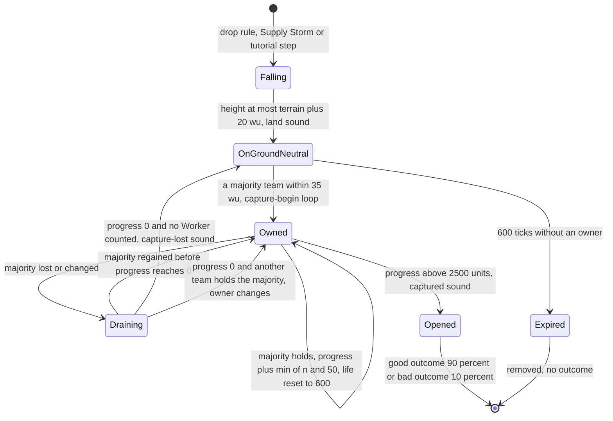
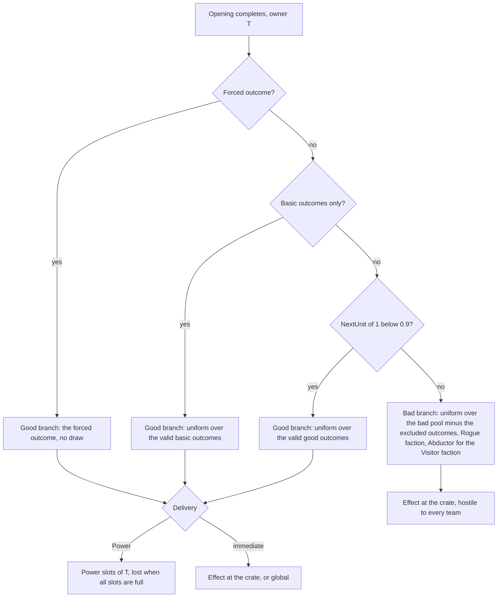
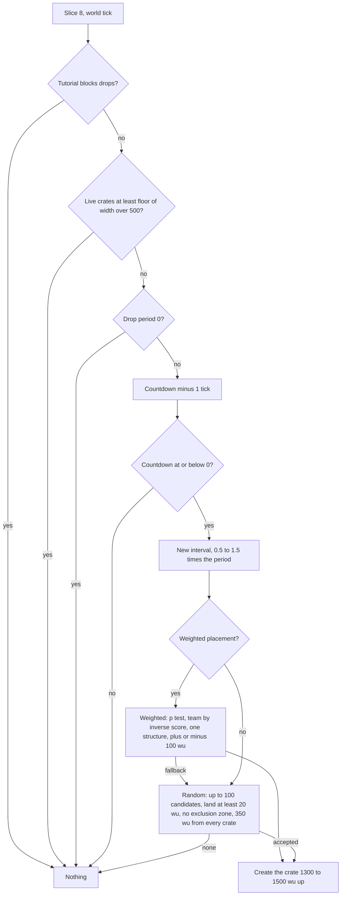
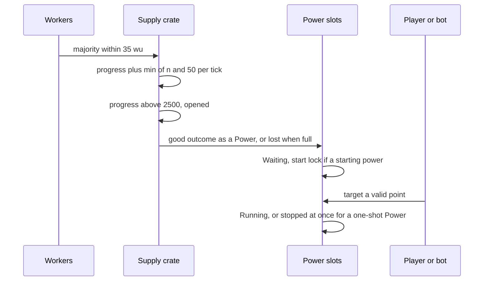

# Supply crates and powers

> Status: Reference · Prefix: R-CRATE · Related: [folder README](README.md) · [weapons and projectiles](weapons_and_projectiles.md) · [01 Skirmish rules and modes](../01_skirmish_rules_and_modes/README.md) · [02 Units](../02_units/README.md) · [hazards and projectiles](../02_units/hazards_and_projectiles.md) · [creatures](../02_units/creatures.md) · [03 Buildings and world objects](../03_buildings_and_world_objects/README.md) · [05 Population flow](../05_population_flow.md) · [07 Bots](../07_bots/README.md) · [12 Simulation model](../12_simulation_model/README.md)

This file specifies the life of a Supply crate from its drop to its opening or expiry, the choice of its outcome, the two other grant paths (starting powers and the Comeback Bonus), and the effect of every outcome of the catalogue ([README](README.md) table 2.2-A). The Power slots, Power targeting, the feedback conventions, the map's excluded outcomes and the basic-outcomes option are shared rules of the [README](README.md); the projectiles that outcomes release are in [weapons and projectiles](weapons_and_projectiles.md).

## 1 Purpose and player experience

A Supply crate appears high above the map, announced once per match, and drifts down for about half a minute inside a translucent bubble with a fiery trail, over a rotating landing marker on the ground. Players see where it will land and race Workers to it. On the ground, the team with the most Workers within a short radius takes ownership and fills an opening ring; a rival must first drain that ring by outnumbering the owner before its own ring starts. With 50 or more Workers a crate opens in about five seconds; with a handful it takes minutes. A crate that nobody holds expires after a minute on the ground.

When it opens, nine times in ten the opening team receives a good outcome: a Power to aim later (a unit, a strike, a turret or a buff for its Workers) or an immediate effect (50 to 99 Workers, a grove of Essence-orb trees, a burst of extra crates, a map-wide Spawn Surge, a change of game speed). One time in ten a bad outcome erupts at the crate instead: a homing Swarm, Sickness, a Hive, a Blight Grove, Spitter Plants, the Allegiance Scrambler or, once per match, the Abductor, which threaten every team.

## 2 Rules

### 2.1 Options that control Supply crates

**R-CRATE-100** (MUST) These match and map settings control Supply crates. Each is a typed option with an explicit default per mode (DEC-073):

| Setting | Values and default | Owner | Effect here |
|---|---|---|---|
| crate drop period | seconds, 0 to 300 in steps of 10; default `ref.crate.drop.period_default_s` (40 s) in all six modes; 0 means no Supply crates | lobby option, [reference/01](../01_skirmish_rules_and_modes/README.md) | the mean drop interval (R-CRATE-103) |
| crate placement | random or weighted; default `ref.match.option.crate_placement` | lobby option, [reference/01](../01_skirmish_rules_and_modes/README.md) | the placement rule (R-CRATE-105) |
| starting powers | 0 to 3; default `ref.econ.start.powers` (0); Spawn Control and Zone Control only | lobby option, [reference/05](../05_population_flow.md) R-ECON-110 | §2.12 |
| Comeback Bonus | on or off; on by default | lobby option, [reference/01](../01_skirmish_rules_and_modes/README.md), [reference/05](../05_population_flow.md) R-ECON-112 | §2.13 |
| basic outcomes only | off by default | lobby option ([README](README.md) R-CRATE-031) | the pools and the bad branch |
| excluded outcomes | a set of outcomes; none by default | map definition ([README](README.md) R-CRATE-029) | validity (R-CRATE-125) |
| Transport cap of the map's Transit Gates | absent, 0, a number, or unlimited (DEC-120) | map definition, [reference/05](../05_population_flow.md) | validity of the Transport outcome (R-CRATE-125) |
| exclusion zones | map structures with a radius and a Power-blocking flag | map definition ([README](README.md) R-CRATE-032) | random placement (R-CRATE-107); Power targeting |

**R-CRATE-101** (MUST) A map definition never places a Supply crate, and no map data sets a Supply crate's outcome: Supply crates exist only as the drop rule, the Supply Storm outcome and tutorial steps create them ([reference/03](../03_buildings_and_world_objects/README.md) R-BLDG-011).

### 2.2 Drop timer

**R-CRATE-102** (MUST) The drop rule runs once per world tick in update slice `ref.sim.slice.supply_crates` (8). It does nothing during the first tutorial, and during the second tutorial until its bot is released ([reference/11](../11_tutorial_and_help.md)). It is not gated by the grace period; it runs on every tick on which the world runs, and no world tick runs while the world is held ([reference/12](../12_simulation_model/01_tick_timing_and_main_loop.md) R-SIM-550). Drops that the grace period does not stop are the reference default of DEC-116.

**R-CRATE-103** (MUST) Each run of the drop rule:

```
maxCrates := floor(world size x / ref.crate.drop.map_width_per_crate)      # 500 wu; the x size only
if liveCrates >= maxCrates: return                                           # the countdown is frozen at the cap
D := crate drop period in seconds; if D = 0: return                          # no Supply crates
if countdown is unset: countdown := Interval(D)                              # the first interval
countdown -= 1                                                               # one tick
if countdown <= 0:
    countdown := Interval(D)
    TryDrop()                                                                # R-CRATE-105; may place nothing
Interval(D) := ceil(10 * D * (ref.crate.drop.interval_factor_max - SimRng::NextUnit(ref.crate.drop.interval_factor_spread)))   # ticks
```

`liveCrates` counts every Supply crate in the world, falling or on the ground. The countdown is unset at match start (DEC-011).

**R-CRATE-104** (MUST) With `ref.crate.drop.interval_factor_max` (1.5) and `ref.crate.drop.interval_factor_spread` (1.0), an interval is uniform over (0.5, 1.5] × the drop period: 200 to 600 ticks (20 to 60 s), mean 400 ticks, at the default of 40 s. The cap is 4 crates on a map 2,000 wu wide, 6 at 3,000 wu and 10 at 5,000 wu. Because game speed only schedules ticks, Time Dilation and Time Rush stretch or compress the real time between drops (DEC-039).

### 2.3 Placement

**R-CRATE-105** (MUST) `TryDrop()` uses the weighted placement of R-CRATE-106 when the crate placement option is weighted, and the random placement of R-CRATE-107 otherwise, or when the weighted placement falls back to it. Weighted placement is the Supply crate's own catch-up lever and is independent of the Catch-up bonus, whose proportional curve and keys belong to [reference/05](../05_population_flow.md) (DEC-081).

**R-CRATE-106** (MUST) **Weighted placement** favours the structures of lower-scoring teams; its drop position is the reference default of DEC-114:

1. The weighted teams are the used teams that are neither the Rogue nor the Visitor faction, in slot order, with score s_t ([reference/01](../01_skirmish_rules_and_modes/README.md)). Let n be their number, total = Σ s_t, high = max s_t and low = min s_t.
2. When total > 0: p = max(high ÷ total, 1 − low ÷ total), and each team's weight is w_t = total ÷ s_t, or total when s_t = 0. When total = 0, every score counts as equal: p = max(1 ÷ n, 1 − 1 ÷ n) and every team's weight is 1 (DEC-465). No step divides by zero or stores a non-finite value (DEC-653).
3. Draw u = `SimRng::NextUnit(1)`. When u > p, fall back to random placement.
4. Draw v = `SimRng::NextUnit(1)` and choose the first team, in slot order, whose cumulative weight share Σ w ÷ Σ w reaches above v.
5. The candidates are every structure of the chosen team, of any kind. With none, fall back to random placement.
6. Choose a structure with `SimRng::NextUint` mod (candidate count). The drop point is its position + (`SimRng::NextSigned`(`ref.crate.drop.weighted_scatter`), 0, `SimRng::NextSigned`(`ref.crate.drop.weighted_scatter`)), within ±100 wu on x and z.
7. The first candidate point is taken whatever the terrain there: a weighted drop can land in water, or up to 100 wu outside the map when the structure is near an edge. This is the reference default of DEC-114; its option B validates the candidate against land of at least `ref.crate.drop.min_land_height` inside the map, for up to `ref.crate.drop.weighted_attempts` (1000) candidates, with a deterministic fallback (DEC-014).
8. A weighted drop tests neither exclusion zones nor the spacing to other crates.
9. Its start height is `ref.crate.drop.start_height` (1300 wu) + `SimRng::NextUnit`(`ref.crate.drop.start_height_spread`) (200 wu).

**R-CRATE-107** (MUST) **Random placement** draws up to `ref.crate.drop.random_attempts` (100) candidate points. Each candidate is (`SimRng::NextUnit`(world size x), `ref.crate.drop.start_height` + `SimRng::NextUnit`(`ref.crate.drop.start_height_spread`), `SimRng::NextUnit`(world size z)), with the height drawn after x and z. A candidate is accepted when all of these hold:

1. the terrain height at its (x, z) is at least `ref.crate.drop.min_land_height` (20 wu);
2. it is not restricted for drops by any exclusion zone ([README](README.md) R-CRATE-032), whether or not the zone blocks Powers;
3. no existing Supply crate lies within `ref.crate.drop.spacing` (350 wu) horizontally.

The first accepted candidate is the drop point. When none of the 100 is accepted, no crate drops this time, and the countdown, already reset, runs on. No candidate is ever the search's start position, because the terrain height at the map origin is below sea level on every reference map (DEC-014).

**R-CRATE-108** (MUST) A drop creates one Supply crate at the drop point, as a structure with no team in the structure pool ([reference/12](../12_simulation_model/04_containers_and_update_order.md)), keeps the drawn start height, starts its falling sound loop and registers its off-screen marker (R-CRATE-144). The first Supply crate of a match also shows the announcement `crate.drop_announce`, once per match.

### 2.4 Other sources of Supply crates

**R-CRATE-109** (MUST) The Supply Storm outcome drops extra crates by the placement rules (R-CRATE-208). The two tutorials each insert one Supply crate with a forced outcome, an airstrike in the first and a Transport in the second, as sequenced simulation events at positions given by tutorial step data ([reference/11](../11_tutorial_and_help.md), DEC-103). No other rule creates a Supply crate.

### 2.5 Falling

**R-CRATE-110** (MUST) Each tick while a Supply crate is not on the ground:

```
if p.y <= terrainHeight(p.x, p.z) + ref.crate.fall.land_clearance:         # 20 wu
    v := 0; onGround := true; stop the falling loop; emit the land sound
    return
t := match time in game seconds + crate serial * ref.crate.fall.sway_phase_step    # 20
sway := ref.crate.fall.sway_amplitude * p.y / ref.crate.drop.start_height         # 300 wu at 1300 wu up
target := (p.x + cos(t) * sway, terrainHeight(p.x + cos(t) * sway, p.z), p.z)    # sway on x only
target := PushFromObstacles(target)
step := normalise(target - p) * ref.crate.fall.speed                             # 40 wu/s
newP := PushFromObstacles(p + step)
newP := p + clampLength(newP - p, ref.crate.fall.speed * dt)                      # at most 4 wu per tick
v := (newP - p) / dt                                                              # read only by presentation
p := newP
```

The crate therefore descends at 40 wu per game second along a swaying, mostly vertical path whose sway shrinks as it descends. The sway reads match time, never a real clock (DEC-009), and its trigonometry is evaluated by the Species maths library (DEC-241).

**R-CRATE-111** (MUST) `PushFromObstacles(q)` examines every structure of the obstacle-grid cell under q whose hit volume meets a sphere of the crate's radius at q, and steps q horizontally away from that structure's centre by `ref.crate.fall.push_step` (2 wu) until the sphere no longer meets it. If the terrain height at the pushed point is at or below `ref.crate.fall.push_min_terrain` (10 wu), the push is discarded and q is returned unchanged, so a crate is never pushed out over water.

**R-CRATE-112** (MUST) From the start heights of 1300 to 1500 wu a crate falls for about 330 to 380 ticks (33 to 38 s): the path length divided by 4 wu per tick, the vertical share of each step being at least 0.97 because the sway never exceeds 300 wu at 1300 wu up. This value is derived by calculation (DEC-111).

### 2.6 Landing and the bot target

**R-CRATE-113** (MUST) On its first tick on the ground, a Supply crate creates a bot navigation node (`BotNavNode`) at its ground position, with priority modifier `ref.crate.bot.priority_modifier` (0.5) and the Supply crate flag set, and the bot navigation links are recalculated; this is how bots notice Supply crates ([reference/07](../07_bots/README.md) gives the priority formulas). The node is destroyed when the crate opens, with an immediate recalculation, or when it expires, with the recalculation made at the next structure advance.

### 2.7 Opening

**R-CRATE-114** (MUST) A Supply crate on the ground runs each tick, in this order:

1. **Count.** For every used team t, n_t is the number of Workers of team t at a horizontal distance of less than `ref.crate.open.scan_range` (35 wu) from the crate, exact per candidate, that are not dead and not inside a Transport. Only Workers count: Leaders, Troopers, Transports, Collectors, Builders and creatures do not. The Workers of the Rogue and Visitor factions count, so those factions can open a crate and receive its outcome. The **majority team** is the team with the highest count, ties going to the lower team slot, or none when every count is 0 (DEC-016); n is its count. The count is made every tick.
2. **Owner holds the majority** (the crate has an owner and it is the majority team): progress += min(n, `ref.crate.open.max_progress_per_tick`) (50 units), and the crate's life is reset to `ref.crate.lifetime.neutral_ticks` (R-CRATE-119). The crate **opens** on the first tick on which its progress exceeds `ref.crate.open.full_progress` (2500 units) (R-CRATE-121).
3. **Otherwise** (the owner lost the majority, the crate is contested, or it has no owner): progress := max(0, progress − `ref.crate.open.drain_per_tick`) (100 units). When progress is 0 and the owner is not the majority team, the owner becomes the majority team: when the new owner is none, the capture-lost sound plays and the capture-begin loop stops; otherwise the capture-begin loop and the 0 % progress sound start.

A crate with no owner and a majority team therefore becomes owned on the same tick, and a challenger must first drain the previous owner's progress before its own progress starts.

**R-CRATE-115** (MUST) Progress is an integer number of units. A Worker contributes one unit per tick, so the opening rate is n units per tick, capped at 50 units per tick: a crate opens after ⌊2500 ÷ min(n, 50)⌋ + 1 ticks of an unbroken majority. With 50 or more Workers that is 51 ticks (5.1 s) at every game speed, the reference minimum (DEC-021); with 25 Workers 101 ticks; with 10 Workers 251 ticks; with 1 Worker 2501 ticks. A full bar drains in 25 ticks (2.5 s). The cap is a per-second rate scheduled in ticks, so it scales with game speed like every other rule (DEC-092).

**R-CRATE-116** (MUST) The **opening fraction** of a crate is min(1, progress ÷ `ref.crate.open.full_progress`) while it has an owner and 0 otherwise. It fills the crate's marker ring (R-CRATE-144).

**R-CRATE-117** (MUST) While the owner holds the majority, whenever the progress bucket b = ⌊5 × progress ÷ `ref.crate.open.full_progress`⌋ changes to a value from 0 to 4, the previous progress sound stops and the progress sound of bucket b plays (`sfx.crate.supply_crate.capture_progress_00`, `_20`, `_40`, `_60` or `_80`). While progress drains, no progress sound plays.

**R-CRATE-118** (MUST) Idle Workers search for Supply crates on the ground within their crate search range and walk to a scatter point around them ([worker.md](../02_units/worker.md) R-UNIT-078, R-UNIT-094); a Worker leaves that state as soon as the crate no longer exists. Players steer Workers to crates with Leaders and orders ([reference/06](../06_controls_camera_and_commands/README.md)).

### 2.8 Lifetime and expiry

**R-CRATE-119** (MUST) A Supply crate's life starts at `ref.crate.lifetime.neutral_ticks` (600 ticks, 60 s). It counts down by one tick per tick only while the crate is on the ground and has no owner, and not during the first tutorial or the second tutorial before its bot is released. It is reset to 600 ticks on every tick on which the owner holds the majority (R-CRATE-114 step 2), and it does not count while a crate with an owner drains.

**R-CRATE-120** (MUST) When its life is at or below 0 and its progress is at or below 0, the crate is removed with no outcome: its bot navigation node is destroyed (R-CRATE-113) and the expiry presentation event is emitted, which no sound is bound to (DEC-565). Opening and expiry both show the shatter effect of `mesh.structure.supply_crate` (presentation).

### 2.9 Resolution on opening

**R-CRATE-121** (MUST) On the tick a crate opens, with T its owner:

```
if crate has a forced outcome:  GoodBranch(forced outcome)          # no draw (DEC-652)
else if basic outcomes only:     GoodBranch(DrawGood())
else:
    u := SimRng::NextUnit(1)
    if u < ref.crate.open.good_share: GoodBranch(DrawGood())          # 0.9
    else:                             BadBranch(DrawBad())             # 0.1
remove the crate; stop the progress sounds and the capture-begin loop; emit the captured sound
destroy its bot navigation node and recalculate the bot navigation links
if T is the local team: notify the hint overlay (presentation, reference/11)
```

`GoodBranch(o)` delivers outcome o to T by the delivery of [README](README.md) table 2.2-A. `BadBranch(o)` creates outcome o at the crate's position for the Rogue faction, or for the Visitor faction when o is the Abductor (R-CRATE-012), hostile to every team, T included. When the drawn candidate list is empty, the branch delivers nothing (R-CRATE-003).

**R-CRATE-122** (MUST) The bad branch never yields the airstrike, Missile Barrage, Reinforcements, Essence Grove, Brood, meteor shower, Firebomb Run, Time Dilation or Time Rush outcome: the bad pool is exactly the outcomes marked "Bad" in table 2.2-A.

**R-CRATE-123** (MUST) A team that opens a crate always receives the good outcome itself, whichever team it is; when the Rogue faction's Workers open a crate, the Rogue faction receives the good outcome and its announcement uses the Rogue-faction column of [README](README.md) table 2.6-A.

### 2.10 Outcome selection and validity

**R-CRATE-124** (MUST) `DrawGood()` builds the good candidate list: every outcome of the catalogue, in catalogue order, that is marked "Good" in table 2.2-A (every outcome except the Swarm, the Allegiance Scrambler, the Sickness, the Abductor and the Spitter Plants) and that is valid by R-CRATE-125. It draws `SimRng::NextUint` mod (list length) and returns that entry, so every valid good outcome has the same probability. An empty list returns nothing.

**R-CRATE-125** (MUST) An outcome is **valid** unless one of these holds, tested in this order:

1. basic outcomes only is on and the outcome is advanced;
2. it is the Collector, Builder or Spawn Surge outcome and the map has no Spawn Node of any team or of no team ([reference/05](../05_population_flow.md) R-ECON-027);
3. it is the Transport outcome, and the mode is Launch Race or the map sets a Transport cap of 1 or more; an absent cap, a cap of 0 and an unlimited cap leave it valid (DEC-120);
4. the mode is Siege and the outcome is the rocket turret or the Abductor;
5. it is the Abductor and the Abductor has already appeared in this match;
6. it is the Supply Storm and at least `ref.crate.supply_storm.max_live_crates` (4) Supply crates exist, the opening crate included;
7. it is the Hive and the number of Hives on the map + `ref.crate.hive.pending_weight` (2) × the number of Hive Powers held in the Power slots of every used team is at least `ref.crate.hive.limit` (4);
8. the map excludes it ([README](README.md) R-CRATE-030).

**R-CRATE-126** (MUST) `DrawBad()` returns nothing when basic outcomes only is on. Otherwise it builds the bad candidate list in catalogue order: the Swarm, the Allegiance Scrambler, the Hive, the Sickness, the Blight Grove, the Abductor while it has not appeared in this match and the mode is not Siege, and the Spitter Plants; it removes every outcome that the map excludes (DEC-107); it draws `SimRng::NextUint` mod (list length) and returns that entry. The other validity rules of R-CRATE-125 do not apply to the bad pool: in particular the Hive limit does not. An empty list returns nothing.

**R-CRATE-127** (MUST) The Hive and the Blight Grove belong to both pools. Drawn by the good branch, each is a Power of the opening team; drawn by the bad branch, each is immediate, at the crate, for the Rogue faction.

### 2.11 Probabilities

**R-CRATE-128** (MUST) With G the good candidate list, B the bad candidate list and g = `ref.crate.open.good_share`, the probability of outcome t at one opening is P(t) = g × [t ∈ G] ÷ |G| + (1 − g) × [t ∈ B] ÷ |B| when basic outcomes only is off, and P(t) = [t ∈ G] ÷ |G| when it is on (a forced outcome aside).

**R-CRATE-129** (MUST) These contexts give these probabilities at the start of a match with basic outcomes only off. Which reference maps fall in which row is map data ([reference/08](../08_maps_and_level_design/README.md)).

Table 2.11-A Probability by context.

| Context | |G| | Each good outcome | |B| | Each bad outcome | Notes |
|---|---|---|---|---|---|
| Spawn Control, Zone Control, Relic Run or Flag Chain; Spawn Nodes; no exclusions; no Transport cap | 26 | 0.9/26 = 3.462 % | 7 | 0.1/7 = 1.429 % | the Hive and the Blight Grove are in both pools: 4.890 % each in total, as two deliveries |
| the same, after the Abductor has appeared | 26 | 3.462 % | 6 | 1.667 % | |
| the same, while 4 or more Supply crates exist | 25 | 3.600 % | 7 | 1.429 % | the Supply Storm is invalid; dynamic |
| the same, while the Hive limit is reached | 25 | 3.600 % | 7 | 1.429 % | dynamic; with both limits 24 and 3.750 % |
| a map with no Spawn Node | 23 | 3.913 % | 7 | 1.429 % | without Collector, Builder and Spawn Surge |
| Flag Chain on a map with a Transport cap | 25 | 3.600 % | 7 | 1.429 % | without Transport |
| Launch Race on a map with Spawn Nodes | 25 | 3.600 % | 7 | 1.429 % | without Transport |
| Launch Race on a map with no Spawn Node | 22 | 4.091 % | 7 | 1.429 % | |
| Siege on a map with no Spawn Node, no exclusions and no Transport cap | 22 | 4.091 % | 6 | 1.667 % | without rocket turret, Collector, Builder and Spawn Surge; no Abductor |
| Siege, with the Transport invalid by a cap or excluded | 21 | 4.286 % | 6 | 1.667 % | |
| Siege, excluding the Strike team, airstrike, Missile Barrage and meteor shower | 18 | 5.000 % | 6 | 1.667 % | |
| the same, with a Transport cap | 17 | 5.294 % | 6 | 1.667 % | |
| basic outcomes only on; Spawn Nodes; no exclusions | 7 | 14.286 % | — | 0 % | no bad outcomes |
| basic outcomes only on; no Spawn Node | 6 | 16.667 % | — | 0 % | without Builder |

**R-CRATE-130** (MUST) In the first context of table 2.11-A each outcome has this total probability: the Strike team, Collector, Builder, Transport, airstrike, Missile Barrage, Reinforcements, Shield, Convert, Speed Boost, gun turret, Essence Grove, Brood, meteor shower, Supply Storm, Spawn Surge, Frenzy, Rocket Troops, Fury, rocket turret, flame turret, Firebomb Run, Time Dilation and Time Rush (24 outcomes) 3.462 % each, as good outcomes; the Hive and the Blight Grove 4.890 % each (3.462 % as a Power of the opening team and 1.429 % immediate for the Rogue faction); the Swarm, Allegiance Scrambler, Sickness, Spitter Plants and Abductor 1.429 % each, as bad outcomes. The good outcomes sum to 90 % and the bad to 10 %.

### 2.12 Starting powers

**R-CRATE-131** (MUST) At the initialisation of each used team that is neither the Rogue nor the Visitor faction, in a match whose mode has the starting-powers option ([reference/05](../05_population_flow.md) R-ECON-110), the team receives k starting powers, k being the option value. Each is drawn as follows: the candidate list is every outcome of `ref.power.start.pool`, in catalogue order, that is valid by R-CRATE-125; one `SimRng::NextUint` mod (list length) picks the outcome; and the outcome is granted to the team as a Power. With an empty list nothing is granted (DEC-014).

**R-CRATE-132** (MUST) `ref.power.start.pool` is the 18 outcomes Strike team, Collector, Builder, Transport, airstrike, Missile Barrage, Shield, Convert, Speed Boost, gun turret, Hive, Brood, meteor shower, Blight Grove, Fury, rocket turret, flame turret and Firebomb Run: the catalogue without `ref.power.start.excluded`, which is the Allegiance Scrambler, Supply Storm, Reinforcements, Frenzy, Spawn Surge, Sickness, Rocket Troops, Abductor, Swarm, Spitter Plants, Time Rush, Time Dilation and Essence Grove (DEC-021). Every starting power is therefore a Power. With basic outcomes only on, the valid pool is the Strike team, Builder, Transport, airstrike and gun turret.

**R-CRATE-133** (MUST) A Hive starting power counts toward the Hive limit as a pending Hive Power (R-CRATE-125 step 7): after two Hive starting powers have been granted across all teams, the Hive is invalid for every later draw.

**R-CRATE-134** (MUST) After its starting powers are granted, every Power the team holds receives the start lock of [README](README.md) R-CRATE-018.

**R-CRATE-135** (MUST) On a reference map with Spawn Nodes and no exclusions, each starting power is one of 18 outcomes with probability 1/18 (5.556 %); without Spawn Nodes, one of 16 (6.25 %); with basic outcomes only, one of 5 (20 %).

### 2.13 Comeback Bonus grants

**R-CRATE-136** (MUST) When the Comeback Bonus grants a power to an eliminated team ([reference/05](../05_population_flow.md) R-ECON-114, [reference/01](../01_skirmish_rules_and_modes/README.md) R-MODE-052), the outcome is the entry `SimRng::NextUint` mod 6 of `ref.power.comeback.pool`, which lists the airstrike, the airstrike, the meteor shower, the Essence Grove, the Blight Grove and the Brood; with basic outcomes only on, it is `ref.power.comeback.pool_basic`, the airstrike alone. The airstrike therefore has probability 2/6 and each other outcome 1/6.

**R-CRATE-137** (MUST) A Comeback grant is always a Power, the Essence Grove included, unlike the Supply crate's immediate Essence Grove; it applies none of the validity rules of R-CRATE-125 and ignores the map's excluded outcomes (the reference default of DEC-452). It records the Comeback Bonus as its source for the Power slots panel.

**R-CRATE-138** (MUST) A grant needs a free Power slot; an eliminated team has two (README R-CRATE-014). When both are occupied, no power is drawn or granted and the local team's player sees `ui.power_slots.comeback_full` ([reference/01](../01_skirmish_rules_and_modes/README.md) R-MODE-053). The Comeback Bonus is the only grant path of an Essence Grove Power; bots use it by the handlers of [reference/07](../07_bots/README.md).

### 2.14 Presentation of the Supply crate

Every rule of this section is presentation: it reads simulation state and never writes it (DEC-007). The crate's orientation, its bubble timer and its smoothed opening fraction are presentation state of the renderer ([reference/12](../12_simulation_model/07_randomness_and_integrity.md) R-SIM-636).

**R-CRATE-139** (MUST) A Supply crate is drawn as `mesh.structure.supply_crate`, tumbling: its orientation is the up axis rotated about x by the presentation time × `ref.crate.render.tumble_rate_x` (1.0 rad/s) and about z by the presentation time × `ref.crate.render.tumble_rate_z` (0.7 rad/s), at its extrapolated position ([reference/12](../12_simulation_model/01_tick_timing_and_main_loop.md) R-SIM-560). A crate has no team colour on its mesh.

**R-CRATE-140** (MUST) While it falls, a crate is drawn inside a camera-facing bubble card `fx.bubble_sphere`, white with alpha `ref.crate.render.bubble_alpha` (150) and half-size 2 × the crate's radius, and the landing marker `marker.crate_landing` lies on the terrain under it, rotating at `ref.crate.render.landing_marker_spin` (−0.3 rad/s), additive with alpha `ref.crate.render.landing_marker_alpha` (180), over a shadow of the same symbol blurred with radius `ref.crate.render.landing_marker_blur` (10 px). Players can therefore position Workers before the crate lands.

**R-CRATE-141** (MUST) When the crate lands, its bubble pops: the bubble splits into three quarter cards that drift apart while the bubble timer, starting at `ref.crate.render.bubble_timer_start` (100), falls by `ref.crate.render.bubble_pop_per_frame` (4) per rendered frame; afterwards only the glow is drawn.

**R-CRATE-142** (MUST) The crate's glow is:

1. while falling, a trail of `fx.starburst` cards: 10, 5 or 2 cards at structure-detail settings 1, 2 or 3 (`ref.crate.render.trail_cards`), of colour `ref.crate.render.trail_colour` (1.0, 0.4, 0.2) with alpha 0.6 × height ÷ `ref.crate.drop.start_height`, card i of size i × `ref.crate.render.trail_size_step` (15 wu);
2. always, 20, 10 or 0 soft blobs of `fx.glow_cloudy` at structure-detail settings 1, 2 or 3 (`ref.crate.render.glow_blobs`), in the owner's team colour with alpha `ref.crate.render.glow_owned_alpha` (155), or in `ref.crate.render.glow_neutral_colour` (255, 155, 100, 55) when the crate has no owner.

**R-CRATE-143** (MUST) A crate counts as in view when its own bounds, the point above it at the camera's height or the ground point below it is in the view frustum, so that a falling crate is drawn while its landing point is on screen.

**R-CRATE-144** (MUST) Every Supply crate has an off-screen marker `marker.supply_crate` for every team, with an edge arrow when it is off screen, and a ring filled from the bottom by the opening fraction (R-CRATE-116) in the owner's team colour, or grey with no owner ([reference/06](../06_controls_camera_and_commands/README.md)).

**R-CRATE-145** (MUST) A Supply crate emits these sound events ([reference/10](../10_audio_design/README.md)): the falling loop `sfx.crate.supply_crate.falling` from its drop until it lands; `sfx.crate.supply_crate.land`; the capture-begin loop, the three layers `sfx.crate.supply_crate.capture_begin`, `sfx.crate.supply_crate.capture_begin_b` and `sfx.crate.supply_crate.capture_begin_c`; the progress sounds `sfx.crate.supply_crate.capture_progress_00` to `sfx.crate.supply_crate.capture_progress_80` (R-CRATE-117); `sfx.crate.supply_crate.captured` on opening; `sfx.crate.supply_crate.capture_lost` when the owner becomes none; and the expiry event, unbound (DEC-565). A weapon hit raises only the crate's damaged event.

**R-CRATE-146** (MUST) The hint overlay shows its Supply crate hint `help.hint.supply_crates` while a Supply crate exists, also during the grace period, and is notified when the local team opens one ([reference/11](../11_tutorial_and_help.md)).

### 2.15 Effect of each outcome

**R-CRATE-150** (MUST) The effect of each outcome is specified below. For a Power, "on targeting" means the tick on which the Power is targeted at the point P ([README](README.md) R-CRATE-025); for an immediate outcome, P is the crate's position. Every outcome emits the feedback of [README](README.md) table 2.6-A at that tick. A one-shot Power stops on the targeting tick (README R-CRATE-017). The units and objects that an outcome creates are specified in the documents named; this section states what the outcome creates, where, for whom and with which outcome-set values.

#### 2.15.1 Strike team

**R-CRATE-151** (MUST) **Delivery:** a Strike team Power; target rule "Strike team" of README table 2.5-A. **On targeting:** the Power creates a Strike team of `ref.unit.strike_team.size_base` (2) + the Strike team power level (`ref.sim.init.power_level.strike_team`, 1) = 3 Troopers of the owner's team at P, spread `ref.unit.strike_team.spawn_spread` (10 wu), with zero velocity; the Strike team is selected, and when the owner is the local player and the camera-tracking preference asks for it, or a gamepad is in use, the camera tracks it ([strike_team.md](../02_units/strike_team.md) R-UNIT-336). The outcome sound plays at P.

**R-CRATE-152** (MUST) The Power lives `ref.unit.strike_team.life_ticks`; when it runs out, every Trooper dies (README R-CRATE-019, R-CRATE-020); it also ends when no Trooper is alive. A Trooper has the Trooper stats and fights with laser bolts and grenades ([strike_team.md](../02_units/strike_team.md), [weapons and projectiles](weapons_and_projectiles.md)); Troopers release no Essence orb.

#### 2.15.2 Collector

**R-CRATE-153** (MUST) **Delivery:** a Collector Power; target rule "Collector, Builder"; valid only on maps with a Spawn Node (R-CRATE-125). **On targeting:** one Collector of the owner's team appears at P raised by `ref.unit.collector.spawn_height` (50 wu) and is selected; the outcome sound plays. The Power ends when the Collector is dead or gone; stopping it makes the Collector vulnerable and kills it ([collector.md](../02_units/collector.md) R-UNIT-415, R-UNIT-416).

#### 2.15.3 Builder

**R-CRATE-154** (MUST) **Delivery:** a Builder Power; target rule "Collector, Builder"; valid only on maps with a Spawn Node; a basic outcome. **On targeting:** one Builder of the owner's team appears at P raised by `ref.unit.builder.spawn_height` (10 wu), outside any actor group, and is selected; no outcome sound plays. The Power ends when the Builder is dead; stopping it kills the Builder ([builder.md](../02_units/builder.md) R-UNIT-448, R-UNIT-449).

#### 2.15.4 Transport

**R-CRATE-155** (MUST) **Delivery:** a Transport Power; target rule "Strike team, Transport"; invalid in Launch Race and on a map with a Transport cap of 1 or more (R-CRATE-125). **On targeting:** one Transport of the owner's team appears at P and is selected; the outcome sound plays ([transport.md](../02_units/transport.md)). The Power ends when the Transport is dead or gone; stopping it kills the Transport, except in a tutorial (README R-CRATE-020).

**R-CRATE-156** (MUST) For counter-play: a Transport is immune to laser bolts, takes turret-round damage divided by 3 by integer division (15 becomes 5), takes every other damage in full and has health `ref.unit.transport.health` (200) ([reference/02](../02_units/README.md) table 2.8-A); it carries up to 100 Workers ([transport.md](../02_units/transport.md)).

#### 2.15.5 airstrike

**R-CRATE-157** (MUST) **Delivery:** an airstrike Power with the standard bomb kind; target anywhere outside an exclusion zone that blocks Powers. **On targeting:** the Power runs the airstrike of [hazards and projectiles](../02_units/hazards_and_projectiles.md) R-UNIT-712 at P for its team and stops at once:

1. it throws `ref.hazard.airstrike.marker_count_base` + (`SimRng::NextUint` mod `ref.hazard.airstrike.marker_count_spread`) airstrike target markers (3 to 7; `ref.hazard.airstrike.tutorial_marker_count`, 10, in a tutorial step that asks for it);
2. each marker is thrown from P itself towards P + (`SimRng::NextSigned(100)`, 0, `SimRng::NextSigned(100)`) on the ground (±50 wu, `ref.hazard.airstrike.marker_scatter`), with the throw force `ref.hazard.airstrike.throw_force_factor` × √distance, at most about 67, and carries the bomb kind;
3. the announcement names the team, the map marker `icon.power.airstrike` is placed at P, and the outcome sound plays.

**R-CRATE-158** (MUST) Each marker, once it has rested (the airstrike target marker of [weapons and projectiles](weapons_and_projectiles.md)), summons one airstrike flight of `ref.sim.init.power_level.airstrike` (2) Bombers, and each Bomber drops one airstrike bomb on its marker ([hazards and projectiles](../02_units/hazards_and_projectiles.md) R-UNIT-713 to R-UNIT-717). One airstrike therefore drops 6 to 14 bombs.

**R-CRATE-159** (MUST) An airstrike bomb of power `ref.weapon.airstrike_bomb.power` (50) explodes with range 25 wu and damage 100 for the Bomber's team ([weapons and projectiles](weapons_and_projectiles.md)): every actor of every team within 37.5 wu takes the full 100, falling linearly to 0 at 50 wu; structures within 75 wu take 100 × (1 − d ÷ 75); and a shockwave ring active for 12 ticks follows. A Worker at full health (`ref.unit.worker.health`, 50) dies within 43.75 wu; in a formation, whose explosive damage is × `ref.unit.worker.formation_explosive_factor` (0.6), within 39.6 wu; under Fury, × `ref.unit.worker.fury_damage_factor` (0.75), within 41.7 wu. These radii are derived (DEC-093, DEC-111).

**R-CRATE-160** (MUST) On flat terrain on maps 1,500 to 3,000 wu wide, the markers come to rest about 10 to 30 ticks after targeting, the bombs land about 80 to 100 ticks after targeting, and the Bombers leave the map about 135 to 154 ticks after they spawn. These timings are derived by calculation (DEC-111). Only turret rounds hurt a Bomber, and one kills it ([hazards and projectiles](../02_units/hazards_and_projectiles.md) R-UNIT-718). No bad outcome is an airstrike (R-CRATE-122).

#### 2.15.6 Missile Barrage

**R-CRATE-161** (MUST) **Delivery:** a Missile Barrage Power; target anywhere outside an exclusion zone that blocks Powers. **On targeting:** the Power creates `ref.hazard.missile_barrage.missile_count` (10) barrage missiles of its team, places the map marker `icon.power.missile_barrage` at P, plays the outcome sound, shows the announcement and stops at once ([hazards and projectiles](../02_units/hazards_and_projectiles.md) R-UNIT-721 to R-UNIT-729):

1. each missile's launcher starts at a sea point found by a bounded search (DEC-014), every reference map being at least 26.2 % sea;
2. missile 0 targets exactly P and draws the ground marker `marker.barrage_target`; missiles 1 to 9 target P + (`SimRng::NextSigned(300)`, 0, `SimRng::NextSigned(300)`), within ±150 wu (`ref.hazard.missile_barrage.target_scatter`); every target lies `ref.hazard.missile_barrage.target_depth` (5 wu) below the ground;
3. a launcher surfaces from `ref.hazard.missile_barrage.launcher_start_height` (−30 wu) to `ref.hazard.missile_barrage.launcher_surface_height` (+30 wu) at `ref.hazard.missile_barrage.launcher_step_per_tick` (1 wu) per tick, in 60 ticks, waits `ref.hazard.missile_barrage.surfaced_wait` (25 ticks), and then counts down max(0, (world size x − D) ÷ `ref.hazard.missile_barrage.launch_delay_divisor`) s (100 wu per second), D its distance to its target, so farther launchers launch sooner;
4. the missile flies a lofted arc at `ref.unit.barrage_missile.speed` × `ref.hazard.missile_barrage.min_speed_fraction` rising to the full speed (50 to 100 wu/s) and explodes within `ref.hazard.missile_barrage.arrival` (5 wu) of its target with range `ref.hazard.missile_barrage.explosion_range` (50 wu) and damage `ref.hazard.missile_barrage.explosion_damage` (100) for no team.

**R-CRATE-162** (MUST) The Missile Barrage is team-blind (DEC-107): every actor of every team, the launching team's own included, takes the full 100 within 75 wu, falling to 0 at 100 wu (a full-health Worker dies within 87.5 wu); structures within 150 wu take 100 × (1 − d ÷ 150); a shockwave ring active for 24 ticks follows; and every death, of any team, adds to the launching team's kill counter.

**R-CRATE-163** (MUST) The ten warheads arrive one after another: on flat terrain a 2,000 wu wide map gives about 28 s from targeting to impact for a launcher 500 wu away and about 39 s for one 1,500 wu away, and nearer launchers strike first. These timings are derived (DEC-111), and the staggered arrival is the reference default of DEC-303. In a co-op match, a missile that explodes within `ref.hazard.missile_barrage.friendly_fire_radius` (120 wu) of a Spawn Node friendly to the launching team emits the Friendly Fire achievement event (R-UNIT-727).

#### 2.15.7 Reinforcements

**R-CRATE-164** (MUST) **Delivery:** immediate, at the crate; a basic outcome. The outcome creates `ref.crate.reinforcements.count_base` (50) + (`SimRng::NextUint` mod `ref.crate.reinforcements.count_spread` (50)) Workers, 50 to 99, of the opening team at the crate's position. Each is launched airborne with velocity normalise((0, 1, 0) + (`SimRng::NextSigned(1)`, 0, `SimRng::NextSigned(1)`)) × (`ref.crate.reinforcements.speed_min` (10 wu/s) + `SimRng::NextUnit`(`ref.crate.reinforcements.speed_spread` (20 wu/s))), and with its front's y component set to 0, so the Workers pop out of the crate and land around it.

**R-CRATE-165** (MUST) The Workers are spawned directly, not through a Spawn Node, so no population cap and no Population Limiter applies to them ([reference/05](../05_population_flow.md) R-ECON-117, DEC-453).

**R-CRATE-166** (MUST) The announcement names the opening team; when the opening team is the Rogue faction, the Rogue-faction announcement is shown instead (README table 2.6-A). The map marker is `icon.power.workers`.

#### 2.15.8 Shield

**R-CRATE-167** (MUST) **Delivery:** a Shield Power; target rule "at least one actor of the owner's team within `ref.power.effect_range`". **On targeting:** every Worker of the owner's team within `ref.power.effect_range` (70 wu, horizontal) of P, except a Worker inside a Transport, takes the Power's Shield link; the Power stays Running and becomes the team's selected Power. Each linked Worker shows 20 team-coloured fire particles (presentation).

**R-CRATE-168** (MUST) A Worker with a Shield link ([worker.md](../02_units/worker.md) R-UNIT-122):

1. takes no damage from any health change except an unresistable one;
2. loses its Shield on an explosive hit, which itself still deals no damage;
3. cannot be set on fire;
4. is never scared in combat and attacks with the attack divisor `ref.unit.worker.attack_divisor_shield` (7) instead of `ref.unit.worker.attack_divisor` (10), a chance of 1 in 7 per tick instead of 1 in 10.

**R-CRATE-169** (MUST) A Shield does not protect against unresistable health changes: the Swarm streak's kill (−999), the Blight Grove's kill (−999), the Core Device pulse wave (−1000), drowning, deaths from Sickness and every creature contact attack (the Crawler bite, the ant bite and the kill of a carried Worker at a Hive, the centipede's and the Reaper Serpent's contact and the spider's squash, [reference/02](../02_units/README.md) R-UNIT-030); nor against conversions, which make no health change: Convert laser bolts, the Swarm streak's conversion and the Allegiance Scrambler (R-UNIT-028).

**R-CRATE-170** (MUST) The Power lives `ref.power.lifetime.buff_ticks` (300 ticks) and ends earlier when no Worker carries its link; a Worker drops the link on the tick after the Power is gone ([worker.md](../02_units/worker.md) R-UNIT-124). The Power marker follows the centroid of the shielded Workers.

#### 2.15.9 Convert

**R-CRATE-171** (MUST) **Delivery:** a Convert Power; target rule "at least one actor of the owner's team within 70 wu". **On targeting:** every Worker of the owner's team within `ref.power.effect_range` of P, except a Worker inside a Transport, takes the Power's convert tag ([worker.md](../02_units/worker.md) R-UNIT-126, DEC-331); the Power stays Running for `ref.power.lifetime.buff_ticks` or until no Worker carries the tag.

**R-CRATE-172** (MUST) In combat a tagged Worker fires Convert laser bolts at `ref.unit.worker.convert_speed` (75 wu/s), whose lifetime is the laser lifetime `ref.weapon.laser.life_ticks` (6 ticks at laser level 2) × `ref.unit.worker.convert_life_factor` (2), so 12 ticks and a reach of about 90 wu ([weapons and projectiles](weapons_and_projectiles.md)). The first enemy Worker such a bolt hits is replaced by a Worker of the shooter's team at its position and velocity, without an Essence orb, cross-fading from its previous team's colour; any other actor it hits takes ordinary laser damage. A tagged Worker throws no grenades.

**R-CRATE-173** (MUST) A gun turret fires a Convert laser bolt, at the Convert Turret's bolt speed, from every barrel whose port occupant carries a convert tag ([defences and props](../03_buildings_and_world_objects/defences_and_props.md) R-BLDG-421).

#### 2.15.10 Speed Boost

**R-CRATE-174** (MUST) **Delivery:** a Speed Boost Power; target rule "at least one actor of the owner's team within 70 wu". **On targeting:** every Worker of the owner's team within `ref.power.effect_range` of P, except a Worker inside a Transport, takes the Power's Speed Boost link; the Power stays Running for `ref.power.lifetime.buff_ticks` or until no Worker carries the link.

**R-CRATE-175** (MUST) A linked Worker's speed stat is multiplied by `ref.unit.worker.speed_boost_factor` (2) when its current speed is below `ref.unit.worker.speed_boost_cap_ratio` (3.5) × its stat-table speed (20 wu/s becomes 40); every tick it leaves a fire trail of cosmetic particles and damages every tree within `ref.unit.worker.speed_boost_tree_radius` (2 wu) by `ref.unit.worker.speed_boost_tree_damage` (1.0), so Workers running through a forest can set it alight ([worker.md](../02_units/worker.md) R-UNIT-123).

**R-CRATE-176** (MUST) When the link is cleared, the Worker's speed returns to its stat-table speed, which also cancels a concurrent Fury speed bonus or a Sickness slow-down. A Relic carried by Workers under Speed Boost moves faster, because the carrying speed derives from the carriers' speed ([mode objects](../03_buildings_and_world_objects/mode_objects.md)).

#### 2.15.11 gun turret, rocket turret and flame turret

**R-CRATE-177** (MUST) **Delivery:** a turret Power whose option is the turret type: gun turret, rocket turret or flame turret; target rule "turret" of README table 2.5-A. The rocket turret outcome is invalid in Siege.

**R-CRATE-178** (MUST) **On targeting:** a turret of the Power's type is created at P with up (0, 1, 0) and front (0, 0, 1) and **no team**, so Workers must man it to capture it; the obstacle grid is updated; a build-in shatter effect plays (presentation); and the map marker `icon.power.gun_turret` is placed, for all three types ([defences and props](../03_buildings_and_world_objects/defences_and_props.md) R-BLDG-424). The announcement names the team and the turret type (`crate.turret.announce`).

**R-CRATE-179** (MUST) After placement the turret Power follows README R-CRATE-024: in Launch Race and Flag Chain it stays Running, counts toward the turret cap and destroys a turret that another team captures; in every other mode it stops, and the turret is an ordinary turret with no team.

**R-CRATE-180** (MUST) A gun turret fires turret rounds, a rocket turret rockets with its own lifetime and reload, and a flame turret fireballs ([defences and props](../03_buildings_and_world_objects/defences_and_props.md) R-BLDG-420; projectiles in [weapons and projectiles](weapons_and_projectiles.md)). The turret's ownership by port occupancy, targeting, ranges and player aiming are reference/03's ([defences and props](../03_buildings_and_world_objects/defences_and_props.md) §2.2).

**R-CRATE-181** (MUST) A turret's automatic line-of-sight test is the corrected rule of [defences and props](../03_buildings_and_world_objects/defences_and_props.md) R-BLDG-413 (DEC-088): it samples the line from the turret towards the target at steps of `ref.bldg.turret.los_step` (30 wu), and every structure other than the turret registered in the obstacle-grid cell of a sample point is ray-tested along that line, so walls, Barrier Emitters, trees, scenery meshes, smoke columns and other turrets between a crate turret and its target block its shots.

#### 2.15.12 Swarm

**R-CRATE-182** (MUST) **Delivery:** a bad outcome, immediate at the crate. A forced Swarm is a Swarm Power, targeted anywhere outside an exclusion zone that blocks Powers, that fires at P.

**R-CRATE-183** (MUST) The outcome creates `ref.crate.swarm.streak_count` (100) Swarm streaks at P, all of the Rogue faction whatever team the outcome is for, with no parent structure, each with initial velocity normalise((0, 1, 0) + (`SimRng::NextSigned(1)`, `SimRng::NextUnit`(`ref.crate.swarm.launch_lift`), `SimRng::NextSigned(1)`)) × `ref.crate.swarm.launch_speed` (100 wu/s), with `ref.crate.swarm.launch_lift` = 2.

**R-CRATE-184** (MUST) The streaks home on targets ([weapons and projectiles](weapons_and_projectiles.md), the Swarm streak): each lives `ref.weapon.swarm_streak.life_ticks` (101 ticks) plus `ref.weapon.swarm_streak.hit_bonus_ticks` (10 ticks) per successful hit and retargets every `ref.weapon.swarm_streak.retarget_ticks` (11 ticks) on the nearest non-Rogue actor `ref.weapon.swarm_streak.min_search_range` to `ref.weapon.swarm_streak.max_search_range` (100 to 200 wu) away or on a floating Essence orb; an actor it reaches is replaced by a Rogue faction Worker (50 %) or killed outright (−`ref.weapon.swarm_streak.kill_damage`, 999, unresistable); an Essence orb it reaches becomes a Rogue faction Crawler (95 %) or spider (5 %). Nobody is safe except the Rogue faction, the opening team included; Workers of other teams flee streaks within `ref.unit.worker.projectile_threat_range` (60 wu) unless they have Fury ([worker.md](../02_units/worker.md) R-UNIT-098).

#### 2.15.13 Essence Grove

**R-CRATE-185** (MUST) **Delivery:** immediate at the crate, as a good outcome; a basic outcome. The trees have no team. The Rogue faction is used only for the map marker's colour; the announcement names no team. As a Comeback grant, the Essence Grove is a Power targeted anywhere outside an exclusion zone that blocks Powers, which plants the grove at P for its owner's marker colour.

**R-CRATE-186** (MUST) The outcome plants `ref.crate.essence_grove.tree_count_base` (1) + (`SimRng::NextUint` mod `ref.crate.essence_grove.tree_count_spread` (2)) trees, 1 or 2, each at P + (`SimRng::NextSigned`(`ref.crate.grove.scatter`), 0, `SimRng::NextSigned`(`ref.crate.grove.scatter`)), within ±50 wu, on the ground, with no team.

**R-CRATE-187** (MUST) Each tree copies a template: the first tree on the map that is not blighted; or, when there is none, a random template whose bud size, push-out and push-up are each `ref.crate.grove.shape_factor_max` (1.2) − `SimRng::NextUnit`(`ref.crate.grove.shape_factor_spread` (0.4)), whose eight colour channels (branch red, green, blue and alpha, then leaf red, green, blue and alpha) are each `ref.crate.grove.colour_base` (100) + (`SimRng::NextUint` mod `ref.crate.grove.colour_spread` (155)), drawn one statement at a time (`ref.sim.rng.crate_tree_draws`, 8, R-SIM-621), with height `ref.crate.grove.template_height` (80 wu) and `ref.crate.essence_grove.template_iterations` (6) iterations.

**R-CRATE-188** (MUST) Each tree then sets: its seed to ⌊`SimRng::NextUnit`(`ref.crate.grove.seed_range` (99999))⌋; its height to min(template height, `ref.crate.grove.height_cap` (100 wu)) × (`ref.crate.grove.shape_factor_max` − `SimRng::NextUnit`(`ref.crate.grove.shape_factor_spread`)); its burn phase to −1, so it starts as a stump that regrows ([trees and crate structures](../03_buildings_and_world_objects/trees_and_crate_structures.md) R-BLDG-602); its remaining offspring to ⌊`ref.crate.grove.offspring_base` (2) + `SimRng::NextUnit`(`ref.crate.grove.offspring_spread` (3))⌋, 2 to 4; its Essence-orb drop rate to ⌊`ref.crate.essence_grove.drop_rate_base` (15) + `SimRng::NextUnit`(`ref.crate.essence_grove.drop_rate_spread` (15))⌋, 15 to 29; and it becomes removable, so it is removed when it burns out. The obstacle grid is updated. The tree's growth, burning and offspring follow the tree rules of [trees and crate structures](../03_buildings_and_world_objects/trees_and_crate_structures.md) §2.2.

**R-CRATE-189** (MUST) Each tick a healthy tree of the grove with drop rate r releases one Essence orb with probability 1 ÷ (`ref.econ.essence_grove.drop_base` (51) − r), about 0.28 to 0.45 orbs per second, for a team drawn from team slots 0 to 3, which may be a slot not in play (DEC-305): free Essence orbs for any team's Collectors and Builders ([reference/05](../05_population_flow.md) R-ECON-067).

#### 2.15.14 Allegiance Scrambler

**R-CRATE-190** (MUST) **Delivery:** a bad outcome, immediate at the crate. A forced Allegiance Scrambler is placed for the opening team; the effect itself ignores teams.

**R-CRATE-191** (MUST) The outcome creates one Allegiance Scrambler effect at P ([trees and crate structures](../03_buildings_and_world_objects/trees_and_crate_structures.md) R-BLDG-652 to R-BLDG-654), with range `ref.crate.allegiance_scrambler.range` (100 wu) and life `ref.crate.allegiance_scrambler.life_ticks` (151 ticks, 15 s). It pulses on its first tick and then every `ref.crate.allegiance_scrambler.pulse_base_ticks` (5) + ⌈`SimRng::NextUnit`(`ref.crate.allegiance_scrambler.pulse_spread_ticks` (25))⌉ ticks (0.5 to 3.0 s). Each pulse replaces every Worker within the range (horizontal) that is not inside a Transport by a new Worker of team `SimRng::NextUint` mod (the map's player count), at the same position and velocity; the drawn team may be the Worker's own. The old Worker is removed without an Essence orb. Shielded Workers are not protected (R-CRATE-169).

**R-CRATE-192** (MUST) Before a match starts, the host fills every empty slot below the map's player count with a bot team, so the drawn team is always a team in play (DEC-305). The effect is drawn as two orbiting muzzle-flash particles in random team colours from the presentation generator.

#### 2.15.15 Hive

**R-CRATE-193** (MUST) **Delivery:** as a good outcome, a Hive Power targeted anywhere outside an exclusion zone that blocks Powers; as a bad outcome, immediate at the crate. The good pool offers it only below the Hive limit (R-CRATE-125 step 7); the bad pool ignores the limit.

**R-CRATE-194** (MUST) The outcome creates `ref.crate.hive.count` (2) Hives of the **Rogue faction**, whoever placed the Power, each at P + (`SimRng::NextSigned`(`ref.crate.hive.scatter`), 0, `SimRng::NextSigned`(`ref.crate.hive.scatter`)), within ±100 wu, with a random facing, and with `ref.crate.hive.ants_max` (75) − (`SimRng::NextUint` mod `ref.crate.hive.ants_spread` (25)) ants inside, 51 to 75; each shows a build-in shatter effect. It also spawns one ant of the Rogue faction at P, which wakes the Rogue faction's bot controller. The obstacle grid is updated.

**R-CRATE-195** (MUST) The ants attack every team except the Rogue faction, the team that placed the Power included ([creatures](../02_units/creatures.md) R-UNIT-559; the Hive in [trees and crate structures](../03_buildings_and_world_objects/trees_and_crate_structures.md) §2.3).

#### 2.15.16 Sickness

**R-CRATE-196** (MUST) **Delivery:** a bad outcome only, immediate at the crate; no Power and no forced delivery exist (R-CRATE-010). The outcome infects every Worker of every team, the opening team included, within `ref.crate.sickness.radius` (70 wu) of the crate, by the infection rule of [worker.md](../02_units/worker.md) R-UNIT-127: a Worker inside a Transport is skipped, and only a healthy Worker becomes sick, with its first Sickness timer `ref.unit.worker.sickness_first_ticks` and its speed × `ref.unit.worker.sickness_speed_factor` (0.75). The outcome is team-blind (DEC-107).

**R-CRATE-197** (MUST) Sick Workers then run the Sickness cycle of [worker.md](../02_units/worker.md) R-UNIT-130: every `ref.unit.worker.sickness_interval_ticks` (51 to 100 ticks) each spreads the Sickness to every Worker within `ref.unit.worker.sickness_spread_radius` (30 wu) with probability 1/2 and rolls 1 of `ref.unit.worker.sickness_roll` (20) outcomes: explode and die, die, speed halved, paralysed, insane, cured and immune (2 in 20), or nothing (13 in 20); a sick Worker also stops dead with a chance of 1 in `ref.unit.worker.sick_stop_odds` (20) per movement tick, and sick Workers with Rocket Troops fire spiralling rockets. Sick Workers show green Sickness particles (presentation).

#### 2.15.17 Brood

**R-CRATE-198** (MUST) **Delivery:** a Brood Power targeted anywhere outside an exclusion zone that blocks Powers. **On targeting:** the outcome creates `ref.unit.seed_pod.group_count_min` (2) + (`SimRng::NextUint` mod `ref.unit.seed_pod.group_count_spread` (3)) Seed Pods, 2 to 4, of the **team that placed the Power**, launched from P + (0, `ref.unit.seed_pod.brood_start_height` (20 wu), 0) with velocity normalise(`SimRng::NextSigned(1)`, `ref.unit.seed_pod.brood_lift` (4), `SimRng::NextSigned(1)`) × (`ref.unit.seed_pod.brood_speed_min` (50) + `SimRng::NextUnit`(`ref.unit.seed_pod.brood_speed_spread` (50))) wu/s ([creatures](../02_units/creatures.md) R-UNIT-512). The ownership by the placing team is the reference default of DEC-121.

**R-CRATE-199** (MUST) Each pod has size 1.0, spawn point P and the outcome's roam range `ref.crate.brood.pod_roam_range` (300 wu), takes its kind uniformly from Crawlers, centipede, spider, nested Seed Pods and Brood Drifter, and bursts after `ref.unit.seed_pod.launch_burst_base` + ⌈`SimRng::NextUnit`(`ref.unit.seed_pod.launch_burst_spread`)⌉ ticks, 40 to 80 ticks (4 to 8 s) (R-UNIT-513, R-UNIT-515). The creatures it releases take the fixed roam ranges of [creatures](../02_units/creatures.md) R-UNIT-519.

**R-CRATE-200** (MUST) The released creatures belong to the pod's team and so fight for the player who placed the Power, except a Reaper Serpent, which is always of the Rogue faction and can come only from a nested pod. A released Brood Drifter lays Crawler eggs for its team; the egg and Essence-orb economy is in [creatures](../02_units/creatures.md) and [reference/05](../05_population_flow.md). The Brood is also a Comeback grant (R-CRATE-136).

#### 2.15.18 meteor shower

**R-CRATE-201** (MUST) **Delivery:** a meteor shower Power targeted anywhere outside an exclusion zone that blocks Powers. **On targeting:** the outcome creates `ref.hazard.meteor_shower.count_base` (5) + (`SimRng::NextUint` mod `ref.hazard.meteor_shower.count_spread` (5)) meteors, 5 to 9, owned by the Power's team for kill credit ([hazards and projectiles](../02_units/hazards_and_projectiles.md) R-UNIT-730 to R-UNIT-735). Each targets P + (`SimRng::NextSigned`(420), 0, `SimRng::NextSigned`(420)), a square of 420 wu (±210 wu, `ref.hazard.meteor_shower.target_spread`, six times `ref.power.effect_range`), `ref.hazard.meteor_shower.target_depth` (10 wu) below the ground, and starts anywhere over the map `ref.hazard.meteor_shower.start_height` (1500 wu) + `SimRng::NextUnit`(`ref.hazard.meteor_shower.start_height_spread` (500 wu)) up.

**R-CRATE-202** (MUST) A meteor flies straight at `ref.unit.meteor.speed` (350 wu/s), about 3 to 6 s, and impacts within `ref.hazard.meteor_shower.impact_distance` (10 wu) of its target or below the terrain, exploding with range `ref.hazard.meteor_shower.explosion_range` (50 wu) and damage `ref.hazard.meteor_shower.explosion_damage` (100) for its owner's team. The explosion is team-blind (DEC-107): the owner's own units take the full 100 within 75 wu, falling to 0 at 100 wu; structures within 150 wu take 100 × (1 − d ÷ 150); a shockwave ring active for 24 ticks follows; and kills of other teams count for the owner.

**R-CRATE-203** (MUST) The first time each meteor comes within `ref.sim.speed.meteor_trigger_distance` (200 wu) of its target, it requests the game speed `ref.sim.speed.meteor_target` (0.4) at the blend rate `ref.sim.speed.meteor_rate` (0.1) with the hold `ref.sim.speed.meteor_hold` (40 ticks) ([reference/12](../12_simulation_model/01_tick_timing_and_main_loop.md) R-SIM-545, R-SIM-556): the speed eases to 0.4 × in about 39 ticks, holds for 40 ticks and eases back in about 39 ticks, and every later meteor's request restarts the hold. No request is made once the match is won.

#### 2.15.19 Blight Grove

**R-CRATE-204** (MUST) **Delivery:** as a good outcome, a Blight Grove Power targeted anywhere outside an exclusion zone that blocks Powers; as a bad outcome, immediate at the crate for the Rogue faction.

**R-CRATE-205** (MUST) The outcome plants `ref.crate.blight_grove.tree_count_base` (2) + (`SimRng::NextUint` mod `ref.crate.blight_grove.tree_count_spread` (3)) trees, 2 to 4, each at P ± 50 wu as in R-CRATE-186, with no team. Each copies the first tree on the map, blighted or not, or, when there is none, a random template with the shape factors of R-CRATE-187 and height `ref.crate.grove.template_height`; it then sets its seed, height, burn phase and offspring as in R-CRATE-188, becomes removable and **blighted**, with branch colour `ref.crate.blight_grove.branch_colour` (0, 0, 0, 255), leaf colour `ref.crate.blight_grove.leaf_colour` (0, 0, 0, 200) and `ref.crate.blight_grove.template_iterations` (5) iterations.

**R-CRATE-206** (MUST) A blighted tree follows the blight rules of [trees and crate structures](../03_buildings_and_world_objects/trees_and_crate_structures.md) R-BLDG-620 to R-BLDG-623. Each tick, when a draw U[0, `ref.bldg.tree.blight_roll_range` (10)) falls below `ref.bldg.tree.blight_roll_below` (0.2), a 2 % chance per tick, it takes the nearest enemy of the Rogue faction within `ref.bldg.tree.blight_reach_factor` (0.5) × its actual height; when that actor is a Worker not operating a structure port, the Worker takes an unresistable health change of −`ref.bldg.tree.blight_kill_damage` (999), so a Shield does not help, the Essence orb its death releases is removed and a Wisp is released ([creatures](../02_units/creatures.md) §2.11). Once fully grown, a blighted tree corrupts one tree every `ref.bldg.tree.corruption_check_base_ticks` (100) + ⌈U[0, `ref.bldg.tree.corruption_check_spread_ticks` (50))⌉ ticks: the first tree in structure order that is not blighted, not already corrupted and within its actual height; the corrupted tree turns blighted `ref.bldg.tree.blight_delay_ticks` (101 ticks, 10 s) later. A blighted tree drops no Essence orbs. Growth, burning and offspring follow the tree rules of [trees and crate structures](../03_buildings_and_world_objects/trees_and_crate_structures.md) §2.2.

**R-CRATE-207** (MUST) The trees kill the Workers of every team except the Rogue faction, the team that placed the Power included. Burning destroys them (Firebomb Run, lightning strikes, fireballs, Speed Boost trails).

#### 2.15.20 Supply Storm

**R-CRATE-208** (MUST) **Delivery:** immediate, global. The outcome runs `TryDrop()` (R-CRATE-105) ⌊`ref.crate.supply_storm.drops_base` (5) + `SimRng::NextUnit`(`ref.crate.supply_storm.drops_spread` (5))⌋ times, 5 to 9, in the opening tick, by the normal placement rules (a random drop keeps its spacing to every crate, those just dropped included) but without the on-map cap of R-CRATE-103.

**R-CRATE-209** (MUST) The Supply Storm is valid only while fewer than `ref.crate.supply_storm.max_live_crates` (4) Supply crates exist, the opening crate included (R-CRATE-125). Its sound plays for no team.

#### 2.15.21 Spawn Surge

**R-CRATE-210** (MUST) **Delivery:** immediate, global: it benefits every team, not only the opening team. The outcome sets the match world's Spawn Surge timer to `ref.crate.spawn_surge.timer_ticks` (51 ticks, 5.0 s), which counts down by one tick per tick in slice `ref.sim.slice.supply_crates` ([reference/12](../12_simulation_model/04_containers_and_update_order.md) R-SIM-218 step 9).

**R-CRATE-211** (MUST) While the timer is above 0, every Spawn Node of every team that has an owner, has finished its activation delay and is not population-locked requests a transit orb every tick instead of on its production timer ([reference/05](../05_population_flow.md) R-ECON-045). A Spawn Node therefore makes 50 or 51 extra requests, depending on whether the crate opens before or after it in structure order; the count is DEC-304, with DEC-455.

**R-CRATE-212** (MUST) The Spawn Surge is valid only on maps with a Spawn Node. The HUD shows `match.hud.spawn_surge_timer` with the seconds remaining, in red below 2 s ([reference/01](../01_skirmish_rules_and_modes/README.md) R-MODE-067).

#### 2.15.22 Frenzy

**R-CRATE-213** (MUST) **Delivery:** immediate, global. The outcome sets the match world's Frenzy timer to `ref.crate.frenzy.timer_ticks` (151 ticks, 15 s), counted down in slice `ref.sim.slice.supply_crates`. While it is above 0, every Worker of every team has the Fury behaviours of [worker.md](../02_units/worker.md) R-UNIT-125: it fires every tick at a target scattered by `SimRng::NextSigned`(`ref.unit.worker.fury_scatter`) (±30 wu) on x and z with its reload reset, fires formation volleys four times as often and ignores projectile threats; it does not get the Fury damage factor or the Fury speed bonus, which only a Fury link gives.

**R-CRATE-214** (MUST) The HUD shows `match.hud.frenzy_timer` with the seconds remaining, in red below 2 s ([reference/01](../01_skirmish_rules_and_modes/README.md) R-MODE-067).

#### 2.15.23 Rocket Troops

**R-CRATE-215** (MUST) **Delivery:** immediate, for the opening team, for the rest of the match: the outcome sets the team's Rocket Troops upgrade (initial value `ref.sim.team.rocket_upgrade`, 0) to 1. From then on, wherever a Worker of that team would throw a grenade, it fires a rocket instead, at the target + (0, `ref.unit.worker.rocket_aim_height` (10 wu), 0), for its team, with the default rocket lifetime and the spiral flight flag when the Worker is sick ([worker.md](../02_units/worker.md); the rocket in [weapons and projectiles](weapons_and_projectiles.md)).

**R-CRATE-216** (MUST) A Worker's rocket explodes with range `ref.weapon.rocket.range` (15 wu) and damage `ref.weapon.rocket.damage` (25) and makes 8 or 9 moves, about 95 or 113 wu, before it expires (DEC-455), so it falls short of a target beyond that distance, where a grenade (range 12.5 wu and damage 50 at the default grenade power `ref.weapon.grenade.power`) reaches about 170 wu. These reaches are derived (DEC-111).

#### 2.15.24 Fury

**R-CRATE-217** (MUST) **Delivery:** a Fury Power; target rule "at least one actor of the owner's team within 70 wu". **On targeting:** every Worker of the owner's team within `ref.power.effect_range` of P, except a Worker inside a Transport, takes the Power's Fury link; the Power stays Running for `ref.power.lifetime.buff_ticks` or until no Worker carries the link. The outcome sound plays for no team.

**R-CRATE-218** (MUST) A linked Worker's speed stat is multiplied by `ref.unit.worker.fury_speed_factor` (1.5) when its current speed is below `ref.unit.worker.fury_cap_ratio` (3) × its stat-table speed; it takes `ref.unit.worker.fury_damage_factor` (0.75) of its damage; it has the Fury behaviours (fire every tick with scatter, formation volleys four times as often, no flight from projectile threats); and it is drawn pulsing in size ([worker.md](../02_units/worker.md) R-UNIT-125). When the link is cleared, its speed returns to the stat-table speed.

#### 2.15.25 Abductor

**R-CRATE-219** (MUST) **Delivery:** a bad outcome only, immediate and global, at most once per match and never in Siege. The outcome spawns one Abductor of the **Visitor faction** at a land point found by a bounded search, `ref.unit.abductor.start_height` (5000 wu) up, sets the match's Abductor-used flag and plays its sound for no team ([hazards and projectiles](../02_units/hazards_and_projectiles.md) R-UNIT-702).

**R-CRATE-220** (MUST) The Abductor is invulnerable and hovers `ref.unit.abductor.hover_height` (500 wu) above the terrain; for `ref.unit.abductor.abduction_base` + ⌈`SimRng::NextUnit`(`ref.unit.abductor.abduction_spread`)⌉ ticks (600 to 1200) it abducts every Worker that is not of the Visitor faction and not inside a Transport within its beam of `ref.unit.abductor.beam_radius` (45 wu), removing it without an Essence orb; it then waits `ref.unit.abductor.wait_ticks` (51 ticks) and drops as many Workers of the Visitor faction, one per tick and at most `ref.unit.abductor.drop_cap` (100), before it leaves ([hazards and projectiles](../02_units/hazards_and_projectiles.md) R-UNIT-703 to R-UNIT-709). The dropped Workers are drawn with `sprite.visitor.front` ([worker.md](../02_units/worker.md)).

#### 2.15.26 Spitter Plants

**R-CRATE-221** (MUST) **Delivery:** a bad outcome only, immediate at the crate, for the Rogue faction. A forced Spitter Plants outcome is immediate at the crate as well.

**R-CRATE-222** (MUST) The outcome creates `ref.crate.spitter_plants.count_base` (1) + (`SimRng::NextUint` mod `ref.crate.spitter_plants.count_spread` (3)) Spitter Plants, 1 to 3, of the Rogue faction, each at P + (`SimRng::NextSigned`(`ref.crate.spitter_plants.scatter`), 0, `SimRng::NextSigned`(`ref.crate.spitter_plants.scatter`)), within ±25 wu, facing away from P, with pitch `ref.crate.spitter_plants.pitch_base` (0.6) + `SimRng::NextUnit`(`ref.crate.spitter_plants.pitch_spread` (0.6)), launch force `ref.crate.spitter_plants.force_base` (60) + `SimRng::NextUnit`(`ref.crate.spitter_plants.force_spread` (60)), variance `SimRng::NextUnit`(`ref.crate.spitter_plants.variance_range` (0.5)) and reload `ref.crate.spitter_plants.reload_base_ticks` (400) + ⌈`SimRng::NextUnit`(`ref.crate.spitter_plants.reload_spread_ticks` (600))⌉ ticks (40 to 100 s). A plant may release every Seed Pod kind except Essence orbs and Crawler eggs: Crawlers, centipede, spider, nested Seed Pods, ants, Brood Drifter, Reaper Serpent and Workers. Its pod count and its launch behaviour are those of the Spitter Plant ([trees and crate structures](../03_buildings_and_world_objects/trees_and_crate_structures.md) §2.4); the pods are [creatures](../02_units/creatures.md) §2.2.

#### 2.15.27 Firebomb Run

**R-CRATE-223** (MUST) **Delivery:** an airstrike Power with the firebomb bomb kind; target anywhere outside an exclusion zone that blocks Powers. **On targeting:** the run is the airstrike of R-CRATE-157 and R-CRATE-158 with the firebomb flag set on every marker, and therefore on every airstrike flight: 3 to 7 markers within ±50 wu, each summoning one flight of 2 Bombers, so 6 to 14 firebomb canisters. The announcement is `crate.firebomb_run.announce`, the map marker `icon.power.airstrike` and the sound `sfx.crate.outcome.airstrike`.

**R-CRATE-224** (MUST) Each Bomber drops a firebomb canister instead of a bomb ([weapons and projectiles](weapons_and_projectiles.md)): it makes **no explosion**; when its fuse ends, every Worker of every team within 62.5 wu (horizontal) is set on fire, except a Worker with a Shield, inside a Transport or of the Rogue faction, and every tree and Spitter Plant whose centre is within 100 wu takes 200 damage with no falloff, so trees catch fire.

**R-CRATE-225** (MUST) Burning Workers die and spread fire ([worker.md](../02_units/worker.md)). Only turret rounds hurt the Bombers.

#### 2.15.28 Time Dilation

**R-CRATE-226** (MUST) **Delivery:** immediate, global; it does nothing once the match is won, because the tick clock is then locked. The outcome requests the game speed `ref.sim.speed.time_dilation_min` (0.2) + `SimRng::NextUnit`(`ref.sim.speed.time_dilation_spread` (0.2)) at the blend rate `ref.sim.speed.crate_rate` (0.05) with the hold `ref.sim.speed.crate_hold` (150 ticks) ([reference/12](../12_simulation_model/01_tick_timing_and_main_loop.md) R-SIM-545, R-SIM-556). The speed approaches its target by 5 % of the gap per tick, snaps within 0.01, holds, and then returns to 1.0 at the same rate with no hold; a newer request (another speed outcome or a meteor) replaces it.

**R-CRATE-227** (MUST) Under tick scheduling every game-time quantity slows with the speed, Supply crate drops, crate opening and the lightning roll included (DEC-039, DEC-092). The announcement shows; no sound and no map marker.

#### 2.15.29 Time Rush

**R-CRATE-228** (MUST) **Delivery:** immediate, global; it does nothing once the match is won. The outcome requests the game speed `ref.sim.speed.time_rush_min` (1.3) + `SimRng::NextUnit`(`ref.sim.speed.time_rush_spread` (0.7)), a target from 1.3 to 2.0, at the blend rate `ref.sim.speed.crate_rate` with the hold `ref.sim.speed.crate_hold`, by the same speed law as R-CRATE-226.

**R-CRATE-229** (MUST) Every game-time quantity runs 1.3 to 2 times faster during the request (DEC-039, DEC-092). The announcement shows; no sound and no map marker. The real-time lengths of the speed ramps are those of [reference/12](../12_simulation_model/01_tick_timing_and_main_loop.md) R-SIM-557.

### 2.16 The Supply crate record

**R-CRATE-230** (MUST) A Supply crate (`SupplyCrate`) is a structure of the structure pool ([reference/12](../12_simulation_model/04_containers_and_update_order.md)) with this simulation state:

| Field | Initial value | Meaning |
|---|---|---|
| team | no team | the owner (R-CRATE-114) |
| on ground | false | set on landing (R-CRATE-110) |
| life | `ref.crate.lifetime.neutral_ticks` (600 ticks) | the neutral on-ground lifetime (R-CRATE-119) |
| progress | 0 units | the opening progress, up to above `ref.crate.open.full_progress` (R-CRATE-114) |
| progress bucket | none | the last progress-sound bucket (R-CRATE-117) |
| forced outcome | none | set only by a tutorial step (README R-CRATE-010) |
| bot navigation node | none | created on the first tick on the ground (R-CRATE-113) |
| velocity | 0 | displacement per tick ÷ dt, read only by presentation |

The match world holds the live Supply crate count, the drop countdown, the first-drop announcement flag and the Abductor-used flag, all reset at match start (README R-CRATE-005). The presentation state of a crate is listed in §2.14.

**R-CRATE-231** (MUST) A Supply crate never blocks anything: its sphere, mesh and ray hit tests always return no hit, so actors, laser bolts and turret rounds pass through it. Its damage operation only raises its damaged event, so no weapon can destroy or open a crate ([reference/03](../03_buildings_and_world_objects/README.md) R-BLDG-034).

## 3 States and flows



Caption: Figure 3-1, the Supply crate life cycle (R-CRATE-110 to R-CRATE-121).



Caption: Figure 3-2, resolution on opening (R-CRATE-121 to R-CRATE-127).



Caption: Figure 3-3, the drop timer and placement (R-CRATE-102 to R-CRATE-108).



Caption: Figure 3-4, from a majority of Workers to a placed Power (R-CRATE-114, R-CRATE-121, README R-CRATE-014 to R-CRATE-025).

## 4 Tuning table

### 4.1 Supply crate drop, fall and opening

| key | value | unit | range or notes | requirement | DEC |
|---|---|---|---|---|---|
| `ref.crate.drop.period_default_s` | 40 | s | default of the crate drop period option in all six modes; the option range is reference/01's | R-CRATE-100, R-CRATE-104 | DEC-021, DEC-073 |
| `ref.crate.drop.interval_factor_max` | 1.5 | × period | interval = period × (1.5 − U[0, 1)) | R-CRATE-103 | DEC-021 |
| `ref.crate.drop.interval_factor_spread` | 1.0 | × period | | R-CRATE-103 | DEC-021 |
| `ref.crate.drop.map_width_per_crate` | 500 | wu | cap = ⌊world size x ÷ 500⌋ | R-CRATE-103 | DEC-021 |
| `ref.crate.drop.weighted_scatter` | 200 | wu | `NextSigned(200)`: ±100 wu on x and z | R-CRATE-106 | DEC-114 |
| `ref.crate.drop.weighted_attempts` | 1000 | candidates | used only by option B of DEC-114 | R-CRATE-106 | DEC-114, DEC-014 |
| `ref.crate.drop.min_land_height` | 20 | wu | terrain height of an accepted candidate | R-CRATE-106, R-CRATE-107 | — |
| `ref.crate.drop.random_attempts` | 100 | candidates | no crate when none is accepted | R-CRATE-107 | DEC-014 |
| `ref.crate.drop.spacing` | 350 | wu | horizontal; 10 × the scan range | R-CRATE-107 | — |
| `ref.crate.drop.start_height` | 1300 | wu | also the sway and trail reference height | R-CRATE-106, R-CRATE-107, R-CRATE-110, R-CRATE-142 | — |
| `ref.crate.drop.start_height_spread` | 200 | wu | start height 1300 to 1500 wu | R-CRATE-106, R-CRATE-107 | — |
| `ref.crate.fall.land_clearance` | 20 | wu | above the terrain height | R-CRATE-110 | — |
| `ref.crate.fall.sway_amplitude` | 300 | wu | × height ÷ start height; x only | R-CRATE-110 | — |
| `ref.crate.fall.sway_phase_step` | 20 | s of phase per serial | phase = match time + serial × 20 | R-CRATE-110 | DEC-009 |
| `ref.crate.fall.speed` | 40 | wu/s | 4 wu per tick | R-CRATE-110 | — |
| `ref.crate.fall.push_step` | 2 | wu | obstacle push step | R-CRATE-111 | — |
| `ref.crate.fall.push_min_terrain` | 10 | wu | a push onto terrain at or below this is discarded | R-CRATE-111 | — |
| `ref.crate.bot.priority_modifier` | 0.5 | × priority | of the crate's bot navigation node | R-CRATE-113 | — |
| `ref.crate.open.scan_range` | 35 | wu | horizontal, strict, exact | R-CRATE-114 | DEC-021 |
| `ref.crate.open.full_progress` | 2500 | progress units | 2.5 game seconds × 1000; opens when exceeded | R-CRATE-114, R-CRATE-115 | DEC-002, DEC-021 |
| `ref.crate.open.max_progress_per_tick` | 50 | progress units | 1 unit per counted Worker per tick, capped; 51 ticks at 50 or more Workers | R-CRATE-114, R-CRATE-115 | DEC-021, DEC-092 |
| `ref.crate.open.drain_per_tick` | 100 | progress units | a full bar drains in 25 ticks | R-CRATE-114 | — |
| `ref.crate.open.good_share` | 0.9 | probability | the bad share is 0.1 | R-CRATE-121, R-CRATE-128 | DEC-021 |
| `ref.crate.lifetime.neutral_ticks` | 600 | ticks | 60 s; counts only on the ground with no owner | R-CRATE-114, R-CRATE-119 | DEC-002, DEC-021 |

### 4.2 Validity and pools

| key | value | unit | range or notes | requirement | DEC |
|---|---|---|---|---|---|
| `ref.crate.supply_storm.max_live_crates` | 4 | Supply crates | the Supply Storm is invalid at this count; the opening crate counts | R-CRATE-125, R-CRATE-209 | — |
| `ref.crate.hive.pending_weight` | 2 | × Hive Powers held | | R-CRATE-125, R-CRATE-133 | — |
| `ref.crate.hive.limit` | 4 | Hives | the good pool's Hive limit | R-CRATE-125 | — |
| `ref.power.start.pool` | Strike team, Collector, Builder, Transport, airstrike, Missile Barrage, Shield, Convert, Speed Boost, gun turret, Hive, Brood, meteor shower, Blight Grove, Fury, rocket turret, flame turret, Firebomb Run | outcomes | 18 outcomes, catalogue order | R-CRATE-131, R-CRATE-132, R-CRATE-135 | DEC-021 |
| `ref.power.start.excluded` | Allegiance Scrambler, Supply Storm, Reinforcements, Frenzy, Spawn Surge, Sickness, Rocket Troops, Abductor, Swarm, Spitter Plants, Time Rush, Time Dilation, Essence Grove | outcomes | 13 outcomes | R-CRATE-132 | DEC-021 |
| `ref.power.comeback.pool` | airstrike, airstrike, meteor shower, Essence Grove, Blight Grove, Brood | entries | uniform over the 6 entries | R-CRATE-136 | DEC-452 |
| `ref.power.comeback.pool_basic` | airstrike | entries | with basic outcomes only | R-CRATE-136 | DEC-452 |

### 4.3 Outcome effects

| key | value | unit | range or notes | requirement | DEC |
|---|---|---|---|---|---|
| `ref.crate.reinforcements.count_base` | 50 | Workers | count 50 + (NextUint mod 50) | R-CRATE-164 | DEC-453 |
| `ref.crate.reinforcements.count_spread` | 50 | Workers | 50 to 99 | R-CRATE-164 | — |
| `ref.crate.reinforcements.speed_min` | 10 | wu/s | | R-CRATE-164 | — |
| `ref.crate.reinforcements.speed_spread` | 20 | wu/s | 10 to 30 wu/s | R-CRATE-164 | — |
| `ref.crate.swarm.streak_count` | 100 | Swarm streaks | all of the Rogue faction | R-CRATE-183 | DEC-107 |
| `ref.crate.swarm.launch_speed` | 100 | wu/s | | R-CRATE-183 | — |
| `ref.crate.swarm.launch_lift` | 2 | — | NextUnit(2) added to the up component | R-CRATE-183 | — |
| `ref.crate.essence_grove.tree_count_base` | 1 | trees | | R-CRATE-186 | — |
| `ref.crate.essence_grove.tree_count_spread` | 2 | trees | 1 or 2 trees | R-CRATE-186 | — |
| `ref.crate.essence_grove.template_iterations` | 6 | iterations | random template only | R-CRATE-187 | — |
| `ref.crate.essence_grove.drop_rate_base` | 15 | — | | R-CRATE-188 | DEC-092 |
| `ref.crate.essence_grove.drop_rate_spread` | 15 | — | drop rate 15 to 29 | R-CRATE-188 | DEC-092 |
| `ref.crate.grove.scatter` | 100 | wu | NextSigned(100): ±50 wu; both groves | R-CRATE-186, R-CRATE-205 | — |
| `ref.crate.grove.shape_factor_max` | 1.2 | × | bud size, push-out, push-up and height factor | R-CRATE-187, R-CRATE-188, R-CRATE-205 | — |
| `ref.crate.grove.shape_factor_spread` | 0.4 | × | factor 0.8 to 1.2 | R-CRATE-187, R-CRATE-188, R-CRATE-205 | — |
| `ref.crate.grove.colour_base` | 100 | colour value | per channel 100 to 254 | R-CRATE-187 | DEC-013 |
| `ref.crate.grove.colour_spread` | 155 | colour value | modulus | R-CRATE-187 | — |
| `ref.crate.grove.template_height` | 80 | wu | random template | R-CRATE-187, R-CRATE-205 | — |
| `ref.crate.grove.seed_range` | 99999 | — | tree seed ⌊NextUnit(99999)⌋ | R-CRATE-188 | — |
| `ref.crate.grove.height_cap` | 100 | wu | before the height factor | R-CRATE-188 | — |
| `ref.crate.grove.offspring_base` | 2 | trees | | R-CRATE-188 | — |
| `ref.crate.grove.offspring_spread` | 3 | trees | 2 to 4 offspring | R-CRATE-188 | — |
| `ref.crate.allegiance_scrambler.range` | 100 | wu | horizontal | R-CRATE-191 | — |
| `ref.crate.allegiance_scrambler.life_ticks` | 151 | ticks | 15 s | R-CRATE-191 | DEC-002 |
| `ref.crate.allegiance_scrambler.pulse_base_ticks` | 5 | ticks | 0.5 s | R-CRATE-191 | DEC-002 |
| `ref.crate.allegiance_scrambler.pulse_spread_ticks` | 25 | ticks | pulse every 5 to 30 ticks | R-CRATE-191 | DEC-002 |
| `ref.crate.hive.count` | 2 | Hives | of the Rogue faction | R-CRATE-194 | DEC-107 |
| `ref.crate.hive.scatter` | 200 | wu | NextSigned(200): ±100 wu | R-CRATE-194 | — |
| `ref.crate.hive.ants_max` | 75 | ants | ants inside = 75 − (NextUint mod 25) | R-CRATE-194 | — |
| `ref.crate.hive.ants_spread` | 25 | ants | 51 to 75 | R-CRATE-194 | — |
| `ref.crate.sickness.radius` | 70 | wu | team-blind | R-CRATE-196 | DEC-107 |
| `ref.crate.brood.pod_roam_range` | 300 | wu | set on each pod; released creatures use fixed ranges | R-CRATE-199 | DEC-121 |
| `ref.crate.blight_grove.tree_count_base` | 2 | trees | | R-CRATE-205 | — |
| `ref.crate.blight_grove.tree_count_spread` | 3 | trees | 2 to 4 trees | R-CRATE-205 | — |
| `ref.crate.blight_grove.branch_colour` | 0, 0, 0, 255 | RGBA | | R-CRATE-205 | — |
| `ref.crate.blight_grove.leaf_colour` | 0, 0, 0, 200 | RGBA | | R-CRATE-205 | — |
| `ref.crate.blight_grove.template_iterations` | 5 | iterations | | R-CRATE-205 | — |
| `ref.crate.supply_storm.drops_base` | 5 | drops | | R-CRATE-208 | — |
| `ref.crate.supply_storm.drops_spread` | 5 | drops | 5 to 9 drop attempts | R-CRATE-208 | — |
| `ref.crate.spawn_surge.timer_ticks` | 51 | ticks | 5.0 s; 50 or 51 requests per Spawn Node | R-CRATE-210, R-CRATE-211 | DEC-304, DEC-455 |
| `ref.crate.frenzy.timer_ticks` | 151 | ticks | 15 s | R-CRATE-213 | DEC-002 |
| `ref.crate.spitter_plants.count_base` | 1 | Spitter Plants | | R-CRATE-222 | — |
| `ref.crate.spitter_plants.count_spread` | 3 | Spitter Plants | 1 to 3 | R-CRATE-222 | — |
| `ref.crate.spitter_plants.scatter` | 50 | wu | NextSigned(50): ±25 wu | R-CRATE-222 | — |
| `ref.crate.spitter_plants.pitch_base` | 0.6 | rad | | R-CRATE-222 | — |
| `ref.crate.spitter_plants.pitch_spread` | 0.6 | rad | 0.6 to 1.2 | R-CRATE-222 | — |
| `ref.crate.spitter_plants.force_base` | 60 | launch force | | R-CRATE-222 | — |
| `ref.crate.spitter_plants.force_spread` | 60 | launch force | 60 to 120 | R-CRATE-222 | — |
| `ref.crate.spitter_plants.variance_range` | 0.5 | — | 0 to 0.5 | R-CRATE-222 | — |
| `ref.crate.spitter_plants.reload_base_ticks` | 400 | ticks | 40 s | R-CRATE-222 | DEC-002 |
| `ref.crate.spitter_plants.reload_spread_ticks` | 600 | ticks | reload 400 to 1000 ticks | R-CRATE-222 | DEC-002 |

### 4.4 Supply crate presentation

| key | value | unit | range or notes | requirement | DEC |
|---|---|---|---|---|---|
| `ref.crate.render.tumble_rate_x` | 1.0 | rad/s of presentation time | | R-CRATE-139 | DEC-007 |
| `ref.crate.render.tumble_rate_z` | 0.7 | rad/s of presentation time | | R-CRATE-139 | DEC-007 |
| `ref.crate.render.bubble_alpha` | 150 | alpha (0–255) | white | R-CRATE-140 | — |
| `ref.crate.render.bubble_size_factor` | 2 | × crate radius | half-size of the bubble card | R-CRATE-140 | — |
| `ref.crate.render.landing_marker_spin` | −0.3 | rad/s of presentation time | | R-CRATE-140 | — |
| `ref.crate.render.landing_marker_alpha` | 180 | alpha (0–255) | additive | R-CRATE-140 | — |
| `ref.crate.render.landing_marker_blur` | 10 | px | blur radius of the shadow | R-CRATE-140 | — |
| `ref.crate.render.bubble_timer_start` | 100 | — | | R-CRATE-141 | DEC-007 |
| `ref.crate.render.bubble_pop_per_frame` | 4 | per rendered frame | | R-CRATE-141 | DEC-007 |
| `ref.crate.render.trail_cards` | 10, 5, 2 | cards | structure-detail settings 1, 2, 3 | R-CRATE-142 | — |
| `ref.crate.render.trail_colour` | 1.0, 0.4, 0.2 | RGB | | R-CRATE-142 | — |
| `ref.crate.render.trail_alpha` | 0.6 | × height ÷ start height | | R-CRATE-142 | — |
| `ref.crate.render.trail_size_step` | 15 | wu | card i has size i × 15 | R-CRATE-142 | — |
| `ref.crate.render.glow_blobs` | 20, 10, 0 | blobs | structure-detail settings 1, 2, 3 | R-CRATE-142 | — |
| `ref.crate.render.glow_owned_alpha` | 155 | alpha (0–255) | owner's team colour | R-CRATE-142 | — |
| `ref.crate.render.glow_neutral_colour` | 255, 155, 100, 55 | RGBA | with no owner | R-CRATE-142 | — |

The README's string table holds the announcement texts of every outcome.

### 4.5 Derived values

| Value | Derivation | requirement |
|---|---|---|
| drop interval 200 to 600 ticks, mean 400 | 40 s × (0.5, 1.5] | R-CRATE-104 |
| at most 4, 6 and 10 crates at once | map widths 2,000, 3,000 and 5,000 wu | R-CRATE-104 |
| fall time about 330 to 380 ticks | (1300 to 1500 wu) ÷ 4 wu per tick, vertical share at least 0.97 | R-CRATE-112, DEC-111 |
| opening in 51, 101, 251 and 2501 ticks | ⌊2500 ÷ min(n, 50)⌋ + 1 for n = 50, 25, 10, 1 | R-CRATE-115 |
| bomb lethal radius 43.75 wu; 39.6 wu in formation; 41.7 wu under Fury | explosion falloff of DEC-093 against a 50-health Worker | R-CRATE-159 |
| airstrike impacts about 80 to 100 ticks after targeting | flat terrain, maps 1,500 to 3,000 wu | R-CRATE-160, DEC-111 |
| Missile Barrage impact about 28 s (launcher 500 wu away) to 39 s (1,500 wu) on a 2,000 wu map | flat terrain | R-CRATE-163, DEC-111, DEC-303 |
| meteor slow-motion: about 39 ticks in, 40 ticks held, about 39 ticks out | blend 0.1 per tick to 0.4, snap within 0.01 | R-CRATE-203 |
| Essence Grove orb rain about 0.28 to 0.45 orbs per second per tree | 1 ÷ (51 − r) per tick, r 15 to 29 | R-CRATE-189 |
| Worker rocket reach about 95 or 113 wu; grenade about 170 wu | weapons of [weapons and projectiles](weapons_and_projectiles.md) | R-CRATE-216, DEC-111 |

### 4.6 Keys cited here and defined elsewhere

| owner | keys |
|---|---|
| [reference/12 tick timing](../12_simulation_model/01_tick_timing_and_main_loop.md) | `ref.sim.slice.supply_crates`, `ref.sim.speed.meteor_trigger_distance`, `ref.sim.speed.meteor_target`, `ref.sim.speed.meteor_rate`, `ref.sim.speed.meteor_hold`, `ref.sim.speed.time_dilation_min`, `ref.sim.speed.time_dilation_spread`, `ref.sim.speed.time_rush_min`, `ref.sim.speed.time_rush_spread`, `ref.sim.speed.crate_rate`, `ref.sim.speed.crate_hold` |
| [reference/12 randomness](../12_simulation_model/07_randomness_and_integrity.md) | `ref.sim.rng.crate_tree_draws` |
| [reference/12 match lifecycle](../12_simulation_model/02_match_lifecycle_and_state_reset.md) | `ref.sim.init.power_level.strike_team`, `ref.sim.init.power_level.airstrike` |
| [reference/12 teams](../12_simulation_model/06_teams_and_player_commands.md) | `ref.sim.team.rocket_upgrade` |
| [reference/01](../01_skirmish_rules_and_modes/README.md) | `ref.match.option.crate_placement` |
| [reference/05](../05_population_flow.md) | `ref.econ.start.powers`, `ref.econ.essence_grove.drop_base` |
| [units README](../02_units/README.md) | `ref.unit.worker.health`, `ref.unit.transport.health`, `ref.unit.meteor.speed`, `ref.unit.barrage_missile.speed` |
| [worker.md](../02_units/worker.md) | `ref.unit.worker.*` (formation, Fury, Speed Boost, Convert, Sickness, attack divisor, threat range and rocket aim keys) |
| [strike_team.md](../02_units/strike_team.md) | `ref.unit.strike_team.size_base`, `ref.unit.strike_team.spawn_spread`, `ref.unit.strike_team.life_ticks` |
| [collector.md](../02_units/collector.md) | `ref.unit.collector.spawn_height` |
| [builder.md](../02_units/builder.md) | `ref.unit.builder.spawn_height` |
| [creatures](../02_units/creatures.md) | `ref.unit.seed_pod.*` |
| [hazards and projectiles](../02_units/hazards_and_projectiles.md) | `ref.hazard.airstrike.*`, `ref.hazard.missile_barrage.*`, `ref.hazard.meteor_shower.*`, `ref.unit.abductor.*` |
| [weapons and projectiles](weapons_and_projectiles.md) | `ref.weapon.*` |
| [trees and crate structures](../03_buildings_and_world_objects/trees_and_crate_structures.md) | `ref.bldg.tree.blight_roll_range`, `ref.bldg.tree.blight_roll_below`, `ref.bldg.tree.blight_reach_factor`, `ref.bldg.tree.blight_kill_damage`, `ref.bldg.tree.corruption_check_base_ticks`, `ref.bldg.tree.corruption_check_spread_ticks`, `ref.bldg.tree.blight_delay_ticks` |
| [defences and props](../03_buildings_and_world_objects/defences_and_props.md) | `ref.bldg.turret.los_step` |
| [README](README.md) | `ref.power.*` slot and targeting keys, `ref.crate.outcome.*` |

## 5 Edge cases and interactions

### 5.1 Counters matrix

"Counters" are both the numeric limits that bound an outcome and the in-match answers to it. Every entry follows from the rules above and from the damage model of [reference/02](../02_units/README.md).

| Outcome | Numeric limit | How opponents, or the victims, answer it |
|---|---|---|
| any Power outcome | 6 Power slots (2 while eliminated); 300-tick start lock for starting powers | deny the crate: contest it with more Workers within 35 wu; a challenger must hold the majority while the owner's progress drains at 100 units per tick before its own starts |
| Strike team | 3 Troopers; the Power's life limit; Troopers release no Essence orbs | turret rounds, grenades, laser bolts; wait out the life limit |
| Transport | health 200; immune to laser bolts; turret rounds ÷ 3 | grenades, airstrikes and the Missile Barrage deal full damage; turret rounds deal 5 per hit |
| Collector, Builder | the Collector is hurt only while vulnerable; the Builder is immune to laser bolts | explosives against the Builder; the Collector is practically immune |
| airstrike, Firebomb Run | 3 to 7 markers, 2 Bombers each; Bomber health 10 | turret rounds are the only weapon that hurts Bombers, and one kills; spread out (lethal radius 43.75 wu per bomb); a Shield blocks a bomb once and is immune to firebombs |
| Missile Barrage | 10 warheads, ±150 wu scatter | leave the marked point during the 28 to 40 s warning; a Shield absorbs one blast, not the later ticks of its shockwave ring |
| meteor shower | 5 to 9 meteors in a 420 wu square; team-blind | leave the area during the slow motion; the owner must not aim near its own units |
| Shield | 300 ticks; removed by any explosive hit | grenades, airstrikes and shockwave rings remove it; the Swarm, the Blight Grove, the pulse wave, creature contact attacks and conversions (Convert, Allegiance Scrambler) ignore it |
| Convert | 300 ticks; Convert bolts reach about 90 wu | keep Workers more than 90 wu away; use units other than Workers, which Convert bolts only damage; Shields and Transports do not protect against conversion |
| Speed Boost | 300 ticks; speed at most 3.5 × the stat speed | a mobility buff; it can set trees alight |
| Fury | 300 ticks; damage × 0.75 | volume of fire still kills; Workers with Fury ignore grenades, so grenades work well |
| Frenzy | 151 ticks, every team | affects every team alike |
| gun, rocket and flame turret | no team until manned; the turret cap in Launch Race and Flag Chain | capture its ports (a crate turret captured in Launch Race or Flag Chain destroys itself); explosives (turret health 60) |
| Swarm | 100 streaks; 101 ticks + 10 per hit | no effective defence (unresistable kills or conversion; Shields do not help); stay more than 200 wu away; streaks ignore Collectors |
| Sickness | radius 70 wu; spreads within 30 wu | separate sick Workers; 2 rolls in 20 cure and immunise |
| Allegiance Scrambler | 151 ticks; radius 100 wu | move Workers out of the circle; Transport passengers are safe, shielded Workers are not |
| Hive | at most 4 in the good pool | destroy the Hives; the ants attack every team |
| Blight Grove | 2 % per tick per tree within half its height | burn the trees (Firebomb Run, lightning, fireballs, Speed Boost); keep Workers away |
| Brood | 2 to 4 pods bursting after 40 to 80 ticks | kill the pods before they burst; Seed Pods are immune to laser bolts |
| Spitter Plants | 1 to 3 plants, reload 400 to 1000 ticks | destroy them with fire; turret rounds deal 2 per hit |
| Abductor | invulnerable; once per match | keep Workers out of its 45 wu beam, or inside Transports |
| Supply Storm | valid below 4 live crates | contest the extra crates |
| Spawn Surge | 51 ticks, every team | own more active Spawn Nodes |
| Time Dilation, Time Rush | 150-tick hold; no request after the match is won | — |
| Rocket Troops | permanent, per team | fight beyond about 95 to 113 wu, where rockets fall short |

### 5.2 Further edge cases

1. **Crates during the grace period.** The drop rule is not gated by the grace period; while the world is held for the start, no world tick runs (R-CRATE-102, DEC-116).
2. **Weighted drops in water.** A weighted drop near a structure on the shore can land in the sea or just outside the map; it is never re-placed (R-CRATE-106, DEC-114).
3. **No crate this time.** When 100 random candidates fail, the drop is skipped and the full new interval runs before the next attempt (R-CRATE-107).
4. **Supply Storm above the cap.** The Supply Storm's drops ignore the on-map cap, so the crate count can exceed ⌊width ÷ 500⌋; the drop timer then stays frozen until crates are opened or expire (R-CRATE-103, R-CRATE-208).
5. **Rogue and Visitor faction openers.** Workers converted by the Swarm belong to the Rogue faction, and the Workers that the Abductor drops to the Visitor faction; both can open crates and receive good outcomes (R-CRATE-114, R-CRATE-123).
6. **Draining a rival's progress.** An owner that loses the majority keeps ownership until its progress has drained to 0; only then does the new majority team take over and start from 0 (R-CRATE-114).
7. **Unbroken majority.** Progress grows only on ticks on which the owner holds the majority; one tick of a lost majority drains 100 units, two ticks' worth of a full-rate opening (R-CRATE-114).
8. **Forced outcomes.** A tutorial crate never draws its outcome or the good-or-bad roll, so the simulation stream is shorter by those draws (R-CRATE-121, DEC-652).
9. **Hive and Blight Grove twice.** Both are in both pools, so each appears at about 4.89 % of openings in the standard case, as two different deliveries (R-CRATE-127, R-CRATE-130).
10. **Empty pools.** A map that excludes every valid good outcome yields nothing on the good branch, and one that excludes every bad outcome yields nothing on the bad branch (R-CRATE-124, R-CRATE-126).
11. **Comeback grants ignore exclusions.** An eliminated team can receive a Comeback Power that the map excludes from crates (R-CRATE-137, DEC-452).
12. **Essence Grove orbs of absent teams.** On 2-player and 3-player maps some Essence Grove orbs belong to team slots not in play (R-CRATE-189, DEC-305).

## 6 Acceptance criteria

- **AC-C-01** (R-CRATE-103, R-CRATE-104) Given a map 2,000 wu wide and the default period, then crates drop at intervals of 200 to 600 ticks while fewer than 4 exist, and the countdown does not move while 4 exist.
- **AC-C-02** (R-CRATE-106) Given weighted placement with scores 0 and 10 for two teams, then p = 1 and the zero-score team is chosen with probability 10/11; given scores 0 and 0, then p = 0.5 and each team is chosen with probability 1/2, and no value is non-finite.
- **AC-C-03** (R-CRATE-107) Given random placement on a map whose land lies entirely inside one exclusion zone, then no crate drops and the countdown is reset.
- **AC-C-04** (R-CRATE-110, R-CRATE-112) Given a crate dropped at 1300 wu over flat terrain at height 0, then it lands between tick 320 and tick 330 after the drop and never moves more than 4 wu per tick.
- **AC-C-05** (R-CRATE-114, R-CRATE-115) Vector table for an unbroken majority of n Workers from 0 progress:

| n | ticks to open |
|---|---|
| 1 | 2501 |
| 10 | 251 |
| 25 | 101 |
| 49 | 52 |
| 50 | 51 |
| 120 | 51 |

- **AC-C-06** (R-CRATE-114) Given team 1 owning a crate at progress 1000 and team 2 then holding the majority, then the owner stays team 1 for 10 ticks, becomes team 2 on tick 10, and team 2's progress starts on tick 11.
- **AC-C-07** (R-CRATE-114) Given equal counts of 12 Workers of team 3 and team 1 around a neutral crate, then team 1 takes ownership.
- **AC-C-08** (R-CRATE-119, R-CRATE-120) Given a crate that lands and is never approached, then it is removed with no outcome on its 600th tick on the ground.
- **AC-C-09** (R-CRATE-121, R-CRATE-128, R-CRATE-130) Over 1,000,000 openings in the first context of table 2.11-A, each of the 24 good-only outcomes appears with frequency 3.462 % ± 0.05 %, the Hive and the Blight Grove 4.890 % ± 0.06 %, and each bad-only outcome 1.429 % ± 0.03 %.
- **AC-C-10** (R-CRATE-125) Given a Siege map without Spawn Nodes, then the good list holds 22 outcomes, without the rocket turret, Collector, Builder and Spawn Surge, and the bad list holds 6, without the Abductor.
- **AC-C-11** (R-CRATE-126, DEC-107) Given a map that excludes the Hive, then no opening yields a Hive, neither as a Power nor for the Rogue faction.
- **AC-C-12** (R-CRATE-131 to R-CRATE-134) Given four teams with 3 starting powers each on a Spawn Control map, then no starting power is in `ref.power.start.excluded`, at most two Hive Powers exist, and every starting power refuses targeting for 300 ticks.
- **AC-C-13** (R-CRATE-136 to R-CRATE-138) Given an eliminated team with 2 Powers when its Comeback timer expires, then no draw is made and `ui.power_slots.comeback_full` shows for its player.
- **AC-C-14** (R-CRATE-164, R-CRATE-165) Given a team at its population cap that opens Reinforcements, then 50 to 99 Workers appear and the team exceeds its cap.
- **AC-C-15** (R-CRATE-183, R-CRATE-184) Given a Swarm outcome opened by team 2, then 100 Rogue faction streaks exist and they target team 2's actors as well.
- **AC-C-16** (R-CRATE-210, R-CRATE-211) Given a Spawn Surge, then the timer is above 0 for 51 ticks and every eligible Spawn Node of every team makes 50 or 51 extra requests.
- **AC-C-17** (R-CRATE-226) Given Time Dilation with the draw 0.5, then the target speed is 0.3, the hold lasts 150 world ticks after the target is reached, and a meteor's request during the hold replaces it.
- **AC-C-18** (R-CRATE-231) Given a laser bolt fired through a Supply crate, then it hits nothing at the crate and the crate stays.

## 7 Dependencies

- **Reference documents:** [README](README.md) (the catalogue, delivery modes, Power slots, targeting, feedback, exclusions); [weapons and projectiles](weapons_and_projectiles.md) (airstrike bombs, firebomb canisters, airstrike target markers, rockets, Convert laser bolts, Swarm streaks); [reference/01](../01_skirmish_rules_and_modes/README.md) (crate options, Comeback step, HUD timers, mode validity summaries); [units README](../02_units/README.md), [worker.md](../02_units/worker.md) (crate search, Power links, Sickness), [strike_team.md](../02_units/strike_team.md), [transport.md](../02_units/transport.md), [collector.md](../02_units/collector.md), [builder.md](../02_units/builder.md), [creatures](../02_units/creatures.md) (Seed Pods, ants, Wisps, Crawlers, spiders), [hazards and projectiles](../02_units/hazards_and_projectiles.md) (Abductor, Bombers, barrage missiles, meteors); [defences and props](../03_buildings_and_world_objects/defences_and_props.md) (turrets, their line of sight, exclusion zones); [trees and crate structures](../03_buildings_and_world_objects/trees_and_crate_structures.md) (trees, Hives, Spitter Plants, the Allegiance Scrambler effect); [mode objects](../03_buildings_and_world_objects/mode_objects.md) (Relic carrying); [reference/05](../05_population_flow.md) (Spawn Node counts, Spawn Surge production, Essence orb rain, population caps, starting-powers option, Comeback timers); [reference/06](../06_controls_camera_and_commands/README.md) (aiming, markers); [reference/07](../07_bots/README.md) (crate priority, bot Power handlers); [reference/08](../08_maps_and_level_design/README.md) (which maps match the probability contexts); [reference/10](../10_audio_design/README.md); [reference/11](../11_tutorial_and_help.md) (tutorial crates, drop suppression, hint overlay); [reference/12](../12_simulation_model/README.md) (slices, speed requests, draws, containers).
- **Engine components:** [renderer](../../architecture/components/renderer/README.md) (crate, bubble, glow and landing marker drawing); [animation and VFX](../../architecture/components/animation_and_vfx/README.md) (shatter effects, particles); [audio engine](../../architecture/components/audio_engine.md).
- **Assets:** `mesh.structure.supply_crate`, `fx.bubble_sphere`, `fx.glow_cloudy`, `fx.starburst`, `marker.crate_landing`, `marker.supply_crate`, `marker.barrage_target`, `mesh.creature.abductor_hull`, `mesh.projectile.meteor_rock`, `mesh.unit.bomber_body`, `mesh.structure.hive_mound`, `mesh.structure.spitter_plant_head`, `mesh.structure.turret_head`, `sprite.missile_barrage.launcher`, `sprite.missile_barrage.launcher_shadow`, `sprite.missile_barrage.missile`, `sprite.visitor.front`, `fx.convert_beam`, `help.hint.supply_crates`, `help.hint.reinforcements`; the sounds `sfx.crate.supply_crate.falling`, `sfx.crate.supply_crate.land`, `sfx.crate.supply_crate.capture_begin`, `sfx.crate.supply_crate.capture_begin_b`, `sfx.crate.supply_crate.capture_begin_c`, `sfx.crate.supply_crate.capture_progress_00`, `sfx.crate.supply_crate.capture_progress_20`, `sfx.crate.supply_crate.capture_progress_40`, `sfx.crate.supply_crate.capture_progress_60`, `sfx.crate.supply_crate.capture_progress_80`, `sfx.crate.supply_crate.captured`, `sfx.crate.supply_crate.capture_lost`, `sfx.creature.abductor.presence_loop`, `sfx.creature.abductor.presence_loop_b`, `sfx.creature.abductor.presence_loop_c`, `sfx.creature.abductor.tractor_beam`, `sfx.unit.bomber.presence_loop`, `sfx.unit.bomber.drop_bomb`, `sfx.weapon.airstrike_bomb.explode`, `sfx.weapon.barrage_missile.presence_loop`, `sfx.weapon.barrage_missile.explode`, `sfx.weapon.barrage_missile.explode_b`, `sfx.weapon.meteor.presence_loop`, `sfx.weapon.meteor.land`, `sfx.weapon.meteor.land_b`, `sfx.building.hive.damaged`, `sfx.building.spitter_plant.burning`; the outcome icons and sounds of [README](README.md) table 2.6-A.

## 8 Open decisions

- DEC-114 — Position of score-weighted crate drops (R-CRATE-106).
- DEC-116 — Supply crates during the grace period (R-CRATE-102).
- DEC-121 — Ownership of Brood creatures (R-CRATE-198).
- DEC-303 — Missile Barrage arrival spread (R-CRATE-163).
- DEC-304 — Spawn Surge request count (R-CRATE-211).
- DEC-305 — Essence Grove orbs of team slots not in play (R-CRATE-189, R-CRATE-192).
- DEC-452 — Comeback Bonus pool and the map's excluded outcomes (R-CRATE-137).
- DEC-453 — Population-cap enforcement points and uncapped sources (R-CRATE-165).
- DEC-455 — Same-tick advance of objects created during a tick (R-CRATE-211, R-CRATE-216).
- DEC-111 — Values derived from flat-terrain calculation (R-CRATE-112, R-CRATE-160, R-CRATE-163, R-CRATE-216).
- DEC-550, DEC-551, DEC-556 — Power slot rules, see the [README](README.md).

Resolved decisions applied here: DEC-002, DEC-004, DEC-005, DEC-006, DEC-007, DEC-009, DEC-011, DEC-013, DEC-014, DEC-015, DEC-016, DEC-088 (turret line of sight), DEC-021 (the starting-power exclusions name the Essence Grove), DEC-033, DEC-039, DEC-073, DEC-092, DEC-093, DEC-107, DEC-120, DEC-331, DEC-465, DEC-652, DEC-653. Dropped: DEC-057.
