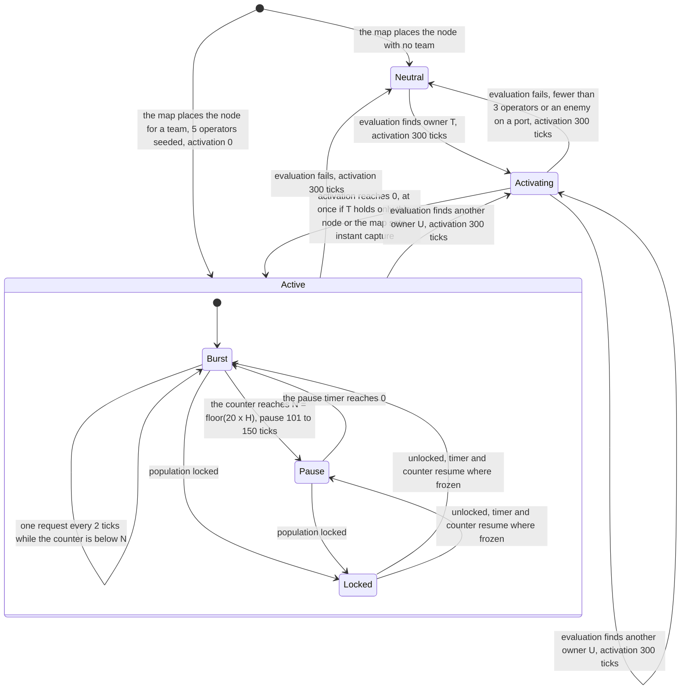
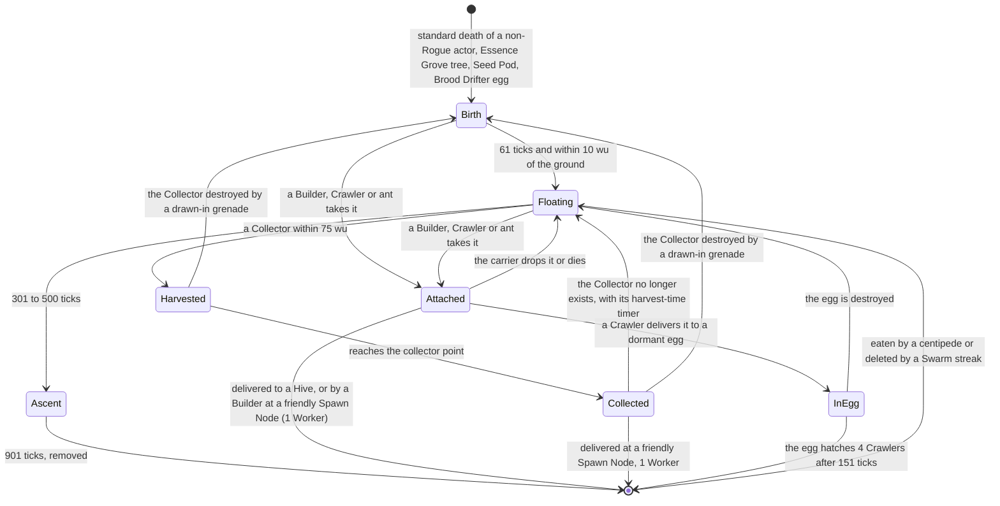
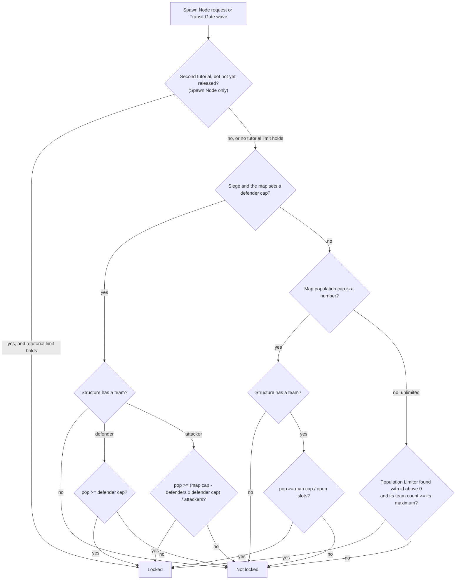

# Population flow

> Status: Reference · Prefix: R-ECON · Related: [00 Reference overview](00_reference_overview.md) · [01 Skirmish rules and modes](01_skirmish_rules_and_modes/README.md) · [02 Units](02_units/README.md) · [03 Buildings and world objects](03_buildings_and_world_objects/README.md) · [04 Supply crates, powers and weapons](04_supply_crates_powers_and_weapons/README.md) · [08 Maps and level design](08_maps_and_level_design/README.md) · [12 Simulation model](12_simulation_model/README.md)

## 1 Purpose and player experience

The reference game has no build queue and no currency. A team's army is a **population**: Workers, plus the few special units that Supply crates and reinforcements provide. Population is created by four kinds of source and destroyed by combat. The only resource a player can fight over is **territory**, chiefly Spawn Nodes, which turn held ground into a steady stream of new Workers up to a per-team population cap.

For the player this reads as a tug of war over places. Workers wander onto the ports of a Spawn Node; once three of the five ports are manned by one team and no enemy stands on any port, the node changes hands, waits 300 ticks, and then pours out bursts of Workers through its door. When the team reaches its cap, every Spawn Node it holds falls silent until losses open room again. Every death leaves an Essence orb that drifts for a while before it ascends, and a Collector can sweep up these orbs, the enemy's included, and turn them into new Workers. Transit Gates add fixed reinforcement waves on the maps and modes that use them.

| Population source | Mechanism | Gate | Rules |
|---|---|---|---|
| Spawn Nodes (territory) | An owned, active Spawn Node requests transit orbs from the map's Source Node in bursts; each arrives after a per-hop latency and becomes 1 Worker | population cap, 300-tick activation delay, Catch-up bonus | §2.3–§2.10 |
| Transit Gates (fixed reinforcement gates) | Every 60 mode seconds each owned Transit Gate releases a wave of Workers, plus Transport, turret and airstrike powers | population cap, checked once per gate per wave | §2.21–§2.25 |
| Starting units | The map's starting forces, plus 1 operating Worker per port on every Spawn Node and Solar Array a team owns at start (5 ports, so 5 per structure) | none | §2.26 |
| Essence orbs recycled | Every death through the standard damage path of a non-Rogue actor leaves an Essence orb; a Collector or a Builder (crate units) collects orbs of **any** team and turns each into a Worker at a friendly Spawn Node | Collector: the receiving team's population cap and the node's activation delay (DEC-080); Builder: none | §2.15–§2.20 |
| Supply crates and creatures | Reinforcements (50–99 Workers), Seed Pod Workers (10–19), Spawn Surge (every active Spawn Node requests every tick while the 51-tick surge timer runs, 50 or 51 requests), Workers released from an exploding Launch Vessel, Visitor-faction Workers from the Abductor | none, except Spawn Surge, whose requests go through Spawn Nodes | §2.29 |

### 1.1 Conventions used in this document

- **Ticks.** Every duration is an integer number of ticks (DEC-002). The tick period is `ref.sim.tick_period` of reference/12 (0.1 s, so 10 ticks per second at game speed 1). Seconds appear only as a derived value next to a tick count.
- **Mode second.** A mode second is `ref.mode.mode_second` (11 ticks) of reference/01 (DEC-002). Rules that count "mode seconds" step once per 11 ticks.
- **Draws.** `U[a, b)` is a uniform real draw from the simulation generator; `U{a..b}` is a uniform integer draw with both ends included. A duration given as a tick range is a `U{a..b}` draw unless the rule says otherwise. All draws follow the stream discipline of reference/12 (DEC-013).
- **Division.** `÷` is integer division, which truncates toward zero (DEC-241); `/` is exact division; `⌊x⌋` is the floor.
- **Team slots.** A match has `ref.sim.max_teams` (6) team slots, 0 to 5 (the constant `MAX_TEAMS` of reference/12). Player teams use slots 0 to 3; slot 4 is the Rogue faction and slot 5 the Visitor faction, both present as bot teams in every match (DEC-082). A structure with no owner has **no team** (one no-team value, DEC-464). A map assigns structures and starting units to **map positions**, which are remapped to match teams at load (DEC-025).
- **Friends.** Two teams are friends when they are the same team, or when co-op is on and both belong to one alliance (DEC-034). No team is never a friend of anything.
- **Ungrouped actors.** A team's ungrouped actors are the actors spawned without an actor group, its bot controller included; Strike teams, Bombers, centipedes and Hive ants live inside actor groups (DEC-117).
- **Structure order.** "Structure order" is the stable structure-index order of the match world (DEC-016).
- **Map values.** "Map cap", "defender cap", "map player count", the attacking positions and the Transit Gate values are match options of the map definition (reference/08). A per-map limit is absent (the lobby default applies), 0 (none) or unlimited, an explicit value of its own (DEC-120).
- **Open slots.** The open slots are the map's player positions that the host has not closed before the match; every open slot is occupied by a player or a bot, so their number is the number of teams playing (DEC-079).

## 2 Rules

### 2.1 Scope, time base and update order

**R-ECON-001** (MUST) The reference economy has no build queue and no currency. A team's army is its population of actors. Population is created only by the sources of this section and removed only by the sinks of §2.2, and territory, chiefly Spawn Nodes, is the only contested resource (see DEC-001, DEC-018).

**R-ECON-002** (MUST) Every economy timer is an integer number of ticks; no economy timer is a floating-point countdown (see DEC-002). Every tick count in this document, including the uniform tick ranges, is part of the rule, and every kept quirk is stated as an explicit rule with a named key (see DEC-006).

**R-ECON-003** (MUST) Economy rules counted in mode seconds advance once per `ref.mode.mode_second` (11 ticks, 1.1 s): the Transit Gate wave countdown, the reinforcement countdown shown on the HUD, and the Spawn Control score and the Spawn Control elimination countdown of `ref.mode.spawn_control.elimination_mode_seconds` (30 mode seconds, 330 ticks) that reference/01 specifies (see DEC-002, DEC-003).

**R-ECON-004** (MUST) No match-time timer of this document advances during the grace period (reference/01, DEC-036). The mode-second timers start at 0, so the first mode second ends on the first tick after the grace period, and the Transit Gate countdown starts on that tick (see DEC-002).

**R-ECON-005** (MUST) Every simulated object advances exactly once per tick (see DEC-117). The match world advances in `ref.sim.update_slices` (10) update slices per tick (the constant `UPDATE_SLICES_PER_TICK` of reference/12); within a slice the order is teams, then weapons and effects, then structures, then Essence orbs, then the cloud layer (reference/12). Supply crates and the Spawn Surge timer advance in update slice 8 of the match world. The match rules (scores, Transit Gate reinforcements, Comeback Bonus) run once per tick, after the match-world update of slice 8, and do not run while the match is over, during the grace period or while the match is paused.

**R-ECON-006** (MUST) Game speed changes only how many ticks run per unit of real time. The tick length and every tick count of this document are the same at every game speed, so per-tick rules (Collector delivery of one orb per tick, Spawn Surge requests of one per tick, the Launch Vessel passenger release, the per-hop transit) scale with game speed exactly like the timers (see DEC-039, DEC-092). Game speed is global, so no team gains relative to another.

### 2.2 Population sinks and corpses

**R-ECON-007** (MUST) An actor that dies through the standard damage path (laser bolts, fire, explosions, drowning, Sickness, the Core Device pulse wave on actors that are not of the Visitor faction, barrage missiles, turrets) leaves exactly one Essence orb of the dead actor's team (§2.15). The kinds that die this way are the Worker, the Leader, the Crawler, the spider, the centipede, the Brood Drifter, the Seed Pod, the ant and the Reaper Serpent. A death of a Rogue faction actor leaves no orb (see DEC-084).

**R-ECON-008** (MUST) The death of a Transport, a Builder, a Collector, a Trooper, a Crawler egg or a Bomber leaves no Essence orb; these kinds handle their own damage and never take the standard death path.

**R-ECON-009** (MUST) These removals leave no Essence orb:

| Removal | Population effect |
|---|---|
| Promotion of a Worker to Leader | the Worker is removed and a Leader added: net 0 for the cap |
| Boarding a Launch Vessel (Launch Race) | the passengers leave the population; if the vessel explodes they return as Workers of the vessel's team, one per tick (R-ECON-118) |
| Abduction by the Abductor | the abducted Workers are replaced by up to 100 Visitor-faction Workers (R-ECON-119) |
| Conversion by Convert or by the Core Device pulse wave | the converting team gains the actor |

**R-ECON-010** (MUST) When a team is eliminated, every member of its actor groups and every one of its ungrouped actors takes unresistable damage equal to `ref.sim.team.eliminate_damage_factor` (2) × its current health (reference/12 R-SIM-407). Kinds that leave orbs leave them (R-ECON-007). The team's Collectors survive, because a Collector takes damage only while it is vulnerable (R-ECON-077), and the team's bot controller survives, because it takes no damage.

**R-ECON-011** (MUST) A dead actor stays in its team's ungrouped list, and keeps counting against the cap, until its corpse has faded. On death its health is set to `ref.unit.corpse.fade_start` (100); it then loses `ref.unit.corpse.fade_ground_per_tick` (4) per tick on the ground or `ref.unit.corpse.fade_air_per_tick` (2) per tick in the air (reference/02), so a corpse fades after 25 ticks (2.5 s) on the ground and 50 ticks (5.0 s) in the air.

### 2.3 Spawn Node ports and occupancy

**R-ECON-012** (MUST) A Spawn Node has `ref.econ.spawn_node.port_count` (5) ports at the port sockets of its mesh (reference/03). Every tick the port evaluation clears each port's occupant and then sets it to the first Worker in the operating-port state that operates that very port on that structure and lies strictly within `ref.econ.spawn_node.port_radius_wu` (5 wu) of the port position, measured horizontally (dx² + dz² < 25). The occupant may be of any team (see DEC-088, DEC-094).

**R-ECON-013** (MUST) When several Workers qualify, the first in actor-grid result order wins: grid cell x ascending, then grid cell z ascending, then team slot 0 to 5, then slot order within the cell, where freed slots are reused first. The query visits every actor-grid cell (`ref.sim.actor_grid.cell_size` of reference/12, 32 × 32 wu) that overlaps the square of half-side 5 wu around the port, and an actor registered in several cells is listed once (see DEC-016).

**R-ECON-014** (MUST) An idle Worker re-plans every `ref.unit.worker.retarget_ticks` (11 to 20 ticks) and searches, in this order: threats, ports, carryable structures, Supply crates, Transports, Flag posts (Flag Chain only), Leaders, and finally a random position. A Worker that is following orders, following a Leader or approaching a Transport searches threats, then ports, then carryable structures, unless it is under a direct player order, in which case it searches threats only. Workers never seek Essence orbs. The Worker itself is specified in reference/02.

**R-ECON-015** (MUST) The port search considers every structure with ports whose distance from the Worker minus the structure's radius is below `ref.unit.worker.port_search_range` (100 wu, reference/02), that has at least one unoccupied port and that the Worker can walk to, and it picks the nearest of them. The search applies no team test, so Workers walk onto the free ports of enemy-held Spawn Nodes.

**R-ECON-016** (MUST) A port is available to a team when it has no occupant and that team's reservation count for the port is below `ref.econ.port.reservation_limit` (1). A Worker approaching a port adds 1 to its team's reservation count for that port every tick, up to `ref.econ.port.reservation_cap` (50). Every tick the port evaluation sets every reservation count of an occupied port to 0 and reduces each reservation count of an unoccupied port by `ref.econ.port.reservation_decay` (4).

**R-ECON-017** (MUST) On arrival the Worker enters the operating-port state and stays in it, without searching for threats, until it is no longer the port's occupant, the structure is removed, or the Worker dies. Selection and crowd orders reach an operating Worker as reference/06 specifies, with no special case (see DEC-308).

Holding a Spawn Node therefore ties up 3 to 5 Workers as operators. They count against the cap (R-ECON-048) and are the first to die when the node is attacked.

### 2.4 Spawn Node ownership evaluation

**R-ECON-018** (MUST) A Spawn Node evaluates its ownership when its evaluation timer expires. The first timer is `ref.econ.spawn_node.first_evaluation_ticks` (1 to 20 ticks), drawn in the node's initialisation step (see DEC-652); after each evaluation the timer is set to `ref.econ.spawn_node.evaluation_interval_ticks` (21 to 30 ticks).

**R-ECON-019** (MUST) An evaluation counts, for each team slot t from 0 to 5, the ports whose occupant belongs to t (count[t]) and then decides the result in this order, where `need` is `ref.econ.spawn_node.capture_min_operators` (3):

```
result ← no team;   occupied ← false
for t in 0 .. 5:                                   # ascending slot order
    if count[t] > 0 and result = no team:
        result ← t
    else if result ≠ no team and count[t] ≥ need and count[t] > count[result]:
        result ← t
    if result ≠ no team and count[t] > 0:
        occupied ← true
    if result ≠ no team and count[result] < need:
        result ← no team
if occupied:
    for t in 0 .. 5:
        if count[t] > 0 and not friends(t, result):
            result ← no team;  stop
```

**R-ECON-020** (MUST) In effect, a Spawn Node belongs to the one team that operates at least 3 of its 5 ports, provided every other occupant is a friend of that team; otherwise it belongs to no team. Allies may share the ports: the ally with at least 3 operators owns the node, and allies with 2 + 2 or 2 + 1 operators leave it neutral. With 5 ports two teams can never both hold 3. The friend check runs whenever any port is occupied, and it changes nothing when the result is already no team.

**R-ECON-021** (MUST) When the result differs from the current owner, the Spawn Node counts (§2.6) move one node from the old owner's entry to the new owner's entry, the activation delay is set to `ref.econ.spawn_node.activation_ticks` (300), and the node raises a presentation event: `spawn_node.deactivate` when the new owner is no team and `spawn_node.activate` otherwise (sound events of reference/10). The node then takes the result as its owner.

**R-ECON-022** (MUST) Ownership has no hold-until-taken rule. A node whose owner falls below 3 operators turns neutral at the next evaluation, a single enemy operator on any port neutralises it, and a node can pass directly from team A to team B when, at one evaluation, B operates at least 3 ports, A operates none and every other occupant is a friend of B.

### 2.5 Activation delay

**R-ECON-023** (MUST) Each tick, while a Spawn Node has an owner and its activation delay is above 0, these steps run in order: the delay decreases by 1 tick; the delay is set to 0 if the owner now holds exactly one Spawn Node, or if the map sets the instant-capture flag; the delay is kept at 0 or above. Production (§2.7) runs only while the delay is 0.

**R-ECON-024** (MUST) Every ownership change, including a change to no team, sets the activation delay to 300 ticks (30.0 s), and the delay does not count down while the node has no team. A Spawn Node starts the match with a delay of 300 ticks, except that a node owned at match start has its delay set to 0 by team initialisation (R-ECON-108). Four reference Relic Run maps set the instant-capture flag; no other reference map does.

**R-ECON-025** (MUST) Presentation shows the activation progress on the node's glow indicators: their colour interpolates from the grey `ref.econ.spawn_node.glow_start_rgba` (100, 100, 100, 200) to the owner's team colour as (remaining delay / 300) goes from 1 to 0, and their opacity is (occupied ports / 5). Presentation only reads these values (DEC-007).

### 2.6 Spawn Node counts

**R-ECON-026** (MUST) The match keeps 7 Spawn Node counts: one entry for nodes with no team and one entry for each team slot 0 to 5. Every entry is 0 at match start, the entry of team slot 5 included (see DEC-011). Each Spawn Node that the map places adds 1 to the entry of its owner (its map position remapped to the match team; no team for an unowned node) when it is initialised, and ownership changes move it between entries (R-ECON-021).

**R-ECON-027** (MUST) The counts are read by: the activation shortcut (R-ECON-023); the Catch-up bonus (§2.8); Spawn Control scoring and elimination (reference/01); the Zone Control and Relic Run elimination test (R-ECON-113 and reference/01); the validity of the Collector, Builder and Spawn Surge outcomes, which are offered only while the sum of all 7 entries is above 0 (reference/04); and the tutorial hints (reference/11).

### 2.7 Production request cycle

**R-ECON-028** (MUST) Each Spawn Node keeps a production timer and a burst counter. The timer is first set to `ref.econ.spawn_node.first_request_ticks` (21 to 40 ticks) in the node's initialisation step (see DEC-652), and the counter starts at 0. Neither is reset on capture or loss: a new owner inherits a part-elapsed timer and a part-used burst.

**R-ECON-029** (MUST) Each tick, after the ownership evaluation (§2.4) and the activation step (§2.5), a Spawn Node that has an owner, has an activation delay of 0 and is not population-locked (§2.12) runs this cycle, with the request interval `ref.econ.spawn_node.request_interval_ticks` (2 ticks), the burst base `ref.econ.spawn_node.burst_base` (20) and the pause `ref.econ.spawn_node.pause_ticks` (101 to 150 ticks); H is the Catch-up bonus multiplier of its owner (§2.8), evaluated at each request:

```
timer ← timer − 1
if timer ≤ 0 or spawnSurgeActive:                  # spawnSurgeActive: R-ECON-045
    request one transit orb from the Source Node, addressed to this node
    timer ← request_interval                       # ref.econ.spawn_node.request_interval_ticks = 2
    counter ← counter + 1
    if counter ≥ ⌊burst_base × H⌋:                 # ref.econ.spawn_node.burst_base = 20
        counter ← 0
        timer ← U{101..150}                        # ref.econ.spawn_node.pause_ticks
```

**R-ECON-030** (MUST) While a Spawn Node is population-locked its production timer is frozen, not decreased, and it requests nothing. When it unlocks, the timer and the counter resume where they stopped.

**R-ECON-031** (MUST) The number of operators beyond the 3 needed for ownership has no effect on production.

**R-ECON-032** (MUST) In a match without a Source Node the timer and the counter still advance, but no transit orb is requested.

**R-ECON-033** (MUST) The burst size is N = ⌊20 × H⌋, re-evaluated at every request, so N can change during a burst. Within a burst the requests fall on relative ticks 0, 2, 4, up to 2(N − 1); the pause of P ticks follows the last request, so one cycle lasts C = 2(N − 1) + P ticks. H = 1 gives N = 20; the largest multiplier, 1 + h ÷ 100, gives for the Catch-up option values h = 0, 10, 20, 30, 40, 50, 60, 70, 80 and 90 the burst sizes 20, 22, 24, 26, 28, 30, 32, 34, 36 and 38 (§2.8, see DEC-124). The first request after an activation comes when the inherited timer expires, 21 to 40 ticks for a node that has never produced.

### 2.8 Catch-up bonus

**R-ECON-034** (MUST) The Catch-up bonus multiplier H of a team is decided by the first of these rules that applies (see DEC-124):

1. the map sets the no-catch-up flag, or the match's Catch-up option h (a percentage) is 0: H = 1;
2. the team is no team: H = 0; the team is the Rogue or the Visitor faction: H = 1;
3. the teams in play are the used team slots (not `TeamKind::Unused`) other than the Rogue and Visitor factions, each ally counted as a team of its own; with m their number, S the sum of their Spawn Node counts (§2.6) and s the team's own count: when m < 2 or S = 0, H = 1;
4. otherwise the share deficit is d = max(0, 1 − m × s ÷ S), computed exactly, and H = 1 + (h ÷ 100) × f(d), where f is the curve `ref.econ.catch_up.curve` (f(d) = d, linear).

**R-ECON-035** (MUST) The share deficit is 0 for a team at or above the even share 1 ÷ m of the Spawn Nodes that the teams in play hold, and 1 for a team in play that holds none, so H rises from 1 towards `ref.econ.catch_up.max_multiplier` (1 + h ÷ 100, 1.9 at the default) as the team's share falls; a team that holds a Spawn Node always stays below it. Spawn Nodes with no team, and any that the Rogue or Visitor faction holds, take no part in the share. With the linear curve the burst size is, exactly, N = 20 + (h × (S − m × s)) ÷ (5 × S) by integer division while m × s < S, and N = 20 otherwise (see DEC-124).

**R-ECON-036** (MUST) In effect, a team below the even share receives a burst bonus in proportion to its deficit, whether or not a Spawn Node is neutral, and allies count as other teams. At the default h = 90 with 2 teams in play and 8 owned Spawn Nodes: holding 1 gives d = 0.75, H = 1.675 and N = 33; holding 2, half the even share, gives d = 0.5, H = 1.45 and N = 29; holding 4 or more gives H = 1 and N = 20 (see DEC-124).

**R-ECON-037** (MUST) The Catch-up option exists in the modes of `ref.econ.catch_up.modes` (Spawn Control, Zone Control and Siege), with values 0 to 90 % in steps of 10 and the default `ref.econ.catch_up.option_percent` (90) (reference/01 R-MODE-051). Relic Run, Launch Race and Flag Chain have no Catch-up option, and an option that a mode does not have takes its typed default of 0, which gives H = 1 (DEC-073). Siege maps have no Spawn Nodes, so only Spawn Control and Zone Control matches can apply the bonus, on every map that does not set the no-catch-up flag (see DEC-124).

### 2.9 Transit through the spawn network

**R-ECON-038** (MUST) A request creates a transit orb (`TransitOrb`) addressed to the requesting Spawn Node and places it on the one outgoing edge of the Source Node whose downstream set contains that node. If no outgoing edge leads to the node, the orb is discarded. A transit orb is on exactly one edge at a time (see DEC-456).

**R-ECON-039** (MUST) Every spawn-network structure advances each transit orb on each of its outgoing edges once per tick. An orb needs `ref.econ.relay.first_hop_ticks` (11) advances on its first edge and `ref.econ.relay.later_hop_ticks` (10) on every later edge, so a transit of h hops needs 10h + 1 advances. Transit time does not depend on distance. At the end of an edge the orb is handed to the edge's target structure, which places it on its own outgoing edge towards the addressed node; a target that is missing, or that is not a spawn-network structure, discards it (see DEC-457).

**R-ECON-040** (MUST) Structures advance in structure order within a tick. When a request or a hand-off places an orb on an edge of a structure that comes later in structure order than the structure making the request or the hand-off, the orb receives that structure's advance in the same tick. A transit of h hops therefore takes between 9h + 1 and 10h + 1 ticks, depending on the structure order of the map (see DEC-455; DEC-002 states the upper bound, 10h + 1). The reference spawn networks have 1 to 11 hops from the Source Node to a Spawn Node, so a transit takes at most 11 to 111 ticks.

**R-ECON-041** (MUST) A Spawn Node that receives a transit orb addressed to itself spawns one Worker if it has an owner at that moment, for whichever team owns it then, and removes the orb; a Spawn Node that receives an orb addressed to another node forwards it. Arrival does not check the population cap (R-ECON-060).

**R-ECON-042** (MUST) A transit orb is lost when its Spawn Node has no team on arrival, when no edge leads to its Spawn Node, when an edge leads to a structure that is not part of the spawn network, or when the match has no Source Node.

**R-ECON-043** (MUST) A Worker produced by a Spawn Node appears at the node's door socket as an ungrouped actor of the node's owner, with no position spread and with velocity (door front + j) × `ref.econ.spawn_node.door_speed` (10), in wu/s, where j has three components, each drawn from `ref.econ.spawn_node.door_jitter` (U[−0.5, 0.5)). After the Worker's spawn step, which sets it on the ground (reference/02 worker.md R-UNIT-061), the Spawn Node clears its on-ground flag, so the Worker starts airborne.

**R-ECON-044** (MUST) Transit orbs are not actors: they are never shown as Essence orbs, never collected and never counted against the cap.

Every reference spawn network has one Source Node, reaches every Spawn Node by exactly one path, and has no cycles and no self-links.

### 2.10 Spawn Surge

**R-ECON-045** (MUST) While the Spawn Surge timer is above 0 (spawnSurgeActive in R-ECON-029), every Spawn Node of every team that has an owner, has an activation delay of 0 and is not population-locked requests one transit orb every tick, whatever its production timer. The counter and pause bookkeeping of the cycle still runs, but the timer is overridden. Each request is still subject to the population cap. The timer belongs to the match world, so the surge is global and not limited to the team that opened the Supply crate (see DEC-304).

**R-ECON-046** (MUST) Opening the Spawn Surge outcome sets the timer to `ref.crate.spawn_surge.timer_ticks` (51 ticks, reference/04 R-CRATE-210), and the timer decreases by 1 per tick in update slice 8, so it is above 0 for 51 ticks. A Spawn Node makes 50 or 51 requests during the surge, depending on whether the Supply crate opens before or after it in the update order (see DEC-304, DEC-455), against about 6 at the normal mean rate over the same time.

**R-ECON-047** (MUST) The Spawn Surge outcome is offered only while at least one Spawn Node exists (R-ECON-027) and only when the match allows the advanced outcomes, that is, when the lobby has not limited drops to the basic outcomes. Its probability is in reference/04.

### 2.11 Population count

**R-ECON-048** (MUST) Every population-cap check uses

```
pop(team) = (number of the team's ungrouped actors) − (number of the team's Crawlers)
```

Actors inside an actor group are not counted. Transit orbs are not actors and are not counted (R-ECON-044).

**R-ECON-049** (MUST) The following actors count, or do not count, as listed:

| Counted (ungrouped) | Created by | Not counted (inside an actor group) |
|---|---|---|
| Worker, including port operators, corpses until faded (R-ECON-011) and Visitor-faction Workers | Spawn Nodes, Transit Gates, starting forces, port seeding, Supply crates, Collectors, Launch Vessels, Seed Pods, conversions | Trooper (a Strike team power) |
| Leader | the promotion power | Bomber (an airstrike) |
| Builder | the Builder power (Supply crate) | centipede segments (Seed Pod) |
| Transport | the Transport power (Supply crate, Transit Gate, starting forces run as a power) | ant released by a Hive |
| Collector | the Collector power (Supply crate) | |
| bot controller, one per bot team, the Rogue and Visitor factions included | team initialisation (R-ECON-107) | |
| barrage missile while in flight, meteor, Crawler egg, Seed Pod, spider, Brood Drifter, Reaper Serpent, ant from a Supply crate or a Seed Pod, Abductor | Supply crates and creatures | |
| Crawler | Crawler eggs, Seed Pods, Supply crates | counted in the ungrouped list, then subtracted (R-ECON-050) |

**R-ECON-050** (MUST) Crawlers are subtracted because they have their own limit of `ref.unit.crawler.team_limit` (250) per team, which Crawler eggs, Seed Pods and Swarm streak arrivals check before they release Crawlers (reference/02).

**R-ECON-051** (MUST) The cap is a cap on bodies, not on Workers: a bot team's bot controller, every Transport, Collector and Builder, and the creatures and eggs that a team owns all consume its cap. The creatures of the Brood outcome belong to the team that placed the power, except Reaper Serpents, which belong to the Rogue faction (see DEC-121).

### 2.12 Population cap computation

**R-ECON-052** (MUST) A Spawn Node or a Transit Gate decides whether it is population-locked by the first of these rules that applies (see DEC-079):

1. *Spawn Node only.* In the second tutorial, while the tutorial's bot may not yet produce: the node is locked if it has requested `ref.econ.tutorial.second_max_requests` (100) or more transit orbs (a count kept only in this tutorial), or if its owner is neither no team nor the tutorial player's team, or if the tutorial player's team has more than `ref.econ.tutorial.second_player_limit` (200) ungrouped actors; a node with no team never requests (R-ECON-029), so in effect the last test locks only a node that the tutorial player owns. If none of these holds, the decision continues with rule 2 (see DEC-103, DEC-110).
2. *Siege with a defender cap.* In a Siege match whose map sets a defender cap: a structure with no team is not locked; a defending team is locked when pop ≥ defender cap; an attacking team is locked when pop ≥ (map cap − numDefenders × defender cap) ÷ numAttackers, where numAttackers is the number of open slots whose position attacks, and numDefenders = open slots − numAttackers.
3. *Map cap.* When the map's population cap is a number: a structure with no team is not locked; otherwise it is locked when pop ≥ map cap ÷ open slots.
4. *Population Limiter fallback.* When the map's population cap is unlimited: the Population Limiter rule of §2.14 decides.
5. Otherwise the structure is not locked.

Every division of these rules is an integer division. The divisor of rule 3 is the number of open slots, which is fixed for the match (see DEC-079).

**R-ECON-053** (MUST) The map cap, the defender cap, the map player count and the attacking positions are match options of the map definition (reference/08 R-MAP-061). The player count and the population cap are required, so a map without a population cap states unlimited explicitly and the map cap is never unset; a map cap of 0 locks every Spawn Node and Transit Gate of every team (see DEC-079, DEC-120). The defender cap and the attacking positions are unset unless the map sets them. A map that gives the population cap twice is a content-build error (see DEC-015, DEC-801).

**R-ECON-054** (MUST) At match start every empty open slot is filled with a bot team, and the host may close slots before the match, so the per-team cap is map cap ÷ open slots, the number of teams playing (see DEC-079). The cap never changes during the match: when a team is eliminated its share is not redistributed to the survivors, and a player who leaves is replaced by a bot that keeps the team and its share (see DEC-035, DEC-079).

**R-ECON-055** (MUST) Caps are per team, not per alliance. A 2-team alliance on a map with 4 open slots has 2 × (map cap ÷ 4) bodies between its teams, never pooled (see DEC-034, DEC-079).

**R-ECON-056** (MUST) A Hive of the Rogue faction applies rule 3, and then the Population Limiter fallback, before each ant sortie; a Hive releases one ant per `ref.bldg.hive.release_interval_ticks` (2 ticks, reference/03 R-BLDG-636). A Hive's ants live in its actor group and are not counted, so the check sees only the Rogue faction's other bodies: its bot controller, crate creatures and eggs (see DEC-084).

**R-ECON-057** (MUST) No global limit on the number of actors exists. The per-team caps of this section and the Crawler limit are the only population limits of the reference (see DEC-106, DEC-201, DEC-228).

**R-ECON-058** (MAY) The map editor edits the map cap as a value from `ref.econ.cap.editor_range` (1 to 5000 in steps of 10) and the defender cap as a value from `ref.econ.cap.defender_editor_range` (50 to 5000 in steps of 10); the editor hooks are in reference/08 (DEC-045).

The reference maps use the caps as follows (map data, reference/08), with every slot open:

| Mode | Cap source on the reference maps | Typical per-team cap | Notes |
|---|---|---|---|
| Spawn Control | map cap ÷ open slots | 500–1000 | one 4-player co-op map states an unlimited cap |
| Zone Control | map cap ÷ open slots | 500–1000 | one 4-player co-op map states an unlimited cap |
| Relic Run | map cap ÷ open slots | 500–1000 | |
| Siege | defender cap for each defending team; the attackers share the remainder | defender 200–350; attacker 550–1725 | two Siege maps set no defender cap, so map cap ÷ open slots applies to both sides |
| Launch Race | map cap ÷ open slots | 450–900 | |
| Flag Chain | map cap ÷ open slots | 350–1000 | |

### 2.13 Cap enforcement points and overshoot

**R-ECON-059** (MUST) The population cap is checked at exactly these points and no others (see DEC-453):

| Population source | Cap checked? | Granularity |
|---|---|---|
| Spawn Node request | yes, before each request; the production timer is frozen while locked | per request; transit orbs already travelling still arrive |
| Transit Gate wave | yes, **once per gate per wave**, before the gate releases its whole count | per gate and wave; overshoot up to count − 1 per gate |
| Hive ant sortie (Rogue faction) | yes, but the Hive's own ants are not counted | per ant |
| Collector delivery | yes: an orb is delivered only on a tick on which the node is not population-locked and its activation delay is 0; otherwise the Collector keeps its orbs and waits (DEC-080) | per orb |
| Builder delivery | no; delivery also skips the activation delay (DEC-085) | — |
| starting forces and port seeding | no | — |
| Supply crate outcomes: Reinforcements, Seed Pods, Brood creatures, the Abductor's Visitor-faction Workers, barrage missiles, Transport, Collector, Builder, Strike team | no | — |
| Workers returned from an exploding Launch Vessel | no | — |
| conversions: Convert, the Core Device pulse wave, the Allegiance Scrambler | no | — |
| Crawlers | their own limit of 250 per team (R-ECON-050) | per Crawler egg, Seed Pod or Swarm streak arrival |

**R-ECON-060** (MUST) Because only the request or the wave is gated, a team exceeds its cap by:

- the transit orbs in flight: at most one burst per Spawn Node, usually far fewer, because a transit of 11 to 111 ticks is short against a pause of 101 to 150 ticks;
- a Transit Gate wave that starts below the cap: up to count − 1 per gate, and with several gates each gate reads the population again after the previous gate's Workers were added;
- every uncapped source of R-ECON-059: a Builder delivers up to its 25 orbs at one per tick at any population.

Corpses, which count for 25 to 50 ticks after death, make the cap take effect slightly earlier during heavy fighting.

### 2.14 Population Limiter

**R-ECON-061** (MUST) A Population Limiter takes effect only in a match whose map's population cap is unlimited. When the map's cap is a number, every Population Limiter does nothing at all, recounts included. On every reference map no Population Limiter takes effect, because each map either sets a numeric population cap or places no limiter (see DEC-454). The Population Limiter structure is specified in reference/03.

**R-ECON-062** (MUST) On its first lock check, a Spawn Node or a Transit Gate stores the structure id of the first Population Limiter in structure order whose search radius contains it, or a none marker when there is none, and keeps it for the match. It is locked when that limiter's count for the structure's team is at or above the limiter's current maximum. The stored id is consulted only when it is greater than 0, so a limiter whose structure id is 0 is never consulted (see DEC-454).

**R-ECON-063** (MUST) A Population Limiter has a search radius (default `ref.econ.population_limiter.search_radius_wu`, 500 wu), a maximum population (default `ref.econ.population_limiter.max_population`, 100), its authored maximum, a count for each team slot 0 to 5, and a recount timer, first set to `ref.econ.population_limiter.first_recount_ticks` (1 to 100 ticks) in its initialisation step (see DEC-652). Its map record gives its position, team, facing, global flag, search radius and maximum population.

**R-ECON-064** (MUST) While limiters are in effect, once per `ref.econ.population_limiter.overpopulation_period_ticks` (10 or 11 ticks: one second of match time, measured like the Hive conversion of R-ECON-084), the match computes overpopulation = (sum over all limiters of max(0, team-slot-0 count − authored maximum)) ÷ `ref.econ.population_limiter.overpopulation_divisor` (2), by integer division, and every limiter sets its current maximum to max(0, authored maximum − overpopulation). Only team slot 0 contributes (see DEC-454, DEC-851). These values are per-match state (DEC-011).

**R-ECON-065** (MUST) A limiter's recount cycle lasts `ref.econ.population_limiter.recount_cycle_ticks` (91 to 110 ticks). During a cycle each team slot k, from 5 down to 0, is recounted once, when the timer's remaining whole seconds first fall to k; a recount sets the slot's count to the actor-grid friend count of team k within the search radius (reference/12, DEC-094). When the timer expires a new cycle starts.

### 2.15 Essence orb creation

Essence orbs are simulated objects but not actors. The match world keeps them in their own container and advances them once per tick in update-slice order. The Essence orb object, its motion, wobble, structure push and look are specified in reference/02 (`essence_orbs.md`); this section gives the population-flow view. Essence orbs are distinct from the transit orbs of the spawn network (§2.9).

**R-ECON-066** (MUST) Creating an Essence orb for the Rogue faction creates nothing. Otherwise the orb takes a free slot and starts at the given position raised by `ref.sim.spawn.orb_lift` (1 wu, reference/12), with the given velocity, team and owning object, in the birth state with a birth timer of `ref.econ.orb.birth_ticks` (61 ticks) and a random wobble phase and wobble rates (R-ECON-071).

**R-ECON-067** (MUST) Essence orbs are produced only as follows:

| Producer | Team of the orb | Count | Notes |
|---|---|---|---|
| a death through the standard damage path (R-ECON-007); an ant or a Reaper Serpent only when it does not belong to the Rogue faction | the dead actor's team; velocity = corpse velocity × `ref.econ.orb.death_velocity_factor` (0.5) | 1 | |
| a tree of the Essence Grove outcome, while healthy (its burn state in `ref.econ.essence_grove.healthy_burn_range`, (−0.3, 0]) | drawn uniformly from `ref.econ.essence_grove.team_slots` (team slots 0 to 3), so possibly a slot not in play (see DEC-305) | 1, with probability 1 / (`ref.econ.essence_grove.drop_base` (51) − dropRate) per tick, where each tree draws dropRate from `ref.crate.essence_grove.drop_rate_base` and `ref.crate.essence_grove.drop_rate_spread` (15 to 29, reference/04 R-CRATE-188) | about 0.28 to 0.45 orbs per second per tree; the probability is a per-tick rule that scales with game speed (DEC-092) |
| a Seed Pod of the essence kind | the Seed Pod's team | `ref.unit.seed_pod.orbs_min` and `ref.unit.seed_pod.orbs_spread` (5 to 9), at speed `ref.unit.seed_pod.orb_speed_min` and `ref.unit.seed_pod.orb_speed_spread` (20 to 40 wu/s) | no Supply crate outcome launches an essence-kind Seed Pod directly; the nested Seed Pods (kind 5, kinds drawn from 0 to 8) that the Brood and Spitter Plants outcomes release can be of the essence kind, so essence Seed Pods occur in matches only that way (reference/02 creatures.md R-UNIT-514) |
| a Brood Drifter laying an egg, with probability 1 in `ref.unit.brood_drifter.prefertilise_one_in` (4) per egg | the Brood Drifter's team; **none** when it belongs to the Rogue faction | 1 per such egg, which fertilises that egg at once | only player-owned Brood Drifters (from the Brood outcome) produce orbs |
| a destroyed Hive: (ants inside + orbs inside) orbs | the Hive's team | — | Hives belong to the Rogue faction in every match, so none are created (see DEC-084) |

### 2.16 Essence orb states and timers

**R-ECON-068** (MUST) An Essence orb is in one of these states:

| State | Timer behaviour | Exit |
|---|---|---|
| Birth | the birth timer of 61 ticks counts down; the orb rises slowly (its vertical hover is at least a draw U[0, `ref.unit.essence_orb.birth_hover_max`), U[0, 0.5) wu/s) and is pulled down while it is more than `ref.econ.orb.birth_max_height_wu` (10 wu) above the ground height at its creation point | to Floating when the timer has expired **and** the orb is within 10 wu of the ground, so after 61 ticks at the earliest |
| Floating | on entry the timer is set to `ref.econ.orb.floating_ticks` (301 to 500 ticks; drawn as (120 + U[−30, 30)) / 3 s); the orb wobbles | to Ascent when the timer expires; to Harvested, Attached or InEgg when a collector takes it (§2.18, §2.19) |
| Attached | no timer, no wobble and no ground clamp; carried by a Builder, a Crawler or an ant | to Floating when the carrier drops it or dies, keeping the remaining timer it had when it was taken |
| InEgg | no timer | to Floating when the Crawler egg is destroyed; consumed when the egg hatches |
| Ascent | the timer is set to `ref.econ.orb.ascent_ticks` (901 ticks); the orb rises at `ref.unit.essence_orb.ascent_rise_min` + U[0, `ref.unit.essence_orb.ascent_rise_range`) (2 to 4 wu/s) | removed when the timer expires |
| Harvested | no timer and no wobble; the Collector draws it towards its collector point | to Collected when it is within `ref.econ.orb.harvest_arrival_wu` (2 wu) of its orbit target, or within `ref.econ.orb.harvest_alt_range_wu` (50 wu) with a height difference below `ref.econ.orb.harvest_alt_dy_wu` (5 wu) |
| Collected | no timer; its velocity is the Collector's velocity | removed on delivery (R-ECON-074); to Floating, with the timer it had when it was harvested, if the Collector no longer exists |

**R-ECON-069** (MUST) An Essence orb that nobody collects lives 61 + (301 to 500) + 901 = 1263 to 1462 ticks (about 126 to 146 s). A Collector can take it only while it is Floating, a window of 301 to 500 ticks; Builders, Crawlers and ants also take orbs in Birth. An orb that a carrier drops, or that a destroyed egg frees, returns to Floating with the timer value it had when it was taken, so an orb taken during Birth floats only for its remaining birth time.

**R-ECON-070** (MUST) The Reaper Serpent removes the Essence orb of every actor it kills.

### 2.17 Essence orb draws

**R-ECON-071** (MUST) Each Essence orb draws from the simulation generator as follows; the draws are part of the simulation and follow the stream discipline of reference/12 (DEC-013):

| Situation | Draws | Values |
|---|---|---|
| creation | 4 | wobble phase `ref.unit.essence_orb.wobble_phase_range` U[0, 10), then three axis wobble rates `ref.econ.orb.wobble_rate_range` U[0, 2) |
| wobble, every tick in Birth, Floating and Ascent | 3 | three wobble offsets `ref.econ.orb.wobble_offset_range` U[−0.5, 0.5) |
| Birth, extra each tick | 1, then 1 more either on each tick while the orb is more than 10 wu above its creation-time ground height, or on the tick it becomes Floating | U[0, 0.5) for the hover; then U[0, 10) for the pull-down, or U[−30, 30) for the floating time |
| Ascent, extra each tick | 1 | U[0, 2) for the rise |
| Attached, InEgg, Harvested, Collected | 0 | — |

A live orb therefore draws 0, 3, 4 or 5 values per tick, so the draw load of the simulation grows with the number of live orbs.

### 2.18 Collectors

The Collector unit is specified in reference/02 (`collector.md`); these rules give its part in the population flow.

**R-ECON-072** (MUST) An idle Collector searches every `ref.unit.collector.retarget_ticks` (11 ticks, reference/02 collector.md) for the nearest Floating Essence orb that is not marked broken (the broken marker of reference/02 essence_orbs.md R-UNIT-308, unset at creation and set by no match rule), within `ref.econ.collector.search_range_wu` (200 wu). It then draws in every Floating orb whose horizontal distance is below `ref.econ.collector.collection_range_wu` (75 wu), up to its capacity of `ref.econ.collector.capacity` (100 orbs at the match research level 3; 0, 25, 50, 100 and 200 for research levels 0 to 4, DEC-115).

**R-ECON-073** (MUST) No step of a Collector's search, collection or delivery tests the orb's team. A Collector collects the orbs of any team, the enemy's included, and turns them into Workers of the team that owns the Spawn Node it delivers to, subject to that team's population cap and the node's activation delay (R-ECON-074); a Collector parked near a battle converts the enemy's dead into its own side's Workers (see DEC-080).

**R-ECON-074** (MUST) A loaded Collector heads for the nearest Spawn Node whose owner is a friend of the Collector's team; an ally's node qualifies, and the Workers it produces are the ally's. At a node that has an owner it releases at most `ref.econ.collector.delivery_per_tick` (1) orb per tick, and only on a tick on which the node may produce: its activation delay is 0 and it is not population-locked (R-ECON-052). Each released orb spawns one Worker at that node for the node's current owner (R-ECON-043), with the sound event `collector.drop_essence` (reference/10). On any other tick the Collector keeps its orbs and waits at the node, so no orb is lost and none becomes a Worker above the cap (see DEC-080, DEC-453).

**R-ECON-075** (MUST) Once a Collector has chosen its Spawn Node, it does not check the node's owner again. If the node has turned enemy, the orbs become the enemy's Workers, under the enemy's cap and the node's activation delay; if it has turned neutral, each released orb is removed without producing a Worker, one per tick (see DEC-080).

**R-ECON-076** (MUST) A Collector with no friendly Spawn Node idles while holding its orbs. Collected orbs never expire.

**R-ECON-077** (MUST) A Collector takes damage only while it is vulnerable. It becomes vulnerable when it draws in a thrown grenade within `ref.econ.collector.grenade_capture_wu` (25 wu, a third of its collection range) and the grenade reaches it; it then takes `ref.econ.collector.self_destruct_damage` (999) damage, and every orb it holds restarts in Birth with fresh timers and is flung outward at up to `ref.econ.collector.release_speed_max_wu_s` (150 wu/s).

**R-ECON-078** (MUST) When a Collector is removed by a path that does not release its orbs, such as the end or cancellation of its power or a stop of all of a team's powers, its Collected orbs return to Floating with the timer they had when harvested (reference/02 essence_orbs.md R-UNIT-317), and only its Harvested orbs stay Harvested, with no timer and no holder (R-UNIT-327, see DEC-307).

**R-ECON-079** (MUST) A bot team's Collector decides every `ref.unit.collector.bot_think_ticks` (11 ticks, reference/02 collector.md) while idle, and moves to the nearest Essence orb in any state anywhere on the map (reference/07).

**R-ECON-080** (MUST) A Collector moves at `ref.unit.collector.speed` (28 wu/s, reference/02 collector.md), multiplied by `ref.econ.collector.idle_speed_factor` (0.25) while idle; it hovers `ref.econ.collector.hover_wu` (50 wu) above the ground, and its collector point is `ref.econ.collector.collector_height_wu` (15 wu) above its hull. When more than `ref.econ.collector.cluster_threshold` (30) Floating orbs lie within 75 wu of its path, it stops at their centroid. Its movement law is in reference/02 (DEC-111).

**R-ECON-081** (MUST) The loops that release a Collector's orbs and drop a Builder's orbs remove each carried entry that has become invalid, so each ends after one pass over its entries (see DEC-014).

### 2.19 Other Essence orb takers

**R-ECON-082** (MUST) A Builder takes Essence orbs in Birth or Floating that are not marked broken (R-UNIT-308), of any team: while idle it searches every `ref.unit.builder.retarget_ticks` (11 ticks, reference/02 builder.md) for the nearest within `ref.econ.builder.search_range_wu` (200 wu), and it carries up to `ref.econ.builder.capacity` (25 orbs at research level 3; 0, 10, 15, 25 and 30 for levels 0 to 4). A Builder that carries orbs and takes no further orb, because it is full or finds none, flies to the nearest Spawn Node, by plain distance, whose owner is a friend of its team, and there delivers one orb per tick; each delivered orb becomes one Worker of the node's current owner, with no population-cap check and no activation check (reference/02 builder.md R-UNIT-454, R-UNIT-457; see DEC-085). Carried orbs are Attached and never expire; when a Builder dies, the orbs it still carries drop to Floating.

**R-ECON-083** (MUST) A Crawler takes the nearest Essence orb in Birth or Floating, of any team, within `ref.unit.crawler.orb_search_range` (60 wu, measured in three dimensions), but only an orb whose list of nearby eggs is not empty; that list holds up to `ref.econ.crawler.egg_cache_max` (8) dormant, grounded Crawler eggs within `ref.econ.crawler.egg_cache_range_wu` (60 wu, measured horizontally) of the orb. The Crawler carries one orb (Attached) and delivers it to a dormant egg, which the orb fertilises (InEgg). After `ref.econ.crawler_egg.hatch_ticks` (151 ticks) the orb is removed and, if the egg's team has fewer than `ref.unit.crawler.team_limit` (250) Crawlers, `ref.econ.crawler_egg.crawlers_per_orb` (4) Crawlers of the egg's team are released.

**R-ECON-084** (MUST) An ant takes the nearest Essence orb in Birth or Floating, of any team, within `ref.unit.ant.search_range` (10 wu, measured in three dimensions), and also carries captured Workers, back to its Hive. A Hive turns each stored orb into `ref.econ.hive.ants_per_orb` (6) ants, one orb per `ref.econ.hive.conversion_ticks` (10 or 11 ticks: one second of match time).

**R-ECON-085** (MUST) A centipede eats Floating Essence orbs of any team within its eat range, with an eat chance of its size / `ref.unit.centipede.eat_chance_divisor` (2) (reference/02). It grows by one segment per `ref.unit.centipede.orbs_per_segment` (4) orbs eaten, up to its maximum size, and every eaten orb is destroyed.

**R-ECON-086** (MUST) When a Swarm streak arrives at a Floating Essence orb, the orb is deleted and a Rogue faction Crawler or spider is released (reference/04).

### 2.20 Conversions

**R-ECON-087** (MUST) Essence orbs and transit orbs convert into population at these ratios and rate limits:

| Conversion | Ratio | Rate limit |
|---|---|---|
| Essence orb → Worker at a Spawn Node, by a Collector | 1 : 1, for the node's current owner | 1 per tick per Collector at the node (10 per second at game speed 1), on ticks on which the node may produce (R-ECON-074) |
| Essence orb → Worker at a Spawn Node, by a Builder | 1 : 1, for the node's current owner | 1 per tick per Builder at the node |
| Essence orb → Crawlers, through a Crawler egg | 1 : 4, for the egg's team | 151 ticks per egg |
| Essence orb → ants, at a Hive | 1 : 6 | 1 orb per 10 or 11 ticks per Hive |
| Essence orb → centipede growth | 4 : 1 segment | per eat roll |
| transit orb → Worker at its Spawn Node | 1 : 1 | §2.7 and §2.9 |

### 2.21 Transit Gate reinforcement waves

The Transit Gate structure is specified in reference/03; these rules give its reinforcement waves.

**R-ECON-088** (MUST) The reinforcement routine runs exactly once per tick in every Launch Race and Flag Chain match, and in every match of another mode whose map sets a Transit Gate reinforcement count above 0 or a Transport cap of 1 or more or unlimited (see DEC-065, DEC-120). It runs as part of the match rules (R-ECON-005), so it does not run during the grace period, after the match is over or while the match is paused.

**R-ECON-089** (MUST) A Transit Gate is never captured. Its owner is fixed by the map (its map position remapped to the match team), and it becomes no team only when the owning team is eliminated. A Transit Gate with no team never reinforces.

**R-ECON-090** (MUST) The wave countdown starts at 0 and decreases by 1 at the end of every mode second (R-ECON-003). When it is at or below 0, a wave runs (R-ECON-093) and the countdown is set to the reinforcement interval, `ref.econ.gate.interval_mode_seconds` (60 mode seconds, also when the mode has no interval option), minus 1 on the first wave. The first mode second ends on the first tick after the grace period, so wave 1 runs on that tick.

**R-ECON-091** (MUST) At each wave the parameters are read afresh. The reinforcement count and the Transport cap take the map's value where the map sets one, otherwise the mode's option value, otherwise the typed default; the map value overrides the lobby default, and a map value of 0 is a value, not an absence (see DEC-065, DEC-073, DEC-120). The typed defaults are: the reinforcement count and the Transport cap from the map's Transit Gate values, with no Transports when the map sets none; a turret frequency of 0, so no reinforcement turrets; and a turret cap of `ref.econ.gate.turret_cap_default` (2). In Siege the map's attacker count and defender count each default to the reinforcement count. The map's attacker and defender power kinds (none when unset) and their power options are read at every wave. When the map sets the no-gun-turret flag, the turret frequency is 0.

**R-ECON-092** (MUST) When the turret frequency F is above 0, the turret counter decreases by 1 at each wave; when it is then at or below 0, this wave grants turrets and the counter is set to F. The counter starts at 0, so turrets come on wave 1 and then on every F-th wave after it: waves 1, 1 + F, 1 + 2F, continuing in steps of F.

**R-ECON-093** (MUST) A wave runs these steps. Steps 1 to 4 run for every Transit Gate that has an owner, in structure order; steps 5 and 6 run once per wave, per team.

1. *Count.* In Siege the count is the attacker count when the owner's position attacks, otherwise the defender count; in every other mode it is the reinforcement count.
2. *Workers.* If the gate is not population-locked (§2.12), it releases that many Workers, one at a time, at gate position + `ref.econ.gate.spawn_height_wu` (50 wu) up + r, where r is the gate's up vector rotated about its front vector by U[0, 2π) and scaled to a length of U[0, `ref.econ.gate.spawn_radius_wu`) (40 wu). Each Worker's velocity is the gate's front vector with its vertical component replaced by a draw from `ref.econ.gate.spawn_vertical_range` (U[0, 1)), multiplied by `ref.econ.gate.spawn_speed_wu_s` (20 + U[0, 15)). The Workers start airborne: the gate clears each Worker's on-ground flag after its spawn step (reference/02 worker.md R-UNIT-061).
3. *Transport.* If the team has fewer Transport powers than the Transport cap, or the Transport cap is unlimited, and the owner's side has no override power kind (the defender kind for an owner whose position does not attack, the attacker kind for an owner whose position attacks; outside Siege every owner counts as not attacking), the team is granted a Transport power. On success the grant is marked as a reinforcement grant, the Transport is targeted at gate position + front × `ref.econ.gate.transport_target_wu` (75 wu), `ref.econ.gate.transport_target_height_wu` (5 wu) above the ground, and its world marker is placed. When no Power slot is free, no Transport is granted (DEC-033). A Transport cap of 0 grants no Transport (DEC-120).
4. *Turret.* The turret power kind is the gun turret, upgraded to the airstrike in Flag Chain (R-ECON-104). If this wave grants turrets and the team holds fewer powers of that kind than the turret cap, the team is granted one, untargeted (the player places it), marked as a reinforcement grant.
5. *Defender power.* If a defender power kind is set, every used team in slots 0 to (map player count − 1) whose position does not attack is granted one power of that kind, with the defender power option.
6. *Attacker power.* If an attacker power kind is set, every used team whose position attacks is granted one power of that kind, with the attacker power option; outside Siege every team is granted it.

**R-ECON-094** (MUST) Steps 1 to 4 apply per gate: a team with 4 Transit Gates can receive 4 Transports in one wave, bounded only by the cap and by its Power slots. Steps 5 and 6 apply per team.

**R-ECON-095** (MUST) The population check of step 2 happens once, before the gate's whole batch, so a team one below its cap still receives the gate's full count (see DEC-453).

**R-ECON-096** (MUST) Reinforcement grants do not change the team's selected unit or its selected Power, and, except on the first wave, they do not raise the most-recent-power pop-up. Every wave notifies the hint overlay (reference/11).

**R-ECON-097** (MUST) The HUD shows the wave countdown, in mode seconds, as the time to the next wave (string id `ui.match.reinforcement_countdown`, new text "Reinforcements in {seconds}") whenever the countdown is not 0 and the local team is not eliminated, on every map where waves run. It is drawn in the warning colour at `ref.econ.gate.hud_warning` (5) or less, and it steps once per mode second (11 ticks).

**R-ECON-098** (MUST) The Transport outcome is not valid on a map that sets a numeric Transport cap of 1 or more, nor in any Launch Race match; an absent cap, a cap of 0 and an unlimited cap leave it valid (reference/04 R-CRATE-125, DEC-120).

### 2.22 Reinforcement parameters per mode

**R-ECON-099** (MUST) The reinforcement parameters per mode are:

| Mode | Reinforcement interval | Workers per owned Transit Gate per wave | Transport cap | Reinforcement turrets |
|---|---|---|---|---|
| Launch Race | option 10 to 300 mode seconds in steps of 10, default 60 | option `ref.econ.gate.count` 1 to 100, default 40 | option `ref.econ.gate.transport_cap` 1 to 10, default 2 | frequency option `ref.econ.gate.turret_frequency` 0 to 10, default 7; cap option `ref.econ.gate.turret_cap` 0 to 5, default 3 |
| Flag Chain | as Launch Race, default 60 | as Launch Race, default 40 | as Launch Race, default 2 | frequency default 2; cap default 2; the gun turret becomes the airstrike by Flag posts held |
| Siege | 60, no option | the map's attacker and defender counts, otherwise the map's Transit Gate count | the map's Transport cap; none when unset | none |
| Spawn Control, Zone Control, Relic Run | 60, no option | the map's Transit Gate count | the map's Transport cap; none when unset | none |

A map value overrides these lobby defaults (R-ECON-091).

### 2.23 Wave timing

**R-ECON-100** (MUST) Counting from the first tick after the grace period as tick 0, wave 1 runs at tick 0, wave 2 at tick 649 (59 mode seconds of 11 ticks), and every later wave 660 ticks (66.0 s) after the previous one when the interval is 60. For an interval of T mode seconds the first gap is 11 × (T − 1) ticks and every later gap 11 × T ticks. With a turret frequency of 2 the turret waves are waves 1, 3, 5, continuing in steps of 2; with a frequency of 7 they are waves 1, 8, 15, continuing in steps of 7.

### 2.24 Siege specifics

**R-ECON-101** (MUST) A Siege map lists its attacking positions; every other position defends. Each defending team has the defender cap, and the attacking teams share the remainder (§2.12 rule 2).

**R-ECON-102** (MUST) An override power kind replaces the Transport on its side: on a map that gives the defenders an airstrike power per wave, the defending owners receive no Transport from their gates, while the attacking owners still receive Transports up to the Transport cap.

**R-ECON-103** (MUST) The attacker and defender power options are passed unchanged to the granted power as its option; their meaning depends on the power kind (for example a firebomb or a standard airstrike, or a turret type), as reference/04 specifies.

On the reference Siege maps the defenders start with large garrisons of starting Workers (63 to 325 per defending position) and own 0 or 1 Transit Gate per defending team, while each attacking team owns 3 to 6 Transit Gates that deliver 60 to 100 Workers each per wave, capped by the larger attacker share, so the attackers' army is almost entirely reinforcement-driven. No reference Siege map has Spawn Nodes, so §2.12 rule 2 governs only Transit Gates there.

### 2.25 Flag Chain specifics

**R-ECON-104** (MUST) On a turret wave in Flag Chain, a team receives the airstrike power instead of the gun turret when it holds at least (flagCount + 1) ÷ 2 Flag posts, or, when the map sets an airstrike threshold, more than that many Flag posts; either condition qualifies (see DEC-851). flagCount is the number of Flag posts counted at Flag Chain initialisation, a count that starts at 0 in every match (see DEC-011). Three reference Flag Chain maps set an airstrike threshold of 3.

**R-ECON-105** (MUST) Flag Chain is the only mode in which idle Workers also search for Flag posts (R-ECON-014).

### 2.26 Starting units

**R-ECON-106** (MUST) Team initialisation at match start runs these steps for each team, in this order: the bot controller (R-ECON-107); the starting powers (R-ECON-110); port seeding (R-ECON-108); the map's starting forces (R-ECON-109).

**R-ECON-107** (MUST) Every bot team, the Rogue and Visitor factions included, receives one bot controller, placed as reference/07 R-BOT-008 specifies: at its team's start position for a player slot, and at the centre of the map for the Rogue and Visitor factions and for a slot with no start position, with no spawn-position search and no draw (see DEC-087, DEC-862). It is an ungrouped actor and counts against the cap, so a bot team reaches its cap one body earlier.

**R-ECON-108** (MUST) For every Spawn Node and every Solar Array that a team owns at match start (by its map position), `ref.econ.start.operators_per_port` (1) Worker is spawned on each of its ports, directly in the operating-port state and facing its port, so 5 per structure. The ports and the ownership are then evaluated at once, and a Spawn Node's activation delay is set to 0: it produces immediately, with its first request when its first-request timer of 21 to 40 ticks expires.

**R-ECON-109** (MUST) Each of the map's starting forces whose team field equals the team's map position is created either as actors, optionally inside an actor group, at the given position with its spread, route and waypoint (a waypoint at a Beam Dish snaps to the dish), or, when it is marked to run as a power, as a power of the matching kind (Transport, Strike team, Collector or Builder), targeted at the given position and with no time limit. Leaders and order-following details are in reference/02.

On the reference maps each player position typically starts with 40 starting Workers (45 on two maps); Siege defender garrisons range from 63 to 325 Workers.

### 2.27 Starting powers

**R-ECON-110** (MUST) The starting-powers option exists in Spawn Control and Zone Control only, with values 0 to 3 and the default `ref.econ.start.powers` (0). For each player team (not the Rogue or Visitor faction), that many outcomes are drawn, each uniformly from the Supply crate outcomes that are valid on the map and not in the exclusion list below, and each is granted to the team as if it had opened a Supply crate with that outcome (reference/04). When no outcome qualifies, no power is granted (see DEC-858). Afterwards every power of the team is locked for `ref.econ.start.power_lock_ticks` (300 ticks), with a visible countdown.

**R-ECON-111** (MUST) The starting-powers draw excludes: Allegiance Scrambler, Supply Storm, Reinforcements, Frenzy, Spawn Surge, Sickness, Rocket Troops, Abductor, Swarm, Spitter Plants, Time Rush, Time Dilation and Essence Grove. Because Reinforcements is excluded, starting powers never add Workers directly.

### 2.28 Comeback Bonus

**R-ECON-112** (MUST) The Comeback Bonus is on by default in every mode; the host can turn it off in Spawn Control, Zone Control, Relic Run and Flag Chain (see DEC-073). It runs in Siege and Launch Race too, but never grants there, because no team counts as eliminated in those modes (R-ECON-113).

**R-ECON-113** (MUST) For the Comeback Bonus a team counts as eliminated: in Spawn Control and Flag Chain, when it is eliminated under the mode's rules (reference/01); in Zone Control and Relic Run, when the map has Spawn Nodes, the team owns none of them and it has fewer than `ref.econ.comeback.worker_threshold` (50) Workers; in Siege and Launch Race, never.

**R-ECON-114** (MUST) Each used player team (not the Rogue or Visitor faction) has a Comeback timer, first `ref.econ.comeback.first_ticks` (51 ticks). While the team does not count as eliminated, its timer is held at `ref.econ.comeback.interval_ticks` (450 ticks); while it counts as eliminated, the timer counts down. When it expires it is set to 450 ticks and, if the team has a free Power slot (an eliminated team has two, DEC-033), the team is granted one power drawn uniformly from the pool `ref.power.comeback.pool` (reference/04), marked as a Comeback Bonus grant (see DEC-452). A team already eliminated on the first tick after the grace period therefore receives its first grant 51 ticks later.

**R-ECON-115** (MUST) The pool lists the airstrike twice and the meteor shower, the Essence Grove, the Blight Grove and the Brood once each, so the airstrike has probability 2/6 and each other outcome 1/6. When the match allows basic crates only, the pool is `ref.power.comeback.pool_basic`, the airstrike alone. The grant applies none of the validity rules of a Supply crate outcome and ignores the map's excluded outcomes (see DEC-452).

**R-ECON-116** (MUST) The Comeback Bonus grants powers, not population, although an Essence Grove creates orb-dropping trees (§2.15) and Brood creatures can release Workers from Seed Pods.

### 2.29 Supply crate and creature population

**R-ECON-117** (MUST) Supply crate outcomes and creatures change the population as follows; none of these checks the population cap except Spawn Surge, whose requests go through Spawn Nodes, and the Collector, whose deliveries wait for the cap (R-ECON-074). The outcomes themselves are specified in reference/04 and the creatures in reference/02.

| Event | Population effect | Cap checked? |
|---|---|---|
| Reinforcements outcome | `ref.crate.reinforcements.count_base` + U{0..`ref.crate.reinforcements.count_spread` − 1} (50 to 99) Workers of the opening team, thrown upward at `ref.crate.reinforcements.speed_min` + U[0, `ref.crate.reinforcements.speed_spread`) (10 to 30 wu/s); the outcome has no hostile variant, so the Rogue faction receives Reinforcements only when its own Workers open the crate (reference/04) | no |
| Spawn Surge outcome | every active, unlocked Spawn Node of every team requests every tick while the 51-tick surge timer runs, 50 or 51 requests (§2.10) | yes, per request |
| Collector outcome | Essence orb recycling (§2.18) | yes, per delivered orb (DEC-080) |
| Builder outcome | Essence orb recycling at friendly Spawn Nodes (§2.19) | no |
| Brood and Spitter Plants outcomes, through Seed Pods | by Seed Pod kind: Workers `ref.unit.seed_pod.workers_min` and `ref.unit.seed_pod.workers_spread` (10 to 19); Crawlers `ref.unit.seed_pod.crawlers_min` and `ref.unit.seed_pod.crawlers_spread` (20 to 39, and none when the team already has 250 Crawlers); ants `ref.unit.seed_pod.ants_min` and `ref.unit.seed_pod.ants_spread` (20 to 29); 1 spider; a centipede of size `ref.unit.seed_pod.centipede_size_min` and `ref.unit.seed_pod.centipede_size_spread` (5 to 14); 1 Brood Drifter; Essence orbs 5 to 9 (§2.15); a Reaper Serpent for the Rogue faction, at most `ref.unit.reaper_serpent.alive_limit` (2) alive and none in Siege, otherwise the Seed Pod releases Crawlers instead (reference/02 creatures.md) | no |
| Abductor outcome | abducts Workers, leaving no Essence orbs, and drops up to the same number, at most `ref.unit.abductor.drop_cap` (100, reference/02), as Visitor-faction Workers | no |
| Launch Vessel exploding (Launch Race) | each passenger returns as a Worker of the vessel's team, `ref.econ.launch_vessel.release_per_tick` (1) per tick, each set on fire with probability `ref.econ.launch_vessel.burning_share` (0.5) | no |
| Allegiance Scrambler, Convert, Core Device pulse wave | existing actors change team; no Essence orb | no |

**R-ECON-118** (MUST) The Workers that an exploding Launch Vessel releases belong to the vessel's team and are released one per tick, as the table of R-ECON-117 states.

**R-ECON-119** (MUST) The Abductor's dropped Workers belong to the Visitor faction and count against team slot 5's population.

**R-ECON-120** (MUST) Supply crates drop at intervals of the crate drop-rate option × U(0.5, 1.5] (default `ref.crate.drop.period_default_s`, 40 s, so 20 to 60 s), with at most ⌊map width ÷ `ref.crate.drop.map_width_per_crate` (500 wu)⌋ crates on the map at once (reference/04 R-CRATE-103, R-CRATE-104); no crate drops in the first tutorial or before the second tutorial's bot release. Placement weighting and outcome probabilities are in reference/04 (DEC-021).

### 2.30 Per-match state and determinism

**R-ECON-121** (MUST) All economy state belongs to the match and starts fresh at match start: the 7 Spawn Node counts (team slot 5 included), the Flag post count that Flag Chain reinforcements use, the Source Node registry, and the Population Limiter overpopulation values. No economy value survives from one match to the next (see DEC-011).

**R-ECON-122** (MUST) Simulation draws in the economy are: the Essence orb draws of R-ECON-071; 2 draws per attempt of every spawn-position search (reference/12 R-SIM-368, R-SIM-628); 3 draws for the door velocity of every Worker a Spawn Node produces (R-ECON-043); and the draws named in the other rules of this section. They follow the stream discipline of reference/12 (see DEC-013).

**R-ECON-123** (MUST) The integer divisions of this document (the per-team cap, the Siege attacker share and the Catch-up burst size) truncate toward zero, and implementations reproduce them exactly; the Catch-up share deficit itself is exact (DEC-124, DEC-241).

**R-ECON-124** (MUST) These same-tick outcomes depend on structure order or container slot order and are specified by DEC-455: hand-offs in the spawn network (R-ECON-040); the order of Transit Gate waves against the cap (R-ECON-093); the Spawn Surge request count (R-ECON-046); and whether a Worker spawned during a tick into a later slot of its team's container advances in that same tick (see DEC-455).

**R-ECON-125** (SHOULD) Production and reinforcement rates measured in headless bot-versus-bot matches agree with the derived throughput of §4.2 within statistical tolerance; this is the economy's check for the first headless gameplay milestone (see DEC-229).

## 3 States and flows

### 3.1 Population flow

Rates are mean values at game speed 1; *k* is the number of owned, active, unlocked Spawn Nodes; *h* is the number of spawn-network hops from the Source Node to a Spawn Node.

```mermaid
flowchart LR
    T["Territory: k held Spawn Nodes<br/>capture: 3 of 5 ports, no enemy on any port<br/>evaluated every 21-30 ticks, 300-tick activation"]
    M["Source Node<br/>(transit orb source)"]
    SP["Spawn Node door"]
    TP["Owned Transit Gates<br/>(owner fixed by the map)"]
    ST["Match start<br/>starting forces + 5 per owned Spawn Node or Solar Array"]
    CR["Supply crates and creatures<br/>Reinforcements 50-99, Seed Pod Workers 10-19,<br/>Launch Vessel passengers, Visitor faction"]
    D(("Workers<br/>ungrouped actors, counted against the cap"))
    CAP{"Population cap<br/>map cap / open slots<br/>Siege: defender and attacker split"}
    C["Combat and hazards"]
    S(("Essence orbs<br/>Birth 61 ticks, Floating 301-500 ticks,<br/>Ascent 901 ticks, then removed"))
    H["Collector (crate unit)<br/>capacity 100, range 75 wu"]
    B["Builder (crate unit)<br/>capacity 25, range 200 wu"]
    X["Other takers: Crawlers to eggs, ants to Hives,<br/>centipede, Reaper Serpent, Swarm streak"]

    T -->|"k x 1.22 per s at H = 1, more under the Catch-up bonus<br/>bursts of floor(20 x H), one request every 2 ticks, pause 101-150 ticks"| M
    M -->|"at most 10h + 1 ticks, lost if the node is neutral on arrival"| SP
    SP -->|"1 Worker per transit orb"| D
    TP -->|"Workers per gate per wave: Launch Race and Flag Chain 40,<br/>Siege 60-100, Zone Control and Relic Run 100; a wave every 660 ticks"| D
    ST -->|"once, at match start"| D
    CR -->|"event-driven"| D
    CAP -.->|"freezes the production timer"| T
    CAP -.->|"skips a whole gate batch"| TP
    CAP -.->|"holds Collector delivery"| H
    D -->|"deaths"| C
    C -->|"1 Essence orb per standard death<br/>none for the Rogue faction, Transport, Builder,<br/>Collector, Trooper, Crawler egg, Bomber"| S
    S -->|"Floating, any team, within 75 wu"| H
    H -->|"1 orb per tick at a friendly Spawn Node<br/>only while the node may produce"| D
    S -->|"Birth or Floating, any team"| B
    B -->|"1 orb per tick at the nearest friendly Spawn Node<br/>no cap check, no activation check"| D
    S -->|"Crawlers ferry to eggs, ants carry home,<br/>centipede eats, Reaper Serpent and Swarm streak delete"| X
```



*Figure 1 — Population flow: the sources of Workers, the population cap that gates three of them, and the Essence orb cycle that the Collector and the Builder close.*

### 3.2 Spawn Node ownership and production



*Figure 2 — Spawn Node ownership and production states. The production timer and burst counter persist across ownership changes; Spawn Surge overrides the timer in Burst and in Pause (§2.10).*

### 3.3 Essence orb lifecycle



*Figure 3 — Essence orb states in a match. An actor that the Reaper Serpent kills leaves no orb, and a Builder's orbs stay Attached until it delivers them at a friendly Spawn Node or dies.*

### 3.4 Population-lock decision



*Figure 4 — The order in which the population-lock rules of §2.12 apply; divisions are integer divisions.*

## 4 Tuning table

### 4.1 Tuning keys

Every value is a reference tuning value that Species may adopt as its baseline (DEC-004). Values that another document owns are cited in the rules by that document's key and are not repeated here; the table after this one lists them.

| key | value | unit | range or notes | requirement | DEC |
|---|---|---|---|---|---|
| `ref.econ.spawn_node.port_count` | 5 | ports | at the port sockets of the mesh | R-ECON-012 | DEC-018 |
| `ref.econ.spawn_node.port_radius_wu` | 5 | wu | strict, horizontal: dx² + dz² < 25 | R-ECON-012 | DEC-094 |
| `ref.econ.port.reservation_limit` | 1 | reservations | a port is available to a team below this count | R-ECON-016 | — |
| `ref.econ.port.reservation_cap` | 50 | reservations | per team and port | R-ECON-016 | — |
| `ref.econ.port.reservation_decay` | 4 | per tick | applied to an unoccupied port | R-ECON-016 | — |
| `ref.econ.spawn_node.capture_min_operators` | 3 | operators | of 5 ports | R-ECON-019, R-ECON-020 | DEC-018 |
| `ref.econ.spawn_node.first_evaluation_ticks` | 1–20 | ticks | uniform; 0.1–2.0 s; drawn at initialisation | R-ECON-018 | DEC-002, DEC-652 |
| `ref.econ.spawn_node.evaluation_interval_ticks` | 21–30 | ticks | uniform; 2.1–3.0 s | R-ECON-018 | DEC-002 |
| `ref.econ.spawn_node.activation_ticks` | 300 | ticks | 30.0 s | R-ECON-021, R-ECON-024 | DEC-002 |
| `ref.econ.spawn_node.glow_start_rgba` | (100, 100, 100, 200) | RGBA8 | grey at the start of activation | R-ECON-025 | DEC-007 |
| `ref.econ.spawn_node.first_request_ticks` | 21–40 | ticks | uniform; mean 30.5; 2.1–4.0 s | R-ECON-028 | DEC-002, DEC-652 |
| `ref.econ.spawn_node.request_interval_ticks` | 2 | ticks | 0.2 s | R-ECON-029 | DEC-002 |
| `ref.econ.spawn_node.burst_base` | 20 | requests | burst N = ⌊20 × H⌋: 20 to 38 | R-ECON-029, R-ECON-033 | DEC-124 |
| `ref.econ.spawn_node.pause_ticks` | 101–150 | ticks | uniform; mean 125.5; 10.1–15.0 s | R-ECON-029 | DEC-002 |
| `ref.econ.spawn_node.door_speed` | 10 | wu/s per unit vector | multiplies door front + jitter | R-ECON-043 | — |
| `ref.econ.spawn_node.door_jitter` | [−0.5, 0.5) | per axis | three U draws added to the door front | R-ECON-043 | — |
| `ref.econ.catch_up.option_percent` | 90 | % | 0–90 in steps of 10; Spawn Control, Zone Control and Siege; typed default 0 elsewhere | R-ECON-034, R-ECON-037 | DEC-073, DEC-124 |
| `ref.econ.catch_up.curve` | f(d) = d | × (h ÷ 100) | linear in the share deficit d; whether another rising curve, such as √d or d², plays better is the playtest item of DEC-124 | R-ECON-034, R-ECON-035 | DEC-124 |
| `ref.econ.catch_up.max_multiplier` | 1 + h ÷ 100 | × burst base | 1.9 at the default option; approached as the team's share falls to 0 | R-ECON-035 | DEC-124 |
| `ref.econ.catch_up.modes` | Spawn Control, Zone Control, Siege | modes | the modes with a Catch-up option; a map switches it off with its no-catch-up flag | R-ECON-037 | DEC-073, DEC-124 |
| `ref.econ.relay.first_hop_ticks` | 11 | advances | first edge of a transit | R-ECON-039 | DEC-002 |
| `ref.econ.relay.later_hop_ticks` | 10 | advances | each later edge; a transit of h hops takes 9h + 1 to 10h + 1 ticks | R-ECON-039, R-ECON-040 | DEC-002, DEC-455 |
| `ref.econ.tutorial.second_max_requests` | 100 | requests | per Spawn Node in the second tutorial | R-ECON-052 | DEC-110 |
| `ref.econ.tutorial.second_player_limit` | 200 | ungrouped actors | the tutorial player's team | R-ECON-052 | DEC-103 |
| `ref.econ.cap.editor_range` | 1–5000 | bodies | map cap, in steps of 10; editor hook | R-ECON-058 | DEC-045 |
| `ref.econ.cap.defender_editor_range` | 50–5000 | bodies | defender cap, in steps of 10; editor hook | R-ECON-058 | DEC-045 |
| `ref.econ.population_limiter.search_radius_wu` | 500 | wu | default | R-ECON-063 | DEC-454 |
| `ref.econ.population_limiter.max_population` | 100 | bodies | default | R-ECON-063 | DEC-454 |
| `ref.econ.population_limiter.first_recount_ticks` | 1–100 | ticks | uniform; U[0, 10) s | R-ECON-063 | DEC-652 |
| `ref.econ.population_limiter.recount_cycle_ticks` | 91–110 | ticks | uniform; 9.1–11.0 s | R-ECON-065 | DEC-002 |
| `ref.econ.population_limiter.overpopulation_period_ticks` | 10–11 | ticks | one second of match time | R-ECON-064 | DEC-454 |
| `ref.econ.population_limiter.overpopulation_divisor` | 2 | — | halves the summed excess of team slot 0, by integer division | R-ECON-064 | DEC-454, DEC-851 |
| `ref.econ.orb.birth_ticks` | 61 | ticks | 6.1 s; minimum Birth duration | R-ECON-066, R-ECON-068 | DEC-002 |
| `ref.econ.orb.birth_max_height_wu` | 10 | wu | above the creation-time ground height; above it the pull-down draws U[0, 10) per tick | R-ECON-068, R-ECON-071 | — |
| `ref.econ.orb.floating_ticks` | 301–500 | ticks | uniform; (120 + U[−30, 30)) / 3 s = 30–50 s | R-ECON-068, R-ECON-069 | DEC-002 |
| `ref.econ.orb.ascent_ticks` | 901 | ticks | 90.1 s | R-ECON-068, R-ECON-069 | DEC-002 |
| `ref.econ.orb.death_velocity_factor` | 0.5 | × corpse velocity | | R-ECON-067 | — |
| `ref.econ.orb.harvest_arrival_wu` | 2 | wu | distance to the orbit target | R-ECON-068 | — |
| `ref.econ.orb.harvest_alt_range_wu` | 50 | wu | alternative arrival test, with the height test below | R-ECON-068 | — |
| `ref.econ.orb.harvest_alt_dy_wu` | 5 | wu | height difference, strict | R-ECON-068 | — |
| `ref.econ.orb.wobble_rate_range` | [0, 2) | — | three draws at creation | R-ECON-071 | DEC-013 |
| `ref.econ.orb.wobble_offset_range` | [−0.5, 0.5) | — | three draws per tick in Birth, Floating and Ascent | R-ECON-071 | DEC-013 |
| `ref.econ.essence_grove.drop_base` | 51 | — | per-tick probability 1 / (51 − drop rate) | R-ECON-067 | DEC-092 |
| `ref.econ.essence_grove.healthy_burn_range` | (−0.3, 0] | burn state | a tree drops orbs only in this range | R-ECON-067 | — |
| `ref.econ.essence_grove.team_slots` | 0–3 | team slots | uniform; may name a slot not in play | R-ECON-067 | DEC-305 |
| `ref.econ.collector.search_range_wu` | 200 | wu | | R-ECON-072 | — |
| `ref.econ.collector.collection_range_wu` | 75 | wu | horizontal | R-ECON-072, R-ECON-080 | — |
| `ref.econ.collector.capacity` | 100 | orbs | research level 3; levels 0–4: 0, 25, 50, 100, 200 | R-ECON-072 | DEC-115 |
| `ref.econ.collector.delivery_per_tick` | 1 | orbs per tick | 10 per second at game speed 1 | R-ECON-074 | DEC-092 |
| `ref.econ.collector.grenade_capture_wu` | 25 | wu | collection range ÷ 3 | R-ECON-077 | — |
| `ref.econ.collector.self_destruct_damage` | 999 | damage | | R-ECON-077 | — |
| `ref.econ.collector.release_speed_max_wu_s` | 150 | wu/s | orbs flung out on destruction | R-ECON-077 | — |
| `ref.econ.collector.idle_speed_factor` | 0.25 | × speed | | R-ECON-080 | — |
| `ref.econ.collector.hover_wu` | 50 | wu | above the ground | R-ECON-080 | — |
| `ref.econ.collector.collector_height_wu` | 15 | wu | above the hull | R-ECON-080 | — |
| `ref.econ.collector.cluster_threshold` | 30 | orbs | stop at the centroid when more lie within the collection range | R-ECON-080 | — |
| `ref.econ.builder.search_range_wu` | 200 | wu | | R-ECON-082 | — |
| `ref.econ.builder.capacity` | 25 | orbs | research level 3; levels 0–4: 0, 10, 15, 25, 30 | R-ECON-082 | DEC-085, DEC-115 |
| `ref.econ.crawler.egg_cache_max` | 8 | eggs | dormant, grounded | R-ECON-083 | — |
| `ref.econ.crawler.egg_cache_range_wu` | 60 | wu | horizontal | R-ECON-083 | — |
| `ref.econ.crawler_egg.hatch_ticks` | 151 | ticks | 15.1 s | R-ECON-083 | DEC-002 |
| `ref.econ.crawler_egg.crawlers_per_orb` | 4 | Crawlers | | R-ECON-083, R-ECON-087 | — |
| `ref.econ.hive.ants_per_orb` | 6 | ants | | R-ECON-084, R-ECON-087 | DEC-084 |
| `ref.econ.hive.conversion_ticks` | 10–11 | ticks | one second of match time per orb | R-ECON-084 | DEC-002 |
| `ref.econ.gate.interval_mode_seconds` | 60 | mode seconds | 660 ticks; option 10–300 in steps of 10 in Launch Race and Flag Chain; fixed elsewhere | R-ECON-090, R-ECON-099 | DEC-073 |
| `ref.econ.gate.count` | 40 | Workers per gate per wave | option 1–100 in Launch Race and Flag Chain | R-ECON-099 | DEC-065 |
| `ref.econ.gate.transport_cap` | 2 | Transport powers | option 1–10 in Launch Race and Flag Chain; a map cap of 0 grants no Transport, and unlimited is its own explicit value (DEC-120) | R-ECON-099 | DEC-065 |
| `ref.econ.gate.turret_frequency` | 7 (Launch Race), 2 (Flag Chain) | waves | option 0–10 | R-ECON-099, R-ECON-092 | — |
| `ref.econ.gate.turret_cap` | 3 (Launch Race), 2 (Flag Chain) | turret powers | option 0–5 | R-ECON-099 | — |
| `ref.econ.gate.turret_cap_default` | 2 | turret powers | typed default where the mode sets no turret cap | R-ECON-091 | DEC-073 |
| `ref.econ.gate.spawn_height_wu` | 50 | wu | along the gate's up vector | R-ECON-093 | — |
| `ref.econ.gate.spawn_radius_wu` | 40 | wu | offset length U[0, 40) | R-ECON-093 | — |
| `ref.econ.gate.spawn_vertical_range` | [0, 1) | — | replaces the vertical component of the gate front | R-ECON-093 | — |
| `ref.econ.gate.spawn_speed_wu_s` | 20–35 | wu/s | 20 + U[0, 15) | R-ECON-093 | — |
| `ref.econ.gate.transport_target_wu` | 75 | wu | along the gate front | R-ECON-093 | — |
| `ref.econ.gate.transport_target_height_wu` | 5 | wu | above the ground | R-ECON-093 | — |
| `ref.econ.gate.hud_warning` | 5 | mode seconds | warning colour at or below | R-ECON-097 | — |
| `ref.econ.start.operators_per_port` | 1 | Workers | per port, on each owned Spawn Node and Solar Array | R-ECON-108 | — |
| `ref.econ.start.powers` | 0 | powers per team | option 0–3, Spawn Control and Zone Control only | R-ECON-110 | DEC-021 |
| `ref.econ.start.power_lock_ticks` | 300 | ticks | 30.0 s, with a visible countdown | R-ECON-110 | DEC-021 |
| `ref.econ.comeback.first_ticks` | 51 | ticks | 5.1 s | R-ECON-114 | DEC-002 |
| `ref.econ.comeback.interval_ticks` | 450 | ticks | 45.0 s | R-ECON-114 | DEC-002, DEC-073 |
| `ref.econ.comeback.worker_threshold` | 50 | Workers | Zone Control and Relic Run elimination test | R-ECON-113 | — |
| `ref.econ.launch_vessel.release_per_tick` | 1 | Workers per tick | | R-ECON-117, R-ECON-118 | DEC-092 |
| `ref.econ.launch_vessel.burning_share` | 0.5 | probability | each released Worker set on fire | R-ECON-117 | — |

Keys cited from other documents (their values are defined there):

| Owning document | Keys | Used by |
|---|---|---|
| [01 README](01_skirmish_rules_and_modes/README.md), [spawn_control.md](01_skirmish_rules_and_modes/spawn_control.md) | `ref.mode.mode_second`, `ref.mode.spawn_control.elimination_mode_seconds` | §1.1, R-ECON-003 |
| [02 README](02_units/README.md) | `ref.unit.corpse.fade_start`, `ref.unit.corpse.fade_ground_per_tick`, `ref.unit.corpse.fade_air_per_tick` | R-ECON-011 |
| [worker.md](02_units/worker.md) | `ref.unit.worker.retarget_ticks`, `ref.unit.worker.port_search_range` | R-ECON-014, R-ECON-015 |
| [collector.md](02_units/collector.md), [builder.md](02_units/builder.md) | `ref.unit.collector.retarget_ticks`, `ref.unit.collector.bot_think_ticks`, `ref.unit.collector.speed`, `ref.unit.builder.retarget_ticks` | R-ECON-072, R-ECON-079, R-ECON-080, R-ECON-082 |
| [essence_orbs.md](02_units/essence_orbs.md) | `ref.unit.essence_orb.birth_hover_max`, `ref.unit.essence_orb.ascent_rise_min`, `ref.unit.essence_orb.ascent_rise_range`, `ref.unit.essence_orb.wobble_phase_range` | R-ECON-068, R-ECON-071 |
| [creatures.md](02_units/creatures.md) | `ref.unit.crawler.team_limit`, `ref.unit.crawler.orb_search_range`, `ref.unit.ant.search_range`, `ref.unit.centipede.eat_chance_divisor`, `ref.unit.centipede.orbs_per_segment`, `ref.unit.brood_drifter.prefertilise_one_in`, `ref.unit.reaper_serpent.alive_limit`, `ref.unit.seed_pod.workers_min`, `ref.unit.seed_pod.workers_spread`, `ref.unit.seed_pod.crawlers_min`, `ref.unit.seed_pod.crawlers_spread`, `ref.unit.seed_pod.ants_min`, `ref.unit.seed_pod.ants_spread`, `ref.unit.seed_pod.centipede_size_min`, `ref.unit.seed_pod.centipede_size_spread`, `ref.unit.seed_pod.orbs_min`, `ref.unit.seed_pod.orbs_spread`, `ref.unit.seed_pod.orb_speed_min`, `ref.unit.seed_pod.orb_speed_spread` | R-ECON-050, R-ECON-067, R-ECON-083 to R-ECON-085, R-ECON-117 |
| [hazards_and_projectiles.md](02_units/hazards_and_projectiles.md) | `ref.unit.abductor.drop_cap` | R-ECON-117 |
| [trees_and_crate_structures.md](03_buildings_and_world_objects/trees_and_crate_structures.md) | `ref.bldg.hive.release_interval_ticks` | R-ECON-056 |
| [crates_and_powers.md](04_supply_crates_powers_and_weapons/crates_and_powers.md) | `ref.crate.drop.period_default_s`, `ref.crate.drop.map_width_per_crate`, `ref.crate.reinforcements.count_base`, `ref.crate.reinforcements.count_spread`, `ref.crate.reinforcements.speed_min`, `ref.crate.reinforcements.speed_spread`, `ref.crate.spawn_surge.timer_ticks`, `ref.crate.essence_grove.drop_rate_base`, `ref.crate.essence_grove.drop_rate_spread`, `ref.power.comeback.pool`, `ref.power.comeback.pool_basic` | R-ECON-046, R-ECON-067, R-ECON-114, R-ECON-115, R-ECON-117, R-ECON-120 |
| [12 tick timing](12_simulation_model/01_tick_timing_and_main_loop.md) | `ref.sim.tick_period`, `ref.sim.update_slices` | §1.1, R-ECON-005 |
| [12 containers](12_simulation_model/04_containers_and_update_order.md) | `ref.sim.spawn.orb_lift` | R-ECON-066 |
| [12 space](12_simulation_model/05_space_routing_and_physics.md) | `ref.sim.actor_grid.cell_size` | R-ECON-013 |
| [12 teams](12_simulation_model/06_teams_and_player_commands.md) | `ref.sim.max_teams`, `ref.sim.team.eliminate_damage_factor` | §1.1, R-ECON-010 |

### 4.2 Derived throughput

These figures follow from the rules and keys above, at game speed 1, below the cap and without losses; the pause mean is 125.5 ticks. They are informative and are the targets of R-ECON-125.

Per Spawn Node, by the Catch-up multiplier H of §2.8 (H = 1 is the normal case; 1.9, the largest multiplier at the default option, is only approached by a team whose share falls towards 0):

| H | N | Burst (s) | Mean cycle (s) | Mean rate (Workers/s) | per minute | Range over the pause (Workers/s) |
|---|---|---|---|---|---|---|
| 1 | 20 | 3.8 | 16.35 | **1.223** | **73.4** | 1.06–1.44 |
| 1.1 | 22 | 4.2 | 16.75 | 1.313 | 78.8 | 1.15–1.54 |
| 1.2 | 24 | 4.6 | 17.15 | 1.399 | 84.0 | 1.22–1.63 |
| 1.3 | 26 | 5.0 | 17.55 | 1.481 | 88.9 | 1.30–1.72 |
| 1.4 | 28 | 5.4 | 17.95 | 1.560 | 93.6 | 1.37–1.81 |
| 1.5 | 30 | 5.8 | 18.35 | 1.635 | 98.1 | 1.44–1.89 |
| 1.6 | 32 | 6.2 | 18.75 | 1.707 | 102.4 | 1.51–1.96 |
| 1.7 | 34 | 6.6 | 19.15 | 1.775 | 106.5 | 1.57–2.04 |
| 1.8 | 36 | 7.0 | 19.55 | 1.841 | 110.5 | 1.64–2.11 |
| 1.9 | 38 | 7.4 | 19.95 | **1.905** | **114.3** | 1.70–2.17 |

Workers from *k* owned, active, unlocked Spawn Nodes at H = 1; with the Catch-up bonus, k nodes give k times the per-node rate of the team's burst size N in the table above:

| k | Workers/s (H = 1) | per minute |
|---|---|---|
| 1 | 1.22 | 73 |
| 2 | 2.45 | 147 |
| 3 | 3.67 | 220 |
| 4 | 4.89 | 294 |
| 5 | 6.12 | 367 |
| 6 | 7.34 | 440 |
| 7 | 8.56 | 514 |
| 8 | 9.79 | 587 |
| 9 | 11.01 | 661 |
| 10 | 12.23 | 734 |
| 11 | 13.46 | 807 |
| 12 | 14.68 | 881 |
| 13 | 15.90 | 954 |
| 14 | 17.13 | 1028 |
| 15 | 18.35 | 1101 |

Spawn income is linear in territory. It does not depend on how many operators stand on a node beyond the 3 needed to hold it, nor on the distance to the Source Node, except for the one-off transit latency.

Per owned Transit Gate, with a wave every 660 ticks (66.0 s):

| Configuration | Workers per gate per wave | Workers/s per gate | per minute | Compared with one Spawn Node |
|---|---|---|---|---|
| Launch Race and Flag Chain defaults | 40 | 0.61 | 36.4 | 0.50 |
| a map Transit Gate count of 100 (Siege, Zone Control, Relic Run) | 100 | 1.52 | 90.9 | 1.24, delivered in one lump per wave |
| a Siege count of 75 | 75 | 1.14 | 68.2 | 0.93 |
| a Siege count of 60 | 60 | 0.91 | 54.5 | 0.74 |

Time to fill the cap:

| Scenario | Start population | Cap | Income | Time to the cap |
|---|---|---|---|---|
| 2-player Zone Control map, map cap 2000, holding 3 Spawn Nodes | 45 | 1000 | 3.67 Workers/s | about 260 s (2600 ticks) |
| 4-player co-op Spawn Control map, map cap 2000, holding 2 Spawn Nodes | 45 | 500 | 2.45 Workers/s | about 186 s (1860 ticks) |
| 2-player Siege map, attackers with 4 Transit Gates of 100 per wave | 0 | 1650 | 400 per wave | waves 1 to 4 (ticks 0, 649, 1309, 1969) give 1600; at wave 5 (tick 2629) the first gate adds 100 (1700) and the other three are locked: 50 over the cap |
| 4-player Launch Race map, map cap 1800, 1 Transit Gate | 0 | 450 | 40 per wave | wave 12 (tick 7249, about 725 s) takes the team from 440 to 480, plus whatever the map's 12 neutral Spawn Nodes add |

### 4.3 Formula reference

This compact reference restates the rules of §2; where it and §2 differ, §2 governs.

```
# Units: ticks; mode second = 11 ticks; U[a,b) real draw, U{a..b} integer draw; ÷ integer division.

# ---- Spawn Node ownership (first after U{1..20} ticks, then every U{21..30} ticks) ----
count[t]  = ports (of 5) whose occupant is an operating Worker of team t
owner     = the team with count ≥ 3, if every other occupant is its friend; otherwise no team
on change : activation ← 300; Spawn Node counts move; captured or lost event
activation: counts down only while owned; ← 0 if the owner holds exactly 1 node or the map sets instant capture

# ---- Production (owned, activation = 0, not locked) ----
timer ← timer − 1
if timer ≤ 0 or spawnSurgeActive:
    request a transit orb;  timer ← 2;  counter ← counter + 1
    if counter ≥ ⌊20 × H⌋:  counter ← 0;  timer ← U{101..150}
locked ⇒ timer frozen
H = 1 + (h/100) × d   d = max(0, 1 − m × s / S), exact; m teams in play (factions excluded, allies
                      separate), S their Spawn Nodes, s the team's; h = Catch-up option (default 90, absent → 0)
  = 1                 with the no-catch-up flag, h = 0, m < 2, S = 0, or for the Rogue and Visitor factions
N = ⌊20 × H⌋ = 20 + (h × (S − m × s)) ÷ (5 × S) while m × s < S
rate per node ≈ N / ((2(N − 1) + 125.5) / 10) Workers/s        # N = 20: 1.223;  N = 38: 1.905
transit: first hop 11 advances, each later hop 10; a hand-off to a later structure advances the same tick
arrival: 1 Worker at the door for the CURRENT owner, else the orb is lost

# ---- Population cap ----
pop(team) = ungrouped actors of the team (bot controller, Transports, Collectors, Builders, Leaders,
            creatures, eggs and corpses included) − Crawlers of the team
Siege and defender cap set:
    defender locked ⇔ pop ≥ defenderCap
    attacker locked ⇔ pop ≥ (mapCap − numDefenders × defenderCap) ÷ numAttackers
else if the map cap is a number:  locked ⇔ pop ≥ mapCap ÷ openSlots
else (unlimited): Population Limiter fallback (none takes effect on the reference maps), else unlocked
checked by: Spawn Node requests (each), Transit Gates (once per gate per wave), Hive sorties (each),
            Collector deliveries (each orb waits while the node is locked or activating)
NOT checked by: Builder delivery, Supply crate outcomes, starting units, Launch Vessel passengers, conversions

# ---- Transit Gates (Launch Race, Flag Chain; any map with a gate count > 0 or a Transport cap ≥ 1 or unlimited) ----
each mode second: countdown − 1;  wave when countdown ≤ 0;  countdown ← T (60; T − 1 after wave 1)
wave 1 on the first post-grace tick; wave 2 at 11 × (T − 1) ticks; later waves every 11 × T ticks
per owned gate: if not locked → release C Workers (map value, else mode option 40, else map gate count;
                 Siege: attacker or defender value); a Transport if Transport powers < cap (or cap unlimited)
                 and the side has no override kind; a turret (the airstrike in Flag Chain at ≥ half the
                 Flag posts) on waves 1, 1 + F, 1 + 2F while turret powers < turret cap
per team: the defender or attacker override power (every team outside Siege for the attacker kind)

# ---- Essence orbs ----
created on every standard death except for the Rogue faction
Birth ≥ 61 ticks → Floating U{301..500} ticks → Ascent 901 ticks → removed
Collector: takes Floating orbs of ANY team within 75 wu (capacity 100); delivers 1 per tick at the
           nearest friendly Spawn Node → 1 Worker each, only while the node is active and not locked
Builder:   takes Birth or Floating orbs of ANY team within 200 wu (capacity 25); delivers 1 per tick at the
           nearest friendly Spawn Node → 1 Worker each, no cap check, no activation check
Crawler (60 wu, needs a dormant egg near the orb) and ant (10 wu) also take Birth or Floating orbs

# ---- Match start ----
bot controller per bot team; starting powers (Spawn Control, Zone Control: 0–3, non-population outcomes);
1 operating Worker per port = 5 per owned Spawn Node or Solar Array (owned Spawn Nodes active at once);
then the starting forces of the team's map position
```

### 4.4 Economy timers at a glance

| Timer | Ticks | Seconds (derived) | Key or rule |
|---|---|---|---|
| production request interval | 2 | 0.2 | `ref.econ.spawn_node.request_interval_ticks` |
| first production timer | 21–40 | 2.1–4.0 | `ref.econ.spawn_node.first_request_ticks` |
| burst pause | 101–150, mean 125.5 | 10.1–15.0 | `ref.econ.spawn_node.pause_ticks` |
| first ownership evaluation | 1–20 | 0.1–2.0 | `ref.econ.spawn_node.first_evaluation_ticks` |
| later ownership evaluations | 21–30 | 2.1–3.0 | `ref.econ.spawn_node.evaluation_interval_ticks` |
| activation delay | 300 | 30.0 | `ref.econ.spawn_node.activation_ticks` |
| spawn-network transit | 11 for the first hop, 10 for each later hop, less same-tick hand-offs | about 1.0–1.1 per hop | R-ECON-039 |
| mode second (wave countdown step, HUD countdown) | 11 | 1.1 | `ref.mode.mode_second` |
| reinforcement wave, interval 60 | 660; first gap 649 | 66.0; 64.9 | R-ECON-100 |
| Spawn Control elimination | 330 (30 mode seconds) | 33.0 | `ref.mode.spawn_control.elimination_mode_seconds` |
| Comeback Bonus | 450; first 51 | 45.0; 5.1 | `ref.econ.comeback.interval_ticks`, `ref.econ.comeback.first_ticks` |
| Spawn Surge | timer 51; 50 or 51 requests | 5.1 | `ref.crate.spawn_surge.timer_ticks` |
| Essence orb Birth | 61 at least | 6.1 | `ref.econ.orb.birth_ticks` |
| Essence orb Floating | 301–500 | 30.1–50.0 | `ref.econ.orb.floating_ticks` |
| Essence orb Ascent | 901 | 90.1 | `ref.econ.orb.ascent_ticks` |
| Collector and Builder idle search | 11 | 1.1 | `ref.unit.collector.retarget_ticks`, `ref.unit.builder.retarget_ticks` |
| Collector delivery | 1 per orb | 0.1 | `ref.econ.collector.delivery_per_tick` |
| bot Collector decision | 11 | 1.1 | `ref.unit.collector.bot_think_ticks` |
| Worker idle re-plan | 11–20 | 1.1–2.0 | `ref.unit.worker.retarget_ticks` |
| corpse fade | 25 on the ground, 50 in the air | 2.5, 5.0 | R-ECON-011 |
| Population Limiter recount cycle | 91–110 | 9.1–11.0 | `ref.econ.population_limiter.recount_cycle_ticks` |
| Hive orb-to-ants conversion | 10–11 | about 1 | `ref.econ.hive.conversion_ticks` |
| Crawler egg hatch | 151 | 15.1 | `ref.econ.crawler_egg.hatch_ticks` |
| starting-power lock | 300 | 30.0 | `ref.econ.start.power_lock_ticks` |

## 5 Edge cases and interactions

### 5.1 Worked examples

**Example A: normal rate.** A 2-player Zone Control map with map cap 2000 and both slots open gives each team 2000 ÷ 2 = 1000. Each team starts with 40 starting Workers and 5 seeded operators on its one owned Spawn Node: 45. A team that holds 3 active Spawn Nodes with H = 1 gets N = 20 per node: 20 requests in 38 ticks and a mean pause of 125.5 ticks, so a cycle of 163.5 ticks (16.35 s) and 1.223 Workers/s per node; 3 nodes give 3.67/s, about 220 per minute. From 45 to the cap of 1000 without losses takes about (1000 − 45) / 3.67 ≈ 260 s. At the cap the timers freeze, and up to 20 requests per node already in flight still arrive, at most 60 over the cap.

**Example B: Catch-up bonus.** A 2-player Spawn Control map with 8 Spawn Nodes, 1000 per team and the default option 90; all 8 nodes are owned, A holds 1 and B holds 7, so m = 2 and S = 8. For A: d = 1 − 2 × 1 ÷ 8 = 0.75, H = 1.675 and N = 20 + (90 × 6) ÷ 40 = 33: 33 Workers per 18.95 s = 1.741/s. For B: 2 × 7 ≥ 8, so d = 0, H = 1 and 7 × 1.223 = 8.56/s. The production ratio is 4.9 : 1 instead of 7 : 1. If A holds 2 against 6, d = 0.5, H = 1.45 and N = 29: A makes 2 × 1.598 = 3.20/s and B 7.34/s. A neutral node does not switch the bonus off: with 1 against 6 and 1 neutral, S = 7, d = 5/7 and N = 20 + (90 × 5) ÷ 35 = 32 (see DEC-124).

**Example C: Spawn Surge.** While the surge timer runs (51 ticks) every active, owned, unlocked Spawn Node of every team requests a transit orb every tick, so a node requests about 50 orbs instead of about 6 at its normal mean rate, each request still subject to the cap.

### 5.2 Population-cap anomalies

| Case | Effect |
|---|---|
| two reference 4-player co-op maps (one Spawn Control, one Zone Control) state an unlimited map cap and place no Population Limiter | no Spawn Node population limit at all: growth is bounded only by territory, combat and performance (DEC-079, DEC-106) |
| co-op teams | caps are per team, not per alliance: a 2-team alliance with 4 open slots has 2 × (map cap ÷ 4) (R-ECON-055) |
| the divisor is the number of open slots, fixed at match start | an eliminated team's share is not redistributed, and a closed slot takes no share (R-ECON-054) |
| every bot team, both factions included, owns a bot controller in its ungrouped list | bot teams reach the cap one body earlier (R-ECON-107) |
| the Rogue faction | only its Hives consult a cap, against its non-grouped bodies, which exclude the Hives' own ants; every other Rogue spawn is uncapped, and its deaths leave no orbs (R-ECON-056, DEC-084) |
| the Visitor faction | its Workers count for team slot 5; its Spawn Node count starts at 0 in every match (R-ECON-026) |
| a map with a numeric Transport cap of 1 or more, and every Launch Race match | the Transport outcome is not valid (R-ECON-098) |
| a Transport cap of 0 set by a map | under R-ECON-091 a map value of 0 is a value: the gates grant no Transport, and an unlimited cap is its own explicit value (R-ECON-093 step 3, DEC-120) |
| a Siege map that sets a defender cap and an unlimited map cap | rule 2 of R-ECON-052 still applies; no reference map does this |

### 5.3 Value of territory

- **Marginal Spawn Node.** +1.22 Workers/s (+73 per minute) while below the cap; in Spawn Control also +1 score per mode second (reference/01).
- **Capture cost.** 3 to 5 Workers parked as operators, still counted against the cap; the 300-tick activation, about 37 Workers of production forgone unless it is the team's only node; the one-off transit latency of 11 to 111 ticks; and the risk that a single enemy on a port neutralises the node within 21 to 30 ticks.
- **Saturation.** At the cap, further nodes add nothing until losses occur; territory then buys replacement rate. A team losing L Workers per second stays at the cap while L < 1.22 × k, and declines otherwise.
- **Essence orb recycling.** Every death in a fight leaves a harvestable orb for 301 to 500 ticks. A Collector (capacity 100, speed 28 wu/s, delivery 10 per second) parked near a battle 500 wu from a friendly Spawn Node returns about 100 orbs per (2 × 500 / 28 ≈ 36 s of travel plus a few seconds of collecting), about 2.5 Workers/s, roughly two Spawn Nodes, while its team is below the cap, and including the enemy's dead; at the cap, or at a node that is still activating, it waits (DEC-080). The estimate ignores the Collector's movement law (DEC-111).
- **Other territory** converts to score, not to units: Control Zones (score per mode second), Relics (+1 per delivery), Flag posts (flags held plus the elimination bonus; flags also upgrade reinforcement turrets to airstrikes), Solar Arrays (Launch Vessel fuel) and Command Consoles (Core Device arming and defence time), all specified in reference/01.
- **Catch-up bonus.** At the default option of 90 a team below the even share of the owned Spawn Nodes gets bursts up to 90 % larger, in proportion to its share deficit: 1 node against 7 gives N = 33 and 2 against 6 gives N = 29; at or above the even share it is inactive (§2.8).

### 5.4 Timing and ordering interactions

- **Transit Gate advance.** The reinforcement routine runs once per tick on every map (R-ECON-088, DEC-065). A routine run twice per tick, the alternative that DEC-065 rejects, would make every countdown step take 5.5 ticks on average: waves 330 ticks apart with a first gap of 324, and 40 Workers per gate every 33.0 s (1.21 per second, about 72.7 per minute).
- **Game speed.** Because game speed only schedules ticks (R-ECON-006), a timer of n ticks lasts n / (10 × speed) real seconds at every speed; Time Dilation and Time Rush (reference/04) change no tick count of this document.
- **Same-tick order.** A Worker that a Spawn Node or a Transit Gate releases into a later slot of its team's container advances in the same tick; with several Transit Gates per team, each gate's cap check sees the Workers of the gates before it in structure order (R-ECON-124, DEC-455).
- **Draw load.** The economy's simulation draws grow with the number of live Essence orbs (0 to 5 per orb per tick) and with every Worker spawned (R-ECON-122).

## 6 Acceptance criteria

All criteria run headless at game speed 1 with a fixed seed; tick 0 is the first tick after the grace period.

**AC-1 Ownership vectors** (R-ECON-019, R-ECON-020, R-ECON-022). Given the port occupants at an evaluation (A′ is an ally of A in co-op, B an enemy), the result is:

| Occupants of the 5 ports | Result |
|---|---|
| A ×3, empty ×2 | A |
| A ×5 | A |
| A ×4, B ×1 | no team |
| A ×3, A′ ×2 | A |
| A ×2, A′ ×2, empty ×1 | no team |
| A ×2, empty ×3 | no team |
| B ×3, empty ×2, while A owned the node at the previous evaluation | B, and the activation delay restarts at 300 |

**AC-2 Occupancy tie** (R-ECON-012, R-ECON-013). Given two operating Workers of teams 2 and 1 in the same grid cell, both within 5 wu of the same port, when the port is evaluated, then the team-1 Worker is the occupant; a Worker at exactly 5.0 wu is never the occupant.

**AC-3 Activation** (R-ECON-023, R-ECON-024). Given team A owns one Spawn Node and captures a second, then the second node makes its first request no earlier than 300 ticks after the capture; given team A owns no node and captures one, then that node's delay is 0 on the next tick; given the map sets instant capture, then every captured node has a delay of 0.

**AC-4 Burst and pause** (R-ECON-029, R-ECON-033). Given an active node with H = 1 and no cap, then requests come 2 ticks apart in bursts of exactly 20, every pause lies in 101 to 150 ticks, and over 10⁶ ticks the pause mean is 125.5 ± 0.5 and the mean rate 1.223 ± 0.01 Workers/s (R-ECON-125).

**AC-5 Catch-up vectors** (R-ECON-034, R-ECON-035, R-ECON-036, R-ECON-037), option 90 unless stated; m teams in play, s own Spawn Nodes, S the Spawn Nodes the teams in play hold:

| m | s | S | Case | d | H | N |
|---|---|---|---|---|---|---|
| 2 | 1 | 8 | | 0.75 | 1.675 | 33 |
| 2 | 2 | 8 | | 0.5 | 1.45 | 29 |
| 2 | 4 | 8 | at the even share | 0 | 1 | 20 |
| 2 | 1 | 7 | one more node neutral | 5/7 | 1.643 | 32 |
| 4 | 1 | 12 | computed exactly | 2/3 | 1.6 | 32 |
| 2 | 1 | 8 | option 50 | 0.75 | 1.375 | 27 |
| 2 | 1 | 8 | Relic Run (no option) or the no-catch-up flag | — | 1 | 20 |
| 1 | 1 | 1 | m < 2 | — | 1 | 20 |

**AC-6 Cap vectors** (R-ECON-052, R-ECON-123):

| Map cap | Open slots | Defender cap | Attacking positions | Per-team cap |
|---|---|---|---|---|
| 2000 | 2 | unset | — | 1000 |
| 2000 | 3 | unset | — | 666 |
| 2000 | 3, one slot of a 4-player map closed | unset | — | 666 |
| 1800 | 4 | unset | — | 450 |
| 2000 | 2 | 350 | 1 | defender 350, attacker 1650 |
| 1500 | 3 | 250 | 2 | defender 250, attacker 625 |
| 1600 | 4 | 200 | 2 | defender 200, attacker 600 |
| 1500 | 4 | 200 | 2 | defender 200, attacker 550 |
| 1600 | 2 | 250 | 1 | defender 250, attacker 1350 |
| unlimited | 4 | unset | — | no limit (no Population Limiter) |
| 0 | 2 | unset | — | 0: every Spawn Node and Transit Gate is locked |

Given a per-team cap of 1000, then a node is unlocked at pop 999 and locked at pop 1000; given a team with 990 ungrouped actors of which 20 are Crawlers, then pop is 970.

**AC-7 Transit** (R-ECON-039, R-ECON-040, R-ECON-041, R-ECON-042). Given a node 1 hop from the Source Node, then the Worker appears 11 ticks after the request when the Source Node comes earlier in structure order than the node, and 10 ticks after it when the Source Node comes later; given 3 hops, then the transit takes 28 to 31 ticks depending on structure order; given the node turns neutral during transit, then no Worker appears; given it changes owner during transit, then the Worker belongs to the new owner.

**AC-8 Overshoot** (R-ECON-095, R-ECON-060, R-ECON-059). Given a team at cap − 1 with one Transit Gate of count 100, when a wave runs, then the team ends at cap + 99; given a Collector with 100 orbs arrives at a friendly node while its team is at the cap, then no Worker appears and it keeps its orbs, delivering one per tick only on ticks on which the team is below the cap; given a Builder with 25 orbs arrives there, then 25 Workers appear over 25 ticks.

**AC-9 Wave timing** (R-ECON-090, R-ECON-100, R-ECON-092). Given a Launch Race match with default options, then waves run at ticks 0, 649, 1309, 1969 and 2629, and turret powers are granted on waves 1, 8 and 15; given Flag Chain defaults, then turrets come on waves 1, 3 and 5; given any map, then the routine runs once per tick.

**AC-10 Essence orb lifetime** (R-ECON-068, R-ECON-069, R-ECON-066). Given a Worker of team 1 dies on flat ground, then exactly one orb of team 1 exists, it turns Floating no earlier than 61 ticks later, its Floating time lies in 301 to 500 ticks, and it is removed 901 ticks after it starts its Ascent; given a Rogue faction actor dies, then no orb is created.

**AC-11 Collector** (R-ECON-073, R-ECON-074, R-ECON-075). Given a team-1 Collector collects 10 orbs of team 2 and delivers them to an active team-1 node while team 1 is below its cap, then team 1 gains 10 Workers over 10 ticks; given the target node turns to team 3 before arrival, then team 3 gains them once the node's activation delay is 0; given it turns neutral, then the orbs are removed and nobody gains Workers.

**AC-12 Starting units** (R-ECON-106, R-ECON-108, R-ECON-107). Given a bot team whose map position owns 2 Spawn Nodes and 1 Solar Array and has 40 starting Workers, then at match start it has 15 seeded operators, 40 Workers and 1 bot controller at its team's start position (R-BOT-008), a pop of 56, and both Spawn Nodes have an activation delay of 0.

**AC-13 Comeback Bonus** (R-ECON-113, R-ECON-114, R-ECON-115). Given a Zone Control team that owns no node on a map with Spawn Nodes and has 49 Workers from tick 0, then it receives a power at tick 51 and again at tick 501 when a Power slot is free; with 50 Workers it receives none; in Siege and Launch Race no team ever receives one. Over 6 × 10⁴ grants the airstrike share is 1/3 ± 0.01.

**AC-14 Per-match reset** (R-ECON-121, R-ECON-026). Given a match that ends with team slot 5 owning a Spawn Node, when a second match starts in the same process, then all 7 Spawn Node counts start at 0 and the Flag post count of Flag Chain starts at 0.

**AC-15 Population Limiter** (R-ECON-061, R-ECON-062). Given a map with a map cap and a limiter of maximum 10 covering a Spawn Node, then the node is not locked at pop 50; given the same map with an unlimited map cap, then it is locked once the limiter's count for its team reaches 10; given the only covering limiter has structure id 0, then the node is never locked by it.

**AC-16 Corpses** (R-ECON-011). Given a Worker dies on the ground, then it still counts for pop for 25 ticks and not on tick 26; dying in the air, 50 ticks.

## 7 Dependencies

- **Reference documents:** [00 Reference overview](00_reference_overview.md) (core loop); [01 Skirmish rules and modes](01_skirmish_rules_and_modes/README.md) (grace period, mode second, elimination, scoring, sudden death, per-mode options); [02 Units](02_units/README.md) (Worker, Collector, Builder, Essence orbs, Crawler, ant, centipede, Brood Drifter, Reaper Serpent, Seed Pod); [03 Buildings and world objects](03_buildings_and_world_objects/README.md) (Spawn Node, Source Node, Relay, Transit Gate, Population Limiter, Solar Array, Hive, Launch Vessel); [04 Supply crates, powers and weapons](04_supply_crates_powers_and_weapons/README.md) (Reinforcements, Spawn Surge, Collector, Builder, Brood, Spitter Plants, Essence Grove, Abductor, airstrike, Time Dilation and Time Rush, crate drops, Power slots); [06 Controls, camera and commands](06_controls_camera_and_commands/README.md) (orders to port operators); [07 Bots](07_bots/README.md) (bot Collector); [08 Maps and level design](08_maps_and_level_design/README.md) (map caps, Transit Gate values, attacking positions, instant capture, starting units, editor hooks); [09 Front end and match flow](09_front_end_and_match_flow/README.md) (lobby options); [10 Audio design](10_audio_design/README.md) (Spawn Node and Collector sound events); [11 Tutorial and help](11_tutorial_and_help.md) (second-tutorial limits, hint overlay); [12 Simulation model](12_simulation_model/README.md) (tick period, update slices, structure order, actor grid, random streams, per-match state).
- **Engine components:** [renderer](../architecture/components/renderer/README.md) (Spawn Node glow indicators, HUD countdown); [data schemas](../architecture/components/data_schemas/README.md) (map match options and typed option defaults); [UI framework](../architecture/components/ui_framework/README.md) (HUD text `ui.match.reinforcement_countdown`).
- **Assets:** none cited directly; the Spawn Node, Transit Gate and Collector meshes and sound events are listed under their owning documents in `assets/asset_manifest.csv`.

## 8 Open decisions

Each default is the behaviour that §2 specifies.

- DEC-001 — reference core loop; whether the world game keeps it (R-ECON-001).
- DEC-003 — mode-second length after playtest (R-ECON-003).
- DEC-045 — map editor; the cap value controls are an editor hook (R-ECON-058).
- DEC-084 — Hive Essence orbs and Hive ants outside the cap (R-ECON-007, R-ECON-056).
- DEC-094 — exact or approximate actor-grid queries; port occupancy is exact (R-ECON-012, R-ECON-065).
- DEC-106 — performance envelope at the population cap (R-ECON-057).
- DEC-110 — second-tutorial start condition (R-ECON-052).
- DEC-111 — values derived on flat terrain, the Collector throughput included (R-ECON-080).
- DEC-115 — fixed match research levels behind the Collector and Builder capacities (R-ECON-072).
- DEC-121 — Brood creature ownership (R-ECON-051).
- DEC-201 — replication bandwidth and population budget (R-ECON-057).
- DEC-228 — per-tick CPU budget, population caps and stress populations (R-ECON-057).
- DEC-229 — build order; the economy throughput check of the first headless milestone (R-ECON-125).
- DEC-241 — numeric semantics, integer truncation included (R-ECON-123).
- DEC-304 — Spawn Surge request count of 50 or 51 (R-ECON-046).
- DEC-305 — Essence Grove orbs of team slots not in play (R-ECON-067).
- DEC-307 — Essence orbs held by a removed Collector (R-ECON-078).
- DEC-308 — orders to Workers that operate a port (R-ECON-017).
- DEC-452 — Comeback Bonus pool and the map's excluded outcomes (R-ECON-114, R-ECON-115).
- DEC-453 — population-cap enforcement points and uncapped sources (R-ECON-059, R-ECON-095).
- DEC-454 — Population Limiter as a fallback cap (R-ECON-061, R-ECON-062).
- DEC-455 — same-tick advance of objects created or handed over during a tick (R-ECON-040, R-ECON-124).
- DEC-851 — Population Limiter halving and the Flag Chain airstrike test (R-ECON-064, R-ECON-104).
- DEC-858 — empty outcome lists; a starting-power draw with no candidate grants nothing (R-ECON-110).
- DEC-862 — bot controller position (R-ECON-107).

Resolved decisions applied in §2: DEC-002, DEC-004, DEC-005, DEC-006, DEC-007, DEC-011, DEC-013, DEC-014, DEC-015, DEC-016, DEC-018, DEC-021, DEC-025, DEC-033, DEC-034, DEC-035, DEC-036, DEC-039, DEC-065, DEC-073, DEC-079 (cap from the open slots, never pooled), DEC-080 (Collector delivery under the cap and the activation rules), DEC-082, DEC-085 (Builder delivery to friendly Spawn Nodes), DEC-087, DEC-088, DEC-092, DEC-103, DEC-117, DEC-120 (absent, 0 and unlimited map values), DEC-124 (the proportional Catch-up curve, which supersedes DEC-081), DEC-456, DEC-457, DEC-464, DEC-652 and DEC-801. DEC-306 is Dropped, superseded by DEC-455. Every value of this document is a reference tuning value that Species may adopt as its baseline (DEC-004), the document is the specification of record (DEC-005), and each kept quirk is an explicit rule (DEC-006).
