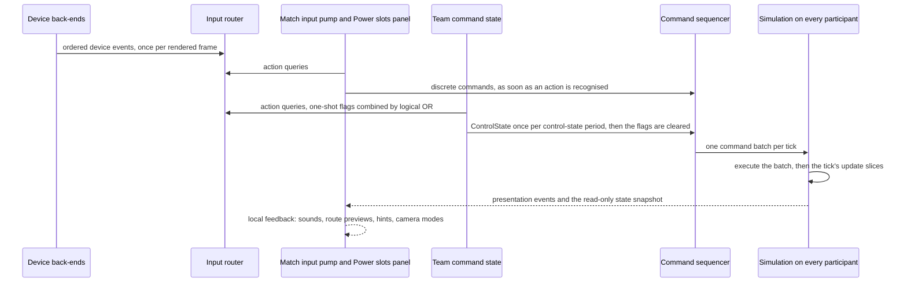
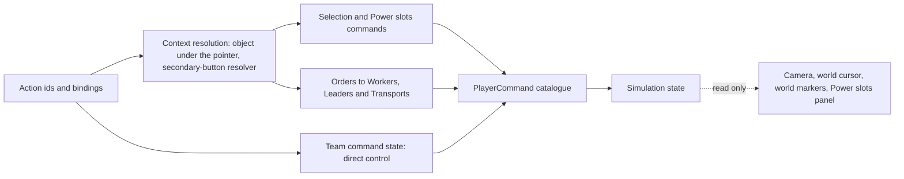

# Controls, camera and commands

> Status: Reference · Prefix: R-CTRL · Related: [Teams and player commands](../12_simulation_model/06_teams_and_player_commands.md) · [Units](../02_units/README.md) · [Worker](../02_units/worker.md) · [Leader and formations](../02_units/leader_and_formations.md) · [Strike team](../02_units/strike_team.md) · [Transport](../02_units/transport.md) · [Supply crates and Powers](../04_supply_crates_powers_and_weapons/crates_and_powers.md) · [Tutorial and help](../11_tutorial_and_help.md) · [Input component](../../architecture/components/input.md) · [Camera and sequences component](../../architecture/components/camera_and_sequences.md)

## 1 Purpose and player experience

The reference is an indirect-control real-time strategy game: the player never builds a unit and never orders a single Worker. The player acts on the world in four ways:

1. **Crowd control.** Holding the primary pointer button draws a growing **selection circle** over the player's own Workers; the secondary button then sends the selected Workers to a destination as a **crowd order**.
2. **Leaders.** The player promotes a Worker to a **Leader**. A Leader either stands as a **Waypoint beacon** that redirects the idle Workers passing it, or gathers Workers into a **formation** that marches and fights as a block ([Leader and formations](../02_units/leader_and_formations.md)).
3. **Powers.** Supply crates, reinforcements, the Comeback Bonus, starting powers and map-placed starting units grant **Powers**. A team holds them in its **Power slots** (six, two while eliminated) and the player selects, places and cancels them.
4. **Direct control.** The player steers a few special units and structures directly: the Strike team, the Transport, the Collector, the Builder, turrets and the Beam Dish.

The camera is a free, cursor-following camera that always turns to face the ground point under the pointer. Zooming narrows the field of view. The camera tracks a Strike team for gamepad players and aims from behind a selected turret or Beam Dish.

Every player interaction with the world reaches the simulation as a command of the player command catalogue or as a field of the continuous team command state ([Teams and player commands](../12_simulation_model/06_teams_and_player_commands.md), DEC-008, DEC-023). The camera, the cursor, the world markers and the Power slots panel are presentation: they read the simulation and never write it (DEC-007). Executing a command never issues a further command (DEC-119).

This folder specifies the player-facing rules:

| File | Contents | R-CTRL numbers |
|---|---|---|
| [README.md](README.md) | purpose; general rules, input conventions and gates; the input pipeline and authority | 001 to 029 |
| [actions_and_bindings.md](actions_and_bindings.md) | Species action ids and default bindings; every player action with its context and command; the secondary-button resolver; the object under the pointer; orders to Leaders and Transports; direct control and the team command state | 030 to 149 |
| [selection_and_power_slots.md](selection_and_power_slots.md) | the selection model, group selection and crowd orders; the Power slots: the Power record, Power kinds, states, capacity and order, targeting, selection and cycling, cancellation; the Power slots panel | 150 to 349 |
| [cursor_and_markers.md](cursor_and_markers.md) | the world cursor, highlights, previews, the crosshair and the world markers | 350 to 449 |
| [camera.md](camera.md) | the match camera: model, per-frame update, live modes, components, free movement, tracking, structure aim, and the start-of-match camera views | 450 to 599 |

The input architecture, the device back-ends, the binding grammar and the complete control catalogue belong to the [input component](../../architecture/components/input.md) (ADR-028, ADR-029). The command catalogue (`PlayerCommand`) belongs to [Teams and player commands](../12_simulation_model/06_teams_and_player_commands.md); this folder cites its members and defines no second catalogue. Units and Leaders, with their tuning keys, are specified in [reference/02_units](../02_units/README.md). Scripted camera moves and camera views as data belong to the [camera and sequences component](../../architecture/components/camera_and_sequences.md).

## 2 Rules

### 2.1 General

**R-CTRL-001** (MUST) The values of the tuning tables of this folder are the reference tuning baseline (DEC-004). The rules of this folder are the specification of record for controls, the player camera and the Power slots (DEC-005), and every reference quirk that it keeps is an explicit rule with a named key or condition (DEC-006).

**R-CTRL-002** (MUST) The reference has one match control scheme, the one this folder specifies; no alternative control scheme is specified (DEC-056). Gesture input and the icon Power bar are not specified (DEC-055).

**R-CTRL-003** (MUST) Every player action that changes the world issues a member of `PlayerCommand` ([Teams and player commands](../12_simulation_model/06_teams_and_player_commands.md) R-SIM-449 to R-SIM-452) or sets a field of the team command state (`TeamCommandState`, R-SIM-439). No input, camera, cursor, marker or panel code writes simulation state (DEC-007, DEC-008). Who may send a command, and its validation on arrival, are the Open DEC-202; each command's handler decides at execution whether it has an effect (R-SIM-447, R-SIM-453).

**R-CTRL-004** (MUST) Simulation code never issues a player command. A rule that needs a follow-up change, such as the selection of a newly promoted Leader or of a toggled Leader, applies it inside the same simulation step, so one click yields one command and one selection change on every participant (DEC-119, R-SIM-454).

**R-CTRL-005** (MUST) Bot teams issue no input actions. A bot controller issues, inside its own step, the catalogue commands that express its actions, and applies its other actions as bot-only operations ([Teams and player commands](../12_simulation_model/06_teams_and_player_commands.md) R-SIM-435; [Bots](../07_bots/README.md) R-BOT-014, R-BOT-015; see DEC-122).

**R-CTRL-006** (MUST) Durations of simulation rules are ticks of `ref.sim.tick_period` ([Tick timing](../12_simulation_model/01_tick_timing_and_main_loop.md)). Presentation timings (the camera, the cursor, the world markers, the Power slots panel and interface sound throttles) are real-time or presentation-clock values in seconds, and never feed a simulation rule (DEC-009).

### 2.2 Input conventions and global gates

**R-CTRL-010** (MUST) Bindings use these conditions on a control: **down**, the control became pressed in this frame; **up**, it became released in this frame; **held**, it is pressed now; **axis**, an analogue value (stick, trigger, mouse movement, wheel). A press and a release within one frame make both down and up true for that frame, so no press is lost (ADR-029, DEC-096). The binding grammar and its parser belong to the [input component](../../architecture/components/input.md); an unknown condition word is rejected at load (DEC-096, DEC-553).

**R-CTRL-011** (MUST) The **input mode** is the class of the last active device: keyboard and mouse, or gamepad (ADR-029). Rules that depend on the input mode say so.

**R-CTRL-012** (MUST) These gates are used by the action tables of [actions and bindings](actions_and_bindings.md):

| Gate | Passes when |
|---|---|
| **G-match** | the local participant has a team, no UI window is open, and the chat log is not held ([actions and bindings](actions_and_bindings.md) R-CTRL-040, row A8) |
| **G-play** | the match is not in its grace period, not over and not paused ([Skirmish rules](../01_skirmish_rules_and_modes/README.md)) |
| **nothing selected** | the team's current selection names no actor group, no actor and no structure (R-SIM-399) |
| **Workers selected** | the team has at least one selected Worker in the latched count of R-SIM-402 |
| **placing** | the team has a current Power and that Power is Waiting ([selection and Power slots](selection_and_power_slots.md)) |

**R-CTRL-013** (MUST) The Power slots have no full-screen overlay in a match: the Power slots panel ([selection and Power slots](selection_and_power_slots.md)) is always on screen, and no action is gated on an overlay being hidden.

**R-CTRL-014** (MUST) A command takes effect on every participant when its tick's command batch executes (R-SIM-444, R-SIM-445), so selections and orders show after the command delay; how long that delay is, and how input is coalesced, is the Open DEC-203. Local feedback (R-CTRL-022) shows at once.

### 2.3 Input pipeline and authority

**R-CTRL-020** (MUST) During a match, each rendered frame runs these input steps in this order:

1. the input router (`InputRouter`) takes the frame's device events (ADR-029);
2. the escape and interface actions (`action.match.menu`, `action.view.hide_interface`) are handled;
3. while no UI window is open, the team command state is sampled for the local team ([actions and bindings](actions_and_bindings.md));
4. when `ref.sim.command.control_state_period` has elapsed since the last send, the team command state is sent as `PlayerCommand::ControlState` and its one-shot flags are cleared (R-SIM-438, R-SIM-441);
5. the simulation runs its due ticks ([Tick timing](../12_simulation_model/01_tick_timing_and_main_loop.md));
6. the UI input pump (`UiInputPump`) delivers pointer and key input to open UI windows;
7. the match camera advances, only while the application window has focus ([camera](camera.md));
8. the match input pump (`MatchInputPump`) resolves the pointer context and issues discrete commands ([actions and bindings](actions_and_bindings.md));
9. the Power slots panel advances ([selection and Power slots](selection_and_power_slots.md));
10. the tutorial logic ([Tutorial and help](../11_tutorial_and_help.md)), the audio engine, the world markers ([cursor and markers](cursor_and_markers.md)) and the hint overlay advance. This step hosts the tutorial director, which is evaluated here once per tick of match time ([Tutorial and help](../11_tutorial_and_help.md) R-TUT-061), and the hint overlay advances after the world markers (R-TUT-011).

**R-CTRL-021** (MUST) The match input pump sends each discrete command as soon as the action that issues it is recognised. The team command state carries the continuous state; its one-shot flags are combined (logical OR) over every frame between two sends, and the sender clears every flag before sending while a UI window is open or the chat log is held (R-SIM-441).

**R-CTRL-022** (MUST) Local, unsequenced feedback is applied at once on the sender only: interface sounds, the route preview line, hints, and camera mode changes. The camera enters Beam Dish aim or turret aim when the player clicks the structure ([actions and bindings](actions_and_bindings.md) R-CTRL-041, row S1), before the `Select` command executes; executing the command also requests that mode for the selecting participant (R-SIM-405 step 6).

**R-CTRL-023** (MUST) The route preview line is generated in every frame and discarded in the next. Its routes live in a store of the presentation, separate from the simulation's route storage, and never take an entry or an id from it (DEC-095).

**R-CTRL-024** (MUST) No simulation rule reads the camera, the pointer, a device, a UI window or a preference of any participant (DEC-008). The sender converts every camera-relative quantity of direct control to world space before it enters the team command state (R-SIM-440), and folds its camera's look-around state into the `cameraTracking` field ([actions and bindings](actions_and_bindings.md) R-CTRL-103).

**R-CTRL-025** (MUST) The rules of the sub-files apply together: an action table names the command; the command's effect when it executes is the catalogue entry of [Teams and player commands](../12_simulation_model/06_teams_and_player_commands.md) R-SIM-450 to R-SIM-452 and the unit rules of [reference/02_units](../02_units/README.md); the feedback that the participant sees is the cursor, marker, panel and camera rules of this folder.

## 3 States and flows

Caption: Diagram 3-A, the input pipeline from device events to commands and back to local feedback (R-CTRL-020 to R-CTRL-024).

Caption: Diagram 3-B, the control graph: actions resolve to commands, commands change the simulation, and presentation only reads it (R-CTRL-003, R-CTRL-025).

## 4 Tuning table

The tuning keys of this folder are defined in the tuning table of each sub-file: [actions and bindings](actions_and_bindings.md) §4, [selection and Power slots](selection_and_power_slots.md) §4, [cursor and markers](cursor_and_markers.md) §4 and [camera](camera.md) §4. This file uses `ref.sim.tick_period` and `ref.sim.command.control_state_period`, which are defined in [Tick timing](../12_simulation_model/01_tick_timing_and_main_loop.md) and [Teams and player commands](../12_simulation_model/06_teams_and_player_commands.md). This file defines no tuning key of its own.

## 5 Edge cases and interactions

1. **Input while a window is open.** The team command state is still sent once per control-state period, with every flag cleared, so a Strike team under direct control neither moves nor fires while a UI window or the chat log is open (R-CTRL-021).
2. **One click, one selection.** A click with nothing selected issues one `Select`, never two (R-CTRL-048, DEC-096).
3. **Feedback before execution.** The aim camera of a Beam Dish or a turret starts at the click, before the selection reaches the simulation; turret aim returns to free movement as soon as the team's selection is not its own turret ([camera](camera.md) R-CTRL-491), while Beam Dish aim has no such check (R-CTRL-022).
4. **Route previews.** A preview never changes the route ids that the simulation hands to Workers, because it never uses the simulation's route storage (R-CTRL-023, DEC-095).

## 6 Acceptance criteria

**AC-CTRL-01 — Commands only** (R-CTRL-003, R-CTRL-024). Given two participants that run the same command batches, one with its camera tracking a Strike team and one with a free camera, when both execute the same ticks, then their simulation states are identical after every tick.

**AC-CTRL-02 — No simulation-issued commands** (R-CTRL-004). Given a match in which the player toggles a Leader once, then the command batches contain exactly one `ToggleUnit` and no `Select` that the input layer did not send, and the Leader is the team's selection on every participant.

**AC-CTRL-03 — Pipeline order** (R-CTRL-020). In one frame in which the player presses the place action and the control-state period elapses, the team command state is sent before the simulation ticks, and the `TargetPower` command is issued by the match input pump after the camera has advanced.

**AC-CTRL-04 — Flags cleared under a window** (R-CTRL-021). Given a held fire action and an open UI window, the sent team command state has every flag clear.

## 7 Dependencies

- **Reference documents:** [Teams and player commands](../12_simulation_model/06_teams_and_player_commands.md) (the command catalogue, the team command state, command execution order); [Tick timing and main loop](../12_simulation_model/01_tick_timing_and_main_loop.md) (tick period, presentation clocks); [reference/02_units](../02_units/README.md); [Skirmish rules](../01_skirmish_rules_and_modes/README.md) (grace period, game over); [Tutorial and help](../11_tutorial_and_help.md) (hints and tutorial notifications); [Bots](../07_bots/README.md).
- **Engine components:** [input](../../architecture/components/input.md) (device events, binding graph, control catalogue); [camera and sequences](../../architecture/components/camera_and_sequences.md) (camera views, scripted moves, picking and projection services); [UI framework](../../architecture/components/ui_framework/README.md); [platform layer](../../architecture/components/platform_layer.md).
- **ADRs:** ADR-028 (input device back-ends), ADR-029 (input event model and binding contract), ADR-036 (presentation clock).
- **Assets:** listed in each sub-file.

## 8 Open decisions

| DEC | Topic | Default specified | File |
|---|---|---|---|
| DEC-050 | Front-end features designed new | no reachable rebinding window or control-help panel (R-CTRL-034); no options control for the automatic-camera setting (R-CTRL-480) | [actions and bindings](actions_and_bindings.md), [camera](camera.md) |
| DEC-122 | Bot and deputy actions outside the player command catalogue | a bot applies the actions that no command expresses as bot-only operations (R-CTRL-005) | this file |
| DEC-202 | Command validation and authority | each handler decides at execution (R-CTRL-003) | this file |
| DEC-203 | Input timing, coalescing and latency | latest control state per tick; one-shot flags combined between sends (R-CTRL-014, R-CTRL-021) | this file |
| DEC-302 | Transport unload order over sea | the order is not registered and the Transport goes idle | [actions and bindings](actions_and_bindings.md) |
| DEC-308 | Orders to Workers that operate a port | orders reach every controlled Worker | [selection and Power slots](selection_and_power_slots.md) |
| DEC-310 | Camera tracking after selecting a Leader or a Transport | the stale orbit centre is kept | [camera](camera.md) |
| DEC-803 | Camera animations without content | the structure focus, the approach and the developer fly mode exist outside the live camera modes (R-CTRL-457) | [camera](camera.md) |
| DEC-864 | Pointer fallback and camera smoothing | the reversed ray meets a far sphere (R-CTRL-058); smoothing is not clamped where the reference does not clamp it (R-CTRL-454) | [actions and bindings](actions_and_bindings.md), [camera](camera.md) |
| DEC-550 | Power cancellation in the tutorials | no Power can be cancelled in the blocked tutorial phases | [selection and Power slots](selection_and_power_slots.md) |
| DEC-551 | Units that outlive their Power slot | a cancel frees the slot even when the unit stays | [selection and Power slots](selection_and_power_slots.md) |
| DEC-556 | Power slot order | the compact slot order; keys select by position | [selection and Power slots](selection_and_power_slots.md) |

Resolved decisions applied in this folder: DEC-002, DEC-004, DEC-005, DEC-006, DEC-007, DEC-008, DEC-009, DEC-023, DEC-024, DEC-028, DEC-031, DEC-032, DEC-033, DEC-038, DEC-083, DEC-086, DEC-095, DEC-096, DEC-102, DEC-117, DEC-119, DEC-553, DEC-554, DEC-555, DEC-564, DEC-653, DEC-863, DEC-953, DEC-955, DEC-960. Dropped decisions that mark what the folder does not specify: DEC-055 (gestures and the icon Power bar), DEC-056 (the alternative control scheme), DEC-552 (Power kinds without targeting behaviour).
