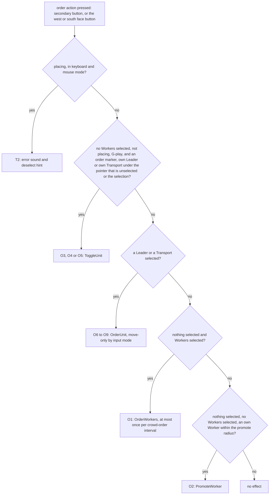
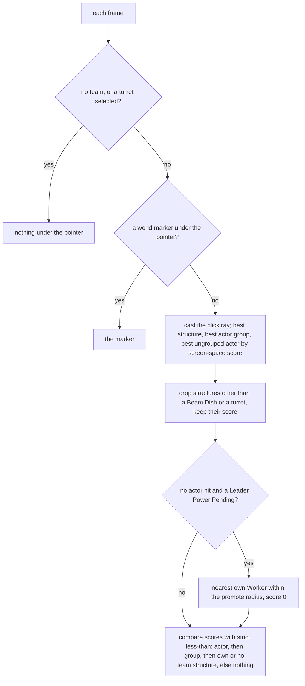

# Actions and bindings

> Status: Reference · Prefix: R-CTRL · Related: [README](README.md) · [Selection and Power slots](selection_and_power_slots.md) · [Cursor and markers](cursor_and_markers.md) · [Camera](camera.md) · [Teams and player commands](../12_simulation_model/06_teams_and_player_commands.md) · [Leader and formations](../02_units/leader_and_formations.md) · [Strike team](../02_units/strike_team.md) · [Transport](../02_units/transport.md) · [Input component](../../architecture/components/input.md)

## 1 Purpose and player experience

The player plays with the mouse and keyboard or with a gamepad. The primary button selects, places Powers and draws the selection circle; the secondary button gives orders, and what an order means depends on what is selected and on what lies under the pointer: it promotes a Worker, toggles a Leader's formation or a Transport's loading, sends the selected Workers, or orders the selected Leader or Transport. A few units and structures are steered directly: the Strike team, the Builder, the Collector, turrets and the Beam Dish.

This file gives every player action a Species action id and a default binding (§2.1), states the context, the effect and the command of every action (§2.2), the priority order of the secondary button's meanings (§2.3), how the pointer picks an object (§2.4, §2.5), the player's orders to Leaders and Transports (§2.6, §2.7), and direct control through the team command state (§2.8). The command catalogue is [Teams and player commands](../12_simulation_model/06_teams_and_player_commands.md); the binding graph, the device back-ends and the full control catalogue are the [input component](../../architecture/components/input.md).

## 2 Rules

### 2.1 Action ids and default bindings

**R-CTRL-030** (MUST) Every player action has a Species action id of the form `action.<group>.<name>`. The [input component](../../architecture/components/input.md) binds each action id to device conditions through its binding graph; several action ids may share one physical input, and the context rules of §2.2 decide which of them applies. The ids of this document are the stable names that bindings, rebinding and saved settings use (ADR-0029).

**R-CTRL-031** (MUST) The default bindings of the match control scheme are those of table 2.4-A. Each binding is stated with its effective meaning (DEC-553). Gamepad controls are named by position: the south, east, west and north face buttons, the left and right shoulder buttons, the left and right triggers, the left and right sticks and their presses, the d-pad, and the menu and view buttons; their glyphs are `glyph.pad.face_south`, `glyph.pad.face_east`, `glyph.pad.face_west`, `glyph.pad.face_north`, `glyph.pad.shoulder_left` and `glyph.pad.shoulder_right`.

Table 2.4-A Default bindings of the match control scheme.

| Action id | Keyboard and mouse | Gamepad | Row |
|---|---|---|---|
| `action.camera.pan_left` | A or Left arrow, held | — | A1 |
| `action.camera.pan_right` | D or Right arrow, held | — | A1 |
| `action.camera.pan_forward` | W or Up arrow, held | — | A1 |
| `action.camera.pan_back` | S or Down arrow, held | — | A1 |
| `action.camera.pan_stick` | — | left stick, axis | A1 |
| `action.camera.fast_pan` | Shift, held | left stick press, held | A2 |
| `action.camera.raise` | Q, held | right trigger, held | A3 |
| `action.camera.lower` | E, held | left trigger, held | A3 |
| `action.camera.height_wheel` | mouse wheel, axis | — | A3 |
| `action.camera.aim` | mouse movement, axis | — | A4 |
| `action.camera.aim_stick` | — | right stick, axis | A4 |
| `action.camera.zoom` | Z or middle button, held | right stick press, held | A5 |
| `action.camera.zoom_out` | C, down | — | A11 |
| `action.camera.look_around` | F2, held | right stick press, held | A6 |
| `action.camera.track_closer` | — | d-pad up, held | A7 |
| `action.camera.track_farther` | — | d-pad down, held | A7 |
| `action.view.chat_log` | L, held | — | A8 |
| `action.view.hide_interface` | X down while Alt is held | — | A9 |
| `action.view.screenshot` | P, down | — | A10 |
| `action.select.pick` | primary button, down | south face button, down | S1, O10 |
| `action.select.pick_idle` | primary button, down | south face button, down | S1 |
| `action.select.clear` | Space, down | east face button, down | S3 |
| `action.select.circle_begin` | primary button, down | south face button, down | S4 |
| `action.select.circle_grow` | primary button, held | south face button, held | S5 |
| `action.select.circle_end` | primary button, up | south face button, up | S6 |
| `action.power.next` | Tab or `]`, down | right shoulder, down | S7 |
| `action.power.previous` | `[`, down | left shoulder, down | S8 |
| `action.power.slot_1` to `action.power.slot_9` | keys 1 to 9, down | — | S9 |
| `action.power.activate_slot` | primary button up, or Enter down | south face button, up | S11 |
| `action.power.place` | primary button, down | south face button, down | T1 |
| `action.power.cancel` | C, down | north face button, down | T3, T6 |
| `action.power.end_current` | unbound | unbound | T7 |
| `action.power.panel_show` | Tab, down | view button, down | T8 |
| `action.power.panel_hide` | Tab, up | view button down, or east face button down | T8 |
| `action.order.crowd` | secondary button, down | west face button, down | O1 |
| `action.order.straight_route` | Ctrl, held | — | O1, O6 |
| `action.order.promote` | secondary button, down | west face button, down | O2 to O5 |
| `action.order.special` | secondary button, down | south face button, down | O6 to O9, T2 |
| `action.order.move_modifier` | Shift, held | west face button, down | O6 to O9 |
| `action.order.demote` | C, down | north face button, down | T5 |
| `action.order.scrap` | C, down | north face button, down | T4 |
| `action.direct.move_hold` | primary button, held | — | D1 |
| `action.direct.move_stick` | — | left stick, axis | D1 |
| `action.direct.fire` | secondary button, held | right trigger, held | D2, D5 |
| `action.direct.secondary_fire` | primary button down while the secondary button is held | left trigger, down | D3 |
| `action.direct.aim_stick` | — | right stick, axis | D2 |
| `action.direct.secondary_fire_directed` | unbound | unbound | D3 |
| `action.direct.set_target` | secondary button, held | west face button, held | D4, D5 |
| `action.direct.set_target_end` | secondary button, up | west face button, up | D1 |
| `action.direct.move_direction_change` | the binding of the input component's control catalogue | the binding of the input component's control catalogue | <<ctrlvec>> |
| `action.match.ready` | Space, down | south or east face button, down | M1 |
| `action.match.chat` | Enter, down | — | M2 |
| `action.match.pause` | Pause, down | — | M3 |
| `action.match.menu` | Esc, down | menu button, down | M4 |
| `action.debug.network_stats` | F9, down | — | M5 |
| `action.ui.pointer_down` | primary button, down | `action.ui.show_cursor` with the south face button down | M6 |
| `action.ui.pointer_held` | primary button, held | `action.ui.show_cursor` with the south face button held | M6 |
| `action.ui.alt_pointer_down` | secondary button, down | — | M6 |
| `action.ui.show_cursor` | — | left shoulder, held | M6 |
| `action.device.pad_disconnected`, `action.device.pad_connected` | — | gamepad disconnect, connect | M7 |
| `action.app.quit` | Alt+F4, or the window's close request | — | M8 |

**R-CTRL-032** (MUST) The gamepad triggers are read as press bindings where table 2.4-A says "down": the secondary fire on the left trigger fires once when the trigger goes down (DEC-553). Trigger magnitude is available to bindings but no default binding uses it (DEC-554).

**R-CTRL-033** (MUST) Each local player drives the match only with its own assigned gamepad (DEC-554). The other input corrections of DEC-096 and DEC-554 (canonical key names, validated drivers, per-binding repeat state, reloading the layout-specific bindings when the keyboard layout changes) are rules of the input component.

**R-CTRL-034** (MUST) The match has no reachable key-rebinding window. The rebinding window and a contextual control-help panel exist only as hooks; whether Species designs them is the Open DEC-050 ([front end, options and hooks](../09_front_end_and_match_flow/options_localisation_and_hooks.md)). Bindings change only through the player's settings file, which the input component reads.

**R-CTRL-035** (MUST) Front-end and menu navigation (menu directions with repeat, activate, close, skip, scroll speed-up) belong to the [UI framework](../../architecture/components/ui_framework/README.md) and the [front end](../09_front_end_and_match_flow/README.md); in a match they act only on open UI windows.

### 2.2 Player actions

**R-CTRL-040** (MUST) The camera and view actions are local to the participant and issue no command:

| Row | Actions | Context and conditions | Effect |
|---|---|---|---|
| A1 | `action.camera.pan_left`, `action.camera.pan_right`, `action.camera.pan_forward`, `action.camera.pan_back`, `action.camera.pan_stick` | free-movement camera | moves the camera target along the horizontal camera basis (<<pan>>) |
| A2 | `action.camera.fast_pan` | with the A1 keys | multiplies the key pan speed (<<pan>>); the stick pan ignores it |
| A3 | `action.camera.raise`, `action.camera.lower`, `action.camera.height_wheel` | no UI window open; raise and lower are ignored while a Beam Dish or a turret is aimed | changes the camera height (<<height>>) |
| A4 | `action.camera.aim`, `action.camera.aim_stick` | free movement, Beam Dish aim and turret aim; the stick only while no UI window is open; not while the chat log is held | the camera turns to face the ground point under the pointer, and the pointer stays on that ground point (<<mouselook>>, <<cursorlock>>) |
| A5 | `action.camera.zoom` | no UI window open; not in tracking, where it re-centres the camera behind the Strike team (<<trackdist>>) | divides the field-of-view target while held (<<zoom>>) |
| A6 | `action.camera.look_around` | ignored while `action.direct.fire` is held | freezes the camera position and suspends tracking; the orientation still follows the pointer (<<lookaround>>) |
| A7 | `action.camera.track_closer`, `action.camera.track_farther` | tracking camera | changes the tracking distance (<<trackdist>>) |
| A8 | `action.view.chat_log` | no UI window open | shows the chat log; mouse-look is frozen, the match input pump issues no team action, and the team command state is sent with every flag cleared (R-CTRL-021) |
| A9 | `action.view.hide_interface` | — | toggles the hidden-interface flag: the HUD, the world markers, the Power slots panel and the cursor effects are hidden |
| A10 | `action.view.screenshot` | no UI window open | renders and saves a screenshot, tiled when the poster-resolution setting is above 1 ([renderer view](../../architecture/components/renderer/view_lighting_and_fog.md) RND-214, ADR-0076) |
| A11 | `action.camera.zoom_out` | — | no effect: no rule reads it, so the field of view never widens beyond its base value |

**R-CTRL-041** (MUST) The selection actions are:

| Row | Actions | Context and conditions | Effect | Command |
|---|---|---|---|---|
| S1 | `action.select.pick` while something is selected, `action.select.pick_idle` while nothing is selected | G-match; the object under the pointer (R-CTRL-055) | an own Beam Dish: select it and enter Beam Dish aim, unless the map disables Beam Dish control; an own turret: select it and enter turret aim; an own selectable actor or actor group: select it; the selection sound (<<selsound>>) | `PlayerCommand::Select` |
| S2 | `action.select.pick` on empty ground | something selected; not placing; no Strike team selected; not a Leader or Transport selected in gamepad mode; `action.direct.set_target` not held | the error sound `match_ui.error` and the deselect hint ([Tutorial and help](../11_tutorial_and_help.md)) | none |
| S3 | `action.select.clear` | G-match | clears the selection and releases the Worker group; the camera returns to free movement; the cycling anchor is cleared (<<anchor>>) | `PlayerCommand::Select` with none, none, none |
| S4 | `action.select.circle_begin` | G-match; nothing selected; no Workers selected; not placing; no circle active; no Leader under the pointer; not in the grace period; the pointer is not over a structure or an own selectable actor or group | starts the local selection circle at the pointer ground point with radius 0; sound `match_ui.selection_circle` (<<circbegin>>) | none |
| S5 | `action.select.circle_grow` | as S4, while no Workers are selected yet | grows the circle and adds the Workers inside it (<<circgrow>>) | `PlayerCommand::SelectWorkers` |
| S6 | `action.select.circle_end` | G-match | ends the circle and resets the crowd-order time (<<circend>>) | none |
| S7 | `action.power.next` | — | selects the next Power (<<cycle>>) | `PlayerCommand::SelectPower` |
| S8 | `action.power.previous` | — | selects the previous Power (<<cycle>>) | `PlayerCommand::SelectPower` |
| S9 | `action.power.slot_1` to `action.power.slot_9` | the slot holds a Power that is not locked | selects the Power in that slot position (<<slotkeys>>) | `PlayerCommand::SelectPower` |
| S10 | S1 on a Power's unit | — | the `Select` handler also selects the Power bound to the named actor group or actor (R-SIM-450) | `PlayerCommand::Select` |
| S11 | `action.power.activate_slot` over a slot of the power bar | the slot holds a Power that is not locked | selects that Power, as S9 (DEC-083, <<clickbar>>) | `PlayerCommand::SelectPower` |

**R-CTRL-042** (MUST) The order actions are:

| Row | Actions | Context and conditions | Effect | Command |
|---|---|---|---|---|
| O1 | `action.order.crowd`; `action.order.straight_route` held gives a straight route | G-match; nothing selected; Workers selected; no circle active; not placing; at least `ref.ctrl.order.crowd_interval_ticks` of match time since the team's last crowd order; the target lies on the map | the crowd order of <<crowd>> | `PlayerCommand::OrderWorkers` |
| O2 | `action.order.promote` near an own Worker | G-match; nothing selected; no Workers selected; not placing; G-play; the nearest own selectable Worker lies within `ref.ctrl.promote_radius` of the pointer ground point; the press is not an O3, O4 or O5 | promotes the Worker; the new Leader is selected in the same step (R-UNIT-153); the tutorial notification of [Tutorial and help](../11_tutorial_and_help.md) | `PlayerCommand::PromoteWorker` |
| O3 | `action.order.promote` on an own Leader | as O2, except that nothing is selected or this Leader is the selected actor | a Leader in formation mode or with a waypoint order cancels its orders; any other enters formation facing forward and is selected in the same step (R-UNIT-175, R-SIM-454); sound `match_ui.toggle_state` | `PlayerCommand::ToggleUnit`, secondary flag clear |
| O4 | `action.order.promote` on an own Transport | as O3 | toggles the Transport's loading ([Transport](../02_units/transport.md) R-UNIT-390); sound `match_ui.toggle_state` | `PlayerCommand::ToggleUnit`, secondary flag clear |
| O5 | `action.order.promote` on a Transport's order marker | as O3; the pointer is over the order marker (<<ordermarker>>) | cycles the Transport's arrival action, and the Transport is deselected (R-UNIT-391) | `PlayerCommand::ToggleUnit`, secondary flag set |
| O6 | `action.order.special` or `action.order.move_modifier` (R-CTRL-043); `action.order.straight_route` held gives a straight route | a Leader selected | a waypoint order or a formation move (R-UNIT-171); the team's selection is cleared in the same step | `PlayerCommand::OrderUnit`, move-only clear |
| O7 | as O6 (R-CTRL-043) | a Leader selected | the Leader itself walks to the point (R-UNIT-169) | `PlayerCommand::OrderUnit`, move-only set |
| O8 | as O6 (R-CTRL-043) | a Transport selected; the target lies on the map | a move order (R-UNIT-387); the land route is highlighted; sound `transport.ordered` | `PlayerCommand::OrderUnit`, move-only set, straight set |
| O9 | as O6 (R-CTRL-043) | a Transport selected; the target lies on the map | a deploy order (R-UNIT-388); the Transport is deselected | `PlayerCommand::OrderUnit`, move-only clear, straight set |
| O10 | `action.select.pick` | an own Beam Dish is selected, and nothing else | aims the Beam Dish at the start point of the other Beam Dish under the pointer, or else at the pointer ground point | `PlayerCommand::AimBeamDish` |

**R-CTRL-043** (MUST) The move-only flag of an order to a selected Leader or Transport depends on the input mode as follows; in gamepad mode the two inputs swap their meaning, so the south face button always gives the move-only order and the west face button always gives the other.

| Selected | Input mode | Input | Move-only | Row |
|---|---|---|---|---|
| Leader | keyboard and mouse | `action.order.special` | clear | O6 |
| Leader | keyboard and mouse | `action.order.special` with `action.order.move_modifier` held | set | O7 |
| Leader | gamepad | `action.order.move_modifier` (west face button) | clear | O6 |
| Leader | gamepad | `action.order.special` (south face button) | set | O7 |
| Transport | keyboard and mouse | `action.order.special` | set | O8 |
| Transport | keyboard and mouse | `action.order.special` with `action.order.move_modifier` held | clear | O9 |
| Transport | gamepad | `action.order.special` (south face button) | set | O8 |
| Transport | gamepad | `action.order.move_modifier` (west face button) | clear | O9 |

An order to a Transport always sets the straight-route flag (R-SIM-450); an order to a Leader sets it while `action.order.straight_route` is held.

**R-CTRL-044** (MUST) The Power actions are:

| Row | Actions | Context and conditions | Effect | Command |
|---|---|---|---|---|
| T1 | `action.power.place` | placing; G-play | targets the current Power at the pointer ground point; the target-area test runs when the command executes ([selection and Power slots](selection_and_power_slots.md) R-CTRL-192) | `PlayerCommand::TargetPower` |
| T2 | `action.order.special` | placing; G-play; no circle growing; keyboard and mouse mode only | the error sound `match_ui.error` and the deselect hint | none |
| T3 | `action.power.cancel` | no UI window open; the team has a current Power | cancels the current Power ([selection and Power slots](selection_and_power_slots.md) R-CTRL-210) | `PlayerCommand::CancelPower` |
| T4 | `action.order.scrap` | nothing selected; no Workers selected; an own ungrouped actor other than a Worker or a Leader is under the pointer | damages that actor by `ref.sim.command.scrap_damage` and clears the selection; the same press also gives T3 (DEC-086) | `PlayerCommand::ScrapActor`, then `PlayerCommand::Select` with none, none, none |
| T5 | `action.order.demote` | a Leader is selected | demotes the Leader to a Worker; the handler clears the selection; the camera returns to free movement (DEC-086, R-UNIT-154) | `PlayerCommand::DemoteLeader` |
| T6 | `action.power.cancel` or `action.select.clear` | an own turret is selected | releases the turret: the selection is cleared and the camera returns to free movement; the turret stays. R-CTRL-109 does the same when the turret changes owner | `PlayerCommand::Select` with none, none, none |
| T7 | `action.power.end_current` | no UI window open; the team has a current Power | as T3; an action never changes a Power locally (DEC-008) | `PlayerCommand::CancelPower` |
| T8 | `action.power.panel_show`, `action.power.panel_hide` | — | no effect in a match | none |

**R-CTRL-045** (MUST) The cancel action never kills or demotes a Leader by itself: demotion is the separate action `action.order.demote`, and scrapping (T4) never applies to a Leader (DEC-086). Promoting, demoting and scrapping are the three separate commands of R-SIM-456.

**R-CTRL-046** (MUST) The direct-control actions set fields of the team command state (R-CTRL-101) and issue no discrete command:

| Row | Actions | Context | Effect |
|---|---|---|---|
| D1 | `action.direct.move_hold`; `action.direct.move_stick` only while the camera tracks the Strike team | a Strike team selected; not firing | moves the Strike team: its waypoint follows the pointer ground point, or the lead Trooper's position plus the stick vector ([Strike team](../02_units/strike_team.md) R-UNIT-357, R-UNIT-358) |
| D2 | `action.direct.fire`, aimed with the pointer or `action.direct.aim_stick` | a Strike team selected; not looking around | the Strike team fires its lasers at the target every tick (R-UNIT-352) |
| D3 | `action.direct.secondary_fire` with `action.direct.fire` held; `action.direct.secondary_fire_directed` | a Strike team selected | the Trooper nearest the target throws a grenade (R-UNIT-355) |
| D4 | `action.direct.set_target` | a Builder or a Collector selected | its waypoint becomes the pointer ground point, and the team's selection is cleared ([Builder](../02_units/builder.md) R-UNIT-463, [Collector](../02_units/collector.md) R-UNIT-441) |
| D5 | the pointer aims; `action.direct.set_target`, `action.direct.fire`, `action.direct.move_hold` or `action.direct.move_stick` fires | an own turret selected, in turret aim | the turret aims at the pointer ground point and fires ([defences and props](../03_buildings_and_world_objects/defences_and_props.md)) |
| D6 | the pointer | a Leader selected, with the order PrepareWaypoint and slower than `ref.ctrl.leader.face_pointer_speed` | the Leader turns to face the pointer ground point, which previews its waypoint direction (R-UNIT-168) |

**R-CTRL-047** (MUST) The match-flow and application actions are:

| Row | Actions | Context and conditions | Effect | Command |
|---|---|---|---|---|
| M1 | `action.match.ready` | the grace period; no UI window open | toggles the team's ready flag ([Skirmish rules](../01_skirmish_rules_and_modes/README.md) R-MODE-041) | `PlayerCommand::ToggleReady` |
| M2 | `action.match.chat` | keyboard and mouse mode; the chat input is closed and was not toggled in this update; no UI window open | opens the chat input; submitting a line sends it. In gamepad mode the chat input closes | `PlayerCommand::Chat` on submit |
| M3 | `action.match.pause` | no remote human team in the match; not in the grace period; not after game over | toggles the pause request (R-SIM-458, DEC-038) | `PlayerCommand::Pause` |
| M4 | `action.match.menu` | the screen fade has finished; no tutorial script runs | closes every open UI window and shows the interface again; with none open, opens the in-match menu and hides the interface while it is open; the UI input pump then runs a second time in this frame | none |
| M5 | `action.debug.network_stats` | — | toggles the network statistics window ([diagnostics](../../architecture/components/diagnostics_test_and_performance.md)) | none |
| M6 | `action.ui.pointer_down`, `action.ui.pointer_held`, `action.ui.alt_pointer_down` | over a UI window | drive the UI window; a primary press over a window is withheld from the match actions for the rest of the frame | none |
| M7 | `action.device.pad_disconnected`, `action.device.pad_connected` | — | opens and closes the gamepad-disconnected dialog ([front end](../09_front_end_and_match_flow/README.md)); while the gamepad is disconnected in gamepad mode, the application treats itself as unfocused, so the camera does not advance | none |
| M8 | `action.app.quit` | — | requests the application to quit ([platform layer](../../architecture/components/platform_layer.md)) | none |

**R-CTRL-048** (MUST) One pointer press produces at most one `Select` command: when nothing is selected, `action.select.pick` and `action.select.pick_idle` resolve the same press once (DEC-096, DEC-119).

### 2.3 The secondary-button resolver

**R-CTRL-050** (MUST) A press of the order actions (`action.order.crowd`, `action.order.promote`, `action.order.special` and `action.order.move_modifier`, which share the secondary button with the mouse and the west and south face buttons with the gamepad) resolves to exactly one meaning, tried in this order (DEC-023):

1. **Placing error.** While placing, in keyboard and mouse mode: the error feedback of row T2; nothing else happens.
2. **Toggle the unit under the pointer.** While no Workers are selected, not placing, and in G-play: a Transport's order marker under the pointer gives O5; an own Leader under the pointer, when nothing is selected or this Leader is the selected actor, gives O3; an own Transport under the pointer, on the same condition, gives O4.
3. **Order the selected unit.** A selected Leader gives O6 or O7, and a selected Transport gives O8 or O9, by R-CTRL-043.
4. **Crowd order.** With nothing selected and Workers selected, row O1.
5. **Promote.** With nothing selected and no Workers selected, row O2.

A press that meets none of these conditions does nothing. While a Strike team, a Builder, a Collector or a turret is selected, the secondary button acts only through the team command state (rows D2, D4 and D5).

**R-CTRL-051** (MUST) Every order action that reaches rule 3, 4 or 5 of R-CTRL-050 also sets the `special_orders` flag of the team command state (R-CTRL-101), whatever its meaning.

### 2.4 The object under the pointer

**R-CTRL-055** (MUST) Every frame, the match input pump resolves the object under the pointer for the local team as follows:

1. There is none while the participant has no team, or while its team's selection is a turret, so that nothing snaps while a turret is aimed.
2. A world marker under the pointer wins (<<markerhover>>).
3. Otherwise the click ray through the pointer is tested against three kinds, and each kind gives its best candidate. The score of a candidate is not its depth along the ray: for each object whose test volume the ray hits, the score is the screen-space distance in pixels between the projected centre of that volume and the projected hit point on it, so it measures how close the pointer is to the object's centre on screen. Within each kind the smallest score wins; on equal scores the earlier object in container order wins.
   - **Structures** of the team or of no team, in structure order: a Beam Dish or a turret that its exact ray test hits is returned at once with score 0 (the first such structure); every other structure is tested as a sphere of `ref.sim.query.structure_pick_fraction` × its radius at its centre ([Containers and update order](../12_simulation_model/04_containers_and_update_order.md) table 2.10-A). Without a hit the score is the largest finite score.
   - **Actor groups** of the team: a group with live members is pre-tested as a sphere of `ref.sim.query.group_pick_factor` × its radius at its centre, then each live member as a sphere of the same factor × its radius; the group of the best-scoring member wins.
   - **Ungrouped actors** of the team, Workers excluded: a Leader is tested against its picking sphere ([Leader and formations](../02_units/leader_and_formations.md) R-UNIT-192); a Transport by its exact ray test, after which the running best score is set to `ref.sim.query.transport_pick_range` unconditionally, so a Transport hit replaces every earlier actor and loses only to a later score below that value; every other actor as a sphere of `ref.sim.query.actor_pick_factor` × its radius.
4. A structure that is neither a Beam Dish nor a turret is dropped as a result, but its score is kept. A structure that cannot be selected, such as a Spawn Node, whose score is not larger than the actor's or the group's score therefore still blocks that pick in step 6, and then nothing is returned.
5. If no actor was hit and the team's current Power is a Pending Leader Power, the nearest own Worker within `ref.ctrl.promote_radius` of the pointer ground point counts as the actor, with score 0.
6. The kinds are compared by score with strict less-than: the actor wins if its score is below both other scores; otherwise the group, if its score is below both others; otherwise the structure, if its score is below both others and it belongs to the team or to no team; otherwise nothing is returned. While a Leader Power is placed, a Worker found at score 0 therefore ties with a Beam Dish or a turret under the pointer, and nothing is returned.

**R-CTRL-056** (MUST) Enemy actors, groups and structures are never picked. A structure of no team can be picked, which serves order snapping, but only own Beam Dishes and own turrets are selected (row S1). Picking is local presentation and input and never runs in a simulation step ([Space, routing and physics](../12_simulation_model/05_space_routing_and_physics.md) R-SIM-387).

**R-CTRL-057** (MUST) The **order target** of rows O1 and O6 to O9, and of the route previews, is the pointer ground point, replaced by the entrance of a Beam Dish under the pointer, by the position of a Supply crate under the pointer, by the position of a Transport under the pointer that is not full, or by the position of a Leader under the pointer.

**R-CTRL-058** (MUST) The **pointer ground point** is recomputed each time the camera moves: the click ray through the pointer is intersected with the terrain. When it misses, the point is where the ray, reversed from `ref.ctrl.pointer.miss_ray_start` radii out, meets the inside of a sphere centred at (world size x ÷ 2, 0, world size z ÷ 2) with radius `ref.ctrl.pointer.miss_sphere_factor` × the world size. Outside a match world the sphere has radius `ref.ctrl.pointer.no_world_sphere_radius` and is centred at the origin.

**R-CTRL-059** (MUST) Before each send of the team command state, its `pointer_position` is replaced by the position of an own ungrouped actor under the pointer, or by the position of a Beam Dish under the pointer, when either is under it; otherwise it is the pointer ground point.

### 2.5 Selecting with the pointer

**R-CTRL-062** (MUST) Row S1 obeys these restrictions: nothing new can be selected while a Beam Dish or a turret is selected (the player deselects first, rows S3 and T6); an actor that is already selected is ignored; a Worker is never selected singly (<<selectable>>). No other rule forbids selecting a new object while another is selected.

**R-CTRL-063** (MUST) An own Beam Dish is selectable unless the map's option disables Beam Dish control ([Maps](../08_maps_and_level_design/README.md)); with the option set, row S1 does not select it.

### 2.6 Leaders as signposts and formations

**R-CTRL-070** (MUST) Leaders are created only by promotion. The player promotes with row O2 (`PlayerCommand::PromoteWorker`); a bot promotes through the Leader Power (<<leaderpower>>). A Burning Worker is not promoted, and the new Leader is selected in the same step ([Leader and formations](../02_units/leader_and_formations.md) R-UNIT-153, R-SIM-454). In every match the team's Leader power level is 3, so a Leader can follow and form up (R-UNIT-174).

**R-CTRL-071** (MUST) Promotion shows a control flash at the new Leader: `ref.ctrl.promote.flash_count` particles, each with a velocity drawn from `ref.ctrl.promote.flash_velocity`, from the presentation generator (presentation, DEC-007). For the local team, promotion also registers a Leader marker (<<leadermarker>>).

**R-CTRL-072** (MUST) The player demotes a selected Leader with row T5 (`PlayerCommand::DemoteLeader`), which turns it back into one Worker without releasing an Essence orb (R-UNIT-154, DEC-086).

**R-CTRL-073** (MUST) The player commands a Leader as follows; the order model, the order state machine, the formation geometry and the formation membership are those of [Leader and formations](../02_units/leader_and_formations.md):

| Input | Command | Leader operation | Result |
|---|---|---|---|
| the promote action on an own Leader, while nothing else is selected or this Leader is selected (O3) | `PlayerCommand::ToggleUnit`, secondary flag clear | in formation mode or with a waypoint order: clear orders; otherwise orders to the point `ref.sim.command.leader_toggle_offset` in front of it | the formation disbands, or the Leader enters formation facing forward and is selected (R-UNIT-175) |
| an order with move-only clear (O6) | `PlayerCommand::OrderUnit`, move-only clear | `AssignOrders(target, straight)` | in formation mode the formation marches to the target; a click closer than `ref.unit.leader.formation_toggle_radius` enters formation; otherwise a waypoint order: the Leader stays and redirects passing idle Workers; the selection is cleared (R-UNIT-170, R-UNIT-171) |
| an order with move-only set (O7) | `PlayerCommand::OrderUnit`, move-only set | `AssignWaypoint(target)` | the Leader walks to the target, turning first in formation mode, and enters a connected Beam Dish whose entrance lies within `ref.unit.leader.beam_dish_radius` of it (R-UNIT-169) |
| demote (T5) | `PlayerCommand::DemoteLeader` | demotion | the Leader becomes one Worker (R-UNIT-154) |
| the pointer, while the Leader is selected with the order PrepareWaypoint and its speed is below `ref.ctrl.leader.face_pointer_speed` (D6) | `PlayerCommand::ControlState` | the Leader faces the team's pointer position | the facing previews the direction of the next waypoint order (R-UNIT-168) |

**R-CTRL-074** (MUST) A Leader under a waypoint order is a **Waypoint beacon**: every idle Worker of its team that passes within `ref.unit.worker.leader_signpost_range` takes the order and walks the order route, which turns the output of a Spawn Node into a conveyor. A Leader in formation mode gathers the Workers within `ref.unit.worker.leader_follow_range` into a block in front of it, up to `ref.sim.team.formation_size_upgrade` members ([Worker](../02_units/worker.md) R-UNIT-096, DEC-031).

**R-CTRL-075** (MUST) The player sees a Leader's orders through these elements: the formation preview of the world cursor while a Leader is selected, and the route and preview of a hovered Leader that walks in formation (<<formpreview>>); the order trail marks that a waypoint order lays along its route (R-UNIT-185, R-UNIT-186, `marker.order_trail`); the Leader's banner, which shows its order and which the world markers draw for the local team (R-UNIT-191, <<leadermarker>>); and the terminate hint shown while the pointer hovers a Leader with no order ([Tutorial and help](../11_tutorial_and_help.md)).

### 2.7 Transport orders

**R-CTRL-080** (MUST) The player commands a Transport with rows O4, O5, O8 and O9 and with crowd orders; the Transport has no continuous control. The order operations are those of [Transport](../02_units/transport.md) R-UNIT-387 to R-UNIT-391 and R-UNIT-401: a move order clears the arrival action and turns Loading into Idle; a deploy order closer than `ref.unit.transport.deploy_min_distance` does nothing, and a farther one drives there and, within `ref.unit.transport.arrival_distance` of the point, starts Unloading when the Transport carries passengers and Loading when it is empty.

**R-CTRL-081** (MUST) An order to a Transport (O8, O9) highlights its land route for the local team and emits an order-marker presentation event for every viewer whose team is a friend of the commanding team (R-SIM-450); the world markers then show the order marker (<<ordermarkertype>>). Clicking that marker with the promote action toggles the Transport's arrival action (O5).

**R-CTRL-082** (MUST) A deploy order, or an unload toggle, given while the Transport is over sea is not registered, and the Transport falls back to its idle state ([Transport](../02_units/transport.md); see DEC-302).

**R-CTRL-083** (MUST) Workers board a Transport when a crowd order's target lies within `ref.unit.worker.order_transport_radius` of a friendly Transport that has free capacity ([Worker](../02_units/worker.md) R-UNIT-140).

### 2.8 Direct control and the team command state

**R-CTRL-100** (MUST) The direct-control rules apply to the team's selected Strike team, Builder, Collector, Leader or turret and are carried only by the team command state (R-SIM-438 to R-SIM-443). Direct control exists only for the Strike team, the Transport (through discrete orders), the Collector, the Builder, turrets and the Beam Dish (through `AimBeamDish`) (DEC-008).

**R-CTRL-101** (MUST) The sender samples the team command state in every frame from the actions of table 2.4-A. Each one-shot flag is combined over the frames since the last send (R-SIM-441):

| Field | Set when |
|---|---|
| `move_target` | `action.direct.set_target` is held, `secondary_fire` is not set, and not (gamepad mode with a Strike team selected) |
| `direct_move` | `action.direct.move_stick` gives a vector |
| `primary_fire` | `action.direct.fire` is held and the camera is not looking around |
| `secondary_fire` | `action.direct.secondary_fire` fires |
| `target_directed` | `action.camera.aim_stick` or `action.direct.aim_stick` gives a vector |
| `secondary_fire_directed` | `action.direct.secondary_fire_directed` fires |
| `camera_tracking` | the camera is in tracking mode, or the camera is looking around (<<camtrack>>) |
| `special_orders` | `action.order.special` fires (R-CTRL-051) |
| `end_set_target` | `action.direct.set_target_end` fires |
| `gamepad` | the input mode is gamepad |
| `primary_held` | `action.direct.move_hold` is held |
| `pointer_position` | the pointer ground point, replaced at send time by R-CTRL-059 |
| `direct_move_vector` | the movement stick converted to world space by R-SIM-440, with the camera's control vector (<<ctrlvec>>) |
| `direct_target_vector` | the aiming stick converted to world space; while the camera tracks a Strike team, the absolute target lead Trooper position + the camera's aim vector (R-CTRL-102) |

**R-CTRL-102** (MUST) The aiming stick also steers the sender's camera aim vector, which is presentation: the wanted aim vector moves towards the stick vector with the acceleration `ref.ctrl.direct.aim_accel`, or `ref.ctrl.direct.aim_accel_fast` when the squared change exceeds `ref.ctrl.direct.aim_fast_threshold_sq`; its length is clamped to `ref.ctrl.direct.aim_max_length` when its squared length exceeds the square of that length. Each frame the camera aim vector moves a quarter of the way to the wanted aim vector (<<aimvec>>).

**R-CTRL-103** (MUST) The sender sets `camera_tracking` when its camera tracks the selected unit or when the player holds `action.camera.look_around`, so the Strike team's direct-control rule reads the sender's state and never a camera (DEC-008, [Strike team](../02_units/strike_team.md) R-UNIT-358).

**R-CTRL-104** (MUST) Executing a team command state applies it on every participant, by the team's current selection (R-SIM-442). The match ignores it while paused and after game over. It sets the team's pointer position, takes the move flag from `move_target` and primary fire from `primary_fire`, and gives secondary fire only when both `primary_fire` and `secondary_fire` are set:

| Selected | Behaviour |
|---|---|
| Strike team | the move flag becomes `primary_held` and not `primary_fire`; the Strike team's direct-control rule runs (R-UNIT-358); with the move flag, the waypoint becomes the pointer position, the target direction points from the group centre to it, and the formation offsets are recalculated (R-UNIT-343); except with a gamepad, primary fire attacks the pointer position without a grenade and secondary fire with a grenade (R-UNIT-352, R-UNIT-357) |
| Builder or Collector | the move flag sets its waypoint to the pointer position and clears the team's selection (R-UNIT-441, R-UNIT-463) |
| Leader | while its order is PrepareWaypoint and its speed is below `ref.ctrl.leader.face_pointer_speed`, it faces the pointer position (R-UNIT-168) |
| Transport | nothing: a Transport takes discrete orders only (R-CTRL-080) |
| turret | the turret aims at the pointer position; any of the move flag, `primary_fire`, `direct_move` or `primary_held` fires it ([defences and props](../03_buildings_and_world_objects/defences_and_props.md)) |

For the local team, `end_set_target` after a move registers a move marker at the pointer position; a match does not draw move markers, and the move-marker list is bounded (DEC-096).

**R-CTRL-105** (MUST) A keyboard and mouse player moves a Strike team by holding `action.direct.move_hold` (the waypoint follows the pointer ground point in every update), fires lasers by holding `action.direct.fire`, and throws a grenade by pressing `action.direct.secondary_fire` while firing. The Troopers of the selected Strike team face the team's pointer position. A gamepad player moves and aims a Strike team only with the sticks while the camera tracks it; `move_target` is never set for it (R-CTRL-101).

**R-CTRL-106** (MUST) A Builder or a Collector takes one move order per selection: holding `action.direct.set_target` sets its waypoint and deselects it, and with it the team's current Power is cleared ([Builder](../02_units/builder.md) R-UNIT-463, [Collector](../02_units/collector.md) R-UNIT-441).

**R-CTRL-107** (MUST) A turret is controlled while it is the team's selection, with the camera in turret aim: its aim follows the pointer ground point in every applied team command state, and it fires while any of its fire inputs is held. Selecting it sets its fire timer (R-SIM-405 step 5). While a turret is controlled, nothing else can be selected, and the object under the pointer is none (R-CTRL-055 step 1). Row T6 releases it, and R-CTRL-109 releases it when another team captures it.

**R-CTRL-108** (MUST) A Beam Dish is controlled while it is the team's selection, with the camera in Beam Dish aim: row O10 aims it, and Workers are sent through it by a crowd order onto its entrance (R-CTRL-057).

**R-CTRL-109** (MUST) When the team's selected actor group, actor or structure is no longer valid for the local participant (it is dead or removed, or it is a turret that now belongs to another team), the match input pump issues `PlayerCommand::Select` with none, none, none, and the camera returns to free movement. Executing it releases the Worker group as every `Select` does (<<release>>).

## 3 States and flows

Caption: Diagram 3-A, the secondary-button resolver (R-CTRL-050, R-CTRL-042, R-CTRL-043).

Caption: Diagram 3-B, resolving the object under the pointer (R-CTRL-055).

## 4 Tuning table

This file cites `ref.sim.query.structure_pick_fraction`, `ref.sim.query.group_pick_factor`, `ref.sim.query.transport_pick_range` and `ref.sim.query.actor_pick_factor` ([Containers and update order](../12_simulation_model/04_containers_and_update_order.md)); `ref.sim.command.control_state_period`, `ref.sim.command.scrap_damage`, `ref.sim.command.leader_toggle_offset` and `ref.sim.team.formation_size_upgrade` ([Teams and player commands](../12_simulation_model/06_teams_and_player_commands.md)); `ref.unit.leader.formation_toggle_radius` and `ref.unit.leader.beam_dish_radius` ([Leader and formations](../02_units/leader_and_formations.md)); `ref.unit.worker.leader_signpost_range`, `ref.unit.worker.leader_follow_range` and `ref.unit.worker.order_transport_radius` ([Worker](../02_units/worker.md)); `ref.unit.transport.deploy_min_distance` and `ref.unit.transport.arrival_distance` ([Transport](../02_units/transport.md)); and `ref.ctrl.order.crowd_interval_ticks` ([selection and Power slots](selection_and_power_slots.md)).

| key | value | unit | range or notes | requirement | DEC |
|---|---|---|---|---|---|
| `ref.ctrl.promote_radius` | 10 | wu | nearest own Worker to the pointer ground point; also the Leader Power's search radius | R-CTRL-042, R-CTRL-055 | DEC-031 |
| `ref.ctrl.leader.face_pointer_speed` | 5 | wu/s | strict: a selected Leader slower than this faces the pointer | R-CTRL-046, R-CTRL-073, R-CTRL-104 | — |
| `ref.ctrl.pointer.miss_ray_start` | 4 | sphere radii | the reversed ray's start on a terrain miss | R-CTRL-058 | — |
| `ref.ctrl.pointer.miss_sphere_factor` | 40 | × the world size | radius of the far sphere | R-CTRL-058 | — |
| `ref.ctrl.pointer.no_world_sphere_radius` | 36000 | wu | outside a match world, centred at the origin | R-CTRL-058 | — |
| `ref.ctrl.promote.flash_count` | 5 + (`FxRng::NextUint` mod 5) | particles | 5 to 9 control-flash particles | R-CTRL-071 | DEC-007 |
| `ref.ctrl.promote.flash_velocity` | (`FxRng::NextSigned`(5), `FxRng::NextUnit`(15), `FxRng::NextSigned`(5)) | wu/s | ±2.5, 0 to 15, ±2.5 | R-CTRL-071 | DEC-007 |
| `ref.ctrl.direct.aim_accel` | 6 | stick units per frame | wanted camera aim vector | R-CTRL-102 | — |
| `ref.ctrl.direct.aim_accel_fast` | 256 | stick units per frame | when the squared change exceeds the threshold | R-CTRL-102 | — |
| `ref.ctrl.direct.aim_fast_threshold_sq` | 175 | stick units² | | R-CTRL-102 | — |
| `ref.ctrl.direct.aim_max_length` | 125 | stick units | applied when the squared length exceeds 125² (15,625) | R-CTRL-102 | — |

## 5 Edge cases and interactions

1. **A press on empty ground with nothing selected** issues one `Select` with none, none, none and starts the selection circle (rows S1 and S4, R-CTRL-048).
2. **Turret control.** While a turret is selected, the pointer resolves to nothing, so no click snaps or selects; only rows T6, S3 and the direct-control fields act (R-CTRL-055, R-CTRL-107).
3. **Shared gamepad buttons.** The west face button is the crowd order, the promote action and the move modifier at once; the resolver gives it one meaning per press (R-CTRL-050).
4. **Enter.** Enter opens the chat input and also activates a focused power-bar slot; the slot needs the pointer over the bar (rows M2, S11).
5. **Toggle before order.** With a Leader selected, a press on that Leader toggles it and does not give it a waypoint at its own position (R-CTRL-050 step 2).
6. **A Leader Power over a structure.** The Worker found at score 0 ties with a Beam Dish or a turret at score 0, and the pointer resolves to nothing (R-CTRL-055 step 6).
7. **Transport over sea.** A deploy order or an unload toggle over sea is not registered (R-CTRL-082, see DEC-302).
8. **The C key.** One press can cancel the current Power and scrap the unit under the pointer (row T4); with a Leader selected it demotes the Leader, whose selection has already cleared the current Power (rows T3, T5).
9. **A gamepad Strike team** moves only by stick and only while the camera tracks it (R-CTRL-101, R-CTRL-105).
10. **Look around as tracking.** A keyboard player who holds look around while a Strike team is selected sends `camera_tracking`, so the Strike team's direct-control rule runs for that player (R-CTRL-103).

## 6 Acceptance criteria

**AC-CTRL-AB-01 — Resolver order** (R-CTRL-050). With a Leader selected and the pointer on that Leader, the secondary button sends `ToggleUnit`, not `OrderUnit`.

**AC-CTRL-AB-02 — Move-only by input mode** (R-CTRL-043).

| Selected | Input mode | Input | Sent |
|---|---|---|---|
| Leader | keyboard and mouse | secondary button | `OrderUnit`, move-only clear |
| Leader | keyboard and mouse | Shift + secondary button | `OrderUnit`, move-only set |
| Transport | keyboard and mouse | secondary button | `OrderUnit`, move-only set, straight set |
| Transport | keyboard and mouse | Shift + secondary button | `OrderUnit`, move-only clear, straight set |
| Leader or Transport | gamepad | south face button | move-only set |
| Leader or Transport | gamepad | west face button | move-only clear |

**AC-CTRL-AB-03 — Screen-space picking** (R-CTRL-055). Of two own Transports hit by the ray, the earlier in container order is returned whatever their depths; of two own Builders hit, the one whose projected centre is nearer the projected hit point is returned.

**AC-CTRL-AB-04 — Structure blocking** (R-CTRL-055 step 4). A Spawn Node whose score is not larger than an own Collector's score makes the pointer resolve to nothing.

**AC-CTRL-AB-05 — Cancel never kills a Leader** (R-CTRL-045, DEC-086). With a Leader selected, the cancel key sends `DemoteLeader` and no `ScrapActor`; with nothing selected and an own Transport under the pointer it sends `ScrapActor` and `Select` with none.

**AC-CTRL-AB-06 — Gamepad Strike team** (R-CTRL-101). In gamepad mode with a Strike team selected, holding the west face button never sets `move_target`.

**AC-CTRL-AB-07 — Leader facing** (R-CTRL-104). A selected Leader with the order PrepareWaypoint at 4.9 wu/s turns to face the pointer position; at 5 wu/s it does not.

**AC-CTRL-AB-08 — Aim vector** (R-CTRL-102). A stick vector that would give a wanted aim vector of length 200 is clamped to length 125.

**AC-CTRL-AB-09 — Crowd order snapping** (R-CTRL-057). A crowd order given with the pointer over a non-full own Transport sends the Transport's position as the target.

## 7 Dependencies

- **Reference documents:** [Teams and player commands](../12_simulation_model/06_teams_and_player_commands.md) (R-SIM-438 to R-SIM-460); [Containers and update order](../12_simulation_model/04_containers_and_update_order.md) (table 2.10-A picking operations); [Space, routing and physics](../12_simulation_model/05_space_routing_and_physics.md) (ray tests, routes); [Worker](../02_units/worker.md); [Leader and formations](../02_units/leader_and_formations.md); [Strike team](../02_units/strike_team.md); [Transport](../02_units/transport.md); [Builder](../02_units/builder.md); [Collector](../02_units/collector.md); [defences and props](../03_buildings_and_world_objects/defences_and_props.md) (turrets); [Skirmish rules](../01_skirmish_rules_and_modes/README.md) (readiness, pause); [Maps](../08_maps_and_level_design/README.md) (the Beam Dish control option); [front end](../09_front_end_and_match_flow/README.md) and [options and hooks](../09_front_end_and_match_flow/options_localisation_and_hooks.md); [Tutorial and help](../11_tutorial_and_help.md) (deselect, terminate and speed-up hints).
- **Engine components:** [input](../../architecture/components/input.md) (binding graph, control catalogue, gamepad assignment); [UI framework](../../architecture/components/ui_framework/README.md); [platform layer](../../architecture/components/platform_layer.md); [diagnostics](../../architecture/components/diagnostics_test_and_performance.md); [frame view](../../architecture/components/renderer/view_lighting_and_fog.md) (poster screenshots).
- **ADRs:** ADR-0028, ADR-0029, ADR-0076 (screenshot encoding).
- **Assets:** `glyph.pad.face_south`, `glyph.pad.face_east`, `glyph.pad.face_west`, `glyph.pad.face_north`, `glyph.pad.shoulder_left`, `glyph.pad.shoulder_right`, `marker.order_trail`; sound events `match_ui.error`, `match_ui.toggle_state`, `transport.ordered`.

## 8 Open decisions

| DEC | Topic | Default specified in §2 |
|---|---|---|
| DEC-050 | Front-end features designed new | no reachable key-rebinding window and no control-help panel (R-CTRL-034) |
| DEC-202 | Command validation and authority | every command goes through the catalogue's handlers, which decide at execution (R-CTRL-048, R-CTRL-109) |
| DEC-203 | Input timing, coalescing and latency | one-shot flags are combined between sends (R-CTRL-101) |
| DEC-302 | Transport unload order over sea | the order is not registered and the Transport goes idle (R-CTRL-082) |

Resolved decisions applied: DEC-007, DEC-008, DEC-023, DEC-031, DEC-032, DEC-083, DEC-086, DEC-095, DEC-096, DEC-117, DEC-119, DEC-553, DEC-554. Dropped: DEC-055, DEC-056.
