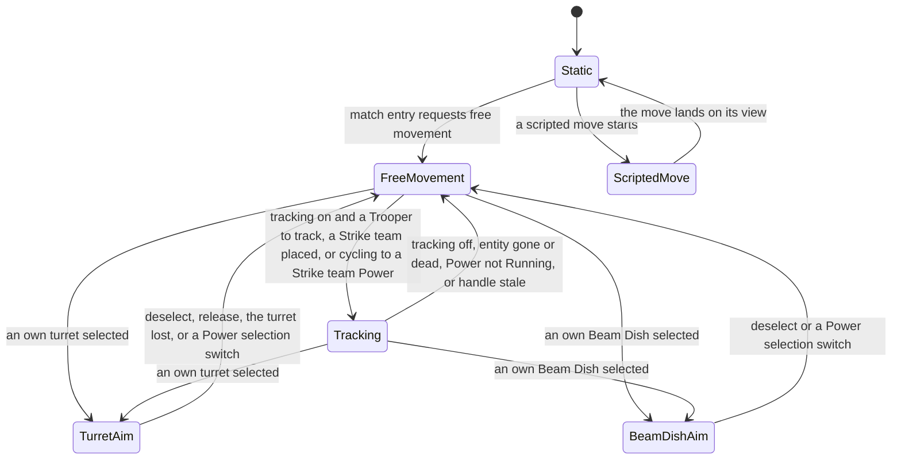
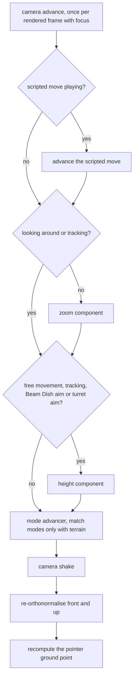
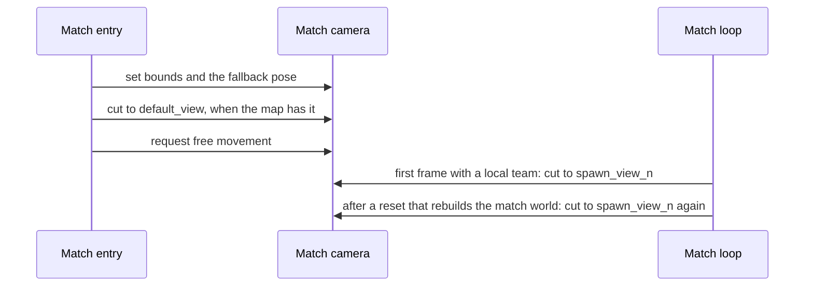

# Camera

> Status: Reference · Prefix: R-CTRL · Related: [README](README.md) · [Actions and bindings](actions_and_bindings.md) · [Selection and Power slots](selection_and_power_slots.md) · [Cursor and markers](cursor_and_markers.md) · [Match lifecycle](../12_simulation_model/02_match_lifecycle_and_state_reset.md) · [Camera and sequences component](../../architecture/components/camera_and_sequences.md) · [Frame view](../../architecture/components/renderer/view_lighting_and_fog.md)

## 1 Purpose and player experience

The match camera is a free camera that follows the pointer: moving the mouse turns the camera to face the ground point under the pointer, and the pointer stays glued to that point while the camera moves. The keys pan over the map at a fixed speed, four times faster with the speed modifier; the wheel raises and lowers the camera, faster the higher it is; zooming narrows the field of view to a quarter. The camera climbs over cliffs instead of running into them. For gamepad players the camera tracks a selected Strike team from behind; a selected turret or Beam Dish puts the camera behind the structure to aim it. At match start the camera cuts to the map's default view and then to the player's own view.

The camera is local to each participant, is never sent, and is never read by the simulation (DEC-008, DEC-024). All its motion uses one presentation clock (DEC-024). Scripted camera moves and the camera views as data belong to the [camera and sequences component](../../architecture/components/camera_and_sequences.md); the projection, the near and far planes and the field-of-view clamp belong to the [renderer](../../architecture/components/renderer/view_lighting_and_fog.md).

## 2 Rules

### 2.1 Model and conventions

**R-CTRL-450** (MUST) Each participant has one match camera (`MatchCamera`). The world is right-handed with +Y up and sea level at y = 0 (ADR-016); distances are in wu.

**R-CTRL-451** (MUST) The camera holds a unit front vector and an up vector, re-orthonormalised every frame. Its **left vector** is up × front, which points to the screen's left; its horizontal left vector is that vector projected onto the ground plane and normalised. The camera's **control vector** is the left vector that the stick conversion of the team command state uses (R-SIM-440, R-CTRL-487).

**R-CTRL-452** (MUST) The camera's state is its position, its target point (the goal point of the mode), its target front and up (for cuts and moves), its height (the wanted absolute y in free movement, and the height parameter of the aim modes), its vertical field of view and the target field of view (degrees), its mode and its velocity. Its initial pose is `ref.ctrl.camera.initial_pose`, in the static mode, with the tracking distance `ref.ctrl.camera.track_distance`.

**R-CTRL-453** (MUST) The camera advances once per rendered frame, only while the application window has focus (and, in gamepad mode, while the gamepad is connected). Every camera rule measures time with the presentation frame delta dt of [Tick timing](../12_simulation_model/01_tick_timing_and_main_loop.md) R-SIM-570, capped at `ref.sim.frame.delta_clamp`, and uses game time for animations and oscillations; no camera mode keeps a timer of its own (DEC-024). The camera is not advanced in the front end.

**R-CTRL-454** (MUST) The camera's smoothing is first order, x := x × (1 − k × dt) + target × k × dt. Where a rule does not clamp k × dt, it is not clamped, so a smoothing with k × dt above 1 overshoots at low frame rates (DEC-006; see DEC-864).

### 2.2 The per-frame update

**R-CTRL-456** (MUST) Each frame the camera runs, in this order:

1. the scripted camera move, when one is playing ([camera and sequences](../../architecture/components/camera_and_sequences.md));
2. unless the camera is looking around or tracking, the zoom component (R-CTRL-460);
3. in free movement, tracking, Beam Dish aim and turret aim, the height component (R-CTRL-461);
4. the advancer of the current mode; the match modes run only while the terrain exists;
5. the camera shake (R-CTRL-463);
6. re-orthonormalisation of front and up;
7. the recomputation of the pointer ground point ([actions and bindings](actions_and_bindings.md) R-CTRL-058).

A mode change takes effect from the next frame's advancer. While a match mode advances, the pointer is held inside the window ([input](../../architecture/components/input/README.md)). The grace frames of the debug advancers are not specified (DEC-024).

**R-CTRL-457** (MUST) The live camera modes are those of table 2.2-A. The spherical-world, scripted-campaign, first-person, entity-follow and replay modes, and the debug modes other than the developer fly mode, are not specified (DEC-024). Two capabilities of the [camera and sequences component](../../architecture/components/camera_and_sequences.md) exist outside the player's live camera modes and leave them unchanged: the structure focus and the approach to a structure are timeline-only operations, which only a presentation timeline reaches (CAM-053 to CAM-058), and the developer fly mode is a developer tool of `Debug` builds and of the map editor (CAM-080 to CAM-084) (DEC-024; see DEC-803).

Table 2.2-A Live camera modes.

| Mode | Entered by | Player-steered | Height component |
|---|---|---|---|
| static | the initial mode; the end of a scripted move; a camera cut | no | no |
| scripted move | a scripted camera move or the restoring of the previous view (`previous_view`), owned by the camera and sequences component | no | no |
| free movement | match entry ([Match lifecycle](../12_simulation_model/02_match_lifecycle_and_state_reset.md) R-SIM-014 step 9); deselect (row S3); releasing a turret or demoting a Leader (rows T5, T6); a Power's selection switch out of an aim mode (R-CTRL-201); leaving tracking; losing the turret (R-CTRL-109) | yes | yes |
| tracking | free movement, when tracking is on and the entity to track is a Trooper (R-CTRL-481); placing a Strike team (R-CTRL-194); cycling onto a Strike team Power (R-CTRL-203) | yes | runs, without effect on the position |
| Beam Dish aim | selecting an own Beam Dish, unless the map sets the option no Beam Dish aiming (row S1, [actions and bindings](actions_and_bindings.md) R-CTRL-063) | yes | yes, clamped |
| turret aim | selecting an own turret (row S1); executing a `Select` of an own turret (R-SIM-405 step 6) | yes | yes, clamped |

### 2.3 Common components

**R-CTRL-460** (MUST) **Zoom.** The zoom component eases the field of view towards a target by the rates of `ref.ctrl.camera.zoom_rates`: the target is the mode's target field of view, with rate 30; while `action.camera.zoom` is held and no UI window is open, the target is divided by `ref.ctrl.camera.zoom_divisor` (60° becomes 15°) and the rate is 100; in the static and scripted-move modes, and in the timeline-only structure focus ([camera and sequences](../../architecture/components/camera_and_sequences.md) CAM-058), the rate is 1. With k = dt × rate × 0.1, the field of view becomes fov × (1 − k) + target × k: a time constant of 1/3 s normally, 0.1 s while zooming, and 10 s during a scripted move. Free movement sets its target to `ref.ctrl.camera.fov_base` when it is entered, and turret aim sets it to `ref.ctrl.camera.turret_fov` in every frame. The renderer clamps the field of view before the projection ([frame view](../../architecture/components/renderer/view_lighting_and_fog.md) RND-212). No action widens the field of view beyond its base value (row A11). The component is skipped while the camera is looking around or tracking (R-CTRL-456 step 2), and while the overlay screen of the Power slots is shown, which never happens in a match (R-CTRL-013).

**R-CTRL-461** (MUST) **Height.** With delta the wheel notches of the frame (forward positive): while no UI window is open, `action.camera.raise` adds `ref.ctrl.camera.height_key_rate` × dt and `action.camera.lower` subtracts it, both ignored while the team's selection is a turret or a Beam Dish. In a match world, with land = max(the terrain height under the camera, `ref.ctrl.camera.min_height`), the height grows by delta × `ref.ctrl.camera.height_scale` × √|height − land|, so the speed grows with the square root of the altitude. Then turret aim clamps the height to `ref.ctrl.camera.turret_height_range`, Beam Dish aim to `ref.ctrl.camera.dish_height_range`, and every other mode keeps it at least land + `ref.ctrl.camera.ground_clearance`; in every mode it stays at most `ref.ctrl.camera.max_height`. Holding the raise action therefore climbs at 14 × √altitude wu/s (about 140 wu/s at an altitude of 100 wu), and one wheel notch at 100 wu altitude raises the camera by 20 wu.

**R-CTRL-463** (MUST) **Shake.** The shake value is a scalar of the screen effects of [animation and VFX](../../architecture/components/animation_and_vfx/particles_shatter_and_screen_effects.md) (VFX-232, ADR-036), not camera state. A shake request of intensity i sets shake := max(shake, i), and while shake is above 0 it decreases by dt. While shake is above 0, each frame offsets the view by the yaw and the roll of `ref.ctrl.camera.shake`, both drawn from the presentation generator (`FxRng::NextSigned`, [Randomness and integrity](../12_simulation_model/07_randomness_and_integrity.md) R-SIM-607): the front is turned by the yaw about the world vertical and the up vector rolled about the front by the roll, then both are re-orthogonalised, without changing the stored front or up ([camera and sequences](../../architecture/components/camera_and_sequences.md) CAM-012). In Species the shake is therefore a view offset that the camera never stores, and it leaves no residue in the camera's pose (DEC-955). The shake sources and their intensities are those of VFX-233, each specified by its owner: a laser bolt that passes near the camera and the flashes of the shockwave and of the Core Device pulse wave ([weapons and projectiles](../04_supply_crates_powers_and_weapons/weapons_and_projectiles.md)), and a Launch Vessel's ignition, which gives every participant the vessel's shake ÷ 5 per tick, with no distance factor ([mode objects](../03_buildings_and_world_objects/mode_objects.md) R-BLDG-332).

**R-CTRL-464** (MUST) **Cursor lock.** In free movement, Beam Dish aim and turret aim, the camera projects the pointer ground point to the screen before it moves, re-projects it after it moves, and adds the pixel difference to the pointer, accumulating the sub-pixel remainders and rounding down, with the pointer clamped to the screen. The pointer therefore stays on the same ground point while the camera moves.

### 2.4 Free movement

**R-CTRL-470** (MUST) Entering free movement sets the target point to the camera position, the height to the camera's y and the target field of view to `ref.ctrl.camera.fov_base`, and moves the pointer to the screen centre.

**R-CTRL-471** (MUST) Each frame in free movement, except while a poster screenshot renders:

1. **Tracking.** The tracking switch is evaluated (R-CTRL-480); when tracking is on and the entity to track (R-CTRL-481) is a Trooper, the camera enters tracking and stops this advance.
2. The screen position of the pointer ground point is recorded for the cursor lock.
3. **Pan.** The pan rate is `ref.ctrl.camera.pan_speed`, × `ref.ctrl.camera.fast_pan_factor` while `action.camera.fast_pan` is held. With fwd the front projected onto the ground and normalised, and left the horizontal left vector: `action.camera.pan_left` adds left × dt × rate to the target, `action.camera.pan_right` subtracts it, `action.camera.pan_forward` adds fwd × dt × rate, and `action.camera.pan_back` subtracts it. The pan stick, in free movement only, subtracts left × dt × x × `ref.ctrl.camera.stick_gain` and fwd × dt × y × the same gain, with the stick's x and y on the input component's stick scale, on which pushing the stick forward gives a negative y; the fast-pan factor does not apply to it. Using the stick records the camera-moved condition for the hints ([Tutorial and help](../11_tutorial_and_help.md)).
4. **Speed-up hint.** While `action.camera.pan_forward` alone has been held, without another direction and without the fast-pan action, for more than `ref.ctrl.camera.speed_hint_hold`, the fast-pan hint of [Tutorial and help](../11_tutorial_and_help.md) R-TUT-026 shows.
5. **Cliff avoidance.** With dir the horizontal direction from the camera to the target, the distance to a blockage d is the distance of the first of the samples of `ref.ctrl.camera.cliff_probe` along dir at which land + `ref.ctrl.camera.ground_clearance` exceeds the height, or the probe length when none does. When d is below the probe length, with s = max(0, (d − 30) ÷ 70), the target becomes position + (target − position) × s, and the height grows by (1 − s) × the horizontal distance from the position to the target: the camera climbs instead of running into the slope.
6. **Ground clearance.** land is the highest terrain height at the target and at the four points `ref.ctrl.camera.ground_samples` around it, and at least `ref.ctrl.camera.min_height`. When land + `ref.ctrl.camera.ground_clearance` exceeds the height, the target's y and the height both become land + `ref.ctrl.camera.ground_clearance`; otherwise the target's y becomes the height.
7. **Position.** Unless the camera is looking around, position := position × (1 − k × dt) + target × k × dt with k = `ref.ctrl.camera.position_smoothing`; the velocity is the change of position ÷ dt.
8. **Mouse-look.** While the chat log is not held and the pointer ground point exists, the front turns towards normalise(ground point − position) about the axis front × wanted by |front × wanted| × min(1, √dt) radians (`ref.ctrl.camera.mouse_look_rate`), and the up vector is rebuilt from world up. The camera always turns to face the point under the pointer; moving the mouse, or the aim stick, aims the camera, and the cursor lock keeps the pointer on that point. There is no edge scrolling and no rotate or orbit action.
9. The cursor lock runs (R-CTRL-464).
10. **Bounds.** The camera position is clamped horizontally to [−`ref.sim.match_entry.camera_border`, world size x + `ref.sim.match_entry.camera_border`] on both axes, the x size serving for z as well (DEC-024, DEC-096).

**R-CTRL-472** (MUST) **Look around.** While `action.camera.look_around` is held and `action.direct.fire` is not, the camera is looking around: its position is frozen, the zoom component is skipped, its orientation still follows the pointer, and tracking is suspended. The state is evaluated in the free-movement and tracking advancers, and the team command state reports it through `cameraTracking` ([actions and bindings](actions_and_bindings.md) R-CTRL-103).

**R-CTRL-473** (MUST) While `action.view.chat_log` is held and no UI window is open, mouse-look is frozen (row A8).

### 2.5 Tracking

**R-CTRL-480** (MUST) The tracking switch is the automatic-camera setting of `ref.ctrl.camera.automatic_setting`: "never", "always", or "automatic", the default, which is on exactly while the input mode is gamepad. Tracking is on when the setting gives on and the camera is not looking around. The options screen has no control for this setting; it is read from the player's settings as the setting `camera.automatic` ([options and hooks](../09_front_end_and_match_flow/options_localisation_and_hooks.md)), and whether Species adds an options control for it is the Open DEC-050.

**R-CTRL-481** (MUST) The entity to track is none while `action.camera.look_around` is held or without a match world or team; otherwise it is the team's selected actor (a Leader, a Transport, a Builder or a Collector) when there is one, and otherwise, when the current Power is not stopping and the selected group is a Strike team, its lead Trooper. Free movement switches to tracking on its own only for a Trooper.

**R-CTRL-482** (MUST) Entering tracking sets the tracking distance to `ref.ctrl.camera.track_distance`, the target point to the entity's position and the camera target to the camera's position, and clears the aim state.

**R-CTRL-483** (MUST) Each frame in tracking:

1. The switch and the entity are evaluated again; the camera returns to free movement when tracking is off, the entity is missing or dead, the current Power is not Running, there is no current Power and the entity is not a Leader, or the entity's handle no longer resolves.
2. The predicted position is the entity's position + the extrapolation time × its velocity (R-SIM-560).
3. The automatic tracking of R-CTRL-484 to R-CTRL-487 runs.
4. The pointer is held at the screen centre.
5. The camera aim vector moves a quarter of the way to the wanted aim vector (`ref.ctrl.camera.aim_vector_easing`, [actions and bindings](actions_and_bindings.md) R-CTRL-102).

The zoom component does not run in tracking, and the height component runs without affecting the position.

**R-CTRL-484** (MUST) **Distance and reset.** `action.camera.zoom` starts a reset, which snaps the camera behind the unit. `action.camera.track_closer` and `action.camera.track_farther` change the tracking distance by ∓ `ref.ctrl.camera.track_zoom_rate` × dt, clamped to `ref.ctrl.camera.track_distance_range`; the distance is a floating-point value (DEC-096). The smoothing factor is k = min(1, `ref.ctrl.camera.track_smoothing` × dt), × 3 while a reset runs.

**R-CTRL-485** (MUST) **Move behind** (only while the tracked entity is a Trooper), with the constants of `ref.ctrl.camera.move_behind`: on a new lead Trooper, last := its position with y = 0. With cur the lead Trooper's position with y = 0, when |cur − last|² exceeds the minimum squared move:

1. with c = dot(normalise(cur − last), normalise(wanted − last)): when no reset runs and c > 0.5, the unit moves towards the camera within ±60°, and the camera translates with it: target := wanted + (cur − last);
2. otherwise cur − last is pushed into a history of 10 samples (initially filled with copies of it), the history is averaged, and the camera is placed the tracking distance behind the average direction of travel: target := cur − normalise(average) × distance;
3. target y := the tracking distance; last := cur; wanted := target.

Then the camera target := lerp(camera target, target, k), or towards the position when there was no movement; the camera target is snapped onto the horizontal circle of radius the tracking distance around cur, at the absolute height y = the tracking distance, not relative to the terrain; and the position := lerp(position, camera target, k). A reset ends when position − wanted is below `ref.ctrl.camera.reset_done` on each axis, compared with sign.

**R-CTRL-486** (MUST) **Rotate towards the entity.** With e the entity's normalised screen offset from the centre, k2 = min(1, 2 × dt + √(eₓ² + e_y²) ÷ 10) (`ref.ctrl.camera.rotate_factor`); the target point eases towards the entity, the front eases towards it, and the up vector is rebuilt.

**R-CTRL-487** (MUST) **Control vector.** The control vector becomes the camera's left vector in every frame, except while the movement stick is held, `action.direct.move_direction_change` is not held and |cos(dot(world up, camera up))| ≥ `ref.ctrl.camera.control_vector_threshold`: the rule takes the cosine of a dot product, so in effect it keeps the control vector only while the camera looks almost straight down. This keeps stick-relative movement stable while the camera swings ([actions and bindings](actions_and_bindings.md) R-CTRL-101).

**R-CTRL-488** (MUST) For a tracked Leader or Transport the move-behind step is skipped, and the circle centre keeps its last value, which is the last Strike team position or the origin (see DEC-310). This case arises only when the player selects a Leader or a Transport while the camera already tracks a Strike team, because every entry into tracking names a Strike team.

### 2.6 Structure aim

**R-CTRL-490** (MUST) **Beam Dish aim**, with `ref.ctrl.camera.dish_aim`: entering sets the target point to the Beam Dish's dish position and the height to 80 wu. Each frame: ground := the target point at terrain height; with k = 4 × dt, the front eases towards the pointer ground point; ideal := ground + (0, h, 0) − the horizontal front × 1.5h; the position := lerp(position, ideal, k); the cursor lock runs. Only the wheel changes the height, within `ref.ctrl.camera.dish_height_range`; the field of view is unchanged.

**R-CTRL-491** (MUST) **Turret aim**, with `ref.ctrl.camera.turret_aim`: entering sets the target point to the turret's position, the height to 20 wu and the aimed structure to the turret. Each frame: the camera returns to free movement unless the team's current structure is its own turret; the target field of view is `ref.ctrl.camera.turret_fov`; ground := target + (0, 20, 0) − front × h; the front eases towards the pointer ground point with k = 4 × dt; ideal := ground + (0, h, 0) − the horizontal front × 0.8h; the position eases towards it; the cursor lock runs. The height stays within `ref.ctrl.camera.turret_height_range`.

**R-CTRL-492** (MUST) A Power's selection switch returns the camera from either aim mode to free movement (R-CTRL-201).

### 2.7 Start-of-match camera views

**R-CTRL-495** (MUST) Each map has camera views: an optional default view (`default_view`), which is the view during loading and in the lobby, and one view per player position, `spawn_view_<n>` with n the position. The camera and sequences component holds them as data, and the map designer authors one spawn view per player position ([Maps](../08_maps_and_level_design/README.md)).

**R-CTRL-496** (MUST) Entering a match sets the camera's bounds and fallback pose and cuts to the default view; a map without a default view keeps the fallback pose ([Match lifecycle](../12_simulation_model/02_match_lifecycle_and_state_reset.md) R-SIM-014 step 8).

**R-CTRL-497** (MUST) As soon as the local team exists, in the first frame of the match loop in which the participant's team is known, and again after every reset that rebuilds the match world, the camera cuts to `spawn_view_<n>`, with n the team's start position ([Teams and player commands](../12_simulation_model/06_teams_and_player_commands.md) R-SIM-417). A map without that view keeps the default view or the fallback pose. Every match start therefore cuts to the default view and then to the player's view (DEC-024).

## 3 States and flows

Caption: Diagram 3-A, the live camera modes (R-CTRL-457 to R-CTRL-492).

Caption: Diagram 3-B, the per-frame camera update (R-CTRL-456).

Caption: Diagram 3-C, the start-of-match camera views (R-CTRL-495 to R-CTRL-497).

## 4 Tuning table

This file cites `ref.sim.frame.delta_clamp` ([Tick timing](../12_simulation_model/01_tick_timing_and_main_loop.md)), `ref.sim.match_entry.camera_border` ([Match lifecycle](../12_simulation_model/02_match_lifecycle_and_state_reset.md)), and the renderer's `rnd.view.near_plane`, `rnd.view.far_plane`, `rnd.view.fov_min` and `rnd.view.fov_max` ([frame view](../../architecture/components/renderer/view_lighting_and_fog.md)), which bound every camera view.

| key | value | unit | range or notes | requirement | DEC |
|---|---|---|---|---|---|
| `ref.ctrl.camera.initial_pose` | field of view 60°; height 50 wu; position (1000, 500, 1000); front normalise(0, −0.5, −1); bounds ±10⁶ wu on both horizontal axes | pose | until match entry sets the pose and the bounds | R-CTRL-452 | — |
| `ref.ctrl.camera.fov_base` | 60 | degrees | vertical; the free-movement target | R-CTRL-460, R-CTRL-470 | DEC-024 |
| `ref.ctrl.camera.zoom_divisor` | 4 | — | 60° becomes 15° while zooming | R-CTRL-460 | DEC-024 |
| `ref.ctrl.camera.zoom_rates` | normal 30; zooming 100; static and scripted move 1; k = dt × rate × 0.1 | per second | time constants 1/3 s, 0.1 s, 10 s | R-CTRL-460 | DEC-024 |
| `ref.ctrl.camera.turret_fov` | 50 | degrees | set every frame in turret aim | R-CTRL-460, R-CTRL-491 | — |
| `ref.ctrl.camera.height_key_rate` | 7 | wheel notches per second | raise and lower actions | R-CTRL-461 | — |
| `ref.ctrl.camera.height_scale` | 2 | × √(wu) per notch | height change = delta × 2 × √\|height − land\| | R-CTRL-461 | — |
| `ref.ctrl.camera.min_height` | 10 | wu | lowest land value used | R-CTRL-461, R-CTRL-471 | — |
| `ref.ctrl.camera.ground_clearance` | 10 | wu | above the land | R-CTRL-461, R-CTRL-471 | — |
| `ref.ctrl.camera.max_height` | 5000 | wu | | R-CTRL-461 | — |
| `ref.ctrl.camera.turret_height_range` | [10, 50] | wu | | R-CTRL-461, R-CTRL-491 | — |
| `ref.ctrl.camera.dish_height_range` | [50, 120] | wu | | R-CTRL-461, R-CTRL-490 | — |
| `ref.ctrl.camera.shake` | yaw `FxRng::NextSigned`(0.05 × shake) rad; roll 0.3 × `FxRng::NextSigned`(shake) rad; decay 1 per second | presentation | | R-CTRL-463 | — |
| `ref.ctrl.camera.pan_speed` | 250 | wu/s | key pan | R-CTRL-471 | DEC-024 |
| `ref.ctrl.camera.fast_pan_factor` | 4 | × | 1,000 wu/s | R-CTRL-471 | DEC-024 |
| `ref.ctrl.camera.stick_gain` | 10 | wu/s per stick unit | full deflection about 393 wu/s; no fast-pan factor | R-CTRL-471 | — |
| `ref.ctrl.camera.speed_hint_hold` | 4 | s of real time | forward pan held alone | R-CTRL-471 | — |
| `ref.ctrl.camera.cliff_probe` | 100 wu, 40 samples 2.5 wu apart; slow band 30 to 100 wu, s = max(0, (d − 30) ÷ 70) | probe | | R-CTRL-471 | — |
| `ref.ctrl.camera.ground_samples` | ±10 | wu | the target and four points around it | R-CTRL-471 | — |
| `ref.ctrl.camera.position_smoothing` | 4 | per second | free-movement position | R-CTRL-471 | — |
| `ref.ctrl.camera.mouse_look_rate` | \|front × wanted\| × min(1, √dt) | radians per frame | | R-CTRL-471 | — |
| `ref.ctrl.camera.automatic_setting` | never; always; automatic (default, on in gamepad mode) | setting | | R-CTRL-480 | — |
| `ref.ctrl.camera.track_distance` | 250 | wu | floating point | R-CTRL-452, R-CTRL-482 | DEC-096 |
| `ref.ctrl.camera.track_zoom_rate` | 10 | wu/s | d-pad up and down | R-CTRL-484 | DEC-096 |
| `ref.ctrl.camera.track_distance_range` | [50, 500] | wu | | R-CTRL-484 | DEC-096 |
| `ref.ctrl.camera.track_smoothing` | 4 | per second | × 3 while resetting; k clamped to 1 | R-CTRL-484 | — |
| `ref.ctrl.camera.move_behind` | minimum squared move 10 wu²; towards-camera cosine 0.5; history 10 samples | constants | | R-CTRL-485 | — |
| `ref.ctrl.camera.reset_done` | 5 | wu per axis | signed comparison | R-CTRL-485 | — |
| `ref.ctrl.camera.rotate_factor` | min(1, 2 × dt + \|e\| ÷ 10) | factor | e = normalised screen offset | R-CTRL-486 | — |
| `ref.ctrl.camera.control_vector_threshold` | 0.98 | cosine | | R-CTRL-487 | — |
| `ref.ctrl.camera.aim_vector_easing` | 0.25 | of the remaining difference per frame | | R-CTRL-483 | — |
| `ref.ctrl.camera.dish_aim` | height 80 wu; back-off 1.5 × h; smoothing 4 per second | constants | | R-CTRL-490 | — |
| `ref.ctrl.camera.turret_aim` | height 20 wu; lift 20 wu; back-off 0.8 × h; smoothing 4 per second | constants | | R-CTRL-491 | — |

## 5 Edge cases and interactions

1. **Low frame rates.** With the frame delta capped at 0.25 s, the free-movement smoothing reaches k × dt = 1 at most, while an unclamped faster smoothing overshoots (R-CTRL-453, R-CTRL-454).
2. **Tracking a Leader or a Transport.** The orbit centre is stale (R-CTRL-488, see DEC-310).
3. **Keyboard players and tracking.** With the default setting, a keyboard and mouse player never gets tracking; only the settings file changes that (R-CTRL-480).
4. **Right stick press.** It is bound both to zoom and to look around; in tracking, zoom starts a reset while look around suspends tracking (R-CTRL-472, R-CTRL-484).
5. **A map without spawn views.** The camera stays on the default view or the fallback pose (R-CTRL-497).
6. **Climbing a slope.** Cliff avoidance raises the height by the shortened step, so a steep climb lifts the camera instead of stopping it (R-CTRL-471 step 5).
7. **Tracking distance.** Because the distance is a floating-point value, the d-pad zooms out at every frame rate (R-CTRL-484, DEC-096).

## 6 Acceptance criteria

**AC-CTRL-CA-01 — Pan speed** (R-CTRL-471). Holding the forward pan for 1 s of presentation time moves the free-movement target 250 wu along the horizontal front; with the fast-pan action, 1,000 wu.

**AC-CTRL-CA-02 — Zoom** (R-CTRL-460). Holding zoom from 60° converges on 15°; at 100 frames per second each frame removes 10 % of the remaining difference, so after 0.1 s about 35 % (0.9¹⁰) of the initial difference remains.

**AC-CTRL-CA-03 — Height** (R-CTRL-461). At an altitude of 100 wu above land, one forward wheel notch raises the camera by 20 wu; in turret aim the height never leaves [10, 50].

**AC-CTRL-CA-04 — Bounds** (R-CTRL-471). Panning for 60 s towards the map's edge leaves the camera at −200 wu or at the world size + 200 wu on that axis.

**AC-CTRL-CA-05 — Cursor lock** (R-CTRL-464). While the camera pans with the mouse still, the pointer ground point changes by less than one pixel's footprint.

**AC-CTRL-CA-06 — Tracking exit** (R-CTRL-483). When a tracked Strike team's Power ends, the camera returns to free movement in the next frame.

**AC-CTRL-CA-07 — Start views** (R-CTRL-497). On a map with `default_view` and `spawn_view_2`, the team at start position 2 sees a cut to `default_view` during entry and a cut to `spawn_view_2` in the first frame with its team known.

**AC-CTRL-CA-08 — Local only** (R-CTRL-450, DEC-008). Two participants with different camera poses produce identical simulation states.

## 7 Dependencies

- **Reference documents:** [actions and bindings](actions_and_bindings.md) (camera actions, the team command state); [selection and Power slots](selection_and_power_slots.md) (Power selection switch, Strike team placement); [cursor and markers](cursor_and_markers.md); [Tick timing](../12_simulation_model/01_tick_timing_and_main_loop.md) (presentation clock, extrapolation); [Match lifecycle](../12_simulation_model/02_match_lifecycle_and_state_reset.md) (match entry, bounds); [Teams and player commands](../12_simulation_model/06_teams_and_player_commands.md) (start positions); [Randomness and integrity](../12_simulation_model/07_randomness_and_integrity.md) (presentation generator); [Maps](../08_maps_and_level_design/README.md) (camera views per map); [Tutorial and help](../11_tutorial_and_help.md) (hints); [options and hooks](../09_front_end_and_match_flow/options_localisation_and_hooks.md).
- **Engine components:** [camera and sequences](../../architecture/components/camera_and_sequences.md) (views, scripted moves, picking and projection services; the shake offset CAM-012; the timeline-only structure focus and approach CAM-053 to CAM-058; the developer fly mode CAM-080 to CAM-084); [animation and VFX](../../architecture/components/animation_and_vfx/particles_shatter_and_screen_effects.md) (the shake value and its sources, VFX-232, VFX-233); [frame view](../../architecture/components/renderer/view_lighting_and_fog.md) (projection, planes, field-of-view clamp); [input](../../architecture/components/input/README.md).
- **ADRs:** ADR-016 (view, projection and depth conventions), ADR-036 (presentation clock), ADR-074 (platform clock).
- **Assets:** `help.hint.camera_controls` (the camera-controls hint shown during the grace period, [Tutorial and help](../11_tutorial_and_help.md)).

## 8 Open decisions

| DEC | Topic | Default specified in §2 |
|---|---|---|
| DEC-050 | Front-end features designed new | the options screen has no control for the automatic-camera setting (R-CTRL-480) |
| DEC-310 | Camera tracking after selecting a Leader or a Transport | the stale orbit centre is kept (R-CTRL-488) |
| DEC-803 | Camera animations without content | the structure focus, the approach and the developer fly mode exist outside the live camera modes (R-CTRL-457) |
| DEC-864 | Pointer fallback and camera smoothing | first-order smoothing is not clamped where the reference does not clamp it (R-CTRL-454) |

Resolved decisions applied: DEC-006, DEC-008, DEC-024, DEC-096, DEC-955.
