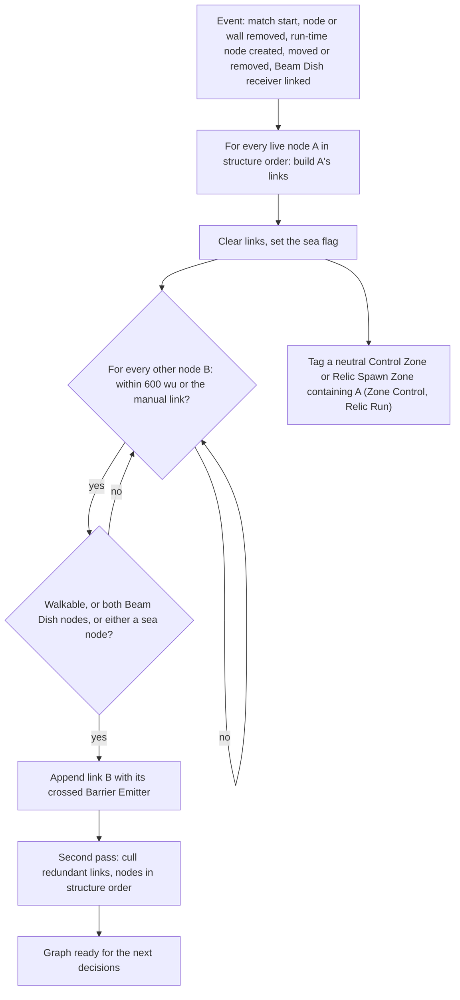
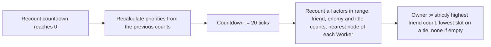

# Bot navigation graph

> Status: Reference · Prefix: R-BOT · Related: [Bots](README.md) · [02 Priority model](02_priority_model.md) · [03 Decision loop and Leaders](03_decision_loop_and_leaders.md) · [03 Buildings and world objects](../03_buildings_and_world_objects/README.md) · [12 Space, routing and physics](../12_simulation_model/05_space_routing_and_physics.md)

## 1 Purpose and player experience

A bot never path-finds over terrain. Its whole model of the map is a sparse, directed graph of **bot navigation nodes**: structures that the map places as corridors and objectives, plus nodes that Supply crates, connected Beam Dishes, turrets, Relics and boarding fuel depots create while the match runs. Links join nodes that are close and walkable, and redundant links are culled, so the graph follows the corridors that a designer laid out. Every two seconds each node counts, for every team, the friends, enemies and idle Workers near it and takes the team with the most bodies as its owner. Bots send Workers from node to node in straight lines; the Workers' own movement rules handle obstacles on the way ([worker.md](../02_units/worker.md), [reference/12](../12_simulation_model/05_space_routing_and_physics.md)). Players never see the graph, but they see its effects: bot crowds gather on nodes, flow along corridors and converge on whatever the graph marks as important.

## 2 Rules

### 2.1 The navigation node

**R-BOT-025** (MUST) A **bot navigation node** (`BotNavNode`) is a structure that only bot rules and the Worker census shortcut (R-BOT-045) read. It is never hit by rays, spheres or weapons, cannot be damaged, has no ports, has no effect on the economy and is drawn only in the map editor and by the bot overlay of [diagnostics, test and performance](../../architecture/components/diagnostics_test_and_performance.md). It holds the fields of table 2.1-A.

Table 2.1-A Fields of a navigation node.

| Field | Initial value | Meaning |
|---|---|---|
| recount countdown | max(1, ⌈`NextUnit(ref.bot.node.recount_phase)`⌉) ticks | ticks to the next recount (R-BOT-041) |
| links | none | outgoing link records (R-BOT-030); directed, and normally symmetric |
| friend count, one per team slot 0 to 5 | 0 | actors of team t within the node's range at the last recount |
| enemy count, one per team slot | 0 | actors of teams that are enemies of t within range |
| idle count, one per team slot | 0 | idle Workers of team t within range |
| priority, one per team slot | 0 | how much team t wants to be at this node ([02](02_priority_model.md)) |
| pinned flag, one per team slot | false | team t's priority here is set by a pin, and the formulas skip it ([02](02_priority_model.md) R-BOT-065) |
| owner | no team | the team with the most bodies at the last recount (R-BOT-047) |
| manual link | none | a node this node links to regardless of distance (R-BOT-030) |
| priority modifier | 0.0 | a designer bias added by the priority formulas |
| check-cliffs | true | false: links from or to this node skip the slope test |
| Beam Dish flag | false | the node stands at the entrance of a connected Beam Dish |
| Relic | none | the Relic this node follows |
| turret flag | false | the node stands on a turret |
| Supply crate flag | false | the node stands under a landed Supply crate |
| tagged zone | none | the neutral Control Zone or Relic Spawn Zone that contains the node (R-BOT-036) |
| sea flag | terrain height at the node ≤ `ref.sim.physics.sea_level` | a sea node: never a walking destination (R-BOT-055) |

**R-BOT-026** (MUST) A link record holds the node it leads to and the Barrier Emitter that the straight link crosses, or none (R-BOT-031).

**R-BOT-027** (MUST) A map places a navigation node with the base fields of a structure record ([reference/03](../03_buildings_and_world_objects/README.md)) followed by three optional fields, each present only when the previous one is: the manual link (default none), the priority modifier (default 0.0) and the check-cliffs flag (1 or 0, default 1). The record's team is ignored, because ownership is recomputed at every recount. Initialisation copies the three fields and sets the sea flag. Every reference map places navigation nodes. Map authors bend the priority field with the modifier (the reference maps use values from −1.0 to 1.0), join distant nodes with manual links, and set check-cliffs to 0 for nodes on steep ground ([reference/08](../08_maps_and_level_design/README.md) holds the reference map census).

**R-BOT-028** (MUST) Every navigation node, map-placed or created during the match, draws its recount phase once, in the step that creates it (DEC-652), so a node created at run time makes exactly one draw.

### 2.2 Run-time nodes

**R-BOT-029** (MUST) Exactly the structures of table 2.2-A create navigation nodes during a match. Each creation makes a node with a new structure serial and the field defaults of table 2.1-A, sets the flags the table names, and rebuilds the navigation links (R-BOT-038). Each node is removed as the table states; removing a node also rebuilds the links (R-BOT-038). The rule that creates or removes each node is owned by the structure's document; this table is the bot-side summary.

Table 2.2-A Run-time navigation nodes.

| Creator | Created | Position | Fields set | Removed | Owning rule |
|---|---|---|---|---|---|
| Supply crate | on its first tick on the ground | the crate's ground position | priority modifier `ref.crate.bot.priority_modifier` (0.5); Supply crate flag | with the crate, when it is opened or expires | [crates_and_powers.md](../04_supply_crates_powers_and_weapons/crates_and_powers.md) R-CRATE-113, R-CRATE-120 |
| Beam Dish | while it is connected | its entrance, at the height of the dish's position | Beam Dish flag; manual link to the receiver's node once that node exists, which takes a second rebuild | when its connection is lost | [economy_and_spawn_objects.md](../03_buildings_and_world_objects/economy_and_spawn_objects.md) R-BLDG-163 |
| Relic | on its first advance | the Relic's position; moved to the Relic, with a rebuild, whenever the Relic is more than `ref.bldg.relic.bot_node_follow_factor` (1.5) × its carry radius away | priority modifier `ref.bldg.relic.bot_node_priority` (1.0); names the Relic | when the Relic is destroyed | [mode_objects.md](../03_buildings_and_world_objects/mode_objects.md) R-BLDG-287, R-BLDG-288 |
| turret, map-placed or placed by a Power | on its first advance | the turret's position | turret flag | with the turret | [defences_and_props.md](../03_buildings_and_world_objects/defences_and_props.md) R-BLDG-426, R-BLDG-423 |
| fuel depot (Launch Race) | while its Launch Vessel is Boarding | the depot's position | priority modifier `ref.bldg.fuel_depot.bot_node_priority` (1.0) | when its Launch Vessel leaves Boarding | [economy_and_spawn_objects.md](../03_buildings_and_world_objects/economy_and_spawn_objects.md) R-BLDG-203 |

A Breach Charge has no navigation node (R-BLDG-294); the Siege bot routes it directly ([04](04_powers_and_unit_policies.md)).

### 2.3 Link construction

**R-BOT-030** (MUST) Building the links of node A clears A's links, sets A's sea flag again from the terrain height at A, and then visits every other node B that is not destroyed, in structure order:

```
inRange    := distance(A, B) <= ref.bot.link.range           or  A.manualLink == B
checkCliff := A.checkCliffs and B.checkCliffs
if A.manualLink == B: checkCliff := false
emitter    := none
if inRange and ( IsPathClear(A, B, evaluateCliffs = checkCliff, permitSteepDownhill = false), recording emitter
                 or (A.beamDishFlag and B.beamDishFlag)
                 or A.seaFlag or B.seaFlag ):
    append link record { B, emitter } to A.links
```

`IsPathClear` is the walkability test of [reference/12](../12_simulation_model/05_space_routing_and_physics.md) R-SIM-335. It is false whenever either end lies at or below sea level, so a sea node is linked only through the sea clause and is never walkable. A link shorter than one walkability step is walkable when both ends are above sea level (R-SIM-337).

**R-BOT-031** (MUST) While the walkability walk of a link runs, the link build records the **last** Barrier Emitter, enabled or not, whose hit volume meets the sphere of `ref.sim.walk.emitter_report_radius` (10 wu) at a sample; that emitter becomes the link record's crossed emitter. The emitter never blocks the link. Because the crossing is stored whatever the emitter's state, switching an emitter on or off needs no rebuild: every rule that uses a link tests the crossed emitter's current state and team when it uses the link (DEC-087). A wall that the walk meets blocks the link (R-SIM-335).

**R-BOT-032** (MUST) The first link build of a match runs in match-world initialisation step 7, after the obstacle grid exists, so the initial graph accounts for walls and Barrier Emitters ([reference/12](../12_simulation_model/02_match_lifecycle_and_state_reset.md) table 2.4-A, R-SIM-329; DEC-087).

**R-BOT-033** (MUST) A link is **usable** for a team t when its crossed emitter is none, or no longer exists, or is switched off, or belongs to a team that the using rule accepts: t itself for the standard, Relic Run and Launch Race priorities ([02](02_priority_model.md)), a friend of t for the diffusion priority and for target selection ([03](03_decision_loop_and_leaders.md)). Each rule states which test it uses.

### 2.4 Link culling

**R-BOT-034** (MUST) Recomputing the navigation links builds the links of every node, in structure order, and then culls redundant links in a second pass:

```
for each node A, in structure order, skipping turret nodes:
    n := 0
    while n < |A.links|:
        C := A.links[n].node
        if C == A.manualLink or C.turretFlag:  n += 1; continue      # manual links and links to turrets are never culled
        dAC := LinkDistance(A, C)
        for each other link index x != n of A:
            B := A.links[x].node
            dAB := LinkDistance(A, B);  dBC := LinkDistance(B, C)
            if dBC > 0 and dAC > ref.bot.link.cull_ratio * (dAB + dBC):
                remove A.links[n];  n -= 1;  break
        n += 1
```

`LinkDistance(X, Y)` is the distance between the two nodes when X has a link to Y, and −1 otherwise. A link A→C is therefore culled when some other neighbour B of A links on to C and the detour through B is less than 1 ÷ `ref.bot.link.cull_ratio` (1.25) times as long as A→C.

**R-BOT-035** (MUST) The cull is order-dependent, and the order is part of the rule: the nodes are visited in structure order, the link lists in their build order, and B's list may already have been culled when A is visited. A turret node is never culled from and never culled to, but it can be the intermediate node B of another node's cull.

### 2.5 Zone tagging

**R-BOT-036** (MUST) While the link build of node A visits structures, it tags A in Relic Run and in Zone Control: a Relic Spawn Zone (Relic Run) or a Control Zone (Zone Control) that has no team at that moment and whose radius contains A becomes A's tagged zone; when several qualify, the last in structure order wins. No rule clears the tag, so a node keeps its tagged zone after the zone has been captured, and a later rebuild while the zone is owned leaves the tag unchanged. No other mode tags nodes. The tag sets the node's range (R-BOT-042), the Zone Control priority override ([02](02_priority_model.md)), the garrison rule and the defence test (R-BOT-051).

### 2.6 Rebuilding the links

**R-BOT-037** (MUST) Recomputing the navigation links is the whole of R-BOT-030 to R-BOT-036 over every live node.

**R-BOT-038** (MUST) The navigation links are recomputed, at once and in the step of the event, on exactly these events: match-world initialisation (R-BOT-032); the removal of a navigation node or of a wall (R-BLDG-032, R-SIM-121), because a removed wall opens new routes; the creation of a run-time node and its removal (table 2.2-A); a Beam Dish node gaining its link to the receiver's node; and a Relic node moving to its Relic. Switching a Barrier Emitter on or off is not an event (R-BOT-031).

**R-BOT-039** (SHOULD) An implementation may update only the links that an event affects, provided the resulting links, their order and their crossed emitters are identical to a full recomputation (DEC-022). A full recomputation costs one walkability walk per pair of nodes within range plus the cull, on every event.

### 2.7 Head counts and ownership

**R-BOT-040** (MUST) A node's range is `ref.bot.node.range` (200 wu); a node with a tagged zone that still exists uses that zone's size instead.

**R-BOT-041** (MUST) Every tick a node counts its recount countdown down by one; when it reaches 0, the node, in this order: recalculates its priorities from the counts of the previous recount ([02](02_priority_model.md)); sets the countdown to `ref.bot.node.recount_ticks` (20 ticks); recounts (R-BOT-042); and recalculates its owner (R-BOT-047). Nodes advance in the structure step of each update slice, and the order within one tick between a node's recount and a bot's decisions is the order their slots give (R-SIM-224, the default of the Open DEC-312).

**R-BOT-042** (MUST) A recount sets the three counts of every team to 0 and takes every actor of every team within the node's range, by the exact circular query `InRange(x, z, range)` of [reference/12](../12_simulation_model/05_space_routing_and_physics.md) R-SIM-311, in result order: every kind of actor counts, bot controllers included. For each actor e of team te and each team slot t from 0 to 5: if te is t, t's friend count rises by 1; otherwise, if te is an enemy of t, t's enemy count rises by 1; an actor of an ally of t counts in neither. If e is an idle Worker, the idle count of te rises by 1. **Perfect information (PI-01).**

**R-BOT-043** (MUST) Every Worker that a recount finds takes the node as its **nearest node** when it has none, or when this node is nearer to it than its current nearest node. A Worker's nearest node is a bot field of the Worker that only recounts write; nothing clears it, so a Worker that walks away keeps its old nearest node until a recount of a nearer node finds it. The dispatcher sends a Worker only from its nearest node ([03](03_decision_loop_and_leaders.md) R-BOT-085).

**R-BOT-044** (MUST) Counts are computed for all six team slots, human teams included; a human team's counts and priorities are read only by the Worker census shortcut (R-BOT-045) and by the bot overlay.

**R-BOT-045** (MUST) The friend and enemy counts of every node are readable by the threat search of every Worker of every team: a Worker that is not in a formation finds no threat when a node within that node's range of it has an enemy count of 0 for the Worker's team ([worker.md](../02_units/worker.md) R-UNIT-098 step 6). **Perfect information (PI-09).**

**R-BOT-046** (MUST) Because a recount happens only every 20 ticks, every count, owner and priority that a bot rule reads is up to 20 ticks old, and counts change only at a node's recount, never between recounts.

**R-BOT-047** (MUST) A node's owner is the team with the highest friend count, found by scanning team slots 0 to 5 and replacing the current best only on a strictly greater count, starting from a count of 0: a tie goes to the lowest team slot (DEC-016), and a node with no actor in range has no team. The owner is a bot notion only and changes nothing for the structure kinds of [reference/03](../03_buildings_and_world_objects/README.md) table 2.7-A.

### 2.8 Node predicates

**R-BOT-048** (MUST) These predicates are evaluated whenever a rule needs them, with the counts, owners and priorities of the nodes' last recounts.

**R-BOT-049** (MUST) **Important.** A node is important when the scan of every structure in structure order finds one whose distance from the node is strictly less than `ref.bot.node.important_radius` (100 wu) and that is any of: a structure with at least one port (R-BLDG-016); a Supply crate; a Beam Dish; a Transit Gate, in Launch Race only; a Control Zone or a kind that shares its type (Relic Base, Relic Spawn Zone, Flag post, Home post), in every mode except Relic Run. The first such structure is the node's **important structure**. **Perfect information (PI-03).**

**R-BOT-050** (MUST) **Leader count.** The Leader count of team t within range r of a point counts t's live Leaders whose distance from the point is at most r, in one of three variants: every Leader; only Leaders that hold a waypoint order (`LeaderOrder::Waypoint`); or only Leaders that do not.

**R-BOT-051** (MUST) **Needs defending.** A node needs defending by team t when its owner is t and either of these holds:

1. it has a tagged zone and the mode is not Relic Run; or
2. one of its links leads to a node whose owner is hostile to the node's owner and whose enemy count for the node's owner is above `ref.bot.node.defend_enemy_threshold` (30), and the Leader count of t, every Leader, within `ref.bot.node.defend_leader_radius` (300 wu) of the node is 0.

**Perfect information (PI-01).**

**R-BOT-052** (MUST) **Nearest node.** The nearest node to a point, with an evaluate-cliffs flag (default true) and a permit-steep-downhill flag (default false), is found by a scan of every node in structure order, sea nodes included: a node becomes the best so far when its distance from the point is strictly less than the best so far and `IsPathClear(point, node, evaluateCliffs, permitSteepDownhill)` holds. The result is the best node at the end of the scan, or none. Because a sea node is never walkable, it is never the result. This scan has no fallback without the walkability test, unlike the route-graph scan of R-SIM-346.

**R-BOT-053** (MUST) The bot rules that take "the node of" a structure use the structure's own node when it has one (table 2.2-A) and otherwise its nearest node with evaluate-cliffs false and permit-steep-downhill true, as each rule states.

**R-BOT-054** (MUST) Every bot rule that lists nodes, links or structures takes them in structure order or link order, and every "first" or "last" in a bot rule refers to that order (DEC-016).

**R-BOT-055** (MUST) A sea node exists only for Transport path-finding and for the links it makes; no bot rule ever sends a Worker to a sea node ([03](03_decision_loop_and_leaders.md) R-BOT-087).

## 3 States and flows



Caption: Figure 3-1, recomputing the navigation links (R-BOT-030 to R-BOT-038).



Caption: Figure 3-2, the recount of one navigation node (R-BOT-041 to R-BOT-047).

## 4 Tuning table

| key | value | unit | range or notes | requirement | DEC |
|---|---|---|---|---|---|
| `ref.bot.link.range` | 600 | wu | automatic link range; manual links ignore it | R-BOT-030 | DEC-022 |
| `ref.bot.link.cull_ratio` | 0.8 | ratio | cull A→C when A→C > 0.8 × (A→B + B→C) | R-BOT-034 | DEC-022 |
| `ref.bot.node.recount_ticks` | 20 | ticks | 2.0 s; recount and priority period | R-BOT-041 | DEC-002 |
| `ref.bot.node.recount_phase` | 20 | ticks | first countdown max(1, ⌈`NextUnit(20)`⌉) | R-BOT-028, table 2.1-A | DEC-652 |
| `ref.bot.node.range` | 200 | wu | recount radius; a tagged zone's size replaces it | R-BOT-040 | — |
| `ref.bot.node.important_radius` | 100 | wu | strict | R-BOT-049 | — |
| `ref.bot.node.defend_enemy_threshold` | 30 | actors | more than | R-BOT-051 | DEC-094 |
| `ref.bot.node.defend_leader_radius` | 300 | wu | at most | R-BOT-051 | — |

Keys cited here and defined elsewhere: `ref.sim.physics.sea_level` and `ref.sim.walk.emitter_report_radius` ([reference/12](../12_simulation_model/05_space_routing_and_physics.md)); `ref.crate.bot.priority_modifier` ([crates_and_powers.md](../04_supply_crates_powers_and_weapons/crates_and_powers.md)); `ref.bldg.relic.bot_node_priority` and `ref.bldg.relic.bot_node_follow_factor` ([mode_objects.md](../03_buildings_and_world_objects/mode_objects.md)); `ref.bldg.fuel_depot.bot_node_priority` ([economy_and_spawn_objects.md](../03_buildings_and_world_objects/economy_and_spawn_objects.md)). The walkability constants (step 20 wu, wet limit 40 wu, climb gradient 2.4, normal y 0.8, wall clearance 13.2 wu) are `ref.sim.walk.*` of R-SIM-335.

## 5 Edge cases and interactions

1. **Start-relative slope.** The slope test compares every sample with the link's start, so a long gentle rise of more than 48 wu breaks a link uphill while the reverse link, downhill, survives; links can be one-way (R-SIM-336).
2. **Sea nodes.** A sea node links to every node within range, walkable or not, and is linked from every node within range; no Worker is ever sent to it (R-BOT-030, R-BOT-055).
3. **Manual links.** A manual link ignores the range and the slope test, is never culled, and is directed: the target node links back only if it is within range and walkable, or names the first node as its own manual link (R-BOT-030, R-BOT-034).
4. **A crossed emitter that is switched on later.** A link built while its Barrier Emitter is off carries the crossing, so once the emitter is switched on the link is unusable for every team the using rule does not accept, without any rebuild (R-BOT-031, R-BOT-033).
5. **Two emitters on one link.** Only the last emitter that the walk meets is recorded; the first one is not tested when the link is used (R-BOT-031).
6. **A captured zone keeps its tag.** A node tagged with a Control Zone keeps the zone's size as its range and stays a defence node for its owner after the zone is captured (R-BOT-036, R-BOT-051).
7. **Stale nearest nodes.** A Worker whose nearest node lies far behind it can be sent from that node only; the stray recall (R-BOT-076) is what brings far-away idle Workers back to a node.
8. **The bot controller in a recount.** A node whose range covers a bot controller counts it as one friend of its team; with no other actor near, that team owns the node (R-BOT-042, R-BOT-047).
9. **Removed walls.** When a Breach Charge or a scuttle removes a wall, the links are recomputed in the slice of the removal, so bots see the opened route in the same tick (R-BOT-038).

## 6 Acceptance criteria

**AC-BOT-08 — Links and range** (R-BOT-030). Given two land nodes 590 wu apart on flat ground, then each links to the other; at 610 wu, neither does; given the second as the first's manual link at 610 wu, then only the first links to the second.

**AC-BOT-09 — Walls and emitters at match start** (R-BOT-031, R-BOT-032). Given two nodes 300 wu apart with a wall between them, then neither links to the other after initialisation; given a switched-off Barrier Emitter between them instead, then both link with that emitter recorded, and switching it on causes no recomputation.

**AC-BOT-10 — Culling** (R-BOT-034). Given nodes A, B, C in a line, A–B 200 wu, B–C 200 wu, A–C 400 wu, all mutually linked, then after the cull A has no link to C and C none to A, and the links A–B and B–C remain; given C as A's manual link, then A→C remains.

**AC-BOT-11 — Recount and ownership** (R-BOT-042, R-BOT-047). Given a node with 12 Workers of team 1, 12 of team 2 and 3 of team 0 within 200 wu, then after its recount the owner is team 1; the enemy count of team 0 is 24; and with teams 1 and 2 allied in co-op, team 1's enemy count is 3.

**AC-BOT-12 — Recount period** (R-BOT-041). Given any node, then over 200 ticks after its first recount it recounts exactly 10 times, at intervals of 20 ticks, at every game speed.

**AC-BOT-13 — Important** (R-BOT-049). Given a node 99 wu from a Spawn Node, then it is important in every mode; at exactly 100 wu, it is not; given a node 50 wu from a Transit Gate, then it is important in Launch Race only.

## 7 Dependencies

- **Reference documents:** [README](README.md); [02 Priority model](02_priority_model.md); [03 Decision loop and Leaders](03_decision_loop_and_leaders.md); [reference/03](../03_buildings_and_world_objects/README.md) (structure records, ports, removal), [mode_objects.md](../03_buildings_and_world_objects/mode_objects.md) (Relic node, Breach Charge), [economy_and_spawn_objects.md](../03_buildings_and_world_objects/economy_and_spawn_objects.md) (Beam Dish node, fuel depot node), [defences_and_props.md](../03_buildings_and_world_objects/defences_and_props.md) (turret node, Barrier Emitters, walls); [crates_and_powers.md](../04_supply_crates_powers_and_weapons/crates_and_powers.md) (Supply crate node); [worker.md](../02_units/worker.md) (census shortcut, idle state); [reference/08](../08_maps_and_level_design/README.md) (map records and census); [reference/12](../12_simulation_model/README.md) (actor-grid queries R-SIM-311, walkability R-SIM-335 to R-SIM-337, initialisation order, update order R-SIM-224).
- **Engine components:** [diagnostics, test and performance](../../architecture/components/diagnostics_test_and_performance.md) (bot overlay).
- **Assets:** none.

## 8 Open decisions

| Decision | Title | Default stated here |
|---|---|---|
| DEC-312 | Bot decisions and node recounts within a tick | the order that their slots give (R-BOT-041) |
| DEC-557 | Bot troop movement between navigation nodes | Workers move in straight lines along links (§1; [03](03_decision_loop_and_leaders.md) R-BOT-086) |
| DEC-094 | Exact or approximate actor-grid queries | the recount uses the exact query; the defence threshold reads recount counts (R-BOT-042, R-BOT-051) |
