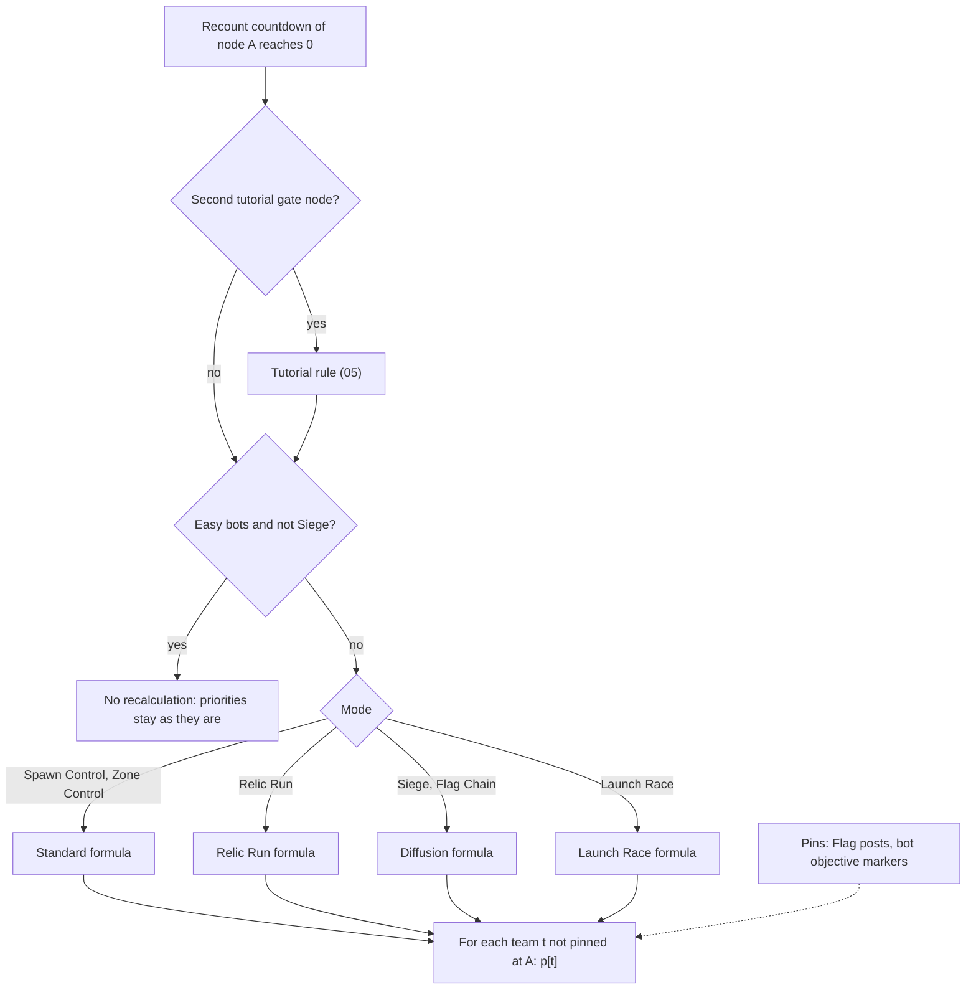

# Bot priority model

> Status: Reference · Prefix: R-BOT · Related: [Bots](README.md) · [01 Navigation graph](01_navigation_graph.md) · [03 Decision loop and Leaders](03_decision_loop_and_leaders.md) · [05 Mode strategies and tutorials](05_mode_strategies_and_tutorials.md) · [01 Skirmish rules and modes](../01_skirmish_rules_and_modes/README.md)

## 1 Purpose and player experience

Every navigation node holds, for every team, a **priority**: how much that team wants to be at the node. The dispatcher sends Workers towards higher priorities, Leaders and Strike teams follow them, and Beam Dishes are aimed by them. Priorities spread through the graph: each node recomputes its own from its neighbours' last values, so news travels one link per recount, at a random phase per node.

The formula depends on the mode. In Spawn Control and Zone Control, anything important that a team does not hold (an enemy or neutral Spawn Node, a Supply crate, a Beam Dish, a Control Zone) pulls at almost full strength, enemy and neutral ground pulls strongly, and a team's own quiet ground takes half the average of its neighbours, so the field points away from the interior towards the frontier. In Relic Run, Relic nodes pull at full strength for every team, and target selection always takes a linked Relic node. In Siege and Flag Chain, objectives are pinned at full strength and the field decays by roughly half per link, so it points along the shortest chain of links to the objective. In Launch Race, Workers are drawn to unheld Solar Array fields, and to the team's own Transit Gate while its Launch Vessel is boarding.

## 2 Rules

### 2.1 Evaluation

**R-BOT-056** (MUST) A node recalculates its priorities at each recount, before it recounts (R-BOT-041), from the counts, owners and priorities of the previous recounts of itself and of its neighbours. It computes a priority for each team slot t from 0 to 5, human teams included, and skips every team whose pinned flag at the node is set (R-BOT-065).

**R-BOT-057** (MUST) A node first applies the tutorial rule of [05](05_mode_strategies_and_tutorials.md) R-BOT-155; then the easy rule of R-BOT-059; then the formula of its mode: the **diffusion** formula (R-BOT-063) in Siege and Flag Chain, the **Relic Run** formula (R-BOT-062) in Relic Run, the **Launch Race** formula (R-BOT-064) in Launch Race, and the **standard** formula (R-BOT-060) in Spawn Control and Zone Control.

**R-BOT-058** (MUST) The notation of the formulas, for node A and team t: own(A) is A's owner (R-BOT-047); F and E are A's friend and enemy counts for t; imp is A's important structure (R-BOT-049), or none; usable(A, t) is the set of A's links that are usable for t by the test that the formula names (R-BOT-033); N.p[t] is a neighbour's priority for t from its own last evaluation; and "friend of own(A)" is false when A has no team.

**R-BOT-059** (MUST) When the match's bot difficulty is Easy and the mode is not Siege, no node recalculates any priority: every priority stays at its initial 0 except where a pin writes it (R-BOT-065). Easy bots move at random (R-BOT-087), so the frozen field matters to the rules that read priorities: the Strike team policy, Beam Dish aiming and the Leader policy.

### 2.2 The standard formula: Spawn Control and Zone Control

**R-BOT-060** (MUST) The standard priority of A for t, with the usable test "no crossed emitter, or its team is t, or it is switched off":

```
if imp != none and imp.team != t and imp is not a Transit Gate:
    p := ref.bot.priority.grab                                    # 0.95: an important structure t does not hold
else if not friend(own(A), t):                                    # enemy-owned or neutral node
    p := ref.bot.priority.enemy_node                              # 0.8
    if F > ref.bot.priority.attack_ratio * E:  p := ref.bot.priority.max          # 1.0: t is attacking
else:                                                             # owned by t or an ally
    if E > ref.bot.priority.defend_ratio * F:  p := ref.bot.priority.max          # 1.0: t is under attack
    else:
        U := usable(A, t)
        p := (sum over N in U of N.p[t]) / |U|,   or 0 when U is empty            # DEC-087: no NaN
        p := p * ref.bot.priority.own_factor                                      # 0.5
if A.beamDishFlag:  p += ref.bot.priority.dish_bonus                              # 0.35
p += ref.bot.priority.link_bonus * |A.links| + A.priorityModifier                 # 0.01 per link
p := min(p, ref.bot.priority.max)
if A.taggedZone exists and the mode is Zone Control:
    if zone.team != t or (zone.totalCount - zone.teamCount[t]) > ref.bot.priority.zone_others:
        p := ref.bot.priority.grab                                                # 0.95
```

The Zone Control override reads the zone's own occupant counts ([zone_control.md](../01_skirmish_rules_and_modes/zone_control.md)): the zone's total count and team t's count. On a node that t or an ally owns, a node with no usable link has a neighbour mean of 0, and the Beam Dish, link and modifier bonuses still apply (DEC-087; see DEC-862). **Perfect information (PI-01, PI-03, PI-06).**

**R-BOT-061** (MUST) Consequences of R-BOT-060 that are part of the rule: an important structure that t does not hold is worth 0.95 before the bonuses, so a Supply crate node (modifier 0.5) is always worth 1.0; plain enemy and neutral nodes are worth 0.8, and 1.0 once t's bodies outnumber half the enemy's; t's own quiet nodes take half the mean of their usable neighbours; and a Control Zone node is worth 0.95 for every team that does not hold the zone, or holds it with more than 10 other bodies inside. A negative modifier can make a priority negative; nothing clamps it from below.

### 2.3 The Relic Run formula

**R-BOT-062** (MUST) The Relic Run priority of A for t, with the same usable test as R-BOT-060:

```
U := usable(A, t)
if |U| > 0:  p := (sum over N in U of max(0, N.p[t])) / |U|       # else p keeps its previous value
if friend(own(A), t):  p := p * ref.bot.priority.own_factor         # applied even when U is empty
p += A.priorityModifier
if A is important and own(A) is no team:  p := ref.bot.priority.grab                  # the node's owner, not the structure's
if A.relic exists:
    if relic.team != t or relic.lifters < relic.maxLifters or E > ref.bot.priority.relic_pressure:
        p := ref.bot.priority.max                                                       # 1.0
p := min(ref.bot.priority.max, p)
```

The lifter counts are the Relic's own ([mode_objects.md](../03_buildings_and_world_objects/mode_objects.md); 20 to 50 lifters). A Relic node carries the modifier 1.0, which alone reaches the clamp, so it is worth 1.0 for every team; the one exception is an important node with no owner, worth 0.95 for a team that carries the Relic with a full crew and has at most 10 enemies near it. The max(0, ·) keeps every Relic Run priority finite. **Perfect information (PI-01, PI-06).**

### 2.4 The diffusion formula: Siege and Flag Chain

**R-BOT-063** (MUST) The diffusion priority of A for t, with the usable test "no crossed emitter, or its team is a friend of t, or it is switched off":

```
p := 0;  S := 0;  n := 0;  dishNeighbour := false
for each N in usable(A, t), in link order:
    if N.p[t] > 0:  S += N.p[t];  n += 1
    if N.beamDishFlag:  dishNeighbour := true
if n > 0:  p := S / (n + 1)
if A.beamDishFlag and not dishNeighbour:  p += ref.bot.priority.dish_bonus     # the far side of the dish has no node yet
p += A.priorityModifier
if A.supplyCrateFlag and bot(t) exists and bot(t) has a current objective whose next objective is none:
    p := 0                                                                      # on the final objective, ignore Supply crates
# no upper or lower clamp
```

The sources of the field are the pinned nodes (R-BOT-065): bot objective markers in Siege and Flag posts in Flag Chain. Every hop divides by at least 2, so the field decays with graph distance and points along the shortest chain of links to a pinned node; map modifiers bend it. Neighbours whose priority is 0 or below add nothing and do not count in n.

### 2.5 The Launch Race formula

**R-BOT-064** (MUST) The Launch Race priority of A for t, with the same usable test as R-BOT-060:

```
mod := 0;  grab := false
if imp != none:
    if imp.team != t and imp is not a Transit Gate:  grab := true
    if imp is a Transit Gate and imp.team == t:                  # t's own Transit Gate
        vessel := t's Launch Vessel
        if vessel exists:
            if vessel is Boarding:  grab := true                  # gather at the gate for the Transport shuttle
            else:  mod := ref.bot.priority.own_gate_bonus         # 0.1
if grab:  p := ref.bot.priority.grab
else:
    U := usable(A, t)
    p := (sum over N in U of N.p[t]) / (|U| + 1)
    if friend(own(A), t):  p := p * ref.bot.priority.own_factor
if A.beamDishFlag:  p += ref.bot.priority.dish_bonus
p += A.priorityModifier + mod                                     # no per-link bonus in Launch Race
p := min(p, ref.bot.priority.max)
```

The Launch Vessel states are those of [launch_race.md](../01_skirmish_rules_and_modes/launch_race.md) diagram 3-A.

### 2.6 External pins

**R-BOT-065** (MUST) A **pin** sets team t's priority at one node and sets t's pinned flag there, or clears the flag to release the node; while the flag is set, the formulas of §2.2 to §2.5 leave t's priority at that node alone. Every pin acts on the nearest node (R-BOT-052, with the default flags) of the structure that pins. Exactly the writers of table 2.6-A pin.

Table 2.6-A Pin writers.

| Writer | Mode | When | Rule |
|---|---|---|---|
| Flag post | Flag Chain | at each Flag post recount, every `ref.mode.recount.one_second` (11 ticks) | R-BOT-069; [mode_objects.md](../03_buildings_and_world_objects/mode_objects.md) R-BLDG-266 |
| attack bot objective marker | Siege | at each marker evaluation, every `ref.bot.marker.period_ticks` (20 ticks) | R-BOT-066 |
| defence bot objective marker | Siege | at each marker evaluation | R-BOT-067 |
| Launch Race bot objective marker | Launch Race | at each marker evaluation | R-BOT-068 |
| the second tutorial's gate node | Zone Control, second tutorial | at the node's own recount | [05](05_mode_strategies_and_tutorials.md) R-BOT-155 |

**R-BOT-066** (MUST) **Attack marker pin (Siege).** At every marker evaluation, whether or not its objective is active, an attack marker pins, for every attacking team i that has a bot controller: if i's bot works on the marker's objective, then when the marker is not a Transport marker and its team is not a friend of i, p[i] := `ref.bot.pin.value` (1.0) with the flag set, and otherwise the flag is cleared; if i's bot works on another objective, then when the marker offers Transport pickup, p[i] := 1.0 with the flag set, and otherwise the flag is cleared. A team without a bot controller is never pinned by a marker. **Perfect information (PI-06).**

**R-BOT-067** (MUST) **Defence marker pin (Siege).** At every marker evaluation a defence marker pins, for every defending team i that has a bot controller: if i's bot works on the marker's objective and the marker's team is a friend of i, p[i] := 1.0 with the flag set; otherwise the flag is cleared.

**R-BOT-068** (MUST) **Launch Race marker pin.** At every marker evaluation, a Launch Race marker whose map team k is a team slot pins for k alone: when k's Launch Vessel exists, is not Boarding, and the node is not owned by k, p[k] := 1.0; otherwise p[k] := 0.0; in both cases k's flag is set. A marker with no map team pins nothing. Workers are therefore drawn to unheld Solar Array fields while the vessel fuels, and released to gather at the Transit Gate (R-BOT-064) while it boards.

**R-BOT-069** (MUST) **Flag post pin (Flag Chain).** At each recount of a Flag post, for every team slot i from 0 to 5, the Flag post's nearest node receives p[i] by table 2.6-B, and i's pinned flag there is set exactly when p[i] > 0 ([mode_objects.md](../03_buildings_and_world_objects/mode_objects.md) R-BLDG-266). With an easy bot difficulty, p[i] is 1.0 at every Flag post for every team; with a standard or hard bot difficulty, it is decided by i's Flag Chain status ([flag_chain.md](../01_skirmish_rules_and_modes/flag_chain.md) R-MODE-462). **Perfect information (PI-06).**

Table 2.6-B Flag post pin for team i at a standard or hard difficulty, applied in this order; the last row that applies decides.

| i's status | p[i] |
|---|---|
| safe | 1.0 for a Flag post that i does not own |
| enemy occupied, under attack or unoccupied | 1.0 for a Home post owned by a team that is in play (not no team and not eliminated) |
| under threat | 1.0 for a Flag post linked to i's Home post and not owned by i |
| eliminated | 0 |
| any status | 0 for a Flag post that is not a Home post and that i owns |
| otherwise | 0 |

**R-BOT-070** (MUST) When several pin writers share one nearest node, the writer that advances last in the tick, in structure order within the structure step, decides the node's priority and flag for each team it writes (DEC-016; see DEC-862).

**R-BOT-071** (MUST) The priority model never stores a value that is not finite (DEC-087, DEC-653 item 6): the standard mean over no usable link is 0 (R-BOT-060), the Relic Run sum clamps each term at 0 (R-BOT-062), and the diffusion and Launch Race formulas divide by at least 1. The diffusion formula has no clamp, so its values can exceed 1.0 or fall below 0 through modifiers (R-BOT-063); the standard, Relic Run and Launch Race formulas clamp only from above, at 1.0.

## 3 States and flows



Caption: Figure 3-1, which formula a node uses, and where pins replace it (R-BOT-056 to R-BOT-069).

## 4 Tuning table

| key | value | unit | range or notes | requirement | DEC |
|---|---|---|---|---|---|
| `ref.bot.priority.grab` | 0.95 | priority | an important structure the team does not hold; a Zone Control zone not held | R-BOT-060, R-BOT-062, R-BOT-064 | DEC-022 |
| `ref.bot.priority.enemy_node` | 0.8 | priority | an enemy-owned or neutral node | R-BOT-060 | — |
| `ref.bot.priority.attack_ratio` | 0.5 | ratio | attacking when F > 0.5 × E | R-BOT-060 | — |
| `ref.bot.priority.defend_ratio` | 0.5 | ratio | under attack when E > 0.5 × F | R-BOT-060 | — |
| `ref.bot.priority.own_factor` | 0.5 | factor | halves the neighbour mean on own ground | R-BOT-060, R-BOT-062, R-BOT-064 | — |
| `ref.bot.priority.dish_bonus` | 0.35 | priority | Beam Dish node bonus | R-BOT-060, R-BOT-063, R-BOT-064 | — |
| `ref.bot.priority.link_bonus` | 0.01 | priority per link | standard formula only | R-BOT-060 | — |
| `ref.bot.priority.max` | 1.0 | priority | upper clamp; the value of an attacked, attacking or Relic node | R-BOT-060, R-BOT-062, R-BOT-064 | — |
| `ref.bot.priority.zone_others` | 10 | actors | more than this many other bodies in a held Control Zone | R-BOT-060 | DEC-094 |
| `ref.bot.priority.relic_pressure` | 10 | actors | more than this many enemies at a Relic node | R-BOT-062 | — |
| `ref.bot.priority.own_gate_bonus` | 0.1 | priority | own Transit Gate while the Launch Vessel is not boarding | R-BOT-064 | — |
| `ref.bot.pin.value` | 1.0 | priority | the value of every pin that is not 0 | R-BOT-066 to R-BOT-069, R-BOT-068 | — |

Keys cited here and defined elsewhere: `ref.mode.recount.one_second` ([reference/01](../01_skirmish_rules_and_modes/README.md), DEC-064); `ref.bot.marker.period_ticks` ([05](05_mode_strategies_and_tutorials.md)); `ref.crate.bot.priority_modifier`, `ref.bldg.relic.bot_node_priority`, `ref.bldg.fuel_depot.bot_node_priority` ([01](01_navigation_graph.md) table 2.2-A).

## 5 Edge cases and interactions

1. **Diffusion is asynchronous.** Each node recalculates at its own phase, so a pin reaches a node k links away after up to k recounts (up to 20 k ticks), and two nodes can briefly disagree about the field's direction (R-BOT-056).
2. **Human teams' priorities.** Priorities are computed for human teams too; only the bot overlay shows them, and no rule reads them for a human team (R-BOT-056).
3. **Frozen easy field.** With easy bots, Spawn Control, Zone Control, Relic Run and Launch Race priorities stay 0 except where pins write them; Flag post pins still set 1.0 at every Flag post node (R-BOT-059, R-BOT-069).
4. **A Supply crate on the final Siege objective.** A team working on the last objective of its chain ignores Supply crate nodes: their diffusion priority is 0 for that team (R-BOT-063).
5. **Shared nearest node.** Two Flag posts whose nearest node is the same node fight over it every recount; the later one in structure order wins (R-BOT-070).
6. **Teams without a bot controller.** Siege marker pins never touch a human team's priorities; Flag post pins and Launch Race marker pins do, harmlessly (R-BOT-066, R-BOT-069, R-BOT-068).
7. **A node with no usable link.** In Spawn Control and Zone Control a quiet own node with no usable link is worth only its bonuses, never NaN; in Relic Run it keeps its last value, halved at each recount while its own team holds it (R-BOT-060, R-BOT-062, R-BOT-071).

## 6 Acceptance criteria

**AC-BOT-14 — Standard values** (R-BOT-060). Given a neutral node with 2 links, no modifier and no important structure, then its priority for any team is 0.82; with an enemy Spawn Node 50 wu away, 0.97; with a Supply crate node (modifier 0.5), 1.0.

**AC-BOT-15 — Own quiet node** (R-BOT-060, R-BOT-071). Given an own node with 2 usable links whose priorities are 0.8 and 0.4, no enemies and no modifier, then its priority is 0.32; with no usable link, then it is 0.0 + 0.01 × (number of links), never NaN.

**AC-BOT-16 — Diffusion decay** (R-BOT-063). Given a chain P – A – B – C, P pinned at 1.0 for team t and every other link priority 0 at first, then after A, B and C have each recalculated once in that order, A = 0.5, B = 0.25, C = 0.125 for t.

**AC-BOT-17 — Relic node** (R-BOT-062). Given a Relic node, then its priority is 1.0 for every team; given that the node is also important and has no owner, and team t carries the Relic with 50 of 50 lifters and 5 enemies near, then its priority for t is 0.95 and for every other team 1.0.

**AC-BOT-18 — Flag post pins** (R-BOT-069). Given a standard bot in status safe, then every Flag post node it does not own is pinned at 1.0 for it; given status under threat, then only Flag posts linked to its Home post and not owned by it are pinned; given easy bots, then every Flag post node is pinned at 1.0 for every team.

**AC-BOT-19 — Easy freeze** (R-BOT-059). Given easy bots in Spawn Control, then after 1,000 ticks every node priority is 0 for every team.

## 7 Dependencies

- **Reference documents:** [README](README.md); [01 Navigation graph](01_navigation_graph.md) (counts, owners, links, usable test); [05 Mode strategies and tutorials](05_mode_strategies_and_tutorials.md) (markers, objectives, tutorial rule); [zone_control.md](../01_skirmish_rules_and_modes/zone_control.md), [relic_run.md](../01_skirmish_rules_and_modes/relic_run.md), [flag_chain.md](../01_skirmish_rules_and_modes/flag_chain.md), [launch_race.md](../01_skirmish_rules_and_modes/launch_race.md), [siege.md](../01_skirmish_rules_and_modes/siege.md); [mode_objects.md](../03_buildings_and_world_objects/mode_objects.md) (Flag post pin R-BLDG-266, Relic lifters, Launch Vessel).
- **Engine components:** none.
- **Assets:** none.

## 8 Open decisions

| Decision | Title | Default stated here |
|---|---|---|
| DEC-094 | Exact or approximate actor-grid queries | the Zone Control override reads the zone's own counts (R-BOT-060) |
| DEC-112 | Bot strength calibration | the priority constants of §4 are the reference starting values |
| DEC-862 | Bot rule details | a neighbour mean of 0 with no usable link (R-BOT-060); the last pin writer decides a shared node (R-BOT-070) |
