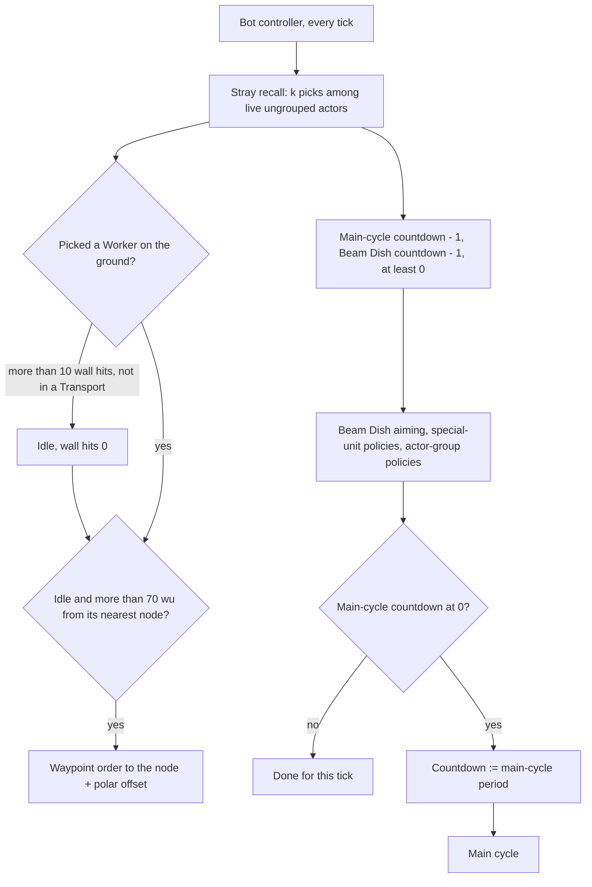
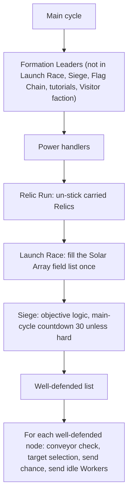
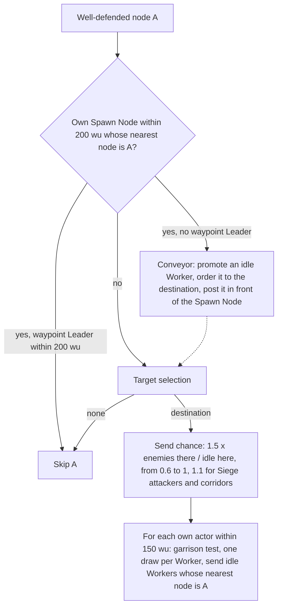

# Bot decision loop and Leaders

> Status: Reference · Prefix: R-BOT · Related: [Bots](README.md) · [01 Navigation graph](01_navigation_graph.md) · [02 Priority model](02_priority_model.md) · [04 Powers and unit policies](04_powers_and_unit_policies.md) · [Leader and formations](../02_units/leader_and_formations.md) · [Worker](../02_units/worker.md)

## 1 Purpose and player experience

A bot acts on two clocks. Every tick it nudges a few idle Workers back onto the graph, aims its Beam Dishes when their countdown ends, and runs the policies of its Leaders, Transports, Strike teams, Collectors and Builders. On its **main cycle**, every 200, 101 or 11 ticks by difficulty, it promotes defensive Leaders, spends its Powers, runs its mode logic and then moves its army: every friendly node that is quiet enough, or that is just a corridor, sends idle Workers to a linked node that it prefers. A hard bot always picks the linked node with the highest priority, so its crowds climb the priority field and stop at the front; an easy bot picks a random linked node, so its crowds wander. At each of its Spawn Nodes the bot posts a Leader that forwards newly spawned Workers to the front, re-aimed every 10 s.

## 2 Rules

### 2.1 Bot timers

**R-BOT-072** (MUST) The bot timers are exactly those of table 2.1-A. Each counts down by one per tick of the world step and fires at 0; game speed changes how many ticks run per real second, never a timer's period (DEC-039, R-SIM-548). The timers of the unit policies start at 0, so each fires on its first call, and keep their own phase from then on.

Table 2.1-A Bot timers.

| Timer | Period | First firing | Key | Rule |
|---|---|---|---|---|
| main cycle, easy bot | 200 ticks (20 s) | phase draw | `ref.bot.cycle.period_easy` | R-BOT-075 |
| main cycle, standard bot | 101 ticks (10.1 s) | phase draw | `ref.bot.cycle.period_standard` | R-BOT-075 |
| main cycle, hard bot | 11 ticks (1.1 s) | phase draw | `ref.bot.cycle.period_hard` | R-BOT-075 |
| main cycle in Siege, easy and standard bots | 30 ticks (3 s) | phase draw | `ref.bot.cycle.period_siege` | R-BOT-075 |
| Beam Dish aiming | 101 ticks (10.1 s) | phase draw | `ref.bot.dish.period_ticks` | R-BOT-096 |
| node recount and priorities | 20 ticks (2 s) | phase draw | `ref.bot.node.recount_ticks` | [01](01_navigation_graph.md) R-BOT-041 |
| bot objective evaluation | 51 ticks (5.1 s) | 51 ticks, no phase | `ref.bot.objective.period_ticks` | [05](05_mode_strategies_and_tutorials.md) R-BOT-131 |
| bot objective marker evaluation | 20 ticks (2 s) | phase draw | `ref.bot.marker.period_ticks` | [05](05_mode_strategies_and_tutorials.md) R-BOT-133 |
| Flag post pin | 11 ticks | the Flag post's recount | `ref.mode.recount.one_second` | [02](02_priority_model.md) R-BOT-069 |
| Leader policy, formation | 11 ticks | first call | `ref.unit.leader.bot_think_ticks` | R-UNIT-188 |
| Leader policy, waypoint order | 101 ticks | — | `ref.unit.leader.bot_waypoint_think_ticks` | R-UNIT-188 |
| Transport policy | 11, 101 or 200 ticks; in Siege 11, 51 or 101 ticks | first call | `ref.unit.transport.bot_think_*` | R-UNIT-402 |
| Transport route check while moving | 11 ticks | — | `ref.unit.transport.bot_route_check_ticks` | R-UNIT-402 |
| Strike team retarget | 11 ticks, firing check every tick | first call | `ref.unit.strike_team.bot_scan_ticks` | R-UNIT-360, R-UNIT-361 |
| Collector policy | 11 ticks | first call | `ref.unit.collector.bot_think_ticks` | R-UNIT-442 |
| Builder policy | 11 ticks | first call | `ref.unit.builder.bot_think_ticks` | R-UNIT-464 |
| Breach Charge re-route | at most once per 11 ticks | — | `ref.bldg.breach_charge.bot_route_retry_ticks` | R-BLDG-294 |

**R-BOT-073** (MUST) A bot controller advances in the update slice that its slot in its team's ungrouped actors gives it, which is slice 0 for a controller created at team initialisation; its decisions and the recounts of navigation nodes, which advance in the structure step of every slice, happen in the order that their slots give within the tick. This changes a bot's reaction time by at most one tick ([reference/12](../12_simulation_model/04_containers_and_update_order.md) R-SIM-224; the default of the Open DEC-312).

### 2.2 The per-tick step

**R-BOT-074** (MUST) Every tick, a bot controller runs these steps in order:

1. the stray recall (R-BOT-076);
2. its main-cycle countdown counts down by one, and its Beam Dish countdown counts down by one, never below 0;
3. Beam Dish aiming (R-BOT-096);
4. the policy of every special unit of its team, in special-unit order: Leaders, Transports, Collectors and Builders ([02 Units](../02_units/README.md) R-UNIT-056 and §2.17);
5. the policy of every actor group of its team, in group order: Strike teams;
6. when the main-cycle countdown is at 0 or below: the countdown is set to the main-cycle period (R-BOT-075), and the main cycle runs (R-BOT-077).

Steps 1 to 5 run on every tick whatever the main-cycle countdown; only step 6 waits for it.

**R-BOT-075** (MUST) The main-cycle period is `ref.bot.cycle.period_easy` (200 ticks) for an easy bot, `ref.bot.cycle.period_standard` (101 ticks) for a standard bot and `ref.bot.cycle.period_hard` (11 ticks) for a hard bot. In Siege the easy and standard bots use `ref.bot.cycle.period_siege` (30 ticks); the hard bot keeps 11 ticks (DEC-022).

### 2.3 Stray recall

**R-BOT-076** (MUST) Each tick the bot draws k = max(`ref.bot.recall.min_picks`, ⌊`ref.bot.recall.share` × n⌋) picks, where n is the number of live ungrouped actors of its team (DEC-087: the rate follows the live count, not a container's capacity); with n = 0 it makes no pick. Each pick takes the ungrouped actor at index `NextUint` mod n, in slot order, and an actor may be picked twice in one tick. For a picked Worker that is on the ground:

1. if its wall-hit count ([worker.md](../02_units/worker.md) R-UNIT-114) is above `ref.bot.recall.wall_hits` (10) and it is not inside a Transport, it becomes Idle and its wall-hit count becomes 0;
2. then, if it is idle and its nearest node by R-BOT-052 with evaluate-cliffs false and permit-steep-downhill true is farther than `ref.bot.recall.distance` (70 wu) from it, in every mode, it receives a waypoint order (R-UNIT-111) to that node + polar(r, θ) with r = `ref.bot.order.offset_base` + `NextUnit(ref.bot.order.offset_spread)` (20 + [0, 20) wu), or r = `ref.bot.recall.offset_base_flag_chain` + `NextUnit(ref.bot.order.offset_spread)` ([0, 20) wu) in Flag Chain, and θ = `NextUnit(2π)`.

A picked actor that is not a Worker, or not on the ground, uses its pick and nothing else. Each idle Worker is examined about once every 50 ticks on average, so idle Workers gather within about 70 wu of a node, where the recounts see them.

### 2.4 The main cycle

**R-BOT-077** (MUST) A main cycle runs these steps in order:

1. formation Leaders (R-BOT-091);
2. the Power handlers ([04](04_powers_and_unit_policies.md) R-BOT-100);
3. in Relic Run only, the Relic un-stick rule ([05](05_mode_strategies_and_tutorials.md) R-BOT-140);
4. in Launch Race only, the Solar Array field list ([05](05_mode_strategies_and_tutorials.md) R-BOT-138);
5. in Siege only, the objective logic ([05](05_mode_strategies_and_tutorials.md) R-BOT-136);
6. the well-defended list (R-BOT-078);
7. dispatch from every well-defended node (R-BOT-081).

### 2.5 Well-defended nodes

**R-BOT-078** (MUST) The well-defended list holds, in structure order, every navigation node A whose owner is the bot's team or an ally of it (a node with no team never qualifies) and that passes R-BOT-080. With I, E and F the idle, enemy and friend counts of A for the bot's team, the idle limit is `ref.bot.dispatch.idle_limit` (10), multiplied by `ref.bot.dispatch.siege_dish_factor` (3, giving 30) when the mode is Siege, A is a Beam Dish node and the bot's team attacks. **Perfect information (PI-01).**

**R-BOT-079** (MUST) A node is **calm** when E < `ref.bot.dispatch.calm_ratio` (0.33) × F. For a standard or hard bot outside Siege, a node with any enemy in range (E > 0) is never calm: those bots never send Workers away from a node that has enemies near it.

**R-BOT-080** (MUST) A node is **well defended** when it is calm and I is above the idle limit, or when it is not important (R-BOT-049). Unimportant friendly nodes are corridors and always release their idle Workers; important ones release only their surplus idle Workers, and only while they are calm.

### 2.6 Dispatch

**R-BOT-081** (MUST) For each well-defended node A, in structure order, the bot first looks for the first Spawn Node b of its own team, in structure order, that lies strictly within `ref.bot.leader.conveyor_node_radius` (200 wu) of A and whose nearest node (R-BOT-052) is A. When such a b exists: if the Leader count of the team, waypoint Leaders only, within `ref.bot.leader.conveyor_search_radius` (200 wu) of A is 0, A dispatches through a conveyor Leader (step 5 of R-BOT-085); otherwise A is skipped entirely, because a conveyor Leader already forwards that Spawn Node's output.

**R-BOT-082** (MUST) The bot then chooses A's destination by target selection (R-BOT-087); when the result is none, A is skipped.

**R-BOT-083** (MUST) The **send chance** of A, with D the destination's enemy count for the bot's team and I A's idle count:

```
if I > 0:          s := clamp(ref.bot.dispatch.send_factor * D / I, ref.bot.dispatch.send_min, ref.bot.dispatch.send_max)   # 1.5, 0.6, 1.0
else if D > 0:     s := ref.bot.dispatch.send_max                 # the limit of the ratio
else:              s := 0                                          # nobody is sent (DEC-087, DEC-653)
if the mode is Siege:
    if the bot's team attacks:  s := ref.bot.dispatch.send_all     # 1.1: attackers send everyone
    if any Transport of the team within ref.bot.dispatch.unload_wait_radius (100 wu) of A is Unloading:  s := 0
if the destination is not important:  s := ref.bot.dispatch.send_all   # a corridor: send everyone
```

The last line also overrides the Transport wait. **Perfect information (PI-01).**

**R-BOT-084** (MUST) **Garrison.** For a standard or hard bot, when A has a tagged zone, the dispatch from A stops as soon as A's friend count for the team minus the number of Workers already sent from A in this cycle is below the garrison: `ref.bot.dispatch.garrison_neutral` (10) when the destination is important and its important structure has no team, and `ref.bot.dispatch.garrison` (50) otherwise. The test runs before each candidate. An easy bot keeps no garrison.

**R-BOT-085** (MUST) The candidates are the actors of the bot's own team within `ref.bot.dispatch.gather_radius` (150 wu) of A, by the exact query `InRange` with the team's mask, in result order. Then:

5. when A dispatches through a conveyor Leader (R-BOT-081), the bot creates or re-uses one by R-BOT-093, and A sends nothing else in this cycle;
6. otherwise, for each candidate in result order: after the garrison test (R-BOT-084), a candidate that is a Worker takes one draw u = `NextUnit(1)`, before any other test; it is sent when u < s and it is idle, not in a formation, on the ground, and its nearest node (R-BOT-043) is A. A sent Worker receives a waypoint order (R-UNIT-111) to the **order point**: when the destination is a Beam Dish node, the position of the last Beam Dish in the obstacle-grid cell of the destination, with no offset; otherwise the destination + polar(r, θ) with r = `ref.bot.order.offset_base` + `NextUnit(ref.bot.order.offset_spread)` and θ = `NextUnit(2π)`, drawn for each sent Worker.

**R-BOT-086** (MUST) A main cycle sends any number of Workers; nothing caps it. The bot gives no route: each sent Worker walks the straight line to its order point under its own movement rules, and the bot looks at it again only at its next main cycle (DEC-557; R-SIM-344).

### 2.7 Target selection

**R-BOT-087** (MUST) **Target selection** from node `from` for the bot's team chooses one of from's linked nodes, from itself, or none. It is **random** when the bot is easy or the match is a tutorial; when the bot is standard and a draw `NextUnit(1)` < `ref.bot.select.standard_random_chance` (0.5), the draw being made at every selection; and never for a hard bot. In Siege and Launch Race selection is never random, at every difficulty. A selection never returns a sea node. **Perfect information (PI-02, PI-03).**

**R-BOT-088** (MUST) The **random** selection:

```
n := |from.links|;  if n == 0: return none
i := NextUint mod n;  tries := 0
loop:
    tries += 1;  if tries > ref.bot.select.random_tries (100): return none
    apply the tutorial filters ([05] R-BOT-151); they may re-roll i or return none
    N := from.links[i].node
    if from.beamDishFlag and N.beamDishFlag:  return from         # stay: the dish carries the Workers
    if N.seaFlag:  i := NextUint mod n;  continue                  # DEC-087: a sea pick is drawn again
    e := from.links[i].emitter
    if e is none or no longer exists or e.team == the bot's team:  break
    i := NextUint mod n                                            # any other team's emitter, switched on or off
return N
```

Every linked node passes; none needs a priority above 0. Because a link stores its crossed emitter whatever the emitter's state (R-BOT-031), the selection draws again on a link that crosses an emitter of any other team, switched on or off (DEC-087; see DEC-862).

**R-BOT-089** (MUST) The **best** selection:

```
best := from.p[team];  id := none;  turret := false;  turretList := []
for each link index i of from, skipping links to sea nodes:
    N := from.links[i].node;  e := from.links[i].emitter
    if N.p[team] > best and (e is none or e no longer exists or friend(e.team, team) or e is switched off):
        best := N.p[team];  id := N;  turret := N.turretFlag
        if from.beamDishFlag and N.beamDishFlag:  id := from
    if N.turretFlag and N's owner is hostile to team:  append i to turretList
    if N.relic != none:  id := N                                   # a Relic node wins whatever its priority or emitter; the last one
if turret and |turretList| > 1:                                   # spread the assault over clustered turrets
    repeat at most ref.bot.select.turret_spread_tries (1000) times:
        M := from.links[turretList[NextUint mod |turretList|]]
        if distance(M.node, id) < ref.bot.select.turret_spread_radius (200 wu)
           and (M.emitter is none or switched off or friend(M.emitter.team, team)):
            id := M.node;  break
return id                                                          # none: stay
```

The destination must be strictly better than the source, so a best-selecting army stops at local maxima of the field, which form the front.

### 2.8 Promotion and Leaders

**R-BOT-090** (MUST) A bot promotes a Worker only through a promotion Power ([04](04_powers_and_unit_policies.md) R-BOT-107): it starts one in a free Power slot, which fails when every slot is occupied, and targets it at a Worker's position with `PlayerCommand::TargetPower`. A successful targeting promotes a Worker of the team by the promotion operation of [leader_and_formations.md](../02_units/leader_and_formations.md) R-UNIT-153 and ends the Power. The bot always targets the Power it has just started and acts on the Leader that this targeting created; when the start fails, the bot targets nothing, and when the targeting promotes nobody, the bot re-orders no Leader (DEC-087).

**R-BOT-091** (MUST) **Formation Leaders.** In every main cycle, except in Launch Race, Siege and Flag Chain, for the Visitor faction and in tutorials, the bot visits every node A whose owner is its team or an ally, in structure order. With the count c = A's friend count for the team, or in Relic Run A's idle count, A gets a formation Leader when A needs defending (R-BOT-051), c is at least `ref.bot.leader.formation_friends` (70), or in Relic Run `ref.bot.leader.formation_idle_relic_run` (150), and the team's Leader count, non-waypoint Leaders only, within `ref.bot.leader.formation_leader_radius` (300 wu) of A is 0. The bot then starts a promotion Power and targets it at the position of the first Worker of its team within `ref.bot.leader.formation_candidate_radius` (100 wu) of A, in result order, that is not carried by an ant, not inside a Transport and not manning a port; it targets at most one Worker per node. **Perfect information (PI-01).**

**R-BOT-092** (MUST) Every Leader of a bot team runs the Leader policy of [leader_and_formations.md](../02_units/leader_and_formations.md) R-UNIT-188 from the per-tick step (R-BOT-074 step 4): a Leader with a waypoint order re-aims at the destination that target selection (R-BOT-087) gives for its nearest node, and every other Leader forms up, faces threats and holds or advances by the predicates of [01](01_navigation_graph.md). A defending formation turns towards the hostile neighbour (DEC-087); because a formation Worker searches for threats in a circle centred ahead of its Leader ([worker.md](../02_units/worker.md) R-UNIT-098 step 7), the facing decides which enemies the formation sees (DEC-112).

**R-BOT-093** (MUST) **Conveyor Leaders.** When a well-defended node A dispatches through a conveyor Leader (R-BOT-081), the bot starts a promotion Power, and then for each candidate of R-BOT-085 that is an idle Worker, in result order: it targets the Power at that Worker's position; when the targeting created a Leader L, then L's no-formations flag is set, L receives orders (`AssignOrders`) to the order point of the destination (R-BOT-085, with the terrain height as y), and L takes the waypoint (`AssignWaypoint`) of the Spawn Node b's position + b's front × `ref.bot.leader.conveyor_post_offset` (60 wu), so it stands in front of the Spawn Node; and the loop ends. When the targeting created no Leader, the loop goes on to the next candidate.

**R-BOT-094** (MUST) A conveyor Leader holds a waypoint order, so Workers newly spawned by its Spawn Node that pass its signpost follow it to the order point ([worker.md](../02_units/worker.md)), and its Leader policy re-aims it every 101 ticks (R-UNIT-188 item 1). Conveyor Leaders are not gated by mode or tutorial: they appear in every mode wherever a bot team owns a Spawn Node with a well-defended nearest node.

**R-BOT-095** (MUST) Because a promotion Power that promotes nobody ends in the same bot step (R-BOT-107), a bot never holds an unused promotion Power, a failed promotion never fills a Power slot, and a bot never targets another Power by mistake (DEC-087). No promotion waits for the team's selection (R-BOT-016).

### 2.9 Beam Dish aiming

**R-BOT-096** (MUST) Beam Dish aiming runs in every per-tick step and acts when the bot's Beam Dish countdown is 0; it then sets the countdown to `ref.bot.dish.period_ticks` (101 ticks). It never acts on a map that sets the option no Beam Dish aiming (`MapOption::NoBeamDishAiming`; one reference Siege map sets it, [rules and conventions](../08_maps_and_level_design/rules_and_conventions.md) table 2.7-A row 11 and R-MAP-200).

**R-BOT-097** (MUST) A Beam Dish of the bot's team is **busy** when more than `ref.bot.dish.busy_transit` (20) actors of the team are in transit in it; a busy dish is not re-aimed.

**R-BOT-098** (MUST) When aiming acts, for each Beam Dish d of the bot's team that is not busy, in structure order:

```
best := -1;  pick := none
for each other Beam Dish r of any team, in structure order:
    if dot(normalise(r.position - d.position), r.dishFront) < 0                 # r faces towards d
       and visible(d.dishPosition, r.dishPosition)
       and d accepts r as a valid receiver (R-BLDG-158)
       and the tutorial filters of [05] R-BOT-153 pass:
        pr := r's own navigation node's priority for the team, when r has a node,
              else the priority of r's nearest node (R-BOT-052, evaluate-cliffs false, permit-steep-downhill true)
        if pr > best:  best := pr;  pick := r
if pick != none and d's receiver is not pick:
    PlayerCommand::AimBeamDish(team, d, pick.dishPosition)
```

A dish's dish position is the world position of its `beam_focus` socket; its dish front is the unit vector from its focus to its receiver's focus while it has a receiver that exists, and its focus front otherwise ([economy_and_spawn_objects.md](../03_buildings_and_world_objects/economy_and_spawn_objects.md) R-BLDG-153 to R-BLDG-159). `visible` is the match-world visibility query of [reference/12](../12_simulation_model/04_containers_and_update_order.md), a terrain ray with `ref.sim.query.visibility_offset` (20 wu). **Perfect information (PI-02, PI-03).**

**R-BOT-099** (MUST) A bot uses Beam Dishes as long-range carriers: a connected dish's node earns the dish bonus in the standard and Launch Race priorities ([02](02_priority_model.md)); Workers sent to a dish node walk into the dish (R-BOT-085, R-UNIT-111); and target selection returns "stay" on a link between two dish nodes, so the dish carries the Workers (R-BOT-088, R-BOT-089).

## 3 States and flows



Caption: Figure 3-1, the per-tick step of a bot controller (R-BOT-074 to R-BOT-076).



Caption: Figure 3-2, the main cycle (R-BOT-077 to R-BOT-086).



Caption: Figure 3-3, dispatch from one well-defended node; the conveyor path selects the destination first and sends no other Worker (R-BOT-081 to R-BOT-093).

## 4 Tuning table

| key | value | unit | range or notes | requirement | DEC |
|---|---|---|---|---|---|
| `ref.bot.dish.period_ticks` | 101 | ticks | 10.1 s | R-BOT-096 | DEC-002 |
| `ref.bot.dish.phase_ticks` | 100 | ticks | first countdown max(1, ⌈`NextUnit(100)`⌉) | R-BOT-009 | DEC-652 |
| `ref.bot.dish.busy_transit` | 20 | actors | more than this in transit: not re-aimed | R-BOT-097 | — |
| `ref.bot.recall.share` | 0.02 | picks per live ungrouped actor per tick | | R-BOT-076 | DEC-087 |
| `ref.bot.recall.min_picks` | 1 | picks per tick | | R-BOT-076 | — |
| `ref.bot.recall.wall_hits` | 10 | wall hits | more than this: reset to Idle | R-BOT-076 | — |
| `ref.bot.recall.distance` | 70 | wu | more than this from the nearest node; every mode | R-BOT-076 | — |
| `ref.bot.recall.offset_base_flag_chain` | 0 | wu | Flag Chain recall offset base | R-BOT-076 | — |
| `ref.bot.order.offset_base` | 20 | wu | order offset radius base | R-BOT-076, R-BOT-085, R-BOT-093 | — |
| `ref.bot.order.offset_spread` | 20 | wu | radius + `NextUnit(20)` | R-BOT-076, R-BOT-085, R-BOT-093 | — |
| `ref.bot.dispatch.idle_limit` | 10 | Workers | more idle than this to release | R-BOT-078 | DEC-112 |
| `ref.bot.dispatch.siege_dish_factor` | 3 | factor | Siege attacker at a Beam Dish node: limit 30 | R-BOT-078 | — |
| `ref.bot.dispatch.calm_ratio` | 0.33 | ratio | calm when enemies < 0.33 × friends | R-BOT-079 | — |
| `ref.bot.dispatch.send_factor` | 1.5 | factor | × destination enemies ÷ idle | R-BOT-083 | — |
| `ref.bot.dispatch.send_min` | 0.6 | probability | | R-BOT-083 | — |
| `ref.bot.dispatch.send_max` | 1.0 | probability | | R-BOT-083 | — |
| `ref.bot.dispatch.send_all` | 1.1 | probability | above every draw: send every candidate | R-BOT-083 | — |
| `ref.bot.dispatch.unload_wait_radius` | 100 | wu | Siege: an unloading Transport this near holds the node's Workers | R-BOT-083 | — |
| `ref.bot.dispatch.gather_radius` | 150 | wu | candidate radius | R-BOT-085 | — |
| `ref.bot.dispatch.garrison` | 50 | Workers | kept in a tagged zone node | R-BOT-084 | — |
| `ref.bot.dispatch.garrison_neutral` | 10 | Workers | kept when the destination's important structure is neutral | R-BOT-084 | — |
| `ref.bot.select.standard_random_chance` | 0.5 | probability | standard bot | R-BOT-087 | DEC-022 |
| `ref.bot.select.random_tries` | 100 | tries | random selection cap; none after it | R-BOT-088 | DEC-014 |
| `ref.bot.select.turret_spread_tries` | 1000 | tries | turret spread cap; keeps the best after it | R-BOT-089 | DEC-014 |
| `ref.bot.select.turret_spread_radius` | 200 | wu | strict | R-BOT-089 | — |
| `ref.bot.leader.formation_friends` | 70 | actors | at least | R-BOT-091 | DEC-112 |
| `ref.bot.leader.formation_idle_relic_run` | 150 | idle Workers | at least; Relic Run | R-BOT-091 | DEC-112 |
| `ref.bot.leader.formation_leader_radius` | 300 | wu | no non-waypoint Leader within | R-BOT-091 | — |
| `ref.bot.leader.formation_candidate_radius` | 100 | wu | Worker search around the node | R-BOT-091 | — |
| `ref.bot.leader.conveyor_node_radius` | 200 | wu | strict; Spawn Node to node | R-BOT-081 | — |
| `ref.bot.leader.conveyor_search_radius` | 200 | wu | waypoint Leaders around the node | R-BOT-081 | — |
| `ref.bot.leader.conveyor_post_offset` | 60 | wu | along the Spawn Node's front | R-BOT-093 | — |

Keys cited here and defined elsewhere: the cycle keys `ref.bot.cycle.*` ([README](README.md)); `ref.bot.node.recount_ticks` ([01](01_navigation_graph.md)); `ref.bot.objective.period_ticks`, `ref.bot.marker.period_ticks` ([05](05_mode_strategies_and_tutorials.md)); `ref.mode.recount.one_second` ([reference/01](../01_skirmish_rules_and_modes/README.md)); the Leader keys `ref.unit.leader.bot_*` ([leader_and_formations.md](../02_units/leader_and_formations.md)); `ref.unit.transport.bot_*` ([transport.md](../02_units/transport.md)); `ref.unit.strike_team.bot_scan_ticks` ([strike_team.md](../02_units/strike_team.md)); `ref.unit.collector.bot_think_ticks`, `ref.unit.builder.bot_think_ticks`; `ref.bldg.breach_charge.bot_route_retry_ticks` ([mode_objects.md](../03_buildings_and_world_objects/mode_objects.md)); `ref.sim.query.visibility_offset` ([reference/12](../12_simulation_model/04_containers_and_update_order.md)).

## 5 Edge cases and interactions

1. **No idle Workers and no enemies.** A node with I = 0 at a destination with no enemies has send chance 0, so it sends nobody unless the destination is a corridor or the bot attacks in Siege (R-BOT-083).
2. **Recount age.** The idle count I is up to 20 ticks old, while the candidates are tested at the moment of dispatch, so a node can send Workers it did not count, or none of those it counted (R-BOT-046, R-BOT-085).
3. **Draws per candidate.** Every Worker candidate makes one draw before its state is tested, so the number of draws in a dispatch depends on the crowd at the node (R-BOT-085, R-SIM-692).
4. **Random walks over emitters.** Random selection re-draws on a link that crosses any other team's Barrier Emitter, switched on or off, so a random-walking army avoids such links entirely; best selection avoids only switched-on emitters of non-friends (R-BOT-088, R-BOT-089).
5. **Relic links.** In best selection a linked Relic node is always chosen, even with a lower priority than the source or across a hostile emitter (R-BOT-089).
6. **Turret spread.** When the best destination is a turret node and two or more hostile turret nodes are linked, the attack may go to another hostile turret within 200 wu of the best one (R-BOT-089).
7. **A conveyor Leader that dies.** A Spawn Node whose conveyor Leader has died gets a new one at the next main cycle in which its node is well defended (R-BOT-081).
8. **Promotion with full Power slots.** A bot whose six Power slots are occupied promotes no Leader until one frees (R-BOT-090, DEC-033).
9. **Stray recall in Flag Chain.** In Flag Chain the recall offset radius is [0, 20) wu instead of [20, 40), so recalled Workers stand closer to the node; the 70 wu trigger distance is the same in every mode (R-BOT-076).
10. **Busy dishes.** A dish with more than 20 Workers in its beam is never re-aimed, so a bot never cuts off its own troops in transit (R-BOT-097).

## 6 Acceptance criteria

**AC-BOT-20 — Main-cycle periods** (R-BOT-075). Given a match with bots, then over 2,000 ticks after its first cycle an easy bot runs exactly 10 main cycles 200 ticks apart, a standard bot 19 cycles 101 ticks apart and a hard bot 181 cycles 11 ticks apart; in Siege the easy and standard bots run 66 cycles 30 ticks apart.

**AC-BOT-21 — Stray recall rate** (R-BOT-076). Given a bot team with 250 live ungrouped actors, then it makes 5 picks per tick; with 40, 1 pick per tick.

**AC-BOT-22 — Calm and well defended** (R-BOT-078 to R-BOT-080). Given an important own node with 30 friends, 12 idle Workers and 5 enemies, then for an easy bot it is well defended (5 < 9.9 and 12 > 10), and for a standard bot it is not (enemies present).

**AC-BOT-23 — Send chance** (R-BOT-083). Given I = 20 idle Workers and a destination with 4 enemies, then s = 0.6; with 20 enemies, s = 1.0; with I = 0 and 3 enemies, s = 1.0; with I = 0 and no enemies, s = 0; with an unimportant destination, s = 1.1.

**AC-BOT-24 — Best selection** (R-BOT-089). Given a node with priority 0.6 and links with priorities 0.5, 0.9 and 0.7, then the best selection returns the 0.9 node; given that the 0.9 link crosses a switched-on enemy Barrier Emitter, then it returns the 0.7 node; given all links below 0.6, then it returns none.

**AC-BOT-25 — Random selection and sea nodes** (R-BOT-088). Given a node whose only links lead to one land node and one sea node, then over 1,000 random selections every result is the land node, never none.

**AC-BOT-26 — Conveyor Leader** (R-BOT-081, R-BOT-093). Given a bot team that owns a Spawn Node whose nearest node is well defended and has 15 idle Workers, then after one main cycle exactly one new Leader holds a waypoint order, has its no-formations flag set and walks to the Spawn Node's position + front × 60; while it stands within 200 wu of the node, no second Leader is promoted there.

**AC-BOT-27 — Promotion failure** (R-BOT-090, R-BOT-095). Given a bot team with six occupied Power slots, when a formation Leader is due, then no Leader is promoted, no Power is targeted and the slots are unchanged.

## 7 Dependencies

- **Reference documents:** [README](README.md); [01 Navigation graph](01_navigation_graph.md); [02 Priority model](02_priority_model.md); [04 Powers and unit policies](04_powers_and_unit_policies.md); [05 Mode strategies and tutorials](05_mode_strategies_and_tutorials.md); [worker.md](../02_units/worker.md) (waypoint order R-UNIT-111, wall hits R-UNIT-114, formation threat search); [leader_and_formations.md](../02_units/leader_and_formations.md) (promotion R-UNIT-153, Leader policy R-UNIT-188); [economy_and_spawn_objects.md](../03_buildings_and_world_objects/economy_and_spawn_objects.md) (Beam Dish); [reference/12](../12_simulation_model/README.md) (update order R-SIM-224, actor-grid queries R-SIM-311, visibility query, game speed R-SIM-548).
- **Engine components:** none.
- **Assets:** none.

## 8 Open decisions

| Decision | Title | Default stated here |
|---|---|---|
| DEC-312 | Bot decisions and node recounts within a tick | the order that their slots give (R-BOT-073) |
| DEC-557 | Bot troop movement between navigation nodes | straight lines to the order point (R-BOT-086) |
| DEC-112 | Bot strength calibration | the thresholds of §4 and the periods of the README (R-BOT-075) |
| DEC-862 | Bot rule details | the random selection draws again on a link that crosses another team's emitter, switched on or off (R-BOT-088) |
