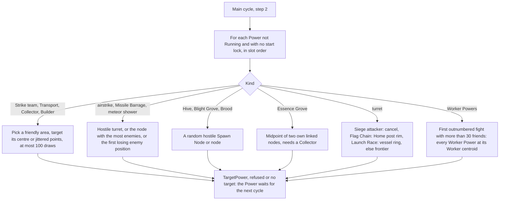

# Bot Powers and unit policies

> Status: Reference · Prefix: R-BOT · Related: [Bots](README.md) · [03 Decision loop and Leaders](03_decision_loop_and_leaders.md) · [04 Supply crates, powers and weapons](../04_supply_crates_powers_and_weapons/README.md) · [Crates and powers](../04_supply_crates_powers_and_weapons/crates_and_powers.md) · [02 Units](../02_units/README.md)

## 1 Purpose and player experience

A bot uses every Power it holds, whatever its source: Supply crate rewards, the starting powers and the Comeback Bonus. Each main cycle it hands every Power that is waiting for a target to the handler of that Power's kind. Unit Powers land at the friendly position under most pressure or at a random friendly drop area; the airstrike goes for a hostile turret, or for the node with the most enemies; the meteor shower waits for a position where the enemy has more than 50 bodies and the bot fewer than 30; Shield, Speed Boost, Convert and Fury are all spent together on one fight where the bot is outnumbered; turrets ring the bot's frontier, its Home post or its Launch Vessel. A handler that finds no target keeps its Power, and its Power slot, for the next cycle.

Units that a bot holds run their own bot policies every tick: Leaders, Transports, Strike teams, Collectors and Builders, and in Siege the Breach Charges. Their policies are specified with each unit; this file links them to the bot.

## 2 Rules

### 2.1 Handling Powers

**R-BOT-100** (MUST) In step 2 of every main cycle ([03](03_decision_loop_and_leaders.md) R-BOT-077), the bot visits every Power in its team's Power slots, in slot order, that is not Running and has no start lock ([README](../04_supply_crates_powers_and_weapons/README.md) R-CRATE-017, R-CRATE-018), and runs the handler of its kind from table 2.1-A. The promotion Power is not visited; Leader rules use it ([03](03_decision_loop_and_leaders.md) R-BOT-090).

Table 2.1-A Power handlers.

| Power kind | Handler |
|---|---|
| Strike team | R-BOT-108 |
| Transport | R-BOT-109 |
| Collector, Builder | R-BOT-110 |
| airstrike, with either bomb kind (Firebomb Run included) | R-BOT-111 |
| Missile Barrage | R-BOT-112 |
| turret, every type (gun turret, rocket turret, flame turret) | R-BOT-113 |
| Essence Grove | R-BOT-118 |
| Hive, Blight Grove | R-BOT-119 |
| Brood | R-BOT-120 |
| meteor shower | R-BOT-121 |
| Shield, Speed Boost, Convert, Fury | R-BOT-122 |

**R-BOT-101** (MUST) The handlers of table 2.1-A cover every Power kind that a bot team can hold in a match. A bot team receives Powers from Supply crates it opens ([crates_and_powers.md](../04_supply_crates_powers_and_weapons/crates_and_powers.md)), from the starting powers, locked for `ref.econ.start.power_lock_ticks` (300 ticks) ([reference/05](../05_population_flow.md) R-ECON-110), and from the Comeback Bonus, the only source of the Essence Grove Power (R-ECON-113 to R-ECON-115, R-CRATE-138). The Transport Powers of Transit Gate waves and the units that a map places as Powers are targeted when they are created and never reach a handler (R-ECON-093, R-ECON-109); a forced outcome goes only to a tutorial player (R-CRATE-010). No source gives a bot a Swarm Power, so no handler exists for it.

**R-BOT-102** (MUST) A handler targets a Power with `PlayerCommand::TargetPower(team, Power id, position)` (README R-BOT-014). The targeting succeeds only when the point satisfies the target rule of the Power's kind ([README](../04_supply_crates_powers_and_weapons/README.md) R-CRATE-025, table 2.5-A) and the Power is Waiting with no start lock; otherwise it is refused and the Power stays Waiting.

**R-BOT-103** (MUST) The handlers use the target areas of table 2.5-A of reference/04, as circles with a centre and a radius r: a **drop area** is the circle of `ref.power.target.unit_drop_radius` (75 wu) around each structure of a friendly team of kind Spawn Node, turret, Control Zone or a kind that shares its type (Relic Base, Relic Spawn Zone, Flag post, Home post), or Transit Gate; a **group area** is the circle of `ref.power.target.group_centre_radius` (100 wu) around the centre of each actor group of the team of the Strike team or Builder kind. The valid areas of the Strike team and Transport Powers are the drop areas; those of the Collector and Builder Powers are the group areas followed by the drop areas. A jittered point of an area is centre + (`NextSigned(r)`, 0, `NextSigned(r)`), the x draw first, so ±37.5 wu per axis for a drop area and ±50 wu for a group area. **Perfect information (PI-03)** wherever a handler reads enemy structures.

**R-BOT-104** (MUST) In the handlers, a node or structure is **hostile** when its owner is hostile to the bot's team (README §1.1); **not Rogue** excludes the Rogue faction as owner; and "the most enemies" is the strictly greatest enemy count for the bot's team in structure order starting from 0, so it needs at least one enemy and keeps the first on a tie (DEC-016). A node is "in a valid area" when its position is a valid target point of the Power's kind.

**R-BOT-105** (MUST) Every placement loop of a handler is bounded (DEC-014): when `ref.bot.power.placement_attempts` (100) points have been drawn without a valid one, the handler places nothing in this cycle and the Power stays Waiting.

**R-BOT-106** (MUST) A handler that finds no acceptable target places nothing: the Power stays Waiting, keeps its Power slot (DEC-033) and is offered to its handler again in the next main cycle.

**R-BOT-107** (MUST) The **promotion Power** is a Power kind that only bots start (README table 2.4-A). Starting one puts it into a free Power slot as Waiting, and fails with no message when every slot is occupied (R-CRATE-014). Its valid target point is one with a Worker of the bot's team within `ref.bot.power.promote_radius` (10 wu); targeting it promotes the nearest such Worker by the promotion operation of [leader_and_formations.md](../02_units/leader_and_formations.md) R-UNIT-153, which selects the new Leader, and ends the Power. A promotion Power that has not promoted a Worker by the end of the bot step that started it ends then, freeing its slot (DEC-087).

### 2.2 The handlers

**R-BOT-108** (MUST) **Strike team.** The target node is the node, of any owner, that lies in a valid area and has the most enemies; with none, the bot waits (R-BOT-106). The bot takes the valid area whose centre is nearest to that node and targets its centre; while the point is invalid, it targets jittered points of that area, bounded by R-BOT-105. The node is the friendly position under most pressure. **Perfect information (PI-01).**

**R-BOT-109** (MUST) **Transport.** With no valid area, the bot waits. Otherwise it takes one valid area by `NextUint` mod the number of areas and targets a jittered point of it pushed out of obstacles (`PushFromObstacles`, R-SIM-380, applied to the point), drawing a new jittered point while the point is invalid, bounded by R-BOT-105.

**R-BOT-110** (MUST) **Collector and Builder.** With no valid area, the bot waits. Otherwise it takes one valid area by `NextUint` mod the number of areas, targets its centre, and while the point is invalid targets jittered points of it, bounded by R-BOT-105.

**R-BOT-111** (MUST) **Airstrike.** Among the structures at valid target points, in structure order: when any hostile turret exists, the target is one of them chosen by `NextUint` mod their number; otherwise the target is the node, not owned by the Rogue faction, with the most enemies. The bot targets the chosen structure's position; with none, it waits. The same handler serves both bomb kinds of the airstrike Power. **Perfect information (PI-01, PI-03).**

**R-BOT-112** (MUST) **Missile Barrage.** The target is the node at a valid point, not owned by the Rogue faction, with the most enemies; the bot targets its position, and with none it waits. **Perfect information (PI-01).**

**R-BOT-113** (MUST) **Turret.** The handler of every turret type:

1. in Siege, when the bot's team attacks: the bot stops the Power with `PlayerCommand::CancelPower` and places no turret;
2. in Flag Chain: the Home post placement (R-BOT-117);
3. in Launch Race, for a standard or hard bot: the Launch Vessel placement (R-BOT-116);
4. otherwise: the frontier placement (R-BOT-114), which Siege defenders and easy bots in Launch Race use too.

**R-BOT-114** (MUST) **Frontier placement.** A **frontier node** is a node owned by the bot's team itself (an ally's node does not qualify) whose position is a valid turret target point and that has at least one linked node that is hostile or neutral. Its **threat** is the greatest enemy count for the team among its hostile linked nodes, or 0 when its links lead only to neutral nodes. The bot takes the frontier node with the greatest threat, the first in structure order on a tie (DEC-087); its target node is that frontier node's hostile linked node with the most enemies, or the frontier node itself when no linked node is hostile. The turret point is the centroid of the bot team's Workers within `ref.bot.power.turret_worker_radius` (150 wu) of the target node (`InRange`, the team's own mask) that are alive, on the ground, not inside a Transport and not Burning; it is pushed away from every turret in structure order, one pass, directly away from that turret in steps of `ref.bot.power.turret_push_step` (10 wu) until it lies at least `ref.bot.power.turret_spacing` (60 wu) from it (R-BOT-115), and then out of obstacles (R-SIM-380, applied to the point). With no frontier node or no such Worker, the bot waits; an invalid point is refused (R-BOT-102) and retried in the next cycle. **Perfect information (PI-01).**

**R-BOT-115** (MUST) The turret push of R-BOT-114 visits every turret of every team once, in structure order, and does not revisit an earlier turret after a later push; the result can therefore lie within 60 wu of an earlier turret.

**R-BOT-116** (MUST) **Launch Vessel placement** (Launch Race, standard and hard bots). With no Launch Vessel of its team, the bot waits. When fewer than `ref.bot.power.vessel_turrets` (2) turrets of its team stand within `ref.bot.power.vessel_turret_radius` (300 wu) of the vessel, the point is the vessel's position + (cos a, 0, sin a) × r, with a = `NextUnit(2π)` drawn first and then r = `ref.bot.power.vessel_ring_base` + `NextUnit(ref.bot.power.vessel_ring_spread)` (75 to 125 wu), so turrets ring the whole vessel (DEC-087). Otherwise the bot takes one of its team's nodes by `NextUint` mod their number, and the point is the centroid of its team's Workers within `ref.bot.power.turret_worker_radius` (150 wu) of that node + (`NextSigned(ref.bot.power.vessel_fallback_scatter)`, 0, `NextSigned(ref.bot.power.vessel_fallback_scatter)`) (±100 wu per axis), pushed out of obstacles; with no such Worker, or no node of its team, the bot waits.

**R-BOT-117** (MUST) **Home post placement** (Flag Chain). With no Home post of its team, the bot waits. The turret limit is `ref.bot.power.flag_turrets_easy` (1) for an easy bot and `ref.bot.power.flag_turrets` (2) otherwise. The bot counts the turrets of every team within the Home post's size of it, remembering the last one found in structure order:

1. when the count is below the limit, the point is a rim point of the Home post: its position + its front rotated about the vertical by `NextUnit(2π)` × its size, at the terrain height, pushed out of obstacles; when the count is not 0, the rotation is drawn again while the point lies within `ref.bot.power.flag_turret_spacing` (50 wu) of the last turret found, bounded by R-BOT-105;
2. otherwise the point is a rim point, by the same construction with no spacing test, of another Flag post of its team chosen by `NextUint` mod their number; with no other Flag post, the bot waits.

**R-BOT-118** (MUST) **Essence Grove.** The handler needs a Collector among its team's special units; without one, the bot waits, holding the Power and its slot until it has a Collector. With one, for every node owned by the team, in structure order, whose first linked node owned by the team exists, the bot targets the midpoint of the two nodes; only the first targeting can succeed, because the Power then runs. A special-unit handle that no longer resolves is skipped (DEC-028).

**R-BOT-119** (MUST) **Hive and Blight Grove.** The target is one of the hostile Spawn Nodes not owned by the Rogue faction at valid points, chosen by `NextUint` mod their number; the bot targets its position, and with none it waits. **Perfect information (PI-03).**

**R-BOT-120** (MUST) **Brood.** The target is one of the hostile nodes not owned by the Rogue faction at valid points, chosen by `NextUint` mod their number; the point is the node + normalise(`NextSigned(1)`, 0, `NextSigned(1)`) × `ref.bot.power.brood_offset` (150 wu), at the terrain height. With none, the bot waits. **Perfect information (PI-02).**

**R-BOT-121** (MUST) **Meteor shower.** The target is the first node in structure order that is hostile, not owned by the Rogue faction, at a valid point, and where, within R = `ref.bot.power.meteor_factor` (6) × `ref.power.effect_range` (70 wu) = 420 wu of it, the cell-granular friend count of the bot's team is below `ref.bot.power.meteor_friends` (30) and the cell-granular enemy count is above `ref.bot.power.meteor_enemies` (50) (`CountFriendsInCells`, `CountEnemiesInCells`, R-SIM-313, DEC-094). The bot targets its position; with none, it waits, which is common, so a meteor shower Power often holds its slot for long. **Perfect information (PI-04).**

**R-BOT-122** (MUST) **Shield, Speed Boost, Convert, Fury.** The fight is the first node in structure order, of any owner, whose friend count for the team is above `ref.bot.power.worker_power_friends` (30) and whose enemy count for the team is above its friend count. With range `ref.bot.power.worker_power_radius` (100 wu), or the node's tagged zone size when it has one, the point is the mean position of the Workers among `Friends(node, range, team)` (allies' Workers included), divided by the number of those Workers (DEC-087); with no fight node or no such Worker, the bot waits. **Perfect information (PI-01).**

**R-BOT-123** (MUST) When R-BOT-122 finds a point, the bot targets **every** Shield, Speed Boost, Convert and Fury Power of its team that is not Running at that point, in slot order, in the same step; each is valid when an actor of the team is within `ref.power.effect_range` (70 wu) of the point. All of a bot's Worker Powers are therefore spent together on one fight.

### 2.3 Unit policies

**R-BOT-124** (MUST) The units of a bot team run their bot policies from the bot's per-tick step ([03](03_decision_loop_and_leaders.md) R-BOT-074): every special unit (Leader, Transport, Collector, Builder) and every actor group (Strike team) of the team, every tick. A unit kind without a bot policy does nothing there. A human team's units never run a bot policy; a departing player's units run them from the bot takeover (README R-BOT-012).

**R-BOT-125** (MUST) The bot policies of the units are specified with each unit, and use the predicates and selections of this folder:

| Unit | Policy | Uses from this folder |
|---|---|---|
| Leader | [leader_and_formations.md](../02_units/leader_and_formations.md) R-UNIT-188 | nearest node (R-BOT-052), target selection (R-BOT-087), important (R-BOT-049), needs defending (R-BOT-051); conveyor and formation Leaders ([03](03_decision_loop_and_leaders.md)) |
| Transport | [transport.md](../02_units/transport.md) R-UNIT-402 to R-UNIT-407: the Siege behaviour in Siege, the Flag Chain behaviour in Flag Chain, the Launch Race behaviour in Launch Race and the standard behaviour in every other mode | the Siege current objective and its markers ([05](05_mode_strategies_and_tutorials.md)); the Transport objective list (R-BOT-127); the Launch Race field list (R-BOT-138); node idle counts |
| Strike team | [strike_team.md](../02_units/strike_team.md) R-UNIT-359 to R-UNIT-361 | nearest node and node priorities |
| Collector | [collector.md](../02_units/collector.md) R-UNIT-442 | — |
| Builder | [builder.md](../02_units/builder.md) R-UNIT-464 | — |
| Breach Charge (Siege) | [mode_objects.md](../03_buildings_and_world_objects/mode_objects.md) R-BLDG-294, run from the Siege objective logic | the current objective's markers ([05](05_mode_strategies_and_tutorials.md) R-BOT-136) |

The Transport policy reads enemy Launch Vessels and Solar Array fields (**Perfect information (PI-06, PI-08)**), the Strike team policy scans enemies around its own centre (**PI-05**), and the Collector and Builder policies go to the nearest Essence orb anywhere on the map (**PI-07**).

## 3 States and flows

Caption: Figure 3-1, the Power handlers of a main cycle (R-BOT-100 to R-BOT-123).

## 4 Tuning table

| key | value | unit | range or notes | requirement | DEC |
|---|---|---|---|---|---|
| `ref.bot.power.placement_attempts` | 100 | draws | cap of every handler placement loop; nothing placed after it | R-BOT-105 | DEC-014 |
| `ref.bot.power.promote_radius` | 10 | wu | promotion Power target radius | R-BOT-107 | DEC-087 |
| `ref.bot.power.turret_worker_radius` | 150 | wu | Worker centroid for turret points | R-BOT-114, R-BOT-116 | — |
| `ref.bot.power.turret_push_step` | 10 | wu | | R-BOT-114 | — |
| `ref.bot.power.turret_spacing` | 60 | wu | at least, from each turret, one pass | R-BOT-114, R-BOT-115 | — |
| `ref.bot.power.vessel_turrets` | 2 | turrets | fewer than this near the vessel: ring placement | R-BOT-116 | — |
| `ref.bot.power.vessel_turret_radius` | 300 | wu | | R-BOT-116 | — |
| `ref.bot.power.vessel_ring_base` | 75 | wu | ring radius base | R-BOT-116 | — |
| `ref.bot.power.vessel_ring_spread` | 50 | wu | + `NextUnit(50)` | R-BOT-116 | — |
| `ref.bot.power.vessel_fallback_scatter` | 200 | wu | `NextSigned(200)`: ±100 per axis | R-BOT-116 | — |
| `ref.bot.power.flag_turrets_easy` | 1 | turrets | easy bot limit at the Home post | R-BOT-117 | DEC-022 |
| `ref.bot.power.flag_turrets` | 2 | turrets | standard and hard bot limit | R-BOT-117 | DEC-022 |
| `ref.bot.power.flag_turret_spacing` | 50 | wu | from the last turret found | R-BOT-117 | DEC-014 |
| `ref.bot.power.brood_offset` | 150 | wu | | R-BOT-120 | — |
| `ref.bot.power.meteor_factor` | 6 | × `ref.power.effect_range` | 420 wu | R-BOT-121 | — |
| `ref.bot.power.meteor_friends` | 30 | actors | fewer than | R-BOT-121 | DEC-094 |
| `ref.bot.power.meteor_enemies` | 50 | actors | more than | R-BOT-121 | DEC-094 |
| `ref.bot.power.worker_power_friends` | 30 | actors | more than, at the fight node | R-BOT-122 | — |
| `ref.bot.power.worker_power_radius` | 100 | wu | or the tagged zone size | R-BOT-122 | — |

Keys cited here and defined elsewhere: `ref.power.target.unit_drop_radius`, `ref.power.target.group_centre_radius`, `ref.power.effect_range` and the slot keys `ref.power.slots.*` ([reference/04](../04_supply_crates_powers_and_weapons/README.md)); `ref.econ.start.power_lock_ticks` ([reference/05](../05_population_flow.md)); the unit policy keys of the documents named in R-BOT-125.

## 5 Edge cases and interactions

1. **Slots held by waiting Powers.** A Power whose handler finds no target keeps its slot; a bot can hold an Essence Grove Power for the whole match when it never has a Collector, and a meteor shower Power until an enemy position qualifies. Grants arriving while all six slots are full are lost (R-BOT-106, DEC-033).
2. **Turret Powers of a Siege attacker.** An attacking bot in Siege cancels every turret Power it receives, so its slot frees at once (R-BOT-113).
3. **Turret-cap modes.** In Launch Race and Flag Chain a placed turret's Power stays Running and keeps its slot while the turret stands (R-CRATE-024); the handler never sees it again.
4. **Worker Powers spent together.** A bot holding Shield and Fury spends both on the same point in the same step; the second Power is valid only while an actor of its team is within 70 wu of the point (R-BOT-123).
5. **Allies in the Worker-Power centroid.** Allied Workers near the fight node move the centroid; the point is valid as long as an actor of the bot's own team is within 70 wu (R-BOT-122, R-BOT-123).
6. **The airstrike against turrets.** While any hostile turret stands at a valid point, a bot's airstrike always goes to a random hostile turret rather than to the biggest crowd (R-BOT-111).
7. **Starting powers.** Starting powers are locked for 300 ticks; the bot does not visit them until the lock is 0 (R-BOT-100).
8. **Promotion Powers.** A promotion Power never survives the bot step that started it, so it never appears to a handler and never fills a slot between cycles (R-BOT-107).

## 6 Acceptance criteria

**AC-BOT-28 — Strike team placement** (R-BOT-108). Given a bot team with two Spawn Nodes, one whose node has 12 enemies and one whose node has 3, then its Strike team Power is targeted within 37.5 wu per axis of the first Spawn Node.

**AC-BOT-29 — Meteor shower test** (R-BOT-121). Given a hostile node with 60 enemies and 25 friends of the bot within 420 wu, then the meteor shower is targeted at it; with 31 friends, it is not, and the Power stays Waiting.

**AC-BOT-30 — Worker Powers** (R-BOT-122, R-BOT-123). Given a node with 35 friends of which 30 are Workers and 2 are Leaders, and 40 enemies, then every waiting Worker Power of the bot is targeted at the mean position of the 30 Workers in the same step.

**AC-BOT-31 — Frontier turret** (R-BOT-114). Given two frontier nodes whose hostile neighbours have 10 and 25 enemies, in that structure order, then the turret point is the Worker centroid at the 25-enemy neighbour, pushed to at least 60 wu from every turret.

**AC-BOT-32 — Vessel ring** (R-BOT-116). Given a standard bot in Launch Race with no turret near its vessel, then over 1,000 seeds the turret points are spread over all four quadrants around the vessel, 75 to 125 wu from it.

**AC-BOT-33 — Bounded placement** (R-BOT-105). Given a Transport Power whose only drop area lies wholly in an exclusion zone that blocks Powers, then the handler draws at most 100 points, places nothing and leaves the Power Waiting.

**AC-BOT-34 — Promotion Power expiry** (R-BOT-107). Given a bot that starts a promotion Power with no Worker within 10 wu of its target point, then at the end of that bot step the Power has ended and its slot is free.

## 7 Dependencies

- **Reference documents:** [README](README.md); [03 Decision loop and Leaders](03_decision_loop_and_leaders.md); [05 Mode strategies and tutorials](05_mode_strategies_and_tutorials.md); [04 Supply crates, powers and weapons](../04_supply_crates_powers_and_weapons/README.md) (Power slots, states, start lock, target rules), [crates_and_powers.md](../04_supply_crates_powers_and_weapons/crates_and_powers.md) (outcomes); [05 Population flow](../05_population_flow.md) (starting powers, Comeback Bonus, Transit Gate waves); [leader_and_formations.md](../02_units/leader_and_formations.md), [transport.md](../02_units/transport.md), [strike_team.md](../02_units/strike_team.md), [collector.md](../02_units/collector.md), [builder.md](../02_units/builder.md); [mode_objects.md](../03_buildings_and_world_objects/mode_objects.md) (Breach Charge); [reference/12](../12_simulation_model/05_space_routing_and_physics.md) (actor-grid queries, obstacle push).
- **Engine components:** none.
- **Assets:** none.

## 8 Open decisions

| Decision | Title | Default stated here |
|---|---|---|
| DEC-094 | Exact or approximate actor-grid queries | the meteor shower test uses the cell-granular counts (R-BOT-121) |
| DEC-112 | Bot strength calibration | the handler thresholds of §4 |
