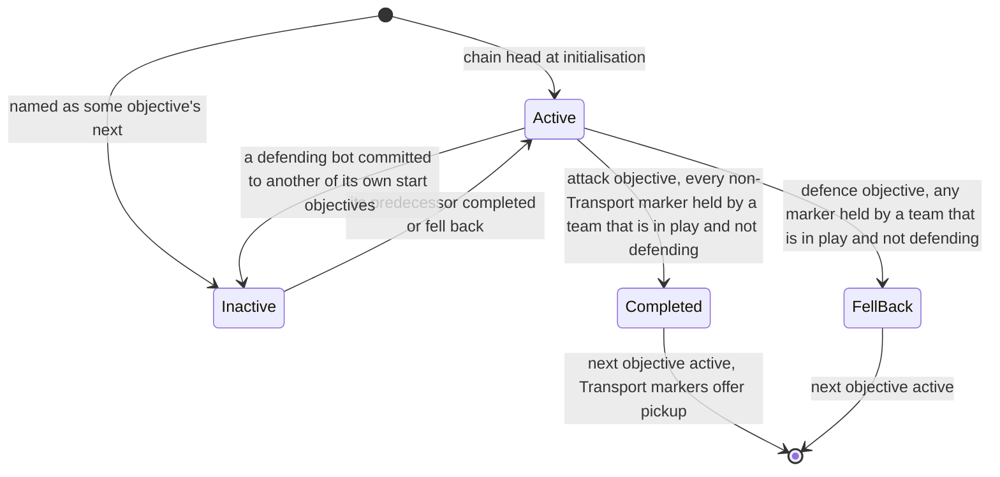
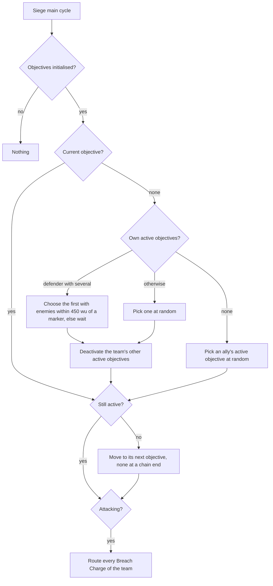

# Bot mode strategies and tutorials

> Status: Reference · Prefix: R-BOT · Related: [Bots](README.md) · [02 Priority model](02_priority_model.md) · [03 Decision loop and Leaders](03_decision_loop_and_leaders.md) · [04 Powers and unit policies](04_powers_and_unit_policies.md) · [01 Skirmish rules and modes](../01_skirmish_rules_and_modes/README.md) · [11 Tutorial and help](../11_tutorial_and_help.md)

## 1 Purpose and player experience

Every mode gives the same bot a different shape. In Spawn Control the bot drains its interior towards the nearest capturable Spawn Node and streams fresh Workers from each Spawn Node it holds. In Zone Control it converges on the Control Zones and keeps a garrison in each zone it holds. In Relic Run it swarms the Relic and frees a carried Relic that has stuck. In Siege it follows an **objective chain** that the map lays out: attackers take the chain one step at a time, every Worker dispatched every 3 s (every 1.1 s at Hard), breaking walls with Breach Charges and ignoring turret Powers; defenders wait until the enemy comes close to one of their possible start objectives and then fall back objective by objective. In Launch Race it fuels its Launch Vessel from the Solar Array fields the map marks for it, shuttles Workers with Transports and rings the vessel with turrets. In Flag Chain it attacks Flag posts by the state of its Home post, flies Transports onto enemy turrets and rings its Home post with turrets. The two tutorials run easy bots whose movement is filtered so that each lesson can happen.

## 2 Rules

### 2.1 Bot objectives and markers

**R-BOT-126** (MUST) A **bot objective** (`BotObjective`) and a **bot objective marker** (`BotObjectiveMarker`) are structures that only bot rules read: they are never hit by rays, spheres or weapons, cannot be damaged and are drawn only in the map editor. Siege maps place both; Launch Race maps place markers only ([reference/03](../03_buildings_and_world_objects/README.md) table 2.6-A). Their fields are those of tables 2.1-A and 2.1-B. A marker's scan range defaults to `ref.bot.marker.scan_range_default` (100 wu), and its first evaluation countdown, max(1, ⌈`NextUnit(ref.bot.marker.phase_ticks)`⌉) with `ref.bot.marker.phase_ticks` (10 ticks), is drawn once, in the step that creates the marker (DEC-652).

Table 2.1-A Fields of a bot objective.

| Field | Initial value | Meaning |
|---|---|---|
| next objective | the map record's | the objective that becomes active when this one completes or falls back; none at a chain end, where the record's schema field `next_objective` is absent |
| markers | none | the markers that registered with it (R-BOT-132) |
| active | true | the objective is in play |
| defence flag | false | the objective belongs to a defending team: it falls back instead of completing |
| evaluation countdown | `ref.bot.objective.period_ticks` (51 ticks), with no phase | ticks to the next evaluation |
| Transport marker | none | the marker that is the Transport drop and pickup point |

Table 2.1-B Fields of a bot objective marker.

| Field | Initial value | Meaning |
|---|---|---|
| scan range | the map record's, default `ref.bot.marker.scan_range_default` (100 wu) | the head-count radius; 0: the team comes from the bound structure or the default team |
| evaluation countdown | max(1, ⌈`NextUnit(ref.bot.marker.phase_ticks)`⌉), drawn once at creation (DEC-652) | ticks to the next evaluation |
| registered | false | the marker has registered with its objective |
| pickup available | false | a Transport may pick up here; set when the objective completes |
| defence flag | false | copied from the objective at registration |
| objective | the map record's | the owning objective; none for a Launch Race marker |
| Transport-objective flag | the map record's schema field `transport_objective`, default 0 | 1: a Transport drop and pickup marker, left out of the capture test |
| pickup-only flag | the map record's schema field `pickup`, default 0 (`normal`) | 1 (`pickup_only`): pickup only, never the objective's Transport marker; −1 (`never_pickup`): never offers pickup |
| bound structure | none | the structure within 20 wu whose team decides the marker (R-BOT-132) |
| default team | the map record's team, or no team when the record names none | the team restored when the scan range is 0 and no structure is bound |

**R-BOT-127** (MUST) The **Transport objective list** holds every bot objective that has a Transport marker. A marker that registers as its objective's Transport marker adds the objective to the list at once, so the list is complete once every marker has registered; it never depends on the order in which objectives and markers first advance (DEC-087). The list is reset with the match world (README R-BOT-011). The Transport's Siege behaviour reads it ([transport.md](../02_units/transport.md) R-UNIT-405 item 1), which is therefore live in every Siege match whose map has Transport markers.

**R-BOT-128** (MUST) A map places a bot objective with the base fields of a structure record followed by its next objective (mandatory, none for a chain end; the map schema writes a chain end as an absent `next_objective`). It places a marker with the base fields followed by its scan range and its objective (both mandatory) and two optional fields, each present only when the previous one is: the Transport-objective flag (0 or 1) and the pickup-only flag (−1, 0 or 1, the values `never_pickup`, `normal` and `pickup_only` of the schema field `pickup`; [map structure records](../../architecture/components/data_schemas/map_structure_records.md)). Every reference Siege map places 6 to 18 chained bot objectives with 24 to 44 markers ([rules and conventions](../08_maps_and_level_design/rules_and_conventions.md) R-MAP-168 item 2, table 2.19-A), and every reference Launch Race map places 6 to 21 markers (R-MAP-171). On the reference maps every Siege marker names an objective, no marker that has no team also has a scan range of 0, and every Launch Race marker names no objective, names a team and has a scan range from 100 to 306.6 wu; the census of record is R-MAP-200, table 2.11-B. Map validation binds every defence marker that has a scan range to a structure (DEC-561).

### 2.2 Initialisation and the objective chain

**R-BOT-129** (MUST) The bot objectives of a match initialise once, at the first advance of any bot objective, which sets the bot-objectives-initialised flag. In structure order, for each objective O: (1) when O has a next objective, that objective becomes inactive, so only chain heads start active; (2) when O's team is a defending team, O's defence flag is set, and when O's defence flag is set and O has a next objective, the next objective's defence flag is set. The pass runs once, in structure order, so the defence flag moves one step down a chain per objective visited: a chain longer than two is marked to its end only when its objectives come in chain order in structure order (see DEC-861). A team attacks when its map position is on the map's attacking list, and defends otherwise; no team neither attacks nor defends ([siege.md](../01_skirmish_rules_and_modes/siege.md) R-MODE-350).

**R-BOT-130** (MUST) An objective is in one of the states of figure 3-1: active or inactive; a completed or fallen-back objective is inactive for the rest of the match. Activity is one flag per objective, shared by every bot.

**R-BOT-131** (MUST) Every objective counts its evaluation countdown down by one per tick and evaluates at 0, setting the countdown to `ref.bot.objective.period_ticks` (51 ticks) again; an inactive objective evaluates nothing. An active **attack** objective (defence flag clear) is **completed** when every registered marker that still exists and is not a Transport marker has a team that is neither no team nor a defending team (with no such marker this holds at once); it then becomes inactive, its next objective becomes active, and every marker of the objective with the Transport-objective flag 1 and a pickup-only flag other than −1 offers pickup. An active **defence** objective **falls back** when any existing marker has a team that is not no team and not a defending team; it becomes inactive and its next objective becomes active.

**R-BOT-132** (MUST) A marker does nothing in Siege until the objectives are initialised. On its first advance after that, a marker with an objective that has not registered: registers with the objective, as its Transport marker when its Transport-objective flag is 1 and its pickup-only flag is not 1 (R-BOT-127); copies the objective's defence flag; when its map record names a team, takes that team as its default team and sets its own team to no team; and binds the first structure in structure order within `ref.bot.marker.bind_radius` (20 wu) that is not a bot objective marker, a navigation node, a wall, a Barrier Emitter or a scenery mesh. A Launch Race marker has no objective, never registers and keeps its map team.

**R-BOT-133** (MUST) After its first advance, a marker counts its evaluation countdown down by one per tick and evaluates at 0, setting the countdown to `ref.bot.marker.period_ticks` (20 ticks). An evaluation runs: in Launch Race, the Launch Race pin ([02](02_priority_model.md) R-BOT-068); for a defence marker, the defence ownership (R-BOT-135) and then the defence pin (R-BOT-067); for every other marker, the attack ownership (R-BOT-134) and then the attack pin (R-BOT-066). Ownership is recomputed only while the marker's objective is active; the pins run at every evaluation.

**R-BOT-134** (MUST) **Attack marker ownership.** First, a bound structure that no longer exists or is destroyed, or that is a Solar Array with no ports (a knocked-out array, R-MODE-355), is unbound. With a bound structure, the marker's team is that structure's team. With none: when the scan range is 0, the team is the default team; otherwise, with c[i] = `CountFriendsInCells(position, scanRange, i)` for team slots 0 to 3 and c[4] = c[5] = 0 (allies count towards each other), the team is no team when the cell-granular count of every actor within the scan range, Rogue and Visitor factions left out, is 0, and otherwise the winner of:

```
w := 0
for i from 0 to 5:
    if c[i] > ref.bot.marker.attack_majority * c[w] and c[w] < ref.bot.marker.attack_leader_cap:  w := i   # 4 and 10
team := w
```

A new team takes the marker only with more than 4 times the current leader's count, and only while the leader has fewer than 10 (DEC-094). **Perfect information (PI-04).**

**R-BOT-135** (MUST) **Defence marker ownership.** The bound structure is unbound as in R-BOT-134, and c[i] is computed as there. Then:

```
w := 0;  D := 0
for i from 0 to 5:
    if team i defends:
        D += c[i]
        if D >= ref.bot.marker.defence_quorum or (a structure is bound and its team defends):  w := i;  stop   # 15
    if c[i] > ref.bot.marker.defence_majority * c[w]:  w := i                                                  # 2
team := w
```

With nobody near and no bound structure of a defending team, a defence marker reads as owned by team 0; when team 0 attacks, the defence objective falls back at its next evaluation. Map validation binds every defence marker that has a scan range (DEC-561), so this happens only after the bound structure is lost (DEC-087). **Perfect information (PI-04).**

**R-BOT-136** (MUST) **Siege objective logic**, in step 5 of every main cycle of a bot in Siege ([03](03_decision_loop_and_leaders.md) R-BOT-077), after the main-cycle countdown has been set (R-BOT-075). Nothing happens until the objectives are initialised. Then, with A true when the bot's team attacks:

```
if current objective is none:
    mine   := the active objectives whose team is the bot's team, in structure order
    allied := the active objectives of other teams that are friends of the bot's team
    if mine is not empty:
        if not A and |mine| > 1:              # a defender with several possible starts waits
            current := the first objective in mine with a marker that has enemies of the team in its cells
                       within ref.bot.siege.engage_radius (450 wu) (EnemiesInCells, R-SIM-313); else none
        else:
            current := mine[NextUint mod |mine|]
        if current is not none:  every other objective in mine becomes inactive
    else if allied is not empty:
        current := allied[NextUint mod |allied|]
if current is not none:
    if current is inactive:  current := current's next objective      # none at a chain end: chosen again next cycle
    if A:  run the Breach Charge policy (R-BLDG-294) for every Breach Charge of the team
```

**Perfect information (PI-04).**

**R-BOT-137** (MUST) In Siege, an attacking bot works on its own team's attack objectives and a defending bot on its own team's defence objectives; a bot whose own objectives are all inactive takes an active objective of an ally. Markers pin priorities only for the bots whose current objective is the marker's objective, or offer pickup to every attacking bot (R-BOT-066). The attack priority sources are 1.0 at the marker nodes and spread by diffusion ([02](02_priority_model.md) R-BOT-063); an attacker also sends every candidate (send chance 1.1, R-BOT-083), raises its idle limit to 30 at Beam Dish nodes (R-BOT-078), cancels its turret Powers (R-BOT-113) and ignores Supply crates on its final objective (R-BOT-063). Transports drop at the current objective's Transport marker or its markers ([transport.md](../02_units/transport.md) R-UNIT-405).

### 2.3 Launch Race markers and the field list

**R-BOT-138** (MUST) In step 4 of every main cycle of a bot in Launch Race, while its Solar Array field list is empty, the bot fills it once: one entry for every Launch Race marker whose team is the bot's team, in structure order, holding the marker's position, the number of Solar Arrays of any team within its scan range (at most the scan range away), the marker and its scan range. The Solar Array counts are taken once, when the list is filled. Only the Transport's Launch Race behaviour reads the list ([transport.md](../02_units/transport.md) R-UNIT-407). **Perfect information (PI-08).**

**R-BOT-139** (MUST) A Launch Race marker pins its nearest node at 1.0 for its team while that team's Launch Vessel is not Boarding and the node is not held by the team, and at 0.0 otherwise ([02](02_priority_model.md) R-BOT-068). Workers are therefore drawn to the unheld Solar Array fields of their team while the vessel fuels, and released to gather at the Transit Gate, which is a grab node, and at the fuel depots' nodes (modifier 1.0, [01](01_navigation_graph.md) table 2.2-A) while it boards; the Transports shuttle idle Workers to the vessel.

### 2.4 The Relic un-stick rule

**R-BOT-140** (MUST) In step 3 of every main cycle of a bot in Relic Run, for every Relic whose team is the bot's team, in structure order, whose velocity is zero and whose collision test reports other carryable structures ([mode_objects.md](../03_buildings_and_world_objects/mode_objects.md)): with c the sum of the positions of those colliding carryable structures divided by their number (their mean position; DEC-087), every Worker of the team within `ref.bot.relic.unstick_carrier_radius` (50 wu) of the Relic (`InRange`, the team's mask) that carries this Relic receives a waypoint order (R-UNIT-111) to the Relic's position + `ref.bot.relic.unstick_step` (20 wu) × Normalize(Relic position − c), which a carrying Worker passes on to the Relic.

**R-BOT-141** (MUST) A bot never steers the delivery of a Relic: a carried Relic routes itself to the nearest Relic Base of its carrying team ([mode_objects.md](../03_buildings_and_world_objects/mode_objects.md)), and the bot only brings Workers to Relic nodes and frees stuck Relics.

### 2.5 Per-mode strategy

**R-BOT-142** (MUST) Each mode uses exactly the bot mechanisms of table 2.5-A. Every mode also uses the stray recall, the well-defended dispatch, Beam Dish aiming, the Power handlers and the Strike team, Collector and Builder policies.

Table 2.5-A Bot mechanisms per mode.

| Mode | Priority formula | Random target selection | Mode logic | Formation Leaders | Conveyor Leaders | Turret placement | Transport policy |
|---|---|---|---|---|---|---|---|
| Spawn Control | standard | easy always, standard 50 %, hard never | — | yes, at least 70 friends | yes | frontier | standard |
| Zone Control | standard with the Control Zone override | as Spawn Control | garrison of 10 or 50 in tagged zone nodes above easy; tagged own nodes always need defending | yes | yes | frontier | standard |
| Relic Run | Relic Run | as Spawn Control; a linked Relic node always wins the best selection | the Relic un-stick rule | yes, at least 150 idle Workers | yes | frontier | standard |
| Siege | diffusion from marker pins | never | the objective chain; attackers send everyone, idle limit 30 at Beam Dish nodes, Breach Charge routing; easy and standard main cycle 30 ticks | no | yes | attackers cancel; defenders frontier | Siege |
| Launch Race | Launch Race with marker pins | never | the Solar Array field list; the boarding grab at the own Transit Gate | no | yes | easy: frontier; standard and hard: Launch Vessel ring | Launch Race |
| Flag Chain | diffusion from Flag post pins | as Spawn Control | Flag post pins, 1.0 everywhere for easy bots; recall offset [0, 20) wu | no | yes | Home post rim, 1 or 2 turrets | Flag Chain |

**R-BOT-143** (MUST) **Spawn Control.** Every enemy or neutral important structure, Spawn Nodes first, is worth 0.95 to 1.0, and quiet own ground half its neighbours' mean, so each bot army drains from its interior along the links towards the nearest capturable or contested node. Standard and hard bots never send Workers away from a node with enemies near it; formation Leaders appear at threatened own nodes with at least 70 friends; a conveyor Leader stands in front of each own Spawn Node and forwards new Workers to the best neighbour (R-BOT-060, R-BOT-079, R-BOT-091, R-BOT-093).

**R-BOT-144** (MUST) **Zone Control.** A node tagged with a Control Zone is worth 0.95 to every team that does not hold the zone outright, or that holds it with more than 10 other bodies inside, so every bot converges on the zones; a held zone's nodes keep a garrison of 50 Workers, or 10 when the destination's important structure is neutral, and always need defending (R-BOT-060, R-BOT-084, R-BOT-051).

**R-BOT-145** (MUST) **Relic Run.** Relic nodes are worth 1.0 and the best selection always takes a linked Relic node; delivery is the Relic's own; the bot frees stuck carried Relics; formation Leaders need at least 150 idle Workers (R-BOT-062, R-BOT-089, R-BOT-140, R-BOT-091).

**R-BOT-146** (MUST) **Siege.** Attack and defence objectives pin 1.0 at their marker nodes for the bot on that objective, and diffusion pulls every Worker towards the chain's current step; attackers dispatch everyone every 30 ticks (11 at Hard), route Breach Charges to the walls near their objective, cancel turret Powers and ignore Supply crates on the final objective; defenders with several possible start objectives wait until enemies come within 450 wu of one before committing, and then fall back objective by objective (R-BOT-136, R-BOT-137).

**R-BOT-147** (MUST) **Launch Race.** Marker nodes on the team's Solar Array fields pin 1.0 while the field is unheld and the vessel is not boarding; while the vessel boards, the own Transit Gate is a grab node and the fuel depot nodes attract boarders, while Transports shuttle idle Workers to the vessel; otherwise Transports ferry reinforcements from the Transit Gate to uncontrolled, outnumbered or weakest fields, or attack an enemy vessel with at least 75 fuel and more fuel than their own. Standard and hard bots ring their vessel with two turrets (R-BOT-064, R-BOT-068, R-BOT-116, R-UNIT-407).

**R-BOT-148** (MUST) **Flag Chain.** Flag post nodes are pinned by the team's Flag Chain status (1.0 everywhere for easy bots): safe teams attack every Flag post they do not hold; teams whose Home post is taken, attacked or empty go for the Home posts of teams in play; teams under threat retake the Flag posts linked to their Home post. Transports carry more than 20 Workers from a Transit Gate to an enemy Flag post linked to one of the team's own, preferring a live enemy Home post, or to the Flag posts linked to their own Home post when it is under threat, and drop onto the Flag post's turret at standard and hard. Turret Powers go on the Home post's rim (R-BOT-069, R-BOT-117, R-UNIT-406).

**R-BOT-149** (MUST) The Comeback Bonus grants Powers to an eliminated bot team exactly as to a human team, in the modes and on the maps where it grants ([reference/05](../05_population_flow.md) R-ECON-112 to R-ECON-115), and the bot uses them by the handlers of [04](04_powers_and_unit_policies.md).

### 2.6 Tutorials

**R-BOT-150** (MUST) Both tutorials are Zone Control matches on their own maps against easy bots, whose bot colours are their slot ids (R-MODE-016, R-MODE-083); the second tutorial's last step sets the bot difficulty to Standard ([reference/11](../11_tutorial_and_help.md)). The tutorial maps designate the structures that the rules of this section name by role tags ([Tutorial and help](../11_tutorial_and_help.md) tables 2.9-A and 2.10-A), and the tutorial step graph sets the second tutorial's two gates, **bots may act** and **bots may spawn**, as sequenced simulation events (DEC-103). This section specifies the reference tutorials; whether and how Species keeps them is DEC-051.

**R-BOT-151** (MUST) **First tutorial, movement.** Target selection is always random (R-BOT-087). While the first tutorial's centre Control Zone, the role tag `centre_zone`, has no team and the bot's tutorial centre latch is clear, the random selection draws a new index whenever it picks a node inside that zone; the latch is set, for good, once the zone has an owner. It also draws a new index whenever it picks an important node that has an owner, the navigation node with the role tag `bot_excluded_node`, or a Supply crate node. Every new draw counts as a try (R-BOT-088).

**R-BOT-152** (MUST) **Second tutorial, movement.** While the "bots may act" gate is clear, target selection returns none, so the bots stay where they are. Until the "bots may spawn" gate is set, the first bot of the tutorial (slot 1) never moves, and the second bot (slot 2) moves only to Beam Dish nodes, drawing a new index for every other pick.

**R-BOT-153** (MUST) **Second tutorial, Beam Dishes.** Once the "bots may act" gate is set, Beam Dish aiming (R-BOT-098) skips every receiver whose nearest node has priority 0 for the bot's team, and skips every receiver outside the six Beam Dishes with the role tag `bot_dish` whose nearest node is owned by another team, or by the bot's own team with more than `ref.bot.tutorial.dish_friends` (30) friends. In the first tutorial Beam Dish aiming is unfiltered.

**R-BOT-154** (MUST) In both tutorials no bot promotes formation Leaders (R-BOT-091); conveyor Leaders are not gated by the tutorials (R-BOT-094), and in the first tutorial formations are disabled for every Leader ([leader_and_formations.md](../02_units/leader_and_formations.md)). No Power can be stopped in the first tutorial, or in the second until the "bots may spawn" gate is set (R-CRATE-021, the default of the Open DEC-550).

**R-BOT-155** (MUST) **Second tutorial, the gate node.** At each priority evaluation of the second bot's gate node, the navigation node with the role tag `bot_gate_node` of the second tutorial's map, before the rule of R-BOT-059: while the "bots may spawn" gate is clear, the second bot's priority there becomes `ref.bot.pin.value` (1.0) and the evaluation goes on; once the gate is set and the second bot's team owns exactly one Spawn Node, its priority there becomes 0 and the evaluation of the node ends.

## 3 States and flows



Caption: Figure 3-1, the state machine of a bot objective, evaluated every 51 ticks (R-BOT-129 to R-BOT-136).



Caption: Figure 3-2, the Siege objective logic of one main cycle (R-BOT-136).

## 4 Tuning table

| key | value | unit | range or notes | requirement | DEC |
|---|---|---|---|---|---|
| `ref.bot.objective.period_ticks` | 51 | ticks | 5.1 s; first evaluation 51 ticks after creation | R-BOT-131 | DEC-002 |
| `ref.bot.marker.period_ticks` | 20 | ticks | 2.0 s | R-BOT-133 | DEC-002 |
| `ref.bot.marker.phase_ticks` | 10 | ticks | first countdown max(1, ⌈`NextUnit(10)`⌉); table 2.1-B | R-BOT-126 | DEC-652 |
| `ref.bot.marker.scan_range_default` | 100 | wu | default of the map field; table 2.1-B | R-BOT-126 | — |
| `ref.bot.marker.bind_radius` | 20 | wu | structure binding at registration | R-BOT-132 | DEC-561 |
| `ref.bot.marker.attack_majority` | 4 | factor | more than 4 × the current leader | R-BOT-134 | DEC-094 |
| `ref.bot.marker.attack_leader_cap` | 10 | actors | only while the leader has fewer | R-BOT-134 | DEC-094 |
| `ref.bot.marker.defence_quorum` | 15 | actors | cumulative defenders | R-BOT-135 | DEC-094 |
| `ref.bot.marker.defence_majority` | 2 | factor | more than 2 × the current leader | R-BOT-135 | DEC-094 |
| `ref.bot.siege.engage_radius` | 450 | wu | a defender's engagement test around markers | R-BOT-136 | DEC-094 |
| `ref.bot.relic.unstick_carrier_radius` | 50 | wu | carriers ordered | R-BOT-140 | DEC-087 |
| `ref.bot.relic.unstick_step` | 20 | wu | push of the order point | R-BOT-140 | — |
| `ref.bot.tutorial.dish_friends` | 30 | actors | more than: the dish is skipped | R-BOT-153 | DEC-103 |

Keys cited here and defined elsewhere: `ref.bot.pin.value` ([02](02_priority_model.md)); the cycle keys ([README](README.md)); the Transport keys `ref.unit.transport.bot_*` ([transport.md](../02_units/transport.md)); `ref.bldg.breach_charge.bot_route_retry_ticks` and `ref.bldg.breach_charge.bot_wall_search_wu` ([mode_objects.md](../03_buildings_and_world_objects/mode_objects.md)).

## 5 Edge cases and interactions

1. **A chain head with no markers.** An attack objective with no registered marker completes at its first evaluation (R-BOT-131).
2. **Long defence chains.** The defence flag of the third objective of a chain is set only when the second objective is visited after the first in structure order (R-BOT-129).
3. **Commitment is shared.** When a defending bot commits to one start objective, every other active objective of its team becomes inactive for every bot of the team (R-BOT-136).
4. **Marker counts are cell-granular.** A marker's counts reach up to about 45 wu beyond its scan range (R-SIM-312), so crowds just outside a marker can decide it (R-BOT-134, R-BOT-135, DEC-094).
5. **Inactive objectives still pin.** A marker of an inactive objective keeps evaluating its pins, so a pickup marker of a completed objective keeps drawing Transports of every attacking bot (R-BOT-133, R-BOT-066).
6. **Solar Array counts are fixed.** The field list counts Solar Arrays once; arrays knocked out later still count for the Transport's drop choice (R-BOT-138).
7. **A Relic jammed against non-carryables.** Only colliding carryable structures move the push centre; a Relic stuck against a wall alone has no carryable collision and is not freed by this rule (R-BOT-140).
8. **Tutorial stops.** While the tutorial Power-stop block holds, a bot's `CancelPower` is refused like a player's (R-BOT-154).

## 6 Acceptance criteria

**AC-BOT-35 — Chain progress** (R-BOT-129, R-BOT-131). Given a two-step attack chain whose first objective has two markers, when both markers are held by the attacking team, then within 51 ticks the first objective is inactive, the second active, and the first's Transport markers with pickup-only 0 offer pickup.

**AC-BOT-36 — Defence fall-back** (R-BOT-131, R-BOT-135). Given an active defence objective with one marker, bound to a structure of a defending team, then the objective never falls back while that structure stands, whatever crowd is near; given that structure destroyed and 20 attackers against 5 defenders within the marker's scan range, then the marker reads as the attackers' team and the objective falls back within 51 ticks.

**AC-BOT-37 — Attack ownership** (R-BOT-134). Given a marker with scan range 100 and counts c = (9, 37, 0, 0), then its team is 1; with c = (12, 50, 0, 0), it stays 0.

**AC-BOT-38 — Defender commitment** (R-BOT-136). Given a defending bot with two active start objectives and no enemy within 450 wu of their markers, then its current objective stays none; when enemies enter 450 wu of a marker of the second, then it commits to the second, and the first becomes inactive.

**AC-BOT-39 — Transport objective list** (R-BOT-127). Given a Siege map whose objectives each have a Transport marker, then once every marker has registered, the list holds every such objective, in every structure order of objectives and markers.

**AC-BOT-40 — Relic un-stick** (R-BOT-140). Given a bot's stopped Relic touching two other carryable structures at (100, 0, 0) and (0, 0, 100) relative to it, then its carriers within 50 wu receive orders to the Relic + 20 × Normalize(−50, 0, −50).

**AC-BOT-41 — Tutorial gates** (R-BOT-152). Given the second tutorial before "bots may act", then no bot Worker receives a dispatch order; after it and before "bots may spawn", the slot 1 bot sends none and the slot 2 bot sends only to Beam Dish nodes.

## 7 Dependencies

- **Reference documents:** [README](README.md); [02 Priority model](02_priority_model.md); [03 Decision loop and Leaders](03_decision_loop_and_leaders.md); [04 Powers and unit policies](04_powers_and_unit_policies.md); [siege.md](../01_skirmish_rules_and_modes/siege.md) (sides), [launch_race.md](../01_skirmish_rules_and_modes/launch_race.md), [relic_run.md](../01_skirmish_rules_and_modes/relic_run.md), [zone_control.md](../01_skirmish_rules_and_modes/zone_control.md), [flag_chain.md](../01_skirmish_rules_and_modes/flag_chain.md), [spawn_control.md](../01_skirmish_rules_and_modes/spawn_control.md), and [README](../01_skirmish_rules_and_modes/README.md) R-MODE-083 (tutorial setup); [mode_objects.md](../03_buildings_and_world_objects/mode_objects.md) (Relic, Breach Charge, Launch Vessel, Flag posts); [transport.md](../02_units/transport.md); [05 Population flow](../05_population_flow.md) (Comeback Bonus); [11 Tutorial and help](../11_tutorial_and_help.md); [rules and conventions](../08_maps_and_level_design/rules_and_conventions.md) (map records, validation, census R-MAP-200); [map structure records](../../architecture/components/data_schemas/map_structure_records.md) (the bot objective and marker fields); [reference/12](../12_simulation_model/05_space_routing_and_physics.md) (cell-granular queries).
- **Engine components:** none.
- **Assets:** none.

## 8 Open decisions

| Decision | Title | Default stated here |
|---|---|---|
| DEC-094 | Exact or approximate actor-grid queries | marker ownership and the defender's engagement test use the cell-granular queries (R-BOT-134, R-BOT-136, R-BOT-135) |
| DEC-112 | Bot strength calibration | Siege attack and Siege defence are calibrated explicitly after the DEC-087 corrections (R-BOT-127, R-BOT-135) |
| DEC-550 | Power cancellation in the tutorials | no Power can be stopped in the first tutorial, or in the second before its bots may spawn (R-BOT-154) |
| DEC-861 | Bot rule quirks | the defence flag moves one step down a chain per objective visited (R-BOT-129) |
