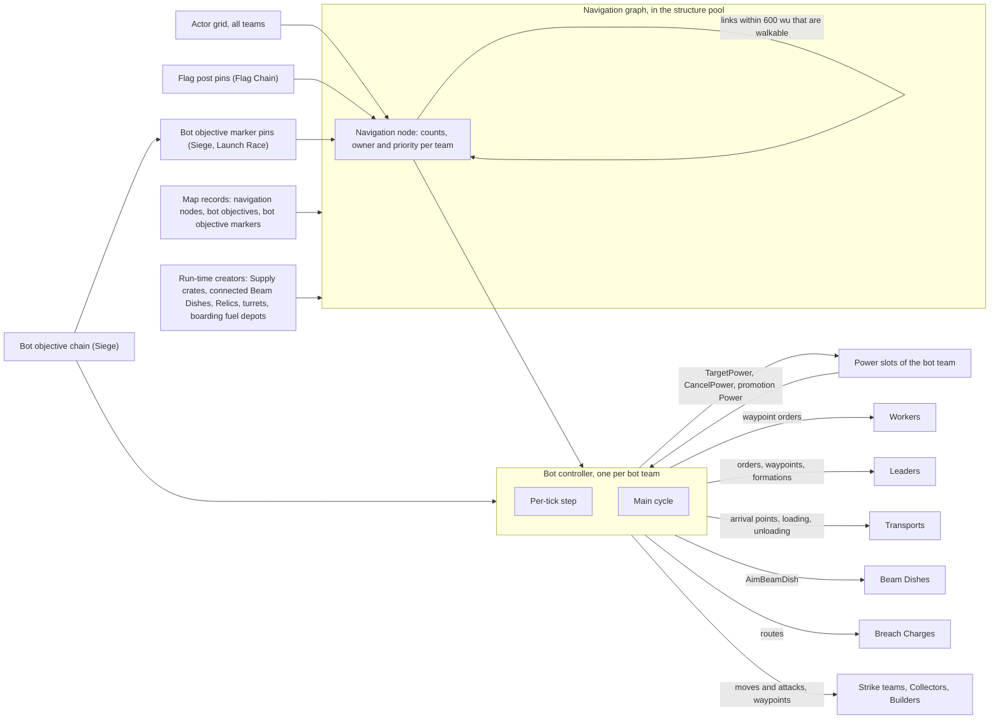
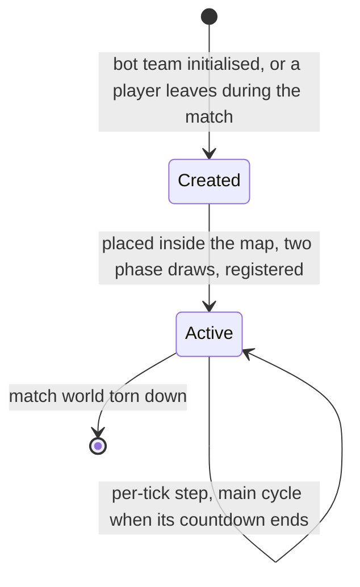

# Bots

> Status: Reference · Prefix: R-BOT · Related: [00 Reference overview](../00_reference_overview.md) · [01 Skirmish rules and modes](../01_skirmish_rules_and_modes/README.md) · [02 Units](../02_units/README.md) · [03 Buildings and world objects](../03_buildings_and_world_objects/README.md) · [04 Supply crates, powers and weapons](../04_supply_crates_powers_and_weapons/README.md) · [05 Population flow](../05_population_flow.md) · [06 Controls, camera and commands](../06_controls_camera_and_commands/README.md) · [12 Simulation model](../12_simulation_model/README.md)

This folder specifies the reference **Bot**, the computer player of a match: its architecture, its map of the world (the bot navigation graph), its priority fields, its decision loop and periods, its use of Leaders, Beam Dishes, Power slots and Supply crate rewards, its per-mode strategy and its difficulty levels. This README is the folder index; it also holds the architecture, the bot controller, the commands a bot issues, the information a bot reads and the difficulty table.

| Document | Content |
|---|---|
| [README.md](README.md) | the five mechanisms; the bot controller and its lifetime; bot actions and the player commands they use; the perfect-information register; advantages and weaknesses; difficulty |
| [01_navigation_graph.md](01_navigation_graph.md) | the bot navigation node and its link records; map-placed and runtime nodes; link construction and culling; zone tagging; rebuild triggers; head counts and ownership; the node predicates |
| [02_priority_model.md](02_priority_model.md) | the per-team priority of every node: the standard, Relic Run, diffusion and Launch Race formulas; the external pins of Flag posts and bot objective markers; numerical rules |
| [03_decision_loop_and_leaders.md](03_decision_loop_and_leaders.md) | every bot timer; the per-tick step and the stray recall; the main cycle; the well-defended rule, the send rule and dispatch; target selection; formation Leaders and conveyor Leaders; promotion; Beam Dish aiming |
| [04_powers_and_unit_policies.md](04_powers_and_unit_policies.md) | how a bot uses its Power slots and Supply crate rewards: the handler of every Power kind; the unit policies of Leaders, Transports, Strike teams, Collectors, Builders and Breach Charges |
| [05_mode_strategies_and_tutorials.md](05_mode_strategies_and_tutorials.md) | the Siege objective chain and its markers; the Launch Race markers; the Relic un-stick rule; the strategy of every mode; the tutorial rules |

## 1 Purpose and player experience

A bot plays a team slot exactly where a human would: it owns Spawn Nodes, Workers, Leaders and Power slots, and it wins and loses by the same rules. Every empty open slot of a match is a bot, a player who leaves is replaced by one, and the Rogue faction and the Visitor faction are bots in every match. Players meet bots as crowds that drain out of their territory along corridors towards the nearest contested or capturable objective, that stream fresh Workers from each Spawn Node through a Leader posted in front of it, that form defensive formations at threatened nodes, and that spend Supply crate rewards at once on the place where they hurt most.

The bot thinks in a sparse graph of navigation nodes that the map places, plus nodes that Supply crates, connected Beam Dishes, turrets, Relics and boarding fuel depots add at run time. Every node knows, for every team, how many friends, enemies and idle Workers stand near it and how much that team wants to be there. The bot moves its idle Workers from node to node along that field. Difficulty is tempo and randomness only: an easy bot re-thinks every 20 s and wanders at random over frozen priorities, a standard bot re-thinks every 10 s and picks a random neighbour half the time, a hard bot re-thinks every 1.1 s and always climbs the priority field. No bot has any economic, population, damage, speed or vision bonus, but every bot reads the whole match state: it has perfect information (§2.5).

### 1.1 Conventions used in this folder

- **Draws.** `NextUint`, `NextUnit(r)` and `NextSigned(r)` are the draw forms of the simulation generator `SimRng` ([reference/12](../12_simulation_model/07_randomness_and_integrity.md) R-SIM-605): an unsigned integer, a uniform value in [0, r) and a uniform value in [−r/2, r/2). Each draw is its own statement, made where the rule names it and in the order the rule lists (DEC-013, DEC-652). Bots never draw from a presentation generator.
- **Polar offset.** "polar(r, θ)" is the horizontal offset (r × sin θ, 0, r × cos θ). Where a rule writes "a polar offset of 20 + `NextUnit(20)`", it draws the radius first and then the angle θ = `NextUnit(2π)`.
- **Structure order** is the stable structure-index order of the structure pool; **result order** is the stable order of actor-grid results (cell x, cell z, team 0 to 5, cell slot; R-SIM-310). Every "first", "last" and strict "most" in a bot rule is taken in one of these orders, as each rule states (DEC-016).
- **Friend, enemy, hostile, neutral.** Friendship is the rule of [reference/12](../12_simulation_model/06_teams_and_player_commands.md) R-SIM-412 to R-SIM-414; no team is nobody's friend. A team is an **enemy** of team t when it is not a friend of t; an owner is **hostile** to t when it is an enemy of t and not no team; a structure or node is **neutral** when it has no team.
- **Idle Worker.** A Worker counts as idle for every bot rule when it is in the Idle behaviour state of [worker.md](../02_units/worker.md) table 2.4-A.
- **Perfect information.** A rule that reads state a human player of the same team could not see on screen is marked **Perfect information (PI-nn)**, with the entry of the register in §2.5.
- **Ticks.** Every bot period is an integer number of ticks of the world step (DEC-002). Game speed changes how many ticks run per real second, never a bot period (DEC-039, R-SIM-548). Seconds appear only as derived display values.

## 2 Rules

### 2.1 Baseline

**R-BOT-001** (MUST) The rules and values of this folder are the reference bot and the Species starting values (DEC-004). They are the specification of record (DEC-005); every reference behaviour that looks accidental and that no Resolved decision corrects is stated as an explicit rule with a named key (DEC-006).

**R-BOT-002** (MUST) Bots keep the node-graph design of DEC-022: navigation nodes linked within `ref.bot.link.range` (600 wu), owned by head count, with per-team priority fields; a dispatcher in which only friendly nodes release troops; conveyor Leaders and formation Leaders; one handler per Power kind; and one strategy per mode. Every correction of DEC-087 is applied, and every bot loop is bounded with a deterministic fallback (DEC-014). Each rule that a correction changes cites DEC-087.

**R-BOT-003** (MUST) A bot runs inside the simulation step of every participant that simulates, reads only simulation state, draws only from the simulation generator and sends nothing over the network (R-SIM-690, R-SIM-691). Where Species runs its bots is part of the replication and authority model, the Open DEC-200.

### 2.2 The five mechanisms

**R-BOT-004** (MUST) A bot decides through exactly these five cooperating mechanisms. They are specified by function; no module structure is prescribed, and the module structure of the Species implementation is the Open DEC-559.

Table 2.2-A The mechanisms of a bot.

| # | Mechanism | What it decides | Specified in |
|---|---|---|---|
| 1 | **Navigation graph**: map-placed and run-time navigation nodes, each with per-team head counts, an owner and a per-team priority that spreads along the links | where Workers should be | [01](01_navigation_graph.md), [02](02_priority_model.md) |
| 2 | **Dispatcher**: every main cycle, for each friendly node judged well defended, a linked destination node is chosen and idle Workers are sent there | the flow of the army along the graph | [03](03_decision_loop_and_leaders.md) |
| 3 | **Leaders**: conveyor Leaders that forward the output of Spawn Nodes, and formation Leaders that defend threatened nodes | throughput and defence | [03](03_decision_loop_and_leaders.md), [leader_and_formations.md](../02_units/leader_and_formations.md) |
| 4 | **Power handlers**: one handler per Power kind places every Power the team holds, whether from a Supply crate, the starting powers or the Comeback Bonus | when and where Powers are used | [04](04_powers_and_unit_policies.md) |
| 5 | **Mode logic**: the Siege objective chain, the Launch Race field list and Transport logistics, the Flag post pins, the Relic un-stick rule, Beam Dish aiming and the unit policies | the mode's objectives | [02](02_priority_model.md), [03](03_decision_loop_and_leaders.md), [04](04_powers_and_unit_policies.md), [05](05_mode_strategies_and_tutorials.md) |

**R-BOT-005** (MUST) The mechanisms connect as figure 3-1 shows: map records and run-time creators feed the navigation graph; the actor grid feeds its head counts; Flag posts and bot objective markers pin priorities in it; the bot controller reads the graph, the objective chain and its team's Power slots, and acts on Workers, Leaders, Transports, Strike teams, Collectors, Builders, Breach Charges, Beam Dishes and Power slots through the actions of §2.4.

### 2.3 The bot controller

**R-BOT-006** (MUST) A bot team is a team slot of kind `TeamKind::Bot` ([reference/12](../12_simulation_model/06_teams_and_player_commands.md) R-SIM-433) that owns exactly one **bot controller** (`BotController`): an invisible, immortal actor in its team's ungrouped actors. The bot controller holds the bot's state (table 2.3-A) and runs every bot rule of its team.

**R-BOT-007** (MUST) A bot controller is created when its team is initialised in the match world, for every team of kind `TeamKind::Bot`: every bot team that fills an empty slot, the Rogue faction (slot 4) and the Visitor faction (slot 5), which are bot teams in every match (R-SIM-394, DEC-558), and every team that a departing player hands to a bot (R-BOT-012). The Rogue faction and the Visitor faction run the full bot controller of this folder; whether they keep it is the Open DEC-558. The number of bot controllers in a match is therefore the number of bot teams in the lobby + 2 + the number of players who left; a human team never has one, so there is no autopilot for a human team. A map cannot place a bot controller.

**R-BOT-008** (MUST) The bot controller is placed inside the map, not at its corner (DEC-087): at match-world initialisation it is created at its team's start position for a player slot, and at the centre of the map, (world size x ÷ 2, terrain height, world size z ÷ 2), for the Rogue and Visitor factions and for a team whose slot has no start position. The placement makes no spawn-position search and no draw. The bot controller never moves, never runs the base actor advance and receives no world clamp (R-SIM-366); its only body effects are those of R-BOT-010.

**R-BOT-009** (MUST) In the initialisation step that creates the bot controller (DEC-652), its state takes the initial values of table 2.3-A, with exactly two draws in this order: the Beam Dish phase, `NextUnit(ref.bot.dish.phase_ticks)` (100 ticks; R-BOT-096), and then the main-cycle phase, `NextUnit` of `ref.bot.cycle.phase_easy` (200 ticks), `ref.bot.cycle.phase_standard` (100 ticks) or `ref.bot.cycle.phase_hard` (10 ticks) for the easy, standard or hard bot. A phase p becomes a first countdown of max(1, ⌈p⌉) ticks, so bots of the same difficulty think on different ticks. The controller registers itself in the per-match bot registry under its team slot, which every node, marker and Leader rule uses to find a team's bot.

Table 2.3-A State of a bot controller.

| Field | Initial value | Meaning |
|---|---|---|
| main-cycle countdown | the main-cycle phase (R-BOT-009) | ticks to the next main cycle ([03](03_decision_loop_and_leaders.md) R-BOT-075) |
| Beam Dish countdown | the Beam Dish phase (R-BOT-009) | ticks to the next Beam Dish decision, never below 0 ([03](03_decision_loop_and_leaders.md) R-BOT-096) |
| current objective | none | Siege: the bot objective this team works on ([05](05_mode_strategies_and_tutorials.md)) |
| Solar Array field list | empty | Launch Race: one entry per bot objective marker of the team (marker position, Solar Array count, the marker, its scan range), filled once ([05](05_mode_strategies_and_tutorials.md) R-BOT-138) |
| tutorial centre latch | false | first tutorial: set once its centre Control Zone has an owner ([05](05_mode_strategies_and_tutorials.md) R-BOT-151) |

**R-BOT-010** (MUST) A bot controller never dies: every health change is refused and its advance never requests its removal. It is not counted by the match's actor population counter (R-SIM table 2.5-A), but it is one of its team's ungrouped actors, so it counts towards its team's population (DEC-079, R-ECON-107). It stands in the actor grid at its position: node recounts count it like any actor (R-BOT-042), and enemy target searches may select it; the nearest-enemy query and the turret searches skip it, the Worker threat search and the creature searches do not, and the rule for all searches is the Open DEC-311.

**R-BOT-011** (MUST) Match-world initialisation clears the bot registry entry of every team slot 0 to 5, the bot-objectives-initialised flag and the Transport objective list, and match-world teardown resets the same state ([reference/12](../12_simulation_model/02_match_lifecycle_and_state_reset.md) R-SIM-016 step 3, R-SIM-232; DEC-011). A bot controller's Solar Array field list is destroyed with it.

**R-BOT-012** (MUST) When a human leaves during a match, every participant, at the same tick, changes that team to `TeamKind::Bot`, creates a bot controller for it by R-BOT-008 and R-BOT-009, records the bot takeover time and emits `match.player_left` (DEC-035, R-SIM-436, R-MODE-069). The new bot inherits the team's Workers, Leaders, Transports, Strike teams, Collectors, Builders and Powers as they stand, and runs every rule of this folder on them from that tick. A player who leaves in the lobby frees the slot instead. A team initialised after the match world has initialised its teams receives its bot controller in the same way.

**R-BOT-013** (MAY) The map editor may draw each bot controller as a sphere of radius `ref.bot.controller.editor_marker_radius` (20 wu) at height `ref.bot.controller.editor_marker_height` (400 wu) in its team colour, labelled with the head counts of teams 0 and 1 at that point. Outside the map editor a bot controller is never drawn and has no colour, sound or controls.

### 2.4 Bot actions and the player commands they use

**R-BOT-014** (MUST) A bot changes the match only through the actions of table 2.4-A. A bot is an authorised command source of its own team (DEC-119): an action that the player command catalogue expresses is that command, issued by the bot for its team, and it executes at once, inside the bot's own step, through the command's operation and with the command's validation and no-op rules ([reference/12](../12_simulation_model/06_teams_and_player_commands.md) R-SIM-435, R-SIM-449 to R-SIM-457). A bot command never enters the command batch of a tick and is never sent over the network (DEC-200). Executing a bot action never issues a further command (R-SIM-454).

**R-BOT-015** (MUST) The actions marked "bot-only" in table 2.4-A have no player command. They apply the named simulation operation of the owning document directly to the named object, inside the bot's step, and check that the object still exists and belongs to the bot's team; an action whose object fails the check does nothing. Whether Species keeps these operations bot-only, adds them to the command catalogue or removes them is a design-phase decision (§8).

Table 2.4-A Bot actions.

| Action | Command or operation | Used by |
|---|---|---|
| start a promotion Power in a free Power slot | bot-only: the promotion Power of [04](04_powers_and_unit_policies.md) R-BOT-107 | formation and conveyor Leaders ([03](03_decision_loop_and_leaders.md)) |
| target a Power at a ground point | `PlayerCommand::TargetPower(team, Power id, position)` | every Power handler; promotion |
| stop a Power | `PlayerCommand::CancelPower(team, Power id)` | the Siege attacker's turret Powers ([04](04_powers_and_unit_policies.md)) |
| aim a Beam Dish | `PlayerCommand::AimBeamDish(team, structure, position)` | Beam Dish aiming ([03](03_decision_loop_and_leaders.md)) |
| give one Worker a waypoint order | bot-only: the waypoint order of [worker.md](../02_units/worker.md) R-UNIT-111, for that Worker | dispatch, stray recall, the Relic un-stick rule |
| give a Leader orders, a waypoint or a formation; set its no-formations flag or bot target front | bot-only: `AssignOrders`, `AssignWaypoint` and `FormUp` of [leader_and_formations.md](../02_units/leader_and_formations.md), and the Leader's bot fields | conveyor Leaders; the Leader policy (R-UNIT-188) |
| set a Transport's arrival point, loading or unloading state, or self-destruct target | bot-only: the Transport bot behaviour of [transport.md](../02_units/transport.md) R-UNIT-402 to R-UNIT-407 | the Transport policy |
| move a Strike team or make it attack | bot-only: the Strike team bot behaviour of [strike_team.md](../02_units/strike_team.md) R-UNIT-359 to R-UNIT-361 | the Strike team policy |
| set a Collector's or a Builder's waypoint | bot-only: [collector.md](../02_units/collector.md) R-UNIT-442, [builder.md](../02_units/builder.md) R-UNIT-464 | the Collector and Builder policies |
| route a Breach Charge | bot-only: [mode_objects.md](../03_buildings_and_world_objects/mode_objects.md) R-BLDG-294 | Siege attackers |
| write node priorities and pins, objective activity and the bot's own state | internal bot state, no command | the priority model and the objective chain |

**R-BOT-016** (MUST) A bot team never sends a team command state (R-SIM-438), so direct control of a selected Strike team, Transport or turret never acts for a bot team. Its selection changes only as a side effect of the operations it uses (a promotion selects the new Leader, R-UNIT-153; a placed unit Power selects its unit; a Leader order or a Worker Power placement clears the selection), and no bot rule reads it: a bot's promotion never waits for its team's selection to clear (DEC-087).

### 2.5 What a bot reads: perfect information

**R-BOT-017** (MUST) A bot reads the whole simulation state and has no fog of war, no sensing radius other than the query radii its rules name, and no reaction delay other than its decision periods. Every read of state that a human player of the same team could not see on screen is a **perfect-information read**, listed in table 2.5-A and marked in the rule that makes it. This is the reference behaviour; how Species bots sense the world is a design-phase decision (DEC-022).

Table 2.5-A Perfect-information register.

| Id | What the bot reads | Scope | Rules that read it |
|---|---|---|---|
| PI-01 | the friend, enemy and idle-Worker counts of every team at every navigation node, from exact actor-grid queries of all teams | map-wide, every 20 ticks | node ownership and priorities ([01](01_navigation_graph.md) R-BOT-042, [02](02_priority_model.md)); the well-defended and send rules ([03](03_decision_loop_and_leaders.md)); Leader and Power decisions ([03](03_decision_loop_and_leaders.md), [04](04_powers_and_unit_policies.md)) |
| PI-02 | the owner and the per-team priority of every node, including nodes inside enemy territory | map-wide | target selection, Beam Dish aiming, the Strike team policy |
| PI-03 | every structure of every team, with its kind, team, position and state, by linear scans in structure order: Spawn Nodes, turrets, mode zones, Supply crates, Beam Dishes and their orientation and connection, Transit Gates, Launch Vessels, walls, Barrier Emitters and their switch state | map-wide | the importance test ([01](01_navigation_graph.md) R-BOT-049), link use, target selection, the Power handlers, Beam Dish aiming |
| PI-04 | actor-grid counts and presence tests around points that the bot chooses anywhere on the map, for any team | map-wide | the meteor shower test, the Worker-Power fight test ([04](04_powers_and_unit_policies.md)); the Siege defender's engagement test ([05](05_mode_strategies_and_tutorials.md)) |
| PI-05 | actor-grid queries around the bot's own units | within the named radius of the unit | the formation-Leader threat scan (R-UNIT-188, 270 wu); the Strike team scan (R-UNIT-360, 500 wu); the Transport counts (R-UNIT-403) |
| PI-06 | the mode state of other teams: the Flag Chain status and elimination of every team, the team and lifter count of every Relic, the occupants of every Control Zone, the fuel and state of every Launch Vessel | map-wide | the Flag post pins ([02](02_priority_model.md)); the Relic Run and Zone Control priorities; the Launch Race Transport drop choice (R-UNIT-407) |
| PI-07 | the position of every Essence orb of every team, in any state | map-wide | the Collector and Builder policies (R-UNIT-442, R-UNIT-464) |
| PI-08 | the Solar Array count and the friend and enemy counts at every Launch Race field of the team | map-wide | the Launch Race field list ([05](05_mode_strategies_and_tutorials.md)); the Transport drop choice (R-UNIT-407) |
| PI-09 | the enemy count of nearby navigation nodes, read by the threat search of every Worker of every team, human teams included | the node range around the Worker | [worker.md](../02_units/worker.md) R-UNIT-098 step 6; [01](01_navigation_graph.md) R-BOT-045 |

**R-BOT-018** (MUST) The attacking and defending sides of a Siege map, the map's records and the match options are match-setup information that every participant holds; reading them is not a perfect-information read.

### 2.6 Advantages and weaknesses

**R-BOT-019** (MUST) A bot has no resource, population, damage, speed or vision bonus at any difficulty. The only simulation rules that treat a bot team differently from a human team are: the creation of its bot controller (R-BOT-007); the takeover of a departing player's team (R-BOT-012); the Hive, which acts only while its team is a bot team ([defences_and_props.md](../03_buildings_and_world_objects/defences_and_props.md) R-BLDG-510; the Rogue faction always is one); the placed-unit Powers, whose actor groups are marked as under player control only for a team that is not a bot team ([reference/04](../04_supply_crates_powers_and_weapons/crates_and_powers.md)); the bot label in team names (R-SIM-406); the ready display, which never waits for a bot (R-MODE-039); and achievement gating ([reference/09](../09_front_end_and_match_flow/options_localisation_and_hooks.md)).

**R-BOT-020** (MUST) A bot has these structural advantages over a human, and no other:

1. **Perfect information**: the reads of table 2.5-A.
2. **Unlimited command rate**: any number of Workers are re-ordered in one main cycle, Leaders are promoted without input, and Powers are targeted anywhere the target rule allows, at once.
3. **Per-Worker orders**: individual Workers receive waypoint orders, where a human orders the selected crowd or uses Leaders.
4. **Transport self-destruct**: a bot Transport can drive into an enemy Spawn Node and destroy itself there ([transport.md](../02_units/transport.md) R-UNIT-404), which no player command can do.
5. **Transport unloading control**: a bot sets a Transport's arrival point and its loading and unloading directly, without the player's toggle and deploy actions.

The bot controller is not a free unit: it counts towards its team's population (R-BOT-010).

**R-BOT-021** (MUST) A bot has these structural weaknesses, which are part of its reference strength: an easy bot's priorities never change outside Siege (R-BOT-059); a bot keeps no memory of past fights; its Workers move in straight lines between nodes (DEC-557); and a Power handler that finds no target keeps its Power, and its Power slot, until a later cycle finds one ([04](04_powers_and_unit_policies.md) R-BOT-106), which can hold a slot for long periods (the Essence Grove without a Collector, the meteor shower without a losing enemy position).

### 2.7 Difficulty

**R-BOT-022** (MUST) One bot difficulty applies to every bot team of a match, the Rogue and Visitor factions included: `BotDifficulty::Easy`, `BotDifficulty::Standard` or `BotDifficulty::Hard` (R-MODE-030). The bot-difficulty option accepts only these three values (DEC-077), so no rule meets any other value. A match starts with the option's default, Standard; a tutorial starts with Easy, and the second tutorial's last step sets Standard ([reference/11](../11_tutorial_and_help.md)).

**R-BOT-023** (MUST) Difficulty changes tempo and randomness only (DEC-022). Its parameters are exactly those of table 2.7-A; every other bot rule and threshold is the same at every difficulty.

Table 2.7-A Difficulty parameters.

| Parameter | Easy | Standard | Hard | Rule |
|---|---|---|---|---|
| first main-cycle phase | `NextUnit(200)` ticks | `NextUnit(100)` ticks | `NextUnit(10)` ticks | R-BOT-009 |
| main-cycle period | `ref.bot.cycle.period_easy` (200 ticks, 20 s) | `ref.bot.cycle.period_standard` (101 ticks, 10.1 s) | `ref.bot.cycle.period_hard` (11 ticks, 1.1 s) | R-BOT-075 |
| main-cycle period in Siege | `ref.bot.cycle.period_siege` (30 ticks, 3 s) | `ref.bot.cycle.period_siege` (30 ticks) | `ref.bot.cycle.period_hard` (11 ticks) | R-BOT-075 |
| node priorities recomputed | only in Siege; frozen in every other mode | yes | yes | R-BOT-059 |
| target selection | always a random linked node | a random linked node when `NextUnit(1)` < `ref.bot.select.standard_random_chance` (0.5), else the best | always the best | R-BOT-087 |
| target selection in Siege and Launch Race | the best | the best | the best | R-BOT-087 |
| hold a node while any enemy is in range | no: only the ratio test | yes, except in Siege | yes, except in Siege | R-BOT-079 |
| keep a garrison in a tagged zone node | no | yes | yes | R-BOT-084 |
| Flag post pins | 1.0 at every Flag post | by the team's Flag Chain status | by the team's Flag Chain status | R-BOT-069 |
| Flag Chain turret count at the Home post | `ref.bot.power.flag_turrets_easy` (1) | `ref.bot.power.flag_turrets` (2) | `ref.bot.power.flag_turrets` (2) | R-BOT-117 |
| Launch Race turret placement | the standard placement | the Launch Vessel ring | the Launch Vessel ring | R-BOT-116 |
| Transport think period, Spawn Control, Zone Control, Relic Run, Flag Chain and Launch Race | 200 ticks | 101 ticks | 11 ticks | R-UNIT-402 |
| Transport think period, Siege | 101 ticks | 51 ticks | 11 ticks | R-UNIT-402 |
| Flag Chain Transport defends the Home post links when under threat | always | with a 50 % draw | never | R-UNIT-406 |
| Flag Chain Transport drop point | the Flag post's centre | the turret rush point | the turret rush point | R-UNIT-406 |
| Launch Race Transport drop offset | the exact point | the 100 wu ring | the 100 wu ring | R-UNIT-407 |
| tutorial movement filters | yes (tutorials run easy bots) | — | — | [05](05_mode_strategies_and_tutorials.md) R-BOT-151 |

**R-BOT-024** (MUST) The difficulty-independent rules include the stray recall, the well-defended thresholds, the send-chance formula, the formation-Leader thresholds, the conveyor Leaders, every Power handler except the two turret rows of table 2.7-A, Beam Dish aiming, the Strike team, Collector, Builder, Leader and Breach Charge policies, the Siege objective logic and every spawn, population and combat rule of the match. Bot strength at each difficulty, after the corrections of DEC-087, is calibrated by playtest in every mode, Siege attack and Siege defence included; the parameters above are the reference starting point of the Open DEC-112.

## 3 States and flows

Caption: Figure 3-1, the components of a bot and what it acts on (R-BOT-004, R-BOT-005, table 2.4-A).

Caption: Figure 3-2, the lifetime of a bot controller; it is never killed (R-BOT-007 to R-BOT-012).

## 4 Tuning table

| key | value | unit | range or notes | requirement | DEC |
|---|---|---|---|---|---|
| `ref.bot.cycle.period_easy` | 200 | ticks | 20 s; easy bot main cycle outside Siege | R-BOT-075, table 2.7-A | DEC-022, DEC-002 |
| `ref.bot.cycle.period_standard` | 101 | ticks | 10.1 s; standard bot main cycle outside Siege | R-BOT-075, table 2.7-A | DEC-022, DEC-002 |
| `ref.bot.cycle.period_hard` | 11 | ticks | 1.1 s; hard bot main cycle in every mode | R-BOT-075, table 2.7-A | DEC-022, DEC-002 |
| `ref.bot.cycle.period_siege` | 30 | ticks | 3 s; easy and standard bot main cycle in Siege | R-BOT-075, table 2.7-A | DEC-022, DEC-112 |
| `ref.bot.cycle.phase_easy` | 200 | ticks | first countdown max(1, ⌈`NextUnit(200)`⌉) | R-BOT-009 | DEC-652 |
| `ref.bot.cycle.phase_standard` | 100 | ticks | first countdown max(1, ⌈`NextUnit(100)`⌉) | R-BOT-009 | DEC-652 |
| `ref.bot.cycle.phase_hard` | 10 | ticks | first countdown max(1, ⌈`NextUnit(10)`⌉) | R-BOT-009 | DEC-652 |
| `ref.bot.controller.editor_marker_radius` | 20 | wu | map-editor drawing only | R-BOT-013 | — |
| `ref.bot.controller.editor_marker_height` | 400 | wu | map-editor drawing only | R-BOT-013 | — |

Keys cited here and defined elsewhere in this folder: `ref.bot.link.range` ([01](01_navigation_graph.md)); `ref.bot.dish.phase_ticks`, `ref.bot.select.standard_random_chance` ([03](03_decision_loop_and_leaders.md)); `ref.bot.power.flag_turrets_easy`, `ref.bot.power.flag_turrets` ([04](04_powers_and_unit_policies.md)). The Transport think periods are `ref.unit.transport.bot_think_*` of [transport.md](../02_units/transport.md). The reference request point of the bot controller, (−100, 0, −100), is `ref.sim.bot.controller_spawn_request` of [reference/12](../12_simulation_model/06_teams_and_player_commands.md); Species does not use it (R-BOT-008).

## 5 Edge cases and interactions

1. **The bot controller in head counts.** The bot controller is an actor in the actor grid, so the recount of a navigation node within the node's range of it counts one friend of its team (R-BOT-042). At its team's start position this adds one body to the team's own base node.
2. **An unkillable target.** Because the Worker threat search does not exclude a bot controller, enemy Workers near it can lock on to a target they cannot kill; turrets and the nearest-enemy query skip it (R-BOT-010, DEC-311).
3. **Several departures.** Each departing player's team receives its own bot controller; a team that is already a bot team never receives a second one (R-BOT-012).
4. **Rogue and Visitor bots.** The two factions run the full bot, including dispatch, Leaders and Power handlers; they never win and never block an elimination win (DEC-082). Their Workers are dispatched like any bot team's (R-BOT-007).
5. **One difficulty for all.** A tutorial's easy bot also makes the Rogue faction and the Visitor faction easy bots; the second tutorial's switch to Standard changes them too (R-BOT-022).
6. **Selection side effects.** A bot team's selection can name a unit or a Leader at any time, but nothing reads it: Power-slot keys and direct control belong to a human participant, and no participant owns a bot team (R-BOT-016).
7. **Bot commands and validation.** A bot's `TargetPower` at an invalid point is refused like a player's, and the Power stays Waiting (R-CRATE-025); a bot's `AimBeamDish` at a dish that is no longer its team's does nothing (R-SIM-453).
8. **The corrections of DEC-087 in this folder.** Each is stated as the rule: the current Power and the right object ids are used (R-BOT-090, R-BOT-118; the Leader's advance target, R-UNIT-188); no priority or send chance is ever NaN (R-BOT-071, R-BOT-083); promotion never waits for the team's selection (R-BOT-016, R-BOT-095); a promotion Power that promotes nobody ends at once (R-BOT-107); the initial navigation graph sees walls and Barrier Emitters (R-BOT-032); emitter crossings are stored whatever the emitter's state (R-BOT-031); a turret goes to the most threatened frontier node (R-BOT-114) and rings the whole Launch Vessel (R-BOT-116); the Worker-Power point divides by the Worker count (R-BOT-122); the Relic un-stick centre divides by the carryable count (R-BOT-140); a random pick of a sea node is drawn again (R-BOT-088); the stray recall follows the live actor count (R-BOT-076); the Siege Transport objectives are listed once markers register (R-BOT-127); defending formations face the threat (R-BOT-092, R-UNIT-188); a Siege defence marker is bound by map validation (R-BOT-135, DEC-561); a marker with no map team has no default team (table 2.1-B of [05](05_mode_strategies_and_tutorials.md)); the bot controller stands inside the map (R-BOT-008); and every bot loop is bounded (R-BOT-088, R-BOT-089, R-BOT-105, R-BOT-117, R-UNIT-407; DEC-014). The Missile Barrage's sea search is bounded by its owner, [reference/04](../04_supply_crates_powers_and_weapons/crates_and_powers.md) (DEC-014).

## 6 Acceptance criteria

**AC-BOT-01 — Bot controllers per match** (R-BOT-007, R-BOT-012). Given a 4-player map with two humans, when the match starts, then exactly four bot controllers exist (two bot teams, the Rogue faction and the Visitor faction); when one human leaves at tick n, then a fifth bot controller exists from tick n and the team's kind is `TeamKind::Bot` on every participant.

**AC-BOT-02 — Placement** (R-BOT-008). Given any map, when bot controllers are created, then each player-slot bot controller stands at its team's start position, the Rogue and Visitor controllers stand at the map centre, and no simulation draw is made for their placement.

**AC-BOT-03 — Phases** (R-BOT-009). Given 1,000 seeds and a standard bot, then the tick of its first main cycle is uniformly distributed over ticks 1 to 100 (± 10 % per decile), and its first Beam Dish decision over ticks 1 to 100.

**AC-BOT-04 — Immortality and population** (R-BOT-010). Given a bot controller inside an explosion of any damage, then it takes no damage; given a team at its population cap, then its bot controller is one of the counted bodies.

**AC-BOT-05 — Commands** (R-BOT-014, R-BOT-015). Given a bot team in a soak match, when every bot action of 10,000 ticks is logged, then every action is one of table 2.4-A; every Power targeting passed the target rule of R-CRATE-025; and no command batch contains a command that a participant's input layer did not send (AC-SIM-06-18).

**AC-BOT-06 — No bonus** (R-BOT-019, R-BOT-023). Given two identical teams, one human and one bot, at every difficulty, then their Workers' stats, spawn rates, population caps and damage are identical.

**AC-BOT-07 — Difficulty values** (R-BOT-022, DEC-077). Given a bot-difficulty option value of 3 in a match-setup command, then it is rejected and the difficulty is unchanged.

## 7 Dependencies

- **Reference documents:** [01 Skirmish rules and modes](../01_skirmish_rules_and_modes/README.md) (slots, the difficulty option, elimination, departures) and every mode file; [02 Units](../02_units/README.md), [worker.md](../02_units/worker.md), [leader_and_formations.md](../02_units/leader_and_formations.md), [transport.md](../02_units/transport.md), [strike_team.md](../02_units/strike_team.md), [collector.md](../02_units/collector.md), [builder.md](../02_units/builder.md); [03 Buildings and world objects](../03_buildings_and_world_objects/README.md), [economy_and_spawn_objects.md](../03_buildings_and_world_objects/economy_and_spawn_objects.md), [mode_objects.md](../03_buildings_and_world_objects/mode_objects.md), [defences_and_props.md](../03_buildings_and_world_objects/defences_and_props.md); [04 Supply crates, powers and weapons](../04_supply_crates_powers_and_weapons/README.md); [05 Population flow](../05_population_flow.md) (population cap, starting powers, Comeback Bonus); [11 Tutorial and help](../11_tutorial_and_help.md); [12 Simulation model](../12_simulation_model/README.md), in particular [04](../12_simulation_model/04_containers_and_update_order.md) (update order, R-SIM-224), [05](../12_simulation_model/05_space_routing_and_physics.md) (actor-grid queries, walkability), [06](../12_simulation_model/06_teams_and_player_commands.md) (bots as team slots, the command catalogue) and [07](../12_simulation_model/07_randomness_and_integrity.md) (bots and integrity).
- **Engine components:** none beyond the simulation model; the bot overlays are developer tools of [diagnostics, test and performance](../../architecture/components/diagnostics_test_and_performance.md).
- **Assets:** none. A bot has no mesh, sound or user-interface asset of its own.

## 8 Open decisions

| Decision | Title | Default stated in this folder |
|---|---|---|
| DEC-094 | Exact or approximate actor-grid queries | bot counts use the cell-granular counts ([02](02_priority_model.md), [04](04_powers_and_unit_policies.md), [05](05_mode_strategies_and_tutorials.md)) |
| DEC-112 | Bot strength calibration | the difficulty parameters of table 2.7-A, after the DEC-087 corrections (R-BOT-024) |
| DEC-200 | Replication and authority model | bots run inside the simulation step and send nothing over the network (R-BOT-003, R-BOT-014) |
| DEC-311 | Bot controller as a target | only the nearest-enemy query and the turret searches skip it (R-BOT-010) |
| DEC-312 | Bot decisions and node recounts within a tick | the order that their slots give ([03](03_decision_loop_and_leaders.md) R-BOT-073) |
| DEC-557 | Bot troop movement between navigation nodes | straight lines along links ([03](03_decision_loop_and_leaders.md) R-BOT-086) |
| DEC-558 | Bot controller of the Rogue and Visitor factions | the full bot controller (R-BOT-007) |
| DEC-559 | Bot module structure | specified by function, no module structure (R-BOT-004) |

The design phase also decides how bots sense the world (fog of war; the register of table 2.5-A), whether the bot-only actions of table 2.4-A stay bot-only (R-BOT-015), and per-bot difficulty (DEC-022).
