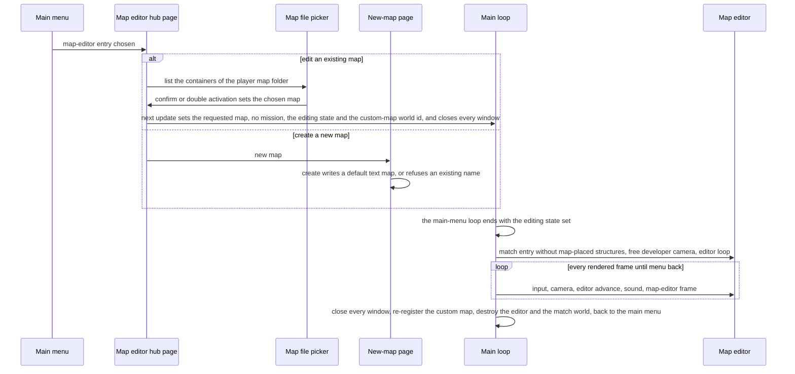
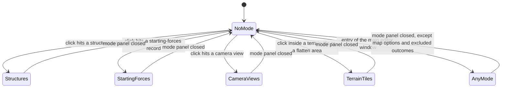
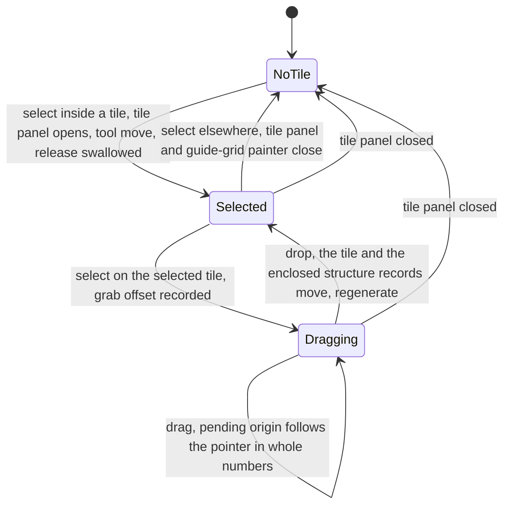
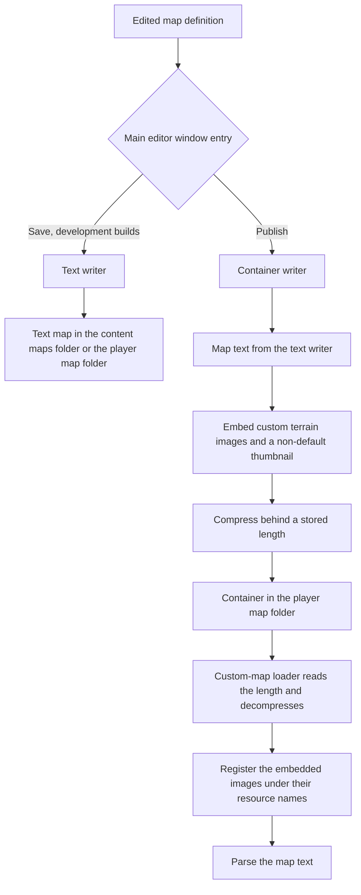

# Map editor hooks

> Status: Reference · Prefix: R-MAP · Related: [README](README.md) · [rules and conventions](rules_and_conventions.md) · [03 Buildings and world objects](../03_buildings_and_world_objects/README.md) · [04 Supply crates, powers and weapons](../04_supply_crates_powers_and_weapons/README.md) · [05 Population flow](../05_population_flow.md) · [07 Bots](../07_bots/README.md) · [12 Simulation model](../12_simulation_model/README.md) · [terrain](../../architecture/components/terrain.md) · [data schemas](../../architecture/components/data_schemas.md)

## 1 Purpose and player experience

The map editor (`MapEditor`) is the authoring tool of map definitions. The reference game has one: an in-game tool that opens a map definition inside the game program, shows it with the match's terrain, structures, camera and renderer while the simulation stands still, lets an author change every capability of a map except routes, camera animations and primary objectives, and writes the result back as a map file. No player of the reference can reach it. A player therefore never meets the editor: no player can create, edit, list, host or share a custom map, and every match uses a listed map of a content set.

The verdict on the editor is that it is designed fresh (DEC-045): the Species design phase decides whether Species has a map editor and what it is like. This document does not design it. It records the editor's **hooks**, the requirements input for that design: the map data the editor reads and writes; its entry and exit flow; its editing modes and the operations each mode offers on terrain, lights, structures and their links, trees, starting forces, routes, camera views, map options and excluded outcomes; what it draws; the save round trip and the custom-map container; the validation a map tool applies when it saves; and the defects and gaps of the reference editor. The map data itself (the map definition, its blocks, fields, defaults and limits, and the `ref.map.*` keys that hold them) is specified in [rules and conventions](rules_and_conventions.md), which this document cites and never redefines. The terrain generator that the editor runs is specified in [terrain](../../architecture/components/terrain.md).

### 1.1 Conventions used in this document

- **Map data.** The terms map definition, map header, match options, terrain definition, terrain tile, terrain flatten area, guide grid, map light, structure record, start position, camera view, camera animation, starting-forces record, route, map option, map effect and excluded outcomes are those of [rules and conventions](rules_and_conventions.md) §2.4 to §2.14. Structure kinds and their record fields are those of [reference/03](../03_buildings_and_world_objects/README.md); actor kinds are those of [reference/02](../02_units/README.md).
- **The reference editor** is the editor that the reference describes. **A map tool** is any Species program that writes map definitions: a map editor, or a step of the content build. A requirement on a map tool applies under either option of DEC-045.
- **Units.** Distances are in wu. The editor runs no simulation, so its operations are counted per rendered frame, per press of a control or per pixel of pointer movement, never in ticks. A map field in ticks or in mode seconds keeps the unit of its owning document; camera-animation durations are seconds of the presentation clock (DEC-024), as in rules and conventions §1.1. Screen sizes are in pixels (px).
- **Map values.** Every per-map value that a map tool writes takes one of the forms of DEC-120: absent, 0 or a number, and for a limit also unlimited (rules and conventions R-MAP-006).
- **Input ranges.** "Range a to b, step s" is the reference editor's input range of a field and the change per press of the field's increment or decrement control. An input range is a property of the reference editor; the limits that the content build enforces are those of the field's owning document (§5 lists where the two differ).
- **Panels.** The editor's windows are named here by their role: the main editor window, the mode panels (the terrain panel, the lights panel, the structure palette, the starting-forces palette, the camera-view panel, the map-options panel and the excluded-outcomes panel), the selection panels (the tile panel, the flatten-area panel, the structure panel and the record panel), the tree panel, the guide-grid painter and the two camera-animation panels: 16 panels in all. The map-editor hub page, the new-map page, the pickers and the colour editor come in addition.
- **Text.** Author-facing text is new text under the string ids of §2.17.

## 2 Rules

### 2.1 Scope, reachability and verdict

**R-MAP-300** (MUST) The values of the tuning table of this document are the reference tuning baseline (DEC-004), and this document is the specification of record for the map editor's hooks (DEC-005). A reference behaviour that looks accidental and that no Resolved decision corrects is stated as an explicit rule (DEC-006).

**R-MAP-301** (MUST) The reference has no reachable map editor. In every player build: the main menu offers no map-editor entry; no key binding and no developer menu opens the editor; a request to enter the editor loads the requested map for play instead; match setup lists no custom map; and no participant advertises or requests a custom map. A player build can load a custom map only when it is given that map's id, which no player-facing screen does. The editor's own panels are absent from player builds; the excluded-outcomes panel, the map-editor hub page and the map file picker are present but never opened. This is the reference default of DEC-045.

**R-MAP-302** (MUST) The map editor is designed fresh in the design phase (DEC-045). The requirements of this document are the hooks that such a design adopts, adapts or drops: they state what the reference editor reads, writes and offers, never how a Species editor presents it. In the reference the editor is part of the game program and exists only in builds made with it; which Species product carries a map editor, if any, is part of DEC-045 ([ADR-0056](../../adr/0056-editions-build-flavours-and-feature-flags.md) names a `tools` product beside the client and the server).

**R-MAP-303** (MUST) The reference editor authors every block of a map definition (rules and conventions table 2.4-A) except three: routes, for which it has no operation (§2.9); camera animations, whose authoring panels are never opened (§2.10, DEC-803); and primary objectives, which it neither edits nor writes (R-MAP-033). It authors the content of the start-position records (DEC-560) through two other operations: the Siege side and the co-op group in the map-options panel (§2.11), and the start camera view through the reserved camera-view names (§2.10).

### 2.2 Entry and exit

**R-MAP-305** (MUST) The editor is entered from the main menu's map-editor entry, labelled `ui.power_slots.map_editor` ([reference/06](../06_controls_camera_and_commands/selection_and_power_slots.md)), which opens the **map-editor hub page** (`MapEditorHubPage`): a full-screen page with two paths, edit an existing map (`ui.map_editor.edit_map`) and create a new map (`ui.map_editor.new_map`). Figure 3.1 shows the flow. The hub page also holds the state of a test game (a mode, a research level of `ref.sim.init.power_level_default` (3, [reference/12](../12_simulation_model/02_match_lifecycle_and_state_reset.md)) for every power and research item, and the mode's parameter values), but it creates no control that starts one, so the reference has no play test from the editor (table 2.16-A item 14).

**R-MAP-306** (MUST) **Edit an existing map.** The map file picker (`MapFilePicker`) lists the custom-map containers in the player's map folder (§2.14). Confirming a file, or activating it twice, makes it the chosen map. On its next update the hub page starts the editor when the chosen map is not the placeholder that names no map and a reader for that name exists in the content set's maps folder or in the player's map folder. The existence test succeeds for every name, so any name other than the placeholder starts the editor. Starting sets the requested map, clears the campaign mission (DEC-052), sets the editing state and the custom-map world id (R-MAP-394), and closes every window. Development builds offer a second picker, which lists the match maps of the content set's maps folder so that content-set maps can be edited.

**R-MAP-307** (MUST) **Create a new map.** The new-map page has one file-name field, which starts with a default name, and a create operation. Create makes the player's map folder when it does not exist, refuses a name that already exists there with `ui.map_editor.map_exists`, and otherwise writes a default map definition with the text writer (§2.13) and confirms with `ui.map_editor.map_created`. The default map stores its file name in lower case as its name and names no campaign mission. It holds the default match options (rules and conventions table 2.6-A) and a terrain definition whose world size is `ref.map.terrain.world_size_default` (2,000 wu) on both axes (rules and conventions table 2.8-A), and no terrain tile, flatten area, map light, structure, camera view or starting-forces record; the light writer writes no light because no match world exists while the new map is written (R-MAP-386).

**R-MAP-308** (MUST) A new map cannot be opened from the hub page: the new-map path writes a plain-text map definition, the edit path lists only custom-map containers, and a plain-text map stored under the container's file extension fails to load (R-MAP-393). A new map becomes editable only if its name reaches the hub page by another path, which no screen provides; the workflow that the reference supports is to edit a container and publish it (R-MAP-392). In a map tool, a map file that does not parse is reported with a diagnostic and is never fatal (DEC-015, DEC-045).

**R-MAP-309** (MUST) **Editor session.** Entering the editor runs match entry with the editing state set ([reference/12](../12_simulation_model/02_match_lifecycle_and_state_reset.md) table 2.3-A): the match world is initialised from the map definition without step 7 of table 2.4-A, so no map-placed structure is created and no grid, route graph or bot navigation link exists (R-SIM-302); the camera runs in a free developer mode, which is not specified (DEC-024); and the editor loop replaces the match loop. Each rendered frame the editor loop reads input, advances the camera, advances the editor (R-MAP-321), updates sound and renders the map-editor frame, in which the editor's drawing follows the match frame ([renderer](../../architecture/components/renderer/frame_graph_and_passes.md) RND-078). The editor loop never advances the simulation: the world is static while editing.

**R-MAP-310** (MUST) In the editor a look-up of a structure by its structure id resolves against the structure records of the map definition, so every structure edit acts on the records that the writers write (§2.13). The editor draws those records itself (R-MAP-380); they are never simulated.

**R-MAP-311** (MUST) **Exit.** The menu-back action ends the editor loop at once. Leaving closes every window, re-registers the edited custom map in the map catalogue by removing it and adding it again, so that its header is read anew (rules and conventions R-MAP-015), destroys the editor and the match world, and returns to the main menu. Leaving never asks to save: the editor tracks no unsaved change, and it has no undo (table 2.16-A item 14).

### 2.3 Modes, selection and tools

**R-MAP-315** (MUST) The editor is in one of nine **editing modes** at a time, those of table 2.3-A. The order of the table is the order of the mode list of the main editor window; Species defines its own enumerator values, and only this order is specified.

Table 2.3-A Editing modes.

| # | Mode | Panel the mode opens | Viewport operation | Rules |
|---|---|---|---|---|
| — | none | none | a click enters a mode (R-MAP-318) | §2.3 |
| 1 | terrain tiles | terrain panel | select and drag terrain tiles | §2.4 |
| 2 | flatten areas | terrain panel | select and drag flatten areas | §2.4 |
| 3 | lights | lights panel | rotate the selected map light | §2.5 |
| 4 | structures | structure palette | select, move, rotate and link structure records | §2.6, §2.7 |
| 5 | starting forces | starting-forces palette | select and move starting-forces records | §2.8 |
| 6 | camera views | camera-view panel | add a camera view to a camera animation (unreachable, R-MAP-373) | §2.10 |
| 7 | map options | map-options panel | none | §2.11 |
| 8 | excluded outcomes | excluded-outcomes panel | none | §2.11 |

**R-MAP-316** (MUST) The **main editor window** (`MapEditorWindow`) is open for the whole session, at the top right of the screen, and has no close control. It lists the eight modes of table 2.3-A in that order under the labels `ui.map_editor.mode.<mode>`, then **Save** (`ui.map_editor.save`, development builds only), which writes the text map definition (R-MAP-385), and **Publish** (`ui.map_editor.publish`), which writes the custom-map container (R-MAP-392). In a build without development features the Publish entry carries the Save label. The entry of the current mode is shown pressed; choosing an entry requests its mode.

**R-MAP-317** (MUST) A **mode request** for the current mode does nothing. Otherwise it closes the panel of the previous mode, opens the panel of the requested mode at the bottom left of the screen (the none mode opens none), sets the mode and clears the selection. Closing a mode panel returns the editor to the none mode, except for the map-options and excluded-outcomes panels, whose closing leaves the mode unchanged. Closing a mode panel also closes the panels that depend on it: the terrain panel closes the tile panel and the guide-grid painter; the structure palette closes the structure panel; the starting-forces palette closes the record panel; and the camera-view panel closes the camera-animation panels.

**R-MAP-318** (MUST) In the none mode a primary click enters: the structures mode when it hits a structure record; the starting-forces mode when it hits a starting-forces record; the camera-views mode when it hits a camera view; and the terrain-tiles mode when it falls inside a terrain tile or inside a flatten area. A click inside a flatten area therefore enters the terrain-tiles mode, not the flatten-areas mode. Entering the mode clears the selection, so the clicked object is not selected; a second click selects it. Figure 3.2 shows the transitions.

**R-MAP-319** (MUST) The editor holds one **selection**: a structure record by its structure id, and a terrain tile, a flatten area, a starting-forces record, a map light or a camera animation by its index in its list. Deleting an entry shifts the indices of the later entries; the editor guards a selection only by closing the selection's panel. A second, finer selection, meant for the route points of a route, is declared and never used (§2.9).

**R-MAP-320** (MUST) The editor holds one **tool**: none, the default; move, for structure records and starting-forces records, which selecting a terrain tile also sets; rotate, for structure records and map lights; and link, for structure records. A create tool is declared and never used.

**R-MAP-321** (MUST) Each rendered frame the editor advances in this order: when the pointer is over any editor panel, nothing reaches the world; when a selecting click waits for its release and the primary button is held or released in this frame, the frame is swallowed; otherwise the current mode's viewport operation runs (§2.4 to §2.10). The map-options and excluded-outcomes modes have no viewport operation. The editor's inputs are **select**, the primary button pressed (also the gamepad's south face button), **drag**, the primary button held, and **drop**, the primary button released. The **world point** is the terrain point under the pointer, and a **pick ray** runs from the camera through the pointer. Every create and clone operation instead places its object at the terrain point under the centre of the screen, the **crosshair point**, which the editor marks with a crosshair of half-length `ref.map.editor.crosshair_half_px` (30 px).

**R-MAP-322** (MUST) **Picking.** The editor finds the object under the pointer with the tests of table 2.3-B.

Table 2.3-B Picking tests.

| Object | Test | Result |
|---|---|---|
| structure record | the structure's ray test ([reference/03](../03_buildings_and_world_objects/README.md) R-BLDG-041 to R-BLDG-043, including the kinds that table 2.12-A of reference/03 makes hittable only in the map editor), over the records in record order | the first record hit, not the nearest |
| starting-forces record | the pick ray against the sphere centred at (x, terrain height at (x, z), z) with radius √count × `ref.map.editor.starting_forces.marker_factor` (6.0 wu) | the first record hit |
| camera view | the pick ray against the sphere around the view's position whose radius is the bounding radius of the camera-view marker mesh (R-MAP-380) | the first view hit |
| terrain tile | position x < world point x < position x + size, and the same for z, both strict | the smallest tile that contains the point |
| flatten area | \|world point x − centre x\| < size and \|world point z − centre z\| < size, size being the half-extent | the first area that contains the point |

**R-MAP-323** (MUST) The editor's panels have the reference sizes and placements of `ref.map.editor.panel.main`, `ref.map.editor.panel.mode`, `ref.map.editor.panel.selection`, `ref.map.editor.panel.tree`, `ref.map.editor.panel.guide_grid`, `ref.map.editor.panel.asset_picker`, `ref.map.editor.panel.colour_editor` and `ref.map.editor.panel.animation_nodes`. A panel whose content does not fit grows: the main editor window downwards, the mode panels upwards from the bottom of the screen.

### 2.4 Terrain authoring

**R-MAP-325** (MUST) The **terrain panel** is open in the terrain-tiles and flatten-areas modes. Its operations are those of table 2.4-A. "Regenerates" means that the terrain height field is generated again from the map definition by the generator of [terrain](../../architecture/components/terrain.md) (R-MAP-335); "and the sea" means that the sea is rebuilt as well. A value control regenerates on every change: on every press of its increment or decrement control, and on every frame while the increment or decrement of a decimal control is held.

Table 2.4-A Terrain-panel operations.

| Operation | Effect | Input range |
|---|---|---|
| regenerate | regenerates, and the sea | — |
| add tile | appends a terrain tile (R-MAP-326); regenerates, without the sea | — |
| add flatten area | appends a flatten area (R-MAP-327); regenerates | — |
| scale down, scale up | rescales the map (R-MAP-328) | `ref.map.editor.terrain.scale_factors` |
| outside height | sets the terrain definition's outside height; regenerates, and the sea | `ref.map.editor.terrain.outside_height_range` |
| cell size | sets the cell size; regenerates, and the sea | `ref.map.editor.terrain.cell_size_range` |
| world size x, world size z | set the world size; regenerate, and the sea | `ref.map.editor.terrain.world_size_range` |
| maximum height | sets the maximum height; regenerates, and the sea | `ref.map.editor.terrain.max_height_range` |
| move structures with tiles | the flag of R-MAP-329 | a flag, initially `ref.map.editor.terrain.move_structures_default` |
| land colour ramp | lists the files of `terrain.ramp` and sets the map's land colour ramp; regenerates | — |
| shore-wave gradient | lists the files of `terrain.shore_wave_gradient` and sets the map's shore-wave gradient; rebuilds the sea | — |
| sea tile | lists the files of `terrain.sea_tile` and sets the map's sea tile; rebuilds nothing | — |

**R-MAP-326** (MUST) **Add tile.** A terrain tile that add tile appends has the size `ref.map.editor.new_tile.size` (384 wu), its origin (position x, position z) at the crosshair point minus half its size on both axes, position y 0, and these field values: fractal dimension `ref.map.editor.new_tile.fractal_dimension` (1.2), height scale `ref.map.editor.new_tile.height_scale` (1.0), desired height `ref.map.editor.new_tile.desired_height` (200 wu), generation method `ref.map.editor.new_tile.generation_method` (1), seed `ref.map.editor.new_tile.seed` (1), lowland smoothing factor `ref.map.editor.new_tile.lowland_smoothing` (1.0) and guide-grid power `ref.map.editor.new_tile.guide_grid_power` (0, no guide grid). The fields are those of rules and conventions R-MAP-081.

**R-MAP-327** (MUST) **Add flatten area.** A flatten area that add flatten area appends has its centre at the crosshair point, the point's height included as centre y, the size `ref.map.editor.new_flatten_area.size` (40 wu), the flatten type Absolute and the threshold `ref.map.terrain.flatten_threshold_default` of rules and conventions R-MAP-083.

**R-MAP-328** (MUST) **Scale.** Scale down and scale up multiply the horizontal coordinates of the map by the two factors of `ref.map.editor.terrain.scale_factors` (0.95 and 1.05): each terrain tile's position x, position z and size, and the world size x and z, which are whole numbers and are truncated; each structure record's x and z; each starting-forces record's x, z and spread; and each camera view's x and z. Scaling then regenerates. It scales no height (no tile position y, desired height or maximum height), no flatten area, no map light and no route, so flatten areas and routes no longer lie on the features they were placed on.

**R-MAP-329** (MUST) **Terrain-tiles mode.** Each frame the mode runs this operation, where a tile's origin is (position x, position z); figure 3.3 shows its states:

```
hit := select ? the smallest tile that contains the world point : none       # table 2.3-B
if no tile is selected and hit != none:
    select hit; tool := move; pending origin := origin of hit; wait for the release
    open the tile panel above the terrain panel
if a tile t is selected:
    if drop and pending origin != origin of t:
        if move structures with tiles:
            for each structure record s with t.origin <= (s.x, s.z) <= t.origin + t.size on both axes:
                (s.x, s.z) += pending origin - t.origin
        t.origin := pending origin; regenerate, and the sea
    if select:
        if hit == t: grab := world point - t.origin                         # a drag starts
        else: clear the selection; tool := none; close the tile panel and the guide-grid painter
    else if drag:
        pending origin := whole numbers of (world point - grab)               # a preview only
```

**R-MAP-330** (MUST) **Tile panel.** The tile panel edits the selected tile with the operations of table 2.4-B. Every value control regenerates, and the sea. Closing the tile panel clears the selection; the tool stays move.

Table 2.4-B Tile-panel operations.

| Operation | Effect | Input range |
|---|---|---|
| regenerate | regenerates, and the sea | — |
| randomise | sets the seed to the whole number of milliseconds of the high-resolution clock, shows it and regenerates | — |
| delete | removes the tile and closes the panel | — |
| clone | appends a tile with its origin at the crosshair point minus half the source's size, copying the source's size, position y, fractal dimension, height scale, desired height, seed, lowland smoothing factor and generation method, but not its guide grid; regenerates | — |
| guide grid | opens the guide-grid painter beside the tile panel (R-MAP-333) | — |
| fractal dimension | sets it | `ref.map.editor.tile.fractal_dimension_range` |
| height scale | sets it | `ref.map.editor.tile.height_scale_range` |
| desired height | sets it | `ref.map.editor.tile.desired_height_range` |
| generation method | sets it | `ref.map.editor.tile.generation_method_range` |
| lowland smoothing factor | sets it | `ref.map.editor.tile.lowland_smoothing_range` |
| position x, position z | set the origin | `ref.map.editor.tile.position_xz_range`, with a step of the whole part of the terrain definition's cell size |
| position y | sets it | `ref.map.editor.tile.position_y_range` |
| size | sets it | `ref.map.editor.tile.size_range` |
| seed | sets it | `ref.map.editor.tile.seed_range` |

**R-MAP-331** (MUST) **Flatten-areas mode.** A select on a flatten area while none is selected selects it and opens the flatten-area panel above the terrain panel. While an area is selected: a select on the same area records the grab offset between the world point and the area's centre; a select on another area, or on no area, makes that area, or none, the selection and closes the panel, so that another area can be selected with no panel open; a drag sets the selected area's centre x and z to the world point minus the grab offset, at once. Moving an area does not regenerate: the terrain changes only on regenerate.

**R-MAP-332** (MUST) **Flatten-area panel.** The flatten-area panel edits the selected area with the operations of table 2.4-C.

Table 2.4-C Flatten-area panel operations.

| Operation | Effect | Input range |
|---|---|---|
| regenerate | regenerates, and the sea | — |
| size | sets the half-extent; regenerates, and the sea | `ref.map.editor.flatten_area.size_range` |
| height | sets centre y; regenerates, and the sea | `ref.map.editor.flatten_area.height_range` |
| flatten type | chooses one of the five flatten types of rules and conventions R-MAP-083 from a list sorted by their display names; does not regenerate | — |
| threshold | sets the height threshold; regenerates, and the sea | `ref.map.editor.flatten_area.threshold_range` |
| delete | removes the area from the list, clears the selection and closes the panel | — |

**R-MAP-333** (MUST) **Guide-grid painter.** The guide-grid painter paints the guide grid of the selected tile (rules and conventions R-MAP-081). Its controls are:

- **apply resolution:** sets the tile's guide-grid power to the painter's resolution, which reallocates the grid; regenerates, and the sea; and rebuilds the painter;
- **resolution:** the guide-grid power, range `ref.map.editor.guide_grid.power_range`; a change applies it;
- **brush size:** the brush diameter in samples, range `ref.map.editor.guide_grid.brush_size_range`;
- **write multiplier:** range `ref.map.editor.guide_grid.write_multiplier_range`;
- **brushes:** freehand (the default), flatten and binary; the active brush is shown pressed;
- **canvas:** one square per sample, `pixels per sample` = min(canvas width, canvas height) ÷ samples per side wide, or 0 when the power is 0; each square is drawn in grey from black (value 0) to white (value `ref.map.editor.guide_grid.sample_max`), with lines through the sample centres, a border, and an outline whose strength is the brush effect on each sample under the brush, in the style of `ref.map.editor.guide_grid.canvas_style`.

**R-MAP-334** (MUST) **Painting.** Once per rendered frame, while the pointer is inside the canvas and either the primary button is held or the secondary button was pressed in this frame, the painter applies the active brush:

```
m := (pointer - canvas origin) / pixels per sample                  # the pointer, in samples
effect(x, z) := 1                              if brush size == 1 and floor(m) == (x, z)
                0                              else if d > brush size / 2
                1 - d / (brush size / 2)       otherwise
                where d := |(x + 0.5, z + 0.5) - m|
for each sample (x, z) with effect(x, z) > 0:
    freehand: new := value + brush size * effect           (primary)
                     value - brush size * effect           (secondary)
    flatten:  new := value - brush size * effect           if value > ref.map.editor.guide_grid.flatten_target
                     value + brush size * effect           otherwise
    binary:   new := ref.map.editor.guide_grid.sample_max  (primary)
                     0                                     (secondary)
    value := truncate(clamp(new, 0, ref.map.editor.guide_grid.sample_max) * write multiplier)
```

Painting with the primary button is continuous and depends on the frame rate; the secondary button applies one step per press; a write multiplier below 1 scales every touched sample down again on every application; the flatten brush pulls values towards `ref.map.editor.guide_grid.flatten_target` (20). The terrain changes only on apply resolution or regenerate. How the painted values are stored in the map definition and how they shape the tile is rules and conventions R-MAP-081 and [terrain](../../architecture/components/terrain.md).

**R-MAP-335** (MUST) The editor generates the terrain with the generator of [terrain](../../architecture/components/terrain.md) and its reference arithmetic, biases included: generation methods 0, 1 and 2 and the five flatten types are the only choices it offers (DEC-324, whose recommendation adds unbiased variants of generation method 2 and of the smooth flatten type as editor choices). The editor generates the height field from the edited records and stores only the records; whether a map tool also bakes the height field into the map asset is DEC-246, whose default is generation at load from the records (rules and conventions R-MAP-084).

### 2.5 Map lights

**R-MAP-340** (MUST) The **lights panel** edits the map lights of the match world that the editor has open, not records of the map definition; the text writer writes the lights of that match world (R-MAP-386). Its operations are those of table 2.5-A, which edit raw colour multipliers and directions, light by light; whether maps select named lighting presets instead is DEC-562. It offers no operation that deletes a light.

Table 2.5-A Lights-panel operations.

| Operation | Effect | Input range |
|---|---|---|
| new light | appends a map light with the renderer's defaults `rnd.light.default_colour` and `rnd.light.default_front` ([renderer](../../architecture/components/renderer/README.md) RND-012); rebuilds the panel | — |
| clear selection | clears the light selection; tool none | — |
| select (one per light) | selects the light and the rotate tool; shown pressed while the light is selected | — |
| darker, brighter (one pair per light) | multiply the light's red, green and blue by the first or the second factor of `ref.map.editor.light.brightness_factors` | — |
| front y (one per light) | sets the y component of the light's front directly, without normalising it | `ref.map.editor.light.front_y_range` |
| red, green, blue (one each per light) | set the colour component | `ref.map.editor.light.colour_range` |

**R-MAP-341** (MUST) In the lights mode a drag rotates the front of the selected light about the vertical axis by the pointer's horizontal movement × `ref.map.editor.light.rotate_rad_per_px` (0.05 rad per pixel). A light is selected only from the lights panel. The renderer normalises a light's front when it loads the map (rules and conventions R-MAP-087).

### 2.6 Structure placement and links

**R-MAP-345** (MUST) **Structure palette.** In the structures mode the structure palette lists every structure kind that the build allows, sorted by display name, and holds a chosen kind, which initially names no valid kind until the author chooses one. **Create** appends a structure record of the chosen kind at the crosshair point, with a new unique structure id, no team and the kind's record defaults; the record is not initialised. The kinds that a map may hold are those of rules and conventions R-MAP-101; a kind that the palette offers and the content build rejects is rejected when the map is saved (R-MAP-400).

**R-MAP-346** (MUST) **Structures mode.** Each frame the mode runs this operation:

```
if the structure panel is open and the pointer is over it: return
hit := select ? the first structure record that the pick ray hits : none       # table 2.3-B
if no structure is selected and hit != none:
    select hit; open the structure panel above the palette; wait for the release
    if hit is a tree: open the tree panel above the structure panel (§2.7)
else if a structure record s is selected:
    if select:
        if hit == none: close the structure panel; clear the selection
        else if tool == link: set the link of s to hit (R-MAP-349); tool := none
        # otherwise a select on another record does nothing: the selection must be cleared first
    else if drag:
        if tool == move:   (s.x, s.z) := world point; the height of s := the terrain height there
        if tool == rotate: rotate s.front about the vertical axis by the pointer's horizontal movement
                           * ref.map.editor.structure.rotate_rad_per_px
```

**R-MAP-347** (MUST) **Structure panel.** The structure panel shows the selected record's structure id in its title and offers the common operations of table 2.6-A, followed by the operations of the record's kind (R-MAP-348).

Table 2.6-A Common operations of the structure panel.

| Operation | Effect |
|---|---|
| move | the move tool; shown pressed while active |
| rotate | the rotate tool; shown pressed while active |
| clone | appends a record of the same kind at the crosshair point, initialised from the source's record fields, at render-detail level 1, with a new unique structure id |
| delete | the first press changes the operation's label to `ui.map_editor.delete_confirm`; the second removes the record, closes the panel, sets the tool to none and clears the selection |
| link | the link tool; shows the structure id of the record's current link, as the link get of [reference/03](../03_buildings_and_world_objects/README.md) table 2.9-A returns it; the next select on a record sets the link (R-MAP-349) |
| owner | one choice per owner, no team and start positions 0 to 3, each with a swatch of its team colour, the no-team swatch in `ref.map.editor.position_selector.inactive_rgb`; the current owner is highlighted; a choice sets the record's team field (rules and conventions R-MAP-044) |
| campaign flag | marks the record as belonging to a campaign mission; the text writer writes only records whose campaign flag is clear (R-MAP-386), so setting it removes the structure from the saved map. Species maps hold no campaign record (DEC-052) |
| global flag | sets the record's global flag (rules and conventions R-MAP-103) |

**R-MAP-348** (MUST) The kind-specific operations of the structure panel are those of table 2.6-B. The meaning of each field is its owning requirement; the input range is the reference editor's. A flag is edited as 0 or 1. Every kind that the table does not list has only the common operations. The reference editor also holds per-kind operations for kinds that only campaign content uses; they can never be shown, because such kinds can be neither created nor loaded (DEC-052).

Table 2.6-B Kind-specific operations of the structure panel.

| Kind | Operation or field | Input range | Field owner |
|---|---|---|---|
| Barrier Emitter | scale | `ref.map.editor.field.barrier_emitter.scale` | [reference/03 defences](../03_buildings_and_world_objects/defences_and_props.md) R-BLDG-433 |
| Barrier Emitter | initial mode | one of the six modes of R-BLDG-435, from a list sorted by display name | R-BLDG-433, R-BLDG-435 |
| Hive | ants inside | `ref.map.editor.field.hive.ants_inside` | [reference/03 trees and crate structures](../03_buildings_and_world_objects/trees_and_crate_structures.md) R-BLDG-633 |
| Spitter Plant | size | `ref.map.editor.field.spitter_plant.size` | R-BLDG-644 |
| Spitter Plant | pitch | `ref.map.editor.field.spitter_plant.pitch` | R-BLDG-644 |
| Spitter Plant | force | `ref.map.editor.field.spitter_plant.force` | R-BLDG-644 |
| Spitter Plant | variance | `ref.map.editor.field.spitter_plant.variance` | R-BLDG-644 |
| Spitter Plant | reload | `ref.map.editor.field.spitter_plant.reload` | R-BLDG-644 |
| Spitter Plant | one flag per Seed Pod kind, labelled with the kind's name | flag | R-BLDG-644 |
| Spitter Plant | trigger | flag | R-BLDG-644 |
| Spitter Plant | trigger x, trigger z | `ref.map.editor.field.spitter_plant.trigger_offset` | R-BLDG-644 |
| Spitter Plant | trigger radius | `ref.map.editor.field.spitter_plant.trigger_radius` | R-BLDG-644 |
| Population Limiter | search radius | `ref.map.editor.field.population_limiter.search_radius` | [reference/03 economy](../03_buildings_and_world_objects/economy_and_spawn_objects.md) R-BLDG-138 |
| Population Limiter | maximum population | `ref.map.editor.field.population_limiter.max_population` | R-BLDG-138 |
| Relay, Source Node, Spawn Node | clear links: removes every outgoing edge | — | R-BLDG-107, R-BLDG-108 |
| scenery mesh | scale | `ref.map.editor.field.scenery_mesh.scale` | [reference/03 defences](../03_buildings_and_world_objects/defences_and_props.md) R-BLDG-459 |
| scenery mesh | mesh: a text field naming the mesh | — | R-BLDG-459 |
| Launch Vessel | starting fuel | `ref.map.editor.field.launch_vessel.fuel` | [reference/03 mode objects](../03_buildings_and_world_objects/mode_objects.md) R-BLDG-340 |
| Launch Vessel | starting passengers | `ref.map.editor.field.launch_vessel.passengers` | R-BLDG-340 |
| Launch Vessel | a linked structure id | `ref.map.editor.field.launch_vessel.linked_id` | R-BLDG-340 |
| Control Zone | size | `ref.map.editor.field.control_zone.size` | [reference/03 mode objects](../03_buildings_and_world_objects/mode_objects.md) R-BLDG-255 |
| bot navigation node | priority modifier | `ref.map.editor.field.bot_nav_node.priority_modifier` | [reference/07](../07_bots/01_navigation_graph.md) R-BOT-027 |
| bot navigation node | cliff check | flag | R-BOT-027 |
| Beam Dish | clear links: removes every valid receiver | — | [reference/03 economy](../03_buildings_and_world_objects/economy_and_spawn_objects.md) R-BLDG-166 |
| Beam Dish | force connection; auto-connect | flags | R-BLDG-166 |
| Core Device | countdown, in mode seconds | `ref.map.editor.field.core_device.countdown` | [reference/03 mode objects](../03_buildings_and_world_objects/mode_objects.md) R-BLDG-317 |
| exclusion zone | size | `ref.map.editor.field.exclusion_zone.size` | [reference/03 defences](../03_buildings_and_world_objects/defences_and_props.md) R-BLDG-462 |
| exclusion zone | power flag | flag | R-BLDG-462 |
| turret | type: one of the five types of R-BLDG-406, from a list sorted by display name | — | R-BLDG-406, R-BLDG-407 |
| turret | mortar target x, mortar target z | `ref.map.editor.field.turret.mortar_target_offset` | R-BLDG-407 |
| turret | mortar target radius, mortar force | `ref.map.editor.field.turret.mortar_radius_force` | R-BLDG-407 |
| jump pad | angle | `ref.map.editor.field.jump_pad.angle` | R-BLDG-473 |
| jump pad | force | `ref.map.editor.field.jump_pad.force` | R-BLDG-473 |
| bot objective marker | scan range | `ref.map.editor.field.bot_objective_marker.scan_range` | [reference/07](../07_bots/05_mode_strategies_and_tutorials.md) table 2.1-B |
| bot objective marker | Transport-objective flag | flag | table 2.1-B of reference/07 |
| bot objective marker | pickup-only flag | `ref.map.editor.field.bot_objective_marker.pickup_only` | table 2.1-B of reference/07 |
| tree | the tree panel (§2.7) | R-BLDG-601 | R-BLDG-601 |

**R-MAP-349** (MUST) **Links.** With the link tool, a select on a structure record sets the link of the selected record to it by the link-set rule of its kind ([reference/03](../03_buildings_and_world_objects/README.md) table 2.9-A): a spawn-network structure appends an edge unless it exists (R-BLDG-107), a Beam Dish appends a valid receiver, a Core Device appends a Command Console, and a Control Zone appends a Flag post link unless it is present (R-BLDG-253). One select adds one link. Relays, Source Nodes, Spawn Nodes and Beam Dishes have a clear-links operation (table 2.6-B); Control Zones and Core Devices have none, so their Flag post links and their Command Console lists can only grow. The team of a Control Zone, which decides Home posts, Relic Bases and starting ownership, is set only through the owner choice of table 2.6-A. The editor checks no link target; a map tool checks every link's target kind when it saves (DEC-457, R-MAP-400).

### 2.7 Trees

**R-MAP-355** (MUST) The **tree panel** opens with the structure panel when the selected record is a tree. It edits the tree's record fields with the input ranges of [reference/03 trees and crate structures](../03_buildings_and_world_objects/trees_and_crate_structures.md) R-BLDG-601, and offers:

- **regenerate:** generates the tree's geometry again (R-BLDG-603 to R-BLDG-606);
- **randomise:** draws a new seed uniformly over the seed range of R-BLDG-601 and regenerates;
- **clone with variation:** appends a tree at the crosshair point, initialised from the source's record, at render-detail level 1, with a new unique structure id, a seed drawn as randomise draws it, and the height of the source × (1 + `FxRng::NextSigned`(`ref.map.editor.tree.clone_height_variance`)), so 0.85 to 1.15 times the source's height; then generates it;
- **branch colour, leaf colour:** each opens the colour editor, which edits an RGBA8 colour; a change does not regenerate;
- **height, leaf drop rate, essence drop rate, blight flag:** a change does not regenerate;
- **leaf width, push up, push out, iterations, seed:** a change regenerates.

The tree panel closes when the editor ends, when the selection changes or when the selected record is no longer a tree. It takes no part in gamepad navigation.

**R-MAP-356** (MUST) The reference randomise and clone-with-variation operations draw from the shared presentation generator, and clone with variation first re-seeds that generator from the wall-clock time (table 2.16-A item 8). A map tool draws its editor randomness from a presentation generator instance of its own and never re-seeds a generator that another consumer draws from ([reference/12](../12_simulation_model/07_randomness_and_integrity.md) R-SIM-607, R-SIM-608; DEC-013).

### 2.8 Starting forces

**R-MAP-360** (MUST) **Starting-forces palette.** In the starting-forces mode the palette lists one entry per actor kind that the build allows, in alphabetical order of the kind's name compared without regard to case. Choosing an entry sets the move tool, closes any open record panel and appends a starting-forces record (rules and conventions R-MAP-130) of that kind at the crosshair point (x, z), with the count `ref.map.editor.starting_forces.new_count` (40), start position 0 and the in-group flag off; its other fields take the defaults of R-MAP-130 (spread `ref.map.starting_forces.spread_default`, state none, no route, no route point, run-as-power off, waypoint (0, 0)). The new record is selected, and its record panel opens. The palette can offer actor kinds that the content build rejects as starting forces (R-MAP-131); a map tool rejects them when it saves (R-MAP-400).

**R-MAP-361** (MUST) **Starting-forces mode.** A select on a starting-forces record selects it and opens its record panel above the palette; while a record is selected, a select on anything else clears the selection and closes the record panel; a drag with the move tool sets the selected record's x and z to the world point.

**R-MAP-362** (MUST) **Record panel.** The record panel edits the selected starting-forces record with the operations of table 2.8-A.

Table 2.8-A Record-panel operations.

| Operation | Effect | Input range |
|---|---|---|
| move | the move tool; a drag in the viewport moves x and z | — |
| clone | appends a record at the crosshair point copying the count, spread, start position, actor kind and in-group flag, but not the run-as-power flag, route, route point or state | — |
| delete | two presses, the first showing `ui.map_editor.delete_confirm`: removes the record, closes the panel, sets the tool to none and clears the selection | — |
| start position | one choice per start position 0 to 3, each with a swatch of its team colour; there is no choice of no team | — |
| count | sets it | `ref.map.editor.starting_forces.count_range` |
| spread | sets the spread radius | `ref.map.editor.starting_forces.spread_range` |
| in-group flag | sets it | flag |
| run-as-power flag | sets it | flag |

### 2.9 Routes

**R-MAP-365** (MUST) The reference editor has no route operation: it cannot create, edit or delete a route or a route point, the finer selection meant for route points is never used (R-MAP-319), scaling moves no route (R-MAP-328), and the text writer writes no route (R-MAP-386). Routes exist only in the map format (rules and conventions R-MAP-120, R-MAP-121), and no reference map holds one. A route-authoring operation is a design-phase input (§8).

### 2.10 Camera views and camera animations

**R-MAP-370** (MUST) The **camera-view panel** edits the map's camera views with the operations of table 2.10-A. A camera view takes part in match entry only under a reserved name (rules and conventions R-MAP-126): an author renames a view to `spawn_view_<n>` to make it the start view of start position n, or to `default_view`.

Table 2.10-A Camera-view panel operations.

| Operation | Effect |
|---|---|
| create | appends a camera view with the current camera position, front and up and a placeholder name that ends in a presentation-generator integer; rebuilds the panel |
| name (one per view) | edits the view's name in place, at most `ref.map.editor.camera_view.name_field_chars` (63) characters |
| delete (one per view) | removes the view; rebuilds the panel |
| go to (one per view) | moves the camera to the view's pose and cuts to it |
| update (one per view) | overwrites the view's pose with the current camera pose |

**R-MAP-371** (MUST) The **camera-animation panels** exist in editor builds but are never opened: the operations that would open them are not created. Their specified behaviour is:

- **animation list:** create appends a camera animation named with a placeholder that ends in a presentation-generator integer limited to 0 to `ref.map.editor.camera_animation.name_number_max` (1,023); per animation a name field, delete, and select, which makes it the selected animation;
- **node panel** (at the bottom right): **arm** switches the adding of nodes on and off, and while it is on its label blinks on and off at `ref.map.editor.camera_animation.armed_blink_hz` (1 Hz) of game time; **previous view** appends a node that names `previous_view` (rules and conventions R-MAP-126) while adding is on; **preview** plays the selected animation; **stop** stops it; and per node a transition choice (move or cut), a duration with the range `ref.map.editor.camera_animation.duration_range`, the name of its camera view and delete, which removes the first node that names that view;
- a new node takes the transition `ref.map.editor.camera_animation.node_default_transition` (move) and the duration `ref.map.editor.camera_animation.node_default_duration_s` (1.0 s); a node made by previous view holds a constant text as its view name, which destroying the node releases (table 2.16-A item 9).

**R-MAP-373** (MUST) In the camera-views mode a select on a camera view appends a node naming that view to the selected animation, only while the node panel is open and adding is on. Nothing opens the node panel, so the operation is unreachable. Camera animations exist in the map format with no content that uses them (rules and conventions R-MAP-127; DEC-803), and a map tool writes every camera animation that the loaded map holds (DEC-800, R-MAP-388).

### 2.11 Map options and excluded outcomes

**R-MAP-375** (MUST) The **map-options panel** edits the map header of the loaded map definition directly, with no apply step. Its sections and fields are those of table 2.11-A; the fields are those of rules and conventions table 2.6-A.

Table 2.11-A Map-options panel.

| Section | Field | Control and input range |
|---|---|---|
| basic | display name | a text field of at most `ref.map.editor.options.name_field_chars` (32) characters |
| basic | description | a text field of at most `ref.map.header.description_max_chars` (rules and conventions table 2.6-A) |
| basic | modes | one mode, chosen from the modes that the build permits by their display names; the panel writes a mode list of exactly that one mode |
| basic | population cap | `ref.econ.cap.editor_range` ([reference/05](../05_population_flow.md) R-ECON-058) |
| basic | player count | `ref.map.editor.options.player_count_range` |
| basic | play time | `ref.map.editor.options.play_time_range`, in whole minutes |
| co-op | co-op allowed, co-op forced | flags |
| co-op | group-1 positions, group-2 positions | one toggle per start position 0 to 3, each with a swatch of its team colour; a group holds at most `ref.map.editor.options.coop_group_max` (2) positions, and a position cannot be in both groups |
| Siege | defender population cap | `ref.econ.cap.defender_editor_range` (R-ECON-058) |
| Siege | attacking positions | one toggle per start position 0 to 3; at most `ref.map.editor.options.attackers_max` (2) attacking positions |
| map options | one control per map option, in the canonical order of rules and conventions table 2.7-A | table 2.11-B |
| map effects | one flag per map effect, in the canonical order of rules and conventions table 2.7-B | flags |

In the co-op and Siege sections a start position at or above the player count is inactive and is shown in `ref.map.editor.position_selector.inactive_rgb`.

Table 2.11-B Map-option controls.

| # | Map option | Control and input range |
|---|---|---|
| 1 | no Catch-up bonus | flag |
| 2 | instant Spawn Node capture | flag |
| 3 | Transit Gate reinforcement count | `ref.map.editor.option.reinforcement_count_range` |
| 4 | Transit Gate Transport cap | `ref.map.editor.option.transport_cap_range` |
| 5 | no gun turrets | flag |
| 6 | attacker reinforcement count | `ref.map.editor.option.reinforcement_count_range` |
| 7 | defender reinforcement count | `ref.map.editor.option.reinforcement_count_range` |
| 8 | defender reinforcement power | a list of the power kinds of R-MAP-376 |
| 9 | attacker reinforcement power | the same list |
| 10 | same-team Beam Dish links | flag |
| 11 | no Beam Dish aiming | flag |
| 12 | airstrike threshold | `ref.map.editor.option.airstrike_threshold_range` |
| 13 | Visitor-faction position | `ref.map.editor.option.visitor_position_range` |
| 14 | attacker reinforcement power option | a list of the options of R-MAP-376 |
| 15 | defender reinforcement power option | the same list |

**R-MAP-376** (MUST) The reinforcement-power lists offer `ref.map.editor.option.power_kind_count` (16) power kinds, listed here in the canonical outcome order of [reference/04](../04_supply_crates_powers_and_weapons/README.md) table 2.2-A: Strike team, Collector, Builder, Transport, airstrike, Missile Barrage, Shield, Convert, Speed Boost, gun turret, Essence Grove, Hive, Brood, meteor shower, Blight Grove and Fury. The value written is the power kind's identifier (rules and conventions R-MAP-072). The reinforcement-power-option lists offer five entries: airstrike, firebomb run, flame turret, rocket turret and gun turret. Each entry writes the option value that selects it within its power kind, the bomb kind of an airstrike or the turret type of R-BLDG-406, so the entries airstrike and gun turret write the same value, and so do firebomb run and rocket turret: the meaning of the value depends on the power kind it is applied to ([reference/05](../05_population_flow.md) R-ECON-103).

**R-MAP-377** (MUST) The **excluded-outcomes panel** shows one flag per Supply crate outcome, `ref.crate.outcome.count` (31) flags in the canonical outcome order of [reference/04](../04_supply_crates_powers_and_weapons/README.md) table 2.2-A, each labelled with the outcome's display name. A set flag excludes the outcome on this map: it is a member of the header's excluded outcomes (rules and conventions table 2.6-A; R-CRATE-029, R-CRATE-030).

### 2.12 Editor drawing

**R-MAP-380** (MUST) After the match frame (RND-078), the editor draws, in this order:

1. **Structure records:** every record with object lighting at time 0; in the structures mode also each record's translucent pass and its link lines. A record of a kind of table 2.12-A also draws its marker. The other editor-only drawings of structures and bots are owned elsewhere: the Population Limiter sphere (R-BLDG-137), the bot controller marker (R-BOT-013), the structures drawn only in the map editor ([reference/03](../03_buildings_and_world_objects/README.md) table 2.12-A) and the editor's sea (RND-148).
2. **Camera views:** the camera-view marker mesh at each view, oriented by its front and up, except a view within `ref.map.editor.camera_view.marker_skip_wu` (20 wu) of the camera.
3. **Starting-forces records:** a label of the count and the actor kind's name, placed as `ref.map.editor.starting_forces.label`; a grid of dots, ⌊√count⌋ columns by count ÷ columns rows (whole numbers), centred on the record and drawn in the team colour of its start position as `ref.map.editor.starting_forces.dot_grid`; and, in the starting-forces mode, a circle of the record's spread drawn as `ref.map.editor.starting_forces.spread_circle`.
4. **Mode overlay** of the current mode (table 2.12-B).
5. **World axes,** drawn as `ref.map.editor.overlay.world_axes`.
6. **Crosshair:** two white lines of half-length `ref.map.editor.crosshair_half_px` through the centre of the screen.

Table 2.12-A Structure markers.

| Kind | Marker |
|---|---|
| bot navigation node | while selected, a sphere of radius `ref.bot.link.range` ([reference/07](../07_bots/01_navigation_graph.md)) in `ref.map.editor.gizmo.bot_nav_node_rgb` |
| bot objective | a sphere of `ref.map.editor.gizmo.bot_objective_radius`, red, or blue for a defence objective, and while selected a red sphere of `ref.map.editor.gizmo.bot_objective_selected_radius`; the first sphere is also drawn in a match when the development setting for bot information is on |
| volcano vent, jump pad, exclusion zone, smoke column | a sphere of `ref.map.editor.gizmo.marker_radius`, and while selected a larger sphere, of `ref.map.editor.gizmo.volcano_vent_selected_radius` for a volcano vent |
| turret | while selected, a circle of the mortar target radius around the turret's position plus its mortar target offset, drawn as `ref.map.editor.gizmo.mortar_circle`, and a force indicator while the mortar force is above 0 |
| Population Limiter | while selected, a sphere of its search radius |
| Spitter Plant | while selected, the simulated trajectory of its Seed Pods and its trigger location |

Table 2.12-B Mode overlays.

| Mode | Overlay |
|---|---|
| terrain tiles | each tile under the pointer, except the selected one, as a translucent box whose footprint starts at (position x − cell size, position z − cell size) and whose size is (size, desired height − outside height, size); the selected tile as an opaque box; a pending move as an outline at (pending x, `ref.map.editor.overlay.pending_move_height`, pending z); and, while the guide-grid painter is open, the guide grid's cells as quads at the height desired height × value ÷ (`ref.map.editor.guide_grid.sample_max` + 1) above position y, with a cell size of size ÷ (samples per side + 1), offset by one cell; colours and passes as `ref.map.editor.overlay.tiles` |
| flatten areas | every flatten area as a box centred on its centre, of size (2 × size, centre y + `ref.map.editor.overlay.flatten_box_extra_height`, 2 × size), translucent, the selected area opaque, as `ref.map.editor.overlay.flatten_areas` |
| structures | the selected record's bounding sphere in white, or its hit-test drawing when it has no mesh; with the link tool, a line from the record's position raised by `ref.map.editor.overlay.link_line_raise` to the world point, ending in a two-stroke arrowhead, as `ref.map.editor.overlay.link_line` |
| starting forces | the selected record's picking sphere, of radius √count × `ref.map.editor.starting_forces.marker_factor` |
| camera views | an arrow from the view of each node of each camera animation to the view of the next node, skipping segments that touch `previous_view`; the selected animation's arrows in a brighter colour, as `ref.map.editor.overlay.animation_arrows` |

The camera-view marker mesh, which the drawing and the picking test of table 2.3-B use, is not yet in the asset manifest.

### 2.13 Writing a map

**R-MAP-385** (MUST) The reference editor has two writers. The **text writer** (Save, development builds only) writes the map definition as text: to the content set's maps folder in a development build, and to the player's map folder otherwise. The **container writer** (Publish) writes the custom-map container (§2.14). The text writer writes no campaign mission (DEC-052), and it writes no map at all when the map's file name contains the text `null`, the text with which the editor marks "no map", so a map whose name contains it is never saved.

**R-MAP-386** (MUST) The text writer writes the blocks in this order: the match options (the map header), the terrain definition, the terrain tiles, the flatten areas, the map lights (those of the open match world; none when no match world exists), the structure records (only those whose campaign flag is clear), the camera views and the starting-forces records. It writes no camera animation, no route, no primary objective and no campaign record. The header comes first, so that the catalogue can read it alone (rules and conventions R-MAP-030).

**R-MAP-387** (MUST) The reference text writer loses data. It writes positions and fronts with 2 decimals, a tile's desired height as a whole number, a tile's fractal dimension and lowland smoothing factor with 2 decimals, flatten-area values with 1 decimal and light values with 2 decimals; it writes a tile's lowland smoothing factor and guide-grid power with no separator between them, so that they can be read back only through fixed field widths; and the header writer drops every map option whose value is 0 and writes the Visitor-faction position twice. A load, save and load round trip therefore moves structures, changes the generated terrain and changes the map's content identity (DEC-045, DEC-204), and a map option set to 0 reads back as absent (DEC-120). DEC-800 replaces these writers for every map tool (R-MAP-388).

**R-MAP-388** (MUST) A map tool writes a map definition by the rules of DEC-800:

1. **Lossless round trip.** Loading a map and saving it again reproduces every value exactly; a number is written in the shortest decimal form that parses back to the same value. A save writes every record that the loaded map holds: terrain tiles with their guide grids, flatten areas, map lights, structure records, start-position records, camera views, camera animations, routes, starting-forces records and every per-map override. A field is omitted only when its value equals the schema default.
2. **Canonical output.** Each field is written once, in schema order, with a separator between every two values, so that saving unchanged data gives the same content hash ([ADR-0060](../../adr/0060-content-identity-by-hash.md)).
3. **Atomic replacement.** The writer writes a complete new file beside the old one, flushes it and then replaces the old file in one step. A failed write leaves the previous file intact and is reported to the author and in the log.
4. **Values are data.** A text value is written literally; no character in it is interpreted as a formatting directive.

**R-MAP-389** (MUST) A map tool keeps the form of every per-map value (DEC-120; rules and conventions R-MAP-006, and R-MAP-075 for the match options): an absent value is written as absent; 0 is written as 0, never dropped; and unlimited is written as the explicit unlimited value, never as 0 or as a negative number. A map tool lets the author choose each of these forms where the field has them, so that the population cap, which a map states explicitly (rules and conventions table 2.6-A), can be set to unlimited.

**R-MAP-390** (MUST) A map tool writes each field once and every list as an explicit array, and it enforces the maximum length of every text field and id that the schema declares: a longer value is refused with its field, never truncated silently (DEC-801; rules and conventions R-MAP-004, R-MAP-005).

### 2.14 Custom maps and the custom-map container

**R-MAP-391** (MUST) A **custom map** is a map read from the player's map folder, a per-user folder of user data (rules and conventions R-MAP-015; [ADR-0071](../../adr/0071-install-layout-runtime-files-and-user-data.md) places user data in per-user known folders). In the reference it is stored as a **custom-map container**: one file that holds, compressed behind a stored length, one key-value tree with the entries of table 2.14-A. The container carries no checksum. Species defines its own container format, which DEC-207 places in the typed container family of the data schemas (DEC-207 default: no format specified).

Table 2.14-A Entries of the reference custom-map container.

| Entry | Content |
|---|---|
| map text | the map definition exactly as the text writer writes it (R-MAP-386) |
| land colour ramp, shore-wave gradient, sea tile, thumbnail | each optional: the image's pixels as RGBA8, row by row; its width and its height; and the resource name under which it registers. The stored images are numbered from 1 in the order land colour ramp, shore-wave gradient, sea tile, thumbnail, counting only the images present |

**R-MAP-392** (MUST) **Publish** writes the container. Its file name is the map's file name with the last four characters replaced by the container's extension (the reference does this with an in-place text operation whose source and destination overlap, which is undefined). It makes the player's map folder when it does not exist. It embeds a terrain image only when that image is not an asset of a content set, and the thumbnail only when the map names a thumbnail other than the default one, which it reads from the player's map folder. Content-set maps have engine-rendered thumbnails (DEC-563); a custom map's thumbnail is a design-phase input.

**R-MAP-393** (MUST) The reference reads a container this way: it reads the stored length, reads the rest of the file into a buffer of the whole file's length and passes that length to the decompression, 4 bytes more than the stream holds, which the decompression ignores; it checks no result; it copies the map text; and it registers every embedded image under its resource name, so that the terrain and the sea find it as they find a content asset. A file that is not a container, such as a text map under the container's extension, is read the same way: its first bytes are taken as the length, and the unchecked decompression fails. A map tool and the custom-map loader check every length and every result, reject a container whose stream does not end where its length says, report a malformed file with a diagnostic and never fail fatally, and are fuzz-tested (DEC-015, DEC-045).

**R-MAP-394** (MUST) The editor and every custom map use one reserved map-world id, distinct from the ids of content-set maps. Custom maps take part in matches only in editor builds: there match setup lists the containers of the player's map folder, the header's own display name shows for a custom map (rules and conventions R-MAP-020), a host advertises the custom map's name, and a client may request the map from the host. Player builds do none of these (R-MAP-301). How Species identifies, lists, transfers and verifies custom maps is DEC-204, whose default identifies a map by its map id and content hash for lists and exchanges no identity between processes, and DEC-207, whose default specifies no transport.

### 2.15 Validation when a map tool saves

**R-MAP-400** (MUST) The reference editor validates nothing when it saves. A map tool validates a map when it saves it, with the rules and the implementation of the content build ([ADR-0059](../../adr/0059-content-build-and-validators.md)), and rejects the map with a diagnostic that names the rule when one fails (DEC-561, DEC-015). The rules are:

1. the schema of the map definition: types, ranges, the forms of DEC-120 and the declared maximum lengths (rules and conventions R-MAP-003, R-MAP-005, R-MAP-006);
2. one record per id and one value per field: unique structure ids, no repeated block or field (R-MAP-004, R-MAP-031, R-MAP-047; DEC-801);
3. the kinds: the structure kinds a map may hold (R-MAP-101), the actor kinds of starting forces (R-MAP-131), the reinforcement power kinds (R-MAP-072) and the mode names (R-MAP-014);
4. the links: every link names a structure of the kind it expects (DEC-457), and the spawn network is acyclic (R-MAP-108);
5. the start positions: the player count lies from `ref.map.players.min` to `ref.sim.team.player_slots` (rules and conventions table 2.6-A), and every attacking and co-op position lies below the player count (R-MAP-061);
6. the camera views and camera animations (R-MAP-125, R-MAP-127);
7. the per-mode rules for every mode that the map lists: Relic Run (R-MAP-161), Siege (R-MAP-166), Launch Race (R-MAP-170) and Flag Chain (R-MAP-176).

Whether a map tool can also keep an unfinished map that fails these rules is a design-phase input (§8).

### 2.16 Defects and gaps of the reference editor

**R-MAP-405** (MUST) Table 2.16-A lists the defects and gaps of the reference editor. They are properties of the reference editor only: no match rule depends on them, and they are recorded as input for the design of the map editor (DEC-045). Where a Resolved decision already corrects a defect for every map tool, the table names it.

Table 2.16-A Defects and gaps of the reference editor.

| # | Defect or gap | Rule | Corrected for every map tool by |
|---|---|---|---|
| 1 | Closing a mode panel with its close control leaves the main editor window holding the closed panel, and the next mode request reads the closed panel's name: a use after release. | R-MAP-317 | — |
| 2 | Picking returns the first object hit in list order, not the nearest. | R-MAP-322 | — |
| 3 | While a structure is selected, a select on another structure does nothing; the selection must be cleared first. | R-MAP-346 | — |
| 4 | A click in the none mode on a flatten area enters the terrain-tiles mode. | R-MAP-318 | — |
| 5 | Terrain tiles, flatten areas, starting-forces records, map lights and camera animations are selected by list index, and a deletion shifts the indices of the later entries. | R-MAP-319 | — |
| 6 | The terrain regenerates on every value change, and on every frame while a decimal control is held. | R-MAP-325 | — |
| 7 | Scaling truncates the whole-number tile coordinates and does not scale flatten areas, map lights or routes. | R-MAP-328 | — |
| 8 | Clone with variation of a tree re-seeds the shared presentation generator from the wall-clock time. | R-MAP-355, R-MAP-356 | DEC-013 (R-SIM-608) |
| 9 | A camera-animation node made by previous view holds a constant text as its view name, which destroying the node releases: an invalid release. | R-MAP-371 | — |
| 10 | A per-kind control of a campaign kind has a step of 0 and inverted bounds, so its value can only be typed. | R-MAP-348 | DEC-052 |
| 11 | The clear-links operation of a campaign kind does nothing; a control type for the global flag is defined and never used; the create tool is never used; and the per-kind operations of campaign kinds can never be shown. | R-MAP-320, R-MAP-348 | DEC-052 |
| 12 | In development builds the starting-forces clone checks that a structure exists whose id equals the record's list index. | R-MAP-362 | — |
| 13 | Deleting a flatten area removes it from the list without releasing it: a leak. | R-MAP-332 | — |
| 14 | There is no undo, no record of unsaved changes and no save prompt when leaving; the simulation is stopped while editing, so there is no play test of the real simulation in the editor. | R-MAP-305, R-MAP-309, R-MAP-311 | — |
| 15 | The camera-animation authoring and a campaign world editor are unreachable even in editor builds. | R-MAP-371 | DEC-052 (the campaign world editor) |
| 16 | The new-map path writes a plain-text map while the edit path lists only containers, and a text map under the container's extension cannot be read. | R-MAP-308, R-MAP-393 | DEC-015 |
| 17 | There is no operation for routes or route points; mode semantics exist only through generic structure fields: ownership through the owner choice, and Flag post links and Core Device console lists can only be appended, one per select, with no clear-links operation for these kinds; no link target is checked. | R-MAP-349, R-MAP-365 | DEC-457, DEC-561 |
| 18 | The text writer quantises values, and the header writer drops map options whose value is 0 and writes one option twice. | R-MAP-387 | DEC-800, DEC-120 |
| 19 | No rule of a mode is checked when a map is saved. | R-MAP-400 | DEC-561 |
| 20 | The container loader checks no length and no result. | R-MAP-393 | DEC-015 |

### 2.17 String ids

**R-MAP-410** (MUST) The editor's author-facing text is new text under the string ids of table 2.17-A ([ADR-0063](../../adr/0063-localisation.md)). The main-menu entry is labelled `ui.power_slots.map_editor` of reference/06.

Table 2.17-A String ids of the map editor.

| String id | Text |
|---|---|
| `ui.map_editor.edit_map` | Edit a map |
| `ui.map_editor.new_map` | New map |
| `ui.map_editor.map_exists` | A map with this name already exists. |
| `ui.map_editor.map_created` | Map created. |
| `ui.map_editor.mode.terrain_tiles` | Terrain tiles |
| `ui.map_editor.mode.flatten_areas` | Flatten areas |
| `ui.map_editor.mode.lights` | Lights |
| `ui.map_editor.mode.structures` | Structures |
| `ui.map_editor.mode.starting_forces` | Starting forces |
| `ui.map_editor.mode.camera_views` | Camera views |
| `ui.map_editor.mode.map_options` | Map options |
| `ui.map_editor.mode.excluded_outcomes` | Excluded outcomes |
| `ui.map_editor.save` | Save |
| `ui.map_editor.publish` | Publish |
| `ui.map_editor.delete_confirm` | Confirm delete |

## 3 States and flows

### 3.1 Entry and exit



Caption: Figure 3.1, entering and leaving the map editor (R-MAP-305 to R-MAP-311).

### 3.2 Editing modes



Caption: Figure 3.2, the editing modes; AnyMode stands for each of the eight modes that the main editor window lists, and every mode change clears the selection (R-MAP-315 to R-MAP-318).

### 3.3 Selecting and dragging a terrain tile



Caption: Figure 3.3, the terrain-tiles mode (R-MAP-329, R-MAP-330).

### 3.4 Saving, publishing and loading a custom map



Caption: Figure 3.4, the two writers and the custom-map container (R-MAP-385 to R-MAP-393).

## 4 Tuning table

Every value is a reference tuning value that Species may adopt as its baseline (DEC-004). The editor runs no simulation, so no value is in ticks except the Spitter Plant reload, a map field. Values owned by another document are cited in the rules by that document's key and are not repeated here: `ref.map.terrain.world_size_default`, `ref.map.terrain.flatten_threshold_default`, `ref.map.starting_forces.spread_default`, `ref.map.header.description_max_chars`, `ref.map.header.name_max_chars`, `ref.map.camera.view_name_max_chars`, `ref.map.camera.animation_duration_max_s`, `ref.map.players.min` (rules and conventions); `ref.sim.init.power_level_default`, `ref.sim.team.player_slots`, `ref.sim.tick_period` (reference/12); `ref.match.option.time_limit_unit` (reference/01); `ref.econ.cap.editor_range`, `ref.econ.cap.defender_editor_range` (reference/05); `ref.crate.outcome.count` (reference/04); `ref.bldg.hive.map_ants_max` (reference/03); `ref.bot.link.range` (reference/07); `rnd.light.default_colour`, `rnd.light.default_front` (renderer).

### 4.1 Input, picking and panels

| key | value | unit | range or notes | requirement | DEC |
|---|---|---|---|---|---|
| `ref.map.editor.crosshair_half_px` | 30 | px | half-length of the screen-centre crosshair; white lines | R-MAP-321, R-MAP-380 | DEC-045 |
| `ref.map.editor.starting_forces.marker_factor` | 6.0 | wu | picking and selection sphere radius = √count × factor | R-MAP-322, R-MAP-380 | DEC-045 |
| `ref.map.editor.panel.main` | 150 × 140 | px | top right; mode entries 135 px wide, 18 px apart; grows downwards | R-MAP-316, R-MAP-323 | DEC-045 |
| `ref.map.editor.panel.mode` | width 220, 300 or 320; height 100 | px | 220 for the terrain panel, lights panel, structure palette and starting-forces palette; 300 for the map-options and excluded-outcomes panels; 320 for the camera-view panel; bottom left, grows upwards | R-MAP-317, R-MAP-323 | DEC-045 |
| `ref.map.editor.panel.selection` | width of its mode panel; height 150, 100, 140 or 160 | px | tile panel 150, flatten-area panel 100, structure panel 140, record panel 160; 10 px above the mode panel | R-MAP-323 | DEC-045 |
| `ref.map.editor.panel.tree` | 220 × 230 | px | above the structure panel | R-MAP-323, R-MAP-355 | DEC-045 |
| `ref.map.editor.panel.guide_grid` | 300 × 330 | px | 10 px right of the tile panel; canvas (width − 80) × (height − 100), 220 × 230 | R-MAP-323, R-MAP-333 | DEC-045 |
| `ref.map.editor.panel.asset_picker` | 300 × 300 | px | the land colour ramp, shore-wave gradient and sea tile pickers, at the top left | R-MAP-323 | DEC-045 |
| `ref.map.editor.panel.colour_editor` | 200 × 100 | px | near the panel that opens it | R-MAP-323, R-MAP-355 | DEC-045 |
| `ref.map.editor.panel.animation_nodes` | 310 × 100 | px | camera-animation node panel, bottom right | R-MAP-323, R-MAP-371 | DEC-803 |

### 4.2 Terrain authoring

| key | value | unit | range or notes | requirement | DEC |
|---|---|---|---|---|---|
| `ref.map.editor.terrain.scale_factors` | 0.95, 1.05 | factor | scale down, scale up | R-MAP-325, R-MAP-328 | DEC-045 |
| `ref.map.editor.terrain.outside_height_range` | −100 to 100 | wu | step 1.0 | R-MAP-325 | — |
| `ref.map.editor.terrain.cell_size_range` | 1 to 100 | wu | step 1 | R-MAP-325 | — |
| `ref.map.editor.terrain.world_size_range` | 1 to 1,000,000 | wu | step 10; x and z | R-MAP-325 | — |
| `ref.map.editor.terrain.max_height_range` | 0 to 2,000 | wu | step 1.0 | R-MAP-325 | — |
| `ref.map.editor.terrain.move_structures_default` | 1 | flag | on: a dragged tile carries its structure records | R-MAP-325, R-MAP-329 | — |
| `ref.map.editor.new_tile.size` | 384 | wu | origin = crosshair point − size ÷ 2 | R-MAP-326 | — |
| `ref.map.editor.new_tile.fractal_dimension` | 1.2 | — | | R-MAP-326 | DEC-324 |
| `ref.map.editor.new_tile.height_scale` | 1.0 | — | | R-MAP-326 | DEC-324 |
| `ref.map.editor.new_tile.desired_height` | 200 | wu | | R-MAP-326 | — |
| `ref.map.editor.new_tile.generation_method` | 1 | method | | R-MAP-326 | DEC-324 |
| `ref.map.editor.new_tile.seed` | 1 | seed | | R-MAP-326 | DEC-246 |
| `ref.map.editor.new_tile.lowland_smoothing` | 1.0 | — | | R-MAP-326 | — |
| `ref.map.editor.new_tile.guide_grid_power` | 0 | power | no guide grid | R-MAP-326 | — |
| `ref.map.editor.new_flatten_area.size` | 40 | wu | half-extent | R-MAP-327 | — |
| `ref.map.editor.tile.fractal_dimension_range` | 0 to 10 | — | step 0.01 | R-MAP-330 | DEC-324 |
| `ref.map.editor.tile.height_scale_range` | 0 to 10 | — | step 0.02 | R-MAP-330 | DEC-324 |
| `ref.map.editor.tile.desired_height_range` | 0 to 1,000 | wu | step 5.0 | R-MAP-330 | — |
| `ref.map.editor.tile.generation_method_range` | 0 to 2 | method | step 1 | R-MAP-330 | DEC-324 |
| `ref.map.editor.tile.lowland_smoothing_range` | 0 to 3 | — | step 0.02 | R-MAP-330 | — |
| `ref.map.editor.tile.position_xz_range` | −10,000 to 10,000 | wu | step: the whole part of the cell size | R-MAP-330 | — |
| `ref.map.editor.tile.position_y_range` | −1,000 to 1,000 | wu | step 0.5 | R-MAP-330 | — |
| `ref.map.editor.tile.size_range` | 0 to 10,000 | wu | step 10 | R-MAP-330 | — |
| `ref.map.editor.tile.seed_range` | 0 to 10,000,000,000 | seed | step 1; the upper bound exceeds the seed's 32-bit integer type (§5) | R-MAP-330 | DEC-246 |
| `ref.map.editor.flatten_area.size_range` | 0 to 1,000 | wu | step 1; half-extent | R-MAP-332 | — |
| `ref.map.editor.flatten_area.height_range` | −1,000 to 1,000 | wu | step 1; centre y | R-MAP-332 | — |
| `ref.map.editor.flatten_area.threshold_range` | 0 to 1,000 | wu | step 1 | R-MAP-332 | DEC-324 |
| `ref.map.editor.guide_grid.power_range` | 0 to 5 | power | step 1 | R-MAP-333 | — |
| `ref.map.editor.guide_grid.brush_size_range` | 1 to 40 | samples | step 1; initially 1; brush diameter | R-MAP-333, R-MAP-334 | — |
| `ref.map.editor.guide_grid.write_multiplier_range` | 0 to 1 | factor | step 0.01; initially 1.0 | R-MAP-333, R-MAP-334 | — |
| `ref.map.editor.guide_grid.sample_max` | 255 | value | painted sample values 0 to 255, one byte | R-MAP-333, R-MAP-334, R-MAP-380 | — |
| `ref.map.editor.guide_grid.flatten_target` | 20 | value | the value the flatten brush pulls towards | R-MAP-334 | — |
| `ref.map.editor.guide_grid.canvas_style` | grey by value; centre lines (0, 0, 0.8); white border; yellow brush outline | colour | additive; outline strength = brush effect | R-MAP-333 | — |

### 4.3 Lights, structures, trees and starting forces

| key | value | unit | range or notes | requirement | DEC |
|---|---|---|---|---|---|
| `ref.map.editor.light.brightness_factors` | 0.9, 1.1 | factor | darker, brighter; applied to red, green and blue | R-MAP-340 | DEC-562 |
| `ref.map.editor.light.front_y_range` | −20 to 20 | — | step 0.01; written without normalising | R-MAP-340 | — |
| `ref.map.editor.light.colour_range` | 0 to 5 | multiplier | step 0.02; red, green, blue | R-MAP-340 | DEC-562 |
| `ref.map.editor.light.rotate_rad_per_px` | 0.05 | rad per pixel | horizontal pointer movement | R-MAP-341 | — |
| `ref.map.editor.structure.rotate_rad_per_px` | 0.01 | rad per pixel | horizontal pointer movement | R-MAP-346 | — |
| `ref.map.editor.position_selector.inactive_rgb` | 100, 100, 100 | RGB8 | the no-team swatch; inactive start positions | R-MAP-347, R-MAP-375 | — |
| `ref.map.editor.field.barrier_emitter.scale` | 0 to 100 | factor | step 0.01 | R-MAP-348 | — |
| `ref.map.editor.field.hive.ants_inside` | 0 to 1,000 | ants | step 1 | R-MAP-348 | — |
| `ref.map.editor.field.spitter_plant.size` | 0 to 50 | factor | step 0.1 | R-MAP-348 | — |
| `ref.map.editor.field.spitter_plant.pitch` | −π to π | rad | step 0.1 | R-MAP-348 | — |
| `ref.map.editor.field.spitter_plant.force` | 0 to 1,000 | wu/s | step 1 | R-MAP-348 | — |
| `ref.map.editor.field.spitter_plant.variance` | 0 to π | rad | step 0.01 | R-MAP-348 | — |
| `ref.map.editor.field.spitter_plant.reload` | 0 to 10,000 | ticks | step 10 ticks; edited in whole seconds, 0 to 1,000 s in steps of 1 s, at `ref.sim.tick_period` | R-MAP-348 | DEC-002 |
| `ref.map.editor.field.spitter_plant.trigger_offset` | −10,000 to 10,000 | wu | step 1; trigger x and trigger z | R-MAP-348 | — |
| `ref.map.editor.field.spitter_plant.trigger_radius` | 0 to 1,000 | wu | step 1 | R-MAP-348 | — |
| `ref.map.editor.field.population_limiter.search_radius` | 0 to 10,000 | wu | step 1 | R-MAP-348 | — |
| `ref.map.editor.field.population_limiter.max_population` | 0 to 10,000 | bodies | step 1 | R-MAP-348 | — |
| `ref.map.editor.field.scenery_mesh.scale` | 0 to 100 | factor | step 0.1 | R-MAP-348 | — |
| `ref.map.editor.field.launch_vessel.fuel` | 0 to 100 | fuel | step 0.1 | R-MAP-348 | — |
| `ref.map.editor.field.launch_vessel.passengers` | 0 to 100 | Workers | step 1 | R-MAP-348 | — |
| `ref.map.editor.field.launch_vessel.linked_id` | 0 to 9,999 | structure id | step 1 | R-MAP-348 | — |
| `ref.map.editor.field.control_zone.size` | 0 to 1,000 | wu | step 1 | R-MAP-348 | — |
| `ref.map.editor.field.bot_nav_node.priority_modifier` | −1 to 1 | — | step 0.05 | R-MAP-348 | — |
| `ref.map.editor.field.core_device.countdown` | 300 to 1,800 | mode seconds | step 60; the play-time range × `ref.match.option.time_limit_unit` | R-MAP-348 | DEC-561 |
| `ref.map.editor.field.exclusion_zone.size` | 0 to 10,000 | wu | step 1 | R-MAP-348 | — |
| `ref.map.editor.field.turret.mortar_target_offset` | −10,000 to 10,000 | wu | step 1; mortar target x and z | R-MAP-348 | — |
| `ref.map.editor.field.turret.mortar_radius_force` | 0 to 1,000 | wu; force | step 1; mortar target radius and mortar force | R-MAP-348 | — |
| `ref.map.editor.field.jump_pad.angle` | −π to π | rad | step 0.1 | R-MAP-348 | — |
| `ref.map.editor.field.jump_pad.force` | 0 to 1,000 | wu/s | step 1 | R-MAP-348 | — |
| `ref.map.editor.field.bot_objective_marker.scan_range` | 1 to 500 | wu | step 1 | R-MAP-348 | — |
| `ref.map.editor.field.bot_objective_marker.pickup_only` | −1 to 1 | — | step 1 | R-MAP-348 | — |
| `ref.map.editor.tree.clone_height_variance` | 0.3 | fraction | `FxRng::NextSigned` range: a height factor of 0.85 to 1.15 | R-MAP-355 | DEC-013 |
| `ref.map.editor.starting_forces.new_count` | 40 | actors | count of a new record | R-MAP-360 | — |
| `ref.map.editor.starting_forces.count_range` | 1 to 1,000 | actors | step 1 | R-MAP-362 | — |
| `ref.map.editor.starting_forces.spread_range` | 0 to 1,000 | wu | step 1; spread radius | R-MAP-362 | — |

### 4.4 Camera views, map options and drawing

| key | value | unit | range or notes | requirement | DEC |
|---|---|---|---|---|---|
| `ref.map.editor.camera_view.name_field_chars` | 63 | characters | one more than `ref.map.camera.view_name_max_chars` of rules and conventions (§5) | R-MAP-370 | DEC-801 |
| `ref.map.editor.camera_view.marker_skip_wu` | 20 | wu | a view this close to the camera is not drawn | R-MAP-380 | — |
| `ref.map.editor.camera_animation.name_number_max` | 1,023 | — | the placeholder number of a new animation is 0 to 1,023 | R-MAP-371 | DEC-803 |
| `ref.map.editor.camera_animation.armed_blink_hz` | 1 | Hz | 0.5 s on and 0.5 s off, of game time | R-MAP-371 | DEC-803 |
| `ref.map.editor.camera_animation.duration_range` | 0.1 to 100 | s | step 0.5; presentation seconds (§5) | R-MAP-371 | DEC-803 |
| `ref.map.editor.camera_animation.node_default_transition` | move | transition | move or cut | R-MAP-371 | DEC-803 |
| `ref.map.editor.camera_animation.node_default_duration_s` | 1.0 | s | presentation seconds | R-MAP-371 | DEC-803 |
| `ref.map.editor.options.name_field_chars` | 32 | characters | display-name field (§5) | R-MAP-375 | DEC-801 |
| `ref.map.editor.options.player_count_range` | 1 to 4 | start positions | step 1 (§5) | R-MAP-375 | — |
| `ref.map.editor.options.play_time_range` | 5 to 30 | minutes | step 1 | R-MAP-375 | — |
| `ref.map.editor.options.coop_group_max` | 2 | start positions | per co-op group | R-MAP-375 | — |
| `ref.map.editor.options.attackers_max` | 2 | start positions | Siege attacking positions | R-MAP-375 | — |
| `ref.map.editor.option.reinforcement_count_range` | 0 to 300 | Workers | step 10; Transit Gate, attacker and defender reinforcement counts | R-MAP-375 | DEC-120 |
| `ref.map.editor.option.transport_cap_range` | 0 to 5 | Transports | step 1 | R-MAP-375 | DEC-120 |
| `ref.map.editor.option.airstrike_threshold_range` | 0 to 20 | Flag posts | step 1 | R-MAP-375 | — |
| `ref.map.editor.option.visitor_position_range` | 0 to 3 | start position | step 1 | R-MAP-375 | — |
| `ref.map.editor.option.power_kind_count` | 16 | power kinds | entries of each reinforcement-power list | R-MAP-376 | — |
| `ref.map.editor.gizmo.bot_nav_node_rgb` | 255, 100, 100 | RGB8 | | R-MAP-380 | — |
| `ref.map.editor.gizmo.bot_objective_radius` | 50 | wu | red; blue for a defence objective | R-MAP-380 | — |
| `ref.map.editor.gizmo.bot_objective_selected_radius` | 60 | wu | red | R-MAP-380 | — |
| `ref.map.editor.gizmo.marker_radius` | 30 | wu | volcano vent, jump pad, exclusion zone, smoke column | R-MAP-380 | — |
| `ref.map.editor.gizmo.volcano_vent_selected_radius` | 35 | wu | | R-MAP-380 | — |
| `ref.map.editor.gizmo.mortar_circle` | 20 segments at terrain height + 10 wu | — | red | R-MAP-380 | — |
| `ref.map.editor.starting_forces.label` | terrain height + 15 wu; text size 15 | — | | R-MAP-380 | — |
| `ref.map.editor.starting_forces.dot_grid` | pitch 10 wu; dot half-size 5 wu at terrain height + 2 wu; alpha 200 of 255 | — | camera-facing quads; additive, no depth write, no culling | R-MAP-380 | — |
| `ref.map.editor.starting_forces.spread_circle` | 30 segments at terrain height + 10 wu, at least 2 wu; alpha 100 of 255; line width 2 px | — | | R-MAP-380 | — |
| `ref.map.editor.overlay.pending_move_height` | 1.0 | wu | height of the pending-move outline | R-MAP-380 | — |
| `ref.map.editor.overlay.tiles` | other tiles (128, 255, 128, 99); selected (128, 255, 128) opaque; pending move (0, 0, 255) | RGBA8 | guide-grid cells in two passes: no depth test, line width 1, colour (1, 0, 0, 0.2); depth test, line width 3, colour (1, 0, 0, 0.8) | R-MAP-380 | — |
| `ref.map.editor.overlay.flatten_box_extra_height` | 20 | wu | box height = centre y + this | R-MAP-380 | — |
| `ref.map.editor.overlay.flatten_areas` | alpha 99 of 255; selected 255 | — | | R-MAP-380 | — |
| `ref.map.editor.overlay.link_line_raise` | 10 | wu | start of the link line above the structure's position | R-MAP-380 | — |
| `ref.map.editor.overlay.link_line` | arrowhead strokes from 10 % of the line back from its end, ±3 wu up; colour (1, 0.5, 0.5) | — | no depth test | R-MAP-380 | — |
| `ref.map.editor.overlay.animation_arrows` | selected animation (255, 255, 0); others (90, 90, 0) | RGB8 | | R-MAP-380 | DEC-803 |
| `ref.map.editor.overlay.world_axes` | x arrow (10, 200, 0) to (world size x ÷ 2, 200, 0); z arrow (0, 200, 10) to (0, 200, world size z ÷ 2); line width 4 | wu | each arrow ends in a letter glyph of two lines, 90 wu wide and from 150 to 250 wu high, beyond the arrow's end | R-MAP-380 | — |

## 5 Edge cases and interactions

1. **Input ranges that differ from the content-build limits.** The reference editor accepts values that the content build rejects, and it cannot enter some values that maps use:
   - the player count accepts 1, below `ref.map.players.min` (2) of rules and conventions; a map tool rejects a 1-player map when it saves (R-MAP-375, R-MAP-400);
   - a camera-view name field accepts `ref.map.editor.camera_view.name_field_chars` (63) characters, one more than `ref.map.camera.view_name_max_chars` (62); under DEC-801 the longer name is refused, never truncated (R-MAP-370, R-MAP-390);
   - the display-name field accepts only `ref.map.editor.options.name_field_chars` (32) characters, far fewer than `ref.map.header.name_max_chars` (511) of a custom map's display name (R-MAP-375);
   - a camera-animation node accepts durations up to 100 s, while rules and conventions R-MAP-127 requires each duration to stay below `ref.map.camera.animation_duration_max_s` (60 s) (R-MAP-371);
   - the scan range of a bot objective marker starts at 1 wu, so the editor cannot enter the scan range 0, which has its own meaning in reference/07 table 2.1-B (R-MAP-348);
   - ants inside reach 1,000 in the editor, while a Hive record loads values up to `ref.bldg.hive.map_ants_max` (10,000, R-BLDG-633);
   - the tile seed's upper bound, 10,000,000,000, is larger than a 32-bit integer seed can hold (R-MAP-330);
   - the population-cap and Transport-cap controls offer only numbers, so the reference editor cannot write unlimited, and because the header writer drops 0-valued map options it cannot write 0 for a map option either (R-MAP-387). A map tool keeps all forms of DEC-120 (R-MAP-389).
2. **Core Device countdown and play time.** The countdown range, 300 to 1,800 mode seconds in steps of 60, equals the play-time range of 5 to 30 minutes × `ref.match.option.time_limit_unit`; the Siege rule that the countdown equals the time limit (rules and conventions R-MAP-166) is checked only when a map tool saves (R-MAP-400).
3. **Kinds that the content build rejects.** The structure palette and the starting-forces palette list what the build allows, which can include structure kinds and actor kinds that a map may not hold (R-MAP-101, R-MAP-131). The record is created and saved by the reference editor and rejected by a map tool (R-MAP-345, R-MAP-360, R-MAP-400).
4. **One mode per map.** The mode control writes exactly one mode, while the header's mode list may hold several (rules and conventions R-MAP-013); a map listed under several modes cannot be made with the reference editor (R-MAP-375).
5. **Reinforcement option values.** The entries airstrike and gun turret write the same option value, and so do firebomb run and rocket turret; the value means what the configured power kind reads from it, so an option chosen for one power kind and kept after the power kind is changed takes the meaning of the new kind (R-MAP-376).
6. **Reinforcement power kinds.** The editor offers 16 power kinds. Other Power kinds that rules and conventions R-MAP-072 accepts, such as Swarm or the rocket and flame turrets as power kinds of their own, are not offered by name; the turret types are reached through the gun turret with a turret-type option (R-MAP-376).
7. **Lights from the match world.** The lights panel edits the open match world's lights, and the text writer writes those lights. A map written while no match world exists, such as a new map, holds no light; the front y written by the editor is not normalised, and the load normalises it, so a reloaded light can point differently from what the panel showed (R-MAP-307, R-MAP-340, R-MAP-341, R-MAP-386).
8. **Moving structures with a tile.** The enclosure test is inclusive on both sides, so a structure record on the shared edge of two adjacent tiles moves with whichever of them is dragged; structures outside every tile never move with terrain (R-MAP-329).
9. **Scaling.** Flatten areas, routes and lights keep their coordinates, and tile coordinates are truncated at every scale step, so scaling down and then up does not restore the map (R-MAP-328).
10. **Deleting by index.** Deleting a terrain tile, flatten area, starting-forces record or camera view shifts the indices of later entries; a selection held by index in another panel can then name a different entry (R-MAP-319).
11. **Campaign flag.** Setting a structure's campaign flag removes the structure from the next save without any warning (R-MAP-347, R-MAP-386).
12. **Names containing `null`.** The text writer writes nothing for a map whose file name contains `null`, and it reports nothing (R-MAP-385).
13. **Short container names.** Publish replaces the last four characters of the file name with the container's extension; for a file name of four characters or fewer the result is not specified (R-MAP-392).
14. **Regeneration cost.** Each value change regenerates the whole terrain, and a held decimal control regenerates on every frame, so the editor's frame time follows the generator's cost (R-MAP-325; [terrain](../../architecture/components/terrain.md)).
15. **Links can only grow.** A wrong Flag post link or a wrong Command Console of a Core Device can be removed only by deleting the record (R-MAP-349).
16. **Tree height.** Changing a tree's height does not regenerate its geometry, because the height is a uniform scale (R-BLDG-601); the crown hit volume follows the height at its next use (R-MAP-355).
17. **Create before a kind is chosen.** The structure palette's chosen kind names no valid kind until the author picks one, so create on a fresh palette names no kind; what it then creates is not specified (R-MAP-345).
18. **No play test.** Because the simulation never advances in the editor, no Spawn Node, Transit Gate, bot or mode rule can be observed while editing; the map must be played as a match (R-MAP-305, R-MAP-309).

## 6 Acceptance criteria

The criteria apply to a map tool that adopts the hooks, and to the reference behaviour where a criterion names the reference editor.

**AC-MEH-01 Not reachable** (R-MAP-301). Given a player build, then no main-menu entry, key binding or developer menu opens the map editor; match setup lists no custom map; and a request to enter the editor loads the requested map for play.

**AC-MEH-02 Lossless round trip** (R-MAP-388, R-MAP-389). Given a map with a structure record at x = 1,234.5678 wu, a tile desired height of 200.4 wu, a flatten-area threshold of 12.345 wu, a light colour of 1.2345, a guide grid, two camera views, a camera animation of two nodes, a route of three route points, a starting-forces record with the run-as-power flag set, the Transit Gate Transport cap set to 0 and the population cap set to unlimited, when a map tool loads and saves it, then every value reads back identical, the camera animation and the route are present, the Transport cap reads 0 and not absent, the population cap reads unlimited, and saving the unchanged map again gives the same content hash.

**AC-MEH-03 Atomic save** (R-MAP-388). Given a save that fails after half of the file is written, then the previous file is unchanged, and the failure is reported to the author and in the log.

**AC-MEH-04 Per-mode validation** (R-MAP-400). Given a map listed under Relic Run with two Relic Bases for start position 0, when a map tool saves it, then it is rejected with a diagnostic that names the Relic Run rule; given a Flag Chain map whose Flag post graph has two components, a Siege map whose Core Device lists two Command Consoles, and a Launch Race map with two fuel depots for one start position, then each is rejected likewise.

**AC-MEH-05 Typed links** (R-MAP-349, R-MAP-400). Given a Barrier Emitter record whose link names a turret, when a map tool saves the map, then it is rejected; given a Relay whose links form a cycle, then it is rejected.

**AC-MEH-06 Container robustness** (R-MAP-393). Given a container whose stored length is larger than its stream, one that is cut short, one with bytes after its stream, and a text map stored under the container's extension, when the custom-map loader reads each, then each is rejected with a diagnostic and the program continues.

**AC-MEH-07 New map** (R-MAP-307). Given a name that exists in the player's map folder, then create refuses it with `ui.map_editor.map_exists`; given a new name, then the written map has a world size of 2,000 wu on both axes and no terrain tile, flatten area, map light, structure record, camera view or starting-forces record.

**AC-MEH-08 Picking** (R-MAP-322). Given tile A with origin (0, 0) and size 1,000 and tile B with origin (100, 100) and size 200, then a select at (150, 150) picks B, a select at (100, 150) picks A, and a select at (0, 500) picks none; given two structure records hit by one pick ray, then the one earlier in record order is picked.

**AC-MEH-09 Dragging a tile** (R-MAP-329). Given a tile with origin (100, 100) and size 384 and structure records at (100, 100), (484, 300) and (485, 300), with move structures with tiles on, when the tile is dragged and dropped at the origin (200, 100), then the first two records move to (200, 100) and (584, 300), the third stays, and the terrain and the sea are rebuilt once.

**AC-MEH-10 Scaling** (R-MAP-328). Given a tile with position x 101 and size 384, a world size of 3,000 wu, a structure record at x 1,000 and a flatten area at centre x 500, when scale up is applied, then the tile's position x is 106, its size 403, the world size 3,150 wu, the structure's x 1,050 and the flatten area's centre x still 500.

**AC-MEH-11 Painting the guide grid** (R-MAP-334). Given brush size 1, write multiplier 1 and the pointer on a sample of value 100, then one frame of freehand with the primary button gives 101; the flatten brush gives 29 from 30 and 11 from 10; one press of the secondary button with the binary brush gives 0; and with write multiplier 0.5 one frame of the binary brush with the primary button gives 127.

**AC-MEH-12 Clone with variation** (R-MAP-355, R-MAP-356). Given a tree of height 100 wu, when clone with variation is applied 1,000 times, then every clone's height lies from 85 to 115 wu and its seed within the seed range of R-BLDG-601; in a map tool, the simulation generator and every other consumer's presentation generator are unchanged by the operation.

**AC-MEH-13 Reinforcement options** (R-MAP-376). Given the attacker reinforcement power option list, then choosing airstrike and choosing gun turret write the same value, and choosing firebomb run and choosing rocket turret write the same value.

**AC-MEH-14 Excluded outcomes** (R-MAP-377). Given the excluded-outcomes panel, then it shows 31 flags in the canonical outcome order; setting the Transport flag makes the Transport outcome a member of the header's excluded outcomes.

**AC-MEH-15 Leaving the editor** (R-MAP-311). Given unsaved edits, when the menu-back action is used, then the main menu shows without a save prompt, and the map catalogue holds the custom map's header as last written.

**AC-MEH-16 Reference text writer** (R-MAP-385, R-MAP-386, R-MAP-387). Given the reference text writer, a map named `null_test` writes no file; a structure at x = 1,234.5678 wu is written as 1,234.57 wu; a map option of value 0 is not written; and no camera animation or route is written.

**AC-MEH-17 Lights** (R-MAP-340, R-MAP-341). Given a light of colour (1.0, 0.5, 0.2), when brighter is pressed once, then its colour is (1.1, 0.55, 0.22); when the light is selected and the pointer is dragged 10 px horizontally, then its front turns by 0.5 rad about the vertical axis.

**AC-MEH-18 New starting-forces record** (R-MAP-360). Given the starting-forces palette, when a Worker entry is chosen, then a record of 40 Workers at start position 0 with the in-group flag off, a spread of 200 wu and no route is appended at the crosshair point, selected, with its record panel open.

## 7 Dependencies

- **Reference documents:** [README](README.md) and [rules and conventions](rules_and_conventions.md) (the map definition, its blocks and fields, the map catalogue, custom maps, start positions, map options, map effects, the per-mode validation rules); [03 Buildings and world objects](../03_buildings_and_world_objects/README.md) (structure kinds, record fields, behaviour hooks and link-set rules, hit tests), [defences and props](../03_buildings_and_world_objects/defences_and_props.md), [economy and spawn objects](../03_buildings_and_world_objects/economy_and_spawn_objects.md), [mode objects](../03_buildings_and_world_objects/mode_objects.md) and [trees and crate structures](../03_buildings_and_world_objects/trees_and_crate_structures.md) (the fields that the structure panel and the tree panel edit); [02 Units](../02_units/README.md) (actor kinds of starting forces); [04 Supply crates, powers and weapons](../04_supply_crates_powers_and_weapons/README.md) (the outcome catalogue, excluded outcomes, power kinds); [05 Population flow](../05_population_flow.md) (the cap input ranges, reinforcement powers and their options); [06 Controls, camera and commands](../06_controls_camera_and_commands/README.md) (the main-menu entry's label, the camera modes); [07 Bots](../07_bots/README.md) (navigation nodes, objectives, objective markers, the bot controller marker); [12 Simulation model](../12_simulation_model/README.md) (match entry and match-world initialisation in the editor, the presentation generators).
- **Engine components:** [terrain](../../architecture/components/terrain.md) (the generator that the editor runs, the guide-grid encoding); [renderer](../../architecture/components/renderer/README.md) (the map-editor frame RND-078, the editor's sea RND-148, map-light defaults RND-012); [data schemas](../../architecture/components/data_schemas.md) (the map-definition schema family and the custom-map container); [camera and sequences](../../architecture/components/camera_and_sequences.md) (camera views, camera-animation playback); [UI framework](../../architecture/components/ui_framework/README.md) (panels, value controls, pickers); [build tooling and distribution](../../architecture/components/build_tooling_and_distribution.md) (the content build, map-editor tooling). ADR-0056 (products and build flavours), ADR-0059 (content build and validators), ADR-0060 (content identity by hash), ADR-0061 (data schemas and versioning), ADR-0063 (localisation), ADR-0071 (user data folders).
- **Assets:** `terrain.ramp`, `terrain.shore_wave_gradient` and `terrain.sea_tile` (the terrain pickers). The camera-view marker mesh that the editor draws and picks is not in the asset manifest.

## 8 Open decisions

Each default is the behaviour that §2 specifies.

- DEC-045 — the map editor: the reference has no reachable editor, and this document records its hooks only (R-MAP-301, R-MAP-302 and every requirement of §2).
- DEC-204 — content and version identity: how custom maps are identified, listed and verified (R-MAP-387, R-MAP-394).
- DEC-207 — transport and message format: the custom-map container and custom-map transfer (R-MAP-391, R-MAP-394).
- DEC-246 — terrain runtime model: whether a map tool bakes the height field into the map asset (R-MAP-335).
- DEC-324 — terrain generator parameter semantics and biases: unbiased variants as editor choices (R-MAP-335).
- DEC-562 — map lighting presets: the raw light values that the lights panel edits (R-MAP-340).
- DEC-803 — camera animations without content: the unreachable camera-animation authoring (R-MAP-303, R-MAP-371, R-MAP-373).

Resolved decisions applied in this document: DEC-002, DEC-004, DEC-005, DEC-006, DEC-013, DEC-015, DEC-024, DEC-120, DEC-457, DEC-560, DEC-561, DEC-563, DEC-800 and DEC-801. Dropped entries applied: DEC-052 (campaign missions, campaign structure kinds and the campaign world editor).

### 8.1 Design-phase inputs

These are the open items of the map editor that the design phase decides under DEC-045; the hooks above are their inputs.

1. Whether Species has a map editor, in which product (ADR-0056), and for whom: the team only, or players too.
2. Undo, unsaved-change tracking and the save prompt (table 2.16-A item 14).
3. Selection by stable id instead of list index, and picking of the nearest object (table 2.16-A items 2, 3 and 5).
4. Play test of the real simulation from the editor (table 2.16-A item 14).
5. Route and route-point authoring (R-MAP-365), and camera-animation authoring (R-MAP-371, DEC-803).
6. Link tools with removal and per-kind link checks, for Flag post adjacency and Command Console lists (R-MAP-349).
7. Whether the editor regenerates the terrain on every change or on demand, and whether it bakes the height field (R-MAP-325, DEC-246), with unbiased generator variants (DEC-324).
8. Whether a map tool can keep an unfinished map that fails the validation of R-MAP-400.
9. The custom-map container, its identity, listing, transfer and the player's map folder (R-MAP-391 to R-MAP-394; DEC-204, DEC-207; ADR-0071), and a custom map's thumbnail (R-MAP-392).
10. Input ranges aligned with the content-build limits (§5 item 1), and a map with more than one mode (§5 item 4).
11. The camera-view marker mesh and the editor's drawing style (R-MAP-380).
