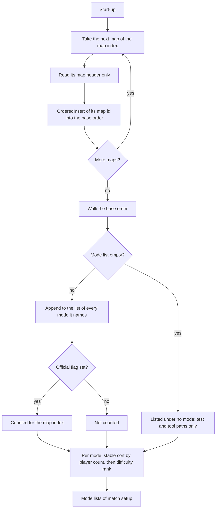
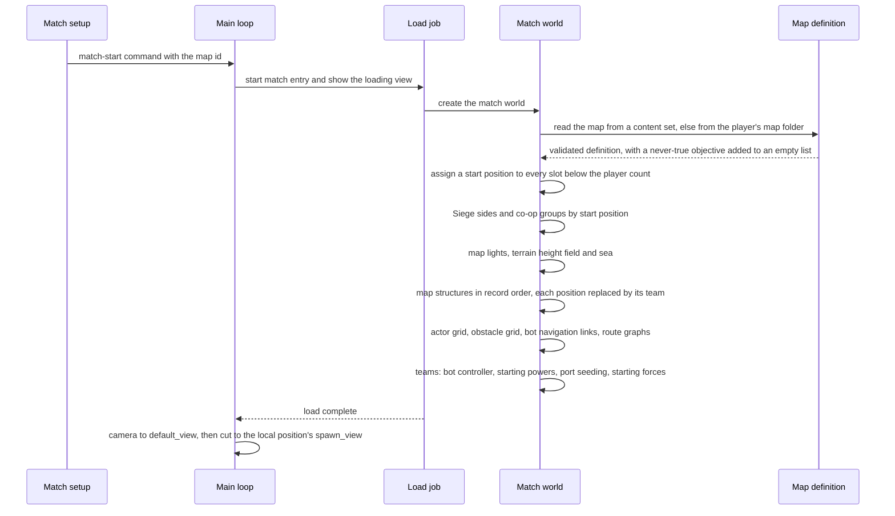
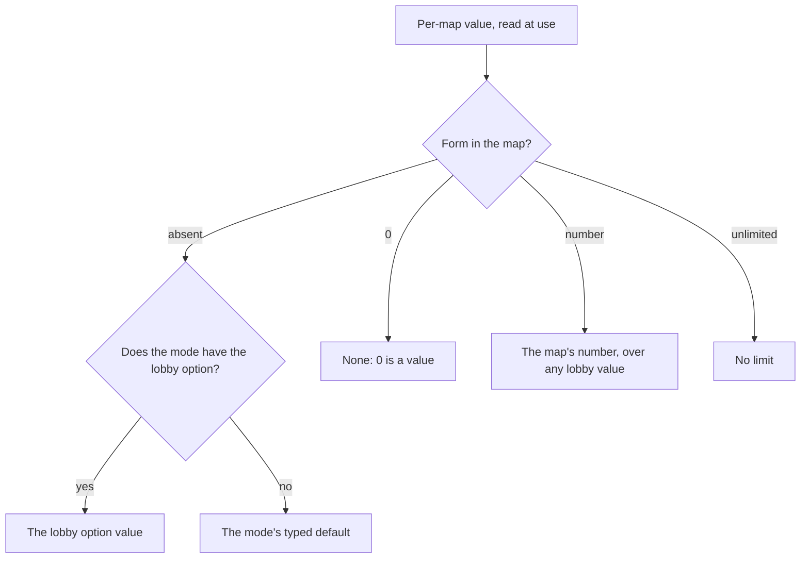
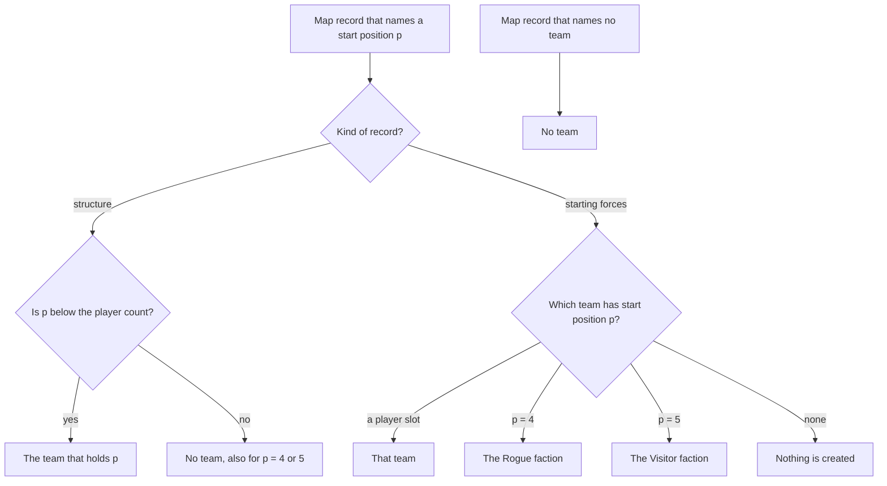

# Map rules and conventions

> Status: Reference · Prefix: R-MAP · Related: [README](README.md) · [map editor hooks](map_editor_hooks.md) · [01 Skirmish rules and modes](../01_skirmish_rules_and_modes/README.md) · [03 Buildings and world objects](../03_buildings_and_world_objects/README.md) · [04 Supply crates, powers and weapons](../04_supply_crates_powers_and_weapons/README.md) · [05 Population flow](../05_population_flow.md) · [07 Bots](../07_bots/README.md) · [09 Front end and match flow](../09_front_end_and_match_flow/README.md) · [12 Simulation model](../12_simulation_model/README.md)

## 1 Purpose and player experience

A map is the arena of one match: a square island world surrounded by sea, with its terrain, its lights, its structures, its starting forces and the match options that tune the mode rules for that arena. A player meets maps in match setup, where each mode lists its maps sorted by player count and difficulty, each with a name, a description, a thumbnail and a suggested play time. Once a map is chosen, the match loads it, gives each team one of the map's start positions, hands the structures of each position to the team that holds it, and opens the camera on that team's start view.

The reference game builds every mode on the same map model. One map definition serves its player count of 2 to 4; mode objects, per-map rule overrides, lights, camera views and starting forces are typed records of that definition; and the terrain comes from a small set of procedural tiles, each with a hand-painted guide grid, composited and flattened into the look of the reference game (DEC-025). The map's match options are the designer's levers on the mode rules: the population caps, the Transit Gate reinforcements, the Supply crate outcomes the map excludes, co-op and the Siege sides.

This document specifies those rules, the conventions that the maps of each mode follow, and the reference map set as anonymous distributions per mode and player count. It names no reference map, and every Species map is authored new (DEC-063). The map editor's hooks are [map_editor_hooks.md](map_editor_hooks.md).

### 1.1 Conventions used in this document

- **Units.** Distances are in world units (wu). Simulation durations are ticks of `ref.sim.tick_period` ([reference/12](../12_simulation_model/01_tick_timing_and_main_loop.md)); a mode second is `ref.mode.mode_second` (11 ticks) of [reference/01](../01_skirmish_rules_and_modes/README.md). Presentation durations, such as camera animations, are in seconds of real time.
- **The reference maps.** "The reference maps" are the 49 match maps of the reference map set (§2.22). Where a figure covers more files, the text says so.
- **Positions.** A *start position* (or *position*) is one of a map's player positions 0 to (player count − 1). The map names positions; teams are assigned to positions at load (§2.5). Positions 4 and 5 are the positions of the Rogue faction and the Visitor faction, whose team slots are `ref.sim.team.rogue_slot` (4) and `ref.sim.team.visitor_slot` (5) of [reference/12](../12_simulation_model/06_teams_and_player_commands.md). *No team* is the neutral owner.
- **Map values.** A per-map value is **absent**, **0** or a number, and a per-map limit may also be **unlimited** (DEC-120). "Sets" means present.
- **Identifiers.** Map structures use the structure kinds of [reference/03](../03_buildings_and_world_objects/README.md) table 2.4-A; map options and map effects use the `MapOption` and `MapEffect` enumerations of §2.7; Supply crate outcomes use the `CrateOutcome` identifiers of [reference/04](../04_supply_crates_powers_and_weapons/README.md) table 2.2-A.
- **Text.** Player-facing text is new text under Species string ids (§4.2).
- **Per-mode tables.** In the tables of §2.16 to §2.21, a cell that lists one value per map lists the maps of its row in the same order as every other such cell of that row, so the values of one map can be read across the row. The order itself carries no meaning.

## 2 Rules

### 2.1 Scope and shared conventions

**R-MAP-001** (MUST) The values of the tuning table of this document are the reference tuning baseline (DEC-004), and this document is the specification of record for maps and level design (DEC-005). A reference behaviour that looks accidental and that no Resolved decision corrects is stated as an explicit rule (DEC-006).

**R-MAP-002** (MUST) A map is one map definition (`MapDefinition`): a typed, versioned asset validated against its schema by the content build ([data schemas](../../architecture/components/data_schemas.md), ADR-0059, ADR-0061). The same definition serves every mode it lists and every match size up to its player count; no map has a variant per mode or per player count (DEC-025).

**R-MAP-003** (MUST) The content build validates every map definition and every asset reference of it. A missing mandatory field, an unknown block or field, a surplus value, a value outside its declared range and a missing asset are build errors with a diagnostic. At run time the map loader never passes a missing value on, never hangs on malformed data, and reports a missing asset as a diagnostic with a fallback, never as a fatal error (DEC-015, DEC-802).

**R-MAP-004** (MUST) A field of a map definition appears at most once in its record, a list is an explicit array, and two records of one kind with the same id in one map are a build error. A value that replaces a lobby default is the map's typed match-option value itself, never a repeated field (DEC-801).

**R-MAP-005** (MUST) Every text field and every id of a map definition has the maximum length that its schema declares, and the validator enforces it with the file, the position and the field (DEC-801). The maxima of the header's text fields are those of §2.6; no run-time structure holds map text in a fixed-size buffer.

**R-MAP-006** (MUST) Every per-map value has the three forms of DEC-120: **absent** applies the lobby default or the typed default of the mode ([reference/01](../01_skirmish_rules_and_modes/README.md) R-MODE-076); **0** means none; a number is that number. A per-map limit also has an explicit **unlimited** form, which is never written as 0 or as a negative number. Where a map sets a value, the map value overrides the lobby default (DEC-065), and a map value of 0 is a value, not an absence.

**R-MAP-007** (MUST) Every Species map is authored new. No terrain, layout, display name or identity of a reference map is reproduced (DEC-063); the per-map figures of this document describe the reference map set only as counts, ranges and distributions per mode and per player count.

### 2.2 Map identity and the map catalogue

**R-MAP-010** (MUST) A map's **map id** (`MapId`) is its stable name, `map_<mode>_<players>p_<nn>` (CONVENTIONS §8.11), where `<mode>` is the Species mode id of the mode it is made for, `<players>` its player count and `<nn>` a two-digit serial. The content build computes a content hash of the cooked map (ADR-0060), which identifies the version of that id; lists of maps (the map lists of match setup, the map index of the achievement hooks) are keyed by the map id together with that hash, and no list identifies a map by its file bytes (DEC-204).

**R-MAP-011** (MUST) The **map catalogue** is built once, at start-up. It reads the header of every map definition that lies directly in the maps folder of a mounted content set; sub-folders of the maps folder are not searched. The catalogue reads each header only: it stops at the end of the header and never loads the rest of the map (DEC-045).

**R-MAP-012** (MUST) The catalogue's **base order** is built by inserting each map, in the order of the content set's map index, with this ordered insertion, whose comparison is the byte-wise comparison of map ids:

```
OrderedInsert(list, id):
    for i in 0 .. len(list) - 2:          # the last entry is never compared
        c := Compare(list[i], id)
        if c == 0: return                  # an exact duplicate of a compared entry is dropped
        if c > 0:
            insert id before list[i]
            return
    append id                              # also when id sorts before the last entry or equals it
```

The base order is therefore nearly alphabetical: an id that sorts after every entry except the last is appended after the last entry, an exact duplicate of the last entry is appended again, and into a list of one entry every new id is appended. This is the reference default of DEC-314; its option B breaks every tie of R-MAP-016 by the map id instead.

**R-MAP-013** (MUST) The catalogue reads these header fields (§2.6): the display name, the modes, the player count, the author, the description, the play time, the difficulty, co-op allowed, co-op forced and the official flag. Every mode in the map's mode list adds the map to that mode's map list, in the base order. A map whose mode list names a mode twice is added to that mode's list twice; no reference map does so.

**R-MAP-014** (MUST) A map whose mode list is empty is valid and loadable, and is listed under no mode: it is reached only through test and tool paths. The content build rejects a mode name that is not one of the six modes of the mode catalogue of [reference/01](../01_skirmish_rules_and_modes/README.md); the mode list of a listed map names at least one mode and passes the per-mode map rules of every mode it names (§2.16 to §2.21). This is the reference default of DEC-802, whose option B adds an explicit visibility field.

**R-MAP-015** (MUST) A map whose definition does not come from a mounted content set, because it is read from the player's own map folder, is a **custom map**; its handling is [map editor hooks](map_editor_hooks.md). The catalogue counts the maps whose header sets the official flag, and the content build generates the **map index**: the list of the map ids of the official maps, which the Completionist achievement hook counts and which is packaged with the maps it lists (DEC-563).

**R-MAP-016** (MUST) Within each mode's list the catalogue sorts the maps with a stable sort: by player count, ascending, then by difficulty rank, ascending, where the rank is `ref.map.catalogue.rank.none` (0) for a map that sets no difficulty, `ref.map.catalogue.rank.basic` (1) for basic, `ref.map.catalogue.rank.intermediate` (2) for intermediate and `ref.map.catalogue.rank.advanced` (3) for advanced. Maps that tie on both keys keep their base order (R-MAP-012; DEC-314).

**R-MAP-017** (MUST) The header's mode list decides only where match setup lists the map. A match takes its mode from the match setup, and match setup offers a map only under the modes the map lists ([reference/01](../01_skirmish_rules_and_modes/README.md) R-MODE-084; [reference/09](../09_front_end_and_match_flow/screen_flow_and_match_setup.md)).

### 2.3 Map display in match setup

**R-MAP-020** (MUST) Match setup shows a map listed from a content set by the string ids `map.<map id>.name` and `map.<map id>.description`, which the map header names and which must exist in the string tables (DEC-802, ADR-0063); the header's own display-name text is shown only for a custom map. Every display name is new text.

**R-MAP-021** (MUST) Match setup shows the map's play time, when the map sets one, as hours and minutes, so a play time of 10 minutes reads 0:10. Choosing the map makes the play time the mode's time limit, when the mode has a time-limit option, and the host applies it once, authoritatively ([reference/01](../01_skirmish_rules_and_modes/README.md) R-MODE-079, DEC-067). A map without a play time leaves the mode's default time limit.

**R-MAP-022** (MUST) Every map listed from a content set has a thumbnail (`thumb.spawn_control`, `thumb.zone_control`, `thumb.relic_run`, `thumb.siege`, `thumb.launch_race` or `thumb.flag_chain`), which the content build renders with the engine from a top-down view of the map at an aspect ratio of 4:3 (DEC-563). The map-select page draws the thumbnail `ref.map.thumbnail.width_fraction` (0.8) of the width of its right-hand column wide and `ref.map.thumbnail.aspect` (0.75) of that width high, inside an outline. A map without a thumbnail, which only a custom map can be, shows the outline alone.

**R-MAP-023** (MUST) The difficulty is shown with the label `map.difficulty.basic`, `map.difficulty.intermediate` or `map.difficulty.advanced`; it is a descriptive rating that orders the lists (R-MAP-016) and changes no rule of the match (DEC-010).

### 2.4 The map definition

**R-MAP-030** (MUST) A map definition holds the blocks of table 2.4-A, each at most once. The match options form the **map header**, which comes first and is readable without the rest of the map, so that the catalogue reads only the header (R-MAP-011, DEC-045). One parser reads the header for the catalogue and the whole map for play, with the same field names and the same rules (DEC-045).

Table 2.4-A Blocks of a map definition.

| Block | Content | Rules |
|---|---|---|
| match options (the map header) | the per-map match options | §2.6, §2.7 |
| terrain definition (`TerrainDefinition`) | world size, cell size, outside height, maximum height and the three terrain colour assets | §2.8 |
| terrain tiles (`TerrainTile`) | the procedural tiles of the terrain | §2.8 |
| terrain flatten areas (`TerrainFlattenArea`) | the flatten areas, applied after the tiles | §2.8 |
| map lights (`MapLight`) | the directional lights | §2.9 |
| structures | one record per map-placed structure, with its links | §2.11 |
| start positions | one record per player position: camera view, Siege side, co-op group | §2.5 (DEC-560) |
| camera views | named camera poses | §2.13 |
| camera animations | named lists of moves and cuts between camera views | §2.13 |
| starting forces | the map's starting-unit records | §2.14 |
| routes | named lists of route points | §2.12 |
| primary objectives | a list of objective conditions | R-MAP-033 |

**R-MAP-031** (MUST) A block listed twice is a build error (DEC-801); in particular a map has one list of map lights and one list of structures. Every structure of a map is a static map structure, created once at match-world initialisation (R-MAP-047).

**R-MAP-032** (MUST) The content build rejects a block or a record that only campaign content uses: the save-game records of running powers, a created-at-difficulty record and a statistics record have no place in a map definition (DEC-052, DEC-802).

**R-MAP-033** (MUST) The primary objectives of a map are a list of objective conditions. On every reference map the list is empty or holds only the condition that never becomes true. When the list is empty, loading the map adds one condition that never becomes true, so every match world holds at least one objective that never completes. No map scripts a win condition: every mode decides its winner by its own rules ([reference/01](../01_skirmish_rules_and_modes/README.md)). The idle Workers' victory celebration starts only when every objective is complete, so it never starts in a match (DEC-331; [reference/02 worker.md](../02_units/worker.md)). The other objective conditions belong to campaign content and are not specified (DEC-052).

**R-MAP-034** (MUST) Loading a map derives no secondary objective: no objective is created for a Transit Gate or for any other map structure.

### 2.5 Level load and start positions

**R-MAP-040** (MUST) The match-start command carries the map id, and the match loads that map during match entry ([reference/12](../12_simulation_model/02_match_lifecycle_and_state_reset.md) R-SIM-014, table 2.3-A step 5, and R-SIM-016, table 2.4-A). The map is read from the mounted content sets; a map id that no content set holds is read from the player's own map folder (a custom map, R-MAP-015). When neither holds it, the load fails with a diagnostic, and the program does not end (DEC-015). Figure 3.2 shows the sequence.

**R-MAP-041** (MUST) Reading the map definition creates no simulated object and makes no random draw; every map-placed structure is created once, from its record, at match-world initialisation (R-SIM-017, DEC-652). The match has no global difficulty: actor stats use difficulty level 0, and the difficulty that a map lists is the descriptive rating of R-MAP-023 (DEC-010).

**R-MAP-042** (MUST) A map definition holds one **start-position record** for each player position 0 to (player count − 1). The record carries the position's start camera view (`spawn_view_<position>`, §2.13), its Siege side (attacking or defending) and its co-op group (1, 2 or none). Structures, starting forces and camera views name the start position they belong to (DEC-560). The header fields "attacking positions" and "group-1 positions" and "group-2 positions" of §2.6 are the content of these records.

**R-MAP-043** (MUST) Match-world initialisation assigns a start position to every team slot below the map's player count, whether or not the slot plays, by the rules of [reference/12](../12_simulation_model/06_teams_and_player_commands.md): outside Siege and co-op by the uniform draw over the free positions of R-SIM-417, asked for in slot order (the reference default of DEC-450); in a tutorial and for the Rogue and Visitor factions the position equals the slot; positions kept from a rematch rotation (R-SIM-418) are used without a draw; Siege then reassigns every position by side (R-SIM-419), and co-op places each team by its group (R-SIM-420). Structures are given their teams only after these steps.

**R-MAP-044** (MUST) The team field of a structure record is a start position or no team. At load each structure record's position is replaced by the team that holds that position: the first team slot below the player count whose position equals it; or by no team when none holds it (R-SIM-411, R-SIM-418). Because every slot below the player count receives a position (R-MAP-043), a structure record becomes no team only when its position is at or above the player count; a structure record whose position is 4 or 5 therefore becomes no team, not the Rogue or Visitor faction. No reference structure record uses position 4 or 5. A record that names no team stays no team.

**R-MAP-045** (MUST) A starting-forces record belongs to the team whose start position equals the record's position (§2.14). Positions 4 and 5 therefore address the Rogue faction and the Visitor faction, whose positions equal their slots (R-MAP-043); a map can field Visitor-faction Workers at position 5 this way.

**R-MAP-046** (MUST) At match start every open slot below the map's player count is occupied: empty open slots are filled with bot teams, and a participant who leaves is taken over by a bot. The host may close slots before the match; a closed slot is an unused team slot (DEC-079; [reference/01](../01_skirmish_rules_and_modes/README.md) R-MODE-010, R-MODE-087).

**R-MAP-047** (MUST) The structure ids of a map are unique within the map; a repeated id is a build error (DEC-801), and the link fields of other records refer to these ids. Each map-placed structure is created once, from its record, at match-world initialisation step 7 ([reference/12](../12_simulation_model/02_match_lifecycle_and_state_reset.md) table 2.4-A); afterwards the structure serial counter continues above the highest map id (R-SIM-018). In Siege, initialisation binds every Command Console that the Core Device's record lists to the Core Device ([reference/03 mode objects](../03_buildings_and_world_objects/mode_objects.md)).

**R-MAP-048** (MUST) On match entry the camera's bounds are −`ref.sim.match_entry.camera_border` to the world size x + `ref.sim.match_entry.camera_border` on both horizontal axes; the x size is used for z as well. The camera first takes the fallback pose (world size x, `ref.sim.match_entry.fallback_camera_height`, world size x) looking along `ref.sim.match_entry.fallback_camera_direction`, then moves to and cuts to the map's default camera view `default_view`, when the map defines one ([reference/12](../12_simulation_model/02_match_lifecycle_and_state_reset.md) table 2.3-A step 8). Once the local team exists, the camera cuts to `spawn_view_<position>` of the local team's start position (R-SIM-418; [camera and sequences](../../architecture/components/camera_and_sequences.md)). A map without these views leaves the camera at the pose it last reached.

**R-MAP-049** (MUST) Match-world initialisation creates the map lights, the terrain height field and the sea from the map definition at step 5, and the map-placed structures, grids, route graphs and bot navigation links at step 7 ([reference/12](../12_simulation_model/02_match_lifecycle_and_state_reset.md) table 2.4-A). Each team's starting forces are created when the team is initialised, at step 8 (§2.14).

### 2.6 The match options of the map header

**R-MAP-060** (MUST) The map header holds the match options of table 2.6-A (`MatchOptions`). A field that is absent takes the default of the table. Each field's value is checked against its type and range by the content build (R-MAP-003).

Table 2.6-A Fields of the map header.

| Field | Identifier | Value | When absent | Meaning | On the reference maps |
|---|---|---|---|---|---|
| display name | `MatchOptions::DisplayName` | the string id `map.<map id>.name`; for a custom map a text of at most `ref.map.header.name_max_chars` (511) characters | required | the map's name in match setup (R-MAP-020) | — |
| modes | `MatchOptions::Modes` | a list of modes (`MatchMode`) | empty: the map is listed under no mode (R-MAP-014) | the mode lists that show the map | every reference map lists exactly one mode |
| population cap | `MatchOptions::BodyCap` | a number of bodies, 0 or unlimited | required: the map states unlimited explicitly when it has no cap | the per-team cap is the cap ÷ the number of open slots (R-MAP-062) | 1,400 to 2,000; unlimited on two 4-player co-op maps |
| defender population cap | `MatchOptions::DefenderBodyCap` | a number of bodies or 0 | Siege uses the population cap ÷ open slots for both sides | Siege: each defending team's cap; the attacking teams share the rest (R-MAP-062) | 200 to 350 on 6 of the 8 Siege maps |
| player count | `MatchOptions::PlayerCount` | `ref.map.players.min` (2) to `ref.sim.team.player_slots` (4) | required | the number of start positions and of lobby slots | 2-player 22 maps, 3-player 15, 4-player 12 |
| play time | `MatchOptions::DefaultTimeLimit` | whole minutes | the mode's default time limit | the time limit that choosing the map sets (R-MAP-021) | 5, 10, 15 or 20 on 20 maps (§2.22) |
| difficulty | `MatchOptions::Difficulty` | basic, intermediate or advanced | rank 0 | the descriptive rating that orders the lists (R-MAP-016, R-MAP-023) | every reference map sets one |
| map effects | `MatchOptions::MapEffects` | a set of map effects (`MapEffect`, table 2.7-B) | none | weather and lighting effects (§2.10) | snow 6 maps, special lighting 3, lightning 2, dust wind 1 |
| map options | `MatchOptions::MapOptions` | one value per map option (`MapOption`, table 2.7-A) | each option takes its own default (table 2.7-A) | per-map rule overrides (§2.7) | §2.22 |
| excluded outcomes | `MatchOptions::ExcludedOutcomes` | a set of Supply crate outcome identifiers (`CrateOutcome`) | none | outcomes that never drop on the map ([reference/04](../04_supply_crates_powers_and_weapons/README.md) R-CRATE-029, R-CRATE-030) | 7 maps (§2.23) |
| attacking positions | `MatchOptions::AttackingPositions` | a set of start positions 0 to (player count − 1), held as the Siege side of each start-position record (R-MAP-042) | no attacking position | Siege: the attacking positions; every other position below the player count defends | every Siege map (§2.19) |
| co-op allowed | `MatchOptions::CoopAllowed` | flag | off | match setup offers co-op on this map | 6 maps, all 4-player |
| co-op forced | `MatchOptions::CoopForced` | flag | off | match setup sets co-op on this map | 4 Siege maps |
| group-1 positions, group-2 positions | `MatchOptions::GroupOnePositions`, `MatchOptions::GroupTwoPositions` | sets of start positions, held as the co-op group of each start-position record (R-MAP-042) | no fixed groups | fixed co-op alliances ([reference/01](../01_skirmish_rules_and_modes/README.md) R-MODE-020) | 6 maps |
| official | `MatchOptions::Official` | flag | off | the map belongs to the map index (R-MAP-015, DEC-563) | every reference map |
| author | `MatchOptions::Author` | a text of at most `ref.map.header.author_max_chars` (63) characters | none | the author's name; never displayed | never set |
| description | `MatchOptions::Description` | the string id `map.<map id>.description`; for a custom map a text of at most `ref.map.header.description_max_chars` (511) characters | none | the description in match setup (R-MAP-020) | — |

**R-MAP-061** (MUST) The player count, the population cap, the defender population cap and the attacking positions are match options of the map, each unset unless the map sets it ([reference/05](../05_population_flow.md) R-ECON-053). A map that gives the population cap twice is a build error (R-MAP-004, DEC-801). The content build rejects a start position outside 0 to (player count − 1) in the attacking positions and in the co-op group positions.

**R-MAP-062** (MUST) Every open slot of the map is occupied by a player or a bot (R-MAP-046). The per-team population cap is the map's population cap divided by the number of open slots, by integer division, fixed for the whole match; caps are per team and never pooled within an alliance. In Siege with a defender population cap, each defending team has the defender cap and the attacking teams share (map cap − number of defenders × defender cap) ÷ number of attackers; a Siege map without a defender cap uses map cap ÷ open slots for both sides. A population cap of unlimited means no cap, and a cap of 0 locks every Spawn Node and Transit Gate of every team. The bodies that count, the enforcement points and the Population Limiter fallback, which takes effect only on a map whose population cap is unlimited, are [reference/05](../05_population_flow.md) §2.11 to §2.14 (DEC-079, DEC-120, DEC-454).

**R-MAP-063** (MUST) Choosing a map in match setup clears the co-op setting on a map that does not allow co-op and sets it on a map that forces co-op ([reference/01](../01_skirmish_rules_and_modes/README.md) R-MODE-079). A map that forces co-op also allows it.

**R-MAP-064** (MUST) The match options that the map header sets and their effect on each mode are listed in [reference/01](../01_skirmish_rules_and_modes/README.md) R-MODE-084 and specified by the documents that consume them; this document owns their names, types, defaults and forms (DEC-017, DEC-120).

### 2.7 Map options and map effects

**R-MAP-070** (MUST) The map options are the 15 per-map rule overrides of table 2.7-A, held in the header field "map options". The order of the table is the canonical map-option order: the order of the fields in the map schema and of the option list in the map editor. Species defines its own enumerator values, and no rule depends on them.

Table 2.7-A Map options (`MapOption`), in canonical order.

| # | Map option | Identifier | Value | When absent | Effect | Specified in | Reference maps |
|---|---|---|---|---|---|---|---|
| 1 | no Catch-up bonus | `MapOption::NoCatchUpBonus` | flag | off | the Catch-up bonus multiplier is 1, whatever the lobby option | [reference/05](../05_population_flow.md) §2.8 | none |
| 2 | instant Spawn Node capture | `MapOption::InstantSpawnNodeCapture` | flag | off | Spawn Nodes skip their activation delay | [reference/05](../05_population_flow.md) §2.5 | 4 Relic Run maps |
| 3 | Transit Gate reinforcement count | `MapOption::GateReinforcementCount` | Workers per owned Transit Gate per wave: a number or 0 | absent | a value above 0 runs Transit Gate waves in every mode; the count per gate per wave, also in a mode that has a count option (R-MAP-071) | [reference/05](../05_population_flow.md) R-ECON-088, R-ECON-091 | 12 maps: 60, 75 or 100 |
| 4 | Transit Gate Transport cap | `MapOption::GateTransportCap` | a number, 0 or unlimited | absent | a value above 0 also runs waves; the Transport cap of the waves; a value of 1 or more makes the Transport outcome invalid | [reference/05](../05_population_flow.md) R-ECON-091, R-ECON-093, R-ECON-098; [reference/04](../04_supply_crates_powers_and_weapons/crates_and_powers.md) R-CRATE-125 | 6 maps: 1 or 3 |
| 5 | no gun turrets | `MapOption::NoGunTurrets` | flag | off | the turret frequency is 0: waves grant no turret powers | [reference/05](../05_population_flow.md) R-ECON-091 | 2 maps |
| 6 | attacker reinforcement count | `MapOption::AttackerReinforcementCount` | a number or 0 | the Transit Gate reinforcement count | Siege: the attackers' Workers per gate per wave | [reference/05](../05_population_flow.md) R-ECON-093 | none |
| 7 | defender reinforcement count | `MapOption::DefenderReinforcementCount` | a number or 0 | the Transit Gate reinforcement count | Siege: the defenders' Workers per gate per wave | [reference/05](../05_population_flow.md) R-ECON-093 | none |
| 8 | defender reinforcement power | `MapOption::DefenderReinforcementPower` | a Power kind (R-MAP-072) | none | each defending team receives one Power of this kind per wave, and the defenders' gates grant no Transport | [reference/05](../05_population_flow.md) R-ECON-093, R-ECON-102 | 1 Siege map: the airstrike |
| 9 | attacker reinforcement power | `MapOption::AttackerReinforcementPower` | a Power kind (R-MAP-072) | none | each attacking team receives one Power of this kind per wave; outside Siege every team receives it | [reference/05](../05_population_flow.md) R-ECON-093, R-ECON-102 | none |
| 10 | same-team Beam Dish links | `MapOption::SameTeamBeamDishLinks` | flag | off | two Beam Dishes connect only when one team owns both | [reference/03 economy](../03_buildings_and_world_objects/economy_and_spawn_objects.md) | 1 Siege map |
| 11 | no Beam Dish aiming | `MapOption::NoBeamDishAiming` | flag | off | neither players nor bots can aim a Beam Dish | [reference/03 economy](../03_buildings_and_world_objects/economy_and_spawn_objects.md), [reference/06](../06_controls_camera_and_commands/README.md), [reference/07](../07_bots/README.md) | 1 Siege map (the same map) |
| 12 | airstrike threshold | `MapOption::AirstrikeThreshold` | a number of Flag posts | absent | Flag Chain: on a turret wave, a team that holds more than this many Flag posts receives the airstrike instead of the gun turret | [reference/05](../05_population_flow.md) R-ECON-104 | 3 Flag Chain maps: 3 |
| 13 | Visitor-faction position | `MapOption::VisitorFactionPosition` | a start position | none | the team whose start position equals the value fields Visitor-faction Workers in place of Workers; the value is compared with the team's start position, not its team slot | [reference/02](../02_units/README.md) | none |
| 14 | attacker reinforcement power option | `MapOption::AttackerReinforcementPowerOption` | an integer | none | the option of the attacker reinforcement power, for example the bomb kind of an airstrike or the turret type | [reference/05](../05_population_flow.md) R-ECON-103; [reference/04](../04_supply_crates_powers_and_weapons/README.md) R-CRATE-012 | none |
| 15 | defender reinforcement power option | `MapOption::DefenderReinforcementPowerOption` | an integer | none | the option of the defender reinforcement power | [reference/05](../05_population_flow.md) R-ECON-103 | none |

**R-MAP-071** (MUST) The reinforcement values of a map override the lobby defaults: at each wave the reinforcement count and the Transport cap take the map's value where the map sets one, otherwise the mode's option value, otherwise the typed default; a map value of 0 is a value (DEC-065; [reference/05](../05_population_flow.md) R-ECON-091). Transit Gates advance exactly once per tick on every map, whichever of the mode and the map options starts the waves (DEC-065).

**R-MAP-072** (MUST) A reinforcement power option names a Power kind by its identifier: one of the Supply crate outcomes whose delivery is a Power in [reference/04](../04_supply_crates_powers_and_weapons/README.md) table 2.2-A. The content build rejects any other value (R-MAP-003). Granting the power is [reference/05](../05_population_flow.md) R-ECON-093.

**R-MAP-073** (MUST) The map effects are the five effect flags of table 2.7-B, held in the header field "map effects", in this canonical order.

Table 2.7-B Map effects (`MapEffect`), in canonical order.

| # | Map effect | Identifier | Effect in a match | Reference maps |
|---|---|---|---|---|
| 1 | snow | `MapEffect::Snow` | the snow spawner (R-MAP-090) | 6 |
| 2 | lightning | `MapEffect::Lightning` | the lightning spawner (R-MAP-090) | 2 |
| 3 | dust wind | `MapEffect::DustVortices` | the dust-storm spawner and its dust vortices (R-MAP-090) | 1 |
| 4 | Essence-orb rain | `MapEffect::EssenceOrbRain` | none specified (R-MAP-092) | none |
| 5 | special lighting | `MapEffect::SpecialLightRig` | the special lighting for structures (R-MAP-091) | 3 |

**R-MAP-074** (MUST) The order of table 2.7-B is the canonical map-effect order, the order of the map schema and of the map editor; no rule depends on enumerator values.

**R-MAP-075** (MUST) A map tool that saves a map definition writes every field that is set, each exactly once: a value of 0, a power kind, every mode of the mode list, every attacking position and every co-op group position are written as set, and a field that is absent stays absent, so that saving and reloading a map changes none of its match options (DEC-800, DEC-120; [map editor hooks](map_editor_hooks.md)).

### 2.8 Terrain authoring

**R-MAP-080** (MUST) The terrain definition (`TerrainDefinition`) holds the fields of table 2.8-A. The playable world is the rectangle from (0, 0) to (world size x, world size z); every reference map is square.

Table 2.8-A Fields of the terrain definition.

| Field | Value | When absent | Meaning |
|---|---|---|---|
| world size x, world size z | whole wu | `ref.map.terrain.world_size_default` (2,000 wu) each | the playable square |
| cell size | wu per height sample | `ref.map.terrain.cell_size_default` (12.0 wu) | the resolution of the height field |
| outside height | wu | `ref.map.terrain.outside_height_default` (−10 wu) | the sea floor, the base of every tile and the height outside the map |
| maximum height | wu | `ref.map.terrain.max_height_default` (0.0 wu) | the normaliser of the colour-ramp look-up only; it limits no height |
| land colour ramp | one file of `terrain.ramp` | the map default, file 1 | the terrain colour by slope and height |
| shore-wave gradient | one file of `terrain.shore_wave_gradient` | the map default, file 1 | the colours of the coastline waves |
| sea tile | one file of `terrain.sea_tile` | the map default, file 1 | the repeated sea surface texture |

**R-MAP-081** (MUST) Each terrain tile record (`TerrainTile`) holds, in this order: position x, position y, position z; size; fractal dimension; height scale; desired height; generation method (0, 1 or 2); random seed; lowland smoothing factor; guide-grid power p; and, when p > 0, a guide grid of 2^p − 1 cells per side whose cells take one of `ref.map.terrain.guide_grid_levels` (16) levels, written A to P. Each tile is a square procedural island with its own private generator, re-seeded from its seed every time the tile is generated, so a tile's heights depend only on its own record (DEC-246). The desired height is the height of the tile's highest point; the guide grid pins the coarse shape of the tile.

**R-MAP-082** (MUST) The tiles are composited by maximum: a tile writes its scaled height into a sample only where it exceeds the height already there, so the order of the tiles does not change the result. The flatten areas are applied afterwards, in record order.

**R-MAP-083** (MUST) Each terrain flatten area record (`TerrainFlattenArea`) holds centre x, centre y, centre z, size, and optionally a flatten type and a height threshold. The area is the axis-aligned square of half-width size around the centre. The flatten types are 0 Absolute (heights set to centre y), 1 Add, 2 Subtract, 3 Smooth and 4 Subtract2; an absent type is 0. The threshold, `ref.map.terrain.flatten_threshold_default` (40.0 wu) when absent, is used by types 2 to 4.

**R-MAP-084** (MUST) The generation algorithm of the tiles, the composition and the five flatten types, with their exact arithmetic and its biases, is [terrain](../../architecture/components/terrain.md) (DEC-025, DEC-324). Whether the terrain is generated at load from these records or baked by the content build is DEC-246, whose default is generation at load; the scale of terrain for a large world is DEC-247.

**R-MAP-085** (MUST) The terrain of the reference map files lies within the envelope of table 2.8-B. The figures cover the 57 reference map files, which are the 49 match maps and 8 development and test maps (DEC-334); the match maps alone are the figures of DEC-247.

Table 2.8-B Terrain envelope of the reference map files.

| Parameter | Range or values used | Notes |
|---|---|---|
| world size | 2,000 to 7,000 wu, square in every file, 28 distinct sizes | the most common are 3,000 wu (12 files) and 2,000 wu (8); on the 49 match maps, 3,000 wu on 11 and 2,000 wu on 5 |
| cell size | 9.00 to 27.08 wu, 17 distinct values | grids of 137 × 137 to 334 × 334 samples; the finest cells are on small maps |
| outside height | −30.00 to −6.93 wu, 8 distinct values | −10.00 wu in 40 files; every map has sea on at least 26.2 % of its cells, and sea along its whole border |
| maximum height | 0.00 in 40 files, 200.00 in 1, absent in 16 | the colour ramp only |
| tiles per map | 1 to 25, 445 tiles in all | |
| tile size | 124 to 4,484 wu | |
| tile position y | −25.93 to 83.90 wu | |
| fractal dimension | 0.57 to 7.88 | |
| height scale | 0.0 to 10.0 | |
| desired height | 30 to 961 wu | |
| generation method | 0 on 30 tiles, 1 on 356, 2 on 59 | all three methods are used |
| lowland smoothing factor | 0.0 to 3.0 | |
| guide-grid power | 0 on 71 tiles, 1 on 26, 2 on 209, 3 on 30, 4 on 93, 5 on 16 | hand-painted guide grids on 374 of the 445 tiles |
| flatten areas | 53 areas in 19 files, 0 to 6 per file | Absolute 17, Add 1, Subtract 5, Smooth 27, Subtract2 3; half-size 8.4 to 1,000 wu; centre y −26 to 886.2 wu; threshold −3.9 to 348.9 wu |

**R-MAP-086** (MUST) The reference map files use 14 land colour ramps, 8 shore-wave gradients and 4 sea tiles, which the asset manifest recreates as the 14 files of `terrain.ramp`, the 8 of `terrain.shore_wave_gradient` and the 4 of `terrain.sea_tile`, each with the map default as file 1. The number of map files that use each asset is: land colour ramps 10 (the map default), 10, 8, 5, 5, 5, 3, 3, 2, 2, 1, 1, 1 and 1; shore-wave gradients 17 (the map default), 11, 10, 8, 4, 3, 3 and 1; sea tiles 30 (the map default), 20, 5 and 2. While the match's seasonal state is active, one land colour ramp, one shore-wave gradient and one sea tile replace the map's own on every map ([renderer](../../architecture/components/renderer/world_renderers.md) RND-134, RND-142, RND-144; DEC-118).

### 2.9 Map lights

**R-MAP-087** (MUST) Each map light record (`MapLight`) holds a direction (front x, y, z) and a colour (r, g, b). Every map light is directional, at an infinite distance; its direction is normalised at load, and its colour components are unclamped multipliers, so values above 1 brighten. A light record without values takes the renderer's defaults `rnd.light.default_colour` and `rnd.light.default_front` ([renderer](../../architecture/components/renderer/README.md) RND-012). The renderer uses the first two lights of the list (RND-013, RND-226); the simulation never reads a map light.

**R-MAP-088** (MUST) Every reference map has exactly `ref.map.light.count` (2) lights. Their colour components lie between 0.26 and 5.23 (red), 0.26 and 3.15 (green) and 0.00 and 2.07 (blue), and the normalised y component of their direction between 0.00 and 0.86. The two lights follow one pattern: a neutral grey fill light, with equal components between 0.33 and 1.25, and a warm key light whose red component exceeds its green, which exceeds its blue. The pattern is a level-design tool that the schema accepts (DEC-315). Whether maps keep per-map light values or select named lighting presets is DEC-562, whose default is the per-map values.

### 2.10 Map effects in a match

**R-MAP-090** (MUST) The map effects snow, dust wind and lightning start the map-effect spawners of [reference/12](../12_simulation_model/04_containers_and_update_order.md), which run in update slice `ref.sim.slice.map_effects` (3) in the order snow, dust storm, lightning, then the seasonal snow (R-SIM-234 to R-SIM-238). The snow spawner creates `ref.sim.weather.snow_burst` (150) snowflakes over the whole map, at heights from 0 to `ref.sim.weather.snow_burst_height_range` (1,000 wu), on its first run, and then one snowflake at a height from `ref.sim.weather.snow_height_base` (700 wu) to that base plus `ref.sim.weather.snow_height_range` (300 wu) every `ref.sim.weather.snow_period` (1 tick). The three spawners share one timer (R-SIM-237). A lightning strike is drawn with `fx.lightning_strip`; the dust vortex and the lightning strike are specified in [weapons and projectiles](../04_supply_crates_powers_and_weapons/weapons_and_projectiles.md).

**R-MAP-091** (MUST) The map effect special lighting lights the structures with the special light rig of the renderer instead of the map lights. The same lighting is also used in every Launch Race match, whatever the map's effects, and whenever the special-lighting setting is on ([renderer](../../architecture/components/renderer/view_lighting_and_fog.md) RND-229).

**R-MAP-092** (MUST) The map effect Essence-orb rain has no specified effect in a match, and no reference map sets it.

**R-MAP-093** (MUST) The seasonal theme starts the snow spawner on every map, independently of the map's effects, when the match setup's seasonal state is active (DEC-118; R-SIM-234). Music is not a property of a map: no field of a map definition names a music track.

### 2.11 Structure placement

**R-MAP-100** (MUST) Each structure record of a map holds the base fields, in this order: structure kind, structure id, position x, position z, team (a start position or no team), facing x, facing z and the global flag; then the fields of its kind, which [reference/03](../03_buildings_and_world_objects/README.md) specifies per kind and the map schema family of [data schemas](../../architecture/components/data_schemas.md) types (R-BLDG-014, R-BLDG-108, R-BLDG-138, R-BLDG-145, R-BLDG-407, R-BLDG-433, R-BLDG-459, R-BLDG-462, R-BLDG-473, R-BLDG-601). Link fields name structure ids of the same map.

**R-MAP-101** (MUST) A structure record's kind is one of the structure kinds of [reference/03](../03_buildings_and_world_objects/README.md) table 2.4-A that a map may place. The content build rejects a record of the Relic or the Supply crate, which only rules create (R-BLDG-011, R-CRATE-101), and a record of a kind that only campaign content uses (DEC-052, DEC-802). A map may place a Hive or a Spitter Plant, which Supply crate outcomes otherwise create; no reference map does.

**R-MAP-102** (MUST) A structure record carries no height: at match-world initialisation every map-placed structure is placed on the terrain at its (x, z) ([reference/12](../12_simulation_model/02_match_lifecycle_and_state_reset.md) table 2.4-A step 7).

**R-MAP-103** (MUST) The global flag is required on every Beam Dish and Transit Gate record, and the content build rejects such a record without it (R-BLDG-015). Otherwise the flag changes no match rule; on a Source Node it selects only how the Source Node is drawn. This is the reference default of DEC-309, whose recommendation removes the flag from map data.

**R-MAP-104** (MUST) Map-placed structures enter the structure pool in record order, so the record order of a map is the structure order that order-dependent rules read, such as the Population Limiter look-up of [reference/05](../05_population_flow.md) R-ECON-062 and the advance order of transit orbs (R-ECON-040). Every participant creates the same structures in the same order (R-SIM-017).

**R-MAP-105** (MUST) No map record is scaled by a difficulty: counts, radii and populations are used as authored (DEC-010).

**R-MAP-106** (MUST) A turret ignores the facing of its map record; its initial facing does not come from map data (R-BLDG-407). This is the reference default of DEC-462.

**R-MAP-107** (MUST) A smoke column that a map places is an invisible obstacle that blocks movement, as [reference/03 defences and props](../03_buildings_and_world_objects/defences_and_props.md) specifies; this is the reference default of DEC-089, whose recommendation makes such markers collide only where the map marks the obstacle as wanted.

**R-MAP-108** (MUST) A map that places Spawn Nodes places exactly one Source Node, whose links start a tree of Relays and Spawn Nodes that reaches every Spawn Node. The content build rejects a spawn network whose links contain a cycle (DEC-456; [reference/03 economy](../03_buildings_and_world_objects/economy_and_spawn_objects.md) R-BLDG-100, R-BLDG-102). On the reference maps a network has 0 to 23 Relays, and on one map the Source Node links straight to every Spawn Node.

**R-MAP-109** (MUST) Population Limiters are local population caps around hubs. On the reference map files their radius lies between 272.77 and 1,169.84 wu and their maximum population between 100 and 1,200. Every reference map that places one also sets a population cap, so no Population Limiter takes effect on a reference map (DEC-454; R-ECON-061).

**R-MAP-110** (MUST) The owner field of the structure records of the reference map files is distributed as table 2.11-A. The per-mode counts of records and maps over the 49 match maps are [reference/03](../03_buildings_and_world_objects/README.md) table 2.4-A; table 2.11-A covers the 57 reference map files of R-MAP-085, without the records of kinds that only campaign content uses.

Table 2.11-A Owner field of the structure records of the reference map files.

| Structure kind | Records | Files | Owner field: no team, then per start position |
|---|---|---|---|
| bot objective | 95 | 9 | no team 62; position 0: 18, 1: 8, 2: 4, 3: 3 |
| bot objective marker | 340 | 16 | no team 155; position 0: 42, 1: 87, 2: 44, 3: 12 |
| bot navigation node | 1,112 | 53 | no team 1,101; position 1: 11 |
| Command Console | 36 | 10 | no team 33; position 0: 3 |
| volcano vent | 1 | 1 | no team 1 |
| Launch Vessel | 19 | 7 | position 0: 7, 1: 7, 2: 4, 3: 1 |
| fuel pump | 57 | 7 | no team 36; position 0: 9, 1: 9, 2: 3 |
| fuel line | 178 | 7 | no team 114; position 0: 25, 1: 25, 2: 14 |
| fuel depot | 57 | 7 | position 0: 21, 1: 21, 2: 12, 3: 3 |
| turret | 207 | 14 | no team 207 |
| jump pad | 23 | 3 | no team 23 |
| Barrier Emitter | 703 | 15 | no team 141; position 0: 288, 1: 154, 2: 77, 3: 43 |
| Control Zone (also Relic Base, Relic Spawn Zone, Flag post, Home post) | 176 | 27 | no team 126; position 0: 18, 1: 18, 2: 10, 3: 4 |
| grid splitter | 26 | 7 | no team 25; position 0: 1 |
| Core Device | 9 | 9 | position 0: 5, 1: 3, 2: 1 |
| grid pylon | 301 | 17 | no team 244; position 0: 21, 1: 21, 2: 12, 3: 3 |
| grid terminal | 88 | 17 | no team 88 |
| Beam Dish | 46 | 7 | no team 44; position 0: 2 |
| exclusion zone | 35 | 14 | no team 35 |
| smoke column | 6 | 1 | no team 6 |
| Solar Array | 231 | 17 | no team 146; position 0: 52, 1: 21, 2: 3, 3: 9 |
| Relay | 276 | 23 | no team 265; position 1: 11 |
| Spawn Node | 286 | 34 | no team 124; position 0: 53, 1: 57, 2: 33, 3: 19 |
| Source Node | 34 | 34 | no team 33; position 1: 1 |
| Population Limiter | 87 | 22 | no team 87 |
| scenery mesh | 193 | 19 | no team 193 |
| tree | 755 | 45 | no team 704; position 1: 51 |
| Transit Gate | 123 | 31 | no team 14; position 0: 33, 1: 46, 2: 23, 3: 7 |
| wall | 356 | 11 | no team 356 |
| Breach Charge | 3 | 1 | no team 3 |

**R-MAP-111** (MUST) The reference maps follow these placement patterns, which the map schema accepts:

1. **Spawn economy.** Every map with Spawn Nodes has one Source Node and a tree of Relays (R-MAP-108). Each start position owns 1 to 3 Spawn Nodes, and capturable Spawn Nodes with no team sit between the positions (§2.16 to §2.21).
2. **Bot hints.** Bot navigation nodes (`BotNavNode`, marker mesh `mesh.structure.bot_nav_node`) are placed on every reference map. Each record holds a link to another node (none, or a node id), a priority modifier from −1 to 1 and a cliff-check flag. Siege maps chain bot objectives (`BotObjective`) by a next-objective link and place bot objective markers (`BotObjectiveMarker`), each with a scan range from 0 to 306.6 wu, an objective id, a Transport flag and a pickup-only flag; Launch Race maps also place bot objective markers. Their use by the bots is [reference/07](../07_bots/README.md).
3. **Fortification kit.** Walls; Barrier Emitters in chains, each record naming the next emitter, with a scale from 0.25 to 3.0 and, over the reference map files, the mode Raised on 658 records, Lowered on 20, AlwaysRaised on 23 and RelayOnly on 2 (R-BLDG-435); turrets, every one with no team, of the gun type on 196 records and the flame type on 11, with every target field 0; exclusion zones with a size from 300 to 1,118.8 wu and the Power-blocking flag (§2.23); jump pads with a force from 76.17 to 227.38 wu/s and an angle from 0.51 to 1.08 rad; Beam Dishes with their force-connection and auto-connect flags and their valid receivers, in the patterns of [reference/03 economy](../03_buildings_and_world_objects/economy_and_spawn_objects.md) R-BLDG-168.
4. **Energy grid and fuel chain.** Solar Arrays, grid pylons, grid terminals and grid splitters, each record naming its next link and a splitter a list of candidates, feed fuel pumps, fuel lines, fuel depots and Launch Vessels on the Launch Race maps; energy grids also appear on Siege, Flag Chain and Spawn Control maps ([reference/03](../03_buildings_and_world_objects/README.md) table 2.4-A).
5. **Set dressing.** Trees, procedural, each record with its height (43.54 to 272.65 wu on the reference maps) and the tree fields of R-BLDG-601; scenery meshes with a scale from 0.83 to 6.1, of which the five most used pieces of `mesh.scenery.prop` account for 67, 56, 32, 27 and 8 records and one record places the Abductor hull `mesh.creature.abductor_hull`; one volcano vent on one Flag Chain map; six smoke columns and three Breach Charges, each on one Siege map.

**R-MAP-112** (MUST) The reference maps also use these level-design patterns, whose design intent is not recorded and which the map schema and the per-mode validation accept: concentric Control Zones in Zone Control (§2.17); duplicate Relic Spawn Zones in Relic Run (§2.18); Zone Control Control Zones that start owned by a position (§2.17); the key and fill pair of map lights (R-MAP-088); and twin terrains, two maps built on one terrain (§2.22). This is the reference default of DEC-315.

### 2.12 Routes

**R-MAP-120** (MUST) A map may hold routes. A route has an id from 0 to `ref.map.route.id_limit` − 1 (0 to 9,999) and a list of route points, each one of three kinds: a 3-D position (x, y, z), a ground position (x, z) or a structure id.

**R-MAP-121** (MUST) In a match a route id names a route of the match's own route table, which holds the routes that players draw ([reference/12](../12_simulation_model/05_space_routing_and_physics.md)); a route of the map definition is never followed. A starting-forces record's route id therefore indexes the match's route table. No reference map holds a route, and no reference starting-forces record names one.

### 2.13 Camera views and camera animations

**R-MAP-125** (MUST) A camera view record holds a name, a position (x, y, z), a front vector (x, y, z) and an up vector (x, y, z); the front and up vectors are normalised at load. A camera view name has at most `ref.map.camera.view_name_max_chars` (62) characters, and names are looked up without regard to case. The camera that uses the views is [camera and sequences](../../architecture/components/camera_and_sequences.md).

**R-MAP-126** (MUST) Three view names are reserved:

| Name | Meaning |
|---|---|
| `spawn_view_<n>` | the start view of start position n; once the local team exists the camera cuts to the view of its position (R-MAP-048) |
| `default_view` | the view the camera moves to after the map has loaded; without it the camera stays at its fallback pose |
| `previous_view` | the camera pose from before a camera animation started; an animation may name it without the map defining it |

**R-MAP-127** (MUST) A camera animation record holds a name and a list of steps until its end; each step is a move or a cut to a named camera view, with a duration from 0 up to, but not including, `ref.map.camera.animation_duration_max_s` (60 s). The view of a step is either defined before the animation or is `previous_view`. The content build rejects an animation that breaks these rules (DEC-015). Camera animations are played only by sequences ([camera and sequences](../../architecture/components/camera_and_sequences.md)); every camera-animation block of the reference map files is empty.

**R-MAP-128** (MUST) On the reference maps every map defines `spawn_view_<n>` for each of its start positions, except one 3-player Siege map that defines no camera view at all, so its camera stays at the pose it reaches after load. Two 2-player maps also define a `spawn_view_2` that no position uses. Over the 57 reference map files, `spawn_view_0` is defined in 51 files, `spawn_view_1` in 51, `spawn_view_2` in 31, `spawn_view_3` in 13 and `default_view` in 7.

### 2.14 Starting forces

**R-MAP-130** (MUST) A starting-forces record holds, in this order: actor kind, start position, x, z, count, in-group flag, state, spread, and optionally a waypoint (x, z), a route id, a route-point id and the run-as-power flag. When absent, the state is none, the spread is `ref.map.starting_forces.spread_default` (200 wu), the waypoint is (0, 0), the route id and the route-point id are none and the run-as-power flag is off.

**R-MAP-131** (MUST) The content build rejects a starting-forces record whose actor kind no match creates as a starting unit: the Leader, the Crawler egg, the Bomber, the ant, the Seed Pod, the bot controller, the barrage missile, the meteor, the Abductor, and every actor kind of campaign or debug content (DEC-062, DEC-802). A Trooper record whose in-group flag is off creates nothing.

**R-MAP-132** (MUST) When a team is initialised at match start, each starting-forces record whose start position equals the team's start position is created for that team (R-MAP-045), after the team's bot controller, its starting powers and its port seeding ([reference/05](../05_population_flow.md) R-ECON-106, R-ECON-109):

1. **Run as a power.** With the run-as-power flag set, a Transport record becomes a Transport Power, a Trooper record a Strike team Power, a Collector record a Collector Power and a Builder record a Builder Power, each targeted at (x, z), with no lifetime limit, occupying a Power slot of the team ([reference/04](../04_supply_crates_powers_and_weapons/README.md)). A record of any other kind with the flag set creates nothing.
2. **Actors.** Otherwise `count` actors of the kind are created around (x, z) within the spread. With the in-group flag set they form one actor group whose waypoint is the spawn point. A single Worker whose state is "following orders" is ordered to the waypoint, which snaps to the centre of a Beam Dish whose radius contains it; a Transport receives the waypoint and the record's state. The actor rules are [reference/02](../02_units/README.md).

**R-MAP-133** (MUST) No reference starting-forces record uses a route or a waypoint: every record gives the waypoint (0, 0), no route and no route point, or leaves them out. The run-as-power flag is set on every Transport record of the Siege maps (7 records on 4 maps) and on no other reference record, so the defenders' starting Transports on those maps begin as Transport Powers with no lifetime limit that occupy Power slots.

**R-MAP-134** (MUST) The starting forces of the reference maps are distributed as table 2.14-A, per start position. The Workers that port seeding adds (one Worker on every Spawn Node port and every Solar Array port that a position owns at start, [reference/05](../05_population_flow.md) R-ECON-108) are listed separately.

Table 2.14-A Starting forces of the reference maps.

| Mode | Starting Workers per start position | Port-seeded Workers per start position |
|---|---|---|
| Spawn Control | 40 on 6 maps (2-player 2 of 5, 3-player 2 of 2, 4-player 2 of 2); 45 on one 2-player map; none on two 2-player maps | 5 to 20 (5 on 3 maps, 10 on 4, 15 on 1, 20 on 1) |
| Zone Control | 40 on 7 maps; 45 on one 3-player map; none on one 3-player map (the map without Spawn Nodes) | 0 to 15 (5 on 3 maps, 10 on 4, 15 on 1, none on 1) |
| Relic Run | 40 on all 9 maps | 5 to 15 (5 on 2 maps, 10 on 6, 15 on 1) |
| Siege | defending positions 63 to 325 (325, 300, 209, 103, 260, 180, 100 and 68, 63 and 95 per map); attacking positions none, except one 2-player map whose attacking position starts with 8; one 2-player map also places 35 Visitor-faction Workers at position 5; Transport Powers on 4 maps (R-MAP-133) | defenders on 5 maps: 30 to 60; attackers none |
| Launch Race | none on 6 maps; 8 on one 3-player map | none |
| Flag Chain | 2-player maps 40, 36, 8 and none; 3-player maps 15 and none; the 4-player map none | 15 on one 2-player map and on the 4-player map, 10 on another 2-player map, none on the other 4 maps |

On 9 reference maps the opening army is the first Transit Gate wave alone, with no starting Workers and no port seeding: 6 Launch Race maps, 2 Flag Chain maps and 1 Zone Control map. The two Spawn Control maps without starting Workers open with their port-seeded Workers, and the Siege attackers open with their first wave.

### 2.15 Fixed research levels and what a map cannot express

**R-MAP-140** (MUST) A map cannot set research levels. Match start sets every power and research level to `ref.sim.init.power_level_default` (3), then the Strike team to `ref.sim.init.power_level.strike_team` (1), the laser, grenade, rocket and airstrike to 2 (`ref.sim.init.power_level.laser`, `ref.sim.init.power_level.grenade`, `ref.sim.init.power_level.rocket`, `ref.sim.init.power_level.airstrike`) and the Worker to `ref.sim.init.power_level.worker` (4), after any research setting of the match setup, which therefore has no effect ([reference/12](../12_simulation_model/02_match_lifecycle_and_state_reset.md) table 2.4-B; DEC-115). A map refers to power kinds only by identifier, in its reinforcement power options (R-MAP-072).

**R-MAP-141** (MUST) The power and research items (`PowerLevels`) that hold a level are, in this order: Worker, Leader, Strike team, laser, grenade, rocket, airstrike, Transport, Power slots, Builder, Collector, Missile Barrage, Convert, Shield, Speed Boost, gun turret, Swarm, Essence Grove, Blight Grove, Hive, Sickness, Brood, meteor shower and Fury. The items of campaign and debug content that the reference enumeration also holds are not specified (DEC-052, DEC-062). The level progression of campaign research does not exist in a match.

**R-MAP-142** (MUST) A map definition cannot express: a music track; sky or cloud settings; fog; a per-map bot difficulty; the Supply crate drop period or any outcome probability (only excluded outcomes); research levels; team colours; a time of day; scripted events or a win condition for a mode; or a per-map ambient sound. These come from the mode's options, the match setup or fixed rules ([reference/01](../01_skirmish_rules_and_modes/README.md), [reference/04](../04_supply_crates_powers_and_weapons/README.md), [reference/09](../09_front_end_and_match_flow/README.md), [reference/10](../10_audio_design.md)).

### 2.16 Spawn Control maps

**R-MAP-150** (MUST) A Spawn Control map is a spawn economy and nothing else: 1 to 3 Spawn Nodes per start position, 3 to 9 Spawn Nodes with no team between them, one Source Node and a tree of Relays (R-MAP-108); it places no Control Zone. The mode rules are [reference/01 Spawn Control](../01_skirmish_rules_and_modes/spawn_control.md) and the network rules [reference/03 economy](../03_buildings_and_world_objects/economy_and_spawn_objects.md).

**R-MAP-151** (MUST) The Spawn Control maps vary the economy with these additions: one 2-player map adds 6 Beam Dishes and one Transit Gate, all with no team; one 4-player map adds 8 Beam Dishes; one other 2-player map adds one Transit Gate with no team; one 3-player map adds 18 jump pads, 6 turrets with no team and 95 Barrier Emitters, and has no Relay, its Source Node linking straight to every Spawn Node. A Transit Gate with no team never reinforces (R-ECON-089), and no Spawn Control map sets a map option that starts waves.

**R-MAP-152** (MUST) Four Spawn Control maps are twin terrains of Zone Control maps (§2.22): the Spawn Control twin replaces the Control Zones with extra Spawn Nodes with no team. Table 2.16-A gives the Spawn Control maps per player count.

Table 2.16-A Spawn Control maps.

| Players | Maps | Difficulty | Play time | Population cap → per team | Co-op | Spawn Nodes: per position; with no team | World size (wu) |
|---|---|---|---|---|---|---|---|
| 2 | 5 | basic 2, intermediate 3 | 10 min on 2 maps | 2,000 → 1,000 on 3; 1,800 → 900; 1,500 → 750 | none | 1 on 3 maps, 2 on 1, 3 on 1; 3 to 8 | 2,000 to 2,754 |
| 3 | 2 | basic 1, advanced 1 | 10 min on 1 map | 1,800 → 600 on both | none | 2 on both; 4 and 9 | 2,345 and 6,000 |
| 4 | 2 | intermediate 1, advanced 1 | 15 and 10 min | 2,000 → 500; unlimited | allowed on both; fixed groups (0, 2 against 1, 3) on the map without a cap | 1 and 2; 6 and 4 | 3,000 on both |

### 2.17 Zone Control maps

**R-MAP-155** (MUST) Zone Control's hills are Control Zones, 1 to 15 per map, almost all with no team, with radii from 50 to 555.24 wu. Every Zone Control map except one has a spawn economy; the exception is a 3-player map with no Spawn Node, 2 Transit Gates per start position, the Transit Gate reinforcement count 100, 6 turrets with no team and a single central Control Zone of radius 86.2 wu. The mode rules are [reference/01 Zone Control](../01_skirmish_rules_and_modes/zone_control.md).

**R-MAP-156** (MUST) **Concentric Control Zones** are several Control Zones whose centres lie within `ref.map.zone_control.concentric_centre_wu` (10 wu) of each other, with different radii, so that the centre counts as two or three zones, each of which scores separately. Four Zone Control maps use them: on a 3-player map one pair (radii 101.17 and 140 wu); on the 4-player maps one triple (200, 125 and 50 wu) with four pairs (100 and 50 wu); two large zones (233.01 and 220 wu) that each contain three zones of 90 wu, with two pairs (100 and 50 wu); and one central triple (555.24, 193.87 and 50 wu) with four pairs (122 and 50 wu) and four single zones of 50 wu. The pattern is a level-design tool (DEC-315).

**R-MAP-157** (MUST) One 3-player Zone Control map gives three Control Zones of radius 150 wu the start positions 0, 1 and 2 as their team, so at load each becomes the team at that position (R-MAP-044) and those hills start owned; ownership then follows occupancy (DEC-315).

**R-MAP-158** (MUST) The Zone Control maps vary the economy with these additions: one 3-player map adds 12 Beam Dishes, 6 Command Consoles that control them and one Transit Gate, all with no team; another 3-player map adds one Transit Gate with no team; one 4-player map adds 4 Transit Gates with no team; one 4-player map adds 8 Beam Dishes with no team. Two Zone Control maps host the two tutorials, `map_zone_control_2p_01` the first and `map_zone_control_3p_01` the second ([reference/11](../11_tutorial_and_help.md)). Table 2.17-A gives the Zone Control maps per player count.

Table 2.17-A Zone Control maps.

| Players | Maps | Difficulty | Play time | Population cap → per team | Co-op | Spawn Nodes: per position; with no team | Control Zones (radii in wu) | World size (wu) |
|---|---|---|---|---|---|---|---|---|
| 2 | 2 | basic 1, intermediate 1 | 10 min on 1 map | 2,000 → 1,000; 1,500 → 750 | none | 1 and 2; 4 and 6 | 3 (150) and 4 (100) | 2,700 and 2,754 |
| 3 | 4 | basic 1, intermediate 3 | 5 min on 1 map, 10 min on 3 | 1,800 → 600 on all | none | 2, 1, 2 and none; 3, 6 and 3 | 4 (80); 4 (80 and 160); 5 (3 owned of 150, and 101.17 and 140); 1 (86.2) | 2,345 to 3,000 |
| 4 | 3 | basic 1, intermediate 1, advanced 1 | 10 min on 2 maps | 2,000 → 500 on 2; unlimited on 1 | allowed on all 3; fixed groups (0, 2 against 1, 3) on the map without a cap | 3, 1 and 2; none, 6 and 4 | 15 (50 to 555.24); 11 (50 to 200); 12 (50 to 233.01) | 3,000 on all |

### 2.18 Relic Run maps

**R-MAP-160** (MUST) A Relic Run map places exactly one Control Zone owned by each start position, which is that position's Relic Base, and 1 to 6 Control Zones with no team, which are the Relic Spawn Zones. On the reference maps a Relic Base has a radius of 80, 100 or 109.27 wu and a Relic Spawn Zone a radius from 40 to 75 wu. A map never places a Relic: the Relic Run rules create Relics at the Relic Spawn Zones ([reference/01 Relic Run](../01_skirmish_rules_and_modes/relic_run.md); R-MAP-101).

**R-MAP-161** (MUST) The content build rejects a Relic Run map that does not have exactly one Relic Base per start position and at least one Relic Spawn Zone (DEC-561; R-BLDG-261).

**R-MAP-162** (MUST) Several Relic Spawn Zones may share one place: two reference maps (one 2-player, one 4-player) each place two Relic Spawn Zones at identical coordinates, which weights the choice of that place. The pattern is a level-design tool (DEC-315).

**R-MAP-163** (MUST) Every Relic Run map has a spawn economy with 1 to 3 Spawn Nodes per start position and up to 8 with no team; four maps set instant Spawn Node capture; every start position starts with 40 Workers. Table 2.18-A gives the Relic Run maps per player count.

Table 2.18-A Relic Run maps.

| Players | Maps | Difficulty | Population cap → per team | Co-op | Spawn Nodes: per position; with no team | Relic Spawn Zones per map | Instant capture | World size (wu) |
|---|---|---|---|---|---|---|---|---|
| 2 | 4 | basic 2, intermediate 2 | 2,000 → 1,000 on all | none | 2 on 3 maps, 1 on 1; none on 2 maps, 2 on 2 | 2, 1, 2 and 2 | 1 map | 2,000 to 2,332 |
| 3 | 2 | intermediate 2 | 1,800 → 600; 1,500 → 500 | none | 2 and 3; none | 3 and 5 | both | 3,000 and 2,999 |
| 4 | 3 | advanced 3 | 2,000 → 500 on all | allowed on 1 map | 1, 2 and 2; 8, none and none | 3, 6 and 3 | 1 map | 2,720 to 3,428 |

No Relic Run map sets a play time.

### 2.19 Siege maps

**R-MAP-165** (MUST) Siege sides are start positions: the attacking positions are listed by the map (R-MAP-042), and every other position below the player count defends. Match setup assigns the teams to free attacking and defending positions with simulation draws (R-SIM-419), and in co-op the map's group positions fix the alliances ([reference/01 Siege](../01_skirmish_rules_and_modes/siege.md)).

**R-MAP-166** (MUST) The content build rejects a Siege map that does not have one Core Device owned by a defending start position, at least three Command Consoles linked to it, a Core Device countdown equal to the match time limit, and every defence bot objective marker that has a scan range bound to a structure (DEC-561; R-BLDG-317). A Core Device with no linked Command Console therefore never reaches a match; the rule that destroys such a Core Device on its first advance is the reference default of DEC-459.

**R-MAP-167** (MUST) Every reference Siege map places one Core Device, owned by a defending position, whose record lists 3 Command Consoles (4 on one 4-player map), which match-world initialisation binds to it (R-MAP-047). The Core Device countdown equals the map's play time × `ref.match.option.time_limit_unit` (60 mode seconds): 900 mode seconds on 7 maps (play time 15 minutes) and 1,200 on the 4-player map with a play time of 20 minutes. On one 2-player map two further Command Consoles control Beam Dishes instead of the Core Device, and on one 3-player map the three linked Command Consoles start owned by the defending position.

**R-MAP-168** (MUST) The Siege maps follow these conventions:

1. **Attackers live on reinforcements.** Each attacking position owns 3 to 6 Transit Gates and each defending position 0 or 1. Attacking positions start with no Workers, except on one 2-player map where the attacking position starts with 8.
2. **Defenders hold a fortress.** Defending positions start with 63 to 325 Workers, and on four maps with one or two Transport Powers (R-MAP-133). They have the fortification kit: walls and Barrier Emitters owned by defending positions or with no team, 7 to 40 turrets with no team (flame turrets among them on 3 maps), and 6 to 18 chained bot objectives with 24 to 44 bot objective markers for the bots ([reference/07](../07_bots/README.md)).
3. **No Spawn Nodes.** No Siege map places a Spawn Node, so the Collector, Builder and Spawn Surge outcomes are never valid on a Siege map (R-CRATE-125).
4. **Exclusion zones block Powers.** Every exclusion zone of a Siege map has the Power-blocking flag set (§2.23).
5. **Visitor faction.** One 2-player map places 35 starting Workers at position 5, the Visitor faction's position (R-MAP-045), which match-world initialisation always sets up ([reference/12](../12_simulation_model/02_match_lifecycle_and_state_reset.md) table 2.4-A step 10).

Table 2.19-A Siege maps.

| Players | Maps | Difficulty | Attackers : defenders | Population cap; defender cap → attacker share | Co-op | Transit Gates per attacking position; per defending position | Bot objectives; markers | World size (wu) |
|---|---|---|---|---|---|---|---|---|
| 2 | 4 | basic 1, intermediate 1, advanced 2 | 1 : 1 | 2,000; 350 → 1,650. 2,000; none → 1,000 each. 2,000; 275 → 1,725. 1,600; 250 → 1,350 | none | 4, 3, 5 and 6; 1, 0, 1 and 1 | 12, 11, 9 and 10; 36, 25, 28 and 27 | 2,991 to 5,143 |
| 3 | 2 | intermediate 1, advanced 1 | 2 : 1 | 1,800; none → 600 each. 1,500; 250 → 625 | forced on both, groups (0 against 1, 2) | 4 on both; 0 and 1 | 6 and 12; 29 and 27 | 2,549 and 5,000 |
| 4 | 2 | advanced 2 | 2 : 2 | 1,600; 200 → 600. 1,500; 200 → 550 | forced on both, groups (0, 1 against 2, 3) | 3 and 4; 1 on both | 14 and 18; 24 and 44 | 4,070 and 7,000 |

Every Siege map sets a play time of 15 minutes, except the 4-player map with 20.

### 2.20 Launch Race maps

**R-MAP-170** (MUST) The content build rejects a Launch Race map that does not have, for each start position, one Launch Vessel, three fuel depots and one Transit Gate for reinforcements (DEC-561; R-BLDG-340).

**R-MAP-171** (MUST) Every Launch Race map places, per start position: one Launch Vessel, whose record holds no fuel link, starting fuel 0 and no passengers; three fuel depots; one Transit Gate; three grid pylons owned by the position; and three fuel pumps, owned by the position on 3 maps and with no team on the other 4. Fuel-line chains join the pumps to the depots, and a shared energy grid with no team feeds them: 15 to 24 Solar Arrays, 3 to 5 grid splitters, 3 grid terminals per position and grid pylons with no team. Every Solar Array, grid terminal and grid splitter record has no team, except one grid splitter owned by position 0 on one 3-player map. Each map also places 6 to 21 bot objective markers for the bots ([reference/07](../07_bots/README.md)).

**R-MAP-172** (MUST) The Transit Gate is the main source of Workers; only one 3-player map gives each position starting Workers (8). Two maps carry a spawn network with no team (2 and 12 Spawn Nodes). A Launch Race map needs no map option, because the mode's options run the reinforcement waves ([reference/05](../05_population_flow.md) R-ECON-088); one 3-player map sets "no gun turrets" and places 6 turrets with no team, and one 2-player map excludes the Transport outcome, which Launch Race makes invalid anyway (R-CRATE-125). Every Launch Race match uses the special lighting for structures (R-MAP-091). Table 2.20-A gives the Launch Race maps per player count.

Table 2.20-A Launch Race maps.

| Players | Maps | Difficulty | Population cap → per team | Spawn Nodes with no team | Bot objective markers | World size (wu) |
|---|---|---|---|---|---|---|
| 2 | 3 | basic 1, intermediate 2 | 1,500 → 750, 1,500 → 750 and 1,800 → 900 | none, 2 and none | 6, 10 and 6 | 2,000, 5,000 and 3,756 |
| 3 | 3 | basic 1, intermediate 1, advanced 1 | 1,800 → 600 on all | none | 15, 21 and 15 | 4,285 to 5,000 |
| 4 | 1 | advanced | 1,800 → 450 | 12 | 17 | 4,186 |

No Launch Race map sets a play time or allows co-op.

### 2.21 Flag Chain maps

**R-MAP-175** (MUST) Flag posts are Control Zones whose record ends with an adjacency list: the ids of the Flag posts it links to. Each start position owns one Control Zone, its Home post; 1 to 5 further Flag posts have no team. The adjacency is stored as one two-way relation: a link written on either post joins both ([reference/01 Flag Chain](../01_skirmish_rules_and_modes/flag_chain.md); DEC-561). On the reference maps every Flag post has a radius of 100 wu, except on one 3-player map with 75 wu.

**R-MAP-176** (MUST) The content build rejects a Flag Chain map that does not have one Home post per start position and a connected Flag post graph (DEC-561; R-BLDG-270).

**R-MAP-177** (MUST) The Flag post graphs of the reference maps have these shapes:

| Players | Shapes |
|---|---|
| 2 | a chain of 3 (Home post, post, Home post) on two maps; a chain of 5 on one map; a ring of 6, two routes of two posts each between the Home posts, on one map |
| 3 | a ring of 6 that alternates Home posts and posts, with a central post linked to the three posts of the ring; a ring of 6 that alternates Home posts and posts, with a central post linked to the three Home posts |
| 4 | a ring of 8 that alternates Home posts and posts, with a central post linked to the four posts of the ring |

**R-MAP-178** (MUST) Every Flag Chain map places one Transit Gate per start position, and two 2-player maps one more with no team. The 2-player maps also place Spawn Nodes: one map 2 per position and 2 with no team, the others 1 to 4 with no team. Three 2-player maps set the Transit Gate reinforcement count 100 and the Transit Gate Transport cap 3; the fourth sets "no gun turrets". The 3-player and 4-player maps set the airstrike threshold 3. Flag Chain is the only mode in which idle Workers also look for Flag posts (R-ECON-105). Table 2.21-A gives the Flag Chain maps per player count.

Table 2.21-A Flag Chain maps.

| Players | Maps | Difficulty | Population cap → per team | Flag posts (with no team) | Spawn Nodes | Starting Workers per position | World size (wu) |
|---|---|---|---|---|---|---|---|
| 2 | 4 | basic 1, intermediate 1, advanced 2 | 1,500 → 750; 2,000 → 1,000 on 2; 1,800 → 900 | 3 (1), 3 (1), 5 (3) and 6 (4) | 1, 4, 6 and 3 | 40, none, 8 and 36 | 3,000 to 4,000 |
| 3 | 2 | basic 1, intermediate 1 | 2,000 → 666; 1,500 → 500 | 7 (4) on both | none | none and 15 | 2,938 and 4,000 |
| 4 | 1 | advanced | 1,400 → 350 | 9 (5) | none | none | 4,000 |

No Flag Chain map sets a play time or allows co-op.

### 2.22 The reference map distribution

**R-MAP-180** (MUST) The reference map set has `ref.map.reference.map_count` (49) match maps, each listed under exactly one mode: Spawn Control `ref.map.reference.count.spawn_control` (9), Zone Control `ref.map.reference.count.zone_control` (9), Relic Run `ref.map.reference.count.relic_run` (9), Siege `ref.map.reference.count.siege` (8), Launch Race `ref.map.reference.count.launch_race` (7) and Flag Chain `ref.map.reference.count.flag_chain` (7). By player count, `ref.map.reference.count.players_2` (22) maps have 2 players, `ref.map.reference.count.players_3` (15) have 3 and `ref.map.reference.count.players_4` (12) have 4; the split per mode is the table of the [README](README.md). The player count of a map is the count its header declares. The map index of the reference set lists exactly these 49 maps (DEC-563).

**R-MAP-181** (MUST) The Species map slots that recreate the reference distribution are the manifest entries `map.spawn_control`, `map.zone_control`, `map.relic_run`, `map.siege`, `map.launch_race` and `map.flag_chain`, one file `map_<mode>_<players>p_<nn>` per slot, each with its thumbnail of `thumb.<mode>` (R-MAP-022). Every slot is a new layout (DEC-063).

**R-MAP-182** (MUST) The 49 maps are square, with world sizes from 2,000 to 7,000 wu, cell sizes from 9.00 to 27.08 wu, grids from 137 × 137 to 334 × 334 samples and 1 to 25 terrain tiles. Their extents, areas per player slot, height ranges and land shares are the figures of DEC-247.

**R-MAP-183** (MUST) **Twin terrains** are two maps of two modes built on one terrain, with the mode's objective structures exchanged. Four pairs of a Spawn Control map and a Zone Control map have identical terrain tiles (one 2-player pair, one 3-player pair and two 4-player pairs); a fifth pair of 2-player Spawn Control and Zone Control maps shares the terrain definition and the lights but has its own tiles and flatten areas. Each twin pair shares 25 to 95 identical structure records. Twin terrains are a level-design tool (DEC-315).

**R-MAP-184** (MUST) The match options of the reference maps are distributed as table 2.22-A.

Table 2.22-A Match-option values on the reference maps.

| Field | Distribution over the 49 maps |
|---|---|
| population cap | 2,000 on 20 maps, 1,800 on 15, 1,500 on 9, 1,600 on 2, 1,400 on 1; unlimited on 2, the two 4-player co-op maps with fixed groups (one Spawn Control, one Zone Control). One 4-player Relic Run map gives the cap twice, unset and then 2,000; a Species map gives the single value 2,000 (R-MAP-061) |
| defender population cap | 350, 275, 250, 250, 200 and 200 on 6 of the 8 Siege maps; no other map sets one |
| play time | set on 20 maps: 5 minutes on 1 (Zone Control), 10 on 10 (Spawn Control 4, Zone Control 6), 15 on 8 (Siege 7, Spawn Control 1), 20 on 1 (Siege) |
| difficulty | basic 13, intermediate 20, advanced 16; per mode in tables 2.16-A to 2.21-A |
| map effects | snow on 6 maps (Spawn Control 1, Zone Control 1, Relic Run 1, Siege 1, Flag Chain 2); special lighting on 3 (Spawn Control 1, Zone Control 2), two of them together with snow; lightning on 2 (Relic Run 1, Flag Chain 1); dust wind on 1 (Relic Run); Essence-orb rain on none |
| Transit Gate reinforcement count | 12 maps: Siege 8 (100 on 4, 75 on 3, 60 on 1), Zone Control 1 (100), Flag Chain 3 (100) |
| Transit Gate Transport cap | 6 maps: Siege 3 (1, 3 and 3), Flag Chain 3 (3 each) |
| instant Spawn Node capture | 4 Relic Run maps |
| airstrike threshold | 3 Flag Chain maps, each 3 |
| defender reinforcement power | 1 Siege map: the airstrike |
| no gun turrets | 2 maps: Launch Race 1, Flag Chain 1 |
| same-team Beam Dish links; no Beam Dish aiming | 1 Siege map sets both |
| map options never set | no Catch-up bonus, attacker reinforcement count, defender reinforcement count, attacker reinforcement power, Visitor-faction position, attacker reinforcement power option, defender reinforcement power option |
| excluded outcomes | 2 Siege maps exclude the Strike team, airstrike, Missile Barrage and meteor shower; 4 Siege maps exclude the Transport; 1 Launch Race map excludes the Transport |
| co-op | allowed on 6 maps, all 4-player (Spawn Control 2, Zone Control 3, Relic Run 1); forced on 4 Siege maps (two 3-player, two 4-player); fixed groups on 6 maps, the 4 forced Siege maps and the 2 uncapped 4-player maps |
| official | all 49 |
| author, description | never set |

### 2.23 Supply crate context of the reference maps

**R-MAP-190** (MUST) A map's world size limits its Supply crates: at most ⌊world size x ÷ `ref.crate.drop.map_width_per_crate`⌋ (500 wu) Supply crates exist at once ([reference/04](../04_supply_crates_powers_and_weapons/crates_and_powers.md) R-CRATE-103), so 4 on a map 2,000 wu wide and 14 on a map 7,000 wu wide.

**R-MAP-191** (MUST) 14 reference maps place 35 exclusion zones. Every exclusion zone of a Siege map blocks Powers (9 zones on 6 Siege maps); no exclusion zone of another mode blocks Powers (26 zones on 8 maps), so there they only keep random Supply crate drops out ([reference/04](../04_supply_crates_powers_and_weapons/README.md) R-CRATE-032 to R-CRATE-034).

**R-MAP-192** (MUST) The candidate pools of [reference/04](../04_supply_crates_powers_and_weapons/crates_and_powers.md) R-CRATE-124 to R-CRATE-126 have, at match start, the sizes of table 2.23-A on the reference maps: before any limit of the match applies (fewer than 4 Supply crates, the Hive limit not reached, the Abductor not yet seen), with basic outcomes only off for the good and bad pools and on for the basic pool. The pools follow from the mode, the map's Spawn Nodes, its Transport cap and its excluded outcomes (R-CRATE-125, R-CRATE-129).

Table 2.23-A Supply crate context of the reference maps. Within a row, the values of each column are listed in the same map order.

| Mode | Players | Maximum Supply crates at once | Exclusion zones (of which block Powers) | Good, bad and basic pool sizes |
|---|---|---|---|---|
| Spawn Control | 2 | 5, 4, 4, 5, 5 | none | 26, 7, 7 on all |
| Spawn Control | 3 | 4, 12 | none; 3 (0) | 26, 7, 7 on both |
| Spawn Control | 4 | 6, 6 | none | 26, 7, 7 on both |
| Zone Control | 2 | 5, 5 | none | 26, 7, 7 on both |
| Zone Control | 3 | 4, 6, 5, 5 | none; 3 (0); none; none | 26, 7, 7 on the first three; 23, 7, 6 on the map without Spawn Nodes |
| Zone Control | 4 | 6, 6, 6 | none | 26, 7, 7 on all |
| Relic Run | 2 | 4, 4, 4, 4 | none | 26, 7, 7 on all |
| Relic Run | 3 | 6, 5 | none | 26, 7, 7 on both |
| Relic Run | 4 | 6, 6, 5 | none | 26, 7, 7 on all |
| Siege | 2 | 6, 10, 5, 10 | none; 1 (1); 1 (1); 2 (2) | 18, 6, 4; 17, 6, 3; 21, 6, 5; 21, 6, 5 |
| Siege | 3 | 5, 10 | none; 2 (2) | 22, 6, 6; 21, 6, 5 |
| Siege | 4 | 8, 14 | 1 (1); 2 (2) | 21, 6, 5 on both |
| Launch Race | 2 | 4, 10, 7 | none; 2 (0); none | 22, 7, 5; 25, 7, 6; 22, 7, 5 |
| Launch Race | 3 | 10, 8, 9 | 3 (0); 4 (0); none | 22, 7, 5 on all |
| Launch Race | 4 | 8 | 4 (0) | 25, 7, 6 |
| Flag Chain | 2 | 7, 6, 8, 6 | none | 25, 7, 6 on the first three; 26, 7, 7 on the map without a Transport cap |
| Flag Chain | 3 | 5, 8 | 3 (0); none | 23, 7, 6 on both |
| Flag Chain | 4 | 8 | 4 (0) | 23, 7, 6 |

**R-MAP-193** (MUST) The pool sizes of table 2.23-A arise as follows. A map with Spawn Nodes, no Transport cap and no exclusions has the full pools of 26, 7 and 7. A map without Spawn Nodes loses the Collector, Builder and Spawn Surge (23, 7, 6). A Transport cap of 1 or more, or Launch Race, removes the Transport. Siege removes the rocket turret from the good pool and the Abductor from the bad pool, and no Siege map has Spawn Nodes, so a Siege map without exclusions or a Transport cap has 22, 6 and 6. The Siege maps' exclusions remove the Transport (good pool 21) or the Strike team, airstrike, Missile Barrage and meteor shower (good pool 18, and 17 with a Transport cap as well). On one Siege map the Transport exclusion repeats the effect of its Transport cap, and on the Launch Race map it repeats the mode's rule.

### 2.24 Population caps of the reference maps

**R-MAP-195** (MUST) With every slot open, the per-team caps of the reference maps are those of table 2.24-A (R-MAP-062; [reference/05](../05_population_flow.md) §2.12). When the host closes slots, each team's cap is the map cap ÷ the open slots: on a 4-player map with a cap of 2,000 and one slot closed, three teams play with 666 each for the whole match ([reference/01](../01_skirmish_rules_and_modes/README.md) §5 item 13; DEC-079).

Table 2.24-A Per-team caps of the reference maps with every slot open.

| Mode | 2 players | 3 players | 4 players |
|---|---|---|---|
| Spawn Control | 1,000 on 3 maps, 900, 750 | 600 on both | 500; no cap |
| Zone Control | 1,000, 750 | 600 on all 4 | 500 on 2; no cap |
| Relic Run | 1,000 on all 4 | 600, 500 | 500 on all 3 |
| Siege | defenders 350, 275 and 250 with attacker shares 1,650, 1,725 and 1,350; one map without a defender cap, 1,000 for each side | defender 250 with an attacker share of 625; one map without a defender cap, 600 for each side | defenders 200 with attacker shares of 600 and 550 |
| Launch Race | 750 on 2 maps, 900 | 600 on all 3 | 450 |
| Flag Chain | 750, 1,000 on 2 maps, 900 | 666, 500 | 350 |

On the two uncapped 4-player maps the Population Limiter fallback would apply, but neither places a Population Limiter (R-MAP-109, DEC-454).

### 2.25 Transit Gate configuration of the reference maps

**R-MAP-197** (MUST) On the reference maps the Transit Gate waves run as table 2.25-A gives, with every Transit Gate advanced exactly once per tick and every map value overriding the lobby default (R-MAP-071, DEC-065). Waves come every 60 mode seconds (660 ticks) on every reference map unless the host changes the interval of Launch Race or Flag Chain ([reference/05](../05_population_flow.md) R-ECON-090, R-ECON-100). A Transit Gate with no team never reinforces (R-ECON-089).

Table 2.25-A Transit Gate waves on the reference maps.

| Mode | Maps with waves | Workers per owned gate per wave | Transport cap | Reinforcement turrets | Side powers |
|---|---|---|---|---|---|
| Siege | all 8 | the map's count for both sides: 100 on 4 maps, 75 on 3, 60 on 1 | 1 on 1 map; 3 on 2 maps; none on 5, which grant no Transports | none | the defenders receive an airstrike per wave on 1 map (with a Transport cap of 3), so their gates grant no Transport (R-ECON-102) |
| Launch Race | all 7 | the lobby option, default `ref.econ.gate.count` (40) | the lobby option, default `ref.econ.gate.transport_cap` (2) | every `ref.econ.gate.turret_frequency` (7) waves, cap `ref.econ.gate.turret_cap` (3), on 6 maps; none on the map that sets "no gun turrets" | none |
| Flag Chain | all 7 | 100, the map's count, on three 2-player maps; the lobby option (default 40) on the other 4 | 3, the map's cap, on the same three maps; the lobby option (default 2) on the other 4 | every 2 waves, cap 2, as gun turrets that become airstrikes by Flag posts held (R-ECON-104), on 6 maps; none on the 2-player map that sets "no gun turrets" | none |
| Zone Control | 1 (3-player, 2 gates per position) | 100 | none: no Transports | none | none |
| Spawn Control, Relic Run | none | — | — | — | — |

The Transit Gates of 3 other Zone Control maps and of 2 Spawn Control maps have no team, and no Relic Run map places one.

## 3 States and flows

### 3.1 Building the map catalogue



Figure 3.1 The map catalogue at start-up (R-MAP-011 to R-MAP-016).

### 3.2 Loading a map into a match



Figure 3.2 The load sequence of a map (R-MAP-040 to R-MAP-049; [reference/12](../12_simulation_model/02_match_lifecycle_and_state_reset.md) tables 2.3-A and 2.4-A).

### 3.3 Resolving a per-map value



Figure 3.3 The forms of a per-map value and their precedence (R-MAP-006, R-MAP-071; DEC-065, DEC-120).

### 3.4 Owners of map records



Figure 3.4 How map records receive their teams at load (R-MAP-044, R-MAP-045, R-MAP-132).

## 4 Tuning table

### 4.1 Keys owned by this document

| key | value | unit | range or notes | requirement | DEC |
|---|---|---|---|---|---|
| `ref.map.players.min` | 2 | player positions | the maximum is `ref.sim.team.player_slots` (4) of reference/12 | R-MAP-060 | DEC-025 |
| `ref.map.catalogue.rank.none` | 0 | rank | a map that sets no difficulty | R-MAP-016 | DEC-314 |
| `ref.map.catalogue.rank.basic` | 1 | rank | | R-MAP-016 | DEC-314 |
| `ref.map.catalogue.rank.intermediate` | 2 | rank | | R-MAP-016 | DEC-314 |
| `ref.map.catalogue.rank.advanced` | 3 | rank | | R-MAP-016 | DEC-314 |
| `ref.map.thumbnail.width_fraction` | 0.8 | of the right-hand column width | presentation | R-MAP-022 | DEC-563 |
| `ref.map.thumbnail.aspect` | 0.75 | height ÷ width | the 4:3 thumbnail | R-MAP-022 | DEC-563 |
| `ref.map.header.name_max_chars` | 511 | characters | custom-map display name | R-MAP-060 | DEC-801 |
| `ref.map.header.author_max_chars` | 63 | characters | | R-MAP-060 | DEC-801 |
| `ref.map.header.description_max_chars` | 511 | characters | custom-map description | R-MAP-060 | DEC-801 |
| `ref.map.terrain.world_size_default` | 2,000 | wu | per axis; reference maps 2,000 to 7,000 | R-MAP-080 | DEC-247 |
| `ref.map.terrain.cell_size_default` | 12.0 | wu per sample | reference maps 9.00 to 27.08 | R-MAP-080 | DEC-247 |
| `ref.map.terrain.outside_height_default` | −10 | wu | reference maps −30.00 to −6.93 | R-MAP-080 | DEC-246 |
| `ref.map.terrain.max_height_default` | 0.0 | wu | colour-ramp normaliser only | R-MAP-080 | — |
| `ref.map.terrain.flatten_threshold_default` | 40.0 | wu | used by flatten types 2 to 4 | R-MAP-083 | DEC-324 |
| `ref.map.terrain.guide_grid_levels` | 16 | levels | written A to P | R-MAP-081 | DEC-025 |
| `ref.map.light.count` | 2 | lights | every reference map; the renderer uses the first two | R-MAP-088 | DEC-562 |
| `ref.map.route.id_limit` | 10,000 | ids | route ids 0 to 9,999 | R-MAP-120 | — |
| `ref.map.camera.view_name_max_chars` | 62 | characters | | R-MAP-125 | DEC-801 |
| `ref.map.camera.animation_duration_max_s` | 60 | s of real time | exclusive upper bound of a step's duration; presentation | R-MAP-127 | DEC-015 |
| `ref.map.starting_forces.spread_default` | 200 | wu | | R-MAP-130 | — |
| `ref.map.zone_control.concentric_centre_wu` | 10 | wu | centre distance of concentric Control Zones | R-MAP-156 | DEC-315 |
| `ref.map.reference.map_count` | 49 | maps | the reference map set | R-MAP-180 | DEC-063 |
| `ref.map.reference.count.spawn_control` | 9 | maps | 2-player 5, 3-player 2, 4-player 2 | R-MAP-180 | — |
| `ref.map.reference.count.zone_control` | 9 | maps | 2, 4, 3 | R-MAP-180 | — |
| `ref.map.reference.count.relic_run` | 9 | maps | 4, 2, 3 | R-MAP-180 | — |
| `ref.map.reference.count.siege` | 8 | maps | 4, 2, 2 | R-MAP-180 | — |
| `ref.map.reference.count.launch_race` | 7 | maps | 3, 3, 1 | R-MAP-180 | — |
| `ref.map.reference.count.flag_chain` | 7 | maps | 4, 2, 1 | R-MAP-180 | — |
| `ref.map.reference.count.players_2` | 22 | maps | | R-MAP-180 | — |
| `ref.map.reference.count.players_3` | 15 | maps | | R-MAP-180 | — |
| `ref.map.reference.count.players_4` | 12 | maps | | R-MAP-180 | — |

### 4.2 String table

| String id | New text |
|---|---|
| `map.<map id>.name` | the map's display name, new text per map |
| `map.<map id>.description` | the map's description, new text per map |
| `map.difficulty.basic` | Basic |
| `map.difficulty.intermediate` | Intermediate |
| `map.difficulty.advanced` | Advanced |

### 4.3 Keys cited here and defined elsewhere

| owner | keys cited |
|---|---|
| [reference/12 tick timing](../12_simulation_model/01_tick_timing_and_main_loop.md) | `ref.sim.tick_period`, `ref.sim.slice.map_effects` |
| [reference/12 teams](../12_simulation_model/06_teams_and_player_commands.md) | `ref.sim.team.player_slots`, `ref.sim.team.rogue_slot`, `ref.sim.team.visitor_slot` |
| [reference/12 match lifecycle](../12_simulation_model/02_match_lifecycle_and_state_reset.md) | `ref.sim.match_entry.camera_border`, `ref.sim.match_entry.fallback_camera_height`, `ref.sim.match_entry.fallback_camera_direction`, `ref.sim.init.power_level_default`, `ref.sim.init.power_level.strike_team`, `ref.sim.init.power_level.laser`, `ref.sim.init.power_level.grenade`, `ref.sim.init.power_level.rocket`, `ref.sim.init.power_level.airstrike`, `ref.sim.init.power_level.worker` |
| [reference/12 containers and update order](../12_simulation_model/04_containers_and_update_order.md) | `ref.sim.weather.snow_burst`, `ref.sim.weather.snow_burst_height_range`, `ref.sim.weather.snow_height_base`, `ref.sim.weather.snow_height_range`, `ref.sim.weather.snow_period` |
| [reference/01](../01_skirmish_rules_and_modes/README.md) | `ref.mode.mode_second`, `ref.match.option.time_limit_unit` |
| [reference/04 crates and powers](../04_supply_crates_powers_and_weapons/crates_and_powers.md) | `ref.crate.drop.map_width_per_crate` |
| [reference/05](../05_population_flow.md) | `ref.econ.gate.count`, `ref.econ.gate.transport_cap`, `ref.econ.gate.turret_frequency`, `ref.econ.gate.turret_cap` |
| [renderer](../../architecture/components/renderer/README.md) | `rnd.light.default_colour`, `rnd.light.default_front` |

## 5 Edge cases and interactions

1. **Saving a map keeps every value.** A map tool writes a value of 0, a power kind and every mode as set and every option once, so a save and reload changes no match option; an absent field stays absent and keeps applying the lobby default (R-MAP-075, R-MAP-006).
2. **Positions 4 and 5.** A structure record at position 4 or 5 becomes no team, while a starting-forces record at position 4 or 5 belongs to the Rogue faction or the Visitor faction; a map fields Visitor-faction Workers through a starting-forces record at position 5 (R-MAP-044, R-MAP-045).
3. **A closed slot.** Every slot below the player count receives a start position, closed or not, so the structures of a closed slot's position belong to that unused team and its starting forces are created for no playing team; the per-team cap is computed over the open slots only (R-MAP-043, R-MAP-046, R-MAP-062).
4. **Population cap 0 and unlimited.** A cap of 0 locks every Spawn Node and Transit Gate from the first check; an unlimited cap makes any Population Limiter of the map take effect (R-MAP-062, DEC-454).
5. **Map values over lobby values.** On the 2-player Flag Chain maps that set their own Transit Gate values, each owned gate releases the map's 100 Workers per wave with a Transport cap of 3, whatever the lobby's reinforcement count and Transport cap, and the gates advance once per tick (R-MAP-071, R-MAP-197).
6. **A mode listed twice.** A map whose mode list repeats a mode appears twice in that mode's list (R-MAP-013).
7. **Ties in the mode lists.** Two maps with the same player count and difficulty keep their base order, which an id that sorts just before the last entry can put out of alphabetical order (R-MAP-012, R-MAP-016, DEC-314).
8. **A map on several modes.** A Species map may list several modes; it is then validated for every mode it lists and appears in each list (R-MAP-014, DEC-561).
9. **Redundant exclusions.** Excluding the Transport on a map that also sets a Transport cap of 1 or more, or on a Launch Race map, changes no pool size (R-MAP-193).
10. **Map size and the x axis.** The camera bounds and the Supply crate cap read the world size x only; on every reference map, which is square, this is the same as reading z (R-MAP-048, R-MAP-190).
11. **A map without camera views.** Without `default_view` and `spawn_view_<n>` the camera stays at its fallback pose; a `spawn_view_<n>` for a position the map does not have is never used (R-MAP-048, R-MAP-128).
12. **Special lighting without the effect.** Every Launch Race match uses the special lighting for structures, so the effect flag adds nothing on a Launch Race map (R-MAP-091).
13. **Snow and the seasonal theme.** On a snow map with the seasonal state active, the snow spawner runs twice per tick, and the shared timer couples snow, dust and lightning (R-MAP-090, R-MAP-093; R-SIM-237).
14. **Routes in starting forces.** A starting-forces route id indexes the match's route table, which is empty at match start, so a map cannot send its starting forces along a map route (R-MAP-121, R-MAP-130).
15. **A Core Device without consoles.** A Siege map whose Core Device links fewer than three Command Consoles is rejected by the content build, so the immediate destruction of a Core Device with no linked console never happens on a valid map (R-MAP-166, DEC-459).

## 6 Acceptance criteria

- **AC-MAP-01** (R-MAP-012) Given three map ids A < B < C inserted into an empty base order in the order A, C, B, then the base order is A, C, B: C is appended to the one-entry list, and B, which sorts after every entry except the last, is appended after the last.
- **AC-MAP-02** (R-MAP-012) Given the base order A, C and an insertion of C, then the order becomes A, C, C; given an insertion of A instead, the order stays A, C.
- **AC-MAP-03** (R-MAP-016) Given three Zone Control maps with (player count, difficulty) of (3, intermediate), (2, none) and (3, basic) in base order, then the Zone Control list is (2, none), (3, basic), (3, intermediate).
- **AC-MAP-04** (R-MAP-014, R-MAP-013) Given a map whose mode list is empty, then it appears in no mode list and still loads through a test path; given a mode list that names an unknown mode, then the content build fails with a diagnostic.
- **AC-MAP-05** (R-MAP-006, R-MAP-071) Vector table for the Transit Gate reinforcement count in a Flag Chain match with a lobby value of 40:

| Map value | Workers per owned gate per wave |
|---|---|
| absent | 40 |
| 0 | 0 |
| 100 | 100 |

- **AC-MAP-06** (R-MAP-062, R-MAP-195) Given a 4-player map with a population cap of 2,000, then with 4 open slots each team's cap is 500 and with one slot closed each of the 3 teams has 666 for the whole match; given a 3-player Siege map with a cap of 1,500, a defender cap of 250 and two attacking positions, then the defender's cap is 250 and each attacker's 625.
- **AC-MAP-07** (R-MAP-044, R-MAP-045) Given a 2-player map with a structure record at position 1, a structure record at position 5 and a starting-forces record of 35 Workers at position 5, then the first structure belongs to the team at position 1, the second has no team, and 35 Visitor-faction Workers are created.
- **AC-MAP-08** (R-MAP-033) Given a map with no primary objectives, when it loads, then the match world holds exactly one objective, which never completes, and idle Workers never start the victory celebration.
- **AC-MAP-09** (R-MAP-004, R-MAP-061) Given a map that gives the population cap twice, then the content build fails and names both locations.
- **AC-MAP-10** (R-MAP-161, R-MAP-166, R-MAP-170, R-MAP-176) Given a Relic Run map with one position lacking a Relic Base, a Siege map whose Core Device links two Command Consoles, a Launch Race map with two fuel depots for one position, and a Flag Chain map whose Flag post graph has two components, then the content build rejects each of them with a diagnostic.
- **AC-MAP-11** (R-MAP-101, R-MAP-103) Given a map with a Relic record, or a Transit Gate record without the global flag, then the content build rejects it.
- **AC-MAP-12** (R-MAP-131, R-MAP-132) Given a starting-forces record of a Transport with the run-as-power flag at position 0, then the team at position 0 holds one Transport Power with no lifetime limit; given a Leader record, then the content build rejects the map.
- **AC-MAP-13** (R-MAP-190, R-MAP-192) Given a Siege map 5,143 wu wide without Spawn Nodes, with a Transport cap of 3 and excluding the Strike team, airstrike, Missile Barrage and meteor shower, then at most 10 Supply crates exist at once and the good, bad and basic pools have 17, 6 and 3 entries.
- **AC-MAP-14** (R-MAP-082) Given two overlapping terrain tiles, when they are composited in either order, then every height sample is the same.
- **AC-MAP-15** (R-MAP-075) Given a map whose map options set the Transit Gate reinforcement count to 0 and the defender reinforcement power to the airstrike, when a map tool saves and reloads it, then both values are unchanged and no option appears twice in the saved file.
- **AC-MAP-16** (R-MAP-048, R-MAP-128) Given a map with `default_view` and `spawn_view_0` to `spawn_view_2` and a local team at position 2, when the match starts, then the camera moves to `default_view` and then cuts to `spawn_view_2`.

## 7 Dependencies

- **Reference documents:** [README](README.md); [map editor hooks](map_editor_hooks.md) (custom maps, the writers, the editor); [reference/01](../01_skirmish_rules_and_modes/README.md) (the modes, the lobby options and their typed defaults, R-MODE-079 and R-MODE-084) and the six mode files; [reference/02](../02_units/README.md) (actors of the starting forces, the Visitor faction, the victory celebration); [reference/03](../03_buildings_and_world_objects/README.md) (structure kinds, their map records and the per-kind censuses); [reference/04](../04_supply_crates_powers_and_weapons/README.md) (excluded outcomes, exclusion zones, the drop cap, outcome validity); [reference/05](../05_population_flow.md) (population caps, Population Limiters, Transit Gate waves, starting units); [reference/06](../06_controls_camera_and_commands/README.md) (Beam Dish aiming); [reference/07](../07_bots/README.md) (bot navigation nodes and objectives); [reference/09](../09_front_end_and_match_flow/screen_flow_and_match_setup.md) (match setup and its map lists); [reference/10](../10_audio_design.md); [reference/11](../11_tutorial_and_help.md) (the tutorial maps); [reference/12](../12_simulation_model/README.md) (match entry, initialisation, start positions, map-effect spawners, route tables, fixed power levels).
- **Engine components:** [terrain](../../architecture/components/terrain.md) (the generator); [renderer](../../architecture/components/renderer/README.md) (map lights, special lighting, terrain and sea); [camera and sequences](../../architecture/components/camera_and_sequences.md) (camera views and animations); [data schemas](../../architecture/components/data_schemas.md) (the map definition schema family); [asset pipeline and resources](../../architecture/components/asset_pipeline_and_resources.md) and [build tooling and distribution](../../architecture/components/build_tooling_and_distribution.md) (the content build, thumbnails, the map index); ADR-0059, ADR-0060, ADR-0061, ADR-0063.
- **Assets:** the map slots `map.spawn_control`, `map.zone_control`, `map.relic_run`, `map.siege`, `map.launch_race`, `map.flag_chain`; the thumbnails `thumb.spawn_control`, `thumb.zone_control`, `thumb.relic_run`, `thumb.siege`, `thumb.launch_race`, `thumb.flag_chain`; the terrain assets `terrain.ramp`, `terrain.shore_wave_gradient`, `terrain.sea_tile`; the map-placed meshes `mesh.scenery.prop`, `mesh.creature.abductor_hull`, `mesh.structure.bot_nav_node`; the lightning-strike strip `fx.lightning_strip`.

## 8 Open decisions

- DEC-045 — the map editor; the header readable on its own and one parser (R-MAP-011, R-MAP-030).
- DEC-089 — the smoke-column obstacle (R-MAP-107).
- DEC-204 — map identity by map id and content hash (R-MAP-010).
- DEC-246 — the terrain runtime model: generated at load or baked (R-MAP-081, R-MAP-084).
- DEC-247 — terrain scale and the figures of the reference maps (R-MAP-084, R-MAP-182).
- DEC-309 — the global flag on Source Nodes (R-MAP-103).
- DEC-314 — the order of tied maps in the mode lists (R-MAP-012, R-MAP-016).
- DEC-315 — the level-design patterns of the reference maps (R-MAP-088, R-MAP-112, R-MAP-156, R-MAP-157, R-MAP-162, R-MAP-183).
- DEC-324 — terrain generator parameter semantics and biases (R-MAP-084).
- DEC-115 — the fixed match research levels (R-MAP-140).
- DEC-450 — the start-position draw (R-MAP-043).
- DEC-454 — the Population Limiter as a fallback cap (R-MAP-062, R-MAP-109).
- DEC-459 — a Core Device with no linked Command Console (R-MAP-166).
- DEC-462 — turret facing from map data (R-MAP-106).
- DEC-562 — map lighting and weather presets (R-MAP-088).
- DEC-802 — maps that match setup does not list (R-MAP-003, R-MAP-014, R-MAP-020).

Resolved decisions stated as rules here: DEC-004, DEC-005, DEC-006 (R-MAP-001); DEC-010 (R-MAP-023, R-MAP-041, R-MAP-105); DEC-015 (R-MAP-003, R-MAP-040, R-MAP-127); DEC-017 (R-MAP-064); DEC-025 (R-MAP-002); DEC-065 (R-MAP-006, R-MAP-071); DEC-079 (R-MAP-046, R-MAP-062); DEC-120 (R-MAP-006, R-MAP-062); DEC-331 (R-MAP-033); DEC-456 (R-MAP-108); DEC-560 (R-MAP-042); DEC-561 (R-MAP-161, R-MAP-166, R-MAP-170, R-MAP-176); DEC-563 (R-MAP-015, R-MAP-022); DEC-652 (R-MAP-041); DEC-800 (R-MAP-075); DEC-801 (R-MAP-004, R-MAP-005, R-MAP-031). Dropped: DEC-052 and DEC-062 (campaign and debug content), DEC-063 (reference map shapes and identities, R-MAP-007), DEC-334 (development, test and benchmark maps, R-MAP-085).
