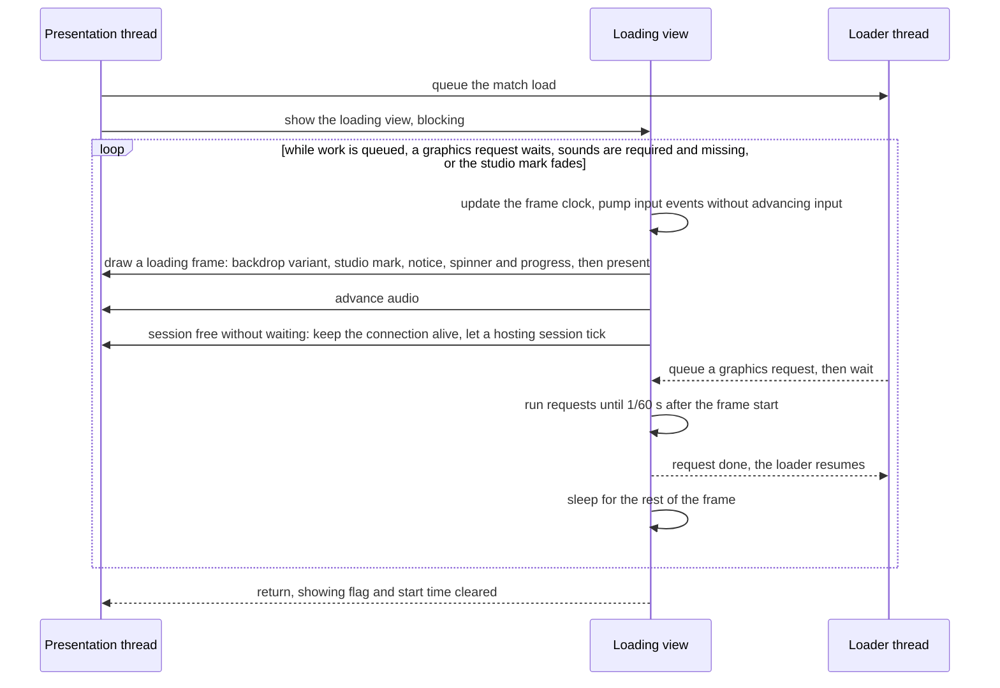
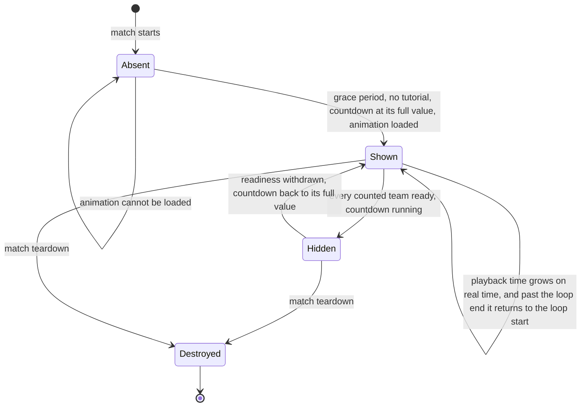
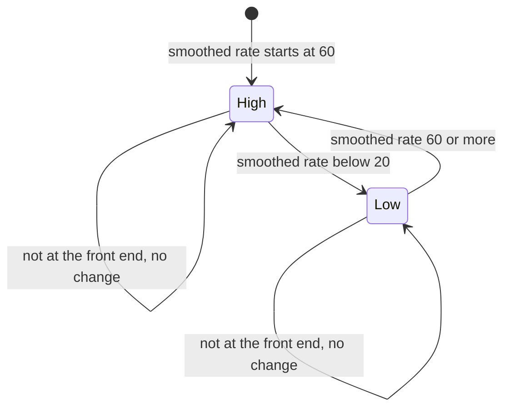

# Front-end presentation, loading view and explainer panel

> Status: Reference · Prefix: R-META · Related: [Folder index](README.md) · [Screen flow and match setup](screen_flow_and_match_setup.md) · [Options, localisation and hooks](options_localisation_and_hooks.md) · [01 Skirmish rules and modes](../01_skirmish_rules_and_modes/README.md) · [11 Tutorial and help](../11_tutorial_and_help.md) · [12 Simulation model](../12_simulation_model/README.md) · [UI framework](../../architecture/components/ui_framework/README.md) · [Animation and VFX](../../architecture/components/animation_and_vfx.md)

## 1 Purpose and player experience

This document specifies how the front end of the reference game looks and how it covers loads: the layout that every front-end page and options screen shares, the animated backdrop and title bar behind every page, the loading view that runs while the game starts up, while a match loads and while the map previews load, the explainer panel that shows how the current mode works while the players ready up, and the start of a match as the front end sees it. The pages themselves, the screen flow and the match setup are [screen_flow_and_match_setup.md](screen_flow_and_match_setup.md); the conventions of its §1.2 apply here too. How a widget is drawn and how the 2-D overlay pass composes the screen belong to the UI framework ([layout, rendering, input and localisation](../../architecture/components/ui_framework/layout_rendering_input_and_localisation.md), [pages and screen recipes](../../architecture/components/ui_framework/pages_and_screen_recipes.md)); how the explainer animations are played is shared with [animation and VFX](../../architecture/components/animation_and_vfx.md) (DEC-750, ADR-0035).

**Player experience.** Every page sits in the same frame: a title bar with the wordmark and two emblems at the top, a box of buttons on the left and an information box on the right, over a red, glowing backdrop in which a giant Worker figure breathes and a faint wheel turns. When the game starts, the screen is black but for a studio mark that fades in and out and a small green Worker spinning in the bottom-right corner; the same spinner turns over the menu while map previews load, and over a black screen while a match loads. In the frozen first seconds of a match, a framed panel at the bottom of the screen loops a short cartoon of the mode with its name above and a one-line summary below, until every human is ready and the countdown begins.

## 2 Rules

### 2.1 Shared page layout

**R-META-200** (MUST) Every front-end page and every options screen (`OptionsScreen`) uses one layout, computed from W and H:

| Quantity | Formula |
|---|---|
| horizontal split | `ref.meta.layout.horizontal_split` (0.26) × H |
| vertical split | `ref.meta.layout.vertical_split` (0.6) × W |
| gap | `ref.meta.layout.gap` (0.05) × vertical split, that is 0.03 × W |
| outer edges | left = top = gap; right = W − gap; bottom = H − gap. On a wide screen, W ÷ H > `ref.meta.layout.widescreen_aspect` (1.4): left += `ref.meta.layout.widescreen_inset` (0.08) × W and right −= `ref.meta.layout.widescreen_inset` × W |
| title bar | x = left; y = top; width = right − left; height = horizontal split − gap ÷ 2 − top |
| left box | x = left; y = horizontal split + gap ÷ 2; width = vertical split − gap ÷ 2 − left; height = bottom − y |
| right box | x = vertical split + gap ÷ 2; y = horizontal split + gap ÷ 2; width = right − x; height = bottom − y |
| fonts | large = `ref.meta.layout.font_large` (0.095) × H; medium = `ref.meta.layout.font_medium` (0.04) × H; small = `ref.meta.layout.font_small` (0.022) × H |
| standard button | width bw = `ref.meta.layout.button_width` (0.9) × lW; height bh = `ref.meta.layout.button_height` (1.3) × medium, that is 0.052 × H; button gap = `ref.meta.layout.button_gap` (0.1) × medium, that is 0.004 × H |

**R-META-201** (MUST) The standard page skeleton places its buttons centred in the left box at bx = lX + (lW − bw) ÷ 2. The page title sits at (lX + `ref.meta.layout.title_inset` (10 px), lY + 10 px, lW − 2 × 10 px, `ref.meta.layout.title_height` (1.5) × bh) in the medium font; it is drawn upper-cased, shrunk to fit, over the highlight beam (`ui.menu_highlight`). The first stacked button sits at y = lY + `ref.meta.layout.first_button_offset` (0.5 × bh + 1.3 × bh + one button step), where one button step is bh + button gap, and each further button one button step lower. The Back button sits at y = lY + lH − `ref.meta.layout.back_offset` (2) × bh. The right box carries an information panel (a picture, a description or the chat), which is outside the navigation order.

**R-META-202** (MUST) Page building, page transitions, the Back semantics and controller navigation follow the UI framework ([pages and screen recipes](../../architecture/components/ui_framework/pages_and_screen_recipes.md)). A Back button marked "previous page" returns to whichever page was showing before the current one.

**R-META-203** (MUST) The widgets of these pages (page buttons, page titles, text fields with their increase and decrease glyphs, drop-down lists in cycle mode or as a full-screen list, check boxes, Back and close buttons, text labels, scrolling text and pictures) render, take their palette and handle input as the UI framework specifies ([core and widgets](../../architecture/components/ui_framework/core_and_widgets.md)).

### 2.2 Persistent background

**R-META-204** (MUST) Every frame the front-end screen draws, in this order: the backdrop figure layer (R-META-205); the title bar (R-META-207); the content boxes of the current page (R-META-208); the page overlays (R-META-209); the widgets. While a drop-down list is open, only the widget that owns the list is drawn of the page's widgets.

**R-META-205** (MUST) The backdrop figure layer, which the options screens and the drop-down menus also draw, consists of:

1. a full-screen additive quad, black at three corners and `ref.meta.backdrop.glow_colour` (RGB 1.0, 0.5, 0.1) at the bottom-left corner, smoothly shaded;
2. the giant Worker figure, `sprite.worker.front`, with nearest filtering and tint `ref.meta.backdrop.figure_tint` (RGBA 1, 0, 0, 1), centred at `ref.meta.backdrop.figure_centre` (0.75 × W, 0.7 × H), of half-size `ref.meta.backdrop.figure_half_size` (0.3 × W) + `ref.meta.backdrop.figure_breath` (5 px) × sin(t), so that it breathes, and rotated by `ref.meta.backdrop.figure_angle` (0.2 rad);
3. in high detail only, `ref.meta.backdrop.echo_count` (10) echo copies of the figure, copy i from 0 to 9: each copy's size is the previous size × `ref.meta.backdrop.echo_scale` (1.02) and its centre the previous centre shifted by `ref.meta.backdrop.echo_offset` (−6, −6) px, tinted `ref.meta.backdrop.echo_tint` (RGB 1, 0.2, 0.2) at alpha `ref.meta.backdrop.echo_alpha` (0.2) × (1 − i ÷ 10);
4. the wheel, `ui.backdrop_wheel`, of half-size `ref.meta.backdrop.wheel_half_size` (0.6 × W), centred on the screen, at angle `ref.meta.backdrop.wheel_spin` (0.2 rad per second) × t, additive white at alpha `ref.meta.backdrop.wheel_alpha` (0.06), drawn `ref.meta.backdrop.wheel_copies` (10) times in high detail, each copy rotated a further `ref.meta.backdrop.wheel_copy_step` (0.02 rad), and not at all in low detail.

**R-META-206** (MUST) The detail level of R-META-205 changes only while the participant is at the front end. Each frame the smoothed frame rate becomes smoothed × (1 − k) + rate × k, with k = frame advance time × `ref.meta.backdrop.fps_smoothing` (0.5). The layer switches to low detail when the smoothed rate falls below `ref.meta.backdrop.low_detail_fps` (20) and back to high detail when it reaches `ref.meta.backdrop.high_detail_fps` (60). The smoothed rate starts at `ref.meta.backdrop.initial_fps` (60).

**R-META-207** (MUST) The title bar is a fill box. When the title string `ui.title.game_name` of the current language is the unchanged game name, the title wordmark `ui.title_wordmark` is drawn: its width is the width of that many characters of the title font at the large size × `ref.meta.title.wordmark_width_factor` (1.1), its height is that width ÷ `ref.meta.title.wordmark_aspect` (5.4), and its top is at the title bar's y + `ref.meta.title.wordmark_top` (0.1) × the title bar's height. Otherwise the title text is drawn with an outline. The tagline `ui.title.tagline` is drawn at the medium size, one large-font line below. The logo emblem `ui.logo_emblem`, of aspect `ref.meta.title.emblem_aspect` (277 ÷ 194) and height `ref.meta.title.emblem_height` (0.8) × the title bar's height, is drawn at x = the title bar's x + `ref.meta.title.emblem_inset` (0.05) × its width, and mirrored at the right end.

**R-META-208** (MUST) The content boxes are shadowed fill boxes (`ui.fill_blur`, `fx.glow_cloudy`; [pages and screen recipes](../../architecture/components/ui_framework/pages_and_screen_recipes.md)), by page: the match setup page has the left and the right box; the session browser page has one box of the title bar's width; the connecting page has the left box; the mode-select, map-select and advanced options pages have the left and the right box; every other page, the title page included, has the left box only.

**R-META-209** (MUST) The page overlays are: on the session browser page with an empty list, the blinking caption `ui.browser.requesting` while the list is being requested and `ui.browser.none_found` when no session was found (DEC-245). A blinking caption has alpha `ref.meta.blink.on_alpha` (1.0) for the first `ref.meta.blink.on_time` (0.5 s) of each second and `ref.meta.blink.off_alpha` (0.5) for the rest.

**R-META-210** (MUST) The 3-D backdrop behind the screen is drawn by the front-end controller whenever the participant is at the front end and the menu exists, and also by the loading view (R-META-219). It advances the camera, places it at the origin with a field of view of `ref.meta.backdrop.camera_fov` (90°), and builds the view from the eye `ref.meta.backdrop.camera_eye` (0, 600, 0) wu, the front (0, 0, 1) and the up vector (0, 1, 0), each rotated about the y axis by `ref.meta.backdrop.camera_yaw` (−1.899 rad) and then about the z axis by `ref.meta.backdrop.camera_roll` (−1.079 rad); the focus point is eye + front × `ref.meta.backdrop.camera_focus_distance` (100 wu). It then draws the sky and its cloud layers (`fx.sky_cloud`; the sky renderer `SkyRenderer`, [world renderers](../../architecture/components/renderer/world_renderers.md)) at the time −(real time); the sky-detail setting applies ([options_localisation_and_hooks.md](options_localisation_and_hooks.md)).


### 2.3 Loading view

**R-META-211** (MUST) The loading view (`LoadingView`) is a blocking presentation loop. It keeps the window alive and animated while a background loader performs a load, runs on the presentation thread the graphics requests that the loader queues, and keeps audio and the session going. Besides its spinner and, at start-up, the studio mark, it shows the progress of the load (DEC-026); how Species loads and measures progress is DEC-226.

**R-META-212** (MUST) One loading view exists for the process, created before the application root ([reference/12](../12_simulation_model/02_match_lifecycle_and_state_reset.md) §2.1). Its state, every field initialised at creation:

| State | Initial | Meaning |
|---|---|---|
| showing flag | clear | set while the loop of R-META-217 runs |
| spinner picture | none | `sprite.worker.front`, set once the asset cache can provide it |
| initial-load flag | set | set only for the very first load; cleared when start-up has finished |
| start time | none | the time of the first drawn frame of the current showing; cleared when the loop ends |
| loader | one worker | the background loader thread and its first-in-first-out job queue |
| graphics requests | empty | the requests queued by loader jobs, guarded by a lock |
| fade-out start | none | when the studio mark began to fade out |
| mark fade-out flag | clear | keeps the loop alive until the studio mark has faded out, on the initial load only |

**R-META-213** (MUST) The loader runs its jobs one at a time, in the order queued, to completion. Its jobs are: the application's start-up initialisation, while the presentation thread shows the loading view; every match load; and the thumbnails of the map-select page ([screen_flow_and_match_setup.md](screen_flow_and_match_setup.md) R-META-034).

**R-META-214** (MUST) The sound banks load on a second worker, queued once the start-up work has finished, so that two reads of the content archive never overlap (DEC-226 item 5). The audio device and the sound banks have their own ready points (DEC-226 item 6).

**R-META-215** (MUST) A loader job that needs work which only the presentation thread may do, such as creating or releasing a texture, creating mesh buffers or setting up the terrain renderer's buffers, queues a graphics request and waits until the presentation thread has run it; a request made on the presentation thread runs at once. Requests queued while no loading view shows run once per frame in the match loop ([reference/12](../12_simulation_model/01_tick_timing_and_main_loop.md) R-SIM-581 step 6). This is the reference model; under DEC-226 item 4 Species GPU uploads go through the copy queue and no loader waits on the presentation thread.

**R-META-216** (MUST) While the loading view shows, asset-cache look-ups are serialised and every game sound event is dropped ([reference/12](../12_simulation_model/02_match_lifecycle_and_state_reset.md) §2.1, the load lifetime; DEC-226 item 6).

**R-META-217** (MUST) Showing the loading view sets the showing flag, sets the mark fade-out flag to the initial-load flag and clears the fade-out start. The loop runs while any of these holds: the loader has queued work; a graphics request is queued; the sounds are required and not yet loaded (R-META-218); the mark fade-out flag is set. Each iteration runs these steps, which keep the session going and pace the loop (DEC-225):

1. updates the frame clock, its advance clamped to `ref.sim.frame.delta_clamp` (0.25 s; [reference/12](../12_simulation_model/01_tick_timing_and_main_loop.md));
2. pumps the input events without advancing input, so that no action fires during a load;
3. once the application, its asset cache and its renderer exist: draws a loading frame (R-META-219); advances audio; and, when the session can be taken without waiting, keeps the participant's connection alive and lets a hosting session issue its command frame when one is due, so that a host keeps ticking and nobody times out during a load (R-SIM-521, R-SIM-533; DEC-225 item 4);
4. runs one graphics request, then further requests until `ref.sim.frame.loading_frame_period` (1/60 s) after the frame start, and sleeps for whatever remains, so loading frames are capped at 60 per second (DEC-225).

When the loop ends it clears the showing flag and the start time.

**R-META-218** (MUST) The sounds become required when the player leaves the front-end loop, so the first match load also waits for the background sound load; the front end itself never waits for it.

**R-META-219** (MUST) A loading frame draws this, in order:

1. While the spinner picture is not available, the frame tries to obtain it; until it has it, the frame draws nothing and presents nothing, so the screen keeps its last frame.
2. On the first frame drawn, the start time is recorded. The frame clears colour to `ref.meta.loading.clear_colour` (RGBA 0, 0, 0, 0) and clears depth.
3. **Menu backdrop variant.** When this is not the initial load, no match is loading, the participant is at the front end and the screen fade has completed, the frame draws the 3-D backdrop (R-META-210) and the UI, so that the menu stays visible under the spinner while thumbnails load.
4. The frame switches to 2-D screen drawing.
5. **Studio mark, on the initial load only.** It starts at `ref.meta.loading.mark_start` (0 s) and fades in over `ref.meta.loading.mark_fade_in` (1.0 s): alpha = min(elapsed ÷ 1.0 s, 1). Once the loader is idle and no graphics request is queued, the fade-out starts: alpha = 1 − (now − fade-out start) ÷ `ref.meta.loading.mark_fade_out` (1.0 s); when alpha reaches 0 or less the mark fade-out flag clears, which lets the loop end. The mark `ui.studio_splash` is centred and square, `ref.meta.loading.mark_size` (500 px) × H ÷ `ref.meta.loading.mark_reference_height` (1024) on a side, in white at that alpha. When the string `ui.loading.online_notice` exists, it is drawn centred at (W ÷ 2, `ref.meta.loading.notice_y` (0.95) × H) with a font of `ref.meta.loading.notice_font` (0.02) × H, in white at alpha − `ref.meta.loading.notice_alpha_offset` (0.5), so at most half opaque.
6. **Spinner, always.** `sprite.worker.front`, `ref.meta.loading.spinner_size` (100 px) square, centred at (W − `ref.meta.loading.spinner_inset` (100 px), H − 100 px), in `ref.meta.loading.spinner_colour` (RGBA 0.2, 0.8, 0.2, 1), rotated about its centre by (t × `ref.meta.loading.spinner_speed` (90° per second)) mod 360°.
7. The frame is presented.

### 2.4 Explainer panel

**R-META-220** (MUST) The explainer panel shows an explainer animation (`ExplainerAnimation`): a short key-framed 2-D animation of pictures that move, turn and fade, in a framed box at the bottom centre of the screen, titled with the mode's name and captioned with a one-line summary of the mode. It plays during the grace period, so that the players learn how the mode works while they ready up (DEC-037). Each mode has one explainer animation (`anim.explainer`), which animates pictures of `help.explainer_picture`; what each reference animation depicts is a brief for the new art, and the choreography is authored new (DEC-037). The authoring format is the data schemas' and the player is [animation and VFX](../../architecture/components/animation_and_vfx.md) (ADR-0035, DEC-750).

**R-META-221** (MUST) The match's mode selects the explainer animation, the `anim.explainer` file of that mode. A mode without an explainer animation shows no panel.

**R-META-222** (MUST) The panel is created when it is first needed during the grace period, once per match; when its animation cannot be loaded, no panel exists for that match. It is destroyed at match teardown, with the hint overlay ([reference/12](../12_simulation_model/02_match_lifecycle_and_state_reset.md) R-SIM-028 step 7).

**R-META-223** (MUST) The panel is drawn only while the match is in its grace period, no tutorial runs and the grace countdown stands at its full value `ref.match.grace_period` (30 ticks). The countdown holds that value until every counted team is ready ([reference/01](../01_skirmish_rules_and_modes/README.md) R-MODE-040), so the panel shows while the players ready up and disappears when the countdown starts. It is not drawn while there is no match world, while the interface is hidden, after game over, while the Siege victory timer runs, or while the participant has no local team. In a tutorial the camera-controls picture shows instead ([reference/11](../11_tutorial_and_help.md)).

**R-META-224** (MUST) The panel's place on the screen, with the canvas width and height of its animation: scale = H ÷ `ref.meta.explainer.reference_height` (1300); panel width w = canvas width × scale and height h = canvas height × scale; x = W ÷ 2 − w ÷ 2; y = H − canvas height × `ref.meta.explainer.bottom_factor` (1.15) × scale. The frame border is `ref.meta.explainer.border` (5 px), the title band `ref.meta.explainer.title_band` (25 px) and the caption band `ref.meta.explainer.caption_band` (15 px), none of them scaled.

**R-META-225** (MUST) The reference explainer animations have these canvases, loops and contents; the canvas sizes and loop lengths are kept, and the pictures are named by their role in `help.explainer_picture`:

| Mode | Canvas and loop | Objects, keys | Pictures |
|---|---|---|---|
| Spawn Control | `ref.meta.explainer.spawn_control` (800 × 250, 0 to 15.01 s) | 28, 169 | soft glow, Worker figure, hurt Worker, laser beam, muzzle flash, Spawn Node |
| Zone Control | `ref.meta.explainer.zone_control` (800 × 250, 0 to 15.66 s) | 17, 108 | soft glow, Worker figure, hurt Worker, laser beam, muzzle flash, +1 score pop-up, Spawn Node, Control Zone back layer, Control Zone front layer |
| Relic Run | `ref.meta.explainer.relic_run` (924 × 250, 0 to 20.01 s) | 23, 111 | soft glow, Worker figure, hurt Worker, laser beam, muzzle flash, +1 score pop-up, Spawn Node, Relic, Control Zone back layer, Control Zone front layer |
| Siege | `ref.meta.explainer.siege` (900 × 250, 0 to 12.02 s) | 14, 135 | soft glow, Worker figure, hurt Worker, muzzle flash, Transit Gate, turret barrel, turret base, Core Device |
| Launch Race | `ref.meta.explainer.launch_race` (1000 × 250, 0 to 30.01 s) | 21, 173 | Transport, soft glow, Worker figure, fuel pump, fuel pump arm, island outline, laser beam, muzzle flash, Launch Vessel, Solar Array, Transit Gate, water band |
| Flag Chain | `ref.meta.explainer.flag_chain` (900 × 250, 0 to 24.01 s) | 28, 180 | soft glow, Worker figure, hurt Worker, neutral flag, lowered flag, locked flag, raised flag, fuel pump arm, laser beam, muzzle flash, Transit Gate |

**R-META-226** (MUST) An explainer animation holds a canvas width and height, a loop start and a loop end, a playback time and its objects in draw order; each object holds its keys in the order authored, unsorted. An animation that sets none of them has the canvas `ref.meta.explainer.default_canvas` (600 × 300) and the loop `ref.meta.explainer.default_loop` (0 to 30 s), and its playback time starts at 0. A key holds:

| Field | Unit | Default (`ref.meta.explainer.key_defaults`) | Between keys |
|---|---|---|---|
| time | s | 0 | the key's position on the timeline |
| picture | a `help.explainer_picture` role | the Worker figure | held: the earlier key's value |
| x, y | canvas units | 100, 100 | eased |
| colour role | none, friendly, enemy, invisible | none | held |
| scale | × the picture's pixel size | 0.3 | eased |
| angle | degrees | 0 | linear |
| horizontal flip | off, on | off | held |
| alpha | 0 to 255 | 255 | linear, truncated to an integer |

**R-META-227** (MUST) The colour roles resolve when the frame is drawn (DEC-750, ADR-0035): none is white (255, 255, 255); friendly is the local team's colour; enemy is the colour of the first team slot from 0 to 5 that is not unused and is not a friend of the local team ([reference/12](../12_simulation_model/06_teams_and_player_commands.md) R-SIM-412), or white when there is none; invisible is (255, 255, 255, 0), and the key's alpha is ignored.

**R-META-228** (MUST) An object's state at playback time t is:

```
Evaluate(object, t):
    left  := the key with the greatest time <= t       # linear scan; on a tie the first key found
    right := the key with the smallest time >= t       # linear scan; on a tie the first key found
    if left is none:                     return not drawn   # also when only right exists:
                                                            # an object is hidden before its first key
    if right is none:                    return left
    if left == right or |right.time - left.time| < key_merge_tolerance:
                                         return left
    lin  := (t - left.time) / (right.time - left.time)
    ramp := Ease(left.time, right.time - left.time, t)
    state := copy of left
    state.x, state.y, state.scale := lerp(left, right, ramp)
    state.angle, state.alpha      := lerp(left, right, lin)  # alpha truncated to an integer
    return state

Ease(start, duration, t):
    f := (t - start) / duration
    if f > 1:   return 1
    if f < 0.5: return 2 * f * f
    return 1 - 2 * (1 - f) * (1 - f)                        # quadratic ease in and out
```

with `key_merge_tolerance` = `ref.meta.explainer.key_merge_tolerance` (0.01 s).

**R-META-229** (MUST) The playback clock runs on real time, not game time (ADR-0036). On the panel's first draw the playback time is 0 and the timer is set to now; on every draw the playback time grows by now − timer, and the timer becomes now. When the playback time passes the loop end it becomes the loop start, and the excess is discarded. The first pass therefore starts at 0 even when the loop start is later, so the span before the loop start plays once as a lead-in; every later pass restarts at the loop start; each pass lasts the loop length plus up to one frame; and keys after the loop end are never reached (DEC-750).

**R-META-230** (MUST) The panel background is a black quad at alpha `ref.meta.explainer.background_alpha` (0.9) over (x − border, y − title band − border) to (x + w + border, y + h + border + caption band), with an outer line loop of white at alpha `ref.meta.explainer.outer_line_alpha` (0.45) on the same rectangle and an inner line loop of white at alpha `ref.meta.explainer.inner_line_alpha` (0.225) on (x, y − title band) to (x + w, y + h + caption band).

**R-META-231** (MUST) The objects are clipped to (x + `ref.meta.explainer.clip_inset` (1 px), y − title band + 1 px), w − 1 px wide and h + title band + caption band − 1 px high, and drawn in list order with standard alpha blending. With s = w ÷ canvas width, an object whose state exists draws its picture, filtered linearly with mip maps and clamped at its edges, picture width × key scale × s wide and picture height × key scale × s high, centred at (x + key x × s, y + key y × s), rotated about its centre by the key angle in degrees, mirrored horizontally when the flip is on, in the colour of its role with alpha = the key alpha, unless the role is invisible.

**R-META-232** (MUST) The title is the mode's name `mode.<mode>.name`, upper-cased, in the title font at `ref.meta.explainer.title_font` (30 px), centred at (x + w ÷ 2, y − title band + `ref.meta.explainer.title_offset` (10 px)), drawn as an outline pass in (1, 1, 1, 0) and then a fill pass in (1, 1, 1, 1).

**R-META-233** (MUST) The caption is `ui.help.explainer.<mode>.caption`, one string per mode, in the body font at `ref.meta.explainer.caption_font` (18 px), word-wrapped to w with a character-width estimate of 18 ÷ `ref.meta.explainer.caption_wrap_divisor` (1.7) px. Its lines are centred at x + w ÷ 2; the bottom line sits at y = y + h + caption band − `ref.meta.explainer.caption_bottom` (12 px), each earlier line 18 px above the next; each line is drawn as an outline pass and then a fill pass.

### 2.5 The match start as the front end sees it

**R-META-234** (MUST) Every match starts the same way, by the rules of [reference/01](../01_skirmish_rules_and_modes/README.md) R-MODE-039 to R-MODE-042 and [reference/12](../12_simulation_model/01_tick_timing_and_main_loop.md) R-SIM-550:

1. The loading view finishes (§2.3); the world stays held, with game time not advancing, until the grace period ends.
2. The grace countdown starts at `ref.match.grace_period` (30 ticks). Only local-player, remote-player and spectator teams are counted; bot teams are never waited for. While a counted team is not ready, the countdown returns to its full value, and the player sees the ready prompt (`match.grace_period.prompt_keyboard` or `match.grace_period.prompt_pad`, then `match.grace_period.waiting` once ready) and the explainer panel (§2.4), or the camera-controls picture in a tutorial. In Relic Run the starting Relic is ensured.
3. Once every counted team is ready, the countdown-tick cue sounds on the first ready tick, the countdown falls by 1 per tick and the overlay shows `match.grace_period.countdown`, with a countdown-tick cue for each displayed number; the explainer panel disappears (R-META-223).
4. When the countdown reaches 0, 30 ticks after everyone was ready, the countdown-zero cue sounds, normal game speed is requested at once, and the visited-map achievement event is emitted (the Tourist hook, DEC-047).

## 3 States and flows

Diagram 3-A: one showing of the loading view, here for a match load (R-META-213 to R-META-219).



Diagram 3-B: the explainer panel during one match (R-META-221 to R-META-223, R-META-229).



Diagram 3-C: the detail level of the backdrop figure layer (R-META-206).



## 4 Tuning table

### 4.1 Keys owned by this document

All values are presentation; real-time values are seconds of the presentation clock.

| key | value | unit | range or notes | requirement | DEC |
|---|---|---|---|---|---|
| `ref.meta.layout.horizontal_split` | 0.26 | × H | | R-META-200 | — |
| `ref.meta.layout.vertical_split` | 0.6 | × W | | R-META-200 | — |
| `ref.meta.layout.gap` | 0.05 | × the vertical split | 0.03 × W | R-META-200 | — |
| `ref.meta.layout.widescreen_aspect` | 1.4 | W ÷ H | wide screen above | R-META-200 | — |
| `ref.meta.layout.widescreen_inset` | 0.08 | × W | added to the left edge and taken from the right edge | R-META-200 | — |
| `ref.meta.layout.font_large` | 0.095 | × H | | R-META-200 | — |
| `ref.meta.layout.font_medium` | 0.04 | × H | | R-META-200 | — |
| `ref.meta.layout.font_small` | 0.022 | × H | | R-META-200 | — |
| `ref.meta.layout.button_width` | 0.9 | × lW | bw | R-META-200 | — |
| `ref.meta.layout.button_height` | 1.3 | × the medium font | bh, 0.052 × H | R-META-200 | — |
| `ref.meta.layout.button_gap` | 0.1 | × the medium font | 0.004 × H | R-META-200 | — |
| `ref.meta.layout.title_inset` | 10 | px | page title inset from the left box | R-META-201 | — |
| `ref.meta.layout.title_height` | 1.5 | × bh | page title | R-META-201 | — |
| `ref.meta.layout.first_button_offset` | 0.5 × bh + 1.3 × bh + one button step | below lY | one button step = bh + button gap | R-META-201 | — |
| `ref.meta.layout.back_offset` | 2 | × bh, above the left box's bottom | Back and the last button | R-META-201 | — |
| `ref.meta.layout.picture_inset` | 0.1 | × rW | right-box pictures and the chat input | R-META-201 | — |
| `ref.meta.backdrop.glow_colour` | 1.0, 0.5, 0.1 | RGB, 0 to 1 | bottom-left corner of the additive quad | R-META-205 | — |
| `ref.meta.backdrop.figure_tint` | 1, 0, 0, 1 | RGBA, 0 to 1 | | R-META-205 | — |
| `ref.meta.backdrop.figure_centre` | 0.75 × W, 0.7 × H | px | | R-META-205 | — |
| `ref.meta.backdrop.figure_half_size` | 0.3 | × W | before the breathing term | R-META-205 | — |
| `ref.meta.backdrop.figure_breath` | 5 | px × sin(t) | | R-META-205 | — |
| `ref.meta.backdrop.figure_angle` | 0.2 | rad | | R-META-205 | — |
| `ref.meta.backdrop.echo_count` | 10 | copies | high detail only | R-META-205 | — |
| `ref.meta.backdrop.echo_scale` | 1.02 | × the previous size | | R-META-205 | — |
| `ref.meta.backdrop.echo_offset` | −6, −6 | px from the previous centre | | R-META-205 | — |
| `ref.meta.backdrop.echo_tint` | 1, 0.2, 0.2 | RGB, 0 to 1 | | R-META-205 | — |
| `ref.meta.backdrop.echo_alpha` | 0.2 | alpha × (1 − i ÷ 10) | | R-META-205 | — |
| `ref.meta.backdrop.wheel_half_size` | 0.6 | × W | | R-META-205 | — |
| `ref.meta.backdrop.wheel_spin` | 0.2 | rad per second | | R-META-205 | — |
| `ref.meta.backdrop.wheel_alpha` | 0.06 | alpha | additive white | R-META-205 | — |
| `ref.meta.backdrop.wheel_copies` | 10 | copies | high detail; none in low detail | R-META-205 | — |
| `ref.meta.backdrop.wheel_copy_step` | 0.02 | rad | extra rotation per copy | R-META-205 | — |
| `ref.meta.backdrop.fps_smoothing` | 0.5 | × the frame advance time | k of the smoothing | R-META-206 | — |
| `ref.meta.backdrop.low_detail_fps` | 20 | frames per second | low detail below | R-META-206 | — |
| `ref.meta.backdrop.high_detail_fps` | 60 | frames per second | high detail again at or above | R-META-206 | — |
| `ref.meta.backdrop.initial_fps` | 60 | frames per second | | R-META-206 | — |
| `ref.meta.backdrop.camera_fov` | 90 | degrees | | R-META-210 | — |
| `ref.meta.backdrop.camera_eye` | 0, 600, 0 | wu | before the two rotations | R-META-210 | — |
| `ref.meta.backdrop.camera_yaw` | −1.899 | rad about the y axis | first rotation | R-META-210 | — |
| `ref.meta.backdrop.camera_roll` | −1.079 | rad about the z axis | second rotation | R-META-210 | — |
| `ref.meta.backdrop.camera_focus_distance` | 100 | wu | | R-META-210 | — |
| `ref.meta.title.wordmark_width_factor` | 1.1 | × the text width | | R-META-207 | — |
| `ref.meta.title.wordmark_aspect` | 5.4 | width ÷ height | | R-META-207 | — |
| `ref.meta.title.wordmark_top` | 0.1 | × the title bar height | | R-META-207 | — |
| `ref.meta.title.emblem_aspect` | 277 ÷ 194 | width ÷ height | | R-META-207 | — |
| `ref.meta.title.emblem_height` | 0.8 | × the title bar height | | R-META-207 | — |
| `ref.meta.title.emblem_inset` | 0.05 | × the title bar width | | R-META-207 | — |
| `ref.meta.blink.on_alpha` | 1.0 | alpha | | R-META-209 | — |
| `ref.meta.blink.on_time` | 0.5 | s of each second | | R-META-209 | — |
| `ref.meta.blink.off_alpha` | 0.5 | alpha | | R-META-209 | — |
| `ref.meta.loading.clear_colour` | 0, 0, 0, 0 | RGBA | | R-META-219 | — |
| `ref.meta.loading.mark_start` | 0 | s | the studio mark starts at once | R-META-219 | — |
| `ref.meta.loading.mark_fade_in` | 1.0 | s | | R-META-219 | — |
| `ref.meta.loading.mark_fade_out` | 1.0 | s | | R-META-219 | — |
| `ref.meta.loading.mark_size` | 500 | px at the reference height | | R-META-219 | — |
| `ref.meta.loading.mark_reference_height` | 1024 | px | size = 500 × H ÷ 1024 | R-META-219 | — |
| `ref.meta.loading.notice_y` | 0.95 | × H | | R-META-219 | — |
| `ref.meta.loading.notice_font` | 0.02 | × H | | R-META-219 | — |
| `ref.meta.loading.notice_alpha_offset` | 0.5 | alpha subtracted | | R-META-219 | — |
| `ref.meta.loading.spinner_size` | 100 | px | | R-META-219 | — |
| `ref.meta.loading.spinner_inset` | 100 | px from the right and bottom edges | spinner centre | R-META-219 | — |
| `ref.meta.loading.spinner_colour` | 0.2, 0.8, 0.2, 1 | RGBA, 0 to 1 | | R-META-219 | — |
| `ref.meta.loading.spinner_speed` | 90 | degrees per second | | R-META-219 | — |
| `ref.meta.explainer.reference_height` | 1300 | px | scale = H ÷ 1300 | R-META-224 | — |
| `ref.meta.explainer.bottom_factor` | 1.15 | × the canvas height × scale | distance of the panel top from the bottom | R-META-224 | — |
| `ref.meta.explainer.border` | 5 | px | | R-META-224 | — |
| `ref.meta.explainer.title_band` | 25 | px | | R-META-224 | — |
| `ref.meta.explainer.caption_band` | 15 | px | | R-META-224 | — |
| `ref.meta.explainer.spawn_control` | 800 × 250; 0 to 15.01 s | canvas units; s | | R-META-225 | DEC-750 |
| `ref.meta.explainer.zone_control` | 800 × 250; 0 to 15.66 s | canvas units; s | | R-META-225 | DEC-750 |
| `ref.meta.explainer.relic_run` | 924 × 250; 0 to 20.01 s | canvas units; s | | R-META-225 | DEC-750 |
| `ref.meta.explainer.siege` | 900 × 250; 0 to 12.02 s | canvas units; s | | R-META-225 | DEC-750 |
| `ref.meta.explainer.launch_race` | 1000 × 250; 0 to 30.01 s | canvas units; s | | R-META-225 | DEC-750 |
| `ref.meta.explainer.flag_chain` | 900 × 250; 0 to 24.01 s | canvas units; s | | R-META-225 | DEC-750 |
| `ref.meta.explainer.default_canvas` | 600 × 300 | canvas units | an animation that sets none | R-META-226 | — |
| `ref.meta.explainer.default_loop` | 0 to 30 | s | | R-META-226 | DEC-750 |
| `ref.meta.explainer.key_defaults` | time 0; Worker figure; x, y 100, 100; colour role none; scale 0.3; angle 0; flip off; alpha 255 | per field | | R-META-226 | — |
| `ref.meta.explainer.key_merge_tolerance` | 0.01 | s | two keys closer than this act as one | R-META-228 | — |
| `ref.meta.explainer.background_alpha` | 0.9 | alpha | black panel | R-META-230 | — |
| `ref.meta.explainer.outer_line_alpha` | 0.45 | alpha | | R-META-230 | — |
| `ref.meta.explainer.inner_line_alpha` | 0.225 | alpha | | R-META-230 | — |
| `ref.meta.explainer.clip_inset` | 1 | px | | R-META-231 | — |
| `ref.meta.explainer.title_font` | 30 | px | | R-META-232 | — |
| `ref.meta.explainer.title_offset` | 10 | px below the top of the title band | | R-META-232 | — |
| `ref.meta.explainer.caption_font` | 18 | px | also the line spacing | R-META-233 | — |
| `ref.meta.explainer.caption_wrap_divisor` | 1.7 | — | character-width estimate 18 ÷ 1.7 px | R-META-233 | — |
| `ref.meta.explainer.caption_bottom` | 12 | px above the bottom of the caption band | | R-META-233 | — |

### 4.2 String table

| String id | Text |
|---|---|
| `ui.title.game_name` | Species |
| `ui.title.tagline` | Grow the crowd, hold the ground |
| `ui.browser.requesting` | Looking for matches |
| `ui.browser.none_found` | No matches found |
| `ui.loading.online_notice` | Online play: other players' conduct is not rated. |
| `ui.help.explainer.spawn_control.caption` | Capture Spawn Nodes to grow your crowd; a team left with none is knocked out. |
| `ui.help.explainer.zone_control.caption` | Fill the zones with Workers; every second you hold one scores. |
| `ui.help.explainer.relic_run.caption` | Carry Relics home to your base; each delivery scores a point. |
| `ui.help.explainer.siege.caption` | Attackers take the consoles before the Core Device fires; defenders hold out. |
| `ui.help.explainer.launch_race.caption` | Power the fuel pumps, crew your Launch Vessel and launch it first. |
| `ui.help.explainer.flag_chain.caption` | Link Flag posts into a chain that reaches an enemy Home post. |

String ids cited from other documents: `mode.<mode>.name` and `match.grace_period.*` ([reference/01](../01_skirmish_rules_and_modes/README.md)).

### 4.3 Keys cited here and defined elsewhere

| key | owner |
|---|---|
| `ref.sim.frame.delta_clamp`, `ref.sim.frame.loading_frame_period` | [reference/12 tick timing](../12_simulation_model/01_tick_timing_and_main_loop.md) |
| `ref.match.grace_period`, the grace countdown | [reference/01](../01_skirmish_rules_and_modes/README.md) |

## 5 Edge cases and interactions

1. **No spinner yet.** Until the asset cache can provide the spinner picture, loading frames draw and present nothing, so the screen keeps its last frame (R-META-219 step 1).
2. **A quick start-up.** When the start-up work finishes before the studio mark has fully faded in, the fade-out starts at full opacity, so the mark jumps to opaque and then fades over 1.0 s; the loop always lasts until the mark has faded (R-META-217, R-META-219 step 5).
3. **The first match load waits for the sounds** loaded in the background, so it can last longer than later loads (R-META-218).
4. **A host that is loading** still issues its command frames and every participant keeps its connection alive, so nobody times out during a load (R-META-217 step 3).
5. **Explainer lead-in and late keys.** The first pass starts at 0 even when the loop starts later, and keys after the loop end are never reached; an object whose first key lies later in the loop is hidden until then (R-META-228, R-META-229; DEC-750).
6. **The enemy colour.** The enemy role takes the first non-friendly slot from 0 to 5, which can be a faction slot, such as the Rogue faction's dark colour, when no player slot is an enemy of the local team (R-META-227).
7. **Backdrop detail in a match.** The detail level is evaluated only at the front end, so a match never changes it; the hysteresis between 20 and 60 frames per second keeps it from flickering (R-META-206).
8. **A translated title.** When the current language translates `ui.title.game_name`, the title bar shows that text instead of the wordmark (R-META-207).
9. **Readiness withdrawn.** When a player withdraws readiness during the countdown, the countdown returns to its full value and the explainer panel shows again from its current playback time (R-META-223, R-META-229).

## 6 Acceptance criteria

- **AC-META-P01** (R-META-200) Given W = 1280 and H = 720, then the screen is wide; the horizontal split is 187.2, the vertical split 768 and the gap 38.4; the left edge is 140.8 and the right edge 1,139.2; the left box is (140.8, 206.4), 608 × 475.2; the right box is (787.2, 206.4), 352 × 475.2; the fonts are 68.4, 28.8 and 15.84; bw = 547.2, bh = 37.44 and the button gap 2.88.
- **AC-META-P02** (R-META-200) Given W = 1024 and H = 768, then the screen is not wide; the left edge is 30.72, the right edge 993.28 and the title bar 153.6 high.
- **AC-META-P03** (R-META-206) Given high detail, when the smoothed rate falls to 19, then low detail applies; when it rises to 59, then low detail stays; at 60, then high detail applies; in a match no change happens at any rate.
- **AC-META-P04** (R-META-205) Given t = π ÷ 2 s and W = 1000, then the figure's half-size is 305 px; the third echo copy (i = 2) is 1.02³ × that size, offset (−18, −18) px, at alpha 0.16.
- **AC-META-P05** (R-META-217, R-META-219) Given the initial load whose loader becomes idle at an elapsed time of 0.4 s, then the studio mark's alpha is 0.4 just before, 1.0 when the fade-out starts and 0.5 half a second later, and the loop ends 1.0 s after the fade-out started.
- **AC-META-P06** (R-META-217) Given a loading frame whose drawing took 4 ms, then graphics requests run until 16.7 ms after the frame start and the loop then sleeps for any time left.
- **AC-META-P07** (R-META-219) Given t = 5 s, then the spinner is rotated by 90°; given H = 2048, then the studio mark is 1,000 px square.
- **AC-META-P08** (R-META-224) Given H = 1300 and the Spawn Control animation, then scale = 1, the panel is 800 × 250 and its top is at y = 1,012.5.
- **AC-META-P09** (R-META-228) Given keys at t = 0 with x = 0 and angle 0 and at t = 2 with x = 100 and angle 40: at t = 0.5, then x = 12.5 and the angle is 10; at t = 1.5, then x = 87.5 and the angle is 30; given keys at t = 1 and t = 1.005, then the state at t = 1.002 is the first key; given an object whose first key is at t = 3, then it is not drawn at t = 2.
- **AC-META-P10** (R-META-229) Given the Spawn Control loop and a playback time of 15.0 s, when a frame adds 0.05 s, then the playback time becomes 0, the loop start.
- **AC-META-P11** (R-META-223) Given a match in its grace period, then the panel is drawn while the grace countdown is 30 and not drawn when it is 29; in a tutorial it is never drawn.
- **AC-META-P12** (R-META-216) Given the loading view showing, when a game sound event fires, then it is dropped.

## 7 Dependencies

- **Reference documents:** [screen_flow_and_match_setup.md](screen_flow_and_match_setup.md) (the pages that use this layout, the map-select previews); [options_localisation_and_hooks.md](options_localisation_and_hooks.md) (the sky-detail setting); [01 Skirmish rules and modes](../01_skirmish_rules_and_modes/README.md) (the grace period and its overlay); [11 Tutorial and help](../11_tutorial_and_help.md) (the camera-controls picture in a tutorial); [12 Simulation model](../12_simulation_model/README.md) (lifetimes, the frame clock, the loading frame period, teardown, friendship).
- **Engine components:** [UI framework](../../architecture/components/ui_framework/README.md) and its [layout, rendering, input and localisation](../../architecture/components/ui_framework/layout_rendering_input_and_localisation.md) and [pages and screen recipes](../../architecture/components/ui_framework/pages_and_screen_recipes.md) (ADR-0031, ADR-0033, ADR-0034); [world renderers](../../architecture/components/renderer/world_renderers.md) (the sky and clouds); [animation and VFX](../../architecture/components/animation_and_vfx.md) (ADR-0035, ADR-0036); [asset pipeline and resources](../../architecture/components/asset_pipeline_and_resources.md) (loading); [audio engine](../../architecture/components/audio_engine.md); [data schemas](../../architecture/components/data_schemas.md) (the explainer format).
- **Assets:** `sprite.worker.front`, `ui.backdrop_wheel`, `ui.title_wordmark`, `ui.logo_emblem`, `ui.fill_blur`, `fx.glow_cloudy`, `ui.menu_highlight`, `fx.sky_cloud`, `ui.studio_splash`, `anim.explainer`, `help.explainer_picture`.

## 8 Open decisions

Open decisions whose reference default this document specifies:

- DEC-225 — frame loop and pacing: the loading frames capped at 60 per second, the session kept going during loads (R-META-217).
- DEC-226 — loading, streaming and asynchronous work: the loader, the sound load, the graphics requests and the previews (R-META-211, R-META-214, R-META-215, R-META-216).
- DEC-750 — the explainer animation's loop and visibility rules (R-META-220, R-META-225, R-META-227, R-META-229).
- DEC-047 — achievements: the visited-map event at the end of the countdown (R-META-234).

Resolved decisions applied: DEC-007 (presentation reads match state only); DEC-026 (the loading view shows progress, R-META-211); DEC-036 (the ready-up barrier, R-META-234); DEC-037 (explainers kept with new art, R-META-220).
