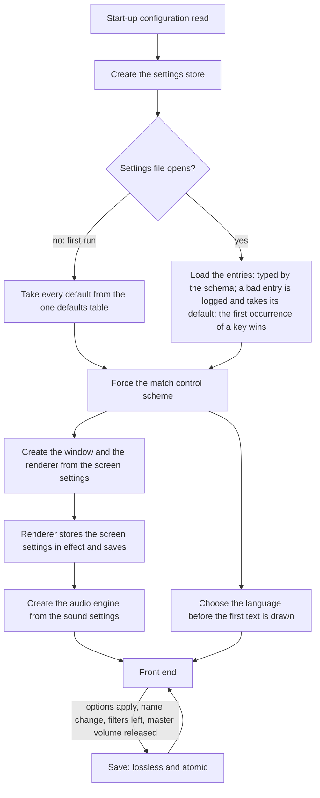
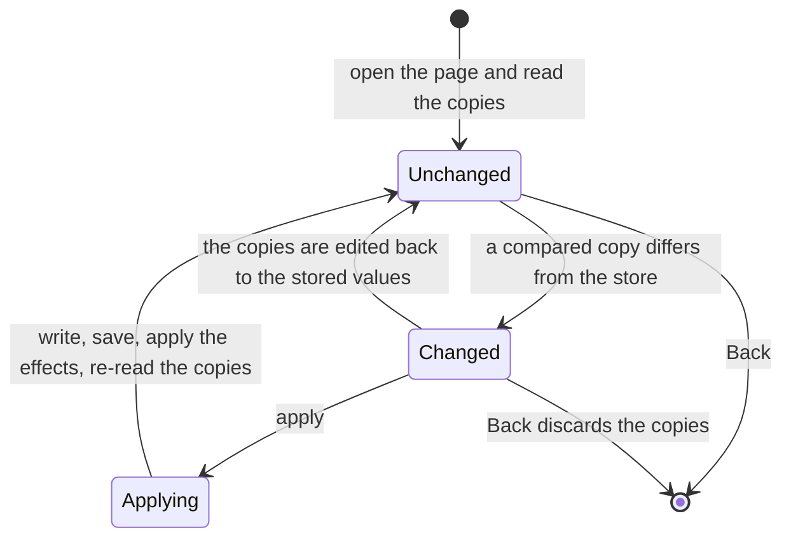
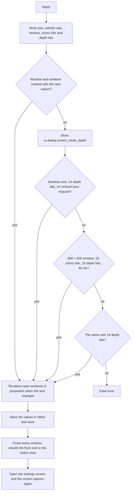
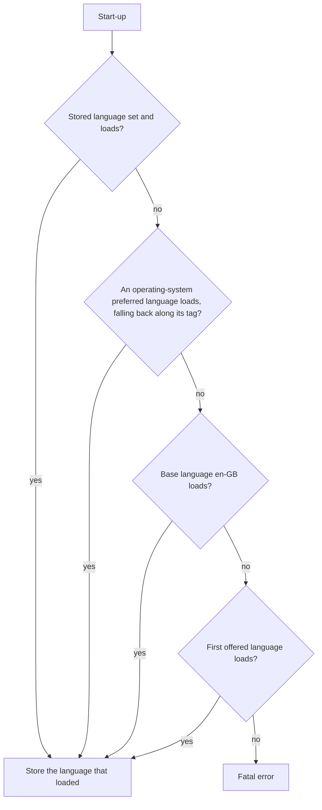
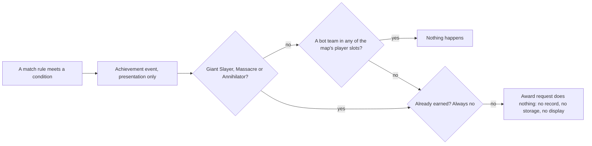
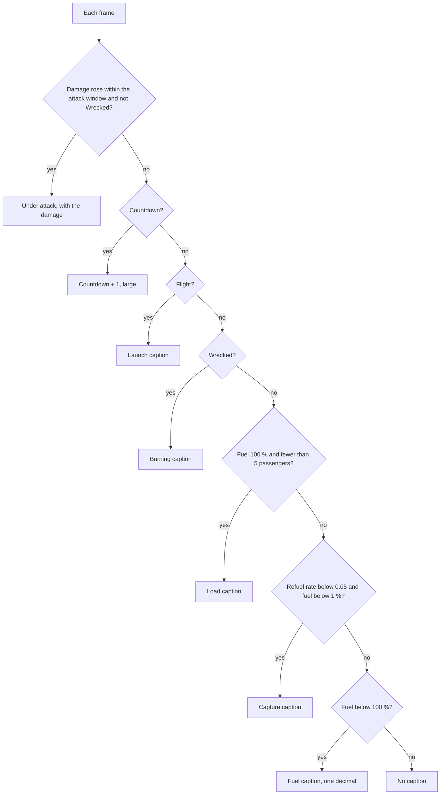

# Options, localisation and hooks

> Status: Reference · Prefix: R-META · Related: [Folder index](README.md) · [Screen flow and match setup](screen_flow_and_match_setup.md) · [01 Skirmish rules and modes](../01_skirmish_rules_and_modes/README.md) · [01 Launch Race](../01_skirmish_rules_and_modes/launch_race.md) · [06 Controls, camera and commands](../06_controls_camera_and_commands/README.md) · [08 Maps and level design](../08_maps_and_level_design/README.md) · [10 Audio design](../10_audio_design.md) · [11 Tutorial and help](../11_tutorial_and_help.md) · [12 Simulation model](../12_simulation_model/README.md) · [UI framework](../../architecture/components/ui_framework/README.md) · [Renderer options](../../architecture/components/renderer/options_and_budgets.md)

## 1 Purpose and player experience

This document specifies what the player can set and what the client remembers between sessions, how the game speaks the player's language, and the hooks of the features that the design phase designs: achievements, statistics and leaderboards. It also specifies the one in-match status panel that belongs to no mode page, the Launch Vessel status panel of Launch Race.

**Settings.** The player opens the settings from the help-and-options branch, at the front end or from the in-match menu ([screen_flow_and_match_setup.md](screen_flow_and_match_setup.md), help-and-options branch). Four pages follow one pattern: the page edits copies of the stored values, an apply action stores and applies them, and the back action discards them. The screen options set the screen size, a window or full screen, and three full-screen display parameters; the graphics options set four detail levels; the sound options set the audio output, the mixing rate, the volume, the number of sounds and the stereo orientation; the other options switch the in-match tips, set the network ports and choose the text language. A handful of further settings are stored without any page: the player name, the preferred colour, the session-browser filters, renderer and input refinements, and development aids. The client keeps all of them in one settings store in the player's profile folder. No setting changes a match: everything that changes the simulation is a match option.

**Language.** Every word the player reads comes from a string table keyed by Species string ids. The reference set has nine languages. A language whose table lacks a string shows the base-language text for that string, and only complete languages are offered (DEC-099). Fonts are licensed families rasterised at run time into a glyph cache, with companion faces for Japanese and Korean.

**Hooks.** The match rules evaluate 12 achievement conditions and keep a small set of statistics, but nothing is awarded, stored or ranked: the platform layer behind them is missing, the achievements page never finishes loading, and the leaderboard pages have no data source. This document records exactly what those hooks compute, where, and what the pages would show (DEC-047). The design phase designs the features.

**Loading.** The loading view itself is [front_end_presentation.md](front_end_presentation.md); this document adds the parts of start-up that read the settings and the language (§2.10).

## 2 Rules

### 2.1 The settings store

**R-META-400** (MUST) The client keeps the player's settings in the settings store (`SettingsStore`): one set of named, typed values, held in memory and backed by one settings file per user in the `settings\` folder of the user-data folder `%LOCALAPPDATA%\<Studio>\Species\` (ADR-0071, DEC-250). The store and its file handling are specified by the [platform layer](../../architecture/components/platform_layer.md), the file grammar and the preferences schema by [data schemas](../../architecture/components/data_schemas.md). This document specifies which settings exist, on which page each one is shown, what the pages do and the defaults of §4.2 that no other document owns.

**R-META-401** (MUST) Settings are presentation and process state. No simulation rule reads a setting, and a setting that would change simulation results exists only as a match option in the match setup (DEC-010; [reference/12](../12_simulation_model/07_randomness_and_integrity.md) R-SIM-660). The stored difficulty setting of §2.6 is the one stored value that a simulation rule could read, and it is inert in every match (R-META-449).

**R-META-402** (MUST) The store is created at start-up, after the start-up configuration has been read and before the window, the renderer and the audio engine are created, so each of them reads its settings from the store. Its defaults come from the one defaults table of DEC-100, which is available before any pack file is mounted, so packaged and development builds start with the same defaults.

**R-META-403** (MUST) **First run.** When the settings file cannot be opened, the store takes every default from the defaults table (DEC-100): the defaults of §4.2 and the defaults that the owning documents state for their settings. It then applies the forced value of R-META-405, and the renderer's start-up writes the display settings and saves the store (R-META-424). Where the reference has two defaults for one setting, the table holds the one that §5 item 1 names.

**R-META-404** (MUST) **Loading.** Each entry of the settings file has the type, range and default that the preferences schema declares; an entry that does not parse, or whose value is outside its type or range, is written to the log and takes its default, and every other entry keeps its stored value (DEC-800 item 5). When a key occurs more than once, the first occurrence is used and every later one is written to the log and ignored. Comment lines and blank lines are kept for the next save. The reference reader that DEC-800 replaces is described in §5 item 2.

**R-META-405** (MUST) After every load, the control-scheme setting (the control scheme, `ControlScheme`, captioned under `ui.options.control_scheme`) is set to the match control scheme, so the alternative scheme never applies (DEC-056). The binding files of the scheme are [reference/06](../06_controls_camera_and_commands/actions_and_bindings.md).

**R-META-406** (MUST) The store saves the settings file on each of these events, and on no other:
1. the apply action of any options page (§2.3 to §2.6);
2. every change of the player name, from the name field or the chat rename command, and every creation of the front-end screen, which stores the player name it read ([screen_flow_and_match_setup.md](screen_flow_and_match_setup.md), front-end lifecycle);
3. the name apply action of the player options page;
4. the renderer's start-up, after it has set the display mode (R-META-424);
5. leaving the session-browser filter page, which stores the filters;
6. the release of the master-volume slider (R-META-433).

**R-META-407** (MUST) A save writes the file losslessly and atomically (DEC-800 items 1, 3 and 4): every comment and blank line of the loaded file in its place, each loaded key once with its current value, then every key that the loaded file did not hold. A save that fails leaves the previous file in place, is written to the log and shows `ui.dialog.settings_save_failed`.

**R-META-408** (MUST) These are not kept in the settings store:
1. the bindings of the control schemes, and the per-keyboard-layout binding overrides, which are content ([reference/06](../06_controls_camera_and_commands/actions_and_bindings.md), [input](../../architecture/components/input.md));
2. a user bindings file, written only by the key-rebinding page, which no player can reach (DEC-050);
3. any match, lobby or session state: nothing about a session outlives the process ([reference/12](../12_simulation_model/02_match_lifecycle_and_state_reset.md) R-SIM-031);
4. achievement progress, which is held for the session only (R-META-490);
5. identity tokens, which belong in the operating system's credential store (DEC-248, DEC-250);
6. user profiles and mods, which the library does not specify (DEC-061);
7. the command-history record of the replay hook, which is a development file (DEC-046; [reference/12](../12_simulation_model/07_randomness_and_integrity.md) R-SIM-740).

**R-META-409** (MUST) The settings file carries no schema version and is never migrated: it is the client-local store of the reference. Versioning, forward migration and synchronisation of settings are the design phase's (DEC-250).

### 2.2 Settings navigation and the shared page pattern

**R-META-410** (MUST) The settings screen, titled `ui.options.title`, lists from top to bottom: the screen options `ui.options.screen.title`, the graphics options `ui.options.graphics.title`, the sound options `ui.options.sound.title`, the other options `ui.options.other.title`, then Back (`ui.common.back`). It has no controls page: the key-rebinding page exists only as an unreachable hook (DEC-050; [reference/06](../06_controls_camera_and_commands/actions_and_bindings.md) R-CTRL-034).

**R-META-411** (MUST) The settings screen opens from the help-and-options window, at the front end and from the in-match menu ([screen_flow_and_match_setup.md](screen_flow_and_match_setup.md), help-and-options branch). Each options page is a full-screen options screen (`OptionsScreen`), built by the full-screen page recipe of [pages_and_screen_recipes.md](../../architecture/components/ui_framework/pages_and_screen_recipes.md); the settings pages belong to the single-window page flow of the front end (DEC-026).

**R-META-412** (MUST) Every options page follows one pattern:
1. on opening, the page reads each of its settings into a copy held by the page; its controls edit only the copies;
2. the apply action `ui.options.apply` is inactive, and drawn greyed, while every copy that the page compares equals the stored value (each page states which copies it compares);
3. the apply action writes the copies to the store, saves it, applies the page's effects and re-reads the copies from the store; the page then stays open, except that the screen options apply rebuilds every window and opens the screen options again (R-META-422), and the other options apply closes every window when it changes the language or large menus (R-META-450);
4. Back closes the page and discards every copy.

The master-volume slider is the one control that acts at once and saves on its own (R-META-433).

**R-META-413** (MUST) The options controls are of four kinds:
1. a **check box**, toggled by activation, showing `ui.icon_check` while on;
2. a **cycle list**, whose activation advances to the next choice and wraps from the last to the first;
3. a **full list**, whose activation opens the list of choices over the page, and whose choice closes it;
4. a **slider** (R-META-433) and a **number field** (R-META-444), which edit a value directly.

Their look, focus and navigation are the [UI framework](../../architecture/components/ui_framework/core_and_widgets.md)'s.

### 2.3 Screen options

**R-META-414** (MUST) The screen options page, titled `ui.options.screen.title`, shows from top to bottom: the screen size `ui.options.screen.size` (full list), play in a window `ui.options.screen.windowed` (check box), the refresh rate `ui.options.screen.refresh` (cycle list), the colour bits `ui.options.screen.colour_bits` (cycle list), the depth bits `ui.options.screen.depth_bits` (cycle list), apply and Back.

**R-META-415** (MUST) The screen-size list holds every distinct width × height that the display reports for a mode of at least `ref.meta.options.screen.min_colour_bits` (15) bits per pixel and at least `rnd.init.min_render_width` (640) wide and `rnd.init.min_render_height` (480) high ([renderer](../../architecture/components/renderer/README.md) RND-026), in the order in which the display reports them, each captioned `ui.options.screen.size_value`. The size is stored as two settings, the width and the height. The page's copy is the entry of the stored size; the stored size is always in the list, because the renderer snaps it to an offered size at start-up (R-META-424). In the Species engine these entries are the render sizes that the renderer offers, with the default `rnd.option.render_size.default` ([renderer options](../../architecture/components/renderer/options_and_budgets.md) RND-442).

**R-META-416** (MUST) Choosing a size, the page's first selection included, rebuilds the refresh-rate choices from the rates that the display reports for that size, each captioned `ui.options.screen.refresh_value`, and selects the page's refresh copy among them. When the copy is not one of them, the control shows its label without a value and the copy keeps its value.

**R-META-417** (MUST) **Play in a window.** The page's copy defaults to `ref.meta.options.screen.windowed_default` (off) when the setting is missing. On, the game runs in a captioned window with minimise and maximise boxes, centred on the desktop; a window larger than the desktop cannot be created (R-META-423). Off, the game runs full screen at the chosen size. The Species window modes are windowed and borderless full screen, the display mode is never changed, and the default is borderless full screen (ADR-0075, `rnd.option.window_mode.default`).

**R-META-418** (MUST) **Refresh rate.** The cycle list offers the rates of the chosen size; the page's copy defaults to `ref.meta.options.screen.refresh_default` (60 Hz). It sets the display frequency of the full-screen mode. While play in a window is ticked, the control is inactive and drawn greyed with `ui.options.screen.fullscreen_only`. The Species engine has no refresh-rate setting (RND-443).

**R-META-419** (MUST) **Colour bits.** The cycle list offers `ref.meta.options.screen.colour_choices` (16, 24 and 32 bits), each captioned `ui.options.screen.bits_value`; the page's copy defaults to `ref.meta.options.screen.colour_default` (16). It sets the bits per pixel of the full-screen mode and the colour bits of the back buffer, and is inactive and greyed while play in a window is ticked, as R-META-418. The Species engine has no equivalent (DEC-100, RND-443).

**R-META-420** (MUST) **Depth bits.** The cycle list offers `ref.meta.options.screen.depth_choices` (16 and 24 bits), captioned `ui.options.screen.bits_value`; the page's copy defaults to `ref.meta.options.screen.depth_default` (24). It sets the precision of the depth buffer, in both window modes. The Species depth buffer has one fixed format, so the engine has no equivalent (RND-443).

**R-META-421** (MUST) The screen options compare the width, the height, the refresh rate, play in a window, the colour bits and the depth bits for R-META-412 item 2.

**R-META-422** (MUST) The screen options apply runs, in this order:
1. write the width and the height of the chosen size, the refresh rate, play in a window, the colour bits and the depth bits;
2. create the window and the renderer again with the new values; a change from one full-screen mode to another always performs a real display-mode change, even when only the refresh rate differs;
3. when the screen size changed, lay the user interface out for the new size and move every open window so that its centre keeps its proportional place: new centre = old centre × new size ÷ old size, on each axis;
4. save the store and re-read the page's copies;
5. close every window; at the front end, build the front-end screen again; in a match, open the match view again;
6. open the settings screen and the screen options page again, so that the player is back on the screen options at the new size.

The Species renderer applies a new size or window mode by reconfiguring itself, without creating the device again or reloading content ([renderer options](../../architecture/components/renderer/options_and_budgets.md) RND-447, ADR-0075).

**R-META-423** (MUST) When the window or the renderer cannot be created with the requested values, the message `ui.dialog.screen_mode_failed` is shown with the requested size, and creation is retried with, in this order: the desktop's own size with 24 depth bits and no vertical-sync request; `rnd.init.fallback_window_size` (800 × 600) in a window with 16 colour bits, 16 depth bits and 60 Hz; the same with 24 depth bits. When the last attempt fails, start-up stops with a fatal error. The retry values and the message position are the [platform layer](../../architecture/components/platform_layer.md)'s (window creation); the Species chain, with its fatal message `ui.error.display_mode`, is [renderer](../../architecture/components/renderer/README.md) RND-023. After a successful creation the store holds the values in effect, the size, play in a window, the colour bits, the depth bits, the refresh rate, the vertical-sync request and an overscan value of 0, and is saved.

**R-META-424** (MUST) At start-up the renderer reads the screen settings, with its own defaults for missing ones, stated by the [platform layer](../../architecture/components/platform_layer.md): full screen, 32 colour bits, 75 Hz, 24 depth bits and the vertical-sync request on. A stored size of 0 × 0, which is the first-run state, takes the desktop's size, refresh rate and colour bits and writes them to the store. The size is then snapped to the closest mode that the display offers. After the mode is set, the renderer writes the screen settings back and saves the store (R-META-406 item 4); the overscan value is always written as 0 and has no other effect. The Species render size follows the same first-run rule from `rnd.option.render_size.default` (0 × 0, the desktop size of the window's monitor) and the snapping of RND-022.

### 2.4 Graphics options

**R-META-425** (MUST) The graphics options page, titled `ui.options.graphics.title`, shows from top to bottom: sea detail `ui.options.graphics.sea`, sky detail `ui.options.graphics.sky`, structure detail `ui.options.graphics.structures` and unit detail `ui.options.graphics.units`, then apply and Back. Each is a cycle list of three choices: `ui.options.graphics.level_high` (detail level 1), `ui.options.graphics.level_medium` (2) and `ui.options.graphics.level_low` (3); a missing setting shows level 1. The four settings, their defaults (`rnd.option.sea_detail.default`, `rnd.option.sky_detail.default`, `rnd.option.structure_detail.default`, `rnd.option.entity_detail.default`, each 1) and their effects are the renderer's ([renderer options](../../architecture/components/renderer/options_and_budgets.md) RND-442 to RND-446).

**R-META-426** (MUST) The graphics options compare six copies for R-META-412 item 2: the four detail levels and two hidden settings that the page reads and writes back unchanged, the terrain detail and the pixel effect, neither of which has any effect (R-META-456). The apply action writes all six and saves the store.

**R-META-427** (MUST) When a match is loaded, the graphics apply also generates the terrain and the sea again from the map definition (DEC-246, DEC-250); outside a match it only stores the settings. The sea detail is read when the sea is built, so a change takes effect at the next build, which this apply performs in a match; the sky, structure and unit detail are read on every frame. In the Species renderer no setting rebuilds terrain or sea geometry: every sea-detail mesh is built at match start, and every change takes effect on the next frame (RND-447 to RND-449).

**R-META-428** (MUST) Two further graphics controls are disabled and never built, so no page shows them: a terrain detail of four levels and a pixel-effect check box. Their stored settings have no effect (R-META-456).

### 2.5 Sound options

**R-META-429** (MUST) The sound options page, titled `ui.options.sound.title`, shows from top to bottom: the audio output `ui.options.sound.output` (full list), the mixing rate `ui.options.sound.mix_rate` (cycle list), the master volume `ui.options.sound.master_volume` (slider), the bus volumes of R-META-434 (sliders), the number of sound voices `ui.options.sound.voices` (cycle list), swap left and right `ui.options.sound.swap_stereo` (check box), then apply and Back. The settings, their defaults and their engine effects are the [audio engine](../../architecture/components/audio_engine.md)'s; the mix that they change is [reference/10](../10_audio_design.md)'s.

**R-META-430** (MUST) **Audio output.** The list offers exactly one choice, the platform audio back end `ui.options.sound.output_platform` (ADR-0022), and the apply action stores it. A stored value that names no back end, which only an edit of the settings file can produce, switches all audio output off: the audio engine then runs on its silent device. The first-run value is the platform back end.

**R-META-431** (MUST) **Mixing rate.** The cycle list offers `ref.meta.options.sound.mix_rate_choices` (11 025, 22 050 and 44 100 Hz), each captioned `ui.options.sound.rate_value`; the page's copy and the first-run value are `ref.meta.options.sound.mix_rate_default` (22 050 Hz), while the audio engine's own reader uses the default that the audio engine states when the setting is missing. It sets the output mixing rate, and the apply action restarts the audio engine (R-META-437). The Species audio engine mixes at its fixed runtime rate (ADR-0025), so the setting has no Species equivalent (DEC-100).

**R-META-432** (MUST) **Sound voices.** The cycle list offers `ref.meta.options.sound.voice_choices` (8, 16, 32 and 64 voices), each captioned `ui.options.sound.voices_value`; the page's copy defaults to `ref.meta.options.sound.voices_page_default` (16) when the setting is missing, while the first-run value and the audio engine's default are the audio engine's (32). The count is the number of voices the engine mixes: the count − 1 voices for sound effects and one for music. The apply action restarts the audio engine. The Species mix shares a fixed budget of 64 real voices over its buses (DEC-570).

**R-META-433** (MUST) **Master volume.** The slider sets a value from 0 to `ref.meta.options.sound.volume_max` (255). Its track spans `ref.meta.options.sound.slider_track` (from 50 % to 95 % of the control's width), and the value is the pointer's fraction along the track × 255, truncated. Pressing or dragging on the track applies the value at once to every playing sound and to music; releasing writes it and saves the store (R-META-406 item 6). The slider works independently of the apply and Back actions, and Back does not undo it. The volume law, the attenuation per step, is [reference/10](../10_audio_design.md)'s.

**R-META-434** (MUST) Below the master volume the page has one volume slider for each bus of the mix, in this order: interface `ui.options.sound.volume_ui`, announcer and stings `ui.options.sound.volume_announcer`, unit voices `ui.options.sound.volume_voice`, world `ui.options.sound.volume_world`, ambience `ui.options.sound.volume_ambience` and music `ui.options.sound.volume_music` (DEC-570). Each acts like the master volume (R-META-433) on its bus; the bus default levels are those of DEC-570 and [reference/10](../10_audio_design.md). The reference page has the master volume only (DEC-044).

**R-META-435** (MUST) **Swap left and right.** The check box is off by default. On, the left and right channels of every positioned sound are exchanged; the setting is read on every audio update, so it takes effect when the apply action stores it.

**R-META-436** (MUST) The sound options compare, for R-META-412 item 2, the copies of the mixing rate, the voices, swap left and right and the audio output with the stored settings, reading each missing setting as the page's value: `ref.meta.options.sound.mix_rate_default`, `ref.meta.options.sound.voices_page_default`, off, and, for a missing or empty audio output, a match with either choice. So with the voices setting missing, the apply action shows as active (§5 item 1).

**R-META-437** (MUST) The sound options apply writes the settings, restarts the audio engine, saves the store and re-reads the copies. A restart creates the engine's voices and devices again: playing sounds survive but lose their voices, so a looping sound starts again from the beginning of its sample, a one-shot sound expires a few audio updates later, and music keeps its read position; the exact rule is the [audio engine](../../architecture/components/audio_engine.md)'s.

**R-META-438** (MUST) Three further sound controls are disabled and never built, so no page shows them: a sample-memory level, a hardware-positioning check box and a real-time effects check box. Their settings are R-META-454.

**R-META-439** (MUST) Every sound setting acts on the whole client, at the front end and in a match alike: the master and bus volumes act at once (R-META-433, R-META-434), swap left and right at the next audio update (R-META-435), and the audio output, the mixing rate and the voices when the apply action restarts the audio engine (R-META-437).

### 2.6 Other options

**R-META-440** (MUST) The other options page, titled `ui.options.other.title`, shows from top to bottom: in-match tips `ui.options.other.tips` (check box), use forwarded port `ui.options.other.port_forwarding` (check box), the hosting port `ui.options.other.host_port` (number field), the joining port `ui.options.other.join_port` (number field), the text language `ui.options.other.language` (full list), then apply and Back.

**R-META-441** (MUST) **In-match tips.** The setting defaults to `ref.meta.settings.tips.default` (on). On, the contextual hints of [reference/11](../11_tutorial_and_help.md) appear in matches (DEC-037); off, none appears. It has no other effect.

**R-META-442** (MUST) **Use forwarded port.** The setting defaults to `ref.meta.settings.port_forwarding.default` (off). On, the client reports its own configured listening port to the session instead of the port at which others see it, and a hosted session is advertised with its own listening port. How sessions are reached and discovered is the design phase's (DEC-207, DEC-245); the reference's traversal through a directory service is not specified.

**R-META-443** (MUST) **Hosting port.** The setting defaults to `ref.meta.settings.host_port.default` (4000). It is the port on which a hosted session listens, and the port that a manual session entry uses when it names none (R-META-452).

**R-META-444** (MUST) The two port controls are number fields that show the stored whole number as text and accept `ref.meta.settings.port_min` (0) to `ref.meta.settings.port_max` (65 535). The forwarded-port check box and both port fields are inactive while this participant hosts a session.

**R-META-445** (MUST) **Joining port.** The setting defaults to `ref.meta.settings.join_port.default` (4001). It is the port on which the client listens. When that port cannot be opened and is not `ref.meta.settings.port_any` (0), the client opens any free port instead.

**R-META-446** (MUST) **Text language.** The full list has one entry per offered language (R-META-463), each captioned with the language's name (R-META-467). The page's copy is the entry whose tag equals the stored language, compared without regard to case. Applying another language switches to it (R-META-466).

**R-META-447** (MUST) The other options compare the tips, the text language, the forwarded port, the hosting port and the joining port for R-META-412 item 2; they do not compare the hidden settings of R-META-449.

**R-META-448** (MUST) The other options apply runs, in this order:
1. write the tips setting and the control-help setting;
2. at the front end only, never in a match, write the difficulty setting (R-META-449 item 2);
3. when a match is loaded, generate the terrain and the sea again from the map definition, as the graphics apply does (R-META-427);
4. when the forwarded port, the hosting port or the joining port changed: write all three and re-open the client's listening port at once, also when this participant does not host;
5. when the language changed: store it, switch to it (R-META-466) and mark the windows for rebuilding;
6. write the automatic-camera setting;
7. write the large-menus setting, and mark the windows for rebuilding when it changed;
8. when marked, rebuild the windows (R-META-450);
9. save the store.

**R-META-449** (MUST) The other options page reads these settings and writes them back without showing a control:
1. **Control help**, default `ref.meta.settings.control_help.default` (on). It has no visible effect: the contextual control-help panel is a hook that matches never show (DEC-050).
2. **Difficulty**, stored as a level + 1 with the default `ref.meta.settings.difficulty.default` (1). At the front end the page reads the stored value − 1, at least 0; in a match it reads the current difficulty level. The apply action writes it only at the front end, storing level + 1 and setting the process difficulty level. The setting is inert: every map load sets the difficulty level to 0 and no map can carry one, so every match runs at level 0 (DEC-010). Species has no process-global difficulty.
3. **Automatic camera**, the tracking switch of [reference/06](../06_controls_camera_and_commands/camera.md) R-CTRL-480, with the choices and the default of `ref.ctrl.camera.automatic_setting`.
4. **Large menus**, default `ref.meta.settings.large_menus.default` (off). On, the small tool-style windows scale with the screen height by the large-menu factor of the [UI framework](../../architecture/components/ui_framework/layout_rendering_input_and_localisation.md), also at start-up; the full-screen options screens are laid out in screen fractions and do not change.
5. **Seasonal theme**, read but never written; it has no effect on the seasonal theme ([screen_flow_and_match_setup.md](screen_flow_and_match_setup.md), seasonal theme at match setup; DEC-101, DEC-118).

**R-META-450** (MUST) Rebuilding the windows after the other options apply closes every window; at the front end it builds the front-end screen again, and in a match it opens the match view again. The settings screen is not opened again.

### 2.7 Settings kept outside the options pages

**R-META-451** (MUST) The front end stores these settings:

| Setting | Default | Written by | Read by |
|---|---|---|---|
| player name | `ui.player.default_name` | every change of the name, from the name field or the chat rename command; every creation of the front-end screen; the name apply action (the front-end lifecycle and the name rule of [screen_flow_and_match_setup.md](screen_flow_and_match_setup.md)) | the front-end screen when it is created; the default session name |
| preferred colour | `ref.meta.settings.preferred_colour.default` (none) | the colour picker of the player options page, except in Siege and in co-op | the match setup page when it assigns the local slot's colour |
| session name | the player name, or `ui.settings.default_session_name` when there is none | only an edit of the settings file | the advertised record of a hosted session (DEC-245) |

**R-META-452** (MUST) The session browser stores these settings, whose use is the browser's (DEC-245):
1. three filters with a control on the filter page, show incompatible sessions, show full sessions and show sessions with a password, and one filter with no control, show custom maps; each defaults to `ref.meta.settings.browser_filter.default` (on). The mode filter is not stored, so it resets every time;
2. up to `ref.meta.settings.manual_sessions` (30) manual session entries, numbered 1 upwards, each a host, a port and a name, which only an edit of the settings file can create. An entry without a port uses the hosting port (R-META-443).

**R-META-453** (MUST) The renderer reads these settings, which no page shows; their defaults, values and effects are the renderer's ([renderer options](../../architecture/components/renderer/options_and_budgets.md) RND-442): the tree detail `rnd.option.tree_detail.default`; special lighting `rnd.option.special_lighting.default`, which Launch Race and a map's special-lighting effect switch on regardless; the screenshot tile factor `rnd.option.poster_resolution.default`; the inverted ink-on-paper style `rnd.option.inverted_style.default` (DEC-040); and the Worker distance scale factor `rnd.option.worker_scale_factor.default`.

**R-META-454** (MUST) The audio engine reads these settings, which no page shows; their defaults and effects are the [audio engine](../../architecture/components/audio_engine.md)'s:
1. the sample-memory level: level 1 chooses among every sample of a sample group, level 2 among the first half and level 3 among the first quarter; it is honoured whenever the settings file holds it;
2. the effects switch, off by default, so no audio effect runs unless the settings file is edited (DEC-567);
3. the output buffer length of the software output path, which has no Species equivalent (DEC-100).

**R-META-455** (MUST) The input system reads these settings, which no page shows; their use is [input](../../architecture/components/input.md)'s and [reference/06](../06_controls_camera_and_commands/actions_and_bindings.md)'s:
1. the keyboard layout, by default the operating system's keyboard layout looked up in the layout table; it selects the per-layout binding override;
2. the mouse-button count, default `ref.meta.settings.mouse_buttons.default` (3), which the client reads when it sends the team controls;
3. the selection lock: when it is set and off, a new object cannot be selected while something is selected; when it is missing, which is the default, selection is not restricted;
4. any setting named by a binding: a binding can test whether a named setting is above 0; no default binding does.

**R-META-456** (MUST) These stored settings have no effect, and Species specifies none of them: the terrain detail (RND-443); the pixel effect (RND-443); the overscan value (R-META-424); the vertical-sync request, which the display driver overrides ([reference/12](../12_simulation_model/01_tick_timing_and_main_loop.md) R-SIM-575); a fog switch; the seasonal setting (R-META-449 item 5); control help (R-META-449 item 1); the difficulty (R-META-449 item 2); a control-method choice whose two choices bind the chat log to the same key; a network address, a server port and a network-bypass flag that nothing reads (DEC-250); the value of the start-up mini-programs (DEC-054); a text speed of a feature that the library does not specify; and the profile, profile-unlock and mod settings (DEC-061).

**R-META-457** (MUST) These development settings are hidden from players: the language test (R-META-473); the command-history record and replay, which runs the match at a fixed step (DEC-046; [reference/12](../12_simulation_model/07_randomness_and_integrity.md) R-SIM-740); and the bot-information overlay with its team choice ([diagnostics](../../architecture/components/diagnostics_test_and_performance.md)).

### 2.8 Options the reference does not have

**R-META-458** (MUST) Until DEC-044 is decided, the option set is the reference set of §2.3 to §2.7, plus the bus volumes of DEC-570 (R-META-434). The reference has none of these options:
1. anti-aliasing: no setting is read;
2. gamma or brightness;
3. mouse inversion or an inverted vertical axis: inversion exists only in the binding syntax, and no default binding uses it;
4. automatic zoom: the nearest setting is the automatic camera (R-META-449 item 3);
5. a vertical-sync control: the stored request has no effect (R-META-456);
6. key rebinding: the rebinding page is unreachable (DEC-050);
7. separate music, effects and voice volumes (DEC-570 adds the bus volumes);
8. subtitles, a text size or colour-blind options: the only text-scale switch is large menus, which the full-screen pages ignore (R-META-449 item 4);
9. mouse sensitivity or camera speed: the camera speeds are binding and tuning values of [reference/06](../06_controls_camera_and_commands/camera.md);
10. network rate or bandwidth settings: only the ports and the forwarded port exist;
11. profile selection or save slots.

**R-META-459** (MUST) The bot difficulty is not a setting: it is a per-match option of the match setup page ([screen_flow_and_match_setup.md](screen_flow_and_match_setup.md), match setup options).

### 2.9 Localisation

**R-META-460** (MUST) Every text that a player reads is looked up by its Species string id in the string table of the current language. String tables are UTF-8, one per language, named by BCP 47 language tags; `ref.meta.lang.base` (`en-GB`) is the base language and the source of every string (ADR-0063). All text is new, written for Species. The tables are the assets `strings.en_gb`, `strings.fr_fr`, `strings.de_de`, `strings.it_it`, `strings.es_es`, `strings.pt_br`, `strings.ru_ru`, `strings.ja_jp` and `strings.ko_kr`; the string-table mechanism is the [UI framework](../../architecture/components/ui_framework/layout_rendering_input_and_localisation.md)'s and the table schema the [data schemas](../../architecture/components/data_schemas.md)'.

**R-META-461** (MUST) The reference language set has `ref.meta.lang.reference_count` (9) languages. The table gives each one's tag, its string table and how much of the base language its reference table covers, as a share of the match and front-end strings and as a share of all strings:

| Language | Tag | String table | Reference coverage | Match and front-end strings | All strings |
|---|---|---|---|---|---|
| English | `en-GB` | `strings.en_gb` | complete (base) | 100 % | 100 % |
| French | `fr-FR` | `strings.fr_fr` | complete | 99.6 % | 99.7 % |
| German | `de-DE` | `strings.de_de` | complete | 99.5 % | 99.7 % |
| Spanish | `es-ES` | `strings.es_es` | complete | 99.6 % | 99.7 % |
| Italian | `it-IT` | `strings.it_it` | nearly complete; some Supply crate tooltips missing | 96.4 % | 97.4 % |
| Russian | `ru-RU` | `strings.ru_ru` | partial | 75.2 % | 88.4 % |
| Japanese | `ja-JP` | `strings.ja_jp` | stub | 25.9 % | 9.0 % |
| Korean | `ko-KR` | `strings.ko_kr` | stub | 18.7 % | 6.6 % |
| Portuguese | `pt-BR` | `strings.pt_br` | stub | 18.7 % | 6.6 % |

The three stubs hold an early subset only: team-kind labels, menu titles, the session and sign-in texts of a console online service, sales prompts, leaderboard titles and some option labels. The region of Portuguese is to be confirmed.

**R-META-462** (MUST) The coverage of R-META-461 describes the reference tables only. Every Species string table is written new, and the content build measures its coverage against the base language's string ids (ADR-0063, ADR-0059).

**R-META-463** (MUST) A language is offered only when it is complete (DEC-099): a language whose table covers less than `ref.meta.lang.offer_coverage` (100 %) of the base language's string ids is not offered. The reference behaviour that DEC-099 replaces is §5 item 5.

**R-META-464** (MUST) A string id that the current language's table lacks shows, per string, the text of the base language (DEC-099, ADR-0063). No page ever shows a string id as text ([screen_flow_and_match_setup.md](screen_flow_and_match_setup.md), page specification conventions), and the content build lists every id that falls back.

**R-META-465** (MUST) At start-up the client chooses the language by trying, in this order, until one loads (DEC-099, ADR-0063):
1. the stored language setting, which on first run is `ref.meta.settings.language.default` (unset);
2. the operating system's preferred user-interface languages, each falling back along its tag, first without the region and then without the script;
3. the base language `ref.meta.lang.base`;
4. the first offered language.

The language that loads is stored in the language setting. When none loads, start-up stops with a fatal error.

**R-META-466** (MUST) Switching the language from the other options (R-META-448 item 5) stores the new language, loads its string table and rebuilds every window (R-META-450), so every caption is drawn again in the new language. The hand-over from the previous table to the new one is the [UI framework](../../architecture/components/ui_framework/layout_rendering_input_and_localisation.md)'s (DEC-099).

**R-META-467** (MUST) Each language list entry is captioned with the language's own name in its own language, the string ids `ui.language.en_gb`, `ui.language.fr_fr`, `ui.language.de_de`, `ui.language.it_it`, `ui.language.es_es`, `ui.language.pt_br`, `ui.language.ru_ru`, `ui.language.ja_jp` and `ui.language.ko_kr`, whose text is the same in every table. In the reference five languages have a name string and the other four show the name of their table file; Species gives every language its name (ADR-0063).

**R-META-468** (MUST) A string id may have a keyboard-and-mouse variant and a gamepad variant, and the variant of the current input mode is shown (ADR-0063). A caption may contain the current binding of an action, shown as its key or button, a passage that appears only in one input mode, with an alternative for the other, and another string by its id. These are expanded when the string table is built. The syntax is the [data schemas](../../architecture/components/data_schemas.md)' and the [UI framework](../../architecture/components/ui_framework/layout_rendering_input_and_localisation.md)'s.

**R-META-469** (MUST) Values inserted at run time are named arguments in ICU MessageFormat syntax, such as `{width}` (ADR-0063). A text value is shown literally: no character of it, a percent sign included, is ever read as a formatting directive (DEC-102, DEC-800 item 4).

**R-META-470** (MUST) Every player-facing caption has a string id, including the captions that the reference draws without one: the spectator label (`ui.lobby.slot.spectator`, [screen_flow_and_match_setup.md](screen_flow_and_match_setup.md)); the captions of the score-mode and crate-drop lists of the match options, which show the option's internal name ([reference/01](../01_skirmish_rules_and_modes/README.md) §2.19); the refresh action of the session browser ([screen_flow_and_match_setup.md](screen_flow_and_match_setup.md), session pages); and the master-volume caption (`ui.options.sound.master_volume`). The development windows are the [diagnostics](../../architecture/components/diagnostics_test_and_performance.md)'.

**R-META-471** (MUST) Whether a string id exists drives counts that come from data: the number of help pages of each mode and the lines of the credits page ([reference/11](../11_tutorial_and_help.md); [screen_flow_and_match_setup.md](screen_flow_and_match_setup.md), credits page). Because only complete languages are offered (R-META-463), every offered language gives the same counts.

**R-META-472** (MUST) A help picture that shows controls has a variant per language, chosen by the current language, and keyboard pictures also by the keyboard layout; without a variant for the current language, the base-language picture is shown ([reference/11](../11_tutorial_and_help.md)).

**R-META-473** (MUST) The development setting language test, default `ref.meta.settings.language_test.default` (off), makes the client compare each language it loads with the base language and write a report of three lists: the ids missing from the language, the values identical to the base language, and the ids that the base language lacks. The content build produces the same three lists for every language at build time (ADR-0063).

**R-META-474** (MUST) Text is drawn with licensed font families, rasterised at run time into a glyph cache; there are no bitmap font atlases (ADR-0034; [GameAssets](../../assets/GameAssets.md) §17). The faces cover the scripts of the language set as follows; the coverage ranges are those of the asset manifest, and the assignment of faces to text roles is the [UI framework](../../architecture/components/ui_framework/layout_rendering_input_and_localisation.md)'s:

| Script | Languages | Faces |
|---|---|---|
| Latin, Cyrillic and currency signs | English, French, German, Spanish, Italian, Portuguese, Russian, and the Latin characters in every language | `font.ui.primary`, `font.ui.stylised`, `font.ui.compact` |
| Japanese kana and CJK ideographs | Japanese | `font.ui.primary_ja`, the companion of `font.ui.primary` |
| Hangul syllables | Korean | `font.ui.primary_ko`, the companion of `font.ui.primary` |

**R-META-475** (MUST) In Japanese and Korean every text role uses the primary face with its companion, because the primary face is the reference's only face with those scripts; Latin characters in that text keep their Latin width. The per-language horizontal scale that gives this is the [UI framework](../../architecture/components/ui_framework/layout_rendering_input_and_localisation.md)'s (ADR-0034). The reference code also selects these faces for two Chinese variants, but no Chinese table exists, so Chinese is not in the language set.

**R-META-476** (MUST) The language setting selects the text language only. Whether voice content is worded and localised is DEC-317.

### 2.10 Loading

**R-META-477** (MUST) The loading view, its background loading, its frame and its progress are [front_end_presentation.md](front_end_presentation.md)'s.

**R-META-478** (MUST) Start-up reads the settings before anything that uses them: the settings store first (R-META-402), then the window and the renderer with the screen settings (R-META-424) and the audio engine with the sound settings; the language is chosen (R-META-465) before the first text is drawn.

**R-META-479** (MUST) The glyphs of the current language's common characters are rasterised while loading, and the glyphs of a language chosen later are rasterised when they are first drawn (ADR-0034).

### 2.11 Achievement hooks

**R-META-480** (MUST) Achievements exist only as hooks (DEC-047). The match rules evaluate 12 achievement conditions (`ref.vis.scope.achievement_conditions`, [reference/00](../00_reference_overview.md)) and report each one as an achievement event (`AchievementEvents`), a presentation event emitted at the tick where the rule fires (DEC-007; [reference/01](../01_skirmish_rules_and_modes/README.md) R-MODE-038). No achievement is ever awarded, stored or shown. The design phase designs achievements, their texts and their platform service (DEC-047, DEC-248).

**R-META-481** (MUST) The 12 achievements, in their reference order, are evaluated as follows. "Local team" is the team of the local player; each condition's values are owned by the document named.

| # | Achievement | Condition | Evaluated in |
|---|---|---|---|
| 1 | Total Control (`Achievement::TotalControl`) | Spawn Control without co-op: the local team is the last team not eliminated (team count − 1 = eliminated count), a win by elimination, never at time-up | [spawn_control.md](../01_skirmish_rules_and_modes/spawn_control.md) R-MODE-212 |
| 2 | Stockpiler (`Achievement::Stockpiler`) | Relic Run won by the local team at time-up with a score above `ref.mode.relic_run.stockpiler_ratio` (2) × the second-highest score and above `ref.mode.relic_run.stockpiler_min_score` (3); the Rogue and Visitor factions do not count for second place | [relic_run.md](../01_skirmish_rules_and_modes/relic_run.md) R-MODE-315 |
| 3 | Crowned (`Achievement::Crowned`) | Zone Control won by the local team at time-up with a score above `ref.mode.zone_control.crowned_margin` (1.5) × the second-highest score | [zone_control.md](../01_skirmish_rules_and_modes/zone_control.md) R-MODE-262 |
| 4 | Clean Launch (`Achievement::CleanLaunch`) | Launch Race won by the local team's Launch Vessel with its damage at most `ref.mode.launch_race.clean_launch_max_damage` (0.01), while no other used player team's vessel, the factions excluded, holds more than `ref.mode.launch_race.clean_launch_rival_fuel` (50) fuel | [launch_race.md](../01_skirmish_rules_and_modes/launch_race.md) R-MODE-419 |
| 5 | Iron Defence (`Achievement::IronDefence`) | Siege ends with the local team defending, and the defending side has owned every objective, the Core Device and its linked Command Consoles, on every checked tick since the start | [siege.md](../01_skirmish_rules_and_modes/siege.md) R-MODE-374 |
| 6 | Giant Slayer (`Achievement::GiantSlayer`) | the local team wins a match without co-op in which another used human team already holds Giant Slayer | R-META-485, at the result declaration of [reference/01](../01_skirmish_rules_and_modes/README.md) R-MODE-057 step 6 |
| 7 | Completionist (`Achievement::Completionist`) | the local team has won a match on every map of the map index | R-META-489, at R-MODE-057 step 6 |
| 8 | Tourist (`Achievement::Tourist`) | the local team has played a match on every map of the map index; a map counts as played when its grace countdown ends | R-META-489, at [reference/01](../01_skirmish_rules_and_modes/README.md) R-MODE-040 step 4 |
| 9 | Massacre (`Achievement::Massacre`) | the local team's kill total is at least `ref.match.massacre_kills` (2,000 Workers) on the tick the match becomes over | [reference/01](../01_skirmish_rules_and_modes/README.md) R-MODE-037 step 11 |
| 10 | Flag Sweep (`Achievement::FlagSweep`) | Flag Chain won by the local team, with the time test of R-META-484 | [flag_chain.md](../01_skirmish_rules_and_modes/flag_chain.md) R-MODE-472 |
| 11 | Friendly Fire (`Achievement::FriendlyFire`) | in co-op, a Missile Barrage warhead of the local team explodes within `ref.hazard.missile_barrage.friendly_fire_radius` (120 wu) of a Spawn Node owned by a friendly team, the team's own included | [hazards_and_projectiles.md](../02_units/hazards_and_projectiles.md) R-UNIT-727 |
| 12 | Annihilator (`Achievement::Annihilator`) | the session kill total reaches at least `ref.meta.achievement.annihilator_kills` (1,000,000) | R-META-487 |

**R-META-482** (MUST) An award request does nothing in every case:
1. for every achievement except Giant Slayer, Massacre and Annihilator, the request does nothing when any of the map's player slots, the first n lobby slots where n is the map's player count, holds a bot team;
2. the request then does nothing when the achievement is already earned, and the earned test always answers no;
3. otherwise the request also does nothing: no achievement is recorded, stored or shown, and the platform's own Giant Slayer check is empty.

**R-META-483** (MUST) For two achievements the stated goal and the evaluated threshold differ: Massacre states more than `ref.meta.achievement.massacre_stated_kills` (3,000) kills and evaluates at least `ref.match.massacre_kills` (2,000); Annihilator states `ref.meta.achievement.annihilator_stated_kills` (100,000) kills and evaluates at least `ref.meta.achievement.annihilator_kills` (1,000,000). The evaluated thresholds are the reference behaviour; the design phase picks one value of each pair (DEC-047). The descriptions of §4.3 take the threshold as an argument.

**R-META-484** (MUST) The Flag Sweep time test passes when the match's start time is at most the time remaining + `ref.meta.achievement.flag_sweep_margin` (300 s, stated as five minutes). It compares a start time stamp with a remaining duration, so it passes on practically every win ([flag_chain.md](../01_skirmish_rules_and_modes/flag_chain.md) R-MODE-472); DEC-047 restates it as a win within a stated number of ticks.

**R-META-485** (MUST) **Giant Slayer.** When the local team wins a match without co-op and the achievement mask of another used, human player team holds the Giant Slayer bit `ref.meta.achievement.giant_slayer_bit` (bit 0), the Giant Slayer request is made and the local participant becomes a holder: from then on, for the rest of the session, its own mask holds that bit. The mask is the lobby slot's achievement mask, default 0, which each participant sends with `PlayerCommand::SetAchievementMask` and every participant stores on receipt ([reference/12](../12_simulation_model/06_teams_and_player_commands.md); DEC-243).

**R-META-486** (MUST) When the Friendly Fire condition is met, the local player sees the message `achievement.friendly_fire.message`, although the achievement itself is not awarded.

**R-META-487** (MUST) The achievement events hold, for the session only: the set of maps played, the set of maps won, the session kill total and the Giant Slayer holder flag. The session kill total starts at `ref.meta.achievement.kill_total_start` (−1). Every result declaration adds the local team's kill total to it ([reference/01](../01_skirmish_rules_and_modes/README.md) R-MODE-057 step 1), so a repeated declaration adds it again, and then runs the Annihilator check.

**R-META-488** (MUST) Maps are counted by their map ids through the map index, which the content build generates, listing the maps that count, and packages with those maps (DEC-563; [reference/08](../08_maps_and_level_design/rules_and_conventions.md) R-MAP-015). A map id listed twice is a content-build error (DEC-801 item 2). A map that the index does not list is never recorded. In the reference the index is absent from the packaged data, so no map is ever recorded; DEC-563 removes that gap.

**R-META-489** (MUST) Playing or winning a map adds its map id to the played or won set; the count of distinct ids in the set is then compared with the number of maps in the map index, `ref.map.reference.map_count` (49) for the reference map set ([reference/08](../08_maps_and_level_design/rules_and_conventions.md) R-MAP-180). When the played count reaches it, the Tourist request is made; when the won count reaches it, the Completionist request.

**R-META-490** (MUST) Achievement progress is never stored: loading it does nothing, saving it does nothing, and it is lost when the client exits (DEC-250).

**R-META-491** (MUST) The achievements page has a page slot, but no page leads to it. If reached, it shows the title `ui.achievements.title`, a scroll bar and Back to the title page, and the caption `ui.achievements.loading`, blinking like the blinking captions of [front_end_presentation.md](front_end_presentation.md) (`ref.meta.blink.on_alpha`, `ref.meta.blink.on_time`, `ref.meta.blink.off_alpha`) for as long as the page is open, because the achievement events never report that they have loaded. Its rows are never created.

**R-META-492** (MUST) An achievement row, if one were created, is one row per achievement, in the order of R-META-481. After the menu transition it slides down into place at `ref.meta.achievement.row_slide_speed` (750 px/s); the scroll bar moves the rows by `ref.meta.achievement.row_scroll_step` (4 px) per step, and the rows are clipped to the scroll bar's band. A row draws only its background, grey `ref.meta.achievement.row_grey` (0.4) at alpha `ref.meta.achievement.row_alpha` (0.5), with no picture and no text, and is inactive. Numbers on the page are shown with the thousands separators of the current language (ADR-0063).

**R-META-493** (MUST) The library specifies no achievement picture, notification, sound or unlock store; those, and the platform service that awards achievements, are the design phase's (DEC-047, DEC-248). The texts of §4.3 name each achievement and state its condition, for use by the design.

### 2.12 Statistics hooks

**R-META-494** (MUST) The reference records exactly these statistics:

| Statistic | Scope | Used by |
|---|---|---|
| each team's score | match | the in-match scoreboard and the game-over list ([reference/01](../01_skirmish_rules_and_modes/README.md) R-MODE-068); also sent in the score report at every result declaration, which every participant ignores ([reference/12](../12_simulation_model/06_teams_and_player_commands.md) R-SIM-451) |
| each team's kill total | match | the Massacre check; added to the session kill total |
| the session kill total | session | the Annihilator check only |
| the maps played and won | session | the Tourist and Completionist checks only |
| network statistics: bandwidth, latency and divergence checks | session | the development network window ([diagnostics](../../architecture/components/diagnostics_test_and_performance.md)) |

**R-META-495** (MUST) There is no statistics page, no stored career record and no summary page after a match: a finished match stays under its game-over overlay ([reference/01](../01_skirmish_rules_and_modes/README.md) R-MODE-058). The data available at match end, the scores, the kill totals and the times, is the input of a results screen, which is the design phase's (DEC-048; [screen_flow_and_match_setup.md](screen_flow_and_match_setup.md) results-screen hooks).

**R-META-496** (MUST) The match statistics (`MatchStatistics`) are the hook through which a results screen, a leaderboard or a career record would read these values; the reference fills nothing beyond the counters of R-META-494.

**R-META-497** (MUST) No statistic is stored or sent to any service: the score report has no receiver, and nothing outlives the session (R-META-490).

### 2.13 Leaderboard hooks

**R-META-498** (MUST) Leaderboards exist only as pages with no data source (DEC-047). The leaderboards entry appears only on a menu that no player can reach, where it is inactive; the leaderboard loader starts no search, scrolls nothing and fills no rows; and setting up either leaderboard page does nothing. No session or directory record carries a ranking field.

**R-META-499** (MUST) The leaderboard selection page, if reached, shows the title `ui.leaderboard.title`, then three board types in this order, each opening the board page for its type: matches against bots `ui.leaderboard.type.bots`, ranked matches by Skill rating `ui.leaderboard.type.ranked`, and standard matches `ui.leaderboard.type.standard`; then Back. A board type for a campaign is not specified.

**R-META-500** (MUST) The board page is full width. Its board selector is cycled with the pad menu cycle actions (`PadMenuCycleUp`, `PadMenuCycleDown`, on the shoulder buttons) through the boards: every match `ui.leaderboard.board.all`, then Spawn Control, Zone Control, Launch Race, Relic Run and Flag Chain, captioned with the mode names of [reference/01](../01_skirmish_rules_and_modes/README.md); there is no Siege board. A board change animates its caption: the alpha steps by `ref.meta.leaderboard.fade_step` (0.1) every `ref.meta.leaderboard.fade_interval` (0.025 s), down for the leaving caption and up for the arriving one, while an offset steps by `ref.meta.leaderboard.slide_step` (1 px) per step, and the caption is drawn displaced by offset³ × `ref.meta.leaderboard.slide_factor` (0.5).

**R-META-501** (MUST) The board page's view selector is cycled with the left and right triggers through friends `ui.leaderboard.view.friends`, own score `ui.leaderboard.view.own` and overall `ui.leaderboard.view.overall`.

**R-META-502** (MUST) The board page shows `ui.leaderboard.loading` while it would load; the row range `ui.leaderboard.rows`, with the first row, the last row and the total, which are always 0, 0 and 0; a period toggle on the north face button that switches between `ui.leaderboard.period.weekly` and `ui.leaderboard.period.all_time`; and Back.

**R-META-503** (MUST) A rank is shown as an ordinal number of the current language, formatted by its ordinal rule (ADR-0063). The reference forms English ordinals only, with the suffixes st, nd, rd and th, and th for 11 to 19.

**R-META-504** (MUST) The score column's header would show the Skill rating caption `ui.leaderboard.skill_rating` on a Skill-rating board and the points caption `ui.leaderboard.points` on every other board, but neither that header nor a Skill-rating board is ever created, so neither caption appears.

### 2.14 Launch Vessel status panel

**R-META-505** (MUST) In Launch Race the HUD shows the Launch Vessel status panel for the local player's team ([launch_race.md](../01_skirmish_rules_and_modes/launch_race.md) R-MODE-418). It is created when first needed and drawn every frame. Its vessel is the lobby slot's Launch Vessel when that structure is a Launch Vessel owned by the team; otherwise, for a spectator or before the vessel is known, the panel draws nothing. The panel reads the vessel's state and writes nothing (DEC-007).

**R-META-506** (MUST) The panel is `ref.mode.launch_race.panel.width` (0.2 × the screen height) wide, w, and `ref.mode.launch_race.panel.aspect` (1.5) × w tall, h. Its left edge is at the screen width − w − `ref.meta.launch_panel.margin` (10 px), and its top edge at the margin.

**R-META-507** (MUST) The panel draws these layers, from the bottom up:
1. a background in the team colour × `ref.meta.launch_panel.background_shade` (0.2) at alpha `ref.meta.launch_panel.background_alpha` (200 of 255);
2. while the fuel is below 100 %, a refuelling sheet `fx.beam_short` in the team colour at alpha `ref.meta.launch_panel.refuel_alpha` (128 of 255), scrolled to the vertical texture offset `ref.meta.launch_panel.refuel_offset` (0.5) − `ref.meta.launch_panel.refuel_scroll` (100) × the fuel fraction;
3. the fuel column `fx.beam_long`, a gradient from black to the team colour at alpha `ref.meta.launch_panel.column_alpha` (200 of 255), rising from `ref.meta.launch_panel.column_base` (0.97 × h) below the top edge by `ref.meta.launch_panel.column_span` (0.95 × h) × the fuel fraction, with a soft shadow above it;
4. the frame `icon.hud.launch_panel`;
5. the damage overlay `icon.hud.launch_panel_damaged`, drawn additively at alpha = the damage ÷ 100;
6. when the fuel is at 100 % or the vessel has passengers, the passenger grid of R-META-508;
7. in PreLaunch, Countdown and Flight, the engine flame `fx.muzzle_flash`, flickering at `ref.meta.launch_panel.flame_flicker` (30 Hz);
8. the caption of R-META-509;
9. a border in white at alpha `ref.meta.launch_panel.border_alpha` (20 %).

**R-META-508** (MUST) The passenger grid has one Worker card `sprite.worker.front` per seat of the `ref.mode.launch_race.panel.grid` (10 × 10) grid, staggered, inside the vessel's window: from `ref.meta.launch_panel.grid_left` (0.25 × w) across `ref.meta.launch_panel.grid_width` (0.45 × w), and from `ref.meta.launch_panel.grid_top` (0.225 × h) down `ref.meta.launch_panel.grid_height` (0.55 × h); each card is `ref.meta.launch_panel.card_size` (0.04 × h) across and moves by a slight sinusoidal jitter. The first cards, as many as the vessel has passengers, are drawn in the team colour; the others are dimmed to the team colour × `ref.meta.launch_panel.dim_shade` (0.3) at alpha `ref.meta.launch_panel.dim_alpha` (20 %).

**R-META-509** (MUST) The caption is drawn in the title text role, word-wrapped and centred at `ref.meta.launch_panel.caption_y` (0.6 × h) below the top edge, at a text height of `ref.meta.launch_panel.caption_height` (0.05 × h). It is the first that applies of:
1. the vessel's damage rose within the last `ref.meta.launch_panel.attack_window` (10 s of real time) and the vessel is not Wrecked: `mode.launch_race.panel.under_attack` with the damage, in red, flashing;
2. Countdown: the countdown + 1, at `ref.meta.launch_panel.countdown_scale` (4) × the text height;
3. Flight: `mode.launch_race.panel.liftoff`, at `ref.meta.launch_panel.liftoff_scale` (1.5) × the text height, flashing;
4. Wrecked: `mode.launch_race.panel.on_fire`, flashing;
5. the fuel is at 100 % and the vessel has fewer than `ref.meta.launch_panel.load_hint_passengers` (5) passengers: `mode.launch_race.panel.load`, flashing;
6. the refuel rate is below `ref.meta.launch_panel.capture_hint_rate` (0.05) and the fuel below `ref.meta.launch_panel.capture_hint_fuel` (1 %): `mode.launch_race.panel.capture`, flashing;
7. the fuel is below 100 %: `mode.launch_race.panel.fuel` with the fuel to one decimal, at alpha `ref.meta.launch_panel.fuel_caption_alpha` (0.75).

When none applies, the panel shows no caption. The caption strings and their text are [launch_race.md](../01_skirmish_rules_and_modes/launch_race.md)'s.

**R-META-510** (MUST) The panel's times, the attack window, the flashing and the flame flicker, run on the presentation clock in real time, not on ticks (DEC-007); the vessel state and its values come from [reference/03](../03_buildings_and_world_objects/mode_objects.md).

## 3 States and flows

Diagram 3-A: the settings store from start-up to save (R-META-402 to R-META-407, R-META-424, R-META-465, R-META-478).

Caption: the store exists before anything that reads a setting; every save writes the whole file in one step.

Diagram 3-B: an options page (R-META-412).

Caption: the apply action is active only in Changed; the master-volume slider acts outside this cycle.

Diagram 3-C: the screen options apply and the creation fallback (R-META-422 to R-META-424).

Caption: the same fallback runs at start-up, where the flow ends after the save.

Diagram 3-D: choosing the language at start-up (R-META-465).

Caption: only complete languages are offered (R-META-463), so every step can only load a complete language or the base language.

Diagram 3-E: an achievement hook from condition to award request (R-META-480 to R-META-482).

Caption: every path ends without an award; the hook records only that the condition was met.

Diagram 3-F: the Launch Vessel status panel caption (R-META-509).

Caption: the first rule that applies wins; a vessel in PreLaunch with 5 or more passengers shows no caption.

## 4 Tuning table

The values of this document are the reference values, adopted as the starting baseline (DEC-004), and this document is their specification of record (DEC-005); where a document owns a value that this document uses, the rule cites that document's key, and §4.2 names the owner. Quirks that the reference keeps are stated as named rules (DEC-006).

### 4.1 Keys owned by this document

| key | value | unit | range or notes | requirement | DEC |
|---|---|---|---|---|---|
| `ref.meta.settings.tips.default` | on | switch | in-match tips | R-META-441 | DEC-037 |
| `ref.meta.settings.port_forwarding.default` | off | switch | | R-META-442 | DEC-207 |
| `ref.meta.settings.host_port.default` | 4000 | port number | the listening port for a hosted session | R-META-443 | DEC-250 |
| `ref.meta.settings.join_port.default` | 4001 | port number | the listening port for the client | R-META-445 | DEC-250 |
| `ref.meta.settings.port_min` | 0 | port number | lowest accepted value | R-META-444 | — |
| `ref.meta.settings.port_max` | 65 535 | port number | highest accepted value | R-META-444 | — |
| `ref.meta.settings.port_any` | 0 | port number | "any free port"; no retry when the stored port is this value | R-META-445 | — |
| `ref.meta.settings.control_help.default` | on | switch | no visible effect | R-META-449 | DEC-050 |
| `ref.meta.settings.difficulty.default` | 1 | level + 1 | inert in every match | R-META-449 | DEC-010 |
| `ref.meta.settings.large_menus.default` | off | switch | small tool-style windows only | R-META-449 | — |
| `ref.meta.settings.preferred_colour.default` | none | team colour | no preference | R-META-451 | — |
| `ref.meta.settings.browser_filter.default` | on | switch | each of the four stored filters | R-META-452 | DEC-245 |
| `ref.meta.settings.manual_sessions` | 30 | entries | at most; numbered from 1 | R-META-452 | DEC-245 |
| `ref.meta.settings.mouse_buttons.default` | 3 | buttons | read when the team controls are sent | R-META-455 | — |
| `ref.meta.settings.language.default` | unset | BCP 47 tag | first run; start-up chooses (R-META-465) | R-META-465 | DEC-099 |
| `ref.meta.settings.language_test.default` | off | switch | development | R-META-473 | — |
| `ref.meta.options.screen.min_colour_bits` | 15 | bits per pixel | at least, for a listed mode | R-META-415 | — |
| `ref.meta.options.screen.windowed_default` | off | switch | page copy when missing | R-META-417 | DEC-100 |
| `ref.meta.options.screen.refresh_default` | 60 | Hz | page copy when missing; the renderer's own default is the platform layer's | R-META-418 | DEC-100 |
| `ref.meta.options.screen.colour_choices` | 16, 24, 32 | bits per pixel | in this order | R-META-419 | DEC-100 |
| `ref.meta.options.screen.colour_default` | 16 | bits per pixel | page copy when missing; the renderer's own default is the platform layer's | R-META-419 | DEC-100 |
| `ref.meta.options.screen.depth_choices` | 16, 24 | bits | in this order | R-META-420 | — |
| `ref.meta.options.screen.depth_default` | 24 | bits | page copy when missing | R-META-420 | — |
| `ref.meta.options.sound.mix_rate_choices` | 11 025, 22 050, 44 100 | Hz | in this order | R-META-431 | DEC-100 |
| `ref.meta.options.sound.mix_rate_default` | 22 050 | Hz | page copy and first-run value | R-META-431, R-META-436 | DEC-100 |
| `ref.meta.options.sound.voice_choices` | 8, 16, 32, 64 | voices | in this order; powers of 2 only | R-META-432 | DEC-570 |
| `ref.meta.options.sound.voices_page_default` | 16 | voices | page copy when missing only | R-META-432, R-META-436 | DEC-100 |
| `ref.meta.options.sound.volume_max` | 255 | steps | slider range 0 to this value | R-META-433 | DEC-570 |
| `ref.meta.options.sound.slider_track` | 50 % to 95 % | of the control's width | the active part of the slider | R-META-433 | — |
| `ref.meta.lang.base` | `en-GB` | BCP 47 tag | source language of every string | R-META-460, R-META-465 | DEC-099 |
| `ref.meta.lang.reference_count` | 9 | languages | the reference language set | R-META-461 | — |
| `ref.meta.lang.offer_coverage` | 100 % | of the base language's string ids | a language below it is not offered | R-META-463 | DEC-099 |
| `ref.meta.achievement.annihilator_kills` | 1,000,000 | Workers killed | at least; evaluated threshold | R-META-481, R-META-483 | DEC-047 |
| `ref.meta.achievement.annihilator_stated_kills` | 100,000 | Workers killed | stated goal | R-META-483 | DEC-047 |
| `ref.meta.achievement.massacre_stated_kills` | 3,000 | Workers killed | more than; stated goal | R-META-483 | DEC-047 |
| `ref.meta.achievement.flag_sweep_margin` | 300 | s | added to the time remaining; stated as five minutes | R-META-484 | DEC-047 |
| `ref.meta.achievement.giant_slayer_bit` | bit 0 | achievement-mask bit | mask value 1 | R-META-485 | DEC-047 |
| `ref.meta.achievement.kill_total_start` | −1 | Workers killed | session start value | R-META-487 | DEC-047 |
| `ref.meta.achievement.row_slide_speed` | 750 | px/s | real time | R-META-492 | DEC-047 |
| `ref.meta.achievement.row_scroll_step` | 4 | px per scroll-bar step | | R-META-492 | — |
| `ref.meta.achievement.row_grey` | 0.4 | grey level | row background | R-META-492 | — |
| `ref.meta.achievement.row_alpha` | 0.5 | alpha | row background | R-META-492 | — |
| `ref.meta.leaderboard.fade_step` | 0.1 | alpha per step | | R-META-500 | DEC-047 |
| `ref.meta.leaderboard.fade_interval` | 0.025 | s of real time | one step | R-META-500 | — |
| `ref.meta.leaderboard.slide_step` | 1 | px per step | | R-META-500 | — |
| `ref.meta.leaderboard.slide_factor` | 0.5 | × offset³ | drawn displacement | R-META-500 | — |
| `ref.meta.launch_panel.margin` | 10 | px | from the right and top screen edges | R-META-506 | — |
| `ref.meta.launch_panel.background_shade` | 0.2 | × team colour | | R-META-507 | — |
| `ref.meta.launch_panel.background_alpha` | 200 | of 255 | | R-META-507 | — |
| `ref.meta.launch_panel.refuel_alpha` | 128 | of 255 | while the fuel is below 100 % | R-META-507 | — |
| `ref.meta.launch_panel.refuel_offset` | 0.5 | texture units | base of the vertical offset | R-META-507 | — |
| `ref.meta.launch_panel.refuel_scroll` | 100 | texture units per fuel fraction | subtracted × the fuel fraction | R-META-507 | — |
| `ref.meta.launch_panel.column_alpha` | 200 | of 255 | | R-META-507 | — |
| `ref.meta.launch_panel.column_base` | 0.97 | × h below the top edge | foot of the fuel column | R-META-507 | — |
| `ref.meta.launch_panel.column_span` | 0.95 | × h | full-fuel height of the column | R-META-507 | — |
| `ref.meta.launch_panel.flame_flicker` | 30 | Hz | real time | R-META-507, R-META-510 | DEC-007 |
| `ref.meta.launch_panel.border_alpha` | 20 % | of white | | R-META-507 | — |
| `ref.meta.launch_panel.grid_left` | 0.25 | × w | | R-META-508 | — |
| `ref.meta.launch_panel.grid_width` | 0.45 | × w | | R-META-508 | — |
| `ref.meta.launch_panel.grid_top` | 0.225 | × h | | R-META-508 | — |
| `ref.meta.launch_panel.grid_height` | 0.55 | × h | | R-META-508 | — |
| `ref.meta.launch_panel.card_size` | 0.04 | × h | one passenger card | R-META-508 | — |
| `ref.meta.launch_panel.dim_shade` | 0.3 | × team colour | empty seat | R-META-508 | — |
| `ref.meta.launch_panel.dim_alpha` | 20 % | alpha | empty seat | R-META-508 | — |
| `ref.meta.launch_panel.caption_y` | 0.6 | × h below the top edge | caption centre | R-META-509 | — |
| `ref.meta.launch_panel.caption_height` | 0.05 | × h | text height | R-META-509 | — |
| `ref.meta.launch_panel.attack_window` | 10 | s of real time | since the damage last rose | R-META-509, R-META-510 | DEC-007 |
| `ref.meta.launch_panel.countdown_scale` | 4 | × text height | | R-META-509 | — |
| `ref.meta.launch_panel.liftoff_scale` | 1.5 | × text height | | R-META-509 | — |
| `ref.meta.launch_panel.load_hint_passengers` | 5 | passengers | fewer than | R-META-509 | — |
| `ref.meta.launch_panel.capture_hint_rate` | 0.05 | refuel rate | below | R-META-509 | — |
| `ref.meta.launch_panel.capture_hint_fuel` | 1 % | fuel | below | R-META-509 | — |
| `ref.meta.launch_panel.fuel_caption_alpha` | 0.75 | alpha | | R-META-509 | — |

### 4.2 Settings register

Every setting that the reference stores and reads, with its page, its default and the document that owns the default. "Hidden" means that no page shows it.

| Setting | Page | Default | Owner of the default |
|---|---|---|---|
| screen width and height | screen options | 0 × 0, the desktop size on first run (`rnd.option.render_size.default`) | [renderer options](../../architecture/components/renderer/options_and_budgets.md) |
| play in a window | screen options | off (`ref.meta.options.screen.windowed_default`); Species borderless full screen (`rnd.option.window_mode.default`) | this document; renderer options |
| refresh rate | screen options | page 60 Hz (`ref.meta.options.screen.refresh_default`); renderer 75 Hz | this document; [platform layer](../../architecture/components/platform_layer.md) |
| colour bits | screen options | page 16 (`ref.meta.options.screen.colour_default`); renderer 32 | this document; platform layer |
| depth bits | screen options | 24 (`ref.meta.options.screen.depth_default`) | this document; platform layer |
| vertical-sync request, overscan | hidden | no effect (R-META-456) | platform layer |
| sea, sky, structure and unit detail | graphics options | 1 (`rnd.option.sea_detail.default`, `rnd.option.sky_detail.default`, `rnd.option.structure_detail.default`, `rnd.option.entity_detail.default`) | renderer options |
| terrain detail, pixel effect | hidden | no effect (R-META-456) | renderer options (RND-443) |
| tree detail, special lighting, screenshot tile factor, inverted style, Worker distance scale factor | hidden | `rnd.option.tree_detail.default`, `rnd.option.special_lighting.default`, `rnd.option.poster_resolution.default`, `rnd.option.inverted_style.default`, `rnd.option.worker_scale_factor.default` | renderer options |
| audio output | sound options | the platform audio back end | [audio engine](../../architecture/components/audio_engine.md) |
| mixing rate | sound options | 22 050 Hz (`ref.meta.options.sound.mix_rate_default`) | this document; audio engine for its reader |
| master volume | sound options | full volume, 255 of `ref.meta.options.sound.volume_max` | audio engine |
| bus volumes | sound options | the bus levels of DEC-570 | [reference/10](../10_audio_design.md) |
| sound voices | sound options | 32; page copy 16 (`ref.meta.options.sound.voices_page_default`) | audio engine; this document |
| swap left and right | sound options | off | audio engine |
| sample-memory level, effects switch, output buffer length | hidden | 1; off; no Species equivalent | audio engine |
| in-match tips | other options | on (`ref.meta.settings.tips.default`) | this document |
| use forwarded port | other options | off (`ref.meta.settings.port_forwarding.default`) | this document |
| hosting port, joining port | other options | 4000, 4001 (`ref.meta.settings.host_port.default`, `ref.meta.settings.join_port.default`) | this document |
| text language | other options | unset (`ref.meta.settings.language.default`) | this document |
| control help, difficulty, large menus | hidden | on, 1, off (`ref.meta.settings.control_help.default`, `ref.meta.settings.difficulty.default`, `ref.meta.settings.large_menus.default`) | this document |
| automatic camera | hidden | automatic (`ref.ctrl.camera.automatic_setting`) | [reference/06](../06_controls_camera_and_commands/camera.md) |
| seasonal theme | hidden | no effect (R-META-449 item 5) | — |
| player name | player options | `ui.player.default_name` | [screen_flow_and_match_setup.md](screen_flow_and_match_setup.md) |
| preferred colour | player options | none (`ref.meta.settings.preferred_colour.default`) | this document |
| session name | hidden | the player name, then `ui.settings.default_session_name` | this document |
| four browser filters | browser filter page (three) and hidden (one) | on (`ref.meta.settings.browser_filter.default`) | this document |
| manual session entries | hidden | none, up to `ref.meta.settings.manual_sessions` | this document |
| control scheme | hidden | forced to the match scheme on every load | [reference/06](../06_controls_camera_and_commands/actions_and_bindings.md) |
| keyboard layout | hidden | the operating system's layout | [input](../../architecture/components/input.md) |
| mouse-button count | hidden | 3 (`ref.meta.settings.mouse_buttons.default`) | this document |
| selection lock | hidden | missing: selection unrestricted | [reference/06](../06_controls_camera_and_commands/actions_and_bindings.md) |
| language test | hidden | off (`ref.meta.settings.language_test.default`) | this document |
| command-history record and replay, bot-information overlay | hidden | off | [reference/12](../12_simulation_model/07_randomness_and_integrity.md), [diagnostics](../../architecture/components/diagnostics_test_and_performance.md) |

### 4.3 String ids and their text

Every string id that this document defines, with its new en-GB text. Arguments are ICU MessageFormat arguments (R-META-469). The Launch Vessel panel captions are [launch_race.md](../01_skirmish_rules_and_modes/launch_race.md)'s, the player-name default and `ui.common.back` are [screen_flow_and_match_setup.md](screen_flow_and_match_setup.md)'s, and the achievement names are the Species terms of CONVENTIONS §8.9.

| String id | Text |
|---|---|
| `ui.options.title` | Options |
| `ui.options.apply` | Apply changes |
| `ui.options.screen.title` | Screen |
| `ui.options.screen.size` | Screen size |
| `ui.options.screen.size_value` | {width} × {height} |
| `ui.options.screen.windowed` | Play in a window |
| `ui.options.screen.refresh` | Screen refresh |
| `ui.options.screen.refresh_value` | {rate} Hz |
| `ui.options.screen.colour_bits` | Colour bits |
| `ui.options.screen.depth_bits` | Depth bits |
| `ui.options.screen.bits_value` | {bits}-bit |
| `ui.options.screen.fullscreen_only` | {label} (full screen only) |
| `ui.dialog.screen_mode_failed` | The screen could not be set to {width} × {height}. Trying a safer setting. |
| `ui.dialog.settings_save_failed` | Your settings could not be saved. The settings you had before are kept. |
| `ui.options.graphics.title` | Visual detail |
| `ui.options.graphics.sea` | Sea |
| `ui.options.graphics.sky` | Sky and clouds |
| `ui.options.graphics.structures` | Structures |
| `ui.options.graphics.units` | Units |
| `ui.options.graphics.level_high` | Best |
| `ui.options.graphics.level_medium` | Balanced |
| `ui.options.graphics.level_low` | Fastest |
| `ui.options.sound.title` | Audio |
| `ui.options.sound.output` | Audio output |
| `ui.options.sound.output_platform` | System audio |
| `ui.options.sound.mix_rate` | Mixing rate |
| `ui.options.sound.rate_value` | {rate} Hz |
| `ui.options.sound.master_volume` | Overall volume |
| `ui.options.sound.volume_ui` | Interface sounds |
| `ui.options.sound.volume_announcer` | Announcements |
| `ui.options.sound.volume_voice` | Unit voices |
| `ui.options.sound.volume_world` | Battle sounds |
| `ui.options.sound.volume_ambience` | Surroundings |
| `ui.options.sound.volume_music` | Music |
| `ui.options.sound.voices` | Sounds at once |
| `ui.options.sound.voices_value` | {count} |
| `ui.options.sound.swap_stereo` | Swap left and right speakers |
| `ui.options.other.title` | General |
| `ui.options.other.tips` | Show tips during matches |
| `ui.options.other.port_forwarding` | My router forwards my port |
| `ui.options.other.host_port` | Port for hosting |
| `ui.options.other.join_port` | Port for joining |
| `ui.options.other.language` | Text language |
| `ui.settings.default_session_name` | Species match |
| `ui.language.en_gb` | English |
| `ui.language.fr_fr` | Français |
| `ui.language.de_de` | Deutsch |
| `ui.language.it_it` | Italiano |
| `ui.language.es_es` | Español |
| `ui.language.pt_br` | Português (Brasil) |
| `ui.language.ru_ru` | Русский |
| `ui.language.ja_jp` | 日本語 |
| `ui.language.ko_kr` | 한국어 |
| `ui.achievements.title` | Achievements |
| `ui.achievements.loading` | Reading your achievements |
| `achievement.total_control.name` | Total Control |
| `achievement.total_control.description` | Win a Spawn Control match without co-op by knocking every other team out. |
| `achievement.stockpiler.name` | Stockpiler |
| `achievement.stockpiler.description` | Win Relic Run when time runs out with more than {ratio} times the runner-up's score and more than {points} points. |
| `achievement.crowned.name` | Crowned |
| `achievement.crowned.description` | Win Zone Control when time runs out with more than {ratio} times the runner-up's score. |
| `achievement.clean_launch.name` | Clean Launch |
| `achievement.clean_launch.description` | Win Launch Race with an undamaged Launch Vessel while no rival vessel holds more than {fuel}% fuel. |
| `achievement.iron_defence.name` | Iron Defence |
| `achievement.iron_defence.description` | Defend in Siege and keep every objective in your side's hands for the whole match. |
| `achievement.giant_slayer.name` | Giant Slayer |
| `achievement.giant_slayer.description` | Beat a player who already holds Giant Slayer, in a match without co-op. |
| `achievement.completionist.name` | Completionist |
| `achievement.completionist.description` | Win a match on every map. |
| `achievement.tourist.name` | Tourist |
| `achievement.tourist.description` | Play a match on every map. |
| `achievement.massacre.name` | Massacre |
| `achievement.massacre.description` | Defeat at least {kills} enemy Workers in a single match. |
| `achievement.flag_sweep.name` | Flag Sweep |
| `achievement.flag_sweep.description` | Win Flag Chain within {minutes} minutes. |
| `achievement.friendly_fire.name` | Friendly Fire |
| `achievement.friendly_fire.description` | In co-op, strike a friendly Spawn Node with your own Missile Barrage. |
| `achievement.friendly_fire.message` | Careful: that Spawn Node is on your side. |
| `achievement.annihilator.name` | Annihilator |
| `achievement.annihilator.description` | Defeat {kills} enemy Workers across all your matches. |
| `ui.leaderboard.title` | Rankings |
| `ui.leaderboard.type.bots` | Against bots |
| `ui.leaderboard.type.ranked` | Ranked by Skill rating |
| `ui.leaderboard.type.standard` | Unranked matches |
| `ui.leaderboard.board.all` | Every mode |
| `ui.leaderboard.view.friends` | My friends |
| `ui.leaderboard.view.own` | Around me |
| `ui.leaderboard.view.overall` | Everyone |
| `ui.leaderboard.loading` | Fetching rankings |
| `ui.leaderboard.rows` | Rows {first} to {last} of {total} |
| `ui.leaderboard.period.weekly` | This week |
| `ui.leaderboard.period.all_time` | All time |
| `ui.leaderboard.skill_rating` | Skill rating |
| `ui.leaderboard.points` | Score |

## 5 Edge cases and interactions

1. **Disagreeing defaults.** Where two readers of one setting have different defaults, the defaults table of DEC-100 holds one value, the one the setting's runtime reader uses: the refresh rate 75 Hz (the page's copy 60 Hz); the colour bits 32 (the page's 16); the sea detail 1, written on first run, while the sea's own reader treats a missing setting as no dynamic sea, so a match draws a flat sea while the page shows the best level; the structure detail, the pixel effect and the tips compare, which have no default at one reader and 1 at another; the output buffer length 512 on first run against 2,000 at its readers; the mixing rate 22 050 Hz on first run against 44 100 Hz at the audio engine's readers; the voices 32 against the page's 16, so with the setting missing the apply action shows as active (R-META-436); and the vertical-sync request, on at the renderer and off in the defaults data. In the reference the defaults data file is read before the main pack is mounted, so a packaged install takes the code defaults only; DEC-100 removes the difference (R-META-402).
2. **The reference settings reader** that DEC-800 replaces types each value by the shape of its text: a leading digit or minus sign with no point gives a whole number, with one point a decimal, with two or more points text, so a dotted address is text. Lookups are type-strict, so a decimal setting stored as a whole number reads back as the caller's default: a Worker distance scale factor written as 2 instead of 2.0 switches the scaling off, and a sea detail written as 1.0 reads as missing. A file whose first key holds a character outside the code points 65 to 122, from `A` to `z`, a digit for example, is discarded and written again with defaults. The writer rounds decimals to two places and does nothing when the file cannot be opened (R-META-404, R-META-407).
3. **Duplicate keys.** The first occurrence of a key in the settings file wins; later ones are logged (R-META-404). This differs from the string tables, where a duplicate id is a content-build error (DEC-801).
4. **The stored language always loads.** The stored language is always one that loaded at start-up (R-META-465), so the language list always contains the page's copy. A stored language that matched no entry would leave the copy with no entry, and the reference apply would then fail; the start-up rule prevents that state.
5. **Offering a language.** In the reference the language list offers every language table present, whatever its coverage, and a string that the current table lacks shows its string id, so with a stub selected about nine tenths of the interface shows raw ids; DEC-099 replaces both rules (R-META-463, R-META-464). [ADR-0063](../../adr/0063-localisation.md) also allows a language to be offered when the release sign-off accepts its listed fallback keys; DEC-099 offers only complete languages, and this document specifies DEC-099's rule (R-META-463).
6. **Master volume and Back.** The master volume and the bus volumes take effect and are saved on release, so Back on the sound options does not undo them (R-META-433, R-META-434).
7. **Port changes while not hosting.** Changing a port re-opens the client's listening port at once, even when no session is hosted (R-META-448 item 4).
8. **Apply in a match.** In the reference both the graphics apply and the other options apply generate the terrain and the sea again from the map definition when a match is loaded; that changes no simulation state, because the simulation reads no setting (DEC-010, DEC-250 item 5; R-META-427). The screen options apply in a match returns to the match view with the settings screen open on top (R-META-422).
9. **Audio restart.** The sound options apply restarts the audio engine: looping sounds start again from the beginning of their sample and one-shot sounds that were playing are cut short (R-META-437).
10. **Achievements and bots.** Nine of the 12 achievements cannot be requested in a match whose map player slots include a bot team; only Giant Slayer, Massacre and Annihilator can, and Giant Slayer needs another human team in any case (R-META-482, R-META-485).
11. **Repeated result declarations.** Every result declaration adds the local team's kill total to the session total again, so a match declared twice counts its kills twice toward Annihilator (R-META-487).
12. **Fuel between 95 % and 100 %.** A Launch Vessel boards from 95 % fuel ([launch_race.md](../01_skirmish_rules_and_modes/launch_race.md) R-MODE-403), but the panel's load caption needs 100 % fuel, so between 95 % and 100 % the panel still shows the fuel caption (R-META-509).
13. **Spectators.** A spectator has no Launch Vessel of its own, so the status panel draws nothing for it (R-META-505).
14. **Language switch in a match.** Applying a new language in a match rebuilds the windows and opens the match view again, and the match goes on (R-META-450, R-META-466).
15. **Giant Slayer spreads.** Winning against a holder makes the winner a holder for the rest of the session, and its mask then carries the bit to every later match setup (R-META-485).

## 6 Acceptance criteria

- **AC-01** (R-META-403, R-META-424) Given no settings file, when the client starts, then every setting takes its default from the defaults table, the stored screen size becomes the desktop size and the file is saved once the renderer has started.
- **AC-02** (R-META-404) Given a settings file with one entry of the wrong type, when it loads, then that entry takes its default, the log names it, and every other entry keeps its stored value.
- **AC-03** (R-META-404) Given a settings file that holds the hosting port twice, 4100 and then 4200, when it loads, then the hosting port is 4100 and the log reports the second entry.
- **AC-04** (R-META-405) Given a settings file that selects the alternative control scheme, when it loads, then the match control scheme is in effect.
- **AC-05** (R-META-407) Given a save that cannot write the file, then the previous file is unchanged, the log reports the failure and `ui.dialog.settings_save_failed` is shown.
- **AC-06** (R-META-412, R-META-421) Given the screen options opened with no change, then the apply action is inactive; when the depth bits are cycled once, then it becomes active; when they are cycled back, it is inactive again.
- **AC-07** (R-META-418, R-META-419) Given play in a window ticked, then the refresh-rate and colour-bit controls are inactive and greyed, and the depth-bit control is active.
- **AC-08** (R-META-422) Given a match in progress, when the screen options apply a new size, then the match view returns with the settings screen and the screen options page open, and every window's centre keeps its proportional place.
- **AC-09** (R-META-423) Given that every window creation fails except 800 × 600 in a window with 16 colour bits, 16 depth bits and 60 Hz, then the game runs in that mode and the store holds those values.
- **AC-10** (R-META-433) Given the master-volume slider, when the pointer is pressed at 72.5 % of the control's width, then the volume is 127 at once; when it is released, the store is saved; when Back is chosen, the volume stays 127.
- **AC-11** (R-META-436) Given a settings file without the voices setting, when the sound options open, then the apply action is active.
- **AC-12** (R-META-444, R-META-445) Given the joining port set to a port that is already in use, when the client opens its listening port, then it listens on another free port; given the joining port 0, then no retry happens.
- **AC-13** (R-META-463) Given a language whose table lacks one string id of the base language, then the language list does not offer it.
- **AC-14** (R-META-464) Given a development build in which the current language lacks one string id, when a page uses that id, then the base-language text is shown and the content-build report lists the id.
- **AC-15** (R-META-465) Given no stored language and an operating system whose preferred language is `pt-PT`, with only `pt-BR` and `en-GB` offered, then the client follows the tag fallback of ADR-0063 and the language that loads is stored.
- **AC-16** (R-META-481, R-META-482) Given a Zone Control match against two bots won at time-up 160 to 100, then the Crowned event is emitted and the award request does nothing at the bot check.
- **AC-17** (R-META-483, R-META-487) Given a session of three matches in which the local team kills 400, 500 and 600 Workers and each match declares its result once, then the session kill total is 1,499 and no Annihilator request is made.
- **AC-18** (R-META-485) Given a match without co-op won by the local team against a human team whose mask holds bit 0, then the Giant Slayer request is made and the local participant's mask holds bit 0 for the rest of the session.
- **AC-19** (R-META-488, R-META-489) Given a map index of 49 maps and a session in which the local team has won on 48 of them, when it wins on the 49th, then the Completionist request is made; when it wins again on a map already won, the won count stays 49.
- **AC-20** (R-META-490) Given a session that recorded played and won maps, when the client exits and starts again, then both sets are empty and the kill total is −1.
- **AC-21** (R-META-506, R-META-507) Given a 1920 × 1080 screen in Launch Race, then the panel is 216 px wide and 324 px tall, its left edge at 1694 px and its top edge at 10 px.
- **AC-22** (R-META-509) Given a vessel in Fuelling at 97.3 % fuel whose damage last rose 12 s ago, then the caption is `mode.launch_race.panel.fuel` showing 97.3; given its damage rose 4 s ago, then the caption is `mode.launch_race.panel.under_attack`.
- **AC-23** (R-META-509) Given a vessel in Boarding at 100 % fuel with 3 passengers, then the caption is `mode.launch_race.panel.load`; with 5 passengers, there is no caption.
- **AC-24** (R-META-500) Given a board change on the board page, then the leaving caption's alpha falls by 0.1 every 0.025 s of real time and the caption is drawn displaced by offset³ × 0.5.

## 7 Dependencies

- **Reference documents:** [README](README.md) (the folder index); [screen_flow_and_match_setup.md](screen_flow_and_match_setup.md) (the help-and-options branch, the player name, the match setup, the session pages and the results-screen hooks); [front_end_presentation.md](front_end_presentation.md) (the loading view and the blinking caption); [reference/00](../00_reference_overview.md) (the achievement-condition count); [reference/01](../01_skirmish_rules_and_modes/README.md), [spawn_control.md](../01_skirmish_rules_and_modes/spawn_control.md), [zone_control.md](../01_skirmish_rules_and_modes/zone_control.md), [relic_run.md](../01_skirmish_rules_and_modes/relic_run.md), [siege.md](../01_skirmish_rules_and_modes/siege.md), [launch_race.md](../01_skirmish_rules_and_modes/launch_race.md) and [flag_chain.md](../01_skirmish_rules_and_modes/flag_chain.md) (where each achievement condition is evaluated; the Launch Vessel panel size and captions); [reference/02 hazards and projectiles](../02_units/hazards_and_projectiles.md) (the Friendly Fire condition); [reference/03 mode objects](../03_buildings_and_world_objects/mode_objects.md) (the Launch Vessel state and values); [reference/06](../06_controls_camera_and_commands/README.md) (the control schemes, the automatic camera and the camera speeds); [reference/08](../08_maps_and_level_design/rules_and_conventions.md) (map ids, the map index and the map count); [reference/10](../10_audio_design.md) (the volume law and the bus levels); [reference/11](../11_tutorial_and_help.md) (the contextual hints and the help pictures); [reference/12](../12_simulation_model/README.md) (settings never feed the simulation, the achievement mask, the score report, the command-history hook).
- **Engine components:** [UI framework](../../architecture/components/ui_framework/README.md), with [core_and_widgets.md](../../architecture/components/ui_framework/core_and_widgets.md), [layout_rendering_input_and_localisation.md](../../architecture/components/ui_framework/layout_rendering_input_and_localisation.md) and [pages_and_screen_recipes.md](../../architecture/components/ui_framework/pages_and_screen_recipes.md) (option controls, the full-screen page recipe, string tables, fonts, large-menu scaling); [renderer options](../../architecture/components/renderer/options_and_budgets.md) (every graphics and render-size setting); [audio engine](../../architecture/components/audio_engine.md) (the sound settings and the restart); [platform layer](../../architecture/components/platform_layer.md) (the settings store, window creation and its fallback); [data schemas](../../architecture/components/data_schemas.md) (the preferences schema and the string-table schema); [input](../../architecture/components/input.md) (keyboard layout and bindings); [diagnostics](../../architecture/components/diagnostics_test_and_performance.md) (development settings and windows).
- **ADRs:** [ADR-0022](../../adr/0022-audio-engine-on-xaudio2.md), [ADR-0025](../../adr/0025-audio-formats-codecs-and-residency.md), [ADR-0034](../../adr/0034-text-rendering-and-glyph-cache.md), [ADR-0059](../../adr/0059-content-build-and-validators.md), [ADR-0063](../../adr/0063-localisation.md), [ADR-0071](../../adr/0071-install-layout-runtime-files-and-user-data.md), [ADR-0075](../../adr/0075-application-window-and-dpi-awareness.md).
- **Assets:** `ui.icon_check`; `font.ui.primary`, `font.ui.primary_ja`, `font.ui.primary_ko`, `font.ui.stylised`, `font.ui.compact`; `strings.en_gb`, `strings.fr_fr`, `strings.de_de`, `strings.it_it`, `strings.es_es`, `strings.pt_br`, `strings.ru_ru`, `strings.ja_jp`, `strings.ko_kr`; for the Launch Vessel status panel `icon.hud.launch_panel`, `icon.hud.launch_panel_damaged`, `fx.beam_short`, `fx.beam_long`, `fx.muzzle_flash` and `sprite.worker.front`.

## 8 Open decisions

- DEC-044 — commonly expected options; the default is the reference option set plus the bus volumes (R-META-434, R-META-458).
- DEC-046 — replays; the command-history hook only (R-META-408, R-META-457).
- DEC-047 — achievements, statistics and leaderboards; hooks only (R-META-480 to R-META-504).
- DEC-048 — a post-match results screen (R-META-495).
- DEC-050 — rebinding and control help; hooks only (R-META-410, R-META-449, R-META-458).
- DEC-040 — the inverted ink-on-paper style (R-META-453).
- DEC-101 — the seasonal theme and who chooses it (R-META-449).
- DEC-207 — the transport, which the port settings feed (R-META-442).
- DEC-243 — lobby authority, through which the achievement mask travels (R-META-485).
- DEC-245 — session discovery and the session browser, which the filter and manual-entry settings feed (R-META-451, R-META-452).
- DEC-246 — the terrain runtime model, which the in-match graphics apply touches (R-META-427).
- DEC-248 — player identity and the platform service behind achievements (R-META-408, R-META-480).
- DEC-250 — the persisted data inventory and the settings file format (R-META-400, R-META-409, R-META-490).
- DEC-317 — the voice set language (R-META-476).
- DEC-567 — the dry mix and the effects switch (R-META-454).

Resolved and dropped decisions applied in this document: DEC-004, DEC-005, DEC-006, DEC-007, DEC-010, DEC-026, DEC-037, DEC-054, DEC-056, DEC-061, DEC-099, DEC-100, DEC-102, DEC-118, DEC-563, DEC-570, DEC-800, DEC-801.
