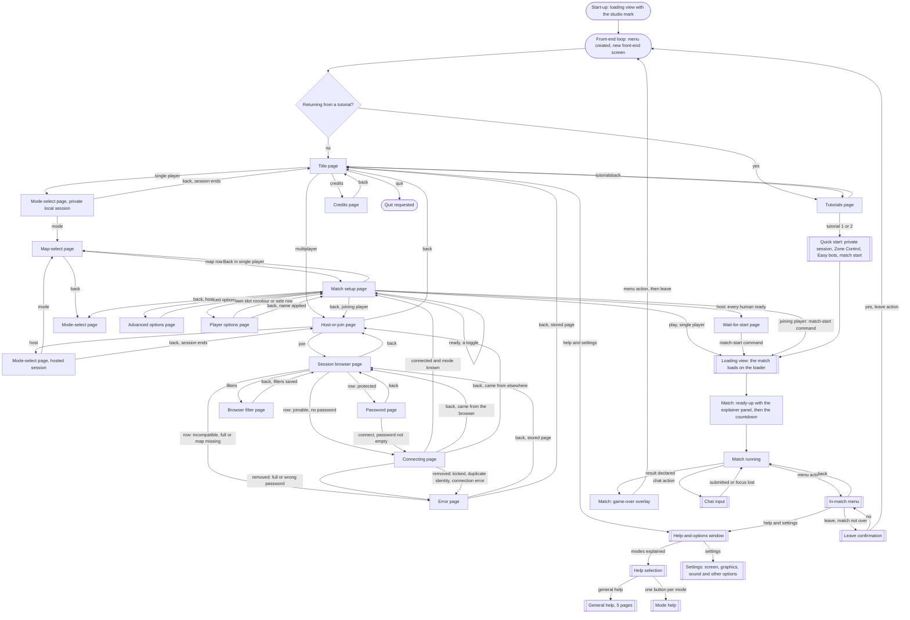
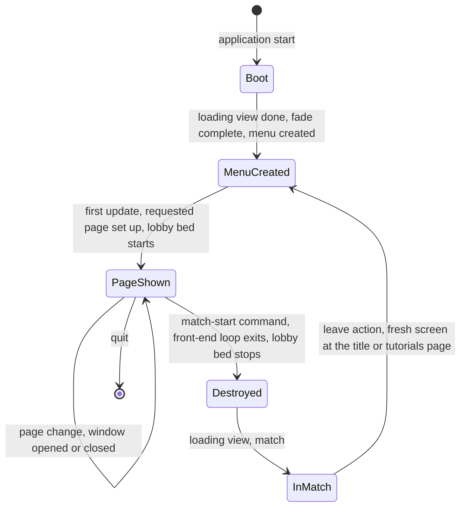
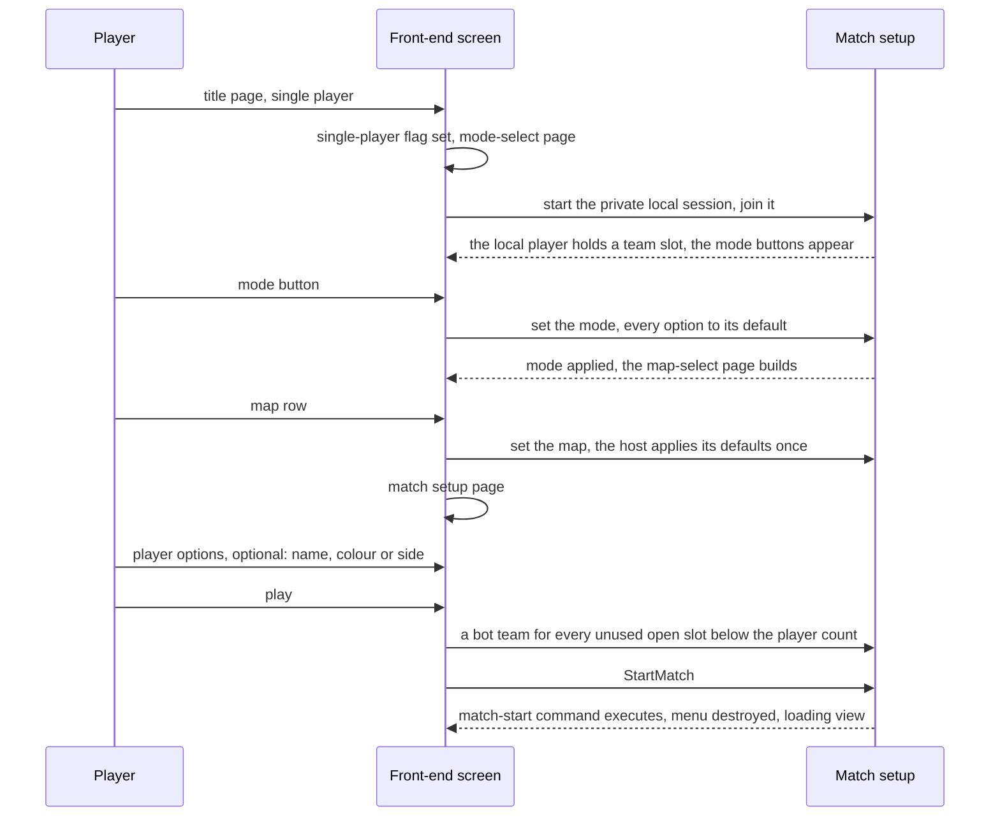
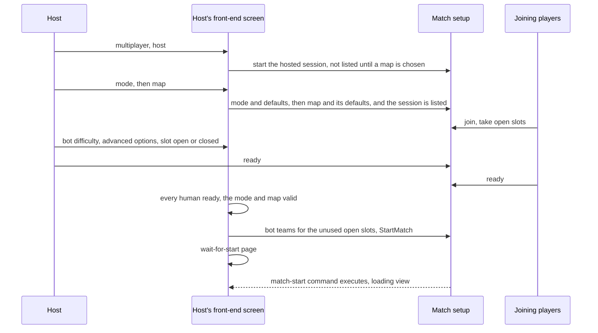
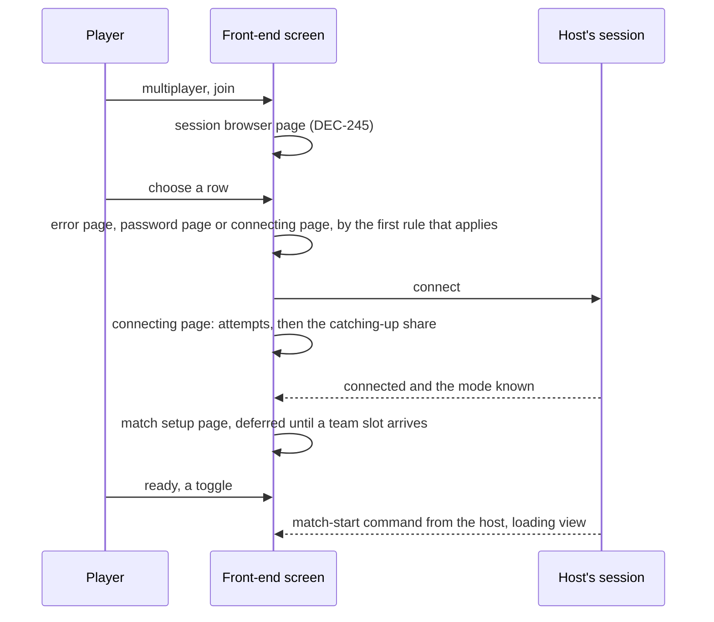
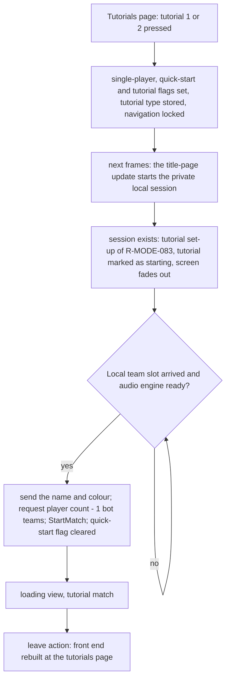
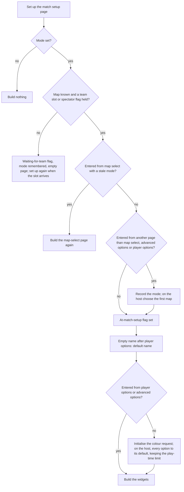
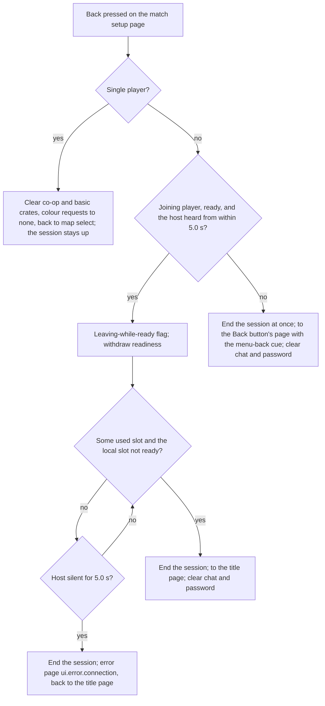
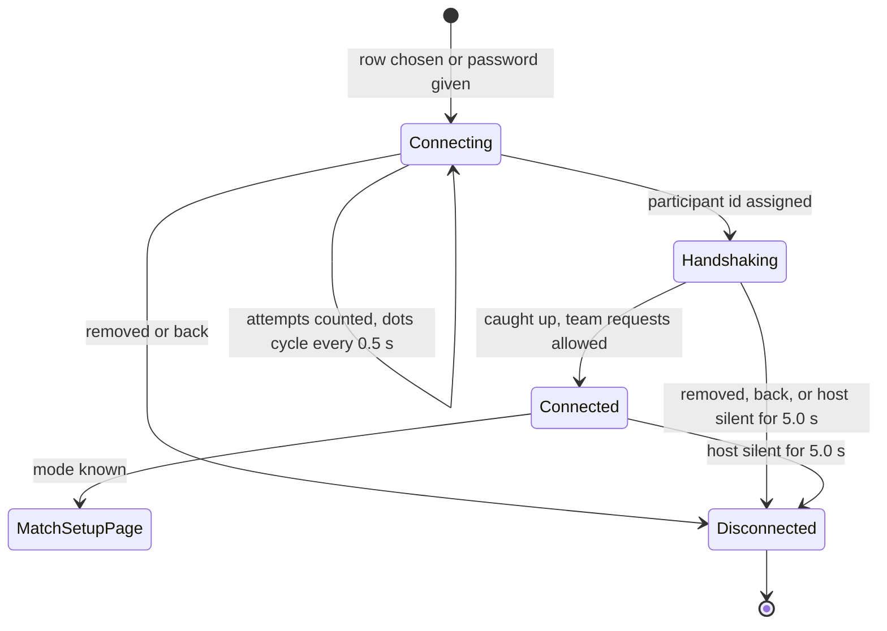

# Screen flow and match setup

> Status: Reference · Prefix: R-META · Related: [Folder index](README.md) · [Options, localisation and hooks](options_localisation_and_hooks.md) · [01 Skirmish rules and modes](../01_skirmish_rules_and_modes/README.md) · [06 Controls, camera and commands](../06_controls_camera_and_commands/README.md) · [07 Bots](../07_bots/README.md) · [08 Maps and level design](../08_maps_and_level_design/README.md) · [10 Audio design](../10_audio_design/README.md) · [11 Tutorial and help](../11_tutorial_and_help.md) · [12 Simulation model](../12_simulation_model/README.md) · [UI framework](../../architecture/components/ui_framework/README.md)

## 1 Purpose and player experience

This document specifies the front end of the reference game: the one full-screen menu screen and its pages, the windows layered over it, the way from the title page through mode, map and match setup into a match and back, the match setup options and which participant sees which control, and the hooks of a results screen. The shared page layout, the animated backdrop, the loading view, the explainer panel shown while the players ready up and the start of a match as the front end sees it are in [front_end_presentation.md](front_end_presentation.md). The settings pages, localisation and the achievement and leaderboard hooks are in [options_localisation_and_hooks.md](options_localisation_and_hooks.md). Pages are described by what they show and do. How a page is built, how focus moves, how widgets look and how the screen is drawn belong to the UI framework ([README](../../architecture/components/ui_framework/README.md), [core and widgets](../../architecture/components/ui_framework/core_and_widgets.md), [layout, rendering, input and localisation](../../architecture/components/ui_framework/layout_rendering_input_and_localisation.md), [pages and screen recipes](../../architecture/components/ui_framework/pages_and_screen_recipes.md)). The lobby protocol, session discovery, admission and identity are decided by the design phase (DEC-243, DEC-244, DEC-245, DEC-248, DEC-249): this document states what the screens show and what the match setup needs, never how it travels between participants.

**Player experience.** The game opens on a loading view that shows a studio mark, then on a title page over an animated backdrop: a giant breathing Worker figure in a red glow, a slowly turning wheel behind it and the title wordmark above. From the title page the player goes to single-player play against bots, to multiplayer (host or join), to the two tutorials, to help and options or to the credits, or quits. Single player and hosting share one path: choose a mode, choose a map, then the match setup page, where the host sets the bot difficulty and the advanced options and every player picks a name and a colour, or a side in Siege. The match starts at once in single player, and in multiplayer when every human is ready. A loading view leads into a frozen match in which the mode's explainer panel loops at the bottom of the screen until every human has pressed Ready; a three-second countdown follows. When the match ends, the game-over overlay stays until the player leaves through the in-match menu, which rebuilds the front end at its title page.

### 1.1 What the front end contains

The player-visible front end consists of:

1. one full-screen front-end screen (`FrontEndScreen`), a page state machine with the pages of §2.1;
2. help and options, opened over the front end or over the in-match menu, which leads to the help pages ([reference/11](../11_tutorial_and_help.md)) and to the settings with their screen, graphics, sound and other options ([options_localisation_and_hooks.md](options_localisation_and_hooks.md));
3. the in-match menu, the leave confirmation, the in-match chat input and the gamepad-disconnected dialog (§2.16);
4. the in-match HUD: the ready prompt, the countdown, the scoreboard, the match clock and the game-over overlay ([reference/01](../01_skirmish_rules_and_modes/README.md) §2.9 and §2.16), whose results hooks are §2.26;
5. the loading view ([front_end_presentation.md](front_end_presentation.md) §2.3) and the explainer panels ([front_end_presentation.md](front_end_presentation.md) §2.4);
6. two tutorials, launched from the tutorials page (§2.6; content in [reference/11](../11_tutorial_and_help.md)).

These exist only as hooks or not at all: the achievements page, the leaderboards and the Skill rating (DEC-047, [options_localisation_and_hooks.md](options_localisation_and_hooks.md)); quick match (DEC-249, DEC-050); user profiles and mods (DEC-061); key rebinding (DEC-050); the first-time intro sequence, the start-up mini-programs and the attract mode (DEC-054).

### 1.2 Conventions used in this document

- **Screen geometry.** W and H are the screen width and height in pixels. bx, bw and bh are the x position, width and height of a standard button; the left box is lX, lY, lW, lH and the right box rX, rY, rW, rH; small, medium and large are the three font sizes ([front_end_presentation.md](front_end_presentation.md) §2.1). Positions are (x, y) with y downwards.
- **Time.** Everything the front end animates runs on the presentation clock in real seconds (ADR-036); t is the presentation time in seconds. Simulation durations, such as the grace countdown, are integer ticks owned by [reference/01](../01_skirmish_rules_and_modes/README.md) and [reference/12](../12_simulation_model/01_tick_timing_and_main_loop.md).
- **Page tables.** "Nav" is the widget's position in the page's navigation order, and "—" marks a widget that focus never reaches (a title, a picture or an information panel). "Caption" is a string id.
- **Text.** Every player-facing text is a string id; the new text of each id that this document defines is in §4.2.
- **Commands.** The front end changes the match setup only through the player commands of [reference/12](../12_simulation_model/06_teams_and_player_commands.md) R-SIM-450 to R-SIM-452. A "match-setup change" is one of the commands of R-SIM-451.

## 2 Rules

### 2.1 Scope and the page set

**R-META-001** (MUST) The values of §4 are the reference tuning baseline, and this document is the specification of record for the front end and the match setup (DEC-004, DEC-005). A reference behaviour that looks accidental is kept as an explicit, named rule unless a decision corrects it (DEC-006).

**R-META-002** (MUST) The front end never writes simulation state. It changes the match setup only by issuing player commands, and it reads match state only from the presentation events and the read-only state that the simulation publishes (DEC-007).

**R-META-003** (MUST) The front end is one full-screen screen whose content is one page at a time. The reference has `ref.meta.front_end.live_pages` (18) live pages; this document specifies the `ref.meta.front_end.specified_pages` (15) pages below. The other three, two credential and trial-edition pages and an update notice, are outside the library (DEC-333, DEC-248, DEC-249).

| Page | Reached from | Specified in |
|---|---|---|
| title page | start-up; every return from a match | §2.5 |
| tutorials page | the title page; every return from a tutorial | §2.6 |
| host-or-join page | the title page | §2.7 |
| mode-select page | the title page (single player); the host-or-join page (host) | §2.8 |
| map-select page | the mode-select page | §2.9 |
| match setup page | the map-select page; the connecting page | §2.10 |
| advanced options page | the match setup page (host) | §2.11 |
| player options page | the match setup page (the player's own slot row) | §2.12 |
| session browser page | the host-or-join page (join) | §2.13, DEC-245 |
| browser filter page | the session browser page | §2.13, DEC-245 |
| password page | the session browser page (a protected session) | §2.13, DEC-244 |
| connecting page | the session browser page; the password page | §2.13 |
| wait-for-start page | the match setup page (host) | §2.13 |
| error page | the session browser page; the connecting page; a removal from a session | §2.13 |
| credits page | the title page | §2.14 |

The order of this table carries no meaning.

**R-META-004** (MUST) These windows open over the page underneath, each as a separate window on top of the window stack (R-META-015): help and options, help selection, general help, mode help, the settings screen and its four option screens (§2.15); the in-match menu, the leave confirmation, the in-match chat input and the gamepad-disconnected dialog (§2.16). The gamepad-disconnected dialog can appear over any screen.

### 2.2 Front-end lifecycle

**R-META-005** (MUST) The front-end controller (`FrontEndController`) lives for the process ([reference/12](../12_simulation_model/02_match_lifecycle_and_state_reset.md) §2.1). It is not a window. It owns the map catalogue ([reference/08](../08_maps_and_level_design/rules_and_conventions.md) R-MAP-011), the 3-D backdrop ([front_end_presentation.md](front_end_presentation.md) R-META-210) and the creation and destruction of the one front-end screen (`FrontEndScreen`). Every page, every page transition and the logic of the match setup page belong to the front-end screen. How the application composes its services and states is DEC-221; the screen-level flow of diagram 3-A is reference behaviour.

**R-META-006** (MUST) While the application is at the front end, the front-end loop creates the menu whenever the menu does not exist and the screen fade has completed.

**R-META-007** (MUST) Creating the menu runs these steps in order:

1. start a screen fade-in of `ref.meta.front_end.fade_in` (0.25 s);
2. remove every UI window;
3. reset the match rules ([reference/01](../01_skirmish_rules_and_modes/README.md) R-MODE-033);
4. create and register a new front-end screen;
5. cut the camera to the front-end view, at `ref.sim.lifetime.front_end_camera_position` looking along `ref.sim.lifetime.front_end_camera_direction` ([reference/12](../12_simulation_model/02_match_lifecycle_and_state_reset.md)); the camera is not advanced in the front end, whose backdrop sets its view directly (CAM-032; DEC-024);
6. set the application's game mode to none;
7. if the player is returning from a tutorial, set the new screen's requested page to the tutorials page;
8. clear the returning-from-tutorial flag;
9. mark the menu as created.

**R-META-008** (MUST) A new front-end screen covers the whole screen, (0, 0) to (W, H), and cannot be resized, moved or closed. Its current page is none and its requested page is the title page, unless step 7 of R-META-007 applies. It reads the player name from the player-name setting ([options_localisation_and_hooks.md](options_localisation_and_hooks.md)), whose default is `ui.player.default_name`, replaces every `%` character of it with a space and stores the result through the name rule (R-META-052). No credential or entitlement check runs at any point of the front end (DEC-248).

**R-META-009** (MUST) On its first update the front-end screen sets up its requested page. On the first update after the audio engine is ready, it starts the lobby ambience (R-META-019).

**R-META-010** (MUST) When the match-start command executes (`StartMatch`, [reference/12](../12_simulation_model/06_teams_and_player_commands.md) R-SIM-460), the participant sets its match-loading flag, requests the match, sets the game mode to match, leaves the front end, shows the interface, clears its at-match-setup flag and resets the game timer. The front-end loop then exits, stops the lobby ambience and destroys the menu: the front-end screen is removed and the screen fades out.

**R-META-011** (MUST) The in-match leave action (R-META-065) clears the requested match and returns the application to the front end. The front-end loop then builds a fresh front-end screen at the title page, or at the tutorials page after a tutorial. No match setup state survives a match; only the settings store persists ([reference/12](../12_simulation_model/02_match_lifecycle_and_state_reset.md) R-SIM-031).

**R-META-012** (MUST) The front end has no results page. A match result is shown only by the game-over overlay of the match HUD ([reference/01](../01_skirmish_rules_and_modes/README.md) R-MODE-035, R-MODE-068); its hooks are §2.26 (DEC-048).

**R-META-013** (MUST) After game over the only way out of a match is the in-match menu's leave action, which in a finished match leaves without a confirmation (R-META-063). The ready action has no effect at game over. The game-over prompt `match.game_over.leave_prompt_keyboard` or `match.game_over.leave_prompt_pad` names this path ([reference/01](../01_skirmish_rules_and_modes/README.md) R-MODE-068).

### 2.3 Navigation, Back and the front-end sound cues

**R-META-014** (MUST) Every full-screen window registers a Back button as its back action, and the UI framework invokes it on `action.menu.close`: the gamepad's Back or east face button, or Esc outside a match (UI-203, UI-204; DEC-950). In a match the menu action `action.match.menu` closes every open window at once and shows the interface again; it does not go back one level ([reference/06](../06_controls_camera_and_commands/actions_and_bindings.md) row M4).

**R-META-015** (MUST) Windows stack: each new window opens on top of the open ones, and closing a window reveals the one beneath it.

**R-META-016** (MUST) The **base press** of a page button plays the menu-select cue, or the menu-back cue when the button's transition direction is backwards, and starts a menu transition of `ref.meta.nav.transition_time` (1.0 s) in that direction.

**R-META-017** (MUST) A Back button plays the menu-select cue through the base press, then the menu-back cue, and restarts the transition in the backwards direction.

**R-META-018** (MUST) The front-end sound cues are events of the match UI sound source ([reference/10](../10_audio_design/README.md) owns the event ids):

| Cue | Asset | When |
|---|---|---|
| lobby bed | `amb.lobby_bed` | starts on the first front-end update after the audio engine is ready; stops when the front-end loop exits |
| menu select | `sfx.ui.match_ui.menu_select` | a forward button press through the base press; a map-row press |
| menu back | `sfx.ui.match_ui.menu_back` | a press of a button whose transition direction is backwards and that uses the base press; every Back button, after its menu-select cue |
| menu hover | `sfx.ui.power_slots.icon_hover` | focus moves onto a new button, map row or colour row |
| chat message | `sfx.ui.match_ui.chat_message` | a chat line arrives on the match setup page; join and leave notices are silent |

**R-META-019** (MUST) The lobby bed plays only at the front end. It does not play during a loading view, because its trigger runs only from the front-end loop (DEC-319).

### 2.4 Page specification conventions

**R-META-020** (MUST) Every widget of a page has a widget id that is unique within the page. The help text of a focused option control is keyed by its option (R-META-050).

**R-META-021** (MUST) Every caption is a string id. A string that the current language lacks falls back to the base language, so no page shows a string id as text (DEC-099; [options_localisation_and_hooks.md](options_localisation_and_hooks.md)).

### 2.5 Title page

**R-META-022** (MUST) Setting up the title page clears the single-player flag and the local map choice. The page holds:

| Nav | Widget | Caption | Shown when | Action |
|---|---|---|---|---|
| — | title | `ui.main.title` | always | — |
| 1 | single player | `ui.main.single_player` | always | base press; sets the single-player flag; → mode-select page |
| 2 | multiplayer | `ui.main.multiplayer` | always | base press; → host-or-join page |
| 3 | tutorials | `ui.main.tutorials` | always | base press; → tutorials page |
| 4 | help and options | `ui.main.help_and_options` | always | base press; opens the help-and-options window as a child of the screen and requests a menu transition |
| 5 | credits | `ui.main.credits` | always | base press; → credits page |
| 6 | quit | `ui.main.quit` | always, at y = lY + lH − 2 × bh | requests the application to quit, with no cue and no transition |

**R-META-023** (MUST) The per-frame update of the title page, which also runs on the tutorials page, starts the private local session when the single-player flag is set and no local session exists (R-META-029). This is how a tutorial launch obtains its session (diagram 3-F).

**R-META-024** (MUST) The title page offers no update check, no message of the day and no credential status; those depend on online services that the library does not specify (DEC-249, DEC-248). It has no map-editor entry in any player build: that entry, `ui.power_slots.map_editor`, exists only in builds that include the map editor ([reference/08](../08_maps_and_level_design/map_editor_hooks.md) R-MAP-301, R-MAP-305).

### 2.6 Tutorials page

**R-META-025** (MUST) Setting up the tutorials page clears the current tutorial instruction ([reference/11](../11_tutorial_and_help.md)). The page holds:

| Nav | Widget | Caption | Condition | Action |
|---|---|---|---|---|
| — | title | `ui.tutorials.title` | | |
| 1 | tutorial 1 | `ui.tutorials.part_1` | inactive while the first tutorial's map ([reference/11](../11_tutorial_and_help.md)) is not in the Zone Control map list | ignored while inactive or while a quick start runs; otherwise the base press, then: set the single-player flag, the quick-start flag, the tutorial flag and the tutorial type, and lock the page navigation |
| 2 | tutorial 2 | `ui.tutorials.part_2` | inactive while the second tutorial's map is not in the Zone Control map list | as tutorial 1, for the second tutorial |
| 3 | Back | `ui.common.back` | | → title page |

**R-META-026** (MUST) While the navigation is locked, focus does not move and no page widget reacts. The tutorial launch then runs as diagram 3-F: the title-page update starts the private local session (R-META-023); once the session exists, the match setup applies the tutorial's set-up of [reference/01](../01_skirmish_rules_and_modes/README.md) R-MODE-083 (Zone Control, its tutorial map, every Zone Control option at its default, Easy bots, requested colour 0, and for the second tutorial the slot colours 0, 1 and 2 on slots 0, 1 and 2), marks the tutorial as starting and fades the screen out; when the local team slot arrives and the audio engine is ready, the front end sends the player's name and colour, requests (player count − 1) bot teams, issues `StartMatch` and clears the quick-start flag. After the tutorial match, the front end opens at the tutorials page (R-META-007).

### 2.7 Host-or-join page

**R-META-027** (MUST) Setting up the host-or-join page clears the single-player flag. The page holds:

| Nav | Widget | Caption | Action |
|---|---|---|---|
| — | title | `ui.host_or_join.title` | |
| 1 | host | `ui.host_or_join.host` | base press; → mode-select page, whose set-up starts the hosted session (R-META-029) |
| 2 | join | `ui.host_or_join.join` | base press; → session browser page (§2.13) |
| 3 | Back | `ui.common.back` | → title page |

**R-META-028** (MUST) No page leads to a quick match. Quick match, which joins the first compatible session with room, is DEC-249, and whether Species designs it is DEC-050.

### 2.8 Mode-select page

**R-META-029** (MUST) Setting up the mode-select page starts the match session when none exists. In single player it is a **private local session** that no other participant can join; when hosting it is a **hosted session** that others can join, which is not listed for joining until a map has been chosen (DEC-245 item 2). Both set the bot difficulty to Standard, unless a tutorial is running (R-MODE-030). The local participant joins its own session through the same path as any other participant (DEC-243 item 12); the session model is decided by the design phase (DEC-200, DEC-243).

**R-META-030** (MUST) The page holds one mode button per mode, in the order of the mode catalogue ([reference/01](../01_skirmish_rules_and_modes/README.md) R-MODE-029), six in all, each captioned `mode.<mode>.name`. A mode button is drawn only once the local participant holds a team slot or is a spectator, so the list appears once the new session has accepted the local player. Each button shows the mode's complexity badge (`uitex.difficulty_badge`, labelled `mode.complexity.simple`, `mode.complexity.medium` or `mode.complexity.hard`) at its right edge, of size `ref.meta.mode_select.badge_size` (0.1 × w by 0.05 × w, w the button width). Moving focus onto a mode button makes it the highlighted mode.

**R-META-031** (MUST) Pressing a mode button, once the local participant holds a team slot, goes to the map-select page, sets the mode in the match setup, clears the mode that the current page was built for, remembers the pressed mode, and sets every option of the mode to its default, as one update that no participant sees half-applied ([reference/01](../01_skirmish_rules_and_modes/README.md) R-MODE-078, DEC-243).

**R-META-032** (MUST) The page holds:

| Nav | Widget | Caption | Notes |
|---|---|---|---|
| — | title | `ui.mode_select.title` | |
| 1–6 | mode buttons | `mode.<mode>.name` | R-META-030, R-META-031 |
| 7 | Back | `ui.common.back` | → title page in single player, else → host-or-join page; ends the local session (R-META-093) |
| — | mode card | — | in the right box at (rX + `ref.meta.layout.picture_inset` (0.1) × rW, rY + 0.1 × rW), `ref.meta.mode_select.card_width` (0.8) × rW wide and `ref.meta.mode_select.card_aspect` (2 ÷ 3) of that width high: the `help.mode_card` of the highlighted mode at alpha `ref.meta.mode_select.card_alpha` (0.8), with an outline at alpha `ref.meta.mode_select.card_outline_alpha` (0.5) |
| — | mode description | — | below the card, `ref.meta.mode_select.info_height` (0.85) × rH − the card height high, in the small font: the highlighted mode's `mode.<mode>.objective`, scrolling automatically |

**R-META-033** (MUST) The page loads every mode card at set-up, so a focus change never waits for a load.

### 2.9 Map-select page

**R-META-034** (MUST) Setting up the map-select page loads the thumbnails of the current mode's maps; while they load, the loading view's spinner is drawn over the menu ([front_end_presentation.md](front_end_presentation.md) R-META-219; see DEC-226 item 9).

**R-META-035** (MUST) While a mode press is pending and the match setup's mode differs from the pressed mode, setting up the page builds an empty page, and the page is set up again every frame until the two match.

**R-META-036** (MUST) The page holds one row per map in the current mode's map list, in the order of the map catalogue ([reference/08](../08_maps_and_level_design/rules_and_conventions.md) R-MAP-016; the order of tied maps is DEC-314). Only maps that list the mode appear (R-MAP-017; maps that list no mode are DEC-802). A row is `ref.meta.map_select.row_height` (0.7) × bh high and bw wide, rows are 0.7 × one button step apart, and the row text uses the small font. A row's widget id is its map id.

**R-META-037** (MUST) The page holds:

| Nav | Widget | Caption | Notes |
|---|---|---|---|
| — | title | `mode.<mode>.name` | |
| — | column header | `ui.map_select.column.name`, `ui.map_select.column.play_time`, `ui.map_select.column.players` | a strip at (bx, lY + `ref.meta.map_select.header_offset` (10 px + 1.8 × bh), bw, 0.7 × bh), black at alpha `ref.meta.map_select.header_alpha` (0.5), its captions in grey `ref.meta.map_select.header_grey` (0.6) at the row columns (R-META-038) |
| 1 to n | map rows | R-META-038 | |
| n + 1 | Back | `ui.common.back` | → mode-select page |
| — | thumbnail | — | in the right box at (rX + `ref.meta.layout.picture_inset` (0.1) × rW, rY + 0.1 × rW), of the size of [reference/08](../08_maps_and_level_design/rules_and_conventions.md) R-MAP-022 (`ref.map.thumbnail.width_fraction` × rW wide, `ref.map.thumbnail.aspect` of that width high) |
| — | map description | — | below the thumbnail, `ref.meta.mode_select.info_height` × rH − the thumbnail height high, in the small font × `ref.meta.map_select.info_font_scale` (1.1) |

**R-META-038** (MUST) A map row shows three columns, at x + `ref.meta.map_select.column_name` (0.025) × w, x + `ref.meta.map_select.column_play_time` (0.65) × w and x + `ref.meta.map_select.column_players` (0.83) × w, w the row width:

1. **Name.** `map.<map id>.name`; a custom map shows the display name of its own header (R-MAP-020). The name is drawn in `ref.meta.map_select.name_colour` (RGB 0.65, 1, 0.4), or `ref.meta.map_select.name_focus_colour` (RGB 1, 0.3, 0.3) while focused; the row of the map that the match setup has chosen is drawn pressed.
2. **Play time.** The map's play time in minutes or, when the map sets none, the mode's default time limit, shown by `ui.map_select.play_time` as "0:" followed by the minutes in two digits, so that 10 reads 0:10 (R-MAP-021; DEC-868 item 3). When neither exists, because the mode has no time-limit option or its default is "no limit", the column shows `ui.map_select.no_play_time`.
3. **Players.** One Worker badge (`uitex.worker_badge`) per player slot of the map, at most `ref.sim.team.player_slots` (4), each `ref.meta.map_select.badge_height` (0.9) × the row height high, `ref.meta.map_select.badge_spacing` (0.55) × the badge width apart and rotated by `ref.meta.map_select.badge_angle` (−π ÷ 8), coloured with team colour i for badge i ([reference/12](../12_simulation_model/06_teams_and_player_commands.md) R-SIM-415). On a map that forces co-op, badge i takes colour i ÷ 2, except that on a 3-player map badge 1 takes colour 1.

**R-META-039** (MUST) Each row slides in after the page is built: it appears `ref.meta.map_select.slide_delay` (1.0 s) × (the row's y ÷ H) after the page is built, starts −`ref.meta.map_select.slide_distance` (0.1 × W) × the remaining seconds to the left of its place, and carries an additive white flash whose alpha is the remaining seconds.

**R-META-040** (MUST) Moving focus onto a row plays the menu-hover cue and makes the row's map the highlighted map, which drives the thumbnail and the description.

**R-META-041** (MUST) Pressing a map row starts a forward transition, ignores an index outside the list, plays the menu-select cue, chooses the map in the match setup by its map id (`SetMatchOptionText`, R-SIM-451), remembers it as the local map choice and goes to the match setup page. The host applies the map's defaults once, authoritatively ([reference/01](../01_skirmish_rules_and_modes/README.md) R-MODE-079, DEC-067): co-op is cleared on a map that does not allow co-op and set on a map that forces it, and, when the mode has a time-limit option, the time limit becomes the map's play time, or the mode default when the map sets none.

**R-META-042** (MUST) The thumbnail shows the map of the focused row, or the chosen map when no row has focus, inside a white outline; a map without a thumbnail, which only a custom map can be, shows the outline alone (R-MAP-022). The description shows a custom map's header description, or `map.<map id>.description` for a listed map, scrolling automatically.

### 2.10 Match setup page

The match setup page is one page for single-player set-up, the host's lobby and a joining player's lobby (DEC-026); the differences are in §2.20.

**R-META-043** (MUST) Setting up the match setup page applies these steps in order:

1. When the match setup has no mode, nothing is built.
2. The map is the local map choice or, when there is none, the match setup's chosen map. When there is no map, or the local participant holds no team slot and is not a spectator, the page sets its waiting-for-team flag, remembers the mode and builds an empty page; it is set up again once a team slot, or the spectator flag, arrives.
3. When the page is entered from the map-select page while the mode that page was built for differs from the match setup's mode, the map-select page is built again instead. When it is entered from any page other than the map-select, advanced options and player options pages, the page records the match setup's mode as the mode it is built for and, on the host, chooses the first map of the list. Every ordinary entry comes from the map-select page, the player options page, the advanced options page or, for a joining player, the connecting page, so this branch is reached only when the mode changes while the page is shown.
4. The participant's at-match-setup flag is set.
5. On a return from the player options page with an empty name, the name becomes `ui.player.default_name`.
6. Unless the page is entered from the player options or advanced options page, the requested colour is initialised: in Siege or co-op the current request is remembered as the previous request and the request becomes none, because the side or alliance is chosen later; otherwise the request is the preferred-colour setting when that colour is free, else the next available colour, the lowest colour id from 0 to 7 that no used slot holds ([reference/01](../01_skirmish_rules_and_modes/README.md) R-MODE-015).
7. On the host, unless the page is entered from the advanced options or player options page, every option of the mode takes its default, keeping a time limit that the map's play time set ([reference/01](../01_skirmish_rules_and_modes/README.md) R-MODE-080, DEC-067).

**R-META-044** (MUST) The page holds the widgets below. Stacked controls use the small font; the title, the primary button and Back use the medium font.

| Nav | Widget | Caption | Who sees it | Geometry | Action |
|---|---|---|---|---|---|
| — | title | `mode.<mode>.name` | everyone | standard | — |
| 1, initial focus | primary button | `ui.lobby.ready` in multiplayer, `ui.lobby.play` in single player | everyone | (bx, lY + bh + `ref.meta.setup.primary_offset` (1.8) × bh, bw, bh) | §2.22 |
| 2 | advanced options | `ui.lobby.advanced_options` | the host | `ref.meta.setup.small_control_height` (0.66) × bh high | base press; → advanced options page |
| 3 | bot difficulty | `match.options.bot_difficulty`, values `match.options.bot_difficulty.easy`, `.standard`, `.hard` | the host | 0.66 × bh high; no background; cycle mode, in which each activation steps to the next value, wrapping from the last to the first; left and right do not change it (UI-210) | the values 0, 1 and 2 are `BotDifficulty::Easy`, `BotDifficulty::Standard` and `BotDifficulty::Hard`, bound to the match setup's bot difficulty ([reference/01](../01_skirmish_rules_and_modes/README.md) R-MODE-082); only these values are accepted (DEC-077) |
| 4 onwards | player slot rows, one per player slot of the map | §2.21 | everyone | a column at (bx, lY + `ref.meta.setup.slot_column_y` (6) × bh), each row `ref.meta.setup.slot_width` (0.45) × bw wide and `ref.meta.setup.slot_height` (0.75) × bh high, rows `ref.meta.setup.slot_step` (1.125) × bh apart | the player's own row: base press, → player options page; any other row: no action |
| beside the rows | slot control: kick, or open and close | — | the host (§2.22) | at (bx + `ref.meta.setup.slot_control_x` (1.05) × 0.45 × bw, the row's y), `ref.meta.setup.slot_control_size` (0.75) × bh square | R-META-089, R-META-090 |
| last | Back | `ui.common.back` | everyone | (bx, lY + lH − 2 × bh) | §2.23 |
| — | mode card | — | everyone | (lX + lW − 0.45 × bw − (lW − bw) ÷ 2, lY + 6 × bh), 0.45 × bw wide and `ref.meta.setup.mode_card_height` (0.3) × bw high, beside the slot rows | the mode's `help.mode_card` |
| — | thumbnail | — | everyone | as on the map-select page (R-META-037) | the chosen map's thumbnail |
| — | map name | — | everyone | under the thumbnail, 0.66 × bh high, small font, over the highlight beam | the chosen map's name; a press does nothing, because the map cannot change on this page |
| — | map description or chat log | — | everyone | under the map name, rH − the thumbnail height − small ÷ 2 − 2 × one button step − button gap high | single player: the map description; multiplayer: the chat log in the small font × `ref.meta.chat.log_font_scale` (0.8) (§2.24) |
| — | chat input | — | multiplayer | (rX + `ref.meta.layout.picture_inset` (0.1) × rW, rY + `ref.meta.chat.input_y` (0.95) × rH, `ref.meta.chat.input_width` (0.8) × rW, `ref.meta.chat.input_height` (1.2) × small) | §2.24 |

**R-META-045** (MUST) No spectator control and no add-bot control exists on the page: bots fill the empty open slots when the match starts (R-META-088), and no player-facing path makes a participant a spectator (R-META-091).

### 2.11 Advanced options page

**R-META-046** (MUST) The advanced options page is reached only by the host. Its controls are `ref.meta.option_controls.control_height` (0.65) × bh high and use the small font:

| Nav | Widget | Caption | Created when | Bound to |
|---|---|---|---|---|
| — | title | `ui.advanced_options.title` | always | |
| 1 to k | one control per option of the mode, in display order ([reference/01](../01_skirmish_rules_and_modes/README.md) R-MODE-073), of the control type and with the label of R-MODE-074 | the match setup has a mode | that option |
| k + 1 | basic crates only switch | `match.options.basic_crates` | always | the basic-crates-only flag |
| k + 2 | co-op switch | `match.options.coop` | the map allows co-op (R-MODE-018) | the co-op flag |
| k + 3 | password field, after one empty row | `match.options.password` | the host of a multiplayer session | the session password, at most `ref.match.option.password_max_length` (16) characters; setting it on the host sets the password that joining players must give (DEC-244 item 9) |
| last | Back | `ui.common.back` | always | → match setup page |
| — | option details | — | always | in the right box, inset `ref.meta.option_controls.details_inset` (5 %) and `ref.meta.option_controls.details_size` (90 %) of the box, small font: the help text of the focused control (R-META-050), scrolling automatically |

**R-META-047** (MUST) An option's control type selects its widget:

| Control | Widget | Values |
|---|---|---|
| switch | check box | off, on |
| list | drop-down list in cycle mode | one entry per value from the minimum to the maximum, each labelled by the value's string id (R-MODE-074) |
| spinner | integer field with a decrease and an increase glyph | clamped to the option's range; each glyph steps by the option's step; holding a glyph repeats the step every `ref.meta.option_controls.repeat_period` (0.1 s), and the value changes `ref.meta.option_controls.repeat_speedup` (5) times as fast while the UI framework's scroll speed-up action `action.menu.scroll_speedup` is held (UI-203) |

**R-META-048** (MUST) Every option value is an integer within the option's stated inclusive bounds, validated once by the match setup's authority (DEC-241 item 13, DEC-243). Under DEC-120 the lowest step of the time-limit spinner and of the crate-drop-period spinner is an explicit value, "no limit" or "none", which the spinner shows as `match.options.time_limit.none` or `match.options.crate_drop_period.none` and never as the number 0.

**R-META-049** (MUST) Every frame, the sudden-death control is inactive while the time limit is "no limit". When that state changes, the control's value is forced: off when it becomes inactive, on when it becomes active ([reference/01](../01_skirmish_rules_and_modes/README.md) R-MODE-056).

**R-META-050** (MUST) The help text of the focused control is `ui.advanced_options.help.<option>.<mode>` when that string exists, else `ui.advanced_options.help.<option>`.

### 2.12 Player options page

**R-META-051** (MUST) The player options page is reached from the player's own slot row. Its controls, its title included, are `ref.meta.option_controls.control_height` (0.65) × bh high and use the small font:

| Nav | Widget | Caption | When | Action |
|---|---|---|---|---|
| — | title | `ui.player_options.title` | | |
| 1 | name field | `ui.player_options.name` | always | the player's name, at most `ref.meta.player.name_max_length` (16) characters (R-META-052) |
| 2 to 4 | side rows: random, attackers, defenders | `ui.player_options.side.random`, `ui.player_options.side.attackers`, `ui.player_options.side.defenders` | Siege | request the colour none, the attacker colour `ref.sim.team.siege_attacker_colour_id` (1) or the defender colour `ref.sim.team.siege_defender_colour_id` (0) ([reference/01](../01_skirmish_rules_and_modes/README.md) R-MODE-026) |
| 2 to 9 | colour rows, colour ids 0 to 7 in id order | `team.colour.green`, `team.colour.red`, `team.colour.yellow`, `team.colour.blue`, `team.colour.orange`, `team.colour.purple`, `team.colour.cyan`, `team.colour.pink` | every other mode | request that colour (§2.21) |
| last | Back | `ui.common.back` | | applies the name (R-META-052), saves the settings file and returns to the match setup page |

**R-META-052** (MUST) The **name rule**: setting the player name truncates it to `ref.meta.player.name_max_length` (16) characters, stores the truncated name, or `ui.player.default_name` when it is empty, in the player-name setting, saves the settings file and issues `SetTeamName` for the player's slot (R-SIM-451). The stored name is always the truncated one.

### 2.13 Session pages

**R-META-053** (MUST) The session browser page, the browser filter page and the password page follow the reference default of DEC-245 (the merged session list, its filters, its sorting, its rows and the rule order for choosing a row) and DEC-244 (the password). This document specifies where they lead (diagram 3-A): choosing a row leads, by the first rule that applies, to the error page for an incompatible session, a full session or a map that is not installed, to the password page for a protected session, and otherwise to the connecting page; a protected session's row shows `uitex.icon_locked`. The browser filter page saves its filter settings and returns to the browser. The password page leads to the connecting page when the typed password is not empty, and back to the browser otherwise.

**R-META-054** (MUST) The connecting page holds the title `ui.connecting.title`, a status widget in the medium font, and a Back button that returns to the session browser page when the player came from it and to the host-or-join page otherwise, for example from the password page.

**R-META-055** (MUST) The status widget shows, by the participant's connection state (the states are DEC-205 item 7):

| State | First line | Second line, at `ref.meta.connect.second_line_scale` (0.6) × the font |
|---|---|---|
| connecting | `ui.connecting.connecting` followed by 0 to `ref.meta.connect.max_dots` (3) dots, the count being ⌊t × 2⌋ mod 4, one more dot every `ref.meta.connect.dot_period` (0.5 s) | `ui.connecting.attempts` with the number of connection attempts |
| handshaking, connected | `ui.connecting.connected` | `ui.connecting.catching_up` with 100 × processed ÷ total command frames, without decimals: the share of the session history caught up so far (DEC-244 item 2) |
| disconnected | blank | blank |

When the player chose a session in the browser, a details block follows at `ref.meta.connect.details_scale` (0.5) × the font, its rows `ref.meta.connect.details_row_step` (0.7) × the font apart and its values `ref.meta.connect.details_value_x` (200 px) right of the labels: `ui.connecting.host` with the session name (by default the host's player name, else `ui.settings.default_session_name`, R-META-451), `ui.connecting.address` with `ui.connecting.address_value` (the address and port actually contacted), `ui.connecting.mode` with the mode's name, `ui.connecting.map` with the map's name and `ui.connecting.players` with "n/max". All text is drawn twice, the outline first and then the fill.

**R-META-056** (MUST) The connecting page goes to the match setup page once the state is connected and the match setup's mode is known; the match setup page may then wait for a team slot (R-META-043 step 2). While the participant connects, the page has no timeout: it waits until the player presses Back or the participant is removed (DEC-205). Once the participant has received a message from the host, the host-silence rule of R-META-059 also ends the wait.

**R-META-057** (MUST) The wait-for-start page is an empty page with the default left box. The host shows it from the moment it issues `StartMatch` until the match-start command executes, so that the automatic start (R-META-087) issues the command only once.

**R-META-058** (MUST) Creating an error stores its message and its back page (by default the title page), requests the error page, clears the at-match-setup flag and clears the chat log. The error page holds the title `ui.error.title`, the message in the small font, centred, at y = lY + `ref.meta.error.message_y` (0.5 × bh + 2 × bh), and a Back button to the stored back page. The stored back page is cleared once the page is built.

**R-META-059** (MUST) The errors that the front end reports, with their back pages, are (Species defines its own removal reasons, DEC-244 item 10):

| Trigger | Message | Back page |
|---|---|---|
| a browser row of an incompatible session | `ui.error.incompatible` | session browser |
| a browser row of a full session | `ui.error.session_full` | session browser |
| a browser row whose map is not installed | `ui.error.map_missing` | session browser |
| removed from the session: full | `ui.error.session_full` | session browser |
| removed from the session: a duplicate identity | `ui.error.duplicate_identity` | title |
| removed from the session: kicked by the host | `ui.error.kicked` | title |
| removed from the session: a wrong password | `ui.error.wrong_password` | session browser |
| the participant id arrives twice | `ui.error.connection` | title |
| joined as a spectator where spectators are not allowed | `ui.error.session_full` | session browser |
| the session removes the participant's own id | `ui.error.session_full` | title |
| a joining participant that has received a message from the host receives none for `ref.meta.connect.host_silence_limit` (5.0 s of real time): it ends its session, on any page and in a match (DEC-205) | `ui.error.connection` | title |
| any other removal reason | none: the front end goes straight to the title page | — |

### 2.14 Credits page

**R-META-060** (MUST) The credits page holds the title `ui.credits.title`, one scrolling text widget in the small font, placed by `ref.meta.credits.text_box`: at (bx, lY + 1.8 × bh), bw wide and lH − 1.5 × bh − 1.3 × bh − bh − 2 × button gap high, and a Back button to the previous page. The text is the strings `ui.credits.line_1`, `ui.credits.line_2` and onwards, each followed by a space and a line break, up to the first index that has no string. A line that starts with "-" is a section heading, drawn `ref.meta.credits.heading_scale` (1.25) × larger without the dash. The scrolling follows the UI framework's scrolling text widget. The credit text is new (`ui.credits`).

### 2.15 Help-and-options branch

**R-META-061** (MUST) The windows of this branch are full-screen options screens laid out in the left box ([front_end_presentation.md](front_end_presentation.md) R-META-200), with their buttons from top to bottom and Back at y = lY + lH − 2 × bh:

| Window | Content |
|---|---|
| help and options | title `ui.help_and_options.title`; how to play, `ui.help_and_options.how_to_play`, → help selection; settings, `ui.help_and_options.settings`, → the settings screen, unless it is already open; Back |
| help selection | title `ui.help_select.title`; general help, `ui.help_select.general`, → general help; one button per mode in the order of the mode catalogue, captioned `mode.<mode>.name`, → that mode's help; Back |
| general help | full width; page 1 to `ref.meta.help.general_pages` (5); previous, `ui.help.previous`, and next, `ui.help.next`, each half the width, change the page by −1 and +1 by rebuilding the window; leaving the range 1 to 5 closes the window; Back |
| mode help | titled `ui.help.mode.<mode>.title`; the mode's help pages; a page exists only while its text string exists, and the window closes itself when it reaches a page that does not ([reference/11](../11_tutorial_and_help.md) R-TUT-043) |

The content and the string ids of the help pages are [reference/11](../11_tutorial_and_help.md). The settings screen, its screen, graphics, sound and other options, and where each option screen's apply action returns to are [options_localisation_and_hooks.md](options_localisation_and_hooks.md).

### 2.16 In-match menus and dialogs

**R-META-062** (MUST) The menu action `action.match.menu` opens the in-match menu once the match's fade-in has finished and no tutorial script runs, when no UI window is open and the Power slots panel is hidden ([reference/06](../06_controls_camera_and_commands/actions_and_bindings.md) row M4, [reference/12](../12_simulation_model/01_tick_timing_and_main_loop.md) R-SIM-581 step 5). Opening it hides the interface. The menu does not pause the match, and a lost window focus does not hold the world either (R-SIM-581 step 7).

**R-META-063** (MUST) The in-match menu holds:

| Widget | Caption | Action |
|---|---|---|
| title | `ui.match_menu.title` | — |
| help and options | `ui.match_menu.help_and_options` | opens the help-and-options window (R-META-061) |
| leave | `ui.match_menu.leave` | when the match is over, the leave action at once (R-META-065); otherwise → the leave confirmation |
| back | `ui.match_menu.back` | in a match, moves the pointer to the screen centre; removes the window; shows the interface |

**R-META-064** (MUST) The leave confirmation holds the title `ui.confirm_leave.title`, a yes button `ui.confirm_leave.yes`, which runs the leave action, and a no button `ui.confirm_leave.no`, which closes the confirmation.

**R-META-065** (MUST) The **leave action** removes every window, clears the requested match and returns the application to the front end. The match and its session are torn down when the main loop sees the request ([reference/12](../12_simulation_model/02_match_lifecycle_and_state_reset.md) R-SIM-028; DEC-221).

**R-META-066** (MUST) The gamepad-disconnected dialog opens on `action.device.pad_disconnected` while the gamepad is known to be connected, and that knowledge is then cleared; it closes on `action.device.pad_connected`, which sets it again ([reference/06](../06_controls_camera_and_commands/actions_and_bindings.md) row M7). While the gamepad is disconnected and the input mode is gamepad, the application treats its window as unfocused. On its first update the dialog shows the message `ui.dialog.pad_disconnected` in a dialog box, which is all it draws; it closes itself when the message is dismissed (the dismiss action `action.menu.dismiss` of UI-203, bound in table 3.6-B of the [input component](../../architecture/components/input/controls_and_default_bindings.md)) or on `action.match.menu`.

### 2.17 Match setup options

**R-META-067** (MUST) The mode options are the typed per-mode schemas of [reference/01](../01_skirmish_rules_and_modes/README.md) R-MODE-073 to R-MODE-077, with explicit defaults per mode (DEC-073); that document owns their labels, ranges, steps, defaults and meanings. The advanced options page shows them in the mode's display order (R-META-046). For readability, the values of R-MODE-074 are repeated here:

| Mode | Options in display order: control, range and step, default |
|---|---|
| Spawn Control | score mode: list, 0 to 1, 0; time limit: spinner, no limit or 1 to 60 minutes in steps of 1, 10; Catch-up bonus: spinner, 0 to 90 % in steps of 10, 90; crate drop period: spinner, none or 10 to 300 s in steps of 10, 40; starting powers: spinner, 0 to 3, 0; Comeback Bonus: switch, on; sudden death: switch, on; crate placement: list, random or weighted, weighted |
| Zone Control | score mode: list, 0 to 3, 0; time limit: spinner, 1 to 60 minutes, 5; Catch-up bonus: 90; crate drop period: 40; starting powers: 0; Comeback Bonus: on; sudden death: on; crate placement: weighted |
| Relic Run | time limit: 1 to 60 minutes, 10; crate drop period: 40; Comeback Bonus: on; sudden death: on; crate placement: weighted |
| Siege | Catch-up bonus: 90; crate drop period: 40 |
| Launch Race | crate drop period: 40; reinforcement interval: spinner, 10 to 300 mode seconds in steps of 10, 60; reinforcement count: spinner, 1 to 100, 40; Transport cap: spinner, 1 to 10, 2; turret frequency: spinner, 0 to 10, 7; turret cap: spinner, 0 to 5, 3 |
| Flag Chain | time limit: no limit or 1 to 60 minutes, 15; crate drop period: 40; reinforcement interval: 60; reinforcement count: 40; Transport cap: 2; turret frequency: 2; Comeback Bonus: on; sudden death: on; turret cap: 2 |

Siege has no time limit, so a map's play time does not apply to it; its player options page offers sides instead of colours (R-META-051), and the single-round Siege flag has no control (DEC-066).

**R-META-068** (MUST) Defaults are applied to every option of the mode when a mode is pressed (R-META-031), when the host enters the match setup page (R-META-043 step 7) and by the tutorial set-up (R-META-026).

**R-META-069** (MUST) These match setup settings lie outside the mode schemas:

| Setting | Where it is changed | Values and default | Who, in the user interface |
|---|---|---|---|
| bot difficulty | match setup page list | Easy, Standard or Hard; Standard, set when the session starts; Easy in a tutorial (R-MODE-082) | the host |
| basic crates only | advanced options switch | off or on; off | the host |
| co-op | advanced options switch, on maps that allow co-op | off or on; switched by the map choice (R-META-041) | the host |
| password | advanced options text field | at most 16 characters; empty | the host of a multiplayer session |
| single-round Siege | no control | on (DEC-066) | nobody |
| map | map-select page; it cannot change on the match setup page | the maps listed for the mode | the host |
| mode | mode-select page | the six modes | the host |
| player name | player options page; the chat rename (R-META-101) | at most 16 characters, at most `ref.meta.chat.rename_max_length` (15) through the chat | each player |
| colour or side | player options page | the eight colours, or random, attackers and defenders in Siege (§2.21) | each player |
| open or closed slot | match setup page slot control (R-META-090) | open by default (DEC-079) | the host |
| seasonal theme | no control (§2.25) | the host's date rule (DEC-101) | nobody |

**R-META-070** (removed: research levels, which the match setup does not carry; the fixed match levels are reference/01 R-MODE-082, DEC-115)

### 2.18 Who can change what

**R-META-071** (MUST) The user interface offers these controls:

| Setting | Host | Joining player |
|---|---|---|
| mode and map | the mode-select and map-select pages, before the match setup page | no page |
| bot difficulty | the match setup page list | the control is not created |
| mode options, basic crates only, co-op, password | the advanced options page | the button to the page is not created |
| own name, colour or side | the player options page | the player options page |
| open or closed slots | the slot controls | not created |
| ready | yes, and the host must also ready up | yes |
| kick | yes | no |
| start | automatic once every human is ready (R-META-087) | no |

**R-META-072** (MUST) Under the reference default the restriction of R-META-071 lies in the user interface only: every participant applies every match-setup change, start and ready command that any participant issues, and only kicking acts through the host alone. Which participant may change each setting, and how the authority validates each command, are DEC-243 and DEC-202.

### 2.19 Match setup state

**R-META-073** (MUST) The front-end screen keeps this local state, which no other participant sees:

| State | Meaning | Initial |
|---|---|---|
| current page, requested page | the page shown and the page to show next | none, the title page (R-META-008) |
| single-player flag | the single-player path: a private local session, Play instead of Ready, no chat and no kick | clear |
| quick-start flag, tutorial-starting flag | a quick start is running; a tutorial has been set up | clear |
| navigation lock | the page navigation is frozen during a tutorial launch | clear |
| local map choice | the map chosen on this participant, used so that nothing starts before the match setup holds the same map | none |
| page-built-for mode, pressed mode | the mode the current page was built for; the mode pressed and not yet applied | none; written before every use |
| highlighted map, highlighted mode | the focused map and mode, which drive the preview panels | none, the first mode |
| requested colour, previous requested colour | the colour or side request | none, none |
| player name | at most 16 characters | the player-name setting |
| session password | at most 16 characters | empty |
| waiting-for-team flag, waiting mode | the match setup page is deferred until a team slot arrives | clear, none |
| leaving-while-ready flag | the player is leaving while ready and waits until readiness is withdrawn (R-META-092) | clear |
| chat log, current chat line, chat-toggled-this-update flag | §2.24 | empty |
| error message, error back page | §2.13 | none, none |
| session browser state | DEC-245 | — |

**R-META-074** (MUST) The match setup that every participant shares holds what a match needs (DEC-243 item 10): the mode; the map, by map id; the mode options; the bot difficulty; the co-op flag; the single-round Siege flag; the basic-crates-only flag; for each player slot, its owner, kind, name, colour, ready flag and whether it is open (DEC-079); the chat; the achievement masks ([options_localisation_and_hooks.md](options_localisation_and_hooks.md)); the seasonal state (DEC-118); the password; and the start. Choosing a mode sets every mode option to its default, and choosing a map sets the time limit (R-META-031, R-META-041).

**R-META-075** (MUST) Under the reference default every option, and every element of the option arrays, carries a version number. A change carries the version that the sender's copy holds + 1, and a participant applies it only when that version is greater than the stored one, and then stores it (DEC-243 item 5). Whether Species keeps this model or an authority-owned snapshot is DEC-243.

### 2.20 Single player, host and client

**R-META-076** (MUST) The match setup page differs by role:

| Aspect | Single player | Host | Joining player |
|---|---|---|---|
| session | private and local | hosted, listed for joining once a map is chosen | the host's |
| primary button | Play, which starts the match at once | Ready, a toggle; the match starts automatically once every human is ready | Ready, a toggle |
| bot difficulty and advanced options | yes | yes | no |
| slot controls | open and close | kick, open and close | no |
| chat | no; the map description instead | yes | yes |
| Back goes to | the map-select page, and the session stays up | the mode-select page; the session ends and every joined player is dropped | the host-or-join page, or the title page when leaving while ready (R-META-092) |

**R-META-077** (MUST) The host cannot change the map or the mode without ending its session, which drops every joined player.

### 2.21 Player slots, names, colours and sides

**R-META-078** (MUST) A player slot row's caption is the first of these that applies:

1. the slot has a non-empty name: the name, or `ui.lobby.slot.ready_name` with the name while the slot is ready;
2. otherwise by the slot's kind ([reference/12](../12_simulation_model/06_teams_and_player_commands.md) R-SIM-395): local player `ui.lobby.slot.local_player`; remote player `ui.lobby.slot.remote_player`; bot `ui.lobby.slot.bot`; spectator `ui.lobby.slot.spectator`; an unused slot that is closed `ui.lobby.slot.closed`; an unused open slot `ui.lobby.slot.bot` in single player and `ui.lobby.slot.open` in multiplayer;
3. while focus is on this slot's kick control and the pointer is over it, `ui.lobby.kick_hint` replaces the caption; while focus is on its open-and-close control, `ui.lobby.slot.close_hint` or `ui.lobby.slot.open_hint` does.

**R-META-079** (MUST) Bot rows and unused rows are inactive, so focus skips them, and are drawn with their colour × `ref.meta.slot.inactive_factor` (0.25) and their border at alpha `ref.meta.slot.inactive_border_alpha` (0.3). A slot whose colour id is none, for example in Siege or co-op before a side or alliance is chosen, is drawn in grey `ref.meta.slot.no_colour_grey` (0.7). The row background is a horizontal gradient from the slot colour at the left to black at the right, or, while focused, to `ref.meta.slot.focus_blend` (50 %) slot colour and 50 % white. When a slot's kind changes, its colour flashes from white back to the slot colour over `ref.meta.slot.flash_time` (1.0 s), linearly, except for the change from unused to bot. The text is white while the row is inactive, `ref.meta.slot.focus_text` (RGB 1, 0.3, 0.3) while it is focused and `ref.meta.slot.text` (RGB 0.6, 1, 0.4) otherwise.

**R-META-080** (MUST) The colours offered are colour ids 0 to 7 of the colour table ([reference/12](../12_simulation_model/06_teams_and_player_commands.md) R-SIM-415, `ref.sim.team.player_colour_count`). A colour or side row is **taken** by this rule, computed once per update for drawing and pressing alike, in which only used slots other than the local one count (DEC-102; UI-416, UI-417):

1. **Siege:** count the used slots other than the local one that are already on that side. On a 3-player map the defender side is taken at a count of at least `ref.match.colour.siege_3p_defender_limit` (1) and the attacker side at a count of `ref.match.colour.siege_3p_attacker_limit` (2); on any other map a side is taken at a count of at least player count ÷ `ref.match.colour.siege_side_divisor` (2). The random row is never taken.
2. **Co-op:** the colour is not a valid co-op colour ([reference/01](../01_skirmish_rules_and_modes/README.md) R-MODE-015).
3. **Otherwise:** a used slot other than the local one already holds the colour.

A taken row is inactive and drawn with a grey swatch of `ref.meta.colour_row.taken_grey` (0.5) and its caption in the inactive grey. The row of the local slot's current colour is drawn pressed, its caption in red.

**R-META-081** (MUST) Pressing a free colour or side row sets the requested colour to its colour id and, outside Siege and co-op, stores it in the preferred-colour setting and saves the settings file ([options_localisation_and_hooks.md](options_localisation_and_hooks.md) R-META-406); it then plays a backwards transition and returns to the match setup page.

**R-META-082** (MUST) Every frame on the match setup, map-select, mode-select and player options pages the front end keeps its colour request current. When the local participant holds a team slot, a colour is requested, it differs from the slot's colour and another slot already holds it, outside co-op and Siege, the request falls back to the preferred-colour setting when that colour is free, and else to the next available colour. On the match setup and player options pages, and while a tutorial is starting, the front end then issues `SetColor` (R-SIM-451) when the request is not none, or in co-op, or in Siege; and it issues `SetTeamName` once when the name has not been sent yet. The authority accepts or refuses each colour request by [reference/01](../01_skirmish_rules_and_modes/README.md) R-MODE-014.

**R-META-083** (MUST) A colour or side row has a background of white at alpha `ref.meta.colour_row.background_alpha` (0.1), or `ref.meta.colour_row.focus_background` (RGBA 0.75, 0.75, 1, 0.5) while focused or pressed; its caption starts at `ref.meta.colour_row.caption_x` (0.05) × w; its colour swatch fills the right quarter, starting at x = `ref.meta.colour_row.swatch_x` (3 ÷ 4) × w, `ref.meta.colour_row.swatch_width` (0.95) × w ÷ 4 wide and `ref.meta.colour_row.swatch_height` (0.8) × h high, with a gradient from the colour at the left to black at the right. Moving focus onto a row plays the menu-hover cue.

**R-META-084** (MUST) The colours of bot slots and unused slots are assigned when the match world initialises, not on this page ([reference/01](../01_skirmish_rules_and_modes/README.md) R-MODE-016; DEC-450).

### 2.22 Ready, start, kick, bots and open or closed slots

**R-META-085** (MUST) In single player, pressing Play does nothing while the local map choice differs from the match setup's map, because the map choice has not been applied yet. Otherwise the front end waits until the audio engine is ready, requests a bot team for every unused open slot below the map's player count, keeps its colour request current (R-META-082) and issues `StartMatch` (R-SIM-460).

**R-META-086** (MUST) In multiplayer, pressing Ready issues `ToggleReady` for the player's own slot (R-SIM-459). The host must ready up too.

**R-META-087** (MUST) Every frame on the host, in single player and multiplayer alike, the front end tests readiness: a slot whose kind is neither unused nor bot and that is not ready makes the match not ready. When every such slot is ready and the mode and the map are valid, the host waits until the audio engine is ready, requests a bot team for every unused open slot below the map's player count, keeps its colour request current, issues `StartMatch` and goes to the wait-for-start page (R-META-057). In single player the local slot is never ready, so only Play starts the match. The match starts when the match-start command executes (R-META-010); a command whose map is outside the edition's permitted maps starts no match and logs the map id, and the reference edition permits every map (BLD-053).

**R-META-088** (MUST) Bots fill the match: at match start every empty open slot below the map's player count holds a bot team ([reference/12](../12_simulation_model/02_match_lifecycle_and_state_reset.md) R-SIM-006, [reference/01](../01_skirmish_rules_and_modes/README.md) R-MODE-010; DEC-079). There is no add-bot control. The number of player slots is the map's player count.

**R-META-089** (MUST) In multiplayer the host has a kick control beside each slot row from slot 1 upwards, shown only while the slot holds a remote human. Pressing it removes that participant from the session, unless it has already disconnected; the removed participant sees the error page with `ui.error.kicked` and returns to the title page (R-META-059). A remote human in slot 0 has no kick control, so the host cannot remove it. The kick control shows `cursor.unavailable`.

**R-META-090** (MUST) Before the match starts the host has an open-and-close control beside each slot row that holds no human (DEC-079), in single player as in multiplayer (DEC-867). Every such slot is open by default. Closing a slot makes it unused for the whole match: it is never filled with a bot, it is not offered to a joining player, and the session counts as full once every open slot is held (DEC-244). A slot that a human holds cannot be closed, and at least `ref.map.players.min` (2) slots stay open ([reference/08](../08_maps_and_level_design/rules_and_conventions.md)). The control shows `ui.lobby.slot.close_hint` or `ui.lobby.slot.open_hint`, and the change is a match-setup change under DEC-243. The per-team population cap counts the open slots ([reference/01](../01_skirmish_rules_and_modes/README.md) R-MODE-087).

**R-META-091** (MUST) No player-facing path makes a participant a spectator: the match setup page has no spectator control, a full session refuses a joining player instead of seating it as a spectator, and the reference advertises `ref.meta.setup.max_spectators` (0) spectator places (DEC-244 item 7). The spectator team kind exists only for the test configuration (DEC-050).

### 2.23 Leaving the match setup page

**R-META-092** (MUST) The Back button of a joining player whose slot is ready, while its session is not lagging, with the last message from the host less than `ref.meta.setup.leave_lag_threshold` (5.0 s) ago, does not leave at once. It sets the leaving-while-ready flag and withdraws readiness (`ToggleReady`). Every frame the page then waits until some used slot and the local slot are not ready, and then ends the participant's session, clears the at-match-setup flag and the chosen map, goes to the title page, not to the Back button's page, and clears the chat log and the password. When the host falls silent during the wait, the host-silence rule of R-META-059 ends it: the session ends and the error page shows `ui.error.connection` with the title page as its back page (DEC-205).

**R-META-093** (MUST) Any other multiplayer Back ends the session at once: a joining player leaves it, and on the host the session ends for everyone. It then clears the at-match-setup flag and the chosen map, goes to its page with the menu-back cue and a backwards transition, and clears the chat log and the password.

**R-META-094** (MUST) The single-player Back clears the co-op flag and the basic-crates-only flag locally, requests the colour none, sets every slot's colour id to none, and returns to the map-select page while the private session stays up. It clears the chat log and the password.

### 2.24 Chat

**R-META-095** (MUST) The match setup page has a chat only in multiplayer, in the right box under the map name. `action.match.chat` (Enter), while the chat field is not being edited, starts editing it and clears its text. While the chat field is visible, the page navigation is suspended.

**R-META-096** (MUST) When a `Chat` command (R-SIM-450) executes while the participant is at the front end, the line is inserted at the front of the chat log with its arrival time, and with the sender's name and colour taken from the slot that the sender's participant owns; the chat-message cue plays. The join notice `ui.lobby.player_joined` is added when a name arrives for a slot whose name was empty (R-SIM-451), and the leave notice `ui.lobby.player_left` when a participant leaves (R-MODE-070); neither plays the cue.

**R-META-097** (MUST) The chat log is a black box at alpha `ref.meta.chat.log_alpha` (200 ÷ 255) with a white outline at alpha `ref.meta.chat.log_outline_alpha` (0.5), its height the widget height − `ref.meta.chat.log_height_reduction` (1.5) × the font. The newest line is at the bottom and older lines go upwards. For every line the sender's current slot is looked up again each frame for the name and colour; when it has none the name is `ui.lobby.chat.sender_fallback` in grey `ref.meta.chat.fallback_grey` (RGB 150, 150, 150). A join notice shows `ui.lobby.player_joined`, a leave notice `ui.lobby.player_left`, and any other line `ui.lobby.chat.line` with the name and the text. Lines are word-wrapped at `ref.meta.chat.wrap_factor` (1.75) × the widget width, drawn in the sender's colour with an outline, and stop `ref.meta.chat.top_margin` (5 %) below the top of the box. Lines never expire; the log is cleared when the player leaves the match setup page, on an error and by every Back button of the session pages. The page shows no "press to talk" hint.

**R-META-098** (MUST) In a match, `action.match.chat` opens the chat input when the chat input is not visible, was not toggled in this update, the input mode is not gamepad and no UI window is open; opening it sets the chat-toggled-this-update flag. Switching the input mode to gamepad while it is open closes it ([reference/06](../06_controls_camera_and_commands/actions_and_bindings.md) row M2).

**R-META-099** (MUST) The in-match chat input is a window with a font of `ref.meta.chat.match_font` (0.015) × H and a scale of W ÷ `ref.meta.chat.scale_reference_width` (1280), or W ÷ `ref.meta.chat.scale_small_width` (1024) when W ≤ `ref.meta.chat.small_screen_width` (800), or `ref.meta.chat.scale_tiny` (0.75) when W ≤ `ref.meta.chat.tiny_screen_width` (640). It sits at (`ref.meta.chat.margin` (10) × scale, H − 10 × scale − `ref.meta.chat.input_line_height` (1.5) × the font), `ref.meta.chat.match_width` (0.25) × W wide and 1.5 × the font high. It holds one text field of at most `ref.meta.chat.max_length` (255) characters, which in a match starts editing at once.

**R-META-100** (MUST) The chat field is drawn as a black box at alpha `ref.meta.chat.input_alpha` (0.5) with a white outline `ref.meta.chat.input_outline` (2 px) wide; its text is `ref.meta.chat.text_height` (0.75) × its height high. While it is not being edited it shows `ui.chat.prompt` in grey `ref.meta.chat.prompt_grey` (0.4). Text wider than the box scrolls so that its end stays visible, and the caret blinks `ref.meta.chat.caret_period` (0.5 s) on and 0.5 s off. In a match the window closes as soon as it loses focus.

**R-META-101** (MUST) Submitting the chat field (Enter, not in the update in which the chat opened) with a non-empty text does this:

1. When the text does not contain "//" and contains "/rename ", the characters from index `ref.meta.chat.rename_long_offset` (8) on become the new name; when it contains "/name ", the characters from index `ref.meta.chat.rename_short_offset` (6) on do. The new name has at most `ref.meta.chat.rename_max_length` (15) characters. On the match setup page it goes through the name rule (R-META-052) and the name and colour are sent; in a match the front end issues `SetTeamName` (R-SIM-451). The command is found anywhere in the text but the name is always taken from the fixed index, so "go /name Kim" makes the text from index 6, "me Kim", the name (DEC-006, DEC-868 item 1).
2. Otherwise the front end issues `Chat` with the text (R-SIM-450).

The field is then cleared; on the match setup page editing starts again, and in a match the window closes. The in-match chat log display is [reference/06](../06_controls_camera_and_commands/actions_and_bindings.md) row A8 and the renderer.

### 2.25 Seasonal theme at match setup

**R-META-102** (MUST) The seasonal state is part of the match setup: it is decided once before match start, recorded with the setup and identical for every participant, and nothing changes it during the match (DEC-118). Until the design phase decides who chooses it (DEC-101), the host's match setup applies the reference date rule once, from the host's local date: the theme is on from `ref.meta.seasonal.first_day` (24) to `ref.meta.seasonal.last_day` (26) of month `ref.meta.seasonal.month` (12), December, and never while editing a map. The host records it with `SetSeasonalTheme` (R-SIM-451).

**R-META-103** (MUST) In a match with the seasonal theme on, snow falls ([reference/12](../12_simulation_model/04_containers_and_update_order.md), `ref.sim.weather.snow_*`, drawn from the presentation generator, DEC-118), and Workers and the terrain take the seasonal look ([animation and VFX](../../architecture/components/animation_and_vfx/README.md)). No setting lets a player opt out; the seasonal setting of the other options has no effect ([options_localisation_and_hooks.md](options_localisation_and_hooks.md)).

### 2.26 Results-screen hooks

The reference has no results screen; the library records its hooks and does not design it (DEC-048).

**R-META-104** (MUST) The match itself supplies the part of the flow from the end of the grace period to the result; the front end adds nothing to it. What the player sees ([reference/01](../01_skirmish_rules_and_modes/README.md)):

| Phase | What the player sees | Ends when | Rules |
|---|---|---|---|
| grace, not every human ready | the ready prompt, or the waiting count once ready, blinking; `match.grace_period.ready` in the scoreboard rows of bots and of ready humans; the explainer panel, or the camera-controls picture in a tutorial | every counted team is ready | R-MODE-039 to R-MODE-043, [front_end_presentation.md](front_end_presentation.md) R-META-223 |
| countdown | `match.grace_period.countdown` at `ref.match.grace_overlay.countdown_scale` (125 %) size, solid; the countdown-tick cues | the countdown reaches 0 | R-MODE-040, R-MODE-042 |
| running | the scoreboard, the match clock, the reinforcement and Comeback countdowns, the Spawn Surge and Frenzy timers, the Launch Race status panel | a result is declared | R-MODE-062 to R-MODE-067 |
| game over | time slows to a halt and stays locked; the game-over cue, then the victory or defeat cue; `match.game_over.title`; `match.game_over.winner` or `match.game_over.draw`; the final score list; the blinking leave prompt | the player opens the in-match menu and leaves (R-META-063, R-META-065) | R-MODE-057, R-MODE-060, R-MODE-068 |

In a co-op match the game-over line shows the declared result, draws included (DEC-069).

**R-META-105** (MUST) The hooks of a results screen are:

1. **Entry point.** The result declaration of [reference/01](../01_skirmish_rules_and_modes/README.md) R-MODE-057, at the tick where the match becomes over, and the score report `ReportScores` with the six scores and the winning team, which every participant ignores ([reference/12](../12_simulation_model/06_teams_and_player_commands.md) R-SIM-451).
2. **Data available at match end.** The declared result (a team or a draw), the six scores and previous scores, the local team's kill total and the statistics counters ([options_localisation_and_hooks.md](options_localisation_and_hooks.md)), the elimination times, the bot takeover times of departed players ([reference/12](../12_simulation_model/06_teams_and_player_commands.md) R-SIM-398), the Siege defence times and the match start tick (R-MODE-071), and the map and mode of the match setup.
3. **Exit.** The leave action rebuilds the front end at the title page, or at the tutorials page after a tutorial (R-META-011); a rematch goes back through the match setup and opens a new session ([reference/12](../12_simulation_model/02_match_lifecycle_and_state_reset.md) R-SIM-003).
4. **Decision.** Whether Species adds a results screen with a rematch is DEC-048; the achievement, statistics and leaderboard hooks that such a screen would show are DEC-047.
5. **Cheats-used marker.** While the session's cheats-used marker is set, the match setup page and the match results show `ui.match.cheats_used`, and the data of item 2 carry the marker ([options_localisation_and_hooks.md](options_localisation_and_hooks.md) R-META-496; DBG-118, DEC-972).

## 3 States and flows

Diagram 3-A: the full screen flow, from start-up through the match setup and the match back to the front end (R-META-003 to R-META-013, R-META-022 to R-META-066). Edge labels are the pressed widget or the condition; double-bordered nodes are windows over the page beneath.

Notes to diagram 3-A: the three mode-select nodes are one page, which the single-player flag distinguishes. The error page returns to the back page that its trigger stored (R-META-059); a removal reason without a message leads straight to the title page. After an option screen's apply action the player lands where [options_localisation_and_hooks.md](options_localisation_and_hooks.md) states. The gamepad-disconnected dialog can open over any node (R-META-066).

Diagram 3-B: the life of the front-end screen (R-META-005 to R-META-011).

Diagram 3-C: starting a single-player match against bots (R-META-022, R-META-029 to R-META-043, R-META-085).

Diagram 3-D: hosting a multiplayer match (R-META-027, R-META-029, R-META-086, R-META-087).

Diagram 3-E: joining a multiplayer match, as the joining player sees it (R-META-053 to R-META-056, R-META-086).

Diagram 3-F: a tutorial launch (R-META-023, R-META-025, R-META-026).

Diagram 3-G: setting up the match setup page (R-META-043).

Diagram 3-H: leaving the match setup page (R-META-092 to R-META-094).

Diagram 3-I: the status widget of the connecting page (R-META-055, R-META-056).

## 4 Tuning table

### 4.1 Keys owned by this document

Every value is presentation unless the notes say otherwise; real-time values are seconds of the presentation clock. The key families of this document are `ref.meta.front_end`, `ref.meta.nav`, `ref.meta.mode_select`, `ref.meta.map_select`, `ref.meta.setup`, `ref.meta.option_controls`, `ref.meta.player`, `ref.meta.connect`, `ref.meta.error`, `ref.meta.credits`, `ref.meta.help`, `ref.meta.slot`, `ref.meta.colour_row`, `ref.meta.chat` and `ref.meta.seasonal`; [front_end_presentation.md](front_end_presentation.md) owns `ref.meta.layout`, `ref.meta.backdrop`, `ref.meta.title`, `ref.meta.blink`, `ref.meta.loading` and `ref.meta.explainer`.

| key | value | unit | range or notes | requirement | DEC |
|---|---|---|---|---|---|
| `ref.meta.front_end.live_pages` | 18 | pages | the live pages of the reference front end | R-META-003 | DEC-026 |
| `ref.meta.front_end.specified_pages` | 15 | pages | the pages that this document specifies | R-META-003 | DEC-333 |
| `ref.meta.front_end.fade_in` | 0.25 | s | screen fade-in when the menu is created | R-META-007 | — |
| `ref.meta.nav.transition_time` | 1.0 | s | one menu transition | R-META-016 | — |
| `ref.meta.mode_select.badge_size` | 0.1 by 0.05 | × the button width | the complexity badge, width by height | R-META-030 | — |
| `ref.meta.mode_select.card_width` | 0.8 | × rW | the mode card | R-META-032 | — |
| `ref.meta.mode_select.card_aspect` | 2 ÷ 3 | height ÷ width | the mode card | R-META-032 | — |
| `ref.meta.mode_select.card_alpha` | 0.8 | alpha | | R-META-032 | — |
| `ref.meta.mode_select.card_outline_alpha` | 0.5 | alpha | | R-META-032 | — |
| `ref.meta.mode_select.info_height` | 0.85 | × rH, less the picture height | the mode and map descriptions | R-META-032, R-META-037 | — |
| `ref.meta.map_select.row_height` | 0.7 | × bh | also the row step, 0.7 × one button step | R-META-036 | — |
| `ref.meta.map_select.header_offset` | 10 px + 1.8 × bh | below lY | the column header strip | R-META-037 | — |
| `ref.meta.map_select.header_alpha` | 0.5 | alpha | black strip | R-META-037 | — |
| `ref.meta.map_select.header_grey` | 0.6 | grey level, 0 to 1 | header captions | R-META-037 | — |
| `ref.meta.map_select.info_font_scale` | 1.1 | × the small font | the map description | R-META-037 | — |
| `ref.meta.map_select.column_name` | 0.025 | × the row width | | R-META-038 | — |
| `ref.meta.map_select.column_play_time` | 0.65 | × the row width | | R-META-038 | — |
| `ref.meta.map_select.column_players` | 0.83 | × the row width | | R-META-038 | — |
| `ref.meta.map_select.name_colour` | 0.65, 1, 0.4 | RGB, 0 to 1 | | R-META-038 | — |
| `ref.meta.map_select.name_focus_colour` | 1, 0.3, 0.3 | RGB, 0 to 1 | | R-META-038 | — |
| `ref.meta.map_select.badge_height` | 0.9 | × the row height | Worker badges | R-META-038 | — |
| `ref.meta.map_select.badge_spacing` | 0.55 | × the badge width | | R-META-038 | — |
| `ref.meta.map_select.badge_angle` | −π ÷ 8 | rad | | R-META-038 | — |
| `ref.meta.map_select.slide_delay` | 1.0 | s per screen height | a row appears after 1.0 s × its y ÷ H | R-META-039 | — |
| `ref.meta.map_select.slide_distance` | 0.1 | × W per remaining second | | R-META-039 | — |
| `ref.meta.setup.primary_offset` | 1.8 | × bh, below lY + bh | the primary button | R-META-044 | — |
| `ref.meta.setup.small_control_height` | 0.66 | × bh | advanced options button, bot difficulty, map name | R-META-044 | — |
| `ref.meta.setup.slot_column_y` | 6 | × bh, below lY | the slot rows and the mode card | R-META-044 | — |
| `ref.meta.setup.slot_width` | 0.45 | × bw | | R-META-044 | — |
| `ref.meta.setup.slot_height` | 0.75 | × bh | | R-META-044 | — |
| `ref.meta.setup.slot_step` | 1.125 | × bh | | R-META-044 | — |
| `ref.meta.setup.slot_control_x` | 1.05 | × the slot width, right of bx | kick and open-and-close controls | R-META-044 | DEC-079 |
| `ref.meta.setup.slot_control_size` | 0.75 | × bh, square | | R-META-044 | — |
| `ref.meta.setup.mode_card_height` | 0.3 | × bw | | R-META-044 | — |
| `ref.meta.setup.max_spectators` | 0 | places | advertised spectator places | R-META-091 | DEC-244 |
| `ref.meta.setup.leave_lag_threshold` | 5.0 | s of real time since the host's last message | below it, a ready joining player leaves by withdrawing readiness first | R-META-092 | DEC-205 |
| `ref.meta.option_controls.control_height` | 0.65 | × bh | advanced options and player options pages | R-META-046, R-META-051 | — |
| `ref.meta.option_controls.details_inset` | 5 | % of the right box | the option details panel | R-META-046 | — |
| `ref.meta.option_controls.details_size` | 90 | % of the right box | | R-META-046 | — |
| `ref.meta.option_controls.repeat_period` | 0.1 | s | a held spinner glyph repeats | R-META-047 | — |
| `ref.meta.option_controls.repeat_speedup` | 5 | × | while the scroll speed-up action is held | R-META-047 | — |
| `ref.meta.player.name_max_length` | 16 | characters | the player name | R-META-051, R-META-052 | — |
| `ref.meta.connect.second_line_scale` | 0.6 | × the font | | R-META-055 | — |
| `ref.meta.connect.max_dots` | 3 | dots | | R-META-055 | — |
| `ref.meta.connect.dot_period` | 0.5 | s | one more dot per period, cycling 0 to 3 | R-META-055 | — |
| `ref.meta.connect.details_scale` | 0.5 | × the font | | R-META-055 | — |
| `ref.meta.connect.details_row_step` | 0.7 | × the font | | R-META-055 | — |
| `ref.meta.connect.details_value_x` | 200 | px | right of the labels | R-META-055 | — |
| `ref.meta.connect.host_silence_limit` | 5.0 | s of real time since the host's last message | a joining participant that has heard from the host and then hears nothing for this long ends its session | R-META-059, R-META-056, R-META-092 | DEC-205 |
| `ref.meta.error.message_y` | 0.5 × bh + 2 × bh | below lY | the error message | R-META-058 | — |
| `ref.meta.credits.text_box` | (bx, lY + 1.8 × bh), bw by lH − 1.5 × bh − 1.3 × bh − bh − 2 × button gap | px | the scrolling credits | R-META-060 | — |
| `ref.meta.credits.heading_scale` | 1.25 | × the small font | section headings | R-META-060 | — |
| `ref.meta.help.general_pages` | 5 | pages | general help | R-META-061 | — |
| `ref.meta.slot.inactive_factor` | 0.25 | × the slot colour | bot and unused rows | R-META-079 | — |
| `ref.meta.slot.inactive_border_alpha` | 0.3 | alpha | | R-META-079 | — |
| `ref.meta.slot.no_colour_grey` | 0.7 | grey level | a slot without a colour id | R-META-079 | — |
| `ref.meta.slot.focus_blend` | 50 | % of the slot colour, the rest white | gradient end while focused | R-META-079 | — |
| `ref.meta.slot.flash_time` | 1.0 | s | white flash when the slot kind changes | R-META-079 | — |
| `ref.meta.slot.focus_text` | 1, 0.3, 0.3 | RGB, 0 to 1 | | R-META-079 | — |
| `ref.meta.slot.text` | 0.6, 1, 0.4 | RGB, 0 to 1 | | R-META-079 | — |
| `ref.meta.colour_row.taken_grey` | 0.5 | grey level | swatch of a taken row | R-META-080 | — |
| `ref.meta.colour_row.background_alpha` | 0.1 | alpha of white | | R-META-083 | — |
| `ref.meta.colour_row.focus_background` | 0.75, 0.75, 1, 0.5 | RGBA, 0 to 1 | focused or pressed | R-META-083 | — |
| `ref.meta.colour_row.caption_x` | 0.05 | × the row width | | R-META-083 | — |
| `ref.meta.colour_row.swatch_x` | 3 ÷ 4 | × the row width | | R-META-083 | — |
| `ref.meta.colour_row.swatch_width` | 0.95 | × a quarter of the row width | | R-META-083 | — |
| `ref.meta.colour_row.swatch_height` | 0.8 | × the row height | | R-META-083 | — |
| `ref.meta.chat.log_font_scale` | 0.8 | × the small font | match setup chat log | R-META-044 | — |
| `ref.meta.chat.input_y` | 0.95 | × rH, below rY | match setup chat input | R-META-044 | — |
| `ref.meta.chat.input_width` | 0.8 | × rW | | R-META-044 | — |
| `ref.meta.chat.input_height` | 1.2 | × the small font | | R-META-044 | — |
| `ref.meta.chat.log_alpha` | 200 ÷ 255 | alpha | black log box | R-META-097 | — |
| `ref.meta.chat.log_outline_alpha` | 0.5 | alpha | white outline | R-META-097 | — |
| `ref.meta.chat.log_height_reduction` | 1.5 | × the font | | R-META-097 | — |
| `ref.meta.chat.fallback_grey` | 150, 150, 150 | RGB8 | sender without a slot | R-META-097 | — |
| `ref.meta.chat.wrap_factor` | 1.75 | × the widget width | word-wrap width | R-META-097 | — |
| `ref.meta.chat.top_margin` | 5 | % of the box height | lines stop below the top | R-META-097 | — |
| `ref.meta.chat.match_font` | 0.015 | × H | in-match chat input | R-META-099 | — |
| `ref.meta.chat.scale_reference_width` | 1280 | px | scale = W ÷ 1280 | R-META-099 | — |
| `ref.meta.chat.scale_small_width` | 1024 | px | scale = W ÷ 1024 at W ≤ 800 | R-META-099 | — |
| `ref.meta.chat.small_screen_width` | 800 | px | | R-META-099 | — |
| `ref.meta.chat.scale_tiny` | 0.75 | scale | at W ≤ 640 | R-META-099 | — |
| `ref.meta.chat.tiny_screen_width` | 640 | px | | R-META-099 | — |
| `ref.meta.chat.margin` | 10 | px × scale | left and bottom margin | R-META-099 | — |
| `ref.meta.chat.input_line_height` | 1.5 | × the font | window height | R-META-099 | — |
| `ref.meta.chat.match_width` | 0.25 | × W | | R-META-099 | — |
| `ref.meta.chat.max_length` | 255 | characters | one chat line | R-META-099 | — |
| `ref.meta.chat.input_alpha` | 0.5 | alpha | black box | R-META-100 | — |
| `ref.meta.chat.input_outline` | 2 | px | white outline | R-META-100 | — |
| `ref.meta.chat.text_height` | 0.75 | × the field height | | R-META-100 | — |
| `ref.meta.chat.prompt_grey` | 0.4 | grey level | | R-META-100 | — |
| `ref.meta.chat.caret_period` | 0.5 | s on, then 0.5 s off | | R-META-100 | — |
| `ref.meta.chat.rename_long_offset` | 8 | characters | the name starts at this index after "/rename " | R-META-101 | DEC-006 |
| `ref.meta.chat.rename_short_offset` | 6 | characters | the name starts at this index after "/name " | R-META-101 | DEC-006 |
| `ref.meta.chat.rename_max_length` | 15 | characters | a name set through the chat | R-META-069, R-META-101 | — |
| `ref.meta.seasonal.first_day` | 24 | day of the month | host's local date | R-META-102 | DEC-101 |
| `ref.meta.seasonal.last_day` | 26 | day of the month | inclusive | R-META-102 | DEC-101 |
| `ref.meta.seasonal.month` | 12 | month | December | R-META-102 | DEC-101 |

### 4.2 String table

New text for the string ids that this document defines; a word in braces, such as `{name}`, marks a value inserted at run time.

| String id | Text |
|---|---|
| `ui.player.default_name` | Unnamed player |
| `ui.common.back` | Back |
| `ui.main.title` | Main menu |
| `ui.main.single_player` | Solo match against bots |
| `ui.main.multiplayer` | Play with others |
| `ui.main.tutorials` | Learn to play |
| `ui.main.help_and_options` | Help and settings |
| `ui.main.credits` | Credits |
| `ui.main.quit` | Exit to desktop |
| `ui.tutorials.title` | Learn to play |
| `ui.tutorials.part_1` | Lesson 1: first steps |
| `ui.tutorials.part_2` | Lesson 2: going further |
| `ui.host_or_join.title` | Play with others |
| `ui.host_or_join.host` | Start a match |
| `ui.host_or_join.join` | Find a match |
| `ui.mode_select.title` | Choose a mode |
| `ui.map_select.column.name`, `ui.map_select.column.play_time`, `ui.map_select.column.players` | Map · Time · Players |
| `ui.map_select.play_time` | 0:{minutes} |
| `ui.map_select.no_play_time` | - |
| `ui.lobby.ready` | Ready |
| `ui.lobby.play` | Start match |
| `ui.lobby.advanced_options` | More settings |
| `ui.lobby.slot.local_player` | You |
| `ui.lobby.slot.remote_player` | Human player |
| `ui.lobby.slot.bot` | Bot |
| `ui.lobby.slot.spectator` | Watching |
| `ui.lobby.slot.open` | Open: a bot will play |
| `ui.lobby.slot.closed` | Closed |
| `ui.lobby.slot.ready_name` | {name} (Ready) |
| `ui.lobby.slot.close_hint` | Close this slot |
| `ui.lobby.slot.open_hint` | Open this slot |
| `ui.lobby.kick_hint` | Remove this player |
| `ui.lobby.chat.sender_fallback` | Someone |
| `ui.lobby.chat.line` | {name}: {text} |
| `ui.advanced_options.title` | More settings |
| `ui.advanced_options.help.score_mode` | How the mode turns what you hold into points. |
| `ui.advanced_options.help.time_limit` | How long the match runs before the scores decide it. |
| `ui.advanced_options.help.catch_up_bonus` | Extra Worker output for a team far behind on Spawn Nodes. |
| `ui.advanced_options.help.crate_drop_period` | The average time between Supply crate drops. |
| `ui.advanced_options.help.starting_powers` | Powers each team holds when the match begins. |
| `ui.advanced_options.help.comeback_bonus` | A knocked-out team keeps receiving powers so it can fight on. |
| `ui.advanced_options.help.sudden_death` | A tie at the time limit is played out instead of drawn. |
| `ui.advanced_options.help.crate_placement` | Where Supply crates land: anywhere, or near the teams that trail. |
| `ui.advanced_options.help.reinforcement_interval` | The time between reinforcement waves through the Transit Gates. |
| `ui.advanced_options.help.reinforcement_count` | Workers that each Transit Gate sends per wave. |
| `ui.advanced_options.help.transport_cap` | The most Transport powers a team can hold from the waves. |
| `ui.advanced_options.help.turret_frequency` | A turret power arrives every this many waves. |
| `ui.advanced_options.help.turret_cap` | The most turret powers a team can hold from the waves. |
| `ui.advanced_options.help.basic_crates` | Supply crates hold only the basic outcomes. |
| `ui.advanced_options.help.coop` | Players pair up into two alliances. |
| `ui.advanced_options.help.password` | Players need this word to join your match. |
| `ui.player_options.title` | Your name and colour |
| `ui.player_options.name` | Name |
| `ui.player_options.side.random` | Either side |
| `ui.player_options.side.attackers` | Attack |
| `ui.player_options.side.defenders` | Defend |
| `ui.connecting.title` | Joining a match |
| `ui.connecting.connecting` | Contacting the host |
| `ui.connecting.attempts` | Attempt {count} |
| `ui.connecting.connected` | Connected |
| `ui.connecting.catching_up` | Catching up: {percent} % |
| `ui.connecting.host`, `ui.connecting.address`, `ui.connecting.mode`, `ui.connecting.map`, `ui.connecting.players` | Match · Address · Mode · Map · Players |
| `ui.connecting.address_value` | {address}, port {port} |
| `ui.error.title` | Cannot continue |
| `ui.error.incompatible` | This match runs a different version of the game. |
| `ui.error.session_full` | This match has no free place for you. |
| `ui.error.map_missing` | This match uses a map that you do not have. |
| `ui.error.wrong_password` | The password was not accepted. |
| `ui.error.kicked` | The host removed you from the match. |
| `ui.error.duplicate_identity` | Your account is already taking part in this match. |
| `ui.error.connection` | The connection to the host failed. |
| `ui.credits.title` | Credits |
| `ui.credits.line_<n>` | the credit lines, numbered from 1; new text |
| `ui.help_and_options.title` | Help and settings |
| `ui.help_and_options.how_to_play` | How the modes work |
| `ui.help_and_options.settings` | Settings |
| `ui.help_select.title` | How to play |
| `ui.help_select.general` | The basics |
| `ui.help.previous`, `ui.help.next` | Previous · Next |
| `ui.match_menu.title` | Match menu |
| `ui.match_menu.help_and_options` | Help and settings |
| `ui.match_menu.leave` | Leave the match |
| `ui.match_menu.back` | Return to the match |
| `ui.confirm_leave.title` | Leave this match? |
| `ui.confirm_leave.yes`, `ui.confirm_leave.no` | Leave · Stay |
| `ui.chat.prompt` | Press {chat_key} to chat |
| `ui.dialog.pad_disconnected` | Your gamepad is disconnected. Reconnect it, or press {menu_key} to carry on. |

String ids cited from other documents: `mode.<mode>.name`, `mode.<mode>.objective`, `mode.complexity.simple`, `mode.complexity.medium`, `mode.complexity.hard`, the `match.options.*` labels and values, `match.grace_period.*`, `match.game_over.*` and `ui.lobby.player_left` ([reference/01](../01_skirmish_rules_and_modes/README.md)); `team.colour.*` and `ui.lobby.player_joined` ([reference/12](../12_simulation_model/06_teams_and_player_commands.md)); `map.<map id>.name` and `map.<map id>.description` ([reference/08](../08_maps_and_level_design/rules_and_conventions.md)); the help-page strings and `ui.help.mode.<mode>.title` ([reference/11](../11_tutorial_and_help.md)); `ui.power_slots.map_editor` (reference/06); `ui.settings.default_session_name` (options_localisation_and_hooks.md); `ui.match.cheats_used` (diagnostics).

### 4.3 Keys cited here and defined elsewhere

| key | owner |
|---|---|
| `ref.sim.lifetime.front_end_camera_position`, `ref.sim.lifetime.front_end_camera_direction` | [reference/12 match lifecycle](../12_simulation_model/02_match_lifecycle_and_state_reset.md) |
| `ref.sim.team.player_slots`, `ref.sim.team.player_colour_count`, `ref.sim.team.siege_attacker_colour_id`, `ref.sim.team.siege_defender_colour_id` | [reference/12 teams](../12_simulation_model/06_teams_and_player_commands.md) |
| `ref.match.grace_period`, `ref.match.grace_overlay.countdown_scale`, `ref.match.option.password_max_length`, `ref.match.colour.siege_3p_defender_limit`, `ref.match.colour.siege_3p_attacker_limit`, `ref.match.colour.siege_side_divisor`, and the option keys of R-MODE-074 (`ref.mode.<mode>.option.*`, `ref.match.option.*`, `ref.econ.catch_up.option_percent`, `ref.crate.drop.period_default_s` ([reference/04](../04_supply_crates_powers_and_weapons/crates_and_powers.md)), `ref.econ.start.powers`, `ref.econ.gate.*`) | [reference/01](../01_skirmish_rules_and_modes/README.md) and the documents it names |
| `ref.map.players.min`, `ref.map.thumbnail.width_fraction`, `ref.map.thumbnail.aspect` | [reference/08](../08_maps_and_level_design/rules_and_conventions.md) |
| `ref.sim.weather.snow_*` | [reference/12 containers and update order](../12_simulation_model/04_containers_and_update_order.md) |
| `ref.meta.layout.*` (`ref.meta.layout.picture_inset` among them) | [front_end_presentation.md](front_end_presentation.md) |

## 5 Edge cases and interactions

1. **Map play time and the time limit.** Choosing a map sets the time limit from its play time, and entering the match setup page resets the options to their defaults; the host applies the map's defaults once and the reset keeps the play-time limit, so the row's play time and the applied limit always agree (R-META-041, R-META-043 step 7; DEC-067).
2. **The mode changes while the match setup page shows.** The page is rebuilt, and on the host the first map of the list is chosen (R-META-043 step 3).
3. **No team slot yet.** The mode buttons stay hidden and the match setup page stays empty until the session has seated the local player (R-META-030, R-META-043 step 2); a joining player can therefore see an empty match setup page for a moment after the connecting page.
4. **A map choice not yet applied.** Play does nothing while the local map choice and the match setup's map differ, and the map-select page stays empty until the pressed mode has been applied (R-META-035, R-META-085).
5. **Slot 0.** A remote human in slot 0 has no kick control (R-META-089).
6. **Leaving while ready.** A ready joining player who presses Back first withdraws readiness and then lands on the title page, not on the host-or-join page (R-META-092). With the host silent for 5.0 s or more, it leaves at once.
7. **Unreported removals.** A removal reason without a message sends the player to the title page without an error page; DEC-244 item 11 asks that every failed join report a reason (R-META-059).
8. **No connecting timeout.** The connecting page waits until Back or a removal while the participant connects; once the host has answered, 5.0 s of host silence ends the session with `ui.error.connection` (R-META-056, R-META-059).
9. **The chat rename.** "/name " and "/rename " are found anywhere in a line but the name is taken from a fixed index, and a line holding "//" is never a rename (R-META-101, DEC-868).
10. **Sudden death and the time limit.** Setting the time limit to "no limit" forces sudden death off and disables it; leaving "no limit" forces it back on, whatever the host had chosen before (R-META-049).
11. **Siege side rows.** The taken test never counts the local slot and is computed once per update, so a row drawn as free accepts the press: on a 3-player map a defender pressing the defender row again counts no other defender and keeps its side (R-META-080, DEC-102).
12. **Changing the map or mode.** The host must end its session to change either, which drops every joined player (R-META-077).
13. **Closed slots.** A joining player is offered only an open empty slot, and a session whose open slots are all held is full even when closed slots remain (R-META-090).
14. **Single player readiness.** The local slot is never ready in single player, so the automatic start never fires and only Play starts the match (R-META-087).
15. **Long play times.** The play-time column always shows "0:" and the minutes, so a 60-minute play time reads 0:60 (R-META-038, DEC-868).
16. **Seasonal dates.** Participants whose local dates differ still play one seasonal state, the one that the host's match setup recorded (R-META-102; DEC-118).
17. **A spectator flag.** A participant that arrives as a spectator gets a match setup page, although no player-facing path creates one (R-META-043 step 2, R-META-091).

## 6 Acceptance criteria

- **AC-META-01** (R-META-003, R-META-022) Given a fresh start, when the front end opens, then the title page shows single player, multiplayer, tutorials, help and options, credits and quit in that navigation order, and no page for credentials, trial editions or updates exists.
- **AC-META-02** (R-META-007, R-META-011) Given a finished tutorial match, when the player leaves it, then the match rules are reset and the new front-end screen opens at the tutorials page; after any other match it opens at the title page.
- **AC-META-03** (R-META-016, R-META-017, R-META-018) Given a forward page button, when it is pressed, then the menu-select cue plays and a 1.0 s forward transition starts; given a Back button, then the menu-select cue and then the menu-back cue play and the transition runs backwards.
- **AC-META-04** (R-META-030, R-META-031) Given the mode-select page before the local player holds a team slot, then no mode button is drawn; when the slot arrives and Spawn Control is pressed, then all eight Spawn Control options are at their defaults in one update and the map-select page opens.
- **AC-META-05** (R-META-036, R-META-038) Vectors for the play-time column: map play time 15, mode Zone Control → "0:15"; no play time, Relic Run → "0:10"; no play time, Launch Race → "-"; no play time, Spawn Control with its default → "0:10".
- **AC-META-06** (R-META-038) Given a 3-player map that forces co-op, then the Worker badges take colours 0, 1 and 1; given a 4-player map that forces co-op, then 0, 0, 1 and 1.
- **AC-META-07** (R-META-041, R-META-043) Given the host on the map-select page for Zone Control, when it presses a map with a play time of 20 that does not allow co-op, then the co-op flag is clear, the match setup page opens, and after its set-up the time limit is 20 and every other option is at its default.
- **AC-META-08** (R-META-044, R-META-076) Given a joining player's match setup page, then it has no advanced options button, no bot difficulty list and no slot controls, and it has the chat log and the chat input.
- **AC-META-09** (R-META-047, R-META-048) Given the time-limit spinner of Spawn Control at 1, when the decrease glyph is pressed, then the value is "no limit", shown by `match.options.time_limit.none`; when the glyph is held with the speed-up action held, then the value changes 5 times as fast as without it, clamped to the range.
- **AC-META-10** (R-META-049) Given Spawn Control with sudden death off and a time limit of 10, when the time limit becomes "no limit", then sudden death is off and inactive; when the time limit becomes 1 again, then sudden death is on and active.
- **AC-META-11** (R-META-052) Given a typed name of 20 characters, when the player options page is left, then the player-name setting holds its first 16 characters and `SetTeamName` carries the same 16 characters; given an empty name, then the setting holds `ui.player.default_name`.
- **AC-META-12** (R-META-080) Vectors for the Siege side rows on a 3-player map, drawn for a player who holds no side: 0 defenders → defender row free; 1 defender → defender row taken; 1 attacker → attacker row free; 2 attackers → attacker row taken; the random row is never taken. On a 4-player map with 2 defenders, the defender row is taken.
- **AC-META-13** (R-META-085, R-META-088, R-META-090) Given single player on a 4-player map with slot 3 closed, when Play is pressed, then bot teams are requested for slots 1 and 2 only, slot 3 stays unused for the whole match and `StartMatch` is issued once.
- **AC-META-14** (R-META-087, R-META-057) Given a host with two joined players, when the last human readies up, then bot teams fill the open empty slots, `StartMatch` is issued exactly once and the wait-for-start page shows until the match-start command executes.
- **AC-META-15** (R-META-089, R-META-059) Given a remote human in slot 2, when the host presses its kick control, then that participant leaves the session and sees `ui.error.kicked` with Back to the title page; given a remote human in slot 0, then no kick control exists.
- **AC-META-16** (R-META-092) Given a ready joining player whose host last spoke 1 s ago, when Back is pressed, then readiness is withdrawn first and the player ends on the title page; given the host silent for 6 s, then the player leaves at once to the host-or-join page.
- **AC-META-17** (R-META-055) Given the connecting page in the connecting state at t = 1.2 s, then the first line ends in 2 dots; given the connected state with 300 of 1,200 command frames processed, then the second line shows 25.
- **AC-META-18** (R-META-059) Vectors of removal reasons to messages and back pages: full → `ui.error.session_full`, session browser; wrong password → `ui.error.wrong_password`, session browser; kicked → `ui.error.kicked`, title; duplicate identity → `ui.error.duplicate_identity`, title; an unlisted reason → no error page, title.
- **AC-META-19** (R-META-101) Vectors for a submitted chat line: "/name Ann" → name "Ann"; "/rename Bob" → name "Bob"; "go //name Kim" → a chat line; "go /name Kim" → the name is the text from index 6, "me Kim"; a 20-character name after "/name " → its first 15 characters.
- **AC-META-20** (R-META-102) Given the host's local date of 25 December, then the match setup records the seasonal theme as on for every participant; given 27 December, then off, whatever the joining players' dates.
- **AC-META-21** (R-META-062, R-META-063) Given a running match with a remote human, when the menu action is pressed with no window open, then the in-match menu opens, the interface hides and the match is not paused; when leave is pressed, then the leave confirmation opens; after game over, leave leaves at once.
- **AC-META-22** (R-META-002, R-META-074) Given any page, when the player changes any match setup setting, then the change reaches the match setup only as a match-setup command, and no front-end code writes simulation state.
- **AC-META-23** (R-META-056, R-META-059, R-META-092) Given a ready joining player waiting to leave the match setup page, when the host sends nothing for 5.0 s, then the session ends and the error page shows `ui.error.connection` with Back to the title page; given a participant still connecting with no answer from the host, then the connecting page keeps waiting.

## 7 Dependencies

- **Reference documents:** [front_end_presentation.md](front_end_presentation.md) (layout, backdrop, loading view, explainer panel); [options_localisation_and_hooks.md](options_localisation_and_hooks.md) (settings, localisation, achievement and leaderboard hooks); [01 Skirmish rules and modes](../01_skirmish_rules_and_modes/README.md) (match options, colours, co-op, Siege sides, grace period, HUD, game over); [06 Controls, camera and commands](../06_controls_camera_and_commands/actions_and_bindings.md) (the menu, chat, ready and gamepad actions); [07 Bots](../07_bots/README.md) (bot difficulty); [08 Maps and level design](../08_maps_and_level_design/rules_and_conventions.md) (map catalogue, map display, thumbnails); [10 Audio design](../10_audio_design/README.md) (the match UI sound events); [11 Tutorial and help](../11_tutorial_and_help.md) (tutorials and help pages); [12 Simulation model](../12_simulation_model/README.md) (lifetimes, teardown, team kinds, colours and the player command catalogue).
- **Engine components:** [UI framework](../../architecture/components/ui_framework/README.md) with [core and widgets](../../architecture/components/ui_framework/core_and_widgets.md), [layout, rendering, input and localisation](../../architecture/components/ui_framework/layout_rendering_input_and_localisation.md) and [pages and screen recipes](../../architecture/components/ui_framework/pages_and_screen_recipes.md) (ADR-030 to ADR-034, ADR-063); [input](../../architecture/components/input/README.md); [audio engine](../../architecture/components/audio_engine/README.md); [platform layer](../../architecture/components/platform_layer.md); [data schemas](../../architecture/components/data_schemas/README.md) (typed match options); build tooling (BLD-053), camera (CAM-032) and diagnostics (DBG-118).
- **Assets:** `help.mode_card`, `uitex.difficulty_badge`, `uitex.worker_badge`, `uitex.menu_highlight`, `uitex.icon_locked`, `cursor.unavailable`, `thumb.spawn_control`, `thumb.zone_control`, `thumb.relic_run`, `thumb.siege`, `thumb.launch_race`, `thumb.flag_chain`, `mapfile.spawn_control`, `mapfile.zone_control`, `mapfile.relic_run`, `mapfile.siege`, `mapfile.launch_race`, `mapfile.flag_chain`, `amb.lobby_bed`, `sfx.ui.match_ui.menu_select`, `sfx.ui.match_ui.menu_back`, `sfx.ui.power_slots.icon_hover`, `sfx.ui.match_ui.chat_message`, and the string tables `strings.en_gb`, `strings.de_de`, `strings.es_es`, `strings.fr_fr`, `strings.it_it`, `strings.ja_jp`, `strings.ko_kr`, `strings.pt_br` and `strings.ru_ru`. The presentation assets are listed in [front_end_presentation.md](front_end_presentation.md) §7.

## 8 Open decisions

Open decisions whose reference default this document specifies:

- DEC-048 — a post-match results screen; the hooks only (R-META-012, R-META-104, R-META-105).
- DEC-101 — the seasonal theme; the host's date rule meanwhile (R-META-102).
- DEC-202 — command validation and authority (R-META-072).
- DEC-205 — join, leave and session continuity: the connecting states, the leave threshold and the host-silence limit (R-META-055, R-META-056, R-META-059, R-META-092).
- DEC-221 — the application state machine; the screen flow is reference behaviour (R-META-005, R-META-065).
- DEC-241 — integer option values with inclusive bounds (R-META-048).
- DEC-243 — lobby authority, the match-setup state and the option versions (R-META-029, R-META-031, R-META-067, R-META-072, R-META-074, R-META-075, R-META-090).
- DEC-244 — join, admission and spectators: the password, the removal reasons, closed slots and spectators (R-META-046, R-META-053, R-META-055, R-META-059, R-META-090, R-META-091).
- DEC-245 — session discovery and the browser pages (R-META-029, R-META-053).
- DEC-248 — identity and entitlement; no credential page (R-META-003, R-META-008, R-META-024).
- DEC-249 — online services and quick match (R-META-003, R-META-024, R-META-028).
- DEC-314 — the order of tied maps (R-META-036).
- DEC-319 — no ambience during loading views (R-META-019).
- DEC-450 — the colours of bot and unused slots (R-META-084).
- DEC-802 — maps that match setup does not list (R-META-036).
- DEC-867 — closed player slots, also in single player (R-META-090).
- DEC-868 — the chat rename and the play-time format (R-META-038, R-META-101).
- DEC-972 — what the cheats-used marker suppresses (R-META-105).
- DEC-024, DEC-047, DEC-050, DEC-066, DEC-200 and DEC-226 are cited where the rules touch them.

Resolved decisions applied: DEC-004, DEC-005, DEC-006 (R-META-001); DEC-102 (R-META-080); DEC-950 (R-META-014); DEC-007 (R-META-002); DEC-026 (R-META-003, the shared match setup page); DEC-035 (a player who leaves a match is replaced by a bot; [reference/01](../01_skirmish_rules_and_modes/README.md) R-MODE-069, R-META-105); DEC-036 (the ready-up barrier, R-META-104); DEC-038 (the in-match menu does not pause; pause is a command, R-META-062); DEC-067 (R-META-041, R-META-043); DEC-069 (R-META-104); DEC-073 (R-META-067); DEC-077 (R-META-044); DEC-079 (R-META-088, R-META-090); DEC-099 (R-META-021); DEC-118 (R-META-102); DEC-120 (R-META-048).

Dropped: DEC-054 (the start-up mini-programs, the intro sequence and the attract mode); DEC-333 (trial-edition gating and credential files); DEC-335 (online-service listing fields); DEC-061 (user profiles and mods).
