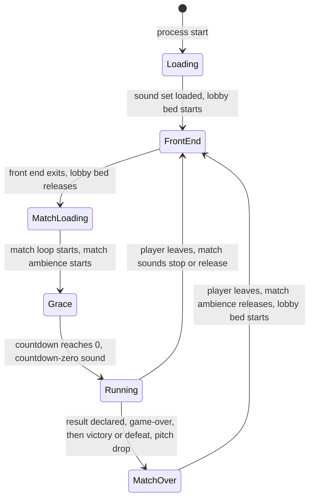

# Audio design

> Status: Reference · Prefix: R-AUD · Related: [00 Reference overview](../00_reference_overview.md) · [01 Skirmish rules and modes](../01_skirmish_rules_and_modes/README.md) · [02 Units](../02_units/README.md) · [03 Buildings and world objects](../03_buildings_and_world_objects/README.md) · [04 Supply crates, powers and weapons](../04_supply_crates_powers_and_weapons/README.md) · [06 Controls, camera and commands](../06_controls_camera_and_commands/README.md) · [09 Front end and match flow](../09_front_end_and_match_flow/README.md) · [12 Simulation model](../12_simulation_model/README.md) · [audio engine](../../architecture/components/audio_engine.md)

This folder specifies the audio design of the reference game: how game code asks for sound, how sound data decides what plays, the complete set of sound events with their Species source ids, event ids and sample groups, the positional, priority and mix rules, the front-end, HUD, voice and ambience sounds, the music hooks, and the brief for the Species sound set. The audio engine that plays the sounds (voices, virtual voices, buses, codecs, device handling) is the [audio engine](../../architecture/components/audio_engine.md) component, decided by ADR-0022 to ADR-0027; this folder states only the design rules that the engine implements.

| File | Scope | Requirement IDs |
|---|---|---|
| [README.md](README.md) | the design in one paragraph, what is audible in a session, conventions and units, the shared rules | R-AUD-001 to R-AUD-019 |
| [event_model_and_sound_data.md](event_model_and_sound_data.md) | the event model: trigger entry points, matching and layering, event ids built at run time, stopping and loop control, sample resolution; the sound data of a layer, modulatable values, envelopes and loops, sample groups, authoring conventions; filters and effects | R-AUD-020 to R-AUD-119 |
| [event_catalogue.md](event_catalogue.md) | every sound source and every sound event that game code raises in a match, with its trigger, its layers, their sample groups and their sound data; the events that stay silent; the kinds with no sound definition | R-AUD-120 to R-AUD-199 |
| [positional_priorities_and_mix.md](positional_priorities_and_mix.md) | the listener, distance attenuation, panning, position kinds and sound lifetime, height, the game-speed pitch bend, crowd sounds, priorities and voice budgets, per-event limiting, buses and routing, the volume law and the mix | R-AUD-200 to R-AUD-299 |
| [front_end_hud_voice_and_ambience.md](front_end_hud_voice_and_ambience.md) | menu and HUD sounds, the countdown, match-clock and match-end schedule, objective and outcome stings, voice content and the voice behaviour rules, the ambience beds | R-AUD-300 to R-AUD-399 |
| [music_hooks_and_sound_design_brief.md](music_hooks_and_sound_design_brief.md) | the music hooks (KH-MUSIC) and the music design brief, the sound-design brief and the event set to author, and the acceptance checks of the Species sound set | R-AUD-400 to R-AUD-499 |

## 1 Purpose and player experience

### 1.1 The design in one paragraph

The reference audio is **data-bound and event-driven**. Game and interface code never name a sound file: they raise a named **event** on a **sound source** (an actor kind, a structure kind, or one of eleven non-object sources) and the sound data decides what, if anything, plays. An event resolves to one or more layered **layers**, each naming a sample group and a complete playback description: two-dimensional, world-fixed or attached position; one-shot, loop or re-triggering note loop; one voice per trigger or one shared voice for every emitter; a friend-or-foe audience; a full-level radius; and six modulatable values (level, pitch, attack, sustain, release and loop delay). The listener is the game camera, and loudness falls off as the minimum distance divided by the distance. What the player hears is: generative ambience beds at the front end and in a match, whose match mix follows the camera's altitude; a large set of crowd barks and combat sounds; team-filtered stings for objectives and Supply crate outcomes; and a handful of interface clicks and beeps. The reference plays no music (KH-MUSIC). Species keeps the binding model and replaces the priority model and the mix with authored priority classes, virtual voices and buses (DEC-027, DEC-570).

### 1.2 What is audible, in the order of a session

| Phase | What plays | Rules |
|---|---|---|
| Start-up and loading views | Nothing. No sound starts before the sound set has loaded, and no game sound event plays while a loading view shows (DEC-319). | R-AUD-048, R-AUD-395 |
| Front end, lobby and options | `match_ui.lobby_bed`: three endless two-dimensional layers, a slow random sequence of pads (`amb.lobby_bed`), a low drone (`amb.match_bed`) and a heartbeat at half speed (`sfx.building.launch_vessel.fuelled_b`). It starts on the first front-end update after the sound set has loaded and starts again each time the front end is built, so after every match. Menu hover, select and back sounds and the chat sound play over it. No music track plays. | R-AUD-390 to R-AUD-392, R-AUD-300 |
| Leaving the front end | The lobby bed stops: its two pad layers fade out over their releases (10.84 s and 10.26 s); the heartbeat has no release and stops at the next audio update. | R-AUD-392 |
| Match start | `ambience.match_enter`: three two-dimensional layers whose levels follow the camera's altitude for the whole match. The ground rumble fades out as the camera rises above about 232 wu; a high-altitude wind bed and white noise fade in as it climbs towards about 990 wu. | R-AUD-393 |
| Grace period | The countdown tick for the first ready tick and for each displayed number of the grace countdown, and the countdown-zero sound (the same tick at twice the pitch) when the match starts. Positional sounds are not pitch-bent during the grace period. | R-AUD-310, R-AUD-311, R-AUD-237 |
| Match | The 182 bound events of the [event catalogue](event_catalogue.md): Worker barks (spawn chatter, battle cries, retreat, pain, death, acknowledgements), laser fire and impacts, grenades, airstrikes, barrage missiles, creature and vehicle loops, structure hums, the Supply crate fall, capture progress and outcome stings, the Control Zone and Relic stings filtered by friend and foe, the Spawn Node activation stings, the Launch Race vessel and fuel sounds, the Siege Core Device choir; the interface's selection clicks and the positional unit-highlight tick; the match clock's tick at every whole minute and at every mode second of the last ten. | R-AUD-120 to R-AUD-199, R-AUD-312 |
| Match end | `match_ui.game_over`, then `match_ui.victory` when the local team won, otherwise `match_ui.defeat` (DEC-097, DEC-049). Game speed is driven to 0, so every positional sound bends down in pitch towards 0.1× while two-dimensional sounds keep their pitch (DEC-569, DEC-320). The ambience keeps playing. The countdown-zero sound plays at time-up (DEC-072). | R-AUD-313 to R-AUD-315, R-AUD-237 |
| Back to the front end | `ambience.match_enter` stops: its two pad layers release over 10.00 s and 10.45 s and the white noise stops at once; `ambience.match_exit` fires and is silent; attached sounds end with their emitters when the match is torn down; every other sound of the match, the Core Device loop included, stops or releases (DEC-097); the lobby bed starts again. | R-AUD-044, R-AUD-393 |

## 2 Rules

### 2.1 Conventions and units

- **Levels** are in decibels (dB) relative to the full level of a voice, 0 dB (DEC-042). Every reference level in this folder is converted from the reference's ten-step authoring scale at `ref.aud.level.reference_step_db` (5 dB) per step, so the top of that scale is 0 dB. A level is the peak target of a sound's envelope.
- **Distances** are in world units (`wu`), measured in three dimensions between the emitter and the listener.
- **Audio time** is real time in seconds: envelopes, loop delays, fades and the interface's rate limits run on the audio clock, which game speed and pausing do not scale. These are presentation durations, never simulation durations.
- **Simulation durations** are in ticks of `ref.sim.tick_period` ([reference/12](../12_simulation_model/01_tick_timing_and_main_loop.md)); a duration that a simulation rule counts, such as the Worker horn cooldown, stays in ticks with seconds as a derived value.
- **Audio update.** The reference audio logic runs one update every `ref.sim.frame.audio_update_period` (0.05 s, 20 updates per second; [reference/12](../12_simulation_model/01_tick_timing_and_main_loop.md)). Rules that the reference states per audio update are restated here as functions of elapsed audio time where the Species engine's update rate differs (ADR-0026).
- **Terms.** A **sound source** is the owner of a set of event definitions: an actor kind, a structure kind or a non-object source. An **event** is one (source, event) pair, written `<source>.<event>`, for example `worker.die`. A **layer** is one playback description of an event; an event can have several layers. An **instance** is one playing or waiting copy of a layer. A **voice** is one channel of the audio engine that mixes one instance. An **emitter** is the object an instance follows or was raised by.

**R-AUD-001** (MUST) Sound is presentation. The simulation never reads audio state, and the audio never writes simulation state: a rule that produces a sound emits a presentation event at the tick where the rule fires, and the audio consumes the event (DEC-007). Friend-or-foe variants, camera-dependent selection and voice allocation may differ between participants by design and never feed back into the match.

**R-AUD-002** (MUST) Audio draws its random numbers from the presentation generator through its own instance, never from the simulation generator: the draws choose sample-group members, shared-voice emitters and ranged-random values (DEC-013, ADR-0022).

**R-AUD-003** (MUST) Every sound of Species is authored new. The reference contributes the binding model, the event list and the sound data of this folder; no reference recording is used as a sample, a template or a placeholder (DEC-027, DEC-005). The reference values of this folder are the Species starting values (DEC-004), and every reference quirk that a Resolved decision does not correct is stated as an explicit rule (DEC-006).

**R-AUD-004** (MUST) Sound levels are authored and stored in decibels. A reference level v on the ten-step scale converts to `ref.aud.level.reference_step_db` × (v − 10) dB, so a reference step is 5 dB, the top of the scale is 0 dB and the bottom of the scale is −50 dB, which is quiet but not silent (DEC-042, ADR-0024). Silence is never expressed as a level; a layer that must be silent has no layer, or a silent sample.

**R-AUD-005** (MUST) The event ids, source ids and layer data of this folder are the Species sound-event set. The content build validates it against the event ids that game code raises and against the asset manifest: an event that game code raises with no definition is listed by the validator, and a layer that names a sample group missing from the manifest is a build error (DEC-015, DEC-027).

**R-AUD-006** (MUST) The audio engine implements the rules of this folder and owns everything below them: the real-voice budget, virtual voices and stealing (ADR-0023), the bus graph and the bus effects (ADR-0024), formats, codecs and residency (ADR-0025), the command queue, the control rate and the callbacks (ADR-0026), and spatialisation (ADR-0027), as specified in [audio engine](../../architecture/components/audio_engine.md).

## 3 States and flows

Diagram 3-A: the audio of a session (R-AUD-001, §1.2).

## 4 Tuning table

| key | value | unit | range or notes | requirement | DEC |
|---|---|---|---|---|---|
| `ref.aud.level.reference_step_db` | 5 | dB per reference step | converts the reference ten-step scale; 10 → 0 dB, 0 → −50 dB | R-AUD-004 | DEC-042 |

Keys cited here and defined elsewhere: `ref.sim.tick_period` and `ref.sim.frame.audio_update_period` in [reference/12](../12_simulation_model/01_tick_timing_and_main_loop.md).

## 5 Edge cases and interactions

- **Simulation boundary.** Because sound is presentation (R-AUD-001), a sound that two participants hear differently, such as an own-team sting, never makes their matches differ; a headless participant raises the same presentation events and plays nothing.
- **Folder split.** The topic is split by sub-topic because the event catalogue alone carries the data of every bound layer; each file holds the rules of its sub-topic and the open decisions they cite.

## 6 Acceptance criteria

The acceptance criteria are in each file of this folder. The folder-wide checks are:

- **AC-AUD-01** (R-AUD-001, R-AUD-002) Given a match recorded with audio on and replayed headless with the same commands, then the simulation state hash at every tick is the same, and no audio code path reads or writes simulation state or draws from the simulation generator.
- **AC-AUD-02** (R-AUD-004) Given the reference levels 10, 9.03 and 0 on the ten-step scale, when they are converted, then they are 0 dB, −4.85 dB and −50 dB.
- **AC-AUD-03** (R-AUD-005) Given the Species sound-event set and the asset manifest, when the content build validates them, then every event of the [event catalogue](event_catalogue.md) has a definition, every layer names a sample group of the manifest, and the validator lists exactly the silent events of the catalogue's silent-event table as events with no layer.

## 7 Dependencies

- **Reference documents:** [00 Reference overview](../00_reference_overview.md) (the audio binding model in the core loop); [01 Skirmish rules and modes](../01_skirmish_rules_and_modes/README.md) (grace countdown, match clock, result declaration); [02 Units](../02_units/README.md), [03 Buildings and world objects](../03_buildings_and_world_objects/README.md) and [04 Supply crates, powers and weapons](../04_supply_crates_powers_and_weapons/README.md) (the rules that raise the sound events); [06 Controls, camera and commands](../06_controls_camera_and_commands/README.md) (interface sounds of selection, orders and Power slots; the camera that is the listener); [09 Front end and match flow](../09_front_end_and_match_flow/README.md) (front-end cues, sound options, loading views); [12 Simulation model](../12_simulation_model/README.md) (tick period, audio update period, game speed).
- **Engine components:** [audio engine](../../architecture/components/audio_engine.md) (ADR-0022 to ADR-0027); [data schemas](../../architecture/components/data_schemas.md) (the sound-event schema); [asset pipeline and resources](../../architecture/components/asset_pipeline_and_resources.md) (sample groups, streaming).
- **Assets:** every `sfx.`, `amb.` and `music.` id of [assets/asset_manifest.csv](../../assets/asset_manifest.csv); the catalogue cites each where it is bound.

## 8 Open decisions

Each default is the behaviour that the files of this folder specify. Every Open decision that affects the audio design, with the file that cites it:

- DEC-049 — music ([music hooks and brief](music_hooks_and_sound_design_brief.md)).
- DEC-071 — the Flag Chain base-under-attack announcement interval ([front end, HUD, voice and ambience](front_end_hud_voice_and_ambience.md)).
- DEC-109 — crowd-sound audibility radius ([positional, priorities and mix](positional_priorities_and_mix.md)).
- DEC-317 — voice set language ([front end, HUD, voice and ambience](front_end_hud_voice_and_ambience.md)).
- DEC-318 — sound triggers tied to the frame rate ([event model](event_model_and_sound_data.md), [front end, HUD, voice and ambience](front_end_hud_voice_and_ambience.md)).
- DEC-319 — ambience during loading views ([front end, HUD, voice and ambience](front_end_hud_voice_and_ambience.md)).
- DEC-320 — match-end pitch drop ([positional, priorities and mix](positional_priorities_and_mix.md)).
- DEC-321 — attached sounds when their emitter is removed ([positional, priorities and mix](positional_priorities_and_mix.md)).
- DEC-322 — start value of smoothed sound parameters ([event model](event_model_and_sound_data.md)).
- DEC-565 — sounds for the other silent gameplay events ([event catalogue](event_catalogue.md)).
- DEC-566 — listener position and distance limits ([positional, priorities and mix](positional_priorities_and_mix.md)).
- DEC-567 — dry mix or applied effects ([event model](event_model_and_sound_data.md)).

Resolved decisions stated as rules in this folder: DEC-004, DEC-005, DEC-006, DEC-007, DEC-013, DEC-015, DEC-027, DEC-042, DEC-072, DEC-097, DEC-323, DEC-331, DEC-458, DEC-564, DEC-568, DEC-569, DEC-570, DEC-751, DEC-752.
