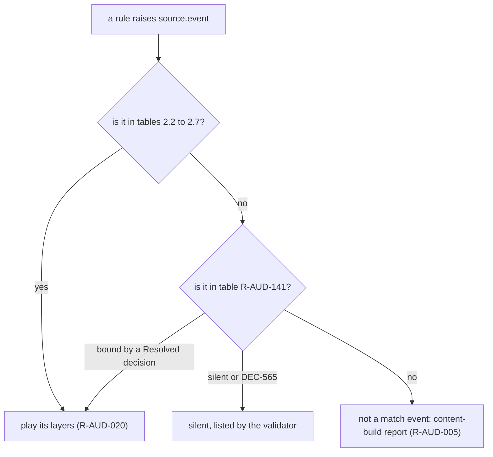

# Audio design: event catalogue

> Status: Reference · Prefix: R-AUD · Related: [Folder index](README.md) · [Event model and sound data](event_model_and_sound_data.md) · [Positional, priorities and mix](positional_priorities_and_mix.md) · [02 Units](../02_units/README.md) · [03 Buildings and world objects](../03_buildings_and_world_objects/README.md) · [04 Supply crates, powers and weapons](../04_supply_crates_powers_and_weapons/README.md) · [assets/GameAssets.md](../../assets/GameAssets.md)

## 1 Purpose and player experience

This file is the Species sound-event set: every sound source, every event that game code raises in a skirmish match or at the front end, the moment that raises it, and, for every bound event, its layers with their sample groups and their complete sound data. It is the data that the [event model](event_model_and_sound_data.md) interprets, and the authoring list of the Species sound set ([music hooks and brief](music_hooks_and_sound_design_brief.md) R-AUD-411). Of the 276 events that a match or the front end raises, 182 are bound and audible, and 94 are silent: most stay silent by default (DEC-565), and seven are bound by Resolved decisions to sounds that the reference does not play (DEC-564, DEC-097, DEC-049).

## 2 Rules

### 2.1 Sound sources

**R-AUD-120** (MUST) An **object source** is an actor kind or a structure kind. Its source id is the stem of the kind's string-id prefix, for example `worker` for `unit.worker` and `spawn_node` for `building.spawn_node` ([02 Units](../02_units/README.md) R-UNIT-047, [03 Buildings](../03_buildings_and_world_objects/README.md) R-BLDG-049).

**R-AUD-121** (MUST) The **non-object sources** are these eleven, in this order; the order is the enumeration order of the non-object sources and carries meaning, so it is kept:

| # | Source | Events |
|---|---|---|
| 0 | `laser_bolt` | `spawn`, `hurt_actor`, `hit_structure`, `kill` |
| 1 | `grenade` | `spawn`, `bounce`, `fuse_blink`, `explode` |
| 2 | `rocket` | `spawn`, `explode` |
| 3 | `airstrike_bomb` | `bounce`, `fuse_blink`, `explode` |
| 4 | `essence_orb` | `collected` |
| 5 | `power_input` | `begin`, `confirm` |
| 6 | `ambience` | `match_enter`, `match_exit` |
| 7 | `music` | the music hooks ([music hooks and brief](music_hooks_and_sound_design_brief.md) R-AUD-400 to R-AUD-405) |
| 8 | `power_slots` | `icon_hover`, `discard`, `select`, `selection_set`, `selection_cleared` |
| 9 | `crate_outcome` | one event per Supply crate outcome (R-AUD-139) |
| 10 | `match_ui` | `countdown_tick`, `countdown_zero`, `game_over`, `victory`, `defeat`, `selection_circle`, `unit_select`, `toggle_state`, `lobby_bed`, `menu_hover`, `menu_select`, `menu_back`, `error`, `chat_message`, `unit_highlight`, `order_given` |

**R-AUD-122** (MUST) These sources raise events in a match or at the front end (bound events, their layers, and silent events):

| Source | Name | Kind | Bound events | Layers | Silent events |
|---|---|---|---|---|---|
| `worker` | Worker | unit | 13 | 17 | 2 |
| `leader` | Leader | unit | 7 | 10 | 3 |
| `trooper` | Trooper | unit | 7 | 7 | 2 |
| `transport` | Transport | unit | 4 | 5 | 3 |
| `collector` | Collector | unit | 2 | 4 | 3 |
| `builder` | Builder | unit | 3 | 3 | 2 |
| `bomber` | Bomber | unit | 2 | 2 | 2 |
| `essence_orb` | Essence orb | unit | 1 | 1 | 0 |
| `crawler` | Crawler | creature | 4 | 4 | 1 |
| `crawler_egg` | Crawler egg | creature | 0 | 0 | 1 |
| `brood_drifter` | Brood Drifter | creature | 4 | 4 | 0 |
| `centipede` | centipede | creature | 4 | 4 | 3 |
| `spider` | spider | creature | 7 | 7 | 1 |
| `ant` | ant | creature | 4 | 4 | 0 |
| `reaper_serpent` | Reaper Serpent | creature | 5 | 6 | 1 |
| `seed_pod` | Seed Pod | creature | 4 | 4 | 1 |
| `abductor` | Abductor | creature | 2 | 5 | 0 |
| `barrage_missile` | barrage missile | weapon | 2 | 3 | 2 |
| `meteor` | meteor | weapon | 2 | 4 | 2 |
| `laser_bolt` | laser bolt | weapon | 1 | 1 | 3 |
| `grenade` | grenade | weapon | 4 | 4 | 0 |
| `rocket` | rocket | weapon | 2 | 3 | 0 |
| `airstrike_bomb` | airstrike bomb | weapon | 2 | 2 | 1 |
| `spawn_node` | Spawn Node | structure | 2 | 2 | 3 |
| `transit_gate` | Transit Gate | structure | 0 | 0 | 4 |
| `beam_dish` | Beam Dish | structure | 4 | 5 | 3 |
| `solar_array` | Solar Array | structure | 2 | 2 | 3 |
| `grid_pylon` | grid pylon | structure | 1 | 1 | 3 |
| `fuel_pump` | fuel pump | structure | 2 | 4 | 3 |
| `fuel_line` | fuel line | structure | 1 | 1 | 3 |
| `fuel_depot` | fuel depot | structure | 1 | 1 | 3 |
| `launch_vessel` | Launch Vessel | structure | 7 | 10 | 3 |
| `control_zone` | Control Zone | structure | 3 | 7 | 1 |
| `relic` | Relic | structure | 3 | 5 | 3 |
| `command_console` | Command Console | structure | 1 | 1 | 2 |
| `core_device` | Core Device | structure | 1 | 1 | 2 |
| `turret` | turret | structure | 4 | 4 | 3 |
| `barrier_emitter` | Barrier Emitter | structure | 3 | 3 | 2 |
| `tree` | tree | structure | 5 | 5 | 2 |
| `hive` | Hive | structure | 2 | 2 | 2 |
| `spitter_plant` | Spitter Plant | structure | 2 | 2 | 3 |
| `supply_crate` | Supply crate | crate | 10 | 12 | 5 |
| `crate_outcome` | Supply crate outcome | crate | 25 | 25 | 0 |
| `match_ui` | match UI | ui | 12 | 15 | 4 |
| `power_slots` | Power slots panel | ui | 2 | 2 | 3 |
| `power_input` | Power input | ui | 2 | 2 | 0 |
| `ambience` | ambience | ambience | 1 | 3 | 1 |
| total | | | 182 | 219 | 94 |

**R-AUD-123** (MUST) **Base events.** Every actor kind has the base events `<source>.spawn`, `<source>.attack`, `<source>.hurt`, `<source>.enter_gate`, `<source>.exit_gate`, `<source>.die` and `<source>.selected` ([02 Units](../02_units/README.md) R-UNIT-047), and every structure kind has `<source>.spawn`, `<source>.owner_changed`, `<source>.damaged` and `<source>.explode` ([03 Buildings](../03_buildings_and_world_objects/README.md) R-BLDG-049). A base event appears in this catalogue only where some rule of a match raises it.

**R-AUD-124** (MUST) **Owner changes of structures.** Only the Control Zone and the Relic bind a sound to `<source>.owner_changed` ([12 entity model](../12_simulation_model/03_entity_model_and_identity.md) R-SIM-122); every other structure's owner change is silent. In particular an empty Solar Array raises no `solar_array.owner_changed`, because the team-assignment operation raises the event only when the team changes ([03 Buildings](../03_buildings_and_world_objects/README.md) R-BLDG-038), and the event has no definition in any case.

**R-AUD-125** (MUST) **Reading the tables.** Each table row is one layer; the first row of an event names the event and the moment that raises it, and the further rows (″) are its further layers. The columns are:

- **Sample group:** the asset id of [assets/asset_manifest.csv](../../assets/asset_manifest.csv) that the layer plays (R-AUD-045).
- **Playback:** the position (`2d`, `fix`, `att`), the loop kind (`once`, `loop`, `note`), the sharing when not one voice per trigger (`share-rnd`, `share-near`) and the audience when not all (`own`, `enemy`, `none`) (R-AUD-049).
- **Min (wu):** the minimum distance.
- **Level (dB):** the level: a number is fixed; `rnd a to b` is random; `<link> x1 to x2 → y1 to y2` is linked to the named link, its input range x1 to x2 mapping to the output range y1 to y2 (R-AUD-051, R-AUD-052).
- **Pitch (×):** the pitch multiplier, in the same forms; empty is 1.0.
- **Envelope and loop (s):** `a` attack, `s` sustain, `r` release, `ld` loop delay, in the same forms; an absent value is 0.
- **Effect:** the effect use of [event model](event_model_and_sound_data.md) R-AUD-082, which runs only when effects are enabled (DEC-567).
- `sN` after a value is its smoothing (R-AUD-054); `/note` marks a value evaluated once per note (R-AUD-053).

### 2.2 Units

**R-AUD-126** (MUST) The `worker` source raises and binds the events of table 2.2-A. The Worker's spawn chatter and the reload layer of its attack play from their nearest emitter only (R-AUD-213, DEC-109); its threat sounds are stopped when its threat ends (R-AUD-039).

Table 2.2-A Worker sound events.

| Event | Raised when | Sample group | Playback | Min (wu) | Level (dB) | Pitch (×) | Envelope and loop (s) | Effect |
|---|---|---|---|---|---|---|---|---|
| `worker.die` | death | `sfx.unit.worker.die` | fix · once | 100 | 0 |  | r 10 |  |
| ″ layer 2 |  | `sfx.unit.worker.die_b` | fix · once | 100 | 0 |  |  |  |
| `worker.hurt` | any health loss | `sfx.unit.worker.hurt` | att · once | 100 | −10 | 1.06 | r 10 | echo |
| ″ layer 2 |  | `sfx.unit.worker.hurt` | att · once | 100 | −10 | 0.91 |  |  |
| `worker.spawn` | a Worker appears (spawn hook) | `sfx.unit.worker.spawn` | att · once · share-near | 100 | −7.5 | rnd 0.58 to 1.59 s0.56 /note | r 1.16; ld rnd 0.87 to 4.84 /note | echo |
| `worker.ordered` | a Leader signpost hands it an order | `sfx.unit.leader.spawn` | att · once | 100 | −10 | rnd 1.51 to 1.85 /note |  |  |
| `worker.flee_bark` | a scared reaction: a grenade or airstrike target marker nearby, a burning tree, or enemies | `sfx.unit.worker.flee_bark` | att · once | 100 | −5 /note | rnd 0.9 to 1.09 /note |  |  |
| ″ layer 2 |  | `sfx.unit.worker.flee_bark_b` | att · once | 100 | −5 |  |  |  |
| `worker.attack` | a laser bolt or a Convert laser bolt is fired | `sfx.unit.worker.attack` | att · once | 85.9 | −5 |  |  |  |
| ″ layer 2 |  | `sfx.unit.worker.attack_b` | att · once · share-near | 60.34 | −4.5 |  | ld 5.03 |  |
| `worker.victory_jump` | a victory celebration hop | `sfx.unit.worker.victory_jump` | att · once | 10.12 | −10 | rnd 0.96 to 1.21 /note |  |  |
| `worker.burning` | while burning, a presentation chance per tick (R-AUD-316) | `sfx.unit.worker.burning` | fix · once | 101.16 | −3.25 |  | ld 0.58 |  |
| `worker.selected` | crowd selection or a click selection, local team only | `sfx.unit.worker.selected` | att · once | 100 | −10 | rnd 0.92 to 1.25 /note |  |  |
| `worker.ordered_by_player` | a crowd order; also alternating with `worker.lift_relic` while carrying | `sfx.unit.worker.selected` | att · once | 100 | −9.85 | 1.03 |  |  |
| `worker.lift_relic` | the carry chant while carrying a carryable structure (R-AUD-318) | `sfx.unit.worker.lift_relic` | att · once | 100 | −10 | rnd 0.93 to 1.21 /note |  |  |
| `worker.attack_bark` | a brave reaction to a new threat | `sfx.unit.worker.attack_bark` | att · once | 100 | −5 |  |  |  |
| `worker.attack_horn` | a rare brave reaction (R-AUD-317) | `sfx.unit.worker.attack_horn` | att · once | 125.13 | −5 |  |  |  |

**R-AUD-127** (MUST) The `leader` source raises and binds the events of table 2.2-B. The own-audience layers are heard only by the Leader's owner; cancelling a Leader's orders stops all its order events ([02 Leader](../02_units/leader_and_formations.md) R-UNIT-193). `leader.attack` is never raised, because a Leader never attacks.

Table 2.2-B Leader sound events.

| Event | Raised when | Sample group | Playback | Min (wu) | Level (dB) | Pitch (×) | Envelope and loop (s) | Effect |
|---|---|---|---|---|---|---|---|---|
| `leader.spawn` | a Leader is created by promotion | `sfx.unit.leader.spawn` | att · once | 200 | −10 |  |  |  |
| ″ layer 2 |  | `sfx.unit.leader.spawn` | 2d · once · own | 100 | −7.1 |  |  |  |
| `leader.hurt` | any health loss | `sfx.unit.worker.hurt` | att · once | 100.03 | −1.45 |  |  |  |
| `leader.die` | death | `sfx.unit.worker.die` | att · once | 200 | −4.85 |  |  |  |
| `leader.enter_gate` | a successful teleport entry | `sfx.unit.trooper.enter_gate` | att · once | 200 | −4.2 |  |  |  |
| `leader.order_waypoint` | a waypoint order, or the mode cycle reaching the waypoint mode | `sfx.unit.leader.order_waypoint` | att · loop | 100 | −9.85 |  |  |  |
| ″ layer 2 |  | `sfx.unit.leader.spawn` | att · once · own | 173.77 | −4.35 |  |  |  |
| `leader.selected` | selection by the local team | `sfx.unit.leader.spawn` | 2d · once · own | 100 | −9.7 |  |  |  |
| `leader.order_formation` | the Leader forms up | `sfx.unit.leader.order_waypoint` | att · loop | 100 | −9.7 |  |  |  |
| ″ layer 2 |  | `sfx.unit.leader.spawn` | att · once · own | 173.77 | −4.35 |  |  |  |

**R-AUD-128** (MUST) The `trooper` source raises and binds the events of table 2.2-C. One shared-random voice carries the chatter of every Trooper of the match.

Table 2.2-C Trooper sound events.

| Event | Raised when | Sample group | Playback | Min (wu) | Level (dB) | Pitch (×) | Envelope and loop (s) | Effect |
|---|---|---|---|---|---|---|---|---|
| `trooper.spawn` | a Trooper appears | `sfx.unit.trooper.presence_loop` | att · loop · share-rnd | 100 | −5 /note |  | r 5.23 /note; ld speed 6.8 to 0 → 0 to 2.9 /note | echo |
| `trooper.hurt` | any health loss | `sfx.unit.trooper.hurt` | att · once | 100 | −5 | 0.91 /note | r 4.06 /note | echo |
| `trooper.weapon_ready` | the secondary-weapon cooldown expires | `sfx.unit.trooper.weapon_ready` | att · once · share-rnd | 100 | −5 /note |  |  |  |
| `trooper.fire_laser` | each laser shot | `sfx.unit.trooper.fire_laser` | att · once | 100 | −6.15 /note | rnd 0.9 to 1.05 /note |  |  |
| `trooper.die` | death | `sfx.unit.trooper.die` | att · once | 100 | −5.15 | rnd 0.76 to 1.05 /note |  |  |
| `trooper.enter_gate` | it enters a Beam Dish | `sfx.unit.trooper.enter_gate` | fix · once | 100 | −5 |  |  |  |
| `trooper.exit_gate` | arrival at the far Beam Dish | `sfx.unit.trooper.exit_gate` | att · once | 100 | −4.5 |  |  |  |

**R-AUD-129** (MUST) The `transport`, `collector`, `builder` and `bomber` sources raise and bind the events of tables 2.2-D to 2.2-G, and the `essence_orb` source the event of table 2.2-H. The Collector's and the Bomber's engines follow height and speed; a Builder's laser hits raise no `builder.hurt`, because a Builder ignores laser damage ([02 Builder](../02_units/builder.md) R-UNIT-461).

Table 2.2-D Transport sound events.

| Event | Raised when | Sample group | Playback | Min (wu) | Level (dB) | Pitch (×) | Envelope and loop (s) | Effect |
|---|---|---|---|---|---|---|---|---|
| `transport.spawn` | a Transport appears | `sfx.unit.transport.presence_loop` | att · loop | 218.81 | speed 0 to 2.4 → −2.25 to 0 | speed 0 to 22.4 → 1.1 to 1.68 |  | gargle |
| ″ layer 2 |  | `sfx.unit.transport.spawn` | att · once | 100 | −3.25 |  |  |  |
| `transport.hurt` | any health loss | `sfx.unit.transport.hurt` | att · once | 141.42 | 0 | rnd 0.88 to 1.05 /note |  |  |
| `transport.die` | destruction | `sfx.unit.transport.die` | fix · once | 222.43 | 0 /note | rnd 0.89 to 1.09 /note |  |  |
| `transport.ordered` | the player orders it to move or deploy | `sfx.unit.transport.ordered` | att · once | 162.69 | −4.85 |  |  |  |

Table 2.2-E Collector sound events.

| Event | Raised when | Sample group | Playback | Min (wu) | Level (dB) | Pitch (×) | Envelope and loop (s) | Effect |
|---|---|---|---|---|---|---|---|---|
| `collector.spawn` | a Collector appears | `sfx.creature.abductor.presence_loop_b` | att · loop | 96.11 | −10 | height 0 to 984 → 0.32 to 2.47 |  |  |
| ″ layer 2 |  | `sfx.creature.abductor.presence_loop_c` | att · loop | 89.81 | speed 3.6 to 1.6 → −9.7 to −5.5 |  |  |  |
| ″ layer 3 |  | `sfx.unit.collector.presence_loop` | att · loop | 150.84 | −5 | 1.29 |  |  |
| `collector.drop_essence` | each Essence orb delivered to a Spawn Node | `sfx.unit.collector.drop_essence` | fix · once | 150 | −5 | rnd 0.38 to 0.52 /note | r 15.1 | gargle |

Table 2.2-F Builder sound events.

| Event | Raised when | Sample group | Playback | Min (wu) | Level (dB) | Pitch (×) | Envelope and loop (s) | Effect |
|---|---|---|---|---|---|---|---|---|
| `builder.spawn` | a Builder appears | `sfx.unit.builder.presence_loop` | att · loop | 100 | −4.85 |  |  |  |
| `builder.hurt` | a non-laser health loss | `sfx.unit.builder.hurt` | fix · once | 200 | 0 | rnd 1.58 to 1.89 /note | r 5.03 |  |
| `builder.die` | death | `sfx.unit.builder.die` | fix · once | 200 | 0 | rnd 0.95 to 1.05 /note |  |  |

Table 2.2-G Bomber sound events.

| Event | Raised when | Sample group | Playback | Min (wu) | Level (dB) | Pitch (×) | Envelope and loop (s) | Effect |
|---|---|---|---|---|---|---|---|---|
| `bomber.drop_bomb` | it releases a bomb near the target | `sfx.unit.bomber.drop_bomb` | att · once | 200 | 0 |  |  |  |
| `bomber.spawn` | a Bomber appears | `sfx.unit.bomber.presence_loop` | att · loop | 200 | 0 | speed 13.2 to 74.4 → 0.91 to 1.96 |  |  |

Table 2.2-H Essence orb sound events.

| Event | Raised when | Sample group | Playback | Min (wu) | Level (dB) | Pitch (×) | Envelope and loop (s) | Effect |
|---|---|---|---|---|---|---|---|---|
| `essence_orb.collected` | a Builder attaches the orb | `sfx.unit.essence_orb.collected` | att · once | 100 | −5 |  |  |  |

### 2.3 Creatures

**R-AUD-130** (MUST) The creature sources raise and bind the events of tables 2.3-A to 2.3-H. A Crawler egg raises only its silent `crawler_egg.spawn`; its death plays no sound ([02 creatures](../02_units/creatures.md) R-UNIT-527).

Table 2.3-A Crawler sound events.

| Event | Raised when | Sample group | Playback | Min (wu) | Level (dB) | Pitch (×) | Envelope and loop (s) | Effect |
|---|---|---|---|---|---|---|---|---|
| `crawler.attack` | a bite on arrival at its target | `sfx.creature.crawler.attack` | att · once | 200 | −4.85 | rnd 0.91 to 1.12 /note |  |  |
| `crawler.hurt` | any health loss | `sfx.creature.crawler.hurt` | fix · once | 200 | 0 | rnd 0.81 to 1.01 /note | r 2.71 | echo |
| `crawler.turn` | an idle Crawler picks a new wander direction | `sfx.creature.crawler.turn` | att · once | 50 | −17.25 | rnd 1.7 to 2.17 /note |  |  |
| `crawler.die` | death | `sfx.creature.crawler.die` | att · once | 175 | 0 | rnd 1.54 to 1.79 /note | r 10.06 /note | echo |

Table 2.3-B Brood Drifter sound events.

| Event | Raised when | Sample group | Playback | Min (wu) | Level (dB) | Pitch (×) | Envelope and loop (s) | Effect |
|---|---|---|---|---|---|---|---|---|
| `brood_drifter.spawn` | a Brood Drifter appears | `sfx.creature.brood_drifter.presence_loop` | att · loop | 100 | −8.4 |  | ld height 4 to 164 → 0.19 to 5.81 |  |
| `brood_drifter.hurt` | any health loss | `sfx.creature.brood_drifter.hurt` | att · once | 150 | 0 |  |  |  |
| `brood_drifter.die` | death | `sfx.creature.brood_drifter.die` | fix · once | 150 | 0 /note | rnd 0.86 to 1.1 /note | r 10.45 | echo |
| `brood_drifter.lay_egg` | it lays a Crawler egg | `sfx.creature.spider.lay_egg` | att · once | 100 | −4.85 |  |  |  |

Table 2.3-C centipede sound events.

| Event | Raised when | Sample group | Playback | Min (wu) | Level (dB) | Pitch (×) | Envelope and loop (s) | Effect |
|---|---|---|---|---|---|---|---|---|
| `centipede.attack` | a segment touches an enemy (per enemy per tick) | `sfx.creature.centipede.attack` | att · once | 100 | 0 | rnd 0.88 to 1.08 /note |  |  |
| `centipede.spawn` | each segment appears, growth segments included | `sfx.creature.centipede.presence_loop` | att · note | 80.09 | −10 | rnd 0.95 to 1.05 /note |  |  |
| `centipede.die` | a segment dies | `sfx.creature.centipede.die` | fix · once | 150 | 0 | 0.94 | r 10 | echo |
| `centipede.hurt` | a segment loses health | `sfx.creature.centipede.hurt` | att · once | 100 | −4.85 | rnd 0.58 to 1.59 s0.56 /note | ld speed 11.2 to 0 → 0.58 to 4.84 /note |  |

Table 2.3-D spider sound events.

| Event | Raised when | Sample group | Playback | Min (wu) | Level (dB) | Pitch (×) | Envelope and loop (s) | Effect |
|---|---|---|---|---|---|---|---|---|
| `spider.spawn` | a spider appears | `sfx.creature.spider.presence_loop` | att · loop | 100 | −5.35 | rnd 0.77 to 1.21 /note | ld speed 4.8 to 0 → 0 to 3.1 |  |
| `spider.die` | death | `sfx.creature.spider.die` | att · once | 200 | 0 | speed 1.2 to 34.4 → 0.58 to 0.82 | r 16.65 | stereo echo |
| `spider.attack` | it starts a pounce (with `spider.pounce`) | `sfx.creature.spider.pounce` | att · once | 100 | −4.85 | rnd 0.74 to 1.03 /note |  |  |
| `spider.pounce` | it leaps | `sfx.creature.spider.pounce` | att · once | 100 | −4.85 | rnd 0.89 to 1.22 /note |  |  |
| `spider.lay_egg` | it lays a Crawler egg | `sfx.creature.spider.lay_egg` | att · once | 100 | −4.85 |  |  |  |
| `spider.hurt` | any health loss | `sfx.creature.spider.hurt` | att · once | 100 | −5 |  |  |  |
| `spider.footstep` | each foot plants | `sfx.creature.spider.footstep` | att · once | 62.63 | speed 0 to 27.2 → −26.45 to −9.7 |  |  |  |

Table 2.3-E ant sound events.

| Event | Raised when | Sample group | Playback | Min (wu) | Level (dB) | Pitch (×) | Envelope and loop (s) | Effect |
|---|---|---|---|---|---|---|---|---|
| `ant.attack` | each bite | `sfx.creature.ant.attack` | att · once | 100 | −7.5 | rnd 0.81 to 1.38 /note |  |  |
| `ant.spawn` | an ant appears | `sfx.creature.ant.presence_loop` | att · loop | 61.12 | rnd −22.4 to −10 s0.60 | rnd 0.67 to 1.34 s0.45 | ld 0.1 |  |
| `ant.hurt` | any health loss | `sfx.creature.ant.hurt` | att · once | 100 | −9.85 | rnd 0.85 to 1.23 /note |  |  |
| `ant.die` | death | `sfx.creature.ant.die` | att · once | 100 | −9.7 | rnd 0.7 to 1.28 /note |  |  |

Table 2.3-F Reaper Serpent sound events.

| Event | Raised when | Sample group | Playback | Min (wu) | Level (dB) | Pitch (×) | Envelope and loop (s) | Effect |
|---|---|---|---|---|---|---|---|---|
| `reaper_serpent.spawn` | a Reaper Serpent appears | `sfx.creature.reaper_serpent.presence_loop` | att · loop | 100 | −1.45 /note | height 0 to 300 → 1.01 to 1.65 | a 0.19 /note; r 0.39 /note |  |
| ″ layer 2 |  | `sfx.creature.reaper_serpent.hurt` | att · once | 204.25 | 0 |  |  |  |
| `reaper_serpent.hurt` | any health loss | `sfx.creature.reaper_serpent.hurt` | att · once | 200 | 0 |  |  |  |
| `reaper_serpent.die` | death | `sfx.creature.reaper_serpent.die` | att · once | 200 | 0 | rnd 0.78 to 1.05 /note |  |  |
| `reaper_serpent.attack` | it passes through an enemy within its damage range (per victim) | `sfx.creature.reaper_serpent.attack` | att · once | 200 | 0 | rnd 0.78 to 1.01 /note |  |  |
| `reaper_serpent.enemy_sighted` | it acquires a target | `sfx.creature.reaper_serpent.enemy_sighted` | att · loop | 100 | height 812 to 0 → −50 to −6.6 | height 72 to 0 → 0.37 to 0.76 s0.69 | a 0.58 /note; r 10.45 |  |

Table 2.3-G Seed Pod sound events.

| Event | Raised when | Sample group | Playback | Min (wu) | Level (dB) | Pitch (×) | Envelope and loop (s) | Effect |
|---|---|---|---|---|---|---|---|---|
| `seed_pod.spawn` | a Seed Pod is launched or appears | `sfx.creature.seed_pod.spawn` | att · once | 100 | −4.5 | rnd 0.89 to 1.19 /note |  |  |
| `seed_pod.bounce` | a ground bounce above the bounce-sound force | `sfx.creature.seed_pod.bounce` | fix · once | 100 | speed 0 to 7.6 → −49.2 to −0.8 | speed 0 to 8.8 → 0.6 to 1.11 /note |  |  |
| `seed_pod.burst_open` | its burst timer elapses and it releases its kind | `sfx.creature.seed_pod.burst_open` | fix · once | 100 | −2.25 | rnd 0.91 to 0.99 /note |  |  |
| `seed_pod.die` | destruction by damage | `sfx.creature.reaper_serpent.die` | fix · once | 100 | 0 |  |  |  |

Table 2.3-H Abductor sound events.

| Event | Raised when | Sample group | Playback | Min (wu) | Level (dB) | Pitch (×) | Envelope and loop (s) | Effect |
|---|---|---|---|---|---|---|---|---|
| `abductor.spawn` | the Abductor appears | `sfx.creature.abductor.presence_loop` | att · loop | 329.4 | 0 |  | ld rnd 0 to 5.81 /note |  |
| ″ layer 2 |  | `sfx.creature.abductor.presence_loop_b` | att · loop | 208.04 | 0 | height 0 to 984 → 0.32 to 2.47 |  |  |
| ″ layer 3 |  | `sfx.creature.abductor.presence_loop_c` | att · loop | 144.99 | speed 3.6 to 1.6 → −9.7 to −0.5 |  |  |  |
| ″ layer 4 |  | `sfx.unit.collector.presence_loop` | att · loop | 300.84 | 0 | 1.29 |  |  |
| `abductor.tractor_beam` | it starts abducting at its target | `sfx.creature.abductor.tractor_beam` | att · loop | 100 | 0 |  |  |  |

### 2.4 Weapons

**R-AUD-131** (MUST) The weapon sources raise and bind the events of tables 2.4-A to 2.4-F. A laser bolt that wounds a Worker without killing it plays the hit bark at the victim, for the shooter's team. The other laser-bolt events are bound by R-AUD-142.

Table 2.4-A barrage missile sound events.

| Event | Raised when | Sample group | Playback | Min (wu) | Level (dB) | Pitch (×) | Envelope and loop (s) | Effect |
|---|---|---|---|---|---|---|---|---|
| `barrage_missile.spawn` | a barrage missile is launched | `sfx.weapon.barrage_missile.presence_loop` | att · loop | 104.86 | −5 | camera_distance 100 to 60 → 0.41 to 1 |  |  |
| `barrage_missile.explode` | it reaches its target and detonates | `sfx.weapon.barrage_missile.explode` | fix · once | 217.86 | 0 | rnd 0.45 to 0.99 /note |  |  |
| ″ layer 2 |  | `sfx.weapon.barrage_missile.explode_b` | fix · once | 338.76 | −1.15 | rnd 0.45 to 0.74 /note | a rnd 0.19 to 2.13 /note |  |

Table 2.4-B meteor sound events.

| Event | Raised when | Sample group | Playback | Min (wu) | Level (dB) | Pitch (×) | Envelope and loop (s) | Effect |
|---|---|---|---|---|---|---|---|---|
| `meteor.land` | impact at its target | `sfx.weapon.meteor.land` | fix · once | 200 | 0 | 1.03 |  |  |
| ″ layer 2 |  | `sfx.weapon.meteor.land_b` | fix · once | 450 | camera_distance 100 to 320 → −50 to −0.5 |  |  |  |
| `meteor.spawn` | a meteor appears | `sfx.weapon.meteor.presence_loop` | att · loop | 97.96 | 0 | height 24 to 996 → 0.89 to 1.8 |  |  |
| ″ layer 2 |  | `sfx.unit.collector.presence_loop` | att · loop | 18.52 | −5 |  |  |  |

Table 2.4-C laser bolt sound events.

| Event | Raised when | Sample group | Playback | Min (wu) | Level (dB) | Pitch (×) | Envelope and loop (s) | Effect |
|---|---|---|---|---|---|---|---|---|
| `laser_bolt.hurt_actor` | a bolt wounds a Worker without killing it; at the victim, for the shooter's team | `sfx.weapon.laser_bolt.hit_bark` | att · once | 100 | −2.25 |  |  |  |

Table 2.4-D grenade sound events.

| Event | Raised when | Sample group | Playback | Min (wu) | Level (dB) | Pitch (×) | Envelope and loop (s) | Effect |
|---|---|---|---|---|---|---|---|---|
| `grenade.explode` | detonation | `sfx.weapon.grenade.explode` | fix · once | 200 | 0 |  | r 10 | studio reverb |
| `grenade.spawn` | a grenade or an airstrike target marker is thrown | `sfx.weapon.grenade.spawn` | att · once | 100 | −2.25 | rnd 0.74 to 1.54 s0.84 |  |  |
| `grenade.fuse_blink` | once per whole second since the throw, as the fuse light blinks | `sfx.weapon.grenade.fuse_blink` | att · once | 100 | −10.5 |  |  |  |
| `grenade.bounce` | a bounce off the terrain | `sfx.weapon.grenade.bounce` | att · once | 74.6 | speed 0 to 10 → −15.15 to −5 /note | rnd 0.96 to 1.56 s0.66 /note |  |  |

Table 2.4-E rocket sound events.

| Event | Raised when | Sample group | Playback | Min (wu) | Level (dB) | Pitch (×) | Envelope and loop (s) | Effect |
|---|---|---|---|---|---|---|---|---|
| `rocket.explode` | the rocket explodes; it stops `rocket.spawn` | `sfx.weapon.rocket.explode` | fix · once | 200 | 0 | rnd 0.8 to 1.2 |  |  |
| `rocket.spawn` | a rocket is launched | `sfx.weapon.rocket.presence_loop` | att · loop | 100 | 0 |  |  |  |
| ″ layer 2 |  | `sfx.weapon.rocket.spawn` | att · once | 150 | 0 | 0.94 /note |  |  |

Table 2.4-F airstrike bomb sound events.

| Event | Raised when | Sample group | Playback | Min (wu) | Level (dB) | Pitch (×) | Envelope and loop (s) | Effect |
|---|---|---|---|---|---|---|---|---|
| `airstrike_bomb.explode` | an airstrike bomb or a firebomb canister explodes | `sfx.weapon.airstrike_bomb.explode` | fix · once | 200 | −3.85 |  |  |  |
| `airstrike_bomb.fuse_blink` | once per whole second, as the fuse light blinks | `sfx.weapon.grenade.fuse_blink` | att · once | 100 | −10 |  |  |  |

### 2.5 Structures

**R-AUD-132** (MUST) The `spawn_node`, `beam_dish`, `solar_array`, `grid_pylon`, `fuel_pump`, `fuel_line` and `fuel_depot` sources raise and bind the events of tables 2.5-A to 2.5-G ([03 economy and spawn objects](../03_buildings_and_world_objects/economy_and_spawn_objects.md) R-BLDG-130, R-BLDG-167, R-BLDG-171, R-BLDG-180, R-BLDG-199, R-BLDG-201). A Transit Gate binds no event (R-AUD-141).

Table 2.5-A Spawn Node sound events.

| Event | Raised when | Sample group | Playback | Min (wu) | Level (dB) | Pitch (×) | Envelope and loop (s) | Effect |
|---|---|---|---|---|---|---|---|---|
| `spawn_node.activate` | an ownership evaluation gives it an owner | `sfx.building.spawn_node.activate` | att · once | 100 | 0 |  |  |  |
| `spawn_node.deactivate` | an ownership evaluation leaves it with no team | `sfx.building.spawn_node.deactivate` | att · once | 100 | −4.5 |  |  |  |

Table 2.5-B Beam Dish sound events.

| Event | Raised when | Sample group | Playback | Min (wu) | Level (dB) | Pitch (×) | Envelope and loop (s) | Effect |
|---|---|---|---|---|---|---|---|---|
| `beam_dish.rotate_start` | the dish is aimed; any running rotation sound stops first | `sfx.building.beam_dish.rotate_start` | att · once | 100 | −4.85 |  |  |  |
| ″ layer 2 |  | `sfx.building.beam_dish.rotate_start_b` | att · loop | 100 | −5.15 |  |  |  |
| `beam_dish.rotate_stop` | the dish finishes turning; it stops `beam_dish.rotate_start` | `sfx.building.beam_dish.rotate_stop` | att · once | 100 | −5 |  |  |  |
| `beam_dish.link_up` | the dish locks onto a receiving dish | `sfx.building.beam_dish.link_up` | att · loop | 50 | −9.2 |  |  |  |
| `beam_dish.link_lost` | the link breaks; it stops `beam_dish.link_up` | `sfx.building.beam_dish.link_lost` | att · once | 150 | −5.3 |  | r 14.32 | echo |

Table 2.5-C Solar Array sound events.

| Event | Raised when | Sample group | Playback | Min (wu) | Level (dB) | Pitch (×) | Envelope and loop (s) | Effect |
|---|---|---|---|---|---|---|---|---|
| `solar_array.surge` | the array emits an energy surge | `sfx.building.solar_array.surge` | att · once | 50 | −14.7 /note | rnd 0.89 to 1.24 /note |  |  |
| `solar_array.charging` | the array enters its operating state; stopped when it leaves it | `sfx.building.solar_array.charging` | att · loop | 100 | −10 | rnd 1.15 to 1.18 s0.24 /note | a 4.06 |  |

Table 2.5-D grid pylon sound events.

| Event | Raised when | Sample group | Playback | Min (wu) | Level (dB) | Pitch (×) | Envelope and loop (s) | Effect |
|---|---|---|---|---|---|---|---|---|
| `grid_pylon.surge` | an energy surge reaches the pylon | `sfx.building.grid_pylon.surge` | att · once | 50 | −14.5 | rnd 0.94 to 1.55 /note |  |  |

Table 2.5-E fuel pump sound events.

| Event | Raised when | Sample group | Playback | Min (wu) | Level (dB) | Pitch (×) | Envelope and loop (s) | Effect |
|---|---|---|---|---|---|---|---|---|
| `fuel_pump.pump_up` | the pump arm reaches its upper extreme | `sfx.building.fuel_pump.pump_up` | att · once | 202.34 | −7.75 | 1.03 |  |  |
| ″ layer 2 |  | `sfx.building.fuel_pump.pump_up_b` | att · once | 100 | −5.65 | 1.02 |  |  |
| `fuel_pump.pump_down` | the pump arm reaches its lower extreme | `sfx.building.fuel_pump.pump_down` | att · once | 100 | −6.15 | 0.98 |  |  |
| ″ layer 2 |  | `sfx.building.fuel_pump.pump_down_b` | att · once | 195.22 | 0 | 0.99 |  |  |

Table 2.5-F fuel line sound events.

| Event | Raised when | Sample group | Playback | Min (wu) | Level (dB) | Pitch (×) | Envelope and loop (s) | Effect |
|---|---|---|---|---|---|---|---|---|
| `fuel_line.flow` | the line's fuel level rises above the flow-sound level; stopped at or below it | `sfx.building.fuel_line.flow` | att · loop | 100 | 0 | 0.57 | a 5.23 |  |

Table 2.5-G fuel depot sound events.

| Event | Raised when | Sample group | Playback | Min (wu) | Level (dB) | Pitch (×) | Envelope and loop (s) | Effect |
|---|---|---|---|---|---|---|---|---|
| `fuel_depot.load_passenger` | a Worker boards the Launch Vessel | `sfx.building.fuel_depot.load_passenger` | fix · once | 75.41 | −4.7 |  | r 4.65 |  |

**R-AUD-133** (MUST) The `launch_vessel` source raises and binds the events of table 2.5-H. Its state loops and its engine loop are started and stopped by explicit events (R-AUD-032, DEC-323); `launch_vessel.hungry` plays from its nearest emitter only (R-AUD-213).

Table 2.5-H Launch Vessel sound events.

| Event | Raised when | Sample group | Playback | Min (wu) | Level (dB) | Pitch (×) | Envelope and loop (s) | Effect |
|---|---|---|---|---|---|---|---|---|
| `launch_vessel.fuelled` | the fuelled loop of the vessel's sound selection | `sfx.building.launch_vessel.fuelled` | att · loop | 100 | −15.3 | rnd 0.6 to 0.99 /note | ld 4.65 |  |
| ″ layer 2 |  | `sfx.building.launch_vessel.fuelled_b` | att · loop | 200.1 | 0 | rnd 0.72 to 0.82 s0.59 /note |  |  |
| `launch_vessel.malfunction` | the malfunction loop of the vessel's sound selection | `sfx.building.launch_vessel.malfunction` | att · loop | 163.95 | −2.25 |  |  |  |
| `launch_vessel.explode` | the vessel is wrecked | `sfx.building.launch_vessel.explode` | att · once | 318.6 | 0 |  | r 13.35 |  |
| ″ layer 2 |  | `sfx.creature.centipede.die` | att · once | 190.11 | 0 | 0.62 |  |  |
| `launch_vessel.damaged` | any damage | `sfx.building.launch_vessel.damaged` | fix · once | 200 | 0 | 1.05 |  |  |
| `launch_vessel.engine_burn` | the engines burn | `sfx.building.launch_vessel.engine_burn` | att · loop | 150.25 | 0 |  |  |  |
| ″ layer 2 |  | `sfx.building.launch_vessel.engine_burn_b` | att · once | 100 | −15 | 0.5 | r 6.39 |  |
| `launch_vessel.hungry` | the needs-fuel loop of the vessel's sound selection | `sfx.building.launch_vessel.hungry` | att · loop · share-near | 200 | −3.25 |  | ld rnd 4.06 to 16.06 /note |  |
| `launch_vessel.flight` | the vessel is in flight | `sfx.building.launch_vessel.flight` | att · loop | 10000 | 0 |  | r 12; ld rnd 0 to 3.48 /note |  |

**R-AUD-134** (MUST) The `control_zone` source raises and binds the events of table 2.5-I. The kinds that share the Control Zone's type, the Relic Base, the Relic Spawn Zone, the Flag post and the Home post, raise the same events ([03 mode objects](../03_buildings_and_world_objects/mode_objects.md) R-BLDG-257). Its no-team layer plays the lost sting, so a Control Zone or Flag post that becomes neutral plays that sting only (R-AUD-025, DEC-097).

Table 2.5-I Control Zone sound events.

| Event | Raised when | Sample group | Playback | Min (wu) | Level (dB) | Pitch (×) | Envelope and loop (s) | Effect |
|---|---|---|---|---|---|---|---|---|
| `control_zone.relic_scored` | a Relic is delivered into the zone | `sfx.building.control_zone.relic_scored` | 2d · once | 200 | 0 |  |  |  |
| ″ layer 2 |  | `sfx.building.control_zone.relic_scored_b` | 2d · once · own | 200 | −3.55 |  |  |  |
| ″ layer 3 |  | `sfx.building.control_zone.relic_scored_c` | 2d · once · enemy | 200 | 0 |  |  |  |
| `control_zone.owner_changed` | the owner of the zone or Flag post changes (R-AUD-026) | `sfx.building.control_zone.owner_changed` | att · once · own | 300 | 0 |  |  |  |
| ″ layer 2 |  | `sfx.building.control_zone.owner_changed_b` | att · once · enemy | 300 | 0 |  |  |  |
| ″ layer 3 | no team (R-AUD-025, DEC-097) | `sfx.building.control_zone.owner_changed_b` | att · once · none | 300 | 0 |  |  |  |
| `control_zone.spawn` | initialisation; the presence loop | `sfx.building.control_zone.presence_loop` | att · loop | 47.91 | −5 |  |  |  |

**R-AUD-135** (MUST) The `command_console` and `core_device` sources raise and bind the events of tables 2.5-J and 2.5-K. The Core Device's presence loop is world-fixed and is stopped when the device is destroyed or removed and at match exit (R-AUD-041); a Command Console linked to the Core Device raises no second spawn event (R-AUD-042).

Table 2.5-J Command Console sound events.

| Event | Raised when | Sample group | Playback | Min (wu) | Level (dB) | Pitch (×) | Envelope and loop (s) | Effect |
|---|---|---|---|---|---|---|---|---|
| `command_console.spawn` | initialisation; the presence loop | `sfx.building.command_console.presence_loop` | att · loop | 70.89 | −5.8 /note |  |  |  |

Table 2.5-K Core Device sound events.

| Event | Raised when | Sample group | Playback | Min (wu) | Level (dB) | Pitch (×) | Envelope and loop (s) | Effect |
|---|---|---|---|---|---|---|---|---|
| `core_device.spawn` | initialisation; the presence loop | `sfx.building.launch_vessel.flight` | fix · loop | 100 | −3.4 | 0.5 |  |  |

**R-AUD-136** (MUST) The `turret`, `barrier_emitter`, `tree`, `hive` and `spitter_plant` sources raise and bind the events of tables 2.5-L to 2.5-P ([03 defences and props](../03_buildings_and_world_objects/defences_and_props.md) R-BLDG-429, R-BLDG-448; [03 trees and crate structures](../03_buildings_and_world_objects/trees_and_crate_structures.md) R-BLDG-630, R-BLDG-655). A tree raises `tree.spawn` and exactly one presence loop, chosen at initialisation.

Table 2.5-L turret sound events.

| Event | Raised when | Sample group | Playback | Min (wu) | Level (dB) | Pitch (×) | Envelope and loop (s) | Effect |
|---|---|---|---|---|---|---|---|---|
| `turret.fire_gun` | a turret round or a gun-turret Convert bolt | `sfx.unit.trooper.fire_laser` | att · once | 91.92 | 0 /note | rnd 0.94 to 1.16 /note |  |  |
| `turret.spawn` | initialisation | `sfx.building.turret.spawn` | fix · once | 100 | 0 |  |  |  |
| `turret.fire_flame` | a fireball | `sfx.building.turret.fire_flame` | fix · once | 100 | 0 | rnd 0.92 to 1.55 /note |  |  |
| `turret.kill_tick` | a kill credited to the turret | `sfx.ui.match_ui.countdown_tick` | att · once | 50.78 | 0 /note | 1.2 /note |  |  |

Table 2.5-M Barrier Emitter sound events.

| Event | Raised when | Sample group | Playback | Min (wu) | Level (dB) | Pitch (×) | Envelope and loop (s) | Effect |
|---|---|---|---|---|---|---|---|---|
| `barrier_emitter.spawn` | initialisation; the presence loop | `sfx.building.barrier_emitter.presence_loop` | att · loop | 20 | 0 /note |  |  |  |
| `barrier_emitter.spark` | a spark while enabled | `sfx.building.barrier_emitter.spark` | att · once | 100 | −15 | rnd 0.84 to 1.4 /note |  |  |
| `barrier_emitter.damaged` | any damage | `sfx.building.barrier_emitter.damaged` | att · once | 100 | 0 | rnd 0.94 to 1.09 /note |  |  |

Table 2.5-N tree sound events.

| Event | Raised when | Sample group | Playback | Min (wu) | Level (dB) | Pitch (×) | Envelope and loop (s) | Effect |
|---|---|---|---|---|---|---|---|---|
| `tree.ambient_normal` | an ordinary tree's presence loop | `sfx.building.tree.ambient_normal` | att · note | 5.98 | 0 |  | a 2.55 /note; s rnd 5.81 to 9.68 /note; r 2.55 |  |
| `tree.ambient_essence` | an essence tree's presence loop | `sfx.building.tree.ambient_normal` | att · note | 5.98 | 0 |  | a 2.55 /note; s rnd 5.81 to 9.68 /note; r 2.55 |  |
| `tree.burning` | loop from ignition; stopped when the fire is out or the tree is removed | `sfx.building.tree.burning` | att · loop | 145.75 | 0 |  | r 9.68 |  |
| `tree.spawn` | every tree at initialisation, besides its ambient loop | `sfx.building.tree.spawn` | att · once | 90.83 | −4.85 | 0.32 |  |  |
| `tree.ambient_blight` | a blight tree's presence loop | `sfx.building.tree.ambient_blight` | att · loop | 19.12 | 0 |  | ld rnd 0 to 23.61 /note |  |

Table 2.5-O Hive sound events.

| Event | Raised when | Sample group | Playback | Min (wu) | Level (dB) | Pitch (×) | Envelope and loop (s) | Effect |
|---|---|---|---|---|---|---|---|---|
| `hive.damaged` | each damage and each health-band crossing | `sfx.building.hive.damaged` | att · once | 100 | −4.85 |  |  |  |
| `hive.explode` | destruction; its Essence orbs are released | `sfx.weapon.grenade.explode` | fix · once | 200 | 0 | 0.31 | r 12.19 |  |

Table 2.5-P Spitter Plant sound events.

| Event | Raised when | Sample group | Playback | Min (wu) | Level (dB) | Pitch (×) | Envelope and loop (s) | Effect |
|---|---|---|---|---|---|---|---|---|
| `spitter_plant.damaged` | each damage | `sfx.creature.brood_drifter.hurt` | fix · once | 100 | 0 | 1.67 | r 12 |  |
| `spitter_plant.burning` | loop from ignition when its damage crosses 0 | `sfx.building.spitter_plant.burning` | att · loop | 124.17 | 0 |  |  |  |

**R-AUD-137** (MUST) The `relic` source raises and binds the events of table 2.5-Q ([03 mode objects](../03_buildings_and_world_objects/mode_objects.md) R-BLDG-284, R-BLDG-285). Its own-audience owner sting shares its group with the first layer of `control_zone.relic_scored`; its no-team layer plays the enemy sting (R-AUD-025, DEC-097).

Table 2.5-Q Relic sound events.

| Event | Raised when | Sample group | Playback | Min (wu) | Level (dB) | Pitch (×) | Envelope and loop (s) | Effect |
|---|---|---|---|---|---|---|---|---|
| `relic.owner_changed` | the Relic's owner changes | `sfx.building.control_zone.relic_scored` | 2d · once · own | 100 | −10.15 |  |  |  |
| ″ layer 2 |  | `sfx.building.relic.owner_changed` | 2d · once · enemy | 100 | −10.15 |  |  |  |
| ″ layer 3 | no team (R-AUD-025, DEC-097) | `sfx.building.relic.owner_changed` | 2d · once · none | 100 | −10.15 |  |  |  |
| `relic.drop` | the Relic is put down | `sfx.building.relic.drop` | att · once | 250.14 | 0 |  |  |  |
| `relic.spawn` | a Relic appears (not during the grace period) | `sfx.building.relic.spawn` | fix · once | 249.31 | 0 |  |  |  |

### 2.6 Supply crates and outcomes

**R-AUD-138** (MUST) The `supply_crate` source raises and binds the events of table 2.6-A ([04 crates and powers](../04_supply_crates_powers_and_weapons/crates_and_powers.md) R-CRATE-117, R-CRATE-145). The progress events follow the bucket rules of R-AUD-030 and R-AUD-031.

Table 2.6-A Supply crate sound events.

| Event | Raised when | Sample group | Playback | Min (wu) | Level (dB) | Pitch (×) | Envelope and loop (s) | Effect |
|---|---|---|---|---|---|---|---|---|
| `supply_crate.land` | the crate touches the ground | `sfx.crate.supply_crate.land` | att · once | 150 | −5 | rnd 0.89 to 1.42 /note |  |  |
| `supply_crate.capture_begin` | a team takes the majority of an ownerless crate | `sfx.crate.supply_crate.capture_begin` | att · once · own | 100 | 0 |  |  |  |
| ″ layer 2 |  | `sfx.crate.supply_crate.capture_begin_b` | att · loop | 64.4 | −15.3 |  |  |  |
| ″ layer 3 |  | `sfx.crate.supply_crate.capture_begin_c` | att · once · enemy | 100 | 0 |  |  |  |
| `supply_crate.capture_lost` | the owner loses the majority and the crate returns to no team | `sfx.crate.supply_crate.capture_lost` | att · once | 100 | 0 |  |  |  |
| `supply_crate.capture_progress_00` | progress bucket 0, fired with `supply_crate.capture_begin` | `sfx.crate.supply_crate.capture_progress_00` | att · note | 150 | −5 |  | a 1.16; r 11.81 |  |
| `supply_crate.capture_progress_20` | progress bucket 1 | `sfx.crate.supply_crate.capture_progress_20` | att · note | 150 | −5 |  | a 1.16; r 12 |  |
| `supply_crate.capture_progress_40` | progress bucket 2 | `sfx.crate.supply_crate.capture_progress_40` | att · note | 157.7 | −2.6 |  | a 1.16; r 12.39 |  |
| `supply_crate.capture_progress_60` | progress bucket 3 | `sfx.crate.supply_crate.capture_progress_60` | att · note | 200.03 | −2.4 |  | a 0.97; r 12.19 |  |
| `supply_crate.capture_progress_80` | progress bucket 4 | `sfx.crate.supply_crate.capture_progress_80` | att · note | 218.95 | 0 |  | a 1.16; r 12.58 |  |
| `supply_crate.captured` | the crate opens and its outcome runs | `sfx.crate.supply_crate.captured` | fix · once | 200 | 0 |  |  |  |
| `supply_crate.falling` | a crate is created in the sky; stopped when it lands | `sfx.crate.supply_crate.falling` | att · note | 100 | −7.1 |  | a 4.26; s rnd 0.97 to 12.58 /note; r 4.65 | stereo echo |

**R-AUD-139** (MUST) The `crate_outcome` source has one event per Supply crate outcome, `crate_outcome.<outcome>` with the outcome's id, raised when the outcome runs (R-AUD-035); table 2.6-B lists the 25 that a match raises. The gun turret, rocket turret and flame turret outcomes raise `crate_outcome.gun_turret`; the Firebomb Run raises `crate_outcome.airstrike`; the Builder, Time Dilation and Time Rush outcomes raise none. Whether these six outcomes raise a sting of their own, `crate_outcome.rocket_turret`, `crate_outcome.flame_turret`, `crate_outcome.firebomb_run`, `crate_outcome.builder`, `crate_outcome.time_dilation` and `crate_outcome.time_rush`, is DEC-565; until it decides, they behave as stated here. "Played for no team" marks an outcome that acts for no team.

Table 2.6-B Supply crate outcome stings.

| Event | Raised when | Sample group | Playback | Min (wu) | Level (dB) | Pitch (×) | Envelope and loop (s) | Effect |
|---|---|---|---|---|---|---|---|---|
| `crate_outcome.strike_team` | the Strike team Power is placed | `sfx.crate.outcome.strike_team` | 2d · once | 200.35 | 0 | 1.21 |  |  |
| `crate_outcome.collector` | the Collector Power is placed | `sfx.crate.outcome.collector` | 2d · once | 100 | −4.35 |  |  |  |
| `crate_outcome.transport` | the Transport Power is placed | `sfx.crate.outcome.transport` | 2d · once | 100 | −4.7 |  |  |  |
| `crate_outcome.reinforcements` | the outcome runs | `sfx.crate.outcome.reinforcements` | 2d · once | 100 | 0 |  |  |  |
| `crate_outcome.hive` | the outcome runs | `sfx.crate.outcome.hive` | 2d · once | 100 | 0 | 0.75 |  |  |
| `crate_outcome.brood` | the outcome runs | `sfx.crate.outcome.brood` | 2d · once | 199.97 | −2.25 |  |  |  |
| `crate_outcome.airstrike` | an airstrike or a Firebomb Run runs | `sfx.crate.outcome.airstrike` | 2d · once | 200.35 | 0 |  |  |  |
| `crate_outcome.essence_grove` | the outcome runs | `sfx.crate.outcome.essence_grove` | 2d · once | 200 | −5 | 0.51 |  |  |
| `crate_outcome.blight_grove` | the outcome runs | `sfx.crate.outcome.blight_grove` | 2d · once | 200 | −2.4 |  |  |  |
| `crate_outcome.supply_storm` | the outcome runs; played for no team | `sfx.crate.outcome.supply_storm` | 2d · once | 200 | −2.25 | 0.81 |  |  |
| `crate_outcome.gun_turret` | a gun turret, rocket turret or flame turret outcome runs | `sfx.crate.outcome.gun_turret` | 2d · once | 200 | −4.2 |  |  |  |
| `crate_outcome.meteor_shower` | the outcome runs | `sfx.crate.outcome.meteor_shower` | 2d · once | 200 | −3.05 |  |  |  |
| `crate_outcome.speed_boost` | the outcome runs | `sfx.crate.outcome.speed_boost` | 2d · once | 100 | −4.7 |  |  |  |
| `crate_outcome.missile_barrage` | the outcome runs | `sfx.crate.outcome.missile_barrage` | 2d · once | 100 | −4.7 |  |  |  |
| `crate_outcome.sickness` | the outcome runs | `sfx.crate.outcome.sickness` | 2d · once | 100 | −4.7 |  |  |  |
| `crate_outcome.allegiance_scrambler` | the outcome runs | `sfx.crate.outcome.allegiance_scrambler` | 2d · once | 100 | −5 |  |  |  |
| `crate_outcome.shield` | the outcome runs | `sfx.crate.outcome.shield` | 2d · once | 100 | 0 |  |  |  |
| `crate_outcome.convert` | the outcome runs | `sfx.crate.outcome.convert` | 2d · once | 200 | −5.3 |  |  |  |
| `crate_outcome.spawn_surge` | the outcome runs; played for no team | `sfx.crate.outcome.spawn_surge` | 2d · once | 100 | −5.15 |  |  |  |
| `crate_outcome.frenzy` | the outcome runs; played for no team | `sfx.crate.outcome.frenzy` | 2d · once | 100 | −5 |  |  |  |
| `crate_outcome.rocket_troops` | the outcome runs; played for no team | `sfx.crate.outcome.rocket_troops` | 2d · once | 100 | −4.5 |  |  |  |
| `crate_outcome.swarm` | the outcome runs | `sfx.crate.outcome.swarm` | 2d · once | 100 | −5 |  |  |  |
| `crate_outcome.fury` | the outcome runs; played for no team | `sfx.crate.outcome.fury` | 2d · once | 100 | −4.7 |  |  |  |
| `crate_outcome.spitter_plants` | the unopened-crate outcome runs; played for no team | `sfx.crate.outcome.spitter_plants` | 2d · once | 100 | −4.5 |  |  |  |
| `crate_outcome.abductor` | the unopened-crate outcome runs; played for no team | `sfx.crate.outcome.abductor` | 2d · once | 100 | 0 |  |  |  |

### 2.7 Interface and ambience

**R-AUD-140** (MUST) The `match_ui`, `power_slots`, `power_input` and `ambience` sources raise and bind the events of tables 2.7-A to 2.7-D ([front end, HUD, voice and ambience](front_end_hud_voice_and_ambience.md)).

Table 2.7-A match UI sound events.

| Event | Raised when | Sample group | Playback | Min (wu) | Level (dB) | Pitch (×) | Envelope and loop (s) | Effect |
|---|---|---|---|---|---|---|---|---|
| `match_ui.countdown_tick` | the grace countdown and the match clock (R-AUD-303, R-AUD-305) | `sfx.ui.match_ui.countdown_tick` | 2d · once | 100 | −14.85 |  |  |  |
| `match_ui.countdown_zero` | the grace countdown reaches 0 (R-AUD-304); time-up (R-AUD-306) | `sfx.ui.match_ui.countdown_tick` | 2d · once | 100 | −14.5 | 2 |  |  |
| `match_ui.selection_circle` | the player starts growing a selection circle; stopped when it ends | `sfx.ui.power_input.begin` | 2d · once | 100 | −15 |  | r 0.58 |  |
| ″ layer 2 |  | `sfx.ui.match_ui.selection_circle` | 2d · loop | 100 | −5.8 |  | a 1.35; r 0.97 |  |
| `match_ui.lobby_bed` | the front end is built; stopped when the front end exits | `amb.match_bed` | 2d · note | 100 | −10 |  | a 9.29; s 10.65; r 10.84 |  |
| ″ layer 2 |  | `sfx.building.launch_vessel.fuelled_b` | 2d · loop | 200.1 | −7.5 | 0.5 |  |  |
| ″ layer 3 |  | `amb.lobby_bed` | 2d · note | 100 | −5 | rnd 0.67 to 1.01 /note | s 10.65; r 10.26 |  |
| `match_ui.menu_hover` | focus or the pointer enters a menu control | `sfx.ui.power_slots.icon_hover` | 2d · once | 100 | −24.85 |  |  |  |
| `match_ui.menu_select` | a menu button is activated | `sfx.ui.match_ui.menu_select` | 2d · once | 100 | −5 |  |  |  |
| `match_ui.menu_back` | a back or close button | `sfx.ui.match_ui.menu_back` | 2d · once | 100 | −10 |  |  |  |
| `match_ui.unit_highlight` | the cursor highlight moves to another object | `sfx.ui.match_ui.unit_highlight` | fix · once | 100 | −15 | 0.9 |  |  |
| `match_ui.unit_select` | a unit selected by clicking | `sfx.ui.match_ui.unit_select` | 2d · once | 100 | −15.15 | 0.33 |  |  |
| `match_ui.error` | an invalid click | `sfx.ui.match_ui.error` | 2d · once | 100 | −7.25 | 0.62 |  |  |
| `match_ui.toggle_state` | a click on an own selected Transport or Leader | `sfx.ui.match_ui.unit_select` | 2d · once | 100 | −4.85 | 0.58 |  |  |
| `match_ui.chat_message` | a chat line arrives in the lobby or in a match | `sfx.ui.match_ui.chat_message` | 2d · once | 100 | −10 |  |  |  |

Table 2.7-B Power slots panel sound events.

| Event | Raised when | Sample group | Playback | Min (wu) | Level (dB) | Pitch (×) | Envelope and loop (s) | Effect |
|---|---|---|---|---|---|---|---|---|
| `power_slots.discard` | the player discards a Power from the slots | `sfx.ui.power_slots.discard` | 2d · once | 100 | −4.35 |  |  |  |
| `power_slots.icon_hover` | the Power-slot highlight moves to another slot or tab | `sfx.ui.power_slots.icon_hover` | 2d · once | 100 | −15 |  |  |  |

Table 2.7-C Power input sound events.

| Event | Raised when | Sample group | Playback | Min (wu) | Level (dB) | Pitch (×) | Envelope and loop (s) | Effect |
|---|---|---|---|---|---|---|---|---|
| `power_input.begin` | the player starts a Power from the Power slots panel | `sfx.ui.power_input.begin` | 2d · once | 100 | −15.15 |  | r 0.39 |  |
| `power_input.confirm` | a Leader promotion, a Builder placement, or a weapon Power chosen | `sfx.ui.power_input.confirm` | 2d · once | 100 | 0 |  |  |  |

Table 2.7-D ambience sound events.

| Event | Raised when | Sample group | Playback | Min (wu) | Level (dB) | Pitch (×) | Envelope and loop (s) | Effect |
|---|---|---|---|---|---|---|---|---|
| `ambience.match_enter` | every match start; stopped when the match loop exits | `amb.match_bed` | 2d · note | 100 | altitude 736 to 232 → −49.5 to −2.1 |  | a 10; s 10.84; r 10 |  |
| ″ layer 2 |  | `amb.match_bed_b` | 2d · loop | 500 | altitude 0 to 992 → −34.85 to −14.85 |  |  | echo |
| ″ layer 3 |  | `amb.match_bed_c` | 2d · note | 100 | altitude 0 to 988 → −49.7 to −20.15 | rnd 0.75 to 1.35 s0.66 /note | a 10.84; s rnd 1.94 to 16.45 /note; r 10.45 |  |

### 2.8 Events with no binding

**R-AUD-141** (MUST) These events are raised by the rules of a match or of the front end. The last column gives each event's binding: silent, silent until DEC-565 decides it, or bound by a Resolved decision:

| Event | Raised when | Binding |
|---|---|---|
| `worker.enter_gate` | a successful teleport entry | silent |
| `worker.exit_gate` | arrival at the far Beam Dish | silent |
| `leader.order_follow` | the order becomes Follow | silent (DEC-565) |
| `leader.order_none` | the order becomes None | silent (DEC-565) |
| `leader.exit_gate` | arrival at the far Beam Dish | silent |
| `trooper.attack` | each laser shot, with `trooper.fire_laser` | silent |
| `trooper.throw_grenade` | the Trooper throws the Strike team grenade | bound: `sfx.unit.trooper.throw_grenade` (DEC-097) |
| `transport.selected` | the local player selects it | silent (DEC-565) |
| `transport.load_worker` | a Worker boards | silent (DEC-565) |
| `transport.unload_worker` | a Worker leaves | silent (DEC-565) |
| `collector.selected` | the local player selects it | silent (DEC-565) |
| `collector.hurt` | any health loss | silent (DEC-565) |
| `collector.die` | destruction | silent (DEC-565) |
| `builder.selected` | the local player selects it | silent (DEC-565) |
| `builder.drop_essence` | each Essence orb delivered | silent (DEC-565) |
| `bomber.hurt` | any health loss | silent (DEC-565) |
| `bomber.die` | destruction | silent (DEC-565) |
| `crawler.spawn` | a Crawler hatches | silent |
| `crawler_egg.spawn` | an egg is laid | silent |
| `centipede.panic` | it starts to panic | silent (DEC-565) |
| `centipede.grow` | it grows a segment | silent (DEC-565) |
| `centipede.enemy_sighted` | it acquires a target | silent (DEC-565) |
| `spider.pounce_land` | it lands after a pounce | silent (DEC-565) |
| `reaper_serpent.panic` | it starts to panic | silent (DEC-565) |
| `seed_pod.hurt` | any health loss | silent |
| `barrage_missile.hurt` | any health loss | silent (DEC-565) |
| `barrage_missile.die` | destruction | silent (DEC-565) |
| `meteor.hurt` | any health loss | silent (DEC-565) |
| `meteor.die` | destruction | silent (DEC-565) |
| `laser_bolt.spawn` | every laser bolt fired | bound: `sfx.weapon.laser_bolt.spawn` (DEC-564) |
| `laser_bolt.hit_structure` | a bolt hits a structure | bound: `sfx.weapon.laser_bolt.hit_structure` (DEC-564) |
| `laser_bolt.kill` | a bolt or a turret round kills an actor | bound: `sfx.weapon.laser_bolt.kill` (DEC-564) |
| `airstrike_bomb.bounce` | a bounce off the terrain | silent |
| `spawn_node.spawn` | initialisation | silent |
| `spawn_node.owner_changed` | the owner changes | silent |
| `spawn_node.damaged` | any damage | silent |
| `transit_gate.spawn` | initialisation | silent |
| `transit_gate.owner_changed` | the owner changes | silent |
| `transit_gate.damaged` | any damage | silent |
| `transit_gate.online` | the gate comes online | silent (DEC-565) |
| `beam_dish.spawn` | initialisation | silent |
| `beam_dish.owner_changed` | the owner changes | silent |
| `beam_dish.damaged` | any damage | silent |
| `solar_array.spawn` | initialisation | silent |
| `solar_array.owner_changed` | the owner changes | silent |
| `solar_array.damaged` | any damage | silent |
| `grid_pylon.spawn` | initialisation | silent |
| `grid_pylon.owner_changed` | the owner changes | silent |
| `grid_pylon.damaged` | any damage | silent |
| `fuel_pump.spawn` | initialisation | silent |
| `fuel_pump.owner_changed` | the owner changes | silent |
| `fuel_pump.damaged` | any damage | silent |
| `fuel_line.spawn` | initialisation | silent |
| `fuel_line.owner_changed` | the owner changes | silent |
| `fuel_line.damaged` | any damage | silent |
| `fuel_depot.spawn` | initialisation | silent |
| `fuel_depot.owner_changed` | the owner changes | silent |
| `fuel_depot.damaged` | any damage | silent |
| `launch_vessel.spawn` | initialisation | silent |
| `launch_vessel.owner_changed` | the owner changes | silent |
| `launch_vessel.refuelling` | the refuelling loop of the vessel's sound selection | silent |
| `control_zone.damaged` | any damage | silent |
| `relic.damaged` | any damage | silent |
| `relic.lift` | the Relic is lifted | silent (DEC-565) |
| `relic.carry` | loop while lifted; stopped when it is put down | silent (DEC-565) |
| `command_console.owner_changed` | the owner changes | silent |
| `command_console.damaged` | any damage | silent |
| `core_device.owner_changed` | the owner changes | silent |
| `core_device.damaged` | any damage | silent |
| `turret.owner_changed` | the owner changes | silent |
| `turret.target_sighted` | a search finds a new target | silent (DEC-565) |
| `turret.fire_rocket` | a rocket turret fires (the rocket has its own `rocket.spawn`) | silent (DEC-565) |
| `barrier_emitter.owner_changed` | the owner changes | silent |
| `barrier_emitter.electrocute` | an actor touches an active field | silent (DEC-565) |
| `tree.owner_changed` | the owner changes | silent |
| `tree.damaged` | any damage | silent |
| `hive.spawn` | initialisation | silent |
| `hive.owner_changed` | the owner changes | silent |
| `spitter_plant.spawn` | initialisation | silent |
| `spitter_plant.owner_changed` | the owner changes | silent |
| `spitter_plant.launch` | a Seed Pod launch | silent (DEC-565) |
| `supply_crate.spawn` | initialisation | silent |
| `supply_crate.owner_changed` | the owner changes | silent |
| `supply_crate.damaged` | any damage | silent |
| `supply_crate.capture_progress_100` | progress bucket 5, the crate opens | silent (DEC-565) |
| `supply_crate.expired` | an unopened crate expires | silent (DEC-565) |
| `match_ui.game_over` | a result is declared (R-AUD-307) | bound: the game-over announcement `sfx.ui.match_ui.game_over`, 2d, announcer bus (DEC-097) |
| `match_ui.victory` | the declared winner is the local team | bound: `music.match.sting_victory`, 2d, announcer bus (DEC-097, DEC-049) |
| `match_ui.defeat` | the declared winner is another team, or a draw | bound: `music.match.sting_defeat`, 2d, announcer bus (DEC-097, DEC-049) |
| `match_ui.order_given` | the player gives a crowd order | silent (DEC-565) |
| `power_slots.select` | the player selects a Power by its slot key | silent (DEC-565) |
| `power_slots.selection_cleared` | a team's selection is cleared | silent (DEC-565) |
| `power_slots.selection_set` | a team's selection is set | silent (DEC-565) |
| `ambience.match_exit` | after the match loop exits | silent (DEC-565) |

**R-AUD-142** (MUST) The events marked "bound" in table R-AUD-141 are bound by Resolved decisions: laser fire is audible, so `laser_bolt.spawn`, `laser_bolt.hit_structure` and `laser_bolt.kill` play the new laser-bolt groups `sfx.weapon.laser_bolt.spawn`, `sfx.weapon.laser_bolt.hit_structure` and `sfx.weapon.laser_bolt.kill` (DEC-564); the Strike team grenade throw plays the new throw group `sfx.unit.trooper.throw_grenade` (DEC-097); and the match end plays the game-over announcement `sfx.ui.match_ui.game_over` and the victory or defeat sting (DEC-097, DEC-049; R-AUD-307). These five groups are new groups of the asset manifest (R-AUD-003, R-AUD-413).

**R-AUD-143** (MUST) The events marked "silent (DEC-565)" stay silent until DEC-565 binds them. The events marked "silent" stay silent with no open decision.

**R-AUD-144** (MUST) A `supply_crate` drain raises the progress events of the falling buckets (R-AUD-031), which are bound.

### 2.9 Kinds with no sound definitions

**R-AUD-145** (MUST) These kinds have no sound definitions, so every event that they raise is silent: the bot controller's actor; the Source Node, Relay, Population Limiter, grid terminal, grid splitter, wall, jump pad, exclusion zone, Breach Charge, smoke column, volcano vent and scenery mesh; and the bot navigation nodes, bot objectives and bot objective markers. Most of them are invisible logic objects; the visible ones, a jump-pad launch, a wall hit and the Siege Breach Charge, are silent by omission. The mortar turret, a turret type that no reference map places and no power creates, binds no sound to its shot `turret.fire_grenade`, so the shot is silent ([03 defences and props](../03_buildings_and_world_objects/defences_and_props.md) R-BLDG-476).

**R-AUD-146** (MUST) The kill-milestone presentation event, which a team advance fires when the team's kill total passes a value of `ref.sim.team.kill_milestones` ([12 containers and update order](../12_simulation_model/04_containers_and_update_order.md) R-SIM-221) and which the presentation shows only for the local team (DEC-007), raises no sound event: no sound source defines it, so it is silent. A sound for it would be a new event of the `match_ui` source, listed by the validator like every other event that game code raises (R-AUD-005).

## 3 States and flows

Diagram 3-A: how an event id resolves against this catalogue (R-AUD-122, R-AUD-141).

## 4 Tuning table

This file defines no tuning keys: the values in its tables are the sound data of each layer, not tuning values, and the rules that interpret them are in the [event model](event_model_and_sound_data.md) and [positional, priorities and mix](positional_priorities_and_mix.md).

## 5 Edge cases and interactions

- **Shared groups.** One group can serve several events with different layer data; R-AUD-067 lists them. The Leader's acknowledgement group, for example, plays for `leader.spawn`, `leader.selected`, `worker.ordered` and the acknowledgement layers of the Leader's order events.
- **A spawn that is a loop.** The `spawn` events of most creatures, vehicles and structures play a presence loop that lasts for the emitter's life (R-AUD-040); the Transport, Reaper Serpent and Abductor add one-shot or further loop layers.
- **Grace-period Relics.** A Relic that appears during the grace period raises no `relic.spawn` (R-BLDG-284).
- **Turret kill tick.** `turret.kill_tick` plays the countdown tick at the turret, positioned, so a kill credited far away is quiet.
- **Hive explosion.** `hive.explode` plays the grenade explosion group at a lower pitch, world-fixed, with a long release.
- **Silent visible objects.** A Breach Charge, a wall hit and a jump-pad launch play nothing (R-AUD-145); any sound for them would be a new event.

## 6 Acceptance criteria

- **AC-CAT-01** (R-AUD-122) Given a match of each mode with every Supply crate outcome enabled, then every event raised belongs to tables 2.2 to 2.7 or to table R-AUD-141, and every bound event of tables 2.2 to 2.7 that the mode can reach is raised at least once over a set of scripted test matches.
- **AC-CAT-02** (R-AUD-125) Given the cooked sound-event set, then for every layer of tables 2.2 to 2.7 its group, position, loop kind, sharing, audience, minimum distance, level, pitch, envelope and effect equal the table's values.
- **AC-CAT-03** (R-AUD-134, R-AUD-137) Given a Control Zone captured by team 1, then the local team 1 hears the captured sting and team 2 the lost sting; given it neutralised, then both hear the lost sting once.
- **AC-CAT-04** (R-AUD-139) Given each of the gun turret, rocket turret and flame turret outcomes, then each plays `crate_outcome.gun_turret`; given the Builder outcome placed, then no outcome sting plays and `power_input.confirm` plays.
- **AC-CAT-05** (R-AUD-141, R-AUD-142) Given a Worker firing at a structure until it kills a Worker behind it, then `laser_bolt.spawn`, `laser_bolt.hit_structure` and `laser_bolt.kill` play their groups (their placeholders until authored).
- **AC-CAT-06** (R-AUD-124) Given 1,000 ticks with every Solar Array empty, then no `solar_array.owner_changed` is raised.
- **AC-CAT-07** (R-AUD-145) Given a Breach Charge carried and detonated, then no sound event of the Breach Charge plays.
- **AC-CAT-08** (R-AUD-146) Given the local team's kill total passing 500, then the kill-milestone presentation event fires and no sound plays for it.

## 7 Dependencies

- **Reference documents:** [event model and sound data](event_model_and_sound_data.md) (how layers play); [positional, priorities and mix](positional_priorities_and_mix.md) (crowd radius, buses); [front end, HUD, voice and ambience](front_end_hud_voice_and_ambience.md) (interface, voice and ambience rules); [02 Units](../02_units/README.md) (worker, Leader, Strike team, Transport, Collector, Builder, Essence orbs, creatures, hazards); [03 Buildings and world objects](../03_buildings_and_world_objects/README.md) (every structure's events); [04 Supply crates, powers and weapons](../04_supply_crates_powers_and_weapons/README.md) (crates, outcomes, weapons); [06 Controls, camera and commands](../06_controls_camera_and_commands/README.md) (selection and Power-slot sounds); [12 entity model](../12_simulation_model/03_entity_model_and_identity.md) (team changes); [12 containers and update order](../12_simulation_model/04_containers_and_update_order.md) R-SIM-221 (the kill-milestone event).
- **Engine components:** [audio engine](../../architecture/components/audio_engine/README.md); [data schemas](../../architecture/components/data_schemas/README.md) (the cooked sound-event set).
- **Assets:** every group named in tables 2.2 to 2.7: `amb.lobby_bed`, `amb.match_bed`, `amb.match_bed_b`, `amb.match_bed_c`, `sfx.building.barrier_emitter.damaged`, `sfx.building.barrier_emitter.presence_loop`, `sfx.building.barrier_emitter.spark`, `sfx.building.beam_dish.link_lost`, `sfx.building.beam_dish.link_up`, `sfx.building.beam_dish.rotate_start`, `sfx.building.beam_dish.rotate_start_b`, `sfx.building.beam_dish.rotate_stop`, `sfx.building.command_console.presence_loop`, `sfx.building.control_zone.owner_changed`, `sfx.building.control_zone.owner_changed_b`, `sfx.building.control_zone.presence_loop`, `sfx.building.control_zone.relic_scored`, `sfx.building.control_zone.relic_scored_b`, `sfx.building.control_zone.relic_scored_c`, `sfx.building.fuel_depot.load_passenger`, `sfx.building.fuel_line.flow`, `sfx.building.fuel_pump.pump_down`, `sfx.building.fuel_pump.pump_down_b`, `sfx.building.fuel_pump.pump_up`, `sfx.building.fuel_pump.pump_up_b`, `sfx.building.grid_pylon.surge`, `sfx.building.hive.damaged`, `sfx.building.launch_vessel.damaged`, `sfx.building.launch_vessel.engine_burn`, `sfx.building.launch_vessel.engine_burn_b`, `sfx.building.launch_vessel.explode`, `sfx.building.launch_vessel.flight`, `sfx.building.launch_vessel.fuelled`, `sfx.building.launch_vessel.fuelled_b`, `sfx.building.launch_vessel.hungry`, `sfx.building.launch_vessel.malfunction`, `sfx.building.relic.drop`, `sfx.building.relic.owner_changed`, `sfx.building.relic.spawn`, `sfx.building.solar_array.charging`, `sfx.building.solar_array.surge`, `sfx.building.spawn_node.activate`, `sfx.building.spawn_node.deactivate`, `sfx.building.spitter_plant.burning`, `sfx.building.tree.ambient_blight`, `sfx.building.tree.ambient_normal`, `sfx.building.tree.burning`, `sfx.building.tree.spawn`, `sfx.building.turret.fire_flame`, `sfx.building.turret.spawn`, `sfx.crate.outcome.abductor`, `sfx.crate.outcome.airstrike`, `sfx.crate.outcome.allegiance_scrambler`, `sfx.crate.outcome.blight_grove`, `sfx.crate.outcome.brood`, `sfx.crate.outcome.collector`, `sfx.crate.outcome.convert`, `sfx.crate.outcome.essence_grove`, `sfx.crate.outcome.frenzy`, `sfx.crate.outcome.fury`, `sfx.crate.outcome.gun_turret`, `sfx.crate.outcome.hive`, `sfx.crate.outcome.meteor_shower`, `sfx.crate.outcome.missile_barrage`, `sfx.crate.outcome.reinforcements`, `sfx.crate.outcome.rocket_troops`, `sfx.crate.outcome.shield`, `sfx.crate.outcome.sickness`, `sfx.crate.outcome.spawn_surge`, `sfx.crate.outcome.speed_boost`, `sfx.crate.outcome.spitter_plants`, `sfx.crate.outcome.strike_team`, `sfx.crate.outcome.supply_storm`, `sfx.crate.outcome.swarm`, `sfx.crate.outcome.transport`, `sfx.crate.supply_crate.capture_begin`, `sfx.crate.supply_crate.capture_begin_b`, `sfx.crate.supply_crate.capture_begin_c`, `sfx.crate.supply_crate.capture_lost`, `sfx.crate.supply_crate.capture_progress_00`, `sfx.crate.supply_crate.capture_progress_20`, `sfx.crate.supply_crate.capture_progress_40`, `sfx.crate.supply_crate.capture_progress_60`, `sfx.crate.supply_crate.capture_progress_80`, `sfx.crate.supply_crate.captured`, `sfx.crate.supply_crate.falling`, `sfx.crate.supply_crate.land`, `sfx.creature.abductor.presence_loop`, `sfx.creature.abductor.presence_loop_b`, `sfx.creature.abductor.presence_loop_c`, `sfx.creature.abductor.tractor_beam`, `sfx.creature.ant.attack`, `sfx.creature.ant.die`, `sfx.creature.ant.hurt`, `sfx.creature.ant.presence_loop`, `sfx.creature.brood_drifter.die`, `sfx.creature.brood_drifter.hurt`, `sfx.creature.brood_drifter.presence_loop`, `sfx.creature.centipede.attack`, `sfx.creature.centipede.die`, `sfx.creature.centipede.hurt`, `sfx.creature.centipede.presence_loop`, `sfx.creature.crawler.attack`, `sfx.creature.crawler.die`, `sfx.creature.crawler.hurt`, `sfx.creature.crawler.turn`, `sfx.creature.reaper_serpent.attack`, `sfx.creature.reaper_serpent.die`, `sfx.creature.reaper_serpent.enemy_sighted`, `sfx.creature.reaper_serpent.hurt`, `sfx.creature.reaper_serpent.presence_loop`, `sfx.creature.seed_pod.bounce`, `sfx.creature.seed_pod.burst_open`, `sfx.creature.seed_pod.spawn`, `sfx.creature.spider.die`, `sfx.creature.spider.footstep`, `sfx.creature.spider.hurt`, `sfx.creature.spider.lay_egg`, `sfx.creature.spider.pounce`, `sfx.creature.spider.presence_loop`, `sfx.ui.match_ui.chat_message`, `sfx.ui.match_ui.countdown_tick`, `sfx.ui.match_ui.error`, `sfx.ui.match_ui.menu_back`, `sfx.ui.match_ui.menu_select`, `sfx.ui.match_ui.selection_circle`, `sfx.ui.match_ui.unit_highlight`, `sfx.ui.match_ui.unit_select`, `sfx.ui.power_input.begin`, `sfx.ui.power_input.confirm`, `sfx.ui.power_slots.discard`, `sfx.ui.power_slots.icon_hover`, `sfx.unit.bomber.drop_bomb`, `sfx.unit.bomber.presence_loop`, `sfx.unit.builder.die`, `sfx.unit.builder.hurt`, `sfx.unit.builder.presence_loop`, `sfx.unit.collector.drop_essence`, `sfx.unit.collector.presence_loop`, `sfx.unit.essence_orb.collected`, `sfx.unit.leader.order_waypoint`, `sfx.unit.leader.spawn`, `sfx.unit.transport.die`, `sfx.unit.transport.hurt`, `sfx.unit.transport.ordered`, `sfx.unit.transport.presence_loop`, `sfx.unit.transport.spawn`, `sfx.unit.trooper.die`, `sfx.unit.trooper.enter_gate`, `sfx.unit.trooper.exit_gate`, `sfx.unit.trooper.fire_laser`, `sfx.unit.trooper.hurt`, `sfx.unit.trooper.presence_loop`, `sfx.unit.trooper.weapon_ready`, `sfx.unit.worker.attack`, `sfx.unit.worker.attack_b`, `sfx.unit.worker.attack_bark`, `sfx.unit.worker.attack_horn`, `sfx.unit.worker.burning`, `sfx.unit.worker.die`, `sfx.unit.worker.die_b`, `sfx.unit.worker.flee_bark`, `sfx.unit.worker.flee_bark_b`, `sfx.unit.worker.hurt`, `sfx.unit.worker.lift_relic`, `sfx.unit.worker.selected`, `sfx.unit.worker.spawn`, `sfx.unit.worker.victory_jump`, `sfx.weapon.airstrike_bomb.explode`, `sfx.weapon.barrage_missile.explode`, `sfx.weapon.barrage_missile.explode_b`, `sfx.weapon.barrage_missile.presence_loop`, `sfx.weapon.grenade.bounce`, `sfx.weapon.grenade.explode`, `sfx.weapon.grenade.fuse_blink`, `sfx.weapon.grenade.spawn`, `sfx.weapon.laser_bolt.hit_bark`, `sfx.weapon.meteor.land`, `sfx.weapon.meteor.land_b`, `sfx.weapon.meteor.presence_loop`, `sfx.weapon.rocket.explode`, `sfx.weapon.rocket.presence_loop`, `sfx.weapon.rocket.spawn`; and the groups of the Resolved bindings of table R-AUD-141: `sfx.ui.match_ui.game_over`, `sfx.unit.trooper.throw_grenade`, `sfx.weapon.laser_bolt.hit_structure`, `sfx.weapon.laser_bolt.kill`, `sfx.weapon.laser_bolt.spawn`, `music.match.sting_victory`, `music.match.sting_defeat`.

## 8 Open decisions

Each default is the behaviour that §2 specifies.

- DEC-565 — sounds for the other silent gameplay events: every event marked "silent (DEC-565)" (R-AUD-141, R-AUD-143) and a sting of their own for six outcomes (R-AUD-139).
- DEC-109 — crowd-sound audibility radius: `worker.spawn`, the reload layer of `worker.attack`, `launch_vessel.hungry` (R-AUD-126, R-AUD-133).
- DEC-567 — dry mix or applied effects: the effect column (R-AUD-125).
- DEC-049 — music: the victory and defeat stings bound to the match end (R-AUD-142).
