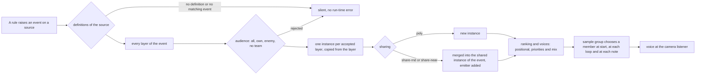
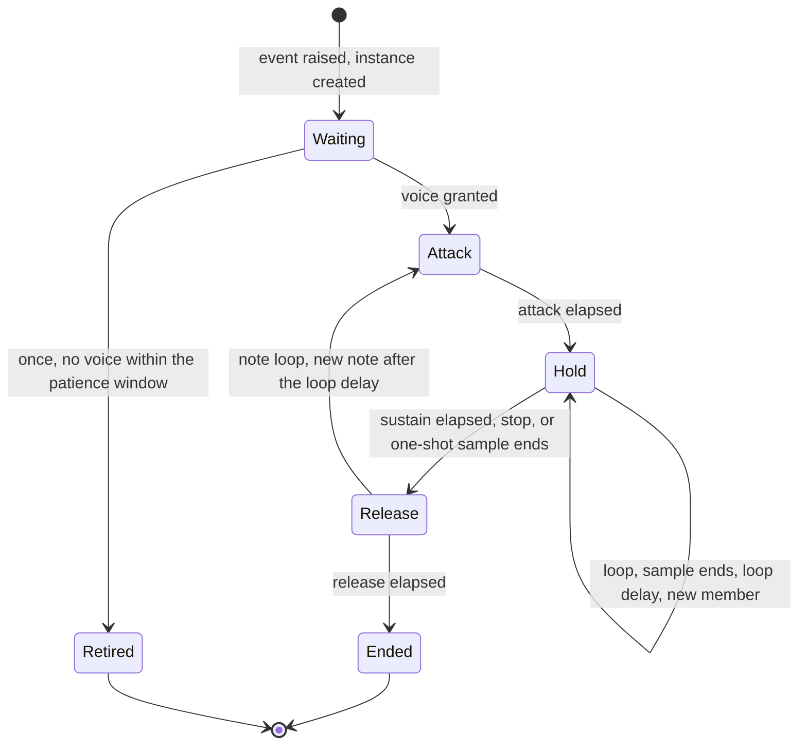
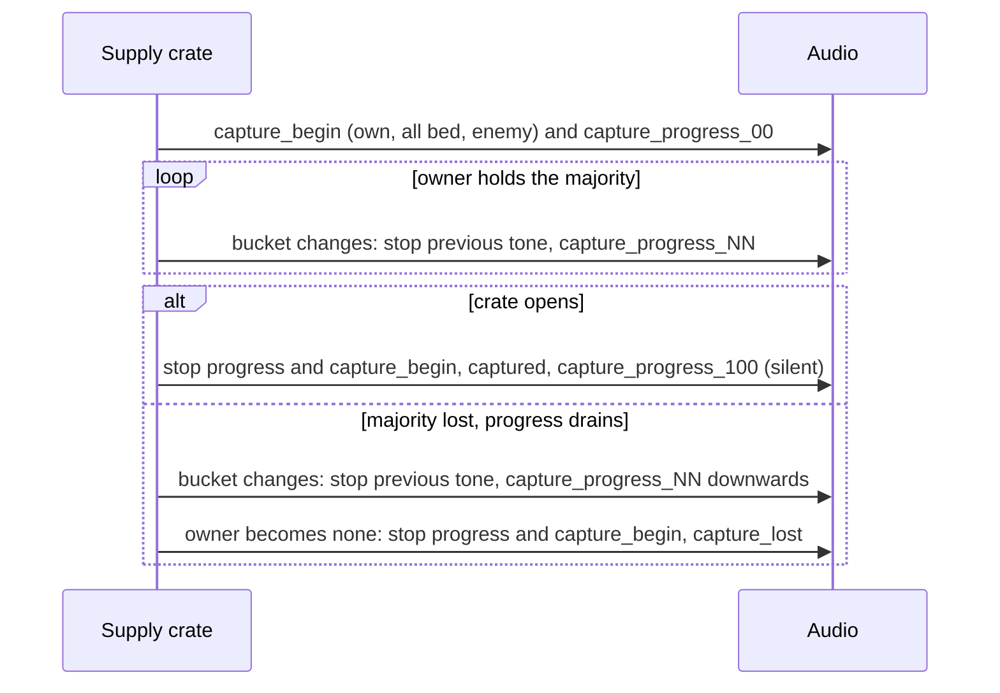

# Audio design: event model and sound data

> Status: Reference · Prefix: R-AUD · Related: [Folder index](README.md) · [Event catalogue](event_catalogue.md) · [Positional, priorities and mix](positional_priorities_and_mix.md) · [02 Units](../02_units/README.md) · [03 Buildings and world objects](../03_buildings_and_world_objects/README.md) · [audio engine](../../architecture/components/audio_engine.md) · [data schemas](../../architecture/components/data_schemas/README.md)

## 1 Purpose and player experience

Game code decides **when** something audible happens; sound data decides **what** the player hears. A rule raises a (source, event) pair, and the sound data turns it into zero or more layered sounds. A designer can therefore change, layer, vary, filter by audience or silence any moment of play without touching game code, and a moment with no data is simply silent. This file specifies that binding model and the sound data that every layer carries. The concrete events and their data are the [event catalogue](event_catalogue.md); how instances are placed, ranked and mixed is [positional, priorities and mix](positional_priorities_and_mix.md).

## 2 Rules

### 2.1 Pipeline and trigger entry points

**R-AUD-020** (MUST) Sound follows this pipeline (diagram 3-A):

1. A rule raises an event on a sound source as a presentation event (R-AUD-001).
2. The source's definitions are looked up. A source with no definitions, or with no definition of that event, plays nothing and reports no error at run time (R-AUD-027).
3. Every layer of the event's definition whose audience accepts the event (R-AUD-024, R-AUD-025) produces one instance, copied from the layer.
4. A layer of one-voice-per-trigger sharing becomes a new instance; a layer of shared-voice sharing merges into the event's existing shared instance and adds its emitter there (R-AUD-029).
5. The audio engine ranks the instances and gives voices to the best of them ([positional, priorities and mix](positional_priorities_and_mix.md)).
6. When an instance starts, and at every loop restart and every new note, its sample group chooses the member to play (R-AUD-063).

**R-AUD-021** (MUST) A sound event enters by one of four entry kinds:

| Entry | Source | Initial position and emitter | Team for the audience filter |
|---|---|---|---|
| actor event | the actor's kind, for example `worker` | the actor's position and velocity; the actor is the emitter | the actor's team |
| structure event | the structure's kind, for example `spawn_node` | the structure's position; an attached instance then follows the structure's centre position; velocity 0; the structure is the emitter | the structure's team |
| non-object event with an object or none | a non-object source (R-AUD-121), for example `grenade` | the object's position, with the object as the emitter; with no object, no position and no emitter (a two-dimensional instance) | the object's team; no team when no object is given |
| non-object event at a position | a non-object source | the given position; no emitter | the given team |

An event of the `music` source goes to the music hooks instead ([music hooks and brief](music_hooks_and_sound_design_brief.md) R-AUD-401).

### 2.2 Matching and layering

**R-AUD-022** (MUST) An event id is matched exactly within its own source's definitions. Event ids and source ids are lower-case snake_case, so exact matching gives the same result as the reference's matching, which ignores case; no event of one source ever matches a definition of another source. The authoring tools offer, for each source, exactly the event ids that game code raises for it (DEC-097). A definition of an event id that game code never raises for its source is a content-build error ([data schemas](../../architecture/components/data_schemas/entity_audio_geometry_and_panel_schemas.md) DAT-267), so the content build reads the list of the event ids that game code raises for each source, generated from game code, which is also the list against which R-AUD-005 validates the sound-event set.

**R-AUD-023** (MUST) **Layering.** Every matching layer whose audience accepts the event produces its own instance. Several layers of one event are how the data layers a body sound with a voice (for example `worker.die`), adds a loop to a one-shot (`transport.spawn`), or provides friend and foe variants (`control_zone.owner_changed`). In the reference event set, 154 bound events have one layer, 22 have two, 5 have three and 1 has four (`abductor.spawn`), 217 layers in all; the two no-team layers of R-AUD-025 make 219 layers in the Species set of the [event catalogue](event_catalogue.md).

**R-AUD-024** (MUST) **Audience.** Each layer has an audience, evaluated once, when the event is raised, on the local participant:

| Audience | The layer plays when |
|---|---|
| all | always |
| own | the event's team is the local team |
| enemy | the event's team is not the local team |
| no team | the event has no team (R-AUD-025) |

Outside a match, and on a participant with no local team, the own and enemy audiences never pass. Each participant hears its own variants, so two participants hear different layers of the same event by design (R-AUD-001).

**R-AUD-025** (MUST) **An event with no team** plays its layers of audience all and its layer of audience no team, and no own or enemy layer, so a change of owner to no team plays one defined sting, never both the captured and the lost sting (DEC-097). The events whose own and enemy layers can meet no team define their no-team layer in the [event catalogue](event_catalogue.md) (R-AUD-134, R-AUD-137); an event without a no-team layer plays only its all layers when it has no team.

**R-AUD-026** (MUST) **Owner-change stings.** `control_zone.owner_changed` is raised by the team-assignment operation on every change of owner ([03 Buildings and world objects](../03_buildings_and_world_objects/README.md) R-BLDG-038). Its own layer is the captured sting and its enemy layer the lost sting, so "lost" means "now owned by a team other than yours": it also plays when a zone passes between two enemy teams, and a Flag post that is captured from an enemy plays the captured sting for its new owner and the lost sting for everybody else.

**R-AUD-027** (MUST) An event with no definition, and a source with no definitions, play nothing at run time. The content build lists every such event that game code can raise (R-AUD-005), and the [event catalogue](event_catalogue.md) lists the ones that the reference leaves silent.

**R-AUD-028** (MUST) **Instance identity.** Every instance carries its full event id `<source>.<event>`. The full id is the key for the per-event copy ranking ([positional, priorities and mix](positional_priorities_and_mix.md)), for shared-voice merging (R-AUD-029), for stopping (R-AUD-036) and for instance counts (R-AUD-037).

**R-AUD-029** (MUST) **Shared voice.** A layer whose sharing is shared-random or shared-nearest merges into an existing shared instance of the same full event id, adding its emitter to that instance's emitter set, instead of creating a new instance. The shared instance plays from one emitter at a time: shared-random picks one of its emitters at random at every start and restart, and shared-nearest follows the emitter nearest the camera continuously, within the crowd radius of [positional, priorities and mix](positional_priorities_and_mix.md) R-AUD-213.

### 2.3 Event ids built at run time

**R-AUD-030** (MUST) **Supply crate capture progress.** While a crate's owner holds the majority, its progress bucket is b = ⌊`ref.aud.crate.progress_buckets` × progress ÷ `ref.crate.open.full_progress`⌋ ([04 crates and powers](../04_supply_crates_powers_and_weapons/crates_and_powers.md) R-CRATE-117). On every change of b, the crate stops its previous progress tone and raises `supply_crate.capture_progress_NN` with NN = `ref.aud.crate.progress_step_percent` × b written with two digits: `_00`, `_20`, `_40`, `_60` and `_80` are bound note loops, and `_100`, raised when the crate opens, has no definition. `supply_crate.capture_progress_00` is raised together with `supply_crate.capture_begin` when a team takes the majority of an ownerless crate.

**R-AUD-031** (MUST) **Supply crate drain.** While a crate's progress drains because its owner has lost the majority, every change of the bucket b stops the previous progress tone and raises the progress event of the new bucket by the same naming rule, so the progress tones play downwards as the bar empties (DEC-097). The reference builds a drain event name that matches no definition, so its drain is silent; Species corrects it.

**R-AUD-032** (MUST) **Launch Vessel loops.** A Launch Vessel selects one state loop each tick from its state, its fuel and its damage (`launch_vessel.refuelling`, `launch_vessel.hungry`, `launch_vessel.fuelled`, `launch_vessel.malfunction` or `launch_vessel.flight`) and the engine loop `launch_vessel.engine_burn`, as [03 mode objects](../03_buildings_and_world_objects/mode_objects.md) R-BLDG-337 specifies. Each loop is started by an explicit start event when it becomes the selected loop and stopped by an explicit stop when another loop is selected, so a loop never runs twice for one vessel (DEC-323).

**R-AUD-033** (MUST) **Thrown weapons.** Grenades and airstrike target markers raise the events of the `grenade` source; airstrike bombs and firebomb canisters raise the events of the `airstrike_bomb` source. A Bomber's bomb is created without the throw initialisation, so no `airstrike_bomb` spawn event exists.

**R-AUD-034** (MUST) **Fuse blink.** `grenade.fuse_blink` and `airstrike_bomb.fuse_blink` are raised each time the weapon's age reaches a whole multiple of `ref.aud.weapon.fuse_blink_ticks` (10 ticks, 1 s), as the fuse light blinks. The reference raises them from the weapon's drawing, so they depend on the weapon being drawn; that is the default of DEC-318.

**R-AUD-035** (MUST) **Outcome stings.** A Supply crate outcome raises `crate_outcome.<outcome>` of the `crate_outcome` source at the effect's position, for the effect's team, or for no team for an outcome that acts for no team ([04 Supply crates](../04_supply_crates_powers_and_weapons/README.md)). Every outcome sting is two-dimensional with audience all, so the position and the team have no audible effect. The gun turret, rocket turret and flame turret outcomes all raise `crate_outcome.gun_turret`; the Firebomb Run raises `crate_outcome.airstrike`; the Builder, Time Dilation and Time Rush outcomes raise no outcome sting, and placing a Builder plays `power_input.confirm` ([06 selection and Power slots](../06_controls_camera_and_commands/selection_and_power_slots.md) R-CTRL-194).

### 2.4 Stopping, querying and loop control

**R-AUD-036** (MUST) **Stop.** Game code stops sounds by emitter and by event: a stop names an emitter, or no emitter, and an event id, a source id, or nothing. It stops every instance whose emitter is the named one and whose full event id equals the named event, starts with the named source, or, when nothing is named, every instance of that emitter. A playing instance is released by its own release (R-AUD-058); a waiting instance is removed. A stop with no emitter acts only on instances raised with no emitter. A stop never reaches the music channel unless it names the `music` source ([music hooks and brief](music_hooks_and_sound_design_brief.md) R-AUD-403).

**R-AUD-037** (MUST) **Counts.** Game code can ask how many live instances of an event exist for an emitter or for any emitter, and whether an emitter has any playing instance. A count counts only live instances and is defined in every voice state (DEC-752). Results come back through the audio engine's result queue (ADR-026), so no rule of the simulation depends on them.

**R-AUD-038** (MUST) Every instance records its emitter when it is triggered, so a stop or a count made before the next audio update, or for a two-dimensional or world-fixed instance, finds it (DEC-323). Looping sounds are started and stopped by explicit events, never kept alive by polling counts.

**R-AUD-039** (MUST) These rules stop sounds:

| Stops | Emitter | When | Owner of the trigger |
|---|---|---|---|
| `match_ui.selection_circle` | none | the selection circle ends | [06 selection](../06_controls_camera_and_commands/selection_and_power_slots.md) |
| `match_ui.lobby_bed` | none | the front-end loop exits | [09 screen flow](../09_front_end_and_match_flow/screen_flow_and_match_setup.md) R-META-029 |
| `ambience.match_enter` | none | the match loop exits; `ambience.match_exit` is raised next | [12 tick timing](../12_simulation_model/01_tick_timing_and_main_loop.md) R-SIM-582 |
| `tree.burning` | the tree | the fire goes out, or the tree is removed | [03 trees](../03_buildings_and_world_objects/trees_and_crate_structures.md) R-BLDG-630 |
| `beam_dish.rotate_start` | the dish | before every new aim, and when the dish is aligned | [03 economy objects](../03_buildings_and_world_objects/economy_and_spawn_objects.md) R-BLDG-167 |
| `beam_dish.link_up` | the dish | the link is lost | as above |
| `solar_array.charging` | the array | the array leaves its operating state | [03 economy objects](../03_buildings_and_world_objects/economy_and_spawn_objects.md) R-BLDG-180 |
| `abductor.tractor_beam` | the Abductor | the abduction ends | [02 hazards](../02_units/hazards_and_projectiles.md) |
| the Leader's order events | the Leader | before every new order sound; cancelling a Leader's orders stops them all | [02 Leader](../02_units/leader_and_formations.md) R-UNIT-193 |
| `supply_crate.falling` | the crate | it lands | [04 crates](../04_supply_crates_powers_and_weapons/crates_and_powers.md) R-CRATE-145 |
| every `supply_crate.capture_progress_NN` | the crate | before each new progress tone, on opening and on loss | R-AUD-030, R-AUD-031 |
| `supply_crate.capture_begin` | the crate | it opens, or its owner becomes none | as above |
| `rocket.spawn` | the rocket | it explodes | [04 weapons](../04_supply_crates_powers_and_weapons/weapons_and_projectiles.md) |
| `worker.flee_bark`, `worker.attack_bark`, `worker.attack_horn` | the Worker | its threat clears or its state changes | [02 Worker](../02_units/worker.md) R-UNIT-151 |
| `fuel_line.flow` | the line | its fuel level falls to the flow-sound level or below | [03 economy objects](../03_buildings_and_world_objects/economy_and_spawn_objects.md) R-BLDG-201 |
| the Launch Vessel's state loops | the vessel | another state loop is selected | R-AUD-032 |
| `launch_vessel.engine_burn` | the vessel | the engines stop | R-AUD-032 |
| `relic.carry` | the Relic | it is put down | [03 mode objects](../03_buildings_and_world_objects/mode_objects.md) R-BLDG-285 |

**R-AUD-040** (MUST) A looping layer that no rule stops ends when its emitter leaves the match world (R-AUD-209): the presence loops of the Builder, Trooper, Brood Drifter, centipede, Bomber, spider, ant, Transport, Reaper Serpent (its spawn loop and its `reaper_serpent.enemy_sighted` loop), Collector, barrage missile, meteor and Abductor; the Barrier Emitter, Control Zone and Command Console presence loops; the three tree presence loops; and the Spitter Plant's `spitter_plant.burning`.

**R-AUD-041** (MUST) The Core Device's world-fixed presence loop `core_device.spawn` is stopped when the Core Device is destroyed or removed and at match exit (DEC-097). The reference gives world-fixed instances no emitter and culls only attached ones, so its Core Device loop keeps playing at its position after the device is gone and after the match ends; Species corrects it by R-AUD-038.

**R-AUD-042** (MUST) When the Core Device links a Command Console at load, the console raises no second `command_console.spawn`, because it runs no second initialisation (DEC-458).

**R-AUD-043** (MUST) **Match exit.** When the match loop exits, the match ambience stops (R-AUD-324) and every other instance raised during the match stops or begins its release within `ref.aud.exit.release_start_limit` (2 s) (DEC-097). Attached instances end when their emitters are torn down (R-AUD-209).

**R-AUD-044** (MUST) With no audio device, the audio engine retires every instance as if its voice had ended, so waiting instances never accumulate over a session (DEC-097); the reference keeps them for the whole session. The behaviour without a device is otherwise the [audio engine](../../architecture/components/audio_engine.md)'s.

### 2.5 From a sample group to sound

**R-AUD-045** (MUST) Every layer names one sample group by its asset id from [assets/asset_manifest.csv](../../assets/asset_manifest.csv), for example `sfx.unit.worker.die`. A single sample is a group of one. Several events may name the same group (R-AUD-067).

**R-AUD-046** (MUST) A layer that names a missing group, or a group member whose file is missing, is a content-build error; at run time it is a diagnostic and the layer is silent, never a fatal stop (DEC-015).

**R-AUD-047** (MUST) The reference has no localised audio: no sample varies by language and the audio has no language switch. Whether Species voice lines are worded is DEC-317 ([front end, HUD, voice and ambience](front_end_hud_voice_and_ambience.md) R-AUD-312).

**R-AUD-048** (MUST) No sound plays before the sound set has finished loading, and every game sound event raised while a loading view shows is dropped ([09 front end presentation](../09_front_end_and_match_flow/front_end_presentation.md) R-META-216). The sound groups that the front end needs first are exactly the layers of `match_ui.lobby_bed`, `match_ui.menu_hover`, `match_ui.menu_select` and `match_ui.menu_back`; loading them first gives no audible gain while every trigger waits for the whole set (DEC-319).

### 2.6 The sound data of a layer

**R-AUD-049** (MUST) Every layer carries these fields; a field that the data omits takes its default:

| Field | Values | Default | Meaning |
|---|---|---|---|
| sample group | an asset id | none: a layer without one is a content-build error | what plays (R-AUD-045) |
| position | `2d`, `fix` (world-fixed), `att` (attached) | `att` | `2d`: at the listener, centred, not attenuated, never pitch-bent by game speed; `fix`: at the trigger position, outliving its emitter (deaths, explosions, impacts); `att`: following its emitter every audio update, ended with it (loops and bodies) ([positional, priorities and mix](positional_priorities_and_mix.md) R-AUD-207) |
| sharing | `poly` (one voice per trigger), `share-rnd`, `share-near` | `poly` | R-AUD-029; the crowd-limiting mechanism |
| loop | `once`, `loop`, `note` | `once` | R-AUD-056 to R-AUD-062 |
| audience | `all`, `own`, `enemy`, `none` | `all` | R-AUD-024, R-AUD-025 |
| minimum distance | wu, within `ref.aud.layer.min_distance_range` | `ref.aud.layer.min_distance_default` (100 wu) | the full-level radius; beyond it the gain falls as minimum distance ÷ distance (R-AUD-202); it also scales the instance's audibility for ranking |
| bus and priority class | a bus of [positional, priorities and mix](positional_priorities_and_mix.md) R-AUD-221 | by source (R-AUD-222) | the authored priority (DEC-570) |
| level | a modulatable value (§2.7) in dB | `ref.aud.layer.level_default` (−15 dB) | the peak target of the envelope and the base of the instance's audibility |
| pitch | a modulatable value, a multiplier of the sample's own rate, within `ref.aud.layer.pitch_range` | `ref.aud.layer.pitch_default` (1.0) | pitch and speed together, with no time-stretch |
| attack | a modulatable value, s, at most `ref.aud.layer.attack_max` | `ref.aud.layer.envelope_default` (0 s) | R-AUD-056 |
| sustain | a modulatable value, s, at most `ref.aud.layer.sustain_max` | 0 s | R-AUD-057 |
| release | a modulatable value, s, at most `ref.aud.layer.release_max` | 0 s | R-AUD-058 |
| loop delay | a modulatable value, s, at most `ref.aud.layer.loop_delay_max` | 0 s | R-AUD-059, R-AUD-060 |
| effects | zero or more effects of §2.11, each with its parameters | none | R-AUD-076 to R-AUD-082 |

The reference sound data has no authored priority: a priority field, where present, is ignored. Besides these fields, a layer carries the engine fields of the [audio engine](../../architecture/components/audio_engine.md) AEN-062, each with an audio-design default: the copy decay (R-AUD-216), the patience window of a `once` layer (R-AUD-061), the per-event real-voice cap, the maximum distance, and the Doppler, distance-filter and distance-reverb factors. The per-event cool-down (R-AUD-220) belongs to the event, not to its layers. The schema of every layer field, these engine fields included, with its key and value domain, is table 3.3-B of [data schemas](../../architecture/components/data_schemas/entity_audio_geometry_and_panel_schemas.md), and the event fields with the cool-down are its table 3.3-A.

**R-AUD-050** (MUST) Effect parameters are matched to their effect's parameter list by position; a parameter that a layer's effect omits is 0.0, not its declared default, in the reference (DEC-567, R-AUD-078). Species authors every effect parameter by name, and the content build cooks each binding's parameters in its kind's parameter order of R-AUD-077, the positions by which the audio engine reads them, so the positional matching holds for the cooked data while the order in the authoring file carries no meaning ([data schemas](../../architecture/components/data_schemas/entity_audio_geometry_and_panel_schemas.md) DAT-270 to DAT-272).

### 2.7 Modulatable values

**R-AUD-051** (MUST) Level, pitch, attack, sustain, release, loop delay and every effect parameter are modulatable values of one of three kinds:

| Kind | Inputs | Value at each evaluation |
|---|---|---|
| fixed | v | v |
| random | lo, hi, smoothing | target = lo + u × (hi − lo), u a uniform presentation draw in [0, 1], so the target can equal hi; then smoothed (R-AUD-054) |
| linked | link, inLo, outLo, inHi, outHi, smoothing | x = the link's input (R-AUD-052); if x is at or beyond inLo on the side away from inHi, outLo; if at or beyond inHi on the side away from inLo, outHi; otherwise outLo + (x − inLo) ÷ (inHi − inLo) × (outHi − outLo). Decreasing input ranges work. Then smoothed (R-AUD-054) |

**R-AUD-052** (MUST) A linked value reads one of these links, evaluated at the instance's position, or at the camera's position and velocity for a two-dimensional instance (DEC-568):

| Link | Input | Uses in the event set |
|---|---|---|
| none | 0 | — |
| height | the position's height above the terrain at that point (0 with no terrain) | flyer engine pitch (the Abductor and Collector engines: 0 to 984 wu above the ground maps pitch 0.32 to 2.47), the Brood Drifter's loop delay, the Reaper Serpent's loops, the meteor fall pitch |
| pos_x | the position's x | — |
| altitude | the position's y, the absolute altitude | the match ambience levels by camera altitude (two-dimensional, so the camera's y) |
| pos_z | the position's z | — |
| speed | the emitter's speed, wu/s | vehicle engines (the Transport's level and pitch), the spider's footstep level, the Bomber's engine pitch, creature loop delays, bounce levels |
| camera_distance | the distance from the camera to the position | the meteor's far landing layer (level from silent to −0.5 dB over 100 to 320 wu), the echo wet/dry mix of two layers, the barrage missile's flight pitch |
| object_age | the emitter's age | none in the reference set |
| teams_nearby | the number of teams with actors near the position | none in the reference set |
| time_remaining | the match clock's time remaining | none in the reference set |
| unit_count | the number of actors near the position | none in the reference set |

**R-AUD-053** (MUST) Each modulatable value has an update mode: **continuous**, evaluated at every audio update, so a random value draws a new target at every update, filtered by its smoothing; or **per note**, evaluated when the instance is triggered, when it starts and after each loop restart or new note only, so a random value gives one value per note. A value whose mode the data omits is continuous. In the catalogue tables, `/note` marks a per-note value.

**R-AUD-054** (MUST) **Smoothing.** A smoothing s lies in [0, `ref.aud.param.smoothing_max`] (0.99). Per `ref.sim.frame.audio_update_period` (0.05 s) of audio time, a value moves as out = target × (1 − √s) + out_previous × √s; over an elapsed audio time Δt the retention is (√s)^(Δt ÷ 0.05 s), so the smoothing depends on elapsed time, not on the update rate (ADR-026). A smoothing of 0.6 keeps 0.775 of the previous value per 0.05 s.

**R-AUD-055** (MUST) A smoothed value starts from the field's default (pitch 1.0) and is evaluated only a few times before the instance starts, so an authored random pitch range is compressed towards 1.0 at the start of a note: a range of 0.75 to 1.35 with smoothing 0.66 is heard as about 0.88 to 1.16. This is the reference default of DEC-322.

### 2.8 Envelopes and loops

**R-AUD-056** (MUST) **Attack.** An instance fades in linearly in dB from the envelope floor of −50 dB, the bottom of the ten-step scale (R-AUD-004), to its level over its attack, timed from the moment the event is raised; an attack of 0 starts at full level. The exact envelope arithmetic is the [audio engine](../../architecture/components/audio_engine.md)'s AEN-166.

**R-AUD-057** (MUST) **Sustain.** After the attack, an instance holds its level for its sustain and then releases by itself. A sustain of 0 holds until the instance is stopped or its sample ends. There is no decay stage and no sustain level.

**R-AUD-058** (MUST) **Release.** A released instance fades out linearly in dB over its release, whether it was released by a stop (R-AUD-036), by the end of its sustain, or by the end of a one-shot sample; a release of 0 ends it at once.

**R-AUD-059** (MUST) **Loop.** A `loop` layer plays its sample again when it ends, after a silence of its loop delay; a group draws a new member for each loop (R-AUD-064).

**R-AUD-060** (MUST) **Note loop.** A `note` layer is a re-triggering note: at each release a new copy of the layer starts after its loop delay, with a new group member and new per-note values, and cross-fades with the fading previous note. This is the generative-pad mechanism of the ambience beds ([front end, HUD, voice and ambience](front_end_hud_voice_and_ambience.md) R-AUD-320).

**R-AUD-061** (MUST) **One-shot patience.** A `once` instance that gets no voice within `ref.aud.layer.one_shot_patience_updates` (3 audio updates, 0.15 to 0.20 s after the event) is retired unheard; a looping instance waits for a voice for as long as it lives. The reference counts these updates from the event. The Species engine keeps waiting instances virtual for the event's patience window, whose default is this value (0.15 s), and counts the window from the instance's start time, which is the trigger's issue time plus the engine's scheduling latency `aen.update.schedule_latency` (0.03 s) ([audio engine](../../architecture/components/audio_engine.md) AEN-024, AEN-146; ADR-023).

**R-AUD-062** (MUST) Envelope ramps change level smoothly in elapsed audio time; the reference steps them once per audio update, and the exact ramp arithmetic is the [audio engine](../../architecture/components/audio_engine.md)'s.

### 2.9 Sample groups

**R-AUD-063** (MUST) A sample group chooses the member to play at random with authored weights, and never plays the same member twice in a row; with one member it plays that member. Pitch variation adds further variety (DEC-568). The reference chooses uniformly with no repeat rule; equal weights reproduce its distribution apart from the immediate repeats.

**R-AUD-064** (MUST) A group draws a member when its instance starts, at every loop restart of a `loop` layer and for every new note of a `note` layer.

**R-AUD-065** (MUST) A group always chooses among all its members. The reference low-memory setting, which limits every group to its first half or quarter, does not exist in Species (DEC-097).

**R-AUD-066** (MUST) **Deliberate silences.** Members 07 to 13 of `sfx.unit.worker.burning` are silent samples, so `ref.aud.group.worker_burning_audible` (6) of its `ref.aud.group.worker_burning_members` (13) members are heard and about half of the burning screams are silent. The silent members are part of the group's design, not placeholders.

**R-AUD-067** (MUST) These groups are named by more than one event, each with its own layer data:

| Group | Events |
|---|---|
| `sfx.unit.worker.hurt` | `worker.hurt` (both layers), `leader.hurt` |
| `sfx.unit.worker.die` | `worker.die`, `leader.die` |
| `sfx.unit.worker.selected` | `worker.selected`, `worker.ordered_by_player` |
| `sfx.unit.leader.spawn` | `leader.spawn` (both layers), `leader.selected`, the second layers of `leader.order_waypoint` and `leader.order_formation`, `worker.ordered` |
| `sfx.unit.leader.order_waypoint` | `leader.order_waypoint`, `leader.order_formation` |
| `sfx.unit.trooper.enter_gate` | `trooper.enter_gate`, `leader.enter_gate` |
| `sfx.unit.trooper.fire_laser` | `trooper.fire_laser`, `turret.fire_gun` |
| `sfx.creature.spider.pounce` | `spider.pounce`, `spider.attack` |
| `sfx.creature.spider.lay_egg` | `spider.lay_egg`, `brood_drifter.lay_egg` |
| `sfx.creature.brood_drifter.hurt` | `brood_drifter.hurt`, `spitter_plant.damaged` |
| `sfx.creature.reaper_serpent.hurt` | `reaper_serpent.hurt`, the second layer of `reaper_serpent.spawn` |
| `sfx.creature.reaper_serpent.die` | `reaper_serpent.die`, `seed_pod.die` |
| `sfx.creature.centipede.die` | `centipede.die`, the second layer of `launch_vessel.explode` |
| `sfx.creature.abductor.presence_loop_b`, `sfx.creature.abductor.presence_loop_c` | `abductor.spawn`, `collector.spawn` |
| `sfx.unit.collector.presence_loop` | `collector.spawn`, `abductor.spawn`, the second layer of `meteor.spawn` |
| `sfx.weapon.grenade.explode` | `grenade.explode`, `hive.explode` |
| `sfx.weapon.grenade.fuse_blink` | `grenade.fuse_blink`, `airstrike_bomb.fuse_blink` |
| `sfx.building.launch_vessel.flight` | `launch_vessel.flight`, `core_device.spawn` |
| `sfx.building.launch_vessel.fuelled_b` | the second layer of `launch_vessel.fuelled`, the second layer of `match_ui.lobby_bed` |
| `sfx.building.tree.ambient_normal` | `tree.ambient_normal`, `tree.ambient_essence` |
| `sfx.building.control_zone.relic_scored` | the first layer of `control_zone.relic_scored`, the own layer of `relic.owner_changed` |
| `sfx.ui.match_ui.countdown_tick` | `match_ui.countdown_tick`, `match_ui.countdown_zero`, `turret.kill_tick` |
| `sfx.ui.match_ui.unit_select` | `match_ui.unit_select`, `match_ui.toggle_state` |
| `sfx.ui.power_input.begin` | `power_input.begin`, the first layer of `match_ui.selection_circle` |
| `sfx.ui.power_slots.icon_hover` | `power_slots.icon_hover`, `match_ui.menu_hover` |
| `amb.match_bed` | the first layer of `ambience.match_enter`, the first layer of `match_ui.lobby_bed` |

The members of `sfx.creature.spider.die` include the two members of `sfx.creature.spider.hurt`.

**R-AUD-068** (MUST) A group name defined twice, or a group that no event names, is reported by the content build; a duplicate definition is a build error, and so is a malformed definition, such as a stray blank line inside a block, which breaks the reference loader (DEC-015).

### 2.10 Authoring conventions

**R-AUD-069** (MUST) Deaths, explosions, impacts and landings are world-fixed (`fix`), so they survive the removal of their object: for example `worker.die` (both layers), `builder.die`, `brood_drifter.die`, `centipede.die`, `barrage_missile.explode`, `grenade.explode`, `airstrike_bomb.explode`, `meteor.land` and `supply_crate.captured`. Some deaths are attached: `crawler.die`, `spider.die`, `trooper.die`, `leader.die`, `ant.die` and `reaper_serpent.die`, and they end with their emitter (R-AUD-209).

**R-AUD-070** (MUST) Bodies, engines and hums are attached loops with no stop rule, so the object's lifetime is the sound's lifetime (R-AUD-040).

**R-AUD-071** (MUST) Crowd sounds use one shared voice: `worker.spawn` and the reload layer of `worker.attack` are shared-nearest, and the `trooper.spawn` chatter and `trooper.weapon_ready` are shared-random; `launch_vessel.hungry` is shared-nearest.

**R-AUD-072** (MUST) Owner-only feedback uses own-audience layers, two-dimensional (`leader.spawn`, `leader.selected`) or attached (the acknowledgement layers of the Leader's order events). Friend and foe stings use own and enemy layer pairs: `supply_crate.capture_begin`, `relic.owner_changed`, `control_zone.owner_changed` and `control_zone.relic_scored`.

**R-AUD-073** (MUST) Variety comes from pitch: 49 of the 217 reference layers randomise their pitch, mostly by 5 to 20 % and per note, besides the sample-group choice.

**R-AUD-074** (MUST) Many one-shots carry a release of about 10 s, authored to let an echo tail ring. With effects off (R-AUD-076), such a release only holds the voice while the ended sample is silent; ranking playing instances by their current envelope level keeps these tails from crowding out new sounds ([positional, priorities and mix](positional_priorities_and_mix.md) R-AUD-215).

**R-AUD-075** (MUST) Levels are authored near the top of the scale: of the 205 fixed levels of the reference event set, 187 lie between −10 dB and 0 dB, the range is −24.85 dB to 0 dB and the mean is −4.5 dB, so loudness differences come mostly from the minimum distance and the distance. Most layers use a minimum distance of 100 wu (110 layers) or 200 wu (30 layers); the range is 5.98 wu (the tree presence loops) to 10000 wu (`launch_vessel.flight`), and only `meteor.land` (450 wu), the white-noise layer of `ambience.match_enter` (500 wu) and `launch_vessel.flight` exceed 400 wu.

### 2.11 Filters and effects

**R-AUD-076** (MUST) No audio effect runs by default, so the reference is heard **dry**: the effects that the sound data names are not applied unless the effects setting is switched on, which no options page offers ([09 options](../09_front_end_and_match_flow/options_localisation_and_hooks.md) R-META-454). This is the default of DEC-567. Where Species applies effects, they run on buses, not on individual voices (DEC-027, ADR-024), and switching effects off leaves no effect processing on any voice or bus (DEC-752).

**R-AUD-077** (MUST) The effect kinds are these fourteen, in this order; the order carries meaning, because it is the order in which a chain processes its own-algorithm effects (R-AUD-080). Ranges and declared defaults:

| # | Effect | Parameters (range, declared default; i = integer) |
|---|---|---|
| 0 | chorus | wet/dry mix 0 to 100, 50; depth 0 to 100, 10; feedback −99 to 99, 25; frequency 0 to 10, 1.1; waveform 0 to 1, 1 (i); delay 0 to 20, 16; phase 0 to 4, 3 (i) |
| 1 | compressor | gain −60 to 60, 0; attack 0.01 to 500, 10; release 50 to 3000, 200; threshold −60 to 0, −20; ratio 1 to 100, 3; pre-delay 0 to 4, 4 |
| 2 | distortion | gain −60 to 0, −18; edge 0 to 100, 15; post-equaliser centre 100 to 8000, 2400; post-equaliser bandwidth 100 to 8000, 2400; pre-low-pass cut-off 100 to 8000, 8000 |
| 3 | stereo echo | wet/dry mix 0 to 100, 50; feedback 0 to 100, 50; left delay 1 to 2000, 500; right delay 1 to 2000, 500; pan delay 0 to 1, 0 (i) |
| 4 | flanger | wet/dry mix 0 to 100, 50; depth 0 to 100, 100; feedback −99 to 99, −50; frequency 0 to 10, 0.25; waveform 0 to 1, 1 (i); delay 0 to 4, 2; phase 0 to 4, 2 (i) |
| 5 | standard gargle | rate 1 to 100 Hz, 20 (i); wave shape 0 to 1, 0 (i) |
| 6 | room reverb (I3DL2 parameter set) | room −10000 to 0, −1000 (i); room high-frequency −10000 to 0, −100 (i); room roll-off factor 0 to 10, 0; decay time 0.1 to 20, 1.49; decay high-frequency ratio 0.1 to 2, 0.83; reflections −10000 to 1000, −2602 (i); reflections delay 0 to 0.3, 0.01; reverb −10000 to 2000, 200 (i); reverb delay 0 to 0.1, 0.01; diffusion 0 to 100, 100; density 0 to 100, 100; high-frequency reference 20 to 20000, 5000; quality 0 to 3, 2 (i) |
| 7 | parametric equaliser | centre 80 to 16000, 8000; bandwidth 1 to 36, 12; gain −15 to 15, 0 |
| 8 | studio reverb | input gain −96 to 0, 0; reverb mix −96 to 0, 0; reverb time 0.01 to 3000, 1000; high-frequency time ratio 0.01 to 0.99, 0.01 |
| 9 | resonant low-pass | cut-off control 100 to 20000, 2500; resonance control 0.1 to 20, 7; gain 0 to 10, 1 |
| 10 | bit crusher | bits 1 to 16, 16 |
| 11 | gargle | wet/dry mix 0 to 100, 50; rate 0.01 to 100 Hz, 20; wave shape 0 to 1, 0 (i) |
| 12 | echo | wet/dry mix 0 to 100, 50; delay 1 to 3000 ms, 200; attenuation 0 to 100, 50 |
| 13 | simple reverb | wet/dry mix 0 to 100, 50, which the effect ignores |

Kinds 0 to 8 are standard effects whose processing is defined by their parameter sets; kinds 9 to 13 are defined by the algorithms of R-AUD-079.

**R-AUD-078** (MUST) A parameter that an effect binding omits is 0.0 in the reference, not its declared default. The schema default of each effect parameter is chosen deliberately, 0.0 for parity or the declared value, and it is audible only once effects are enabled (DEC-567).

**R-AUD-079** (MUST) The own-algorithm effects behave as follows; their exact arithmetic is the [audio engine](../../architecture/components/audio_engine.md)'s:

| Effect | Behaviour |
|---|---|
| resonant low-pass | a resonant two-pole low-pass filter; the cut-off control p maps exponentially to a frequency of e^(p ÷ 3850 + 4.7) Hz, about 113 Hz to 19.8 kHz over the control range; the resonance control r gives a quality factor of e^(r ÷ 4) − 1; the gain scales the output |
| bit crusher | quantises the signal to b bits: the step is 65536 ÷ 2^b on the 16-bit sample scale |
| gargle | amplitude modulation at the rate: a triangle wave mixed by the wet/dry mix, or, with wave shape 1, a square wave that gates the signal hard and ignores the wet/dry mix |
| echo | a single feedback delay line of up to 3 s: the delay in ms, the wet/dry mix, and the attenuation as the feedback percentage |
| simple reverb | a fixed six-tap feedback reverb with taps at 1.1, 3, 11, 19, 29 and 46 ms and no controls |

Every effect computes its time constants and coefficients from the sample rate at which it actually runs, so delays, rates and cut-offs sound the same at every device rate (ADR-024).

**R-AUD-080** (MUST) **Chains.** A layer holds at most one effect of each kind; a second effect of the same kind on one layer is a content-build error. The own-algorithm effects of a chain run in kind order, whatever their order in the data, and the standard effects run after them. Every effect parameter is a modulatable value (R-AUD-051), evaluated like the layer's own values.

**R-AUD-081** (MUST) In Species, an effect that the design attaches to a group of sounds is realised by routing those sounds to a bus whose chain has the effect, or by a send to such a bus ([audio engine](../../architecture/components/audio_engine.md), ADR-024); no voice carries its own effect chain.

**R-AUD-082** (MUST) The event set names these 15 effects, one per layer; with effects enabled they would apply, and with the default of DEC-567 none runs:

| Id | Event (layer) | Effect | Parameters |
|---|---|---|---|
| FX-01 | `crawler.hurt` | echo | wet/dry mix 27.42; delay 200; attenuation 28.71 |
| FX-02 | `crawler.die` | echo | wet/dry mix 50; delay 200; attenuation 50 |
| FX-03 | `trooper.spawn` | echo | wet/dry mix linked to camera_distance 180 to 620 → 0 to 97.10; delay 200; attenuation 50 |
| FX-04 | `trooper.hurt` | echo | wet/dry mix 50; delay 200; attenuation 50 |
| FX-05 | `brood_drifter.die` | echo | wet/dry mix linked to camera_distance 140 to 620 → 0 to 93.55; delay 200; attenuation 50 |
| FX-06 | `centipede.die` | echo | wet/dry mix 50; delay 281.55; attenuation 3.23 |
| FX-07 | `spider.die` | stereo echo | wet/dry mix 50; feedback 50; left delay 207.35; right delay 194.45; pan delay 0 |
| FX-08 | `worker.hurt` (layer 1) | echo | wet/dry mix 50; delay 200; attenuation 50 |
| FX-09 | `worker.spawn` | echo | wet/dry mix 50; delay 200; attenuation 50 |
| FX-10 | `transport.spawn` (layer 1) | gargle | wet/dry mix 100; rate linked to speed 0 to 14.4 → 2.59 to 10.01, smoothing 0.92; wave shape 0 |
| FX-11 | `collector.drop_essence` | gargle | wet/dry mix 36.77 per note; rate 29.68; wave shape 0.99 |
| FX-12 | `beam_dish.link_lost` | echo | wet/dry mix 50; delay 407.32; attenuation 64.84 |
| FX-13 | `supply_crate.falling` | stereo echo | wet/dry mix 50; feedback 90.32; left delay 500; right delay 500; pan delay 0 |
| FX-14 | `grenade.explode` | studio reverb | input gain −0.31; reverb mix −8.98; reverb time 3000; high-frequency time ratio 0.65 |
| FX-15 | `ambience.match_enter` (layer 2) | echo | wet/dry mix 50; delay 523.41; attenuation 50 |

## 3 States and flows

Diagram 3-A: from a raised event to a voice (R-AUD-020 to R-AUD-029).

Diagram 3-B: the life of an instance (R-AUD-056 to R-AUD-062). A note-loop layer starts each new note as a fresh copy that cross-fades with the releasing one.

Diagram 3-C: the Supply crate capture sounds (R-AUD-030, R-AUD-031).

## 4 Tuning table

| key | value | unit | range or notes | requirement | DEC |
|---|---|---|---|---|---|
| `ref.aud.crate.progress_buckets` | 5 | buckets | b = ⌊5 × progress ÷ full progress⌋, 0 to 4 while capturing | R-AUD-030 | — |
| `ref.aud.crate.progress_step_percent` | 20 | % per bucket | the event suffix is 20 × b: 00, 20, 40, 60, 80, 100 | R-AUD-030 | — |
| `ref.aud.weapon.fuse_blink_ticks` | 10 | ticks | 1 s of weapon age | R-AUD-034 | DEC-318 |
| `ref.aud.exit.release_start_limit` | 2 | s of audio time | every match sound stops or starts its release within it | R-AUD-043 | DEC-097 |
| `ref.aud.layer.min_distance_default` | 100 | wu | | R-AUD-049 | — |
| `ref.aud.layer.min_distance_range` | 1 to 10000 | wu | | R-AUD-049 | — |
| `ref.aud.layer.level_default` | −15 | dB | the reference default 7 on the ten-step scale | R-AUD-049 | DEC-042 |
| `ref.aud.layer.pitch_default` | 1.0 | × | | R-AUD-049 | — |
| `ref.aud.layer.pitch_range` | 0 to 3 | × | | R-AUD-049 | — |
| `ref.aud.layer.envelope_default` | 0 | s | attack, sustain, release and loop delay | R-AUD-049 | — |
| `ref.aud.layer.attack_max` | 60 | s | | R-AUD-049 | — |
| `ref.aud.layer.sustain_max` | 300 | s | | R-AUD-049 | — |
| `ref.aud.layer.release_max` | 60 | s | | R-AUD-049 | — |
| `ref.aud.layer.loop_delay_max` | 60 | s | | R-AUD-049 | — |
| `ref.aud.param.smoothing_max` | 0.99 | — | smoothing range 0 to 0.99; retention √s per 0.05 s | R-AUD-054 | — |
| `ref.aud.layer.one_shot_patience_updates` | 3 | audio updates | 0.15 to 0.20 s after the event in the reference; the Species patience window (0.15 s) counts from the instance's start time (AEN-146) | R-AUD-061 | — |
| `ref.aud.group.worker_burning_members` | 13 | members | of `sfx.unit.worker.burning` | R-AUD-066 | — |
| `ref.aud.group.worker_burning_audible` | 6 | members | members 07 to 13 are silent | R-AUD-066 | — |

Keys cited here and defined elsewhere: `ref.crate.open.full_progress` in [04 crates and powers](../04_supply_crates_powers_and_weapons/crates_and_powers.md); `ref.sim.frame.audio_update_period` in [reference/12](../12_simulation_model/01_tick_timing_and_main_loop.md); `ref.aud.level.reference_step_db` in the [folder index](README.md); `aen.update.schedule_latency` in the [audio engine](../../architecture/components/audio_engine.md).

## 5 Edge cases and interactions

- **Same-tick start and stop.** A loop that is started and stopped in the same tick (a Beam Dish aimed and aligned at once) is found by the stop, because its emitter is recorded at trigger time (R-AUD-038); it never plays.
- **Neutral Flag posts.** A Flag post or Control Zone that becomes neutral plays its no-team sting only (R-AUD-025); in the reference it plays the captured and the lost sting together.
- **Double spider attack.** A spider's pounce raises `spider.attack` and `spider.pounce` together, both bound to `sfx.creature.spider.pounce` with different pitch ranges, so a pounce plays two takes of that group.
- **Spawn layer of the Reaper Serpent.** `reaper_serpent.spawn` plays its body loop and, as a second layer, one take of its pain group.
- **Layered body and voice.** `worker.die` plays a voice from `sfx.unit.worker.die` and a body hit from `sfx.unit.worker.die_b`; both are world-fixed, so the death is heard in full after the Worker is removed.
- **Fuse blink while hidden.** A grenade that is off-screen is not drawn, so under the default of DEC-318 its fuse blink is not heard; a blink is raised for each whole second only while the weapon is drawn.
- **Effects switched on.** With effects on, the authored echo tails of R-AUD-074 ring out audibly, and two layers change their echo mix with the camera distance (FX-03, FX-05).
- **Own-algorithm effects.** The own gargle adds a wet/dry mix and fractional rates to the standard gargle, and the own echo is a single-line echo rather than a stereo one; distortion and the parametric equaliser are costly for processing per sound, and a compressor per sound has no use, which is why the event set names none of them.
- **Drain tones.** A crate whose majority flips back and forth plays progress tones up while held and down while draining (R-AUD-030, R-AUD-031); each change stops the previous tone, so at most one progress tone plays per crate.

## 6 Acceptance criteria

- **AC-EVM-01** (R-AUD-023, R-AUD-024) Given `supply_crate.capture_begin` raised for team 1 with the local team 1, then the own sting and the all-audience bed play and the enemy sting does not; with the local team 2, the enemy sting and the bed play.
- **AC-EVM-02** (R-AUD-025) Given `control_zone.owner_changed` raised with no team, then exactly one sting plays, the no-team layer, for every local team.
- **AC-EVM-03** (R-AUD-027) Given an event id that has no definition, when it is raised, then nothing plays and no run-time error is reported, and the content build's report lists it.
- **AC-EVM-04** (R-AUD-029) Given 50 Workers spawning in one tick, then `worker.spawn` has one instance whose emitter set holds the 50 Workers.
- **AC-EVM-05** (R-AUD-030, R-AUD-031) Given a crate captured from 0 to full by an unbroken majority, then the progress events are raised in the order `_00`, `_20`, `_40`, `_60`, `_80`, `_100`, each stopping the previous one; given the majority lost at bucket 3, then `_40`, `_20` and `_00` follow as the progress drains, and `supply_crate.capture_lost` when the owner becomes none.
- **AC-EVM-06** (R-AUD-038, R-AUD-041) Given the Core Device destroyed, then its presence loop stops or releases at once; given the match left, then no instance of the match plays 2 s later except releasing ones (R-AUD-043).
- **AC-EVM-07** (R-AUD-032) Given a Launch Vessel that changes state ten times in 100 ticks, then at every tick at most one state loop and at most one engine loop play for it.
- **AC-EVM-08** (R-AUD-051, R-AUD-054) Given a linked level altitude 736 to 232 → −49.5 to −2.1 dB at altitudes 800, 484 and 200, then the targets are −49.5, −25.8 and −2.1 dB; given a smoothing of 0.6 and a target step from 0 to 1, then after 0.05 s the value is about 0.225 and after 0.10 s 0.4, at any audio update rate.
- **AC-EVM-09** (R-AUD-063) Given a group of 4 equally weighted members and 10,000 starts, then no member plays twice in a row and each member's share is within 2 % of the others'.
- **AC-EVM-10** (R-AUD-066) Given 13,000 `worker.burning` events, then about 6,000 play an audible member and the rest a silent one.
- **AC-EVM-11** (R-AUD-076, R-AUD-082) Given the default settings, then no effect processes any voice or bus; given effects enabled, then FX-01 to FX-15 run on the buses that carry those layers.
- **AC-EVM-12** (R-AUD-079) Given the resonant low-pass at cut-off controls 100, 2500 and 20000, then the cut-off frequencies are about 113 Hz, 211 Hz and 19.8 kHz, at a 44.1 kHz and a 48 kHz device alike.

## 7 Dependencies

- **Reference documents:** [event catalogue](event_catalogue.md) (the events and their layer data); [positional, priorities and mix](positional_priorities_and_mix.md) (position kinds, ranking, buses); [front end, HUD, voice and ambience](front_end_hud_voice_and_ambience.md) (note-loop beds); [02 Units](../02_units/README.md) R-UNIT-047 and [03 Buildings and world objects](../03_buildings_and_world_objects/README.md) R-BLDG-049 (base events); [03 mode objects](../03_buildings_and_world_objects/mode_objects.md) R-BLDG-337 (Launch Vessel loops); [04 crates and powers](../04_supply_crates_powers_and_weapons/crates_and_powers.md) R-CRATE-117 and R-CRATE-145 (crate sounds); [09 options](../09_front_end_and_match_flow/options_localisation_and_hooks.md) R-META-454 (effects setting); [12 tick timing](../12_simulation_model/01_tick_timing_and_main_loop.md) (audio update period).
- **Engine components:** [audio engine](../../architecture/components/audio_engine.md) (ADR-022, ADR-023, ADR-024, ADR-026; AEN-024, AEN-062, AEN-146, AEN-166); [data schemas](../../architecture/components/data_schemas/README.md) (the sound-event schema and its domains; DAT-267 and DAT-270 to DAT-272 and tables 3.3-A and 3.3-B of [entity, audio, geometry and panel schemas](../../architecture/components/data_schemas/entity_audio_geometry_and_panel_schemas.md)); [asset pipeline and resources](../../architecture/components/asset_pipeline_and_resources.md).
- **Assets:** the groups named in R-AUD-067, `sfx.unit.worker.burning`, `sfx.unit.worker.die`, `sfx.unit.worker.die_b`, `sfx.creature.spider.pounce`, `sfx.creature.spider.die`, `sfx.creature.spider.hurt`; every other group is cited where it is bound in the [event catalogue](event_catalogue.md).

## 8 Open decisions

Each default is the behaviour that §2 specifies.

- DEC-318 — sound triggers tied to the frame rate: the fuse blink (R-AUD-034).
- DEC-319 — ambience during loading views; the front-end sound set (R-AUD-048).
- DEC-322 — start value of smoothed sound parameters (R-AUD-055).
- DEC-567 — dry mix or applied effects (R-AUD-050, R-AUD-076, R-AUD-078).
