# Audio design: front end, HUD, voice and ambience

> Status: Reference · Prefix: R-AUD · Related: [Folder index](README.md) · [Event catalogue](event_catalogue.md) · [01 Skirmish rules and modes](../01_skirmish_rules_and_modes/README.md) · [02 Worker](../02_units/worker.md) · [06 selection and Power slots](../06_controls_camera_and_commands/selection_and_power_slots.md) · [09 screen flow](../09_front_end_and_match_flow/screen_flow_and_match_setup.md) · [audio engine](../../architecture/components/audio_engine.md)

## 1 Purpose and player experience

Between the battles the player hears an endless, slowly changing pad under the menus, short clicks for each menu action, and a chat blip. In a match, short two-dimensional clicks and beeps confirm what the player does, a sweep and a drone accompany the selection circle, a beep counts down the grace period and the last seconds of a timed match, and stings tell every player what a Supply crate gave and who took a zone or a Relic. The crowd speaks in short barks rather than words. Under all of it runs a match ambience whose balance shifts from ground rumble to high wind as the camera climbs. The data of every event named here is in the [event catalogue](event_catalogue.md).

## 2 Rules

### 2.1 Menu, HUD and interface sounds

**R-AUD-300** (MUST) The interface raises these events; all are two-dimensional except `match_ui.unit_highlight`:

| Event | Raised when | Groups |
|---|---|---|
| `match_ui.menu_hover` | focus or the pointer moves onto a new menu control: a button, an input field, a drop-down, a check box, a colour row or a map row ([09 screen flow](../09_front_end_and_match_flow/screen_flow_and_match_setup.md) R-META-029) | `sfx.ui.power_slots.icon_hover` |
| `match_ui.menu_select` | a menu button is activated | `sfx.ui.match_ui.menu_select` |
| `match_ui.menu_back` | a back or close button is activated | `sfx.ui.match_ui.menu_back` |
| `match_ui.chat_message` | a chat line arrives on the match setup page or in a match; the join and leave notices are silent | `sfx.ui.match_ui.chat_message` |
| `match_ui.selection_circle` | the player starts to grow a selection circle, outside the grace period; both layers are stopped when the circle ends | `sfx.ui.power_input.begin` (a filter sweep), then `sfx.ui.match_ui.selection_circle` (a looping drone) |
| `match_ui.unit_select` | a unit is selected by clicking, at most once per `ref.ctrl.select.sound_interval` of real time | `sfx.ui.match_ui.unit_select` |
| `match_ui.toggle_state` | a click on an own selected Transport (its deploy toggle) or Leader (its mode change) | `sfx.ui.match_ui.unit_select` at a higher pitch |
| `match_ui.error` | an invalid click: on nothing while something is selected, or the secondary pointer action while a Power is being placed | `sfx.ui.match_ui.error` |
| `match_ui.unit_highlight` | the cursor highlight moves to another object, at most once per `ref.ctrl.cursor.highlight_sound_interval` of real time; world-fixed at the object, with no team | `sfx.ui.match_ui.unit_highlight` |
| `power_slots.icon_hover` | the Power-slot highlight moves to another slot or tab | `sfx.ui.power_slots.icon_hover` |
| `power_slots.discard` | the player discards a Power | `sfx.ui.power_slots.discard` |
| `power_input.begin` | the player starts a Power from the Power slots panel | `sfx.ui.power_input.begin` |
| `power_input.confirm` | a Leader promotion succeeds, a Builder is placed, or a weapon Power is chosen ([06 selection and Power slots](../06_controls_camera_and_commands/selection_and_power_slots.md) R-CTRL-194) | `sfx.ui.power_input.confirm` |
| `match_ui.countdown_tick`, `match_ui.countdown_zero` | §2.2 | `sfx.ui.match_ui.countdown_tick` |
| `match_ui.lobby_bed` | §2.5 | `amb.match_bed`, `sfx.building.launch_vessel.fuelled_b`, `amb.lobby_bed` |

**R-AUD-301** (MUST) The selection and Power-slot sounds that a selection command emits play only for the selecting team's own participant, never for another team's selection (DEC-564; [06 selection](../06_controls_camera_and_commands/selection_and_power_slots.md) R-CTRL-154).

**R-AUD-302** (MUST) These interface events are raised with no definition and are silent, the default of DEC-565: `match_ui.order_given` (the player's crowd order; the Workers' own `worker.ordered_by_player` voice plays instead), `power_slots.select` (a Power selected by its slot key), `power_slots.selection_set` and `power_slots.selection_cleared` (a team's selection set or cleared).

### 2.2 Countdown, match clock and match end

**R-AUD-310** (MUST) **Grace countdown.** When every counted team is ready, `match_ui.countdown_tick` plays on the first ready tick, with the countdown at `ref.match.grace_period` (30 ticks); the countdown then falls by 1 per tick, and `match_ui.countdown_tick` plays each time the displayed number changes, 10, 20 and 30 ticks after the start, at the displayed 2, 1 and 0 ([01 Skirmish rules](../01_skirmish_rules_and_modes/README.md) R-MODE-040). Withdrawn readiness restarts the countdown, and with it the sounds.

**R-AUD-311** (MUST) When the grace countdown reaches 0, `match_ui.countdown_zero` plays, the same tick at twice the pitch, together with the last `match_ui.countdown_tick`, and normal game speed is requested at once. Positioned sounds are not bent during the grace period (R-AUD-237).

**R-AUD-312** (MUST) **Match clock.** In a timed match, `match_ui.countdown_tick` plays at every whole minute of the time remaining (every `ref.match.option.time_limit_unit`, 60 mode seconds) and at every mode second of the last `ref.match.hud.timer_warning` (10 mode seconds), once per change of the time remaining, while the time remaining is above 0, outside the grace period, and while the tutorial does not hide the clock ([01 Skirmish rules](../01_skirmish_rules_and_modes/README.md) R-MODE-066). A mode second is `ref.mode.mode_second` (11 ticks, 1.1 s), so the last ten ticks are 1.1 s of real time apart at game speed 1 and a minute tick comes every 660 ticks (DEC-002, DEC-003). The clock raises its ticks from the HUD's drawing, so they depend on the HUD being drawn; that is the default of DEC-318.

**R-AUD-313** (MUST) **Time-up.** When the time remaining of a timed match reaches 0, `match_ui.countdown_zero` plays (DEC-072; R-MODE-061).

**R-AUD-314** (MUST) **Result.** When a result is declared, `match_ui.game_over` plays, then `match_ui.victory` when the local team is the declared winner, otherwise `match_ui.defeat`; a draw plays `match_ui.defeat` ([01 Skirmish rules](../01_skirmish_rules_and_modes/README.md) R-MODE-057). These events are bound (DEC-097, DEC-049): `match_ui.victory` plays `music.match.sting_victory` and `match_ui.defeat` plays `music.match.sting_defeat`, both two-dimensional on the announcer-and-stings bus. `match_ui.game_over` is bound to a new game-over announcement that the asset manifest does not hold yet; until it exists, the content build's placeholder plays.

**R-AUD-315** (MUST) After the result, game speed is driven to 0 and the world's positioned sounds bend down towards 0.1× pitch (R-AUD-238, DEC-320); the match ambience keeps playing until the player leaves the match (R-AUD-394).

### 2.3 Objective and outcome stings

**R-AUD-320** (MUST) These world events act as game-state feedback; their data is in the [event catalogue](event_catalogue.md):

| Event | Audience | What it tells the player |
|---|---|---|
| `supply_crate.falling`, then `supply_crate.land` | all | a Supply crate is dropping, then has landed |
| `supply_crate.capture_begin` with `supply_crate.capture_progress_00` | three layers: an own sting, an enemy sting and a looping bed for all | a team has started to open a crate |
| `supply_crate.capture_progress_20` to `_80` | all; note loops | the opening progress, up while the majority holds and down while it drains (R-AUD-031, R-AUD-032) |
| `supply_crate.capture_lost`, `supply_crate.captured` | all | an opening abandoned; a crate opened (world-fixed) |
| `crate_outcome.<outcome>` | all; two-dimensional | which outcome a crate gave: one sting per outcome, 25 in all |
| `relic.owner_changed` | two-dimensional; own and enemy | your team or an enemy has taken the Relic |
| `relic.drop`, `relic.spawn` | all | a Relic is put down; a Relic appears |
| `control_zone.relic_scored` | two-dimensional; all, plus an own and an enemy bugle | a Relic was delivered to a Relic Base |
| `control_zone.owner_changed` | attached; own (captured), enemy (lost), no team (R-AUD-026) | a Control Zone or a Flag post changed owner |
| `control_zone.spawn` | attached loop | the hum of a Control Zone |
| `spawn_node.activate`, `spawn_node.deactivate` | attached | a Spawn Node was taken or lost |
| `launch_vessel.fuelled`, `.hungry`, `.malfunction`, `.flight`, `.engine_burn`, `.explode`, `.damaged`; `fuel_pump.pump_up`, `.pump_down`; `fuel_line.flow`; `fuel_depot.load_passenger` | all | the state of a Launch Race vessel: fuelling, damage, boarding and launch |
| `core_device.spawn` | world-fixed loop | the Siege Core Device is armed; the loop stops when the device is destroyed (R-AUD-042) |
| `command_console.spawn` | attached loop | the hum of a Command Console |

**R-AUD-321** (MUST) Every outcome sting is two-dimensional with audience all, so every listener hears it at full level wherever the crate is (R-AUD-036).

**R-AUD-322** (MUST) The mode announcements, such as the Flag Chain announcement that a team's Home post is under attack ([01 Flag Chain](../01_skirmish_rules_and_modes/flag_chain.md) R-MODE-456) and the Launch Vessel attack warning, are text announcements and raise no sound event. The announcement's throttle is DEC-071's.

### 2.4 Voice

**R-AUD-360** (MUST) The reference has no dialogue system, no subtitles, no lip-sync and no localised audio (R-AUD-047). Its voiced content is short non-verbal or one-word barks bound to events. Whether Species voice lines are worded, and so need a recording per language, is DEC-317; every Species voice line is authored new.

**R-AUD-361** (MUST) The voice sets are these groups:

| Voice set | Groups | Bound to |
|---|---|---|
| Worker spawn chatter | `sfx.unit.worker.spawn` | `worker.spawn` (one shared-nearest voice) |
| Worker acknowledgement | `sfx.unit.worker.selected` | `worker.selected`, `worker.ordered_by_player` |
| Worker battle cries | `sfx.unit.worker.attack_bark`; the war horn `sfx.unit.worker.attack_horn` | `worker.attack_bark`; `worker.attack_horn` |
| Worker retreat | `sfx.unit.worker.flee_bark`, `sfx.unit.worker.flee_bark_b` | `worker.flee_bark` (two layers) |
| Worker pain | `sfx.unit.worker.hurt`; the laser-hit bark `sfx.weapon.laser_bolt.hit_bark` | `worker.hurt`, `leader.hurt`; `laser_bolt.hurt_actor` |
| Worker death | `sfx.unit.worker.die`, `sfx.unit.worker.die_b`; the burning screams `sfx.unit.worker.burning` | `worker.die` (two layers), `leader.die`; `worker.burning` |
| Worker effort and joy | `sfx.unit.worker.lift_relic`; `sfx.unit.worker.victory_jump` | `worker.lift_relic`; `worker.victory_jump` |
| Leader voice | `sfx.unit.leader.spawn`; `sfx.unit.leader.order_waypoint` | `leader.spawn`, `leader.selected`, `worker.ordered` and the owner acknowledgements of `leader.order_waypoint` and `leader.order_formation`; the order loops |
| Trooper voice | `sfx.unit.trooper.presence_loop`, `sfx.unit.trooper.hurt`, `sfx.unit.trooper.die` | `trooper.spawn` (one shared-random chatter loop), `trooper.hurt`, `trooper.die` |
| blight-tree speech | `sfx.building.tree.ambient_blight` | `tree.ambient_blight` (the Blight Grove outcome) |
| announcer stings | every `sfx.crate.outcome` group; `sfx.crate.supply_crate.capture_begin`, `sfx.crate.supply_crate.capture_begin_c`, `sfx.crate.supply_crate.capture_lost`; `sfx.building.control_zone.relic_scored`, `sfx.building.relic.owner_changed`; `sfx.building.control_zone.owner_changed`, `sfx.building.control_zone.owner_changed_b`; `sfx.building.spawn_node.activate`, `sfx.building.spawn_node.deactivate` | the 25 outcome stings; the crate, Relic, Control Zone and Spawn Node events |

**R-AUD-362** (MUST) The reference sound set holds voice takes that no event plays, for moments whose events fire silently: 12 Leader acknowledgements, 9 affirmatives, 4 attention calls, 2 formation calls and 5 marching calls (the Leader order changes, DEC-565), 17 strain grunts (lifting and carrying a Relic, DEC-565), 2 game-over, 1 victory and 1 defeat announcements (the match end, R-AUD-314), 1 announcement of a crate opened by another team and 25 alternative outcome-sting takes. They size the voice work of [music hooks and brief](music_hooks_and_sound_design_brief.md) R-AUD-421.

### 2.5 Voice behaviour

**R-AUD-370** (MUST) **Battle cry and retreat.** A Worker raises `worker.attack_bark` or `worker.flee_bark` once per new threat, by its brave or scared reaction ([02 Worker](../02_units/worker.md) R-UNIT-151); its threat sounds are stopped when the threat clears or its state changes (R-AUD-040).

**R-AUD-371** (MUST) **Burning.** A burning Worker raises `worker.burning` with a presentation chance of 1 in `ref.unit.worker.burning_sound_odds` (30) per tick; about half of the group's members are silent (R-AUD-077).

**R-AUD-372** (MUST) **War horn.** At a threat check, a Worker raises `worker.attack_horn` with a presentation chance of 1 in `ref.unit.worker.horn_odds` (200), only if it is not already shouting and at least `ref.unit.worker.horn_cooldown` (40 ticks, 4 s of game time) have passed since the last horn of any Worker of the match ([02 Worker](../02_units/worker.md) R-UNIT-098).

**R-AUD-373** (MUST) **Carry chant.** While carrying a Relic or another carryable structure, a lifting Worker repeats its chant with the period `ref.unit.worker.lift_sound_base` + ⌊(1 − lifters ÷ maximum lifters) × `ref.unit.worker.lift_sound_spread`⌋ ticks (15 to 35 ticks): `worker.lift_relic` at the start of each period and `worker.ordered_by_player` at its half, so fewer lifters chant more slowly ([02 Worker](../02_units/worker.md) R-UNIT-082).

**R-AUD-374** (MUST) **Victory celebration.** Idle Workers celebrate with `worker.victory_jump` only when every primary objective of the map is complete. A map with no primary objectives receives one objective that never completes, so the celebration never starts on it (DEC-331).

### 2.6 Ambience beds

**R-AUD-390** (MUST) **Lobby bed.** `match_ui.lobby_bed` has three two-dimensional layers ([event catalogue](event_catalogue.md)): a note loop of `amb.match_bed` with a long attack, sustain and release; a heartbeat loop of `sfx.building.launch_vessel.fuelled_b` at half pitch; and a note loop of the ten pads of `amb.lobby_bed` with a random pitch per note and no attack. The result is an endless generative pad: about every 10.65 s a new random pad starts at full level at a random pitch while the previous one fades over about 10 s, over a slow drone and a half-speed heartbeat.

**R-AUD-391** (MUST) The lobby bed starts on the first front-end update after the sound set has loaded. The front-end screen is built again each time the front end is entered, so the bed starts again after every match ([09 screen flow](../09_front_end_and_match_flow/screen_flow_and_match_setup.md) R-META-009, R-META-029).

**R-AUD-392** (MUST) When the front-end loop exits, the lobby bed is stopped: its two note-loop layers fade out over their releases (10.84 s and 10.26 s), and the heartbeat, which has no release, stops at the next audio update.

**R-AUD-393** (MUST) **Match bed.** `ambience.match_enter` is raised at the start of every match loop and plays three two-dimensional layers whose levels follow the camera's altitude through the `altitude` link (R-AUD-053): a note loop of `amb.match_bed`, at −2.1 dB at or below 232 wu of altitude and fading to −49.5 dB at 736 wu; a white-noise loop of `amb.match_bed_b`, rising from −34.85 dB at altitude 0 to −14.85 dB at 992 wu; and a note loop of the seven high-altitude layers of `amb.match_bed_c` with a random pitch and a random sustain per note, rising from −49.7 dB at altitude 0 to −20.15 dB at 988 wu. Ground rumble therefore gives way to a high-altitude wind bed and white noise as the camera climbs. The values are the catalogue's.

**R-AUD-394** (MUST) When the match loop exits, `ambience.match_enter` is stopped: its two note-loop layers release over 10.00 s and 10.45 s, and the white-noise layer, which has no release, stops at once; then `ambience.match_exit` is raised, which has no definition ([12 tick timing](../12_simulation_model/01_tick_timing_and_main_loop.md) R-SIM-582).

**R-AUD-395** (MUST) No ambience plays during a loading view: the lobby bed's trigger runs only from the front-end loop, and every game sound event raised while a loading view shows is dropped. This is the default of DEC-319.

**R-AUD-396** (MUST) There are no per-map ambiences, no weather sounds and no positioned ambient emitters; a map definition has no audio fields ([08 rules and conventions](../08_maps_and_level_design/rules_and_conventions.md) R-MAP-142). The structure hums act as the only local ambient sources: `control_zone.spawn`, `command_console.spawn`, `barrier_emitter.spawn` and the tree presence loops `tree.ambient_normal`, `tree.ambient_essence` and `tree.ambient_blight`.

## 3 States and flows

```mermaid
sequenceDiagram
    participant G as Match rules
    participant H as Match HUD
    participant A as Audio
    G->>A: first ready tick: countdown_tick
    loop displayed number changes: 2, 1, 0
      G->>A: countdown_tick
    end
    G->>A: countdown reaches 0: countdown_zero; normal speed requested
    loop timed match running
      H->>A: whole minute, or each of the last 10 mode seconds: countdown_tick
    end
    H->>A: time-up: countdown_zero
    G->>A: result declared: game_over, then victory or defeat
    G->>A: game speed falls to 0: world sounds bend to 0.1×
```

Diagram 3-A: the countdown, match-clock and match-end sounds (R-AUD-310 to R-AUD-315).

```mermaid
stateDiagram-v2
    [*] --> Silent : start-up and loading views
    Silent --> LobbyBed : first front-end update after the sound set loads
    LobbyBed --> Releasing : front-end loop exits
    Releasing --> MatchBed : match loop starts; match_enter
    MatchBed --> MatchReleasing : match loop exits; match_exit
    MatchReleasing --> LobbyBed : front end built again
```



Diagram 3-B: the ambience beds over a session (R-AUD-390 to R-AUD-395).

## 4 Tuning table

This file defines no tuning keys of its own: its numbers are the layer data of the [event catalogue](event_catalogue.md) and keys of other documents.

Keys cited here and defined elsewhere: `ref.match.grace_period`, `ref.match.option.time_limit_unit`, `ref.match.hud.timer_warning` and `ref.mode.mode_second` in [01 Skirmish rules and modes](../01_skirmish_rules_and_modes/README.md); `ref.ctrl.select.sound_interval` and `ref.ctrl.cursor.highlight_sound_interval` in [06](../06_controls_camera_and_commands/README.md); `ref.unit.worker.burning_sound_odds`, `ref.unit.worker.horn_odds`, `ref.unit.worker.horn_cooldown`, `ref.unit.worker.lift_sound_base` and `ref.unit.worker.lift_sound_spread` in [02 Worker](../02_units/worker.md).

## 5 Edge cases and interactions

- **Ready toggled during the countdown.** Withdrawing readiness sets the countdown back to 30 ticks; the first ready tick of the new countdown plays a countdown tick again (R-AUD-310).
- **Hidden HUD.** Under the default of DEC-318 the match-clock ticks are raised by the HUD's drawing, so a frame that does not draw the HUD plays no tick for that change; the time-up sound of R-AUD-313 follows the same path.
- **Draw.** A draw plays the defeat sting for every participant (R-AUD-314).
- **Neutral Flag post.** A Flag post that becomes neutral in Flag Chain plays the no-team layer of `control_zone.owner_changed` (R-AUD-026).
- **Selection sounds of other teams.** A bot's or a remote player's selections never play a selection sound on the local participant (R-AUD-301).
- **Lobby bed after a match.** Because the front end is built again, the lobby bed starts from its first note after every match; a pad of the previous visit never continues.
- **Leaving during the result.** Leaving a finished match stops the bent world sounds with the rest of the match sounds (R-AUD-044); the stings of R-AUD-314 play to their end on the announcer bus.

## 6 Acceptance criteria

- **AC-FEV-01** (R-AUD-310, R-AUD-311) Given every team ready at tick t, then `match_ui.countdown_tick` plays at t, t + 10, t + 20 and t + 30, and `match_ui.countdown_zero` plays at t + 30.
- **AC-FEV-02** (R-AUD-312, R-AUD-313) Given a timed match with 125 mode seconds remaining, then ticks play at 120 and 60 mode seconds remaining and at 10 to 1 mode seconds remaining, 11 ticks apart, and `match_ui.countdown_zero` plays at 0.
- **AC-FEV-03** (R-AUD-314) Given a result declared for the local team, then `match_ui.game_over` and then `match_ui.victory` play once each; given a draw, then `match_ui.game_over` and `match_ui.defeat`; a second declaration of the same result plays nothing further.
- **AC-FEV-04** (R-AUD-301) Given a remote team's crowd selection, then no `worker.selected` and no selection sound plays on the local participant.
- **AC-FEV-05** (R-AUD-371) Given 3,000 ticks of a burning Worker, then `worker.burning` is raised about 100 times.
- **AC-FEV-06** (R-AUD-372) Given 1,000 Workers meeting new threats in one tick, then at most one `worker.attack_horn` plays, and none plays for the next 40 ticks.
- **AC-FEV-07** (R-AUD-373) Given a Relic with 50 maximum lifters carried by 50 Workers, then each lifter's chant period is 15 ticks; with 25 lifters 25 ticks; with 1 lifter 34 ticks.
- **AC-FEV-08** (R-AUD-393) Given the camera at altitudes 100, 484 and 900 wu, then the `amb.match_bed` layer is at −2.1, −25.8 and −49.5 dB and the white-noise layer at about −32.8, −25.1 and −16.7 dB.
- **AC-FEV-09** (R-AUD-392, R-AUD-394) Given the front end left, then the lobby pads fade over 10.84 s and 10.26 s and the heartbeat stops at the next audio update; given a match left, then the match pads release over 10.00 s and 10.45 s and the white noise stops at once.
- **AC-FEV-10** (R-AUD-374) Given a map with no primary objectives, then no Worker plays `worker.victory_jump` during a match.

## 7 Dependencies

- **Reference documents:** [event catalogue](event_catalogue.md) (the data of every event named here); [01 Skirmish rules and modes](../01_skirmish_rules_and_modes/README.md) (R-MODE-040, R-MODE-057, R-MODE-061, R-MODE-066) and [01 Flag Chain](../01_skirmish_rules_and_modes/flag_chain.md) (R-MODE-456); [02 Worker](../02_units/worker.md) (threat, burning, carrying and victory rules); [06 selection and Power slots](../06_controls_camera_and_commands/selection_and_power_slots.md) and [06 cursor and markers](../06_controls_camera_and_commands/cursor_and_markers.md); [08 rules and conventions](../08_maps_and_level_design/rules_and_conventions.md) (no map audio fields); [09 screen flow](../09_front_end_and_match_flow/screen_flow_and_match_setup.md) (front-end cues and lifecycle); [12 tick timing](../12_simulation_model/01_tick_timing_and_main_loop.md).
- **Engine components:** [audio engine](../../architecture/components/audio_engine.md) (streaming of the long beds, ADR-0025); [UI framework](../../architecture/components/ui_framework/README.md) (the controls that raise the menu sounds).
- **Assets:** `sfx.ui.power_slots.icon_hover`, `sfx.ui.match_ui.menu_select`, `sfx.ui.match_ui.menu_back`, `sfx.ui.match_ui.chat_message`, `sfx.ui.power_input.begin`, `sfx.ui.match_ui.selection_circle`, `sfx.ui.match_ui.unit_select`, `sfx.ui.match_ui.error`, `sfx.ui.match_ui.unit_highlight`, `sfx.ui.power_slots.discard`, `sfx.ui.power_input.confirm`, `sfx.ui.match_ui.countdown_tick`, `amb.lobby_bed`, `amb.match_bed`, `amb.match_bed_b`, `amb.match_bed_c`, `sfx.building.launch_vessel.fuelled_b`, `music.match.sting_victory`, `music.match.sting_defeat`, and the voice and sting groups of R-AUD-361.

## 8 Open decisions

Each default is the behaviour that §2 specifies.

- DEC-071 — the Flag Chain base-under-attack announcement interval; the announcement raises no sound (R-AUD-322).
- DEC-317 — voice set language (R-AUD-360).
- DEC-318 — sound triggers tied to the frame rate: the match-clock ticks (R-AUD-312).
- DEC-319 — ambience during loading views (R-AUD-395).
- DEC-320 — match-end pitch drop (R-AUD-315).
- DEC-565 — sounds for the other silent gameplay events: the silent interface events (R-AUD-302).
