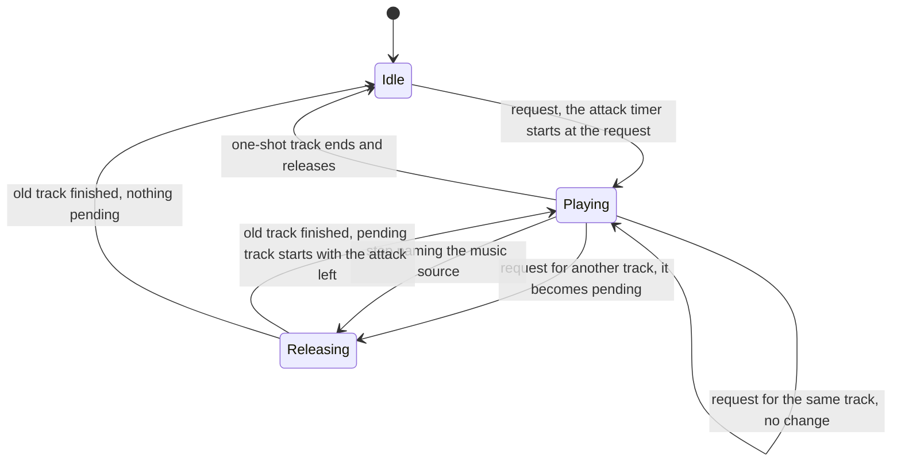

# Audio design: music hooks and the sound-design brief

> Status: Reference · Prefix: R-AUD · Related: [Folder index](README.md) · [Event catalogue](event_catalogue.md) · [Positional, priorities and mix](positional_priorities_and_mix.md) · [assets/GameAssets.md](../../assets/GameAssets.md) · [assets/art_and_audio_briefs.md](../../assets/art_and_audio_briefs.md) · [audio engine](../../architecture/components/audio_engine.md)

## 1 Purpose and player experience

The reference game plays **no music** in any session. Its audio engine nevertheless has a music channel, and its sound data names music events; this file records those hooks (**KH-MUSIC**) and the brief for the music that Species commissions new, which the design phase designs (DEC-049). It then gives the sound-design brief: the event set that the Species sound set must cover, the variety it needs, and the acceptance checks of the finished set. Every Species sound and every note of music is authored new (R-AUD-003).

## 2 Rules

### 2.1 Music hooks (KH-MUSIC)

**R-AUD-400** (MUST) **KH-MUSIC.** The reference plays no music at the front end, in the lobby or in a match, and has no victory or defeat cue and no menu music: no rule of a skirmish session raises a music event, the music tracks are not part of the packaged data, and a music request that reached the engine would fail on its missing track. What the player hears instead is the lobby bed at the front end and the altitude-driven match bed in a match ([front end, HUD, voice and ambience](front_end_hud_voice_and_ambience.md) R-AUD-320, R-AUD-323). Music is a missing feature to design, recorded here as hooks only (DEC-049).

**R-AUD-401** (MUST) **Music events.** Music is any event of the `music` source, raised through the object-or-none entry of R-AUD-021, which routes it to the music channel instead of the effect voices. Every music layer of the reference data is two-dimensional, plays one sample and has a level of −5 dB to 0 dB. A `music` event raised through the position entry is not routed to the music channel.

**R-AUD-402** (MUST) **Slots.** The music channel holds exactly one playing track and one pending request. Music never takes an effect voice, is never positioned and never has effects.

**R-AUD-403** (MUST) **Requests and stops.** Requesting the track that is already playing changes nothing. A request for another track releases the playing track over its own release; the new track starts at the first audio update after the old one has finished and fades in over its own attack. A stop that names the `music` source releases the playing track; a stop that names no event of an emitter does not stop music (R-AUD-036). There is no cross-fade overlap, no beat or bar synchronisation and no playlist.

**R-AUD-404** (MUST) **Attack timing.** The attack of a requested track is timed from the request, not from its start, so the fade-in that is left when the track starts is max(0, attack − time waited). In the reference data 14 of the 17 music layers have releases of 3.29 s to 20.71 s and five have attacks of 2.71 s to 5.23 s, so after any release of at least 5.23 s the next track starts at almost full level; a real fade-in happens only from silence, after the one short release of 3.29 s, or after a track with no release. When Species plays music, a track's attack starts when the track starts.

**R-AUD-405** (MUST) **Loops and level.** A looping music layer loops seamlessly; a one-shot music layer plays once and then releases. Music uses the same envelope rules and the master volume, has no volume of its own in the reference, and is never bent by game speed. In Species, music plays on the music bus with its own player volume and its default level `ref.aud.bus.music.level` (R-AUD-221), streamed by a voice pair that cross-fades with sample-accurate timing (ADR-0024, ADR-0025).

**R-AUD-406** (MUST) The reference music events belong to content that the reference library does not include: single-player sequences and their scripts, retro loading screens, a start-up sequence, credits and demonstration pieces. None is reachable in a skirmish session, and none is carried into Species; their tracks, names and envelopes are not reproduced.

### 2.2 Music design brief (new)

**R-AUD-407** (MUST) Species commissions new music. The asset manifest holds the proposed minimum, whose final list, triggers and mix the design phase sets (DEC-049; [GameAssets.md](../../assets/GameAssets.md) §16):

| Asset | Role |
|---|---|
| `music.front_end.theme` | the front-end theme, looping under the menus and the lobby |
| `music.match.bed` | three in-match beds of low intensity that sit under the crowd |
| `music.match.sting_victory` | the victory sting at the end of a match, bound to `match_ui.victory` (R-AUD-307) |
| `music.match.sting_defeat` | the defeat sting at the end of a match, bound to `match_ui.defeat` (R-AUD-307) |

**R-AUD-408** (MUST) The music brief, as option A of DEC-049, is a state-driven score with layers for the front end, the lobby, the match introduction, low and high match intensity (driven by the units in combat near the camera's focus or by the score margin), the last minute, victory, defeat and draw; played on the streamed, two-voice, cross-fading music bus with transitions synchronised to bars, its own player volume, and stings that duck the music. The camera-altitude ambience mix of R-AUD-323 stays alongside it. The character of the music follows [art_and_audio_briefs.md](../../assets/art_and_audio_briefs.md) §15.

**R-AUD-409** (MUST) A music system can attach to these existing moments, each an event or rule of the reference library: the front end built (`match_ui.lobby_bed` starts, R-AUD-321); the front end left (R-AUD-322); the match loop started (`ambience.match_enter`, R-AUD-323); the grace period over (`match_ui.countdown_zero`, R-AUD-304); the one-minute warning (`ref.match.one_minute_warning`, [01 Skirmish rules](../01_skirmish_rules_and_modes/README.md) R-MODE-037); time-up (R-AUD-306); the result declared (`match_ui.game_over`, `match_ui.victory`, `match_ui.defeat`, R-AUD-307); and the match loop left (`ambience.match_exit`, R-AUD-324).

### 2.3 Sound-design brief

**R-AUD-410** (MUST) **Scope.** Every reference sample, sample-group name and ambience design is replaced by new content; what Species keeps is the binding model of [event model and sound data](event_model_and_sound_data.md) and the event set of the [event catalogue](event_catalogue.md) (DEC-027). The sound-event table is written first, with every event present and silent placeholders allowed, so that a missing binding shows in the content build's validator and never as an unnoticed silence (R-AUD-005).

**R-AUD-411** (MUST) **The event set to author** covers these categories; the catalogue gives each event's trigger and layer data, and an event marked DEC-565 stays silent until that decision binds it:

| Category | Events to author | Catalogue |
|---|---|---|
| Worker | spawn chatter (one crowd voice), selection acknowledgement, crowd-order acknowledgement, battle cry, war horn, retreat, pain, death (voice and body), burning scream, carry chant, victory cheer, laser fire, reload click; gate entry and exit (silent) | `worker` |
| Leader | creation (an owner-only two-dimensional voice and a world sound), selection (owner only), waypoint and formation order loops with owner-only acknowledgements, the follow and none order changes (DEC-565), pain, death, gate entry | `leader` |
| Strike team | Trooper chatter (one crowd loop), laser fire, grenade throw (bound, DEC-097), grenade ready, pain, death, gate entry and exit | `trooper` |
| Builder, Collector, Transport | hover and engine loops linked to speed or height, the Transport's start-up sound and order acknowledgement, pain, death, boarding and leaving (DEC-565), Essence orb delivery, selection (DEC-565) | `builder`, `collector`, `transport` |
| Creatures | body loops, attacks, the spider's pounce and footsteps and landing (DEC-565), egg laying, the Crawler's direction chirp, pain, death, panic and growth (DEC-565), the Seed Pod's launch, bounce and burst, the Abductor's engine layers and tractor beam | `crawler`, `brood_drifter`, `centipede`, `spider`, `ant`, `reaper_serpent`, `seed_pod`, `abductor` |
| Weapons | laser-bolt fire, structure hit and kill (bound, DEC-564) and the hit bark; grenade throw, bounce, fuse blink and explosion; rocket launch, flight loop and explosion; the Bomber's engine and bomb drop; the airstrike bomb's fuse blink and explosion; the barrage missile's flight and its near and far explosion; the meteor's fall and its near and far landing | `laser_bolt`, `grenade`, `rocket`, `bomber`, `airstrike_bomb`, `barrage_missile`, `meteor` |
| Structures | turret creation, gun and flame fire, kill tick, target acquired and rocket fire (DEC-565); Barrier Emitter hum, spark, damage and electrocution (DEC-565); Beam Dish rotation start and stop, link and link lost; Spawn Node activation and deactivation; tree presence loops (ordinary, essence, blight speech), creation and burning; Solar Array and grid pylon surges and the charging loop; Control Zone hum; Command Console hum; Relic appearance, owner change (own, enemy, no team), drop, lift and carry (DEC-565); Core Device loop; Transit Gate coming online (DEC-565); Hive damage and explosion; Spitter Plant damage, burning and launch (DEC-565) | §2.6 of the catalogue |
| Supply crates | fall, landing, capture start (own, enemy and a bed), progress tones for 0 to 80 % rising and falling, opening, capture lost, expiry (DEC-565), and one sting for each of the 25 outcomes that raise one | `supply_crate`, `crate_outcome` |
| Launch Race | refuelling bed (silent), needs-fuel, fuelled, malfunction and flight loops, engine burn, damage, explosion, fuel-pump strokes, fuel flow, passenger boarding | `launch_vessel`, `fuel_pump`, `fuel_line`, `fuel_depot` |
| Match flow | countdown tick, countdown zero, match-clock ticks, time-up, game over, victory, defeat | `match_ui` |
| Interface | menu hover, select and back; chat; selection-circle sweep and drone; unit select; state toggle; invalid action; unit highlight; Power-slot hover and discard; Power input begin and confirm; Power select, selection set and cleared, and the crowd order (DEC-565) | `match_ui`, `power_slots`, `power_input` |
| Ambience | the front-end generative bed; the match bed with its altitude crossfade | `match_ui.lobby_bed`, `ambience.match_enter` |

**R-AUD-412** (MUST) **Variety.** The reference set plays about 900 files for its 182 bound events, about five variants per event and up to 37 for the Worker battle cries; the asset manifest keeps each group's reference variant count. A first playable needs one file per group; a finished set needs about 3 to 8 variants for barks and impacts and 1 to 2 for stings and interface sounds.

**R-AUD-413** (MUST) The Resolved bindings that the reference leaves silent need new groups that the asset manifest does not yet hold: the laser-bolt fire, structure-hit and kill sounds (DEC-564), the Trooper grenade throw (DEC-097) and the game-over announcement (DEC-097); until they exist, the content build plays its placeholder for them. The victory and defeat stings exist (R-AUD-407), and the progress tones of the crate drain reuse the progress groups (R-AUD-031).

## 3 States and flows

Diagram 3-A: the reference music channel, recorded as a hook (R-AUD-401 to R-AUD-405, KH-MUSIC).

## 4 Tuning table

This file defines no tuning keys of its own.

Keys cited here and defined elsewhere: `ref.aud.bus.music.level` in [positional, priorities and mix](positional_priorities_and_mix.md); `ref.match.one_minute_warning` in [01 Skirmish rules and modes](../01_skirmish_rules_and_modes/README.md).

## 5 Edge cases and interactions

- **Music and stops.** A stop of all of an emitter's sounds never stops music, so leaving a match does not stop a music track unless a rule names the `music` source (R-AUD-403); a Species music system names it explicitly at the moments of R-AUD-409.
- **Music and voices.** Music never competes with effects for voices in the reference (R-AUD-402) and has its own two voices in the Species budget (DEC-570).
- **Match-end stings without music.** The victory and defeat stings are bound to match events, not to the music system, so they play whatever DEC-049 decides about the score (R-AUD-307).

## 6 Acceptance criteria

The acceptance checks of the Species sound set:

- **AC-BRF-01** (R-AUD-410, R-AUD-411) Given the Species sound-event table, when the validator runs, then every event of the [event catalogue](event_catalogue.md) is present, every bound event names an existing group or a placeholder, and the report is empty except for the silent events that DEC-565 keeps silent.
- **AC-BRF-02** (R-AUD-413, R-AUD-307) Given a match played to its end with Supply crates drained, Trooper grenades thrown and Workers firing at structures, then the match end, the crate drain, the grenade throw and the laser fire, structure hits and kills are all audible.
- **AC-BRF-03** (R-AUD-043) Given a match left at any moment, then every sound of the match has stopped or started its release within 2 s.
- **AC-BRF-04** (R-AUD-218, R-AUD-221) Given a stress scene of 500 units and 30 explosions in 1 s, then no interface sound and no sting is lost, and no kind of one-shot sound disappears entirely.
- **AC-BRF-05** (R-AUD-001) Given the same match with audio on and off, then the simulation states are equal at every tick; the only differences between participants are presentation (friend and foe variants, camera-dependent selection).
- **AC-BRF-06** (R-AUD-400, R-AUD-401) Given a reference skirmish session from start-up to leaving a match, then no music event reaches the music channel; given a Species music event raised through the object-or-none entry, then it plays on the music bus and not on an effect voice.
- **AC-BRF-07** (R-AUD-404) Given track B requested while track A releases over 10 s, with B's attack 5 s, then under the reference rule B starts at full level, and under the Species rule B fades in over 5 s from its start.

## 7 Dependencies

- **Reference documents:** [event catalogue](event_catalogue.md) (the event set); [event model and sound data](event_model_and_sound_data.md) (entry kinds, stops, the validator); [positional, priorities and mix](positional_priorities_and_mix.md) (the music bus); [front end, HUD, voice and ambience](front_end_hud_voice_and_ambience.md) (beds, match end); [01 Skirmish rules and modes](../01_skirmish_rules_and_modes/README.md) (the one-minute warning).
- **Engine components:** [audio engine](../../architecture/components/audio_engine.md) (the music path of ADR-0024; streaming of ADR-0025).
- **Assets:** `music.front_end.theme`, `music.match.bed`, `music.match.sting_victory`, `music.match.sting_defeat`; [assets/art_and_audio_briefs.md](../../assets/art_and_audio_briefs.md) §12 to §15 (the style of the sound set and the music). Groups requested and not yet in the manifest: the laser-bolt fire, structure-hit and kill sounds, the Trooper grenade throw and the game-over announcement (R-AUD-413).

## 8 Open decisions

Each default is the behaviour that §2 specifies.

- DEC-049 — music: no music plays; the hooks and the brief of §2.1 and §2.2 (R-AUD-400, R-AUD-407, R-AUD-408).
- DEC-565 — sounds for the other silent gameplay events: the events of the brief marked DEC-565 stay silent until it binds them (R-AUD-411).
