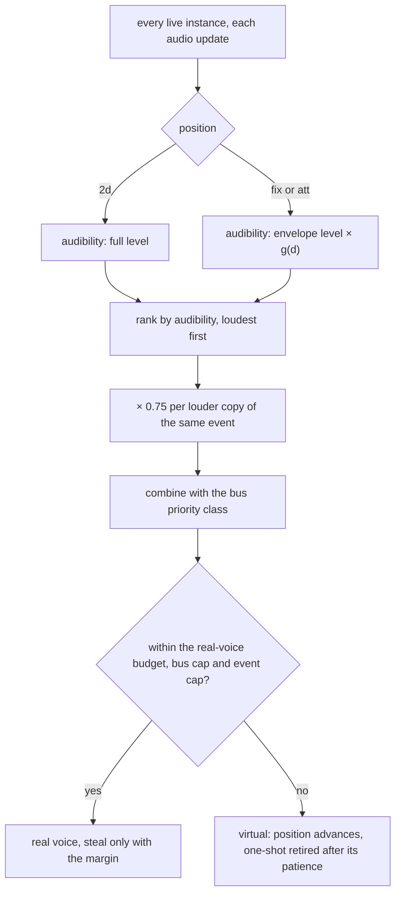
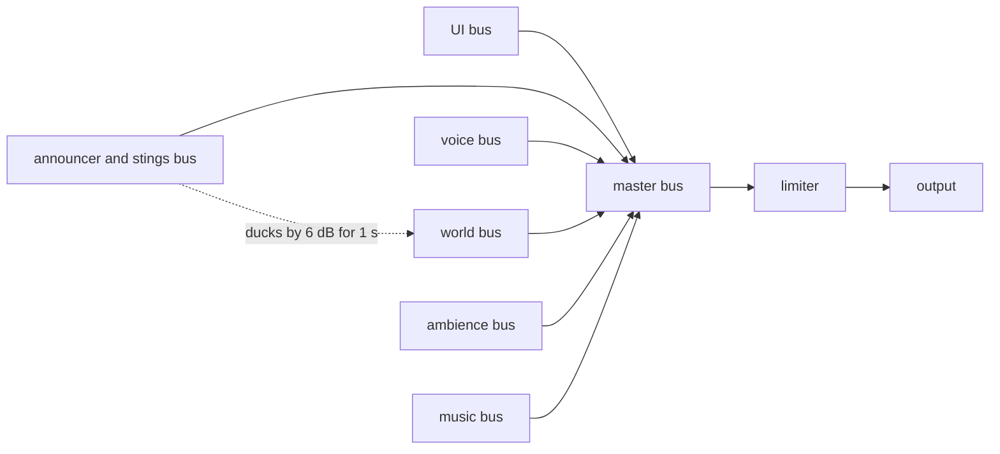

# Audio design: positional rules, priorities and the mix

> Status: Reference · Prefix: R-AUD · Related: [Folder index](README.md) · [Event model and sound data](event_model_and_sound_data.md) · [Event catalogue](event_catalogue.md) · [06 camera](../06_controls_camera_and_commands/README.md) · [09 options](../09_front_end_and_match_flow/options_localisation_and_hooks.md) · [12 tick timing](../12_simulation_model/01_tick_timing_and_main_loop.md) · [audio engine](../../architecture/components/audio_engine/README.md)

## 1 Purpose and player experience

A reference match is heard from the camera. A sound plays at full level within its minimum distance and falls off with distance beyond it, so an overview camera high above the battlefield hears the battle quietly and the altitude-driven ambience loudly, and zooming in is how the player hears detail. Crowds of identical sounds thin themselves out: copies of one event rank lower the more of them play, and the crowd voices of Workers play from one emitter only. Game speed bends the pitch of the world, most audibly as the world slows to a halt at the end of a match. This file specifies these rules and the Species mix that replaces the reference's single volume: six buses with their own levels and priority classes (DEC-570).

## 2 Rules

### 2.1 Listener

**R-AUD-200** (MUST) The listener is the game camera, updated at every audio update: its position is the camera's position, its orientation the camera's front and up vectors. There is no separate listening point on the ground, so a high camera hears every sound at the camera's distance. This is the reference default of DEC-566. The swap-left-and-right setting exchanges the left and right channels of every positioned sound ([09 options](../09_front_end_and_match_flow/options_localisation_and_hooks.md) R-META-435).

**R-AUD-201** (MUST) The listener applies no Doppler shift, and no sound has a cone, occlusion, obstruction, air absorption, distance low-pass filtering or a distance-dependent reverb send (DEC-566). The audio engine's per-event Doppler, filter and send factors default to off, which keeps this mix (ADR-027).

### 2.2 Distance attenuation

**R-AUD-202** (MUST) The gain of a positioned instance follows the inverse-distance law, with d the three-dimensional distance in wu between the emitter and the listener and md the layer's minimum distance:

```
g(d) = 1           when d ≤ md
     = md ÷ d      when d > md        (−6.02 dB per doubling of distance)
heard level (dB) = envelope level (dB) + 20 × log10 g(d) + bus and master gains (dB)
```

The roll-off is 1, and the design data sets no maximum distance (DEC-566). The same g(d) feeds the instance's audibility for ranking (R-AUD-215). Where the audio engine applies its maximum distance (ADR-027), every event leaves it at the engine's global default.

**R-AUD-203** (MUST) The law gives these attenuations relative to full level:

| d (wu) | md 50 | md 100 | md 200 | md 500 |
|---|---|---|---|---|
| 50 | 0.0 dB | 0.0 dB | 0.0 dB | 0.0 dB |
| 100 | −6.0 dB | 0.0 dB | 0.0 dB | 0.0 dB |
| 200 | −12.0 dB | −6.0 dB | 0.0 dB | 0.0 dB |
| 316 | −16.0 dB | −10.0 dB | −4.0 dB | 0.0 dB |
| 500 | −20.0 dB | −14.0 dB | −8.0 dB | 0.0 dB |
| 1000 | −26.0 dB | −20.0 dB | −14.0 dB | −6.0 dB |
| 2000 | −32.0 dB | −26.0 dB | −20.0 dB | −12.0 dB |

**R-AUD-204** (MUST) The minimum distance is the designer's "how big is this sound" control: a large source such as an aircraft has a large minimum distance and a tiny one such as an insect a small one, and a quiet but large source, such as a waterfall, combines a low level with a large minimum distance. The event set uses 5.98 wu to 10000 wu (R-AUD-075), and its linked values imply camera altitudes up to about 1000 wu.

### 2.3 Panning

**R-AUD-205** (MUST) Stereo output uses a constant-power pan. With x = ((emitter − camera) ÷ |emitter − camera|) · listenerRight, in [−1, 1], where listenerRight comes from the camera's front and up vectors and is reversed by the swap-left-and-right setting, and p = (x + 1) ÷ 2: left = cos(p × π ÷ 2) and right = sin(p × π ÷ 2), applied on top of the distance gain. A centred source is −3 dB on each side. A two-dimensional instance takes the centred value, so a two-dimensional instance and a centred positioned instance of the same level within their minimum distance are equally loud (ADR-027).

**R-AUD-206** (MUST) The reference output is stereo, with no stereo-width control and no surround output. Other channel layouts and the system spatial-sound format are the audio engine's (ADR-027); they carry the same distance gain.

### 2.4 Position kinds and sound lifetime

**R-AUD-207** (MUST) The three position kinds behave as follows:

| Position | Where it sounds | Lifetime | Game-speed bend | Audibility for ranking | Use in the event set |
|---|---|---|---|---|---|
| `2d` | at the listener: centred, not attenuated; the minimum distance has no effect | until it ends or is stopped | never (R-AUD-211) | full level | interface sounds, stings, ambience, owner-only voices (53 layers) |
| `fix` | fixed at the position where it was raised | outlives its emitter; stoppable by its emitter (R-AUD-038) | yes | level × g(d) | deaths, explosions, impacts, landings (31 layers) |
| `att` | follows its emitter at every audio update; a structure's attached sounds follow its centre position | ends with its emitter (R-AUD-209) | yes | level × g(d) | loops, bodies, voices and most one-shots (133 layers) |

**R-AUD-208** (MUST) Every real positioned voice is recalculated at every audio update, whatever its movement (ADR-027).

**R-AUD-209** (MUST) **Removal of an emitter.** An attached instance stops at once, without its release, on the first audio update after its emitter has left the match world, or when no emitter of a shared instance can be chosen (R-AUD-213). This is the reference default of DEC-321; a graceful path, in which the instance becomes world-fixed at the emitter's last position and plays its release, exists but almost never runs. Attached deaths (R-AUD-069) are therefore cut on the first audio update after their actor is deleted, and every vehicle and creature loop ends with a hard cut.

### 2.5 Height and altitude

**R-AUD-210** (MUST) Height affects a sound only through linked values (R-AUD-052): `height` for flyer pitch and loop delays, `altitude` for the camera-altitude ambience, which therefore acts as a zoom-dependent mix, and `camera_distance` for the near and far layers of `meteor.land`. There is no automatic filtering by altitude.

### 2.6 Game-speed pitch bend

**R-AUD-211** (MUST) While a match runs after its grace period, the pitch of every positioned instance is multiplied by √max(s, `ref.aud.pitch_bend.speed_floor`), where s is the smoothed game speed, so the bend never goes below 0.1×. Two-dimensional instances, the interface and announcer stings are never bent; the bend is an effect of the world buses, the voice and world buses of R-AUD-221 (DEC-569). The smoothed game speed belongs to the match: it is 1.0 outside a match and throughout the grace period, starts every match at 1.0, and is discarded when the match ends. It follows elapsed audio time with one time constant, an audio engine tuning value whose starting value is DEC-751's, and its speed never depends on how many sounds are playing (DEC-751, ADR-026).

**R-AUD-212** (MUST) The bend makes these moments audible: the Time Dilation and Time Rush outcomes and the slow motion of a meteor shower bend the world by √(game speed) ([12 tick timing](../12_simulation_model/01_tick_timing_and_main_loop.md) R-SIM-545); at match end, game speed is driven to 0, so the world's sounds fall towards 0.1× pitch like a tape slowing down, while the ambience, the interface and the stings keep their pitch. Keeping this drop is the default of DEC-320.

### 2.7 Crowd sounds

**R-AUD-213** (MUST) A shared-nearest instance follows, at every audio update, the emitter of its emitter set nearest the camera, but only an emitter within `ref.aud.crowd.nearest_radius` (316.2 wu) of the camera can be chosen. When no emitter is that close as the instance is first updated, it has no emitter, counts as an attached instance whose emitter is gone (R-AUD-209) and is removed in the same update. A shared-random instance has no such radius. The radius is the default of the crowd priority class (DEC-109, DEC-097).

**R-AUD-214** (MUST) The affected layers are `worker.spawn`, the reload layer of `worker.attack` and `launch_vessel.hungry` (R-AUD-071). The Worker spawn chatter and the reload click are therefore heard only while the camera is within about 316 wu of a spawning or firing Worker; at strategic camera heights they are silent, which keeps the mix of a large battle clear.

### 2.8 Priorities and voices

**R-AUD-215** (MUST) **Audibility.** At every audio update each live instance has an audibility: full level for a two-dimensional instance; otherwise base × g(d), where base is the instance's current envelope level once it has played, that is once it has ever had a voice, including while it is kept virtual after losing its voice (R-AUD-218), and its level target while it has never had a voice ([audio engine](../../architecture/components/audio_engine/README.md) AEN-140). A playing instance in a long release tail therefore ranks lower as it fades (R-AUD-074). In the reference allocation (R-AUD-219) an instance that loses its voice is removed or restarts from its beginning, so there the two cases are an instance with a voice and an instance waiting for one.

**R-AUD-216** (MUST) **Copies of one event.** The instances are ranked by audibility, loudest first, and each further instance of the same full event id is multiplied by `ref.aud.rank.copy_decay` (0.75) once per louder copy: priority = audibility × 0.75^k, with k the number of louder instances of the same event in this update (1, 0.75, 0.5625, 0.421875 for the first four). Copies of one event therefore limit themselves as a group without a hard cap.

**R-AUD-217** (MUST) **Authored priority.** Each event's authored priority is its bus's priority class (R-AUD-221); an instance's ranking score combines that class with its priority of R-AUD-216, and voices go to the best-ranked instances within the real-voice budget, the per-bus and the per-event caps that the audio engine sets from the starting values of DEC-570 (ADR-023).

**R-AUD-218** (MUST) **Voice taking.** A waiting instance takes the voice of the lowest-ranked playing instance only when it outranks it by the steal margin of DEC-570; an instance that does not win a voice is kept virtual, not dropped, and a virtual loop keeps advancing its play position so that it resumes in time. Any number of instances may start in one update, and each trigger carries its time, so start latency is not quantised to the audio update (DEC-570, ADR-023).

**R-AUD-219** (MUST) **The reference allocation**, which R-AUD-217 and R-AUD-218 replace, is recorded for balancing the reference set: the voice setting N gives N − `ref.aud.reference.music_voices` effect voices and one music voice, at most `ref.aud.reference.max_voices` (64) in all, so 31 effect voices at the default setting ([09 options](../09_front_end_and_match_flow/options_localisation_and_hooks.md) R-META-432); waiting requests are unlimited; at most `ref.aud.reference.starts_per_update` (1) voice starts per audio update, 20 per second; the candidate is the best-ranked waiting instance with a priority above 0; it takes the first free voice, or else the voice of the lowest-ranked occupant (the lowest voice index on a tie) with no comparison of priorities; a one-shot that loses its voice is removed, and a loop that loses it waits and restarts from its beginning, or with a new group member, when it wins a voice again; a waiting loop can win back the voice it lost at the next update. A two-dimensional instance ranks at the maximum and out-ranks every positioned instance below full level at any distance.

**R-AUD-220** (MUST) **Per-event limiting.** The data limits an event by its copy ranking (R-AUD-216), by shared voices (R-AUD-029) and by its number of layers; the reference data has no per-event cap, no maximum instance count and no cool-down. Species adds per-event caps in the audio engine (DEC-570) and per-event cool-downs as event data, which replace the fixed rate limits of game code; the reference values of those limits are owned by the documents of the rules that raise the events:

| Event | Limit | Key |
|---|---|---|
| `match_ui.unit_select` | at most one per interval of real time | `ref.ctrl.select.sound_interval` (0.5 s), [06 selection](../06_controls_camera_and_commands/selection_and_power_slots.md) |
| `match_ui.unit_highlight` | at most one per interval of real time | `ref.ctrl.cursor.highlight_sound_interval` (0.2 s), [06 cursor](../06_controls_camera_and_commands/cursor_and_markers.md) |
| `worker.attack_horn` | a presentation chance of 1 in `ref.unit.worker.horn_odds` (200) per threat check, at most one per cool-down shared by every Worker | `ref.unit.worker.horn_cooldown` (40 ticks, 4 s of game time), [02 Worker](../02_units/worker.md) |
| `worker.burning` | a presentation chance per tick while burning | `ref.unit.worker.burning_sound_odds` (1 in 30), [02 Worker](../02_units/worker.md) |
| `match_ui.countdown_tick` | once per displayed number or mode second | [front end, HUD, voice and ambience](front_end_hud_voice_and_ambience.md) R-AUD-303 to R-AUD-305 |

### 2.9 Buses and routing

**R-AUD-221** (MUST) The Species mix has six buses under the master bus, each with its own player volume ([09 options](../09_front_end_and_match_flow/options_localisation_and_hooks.md) R-META-434) (DEC-570):

| Bus | Contents | Default level | Priority class |
|---|---|---|---|
| UI | interface sounds | `ref.aud.bus.ui.level` (0 dB) | highest; never stolen |
| announcer and stings | Supply crate outcome stings, Control Zone, Relic and Spawn Node stings, crate capture stings, match flow | `ref.aud.bus.announcer.level` (0 dB); each sting ducks the world bus by `ref.aud.bus.announcer.duck_world_db` (−6 dB) for `ref.aud.bus.announcer.duck_time` (1 s) | high |
| voice | unit barks | `ref.aud.bus.voice.level` (−3 dB) | medium |
| world | weapons, impacts, structures, creatures, vehicles | `ref.aud.bus.world.level` (−3 dB) | by loudness at the listener |
| ambience | ambience beds | `ref.aud.bus.ambience.level` (−10 dB) | low, but never stolen by world sounds |
| music | the music hooks ([music hooks and brief](music_hooks_and_sound_design_brief.md)) | `ref.aud.bus.music.level` (−6 dB) | separate |

The buses are submix buses of the audio engine's data-defined bus graph, which feeds a limiter before the output (ADR-024).

**R-AUD-222** (MUST) Every event names its bus. The default routing is:

| Bus | Events |
|---|---|
| UI | every `match_ui` event except `match_ui.lobby_bed`, `match_ui.game_over`, `match_ui.victory` and `match_ui.defeat`; every `power_slots` and `power_input` event |
| announcer and stings | every `crate_outcome` event; the own and enemy layers of `supply_crate.capture_begin`; `supply_crate.captured` and `supply_crate.capture_lost`; `control_zone.owner_changed` and `control_zone.relic_scored`; `relic.owner_changed`; `spawn_node.activate` and `spawn_node.deactivate`; `match_ui.game_over`, `match_ui.victory` and `match_ui.defeat` |
| voice | `worker.spawn`, `worker.hurt`, `worker.die`, `worker.selected`, `worker.ordered`, `worker.ordered_by_player`, `worker.attack_bark`, `worker.attack_horn`, `worker.flee_bark`, `worker.victory_jump`, `worker.burning`, `worker.lift_relic`; every `leader` event except `leader.enter_gate`; `trooper.spawn`, `trooper.hurt`, `trooper.die`; `laser_bolt.hurt_actor` |
| ambience | `ambience.match_enter`, `match_ui.lobby_bed` |
| music | every `music` event |
| world | every other event and layer |

**R-AUD-223** (MUST) Announcer stings that the reference attaches to their structure (the Control Zone owner stings, the Spawn Node stings, the crate capture stings) keep their position and distance gain on the announcer bus; as announcer stings they are not bent by game speed (R-AUD-211).

### 2.10 Volume law and the master volume

**R-AUD-224** (MUST) Levels, envelopes and bus gains are in dB (R-AUD-004). An envelope ramp is linear in dB.

**R-AUD-225** (MUST) **Master volume.** The master control has the steps 0 to `ref.meta.options.sound.volume_max` (255) of [09 options](../09_front_end_and_match_flow/options_localisation_and_hooks.md) R-META-433; each step below the maximum attenuates every sound and the music by `ref.aud.mix.master_step_db` (0.32 dB), so step 0 is −81.6 dB. A change applies at once, to every playing sound at its next audio update. No gain stage goes below `ref.aud.mix.floor_db` (−100 dB). Each bus volume of R-AUD-221 follows the same law on its bus.

**R-AUD-226** (MUST) The voice-count, mixing-rate and output settings of [09 options](../09_front_end_and_match_flow/options_localisation_and_hooks.md) R-META-430 to R-META-432 configure the audio engine; their effect on running sounds when they are applied is the engine's (R-META-437).

### 2.11 The reference mix

**R-AUD-227** (MUST) The authored level range is narrow (R-AUD-075), so the match mix is dominated by distance and by the two-dimensional layer. The lobby and match ambience beds are authored at −10 dB to −2 dB and are always present. Because the match ambience follows the camera's altitude, a zoomed-out camera hears louder wind and white noise while positioned combat grows quieter: the strategic view has its own mix by design ([front end, HUD, voice and ambience](front_end_hud_voice_and_ambience.md) R-AUD-323).

## 3 States and flows



Diagram 3-A: ranking and voices (R-AUD-215 to R-AUD-218).



Diagram 3-B: the Species buses (R-AUD-221); the pitch bend acts on the voice and world buses only (R-AUD-211).

## 4 Tuning table

| key | value | unit | range or notes | requirement | DEC |
|---|---|---|---|---|---|
| `ref.aud.pitch_bend.speed_floor` | 0.01 | game speed | pitch floor √0.01 = 0.1× | R-AUD-211 | DEC-569, DEC-751 |
| `ref.aud.crowd.nearest_radius` | 316.2 | wu | √99999.9; the crowd class radius | R-AUD-213 | DEC-109 |
| `ref.aud.rank.copy_decay` | 0.75 | × per louder copy | the reference copy decay; the starting value of the engine's factor (ADR-023) | R-AUD-216 | DEC-570 |
| `ref.aud.reference.music_voices` | 1 | voices | reserved for music in the reference allocation | R-AUD-219 | DEC-570 |
| `ref.aud.reference.max_voices` | 64 | voices | the reference cap of the voice setting | R-AUD-219 | DEC-570 |
| `ref.aud.reference.starts_per_update` | 1 | voice starts per audio update | 20 per second in the reference; Species has no quota | R-AUD-219 | DEC-570 |
| `ref.aud.bus.ui.level` | 0 | dB | | R-AUD-221 | DEC-570 |
| `ref.aud.bus.announcer.level` | 0 | dB | | R-AUD-221 | DEC-570 |
| `ref.aud.bus.announcer.duck_world_db` | −6 | dB | applied to the world bus | R-AUD-221 | DEC-570 |
| `ref.aud.bus.announcer.duck_time` | 1 | s of audio time | | R-AUD-221 | DEC-570 |
| `ref.aud.bus.voice.level` | −3 | dB | | R-AUD-221 | DEC-570 |
| `ref.aud.bus.world.level` | −3 | dB | | R-AUD-221 | DEC-570 |
| `ref.aud.bus.ambience.level` | −10 | dB | | R-AUD-221 | DEC-570 |
| `ref.aud.bus.music.level` | −6 | dB | | R-AUD-221 | DEC-570 |
| `ref.aud.mix.master_step_db` | 0.32 | dB per step | 255 steps; step 0 = −81.6 dB | R-AUD-225 | — |
| `ref.aud.mix.floor_db` | −100 | dB | | R-AUD-225 | — |

Keys cited here and defined elsewhere: `ref.meta.options.sound.volume_max` in [09 options](../09_front_end_and_match_flow/options_localisation_and_hooks.md); `ref.ctrl.select.sound_interval` and `ref.ctrl.cursor.highlight_sound_interval` in [06](../06_controls_camera_and_commands/README.md); `ref.unit.worker.horn_odds`, `ref.unit.worker.horn_cooldown` and `ref.unit.worker.burning_sound_odds` in [02 Worker](../02_units/worker.md). The real-voice budget, the per-bus and per-event caps, the steal margin and the time constant of the pitch-bend smoothing are audio engine tuning values with the starting values of DEC-570 and DEC-751 ([audio engine](../../architecture/components/audio_engine/README.md)).

## 5 Edge cases and interactions

- **Reference mix structure.** The reference has one gain stage above the voices, the master volume, applied to every voice and to music. It has no music, effects, voice or interface volumes, no buses, no ducking or side-chaining, no snapshots, no mode that highlights one event, no loudness normalisation and no limiter. Its only group-like mechanisms are implicit: the two-dimensional position acts as an interface, sting and ambience layer (unattenuated, unbent, top-ranked); the audience filter acts as an owner-only or enemy-only variant; the copy decay acts as a soft per-event voice budget; shared voices act as one voice per crowd; the music channel acts as a music bus with no volume of its own; and the altitude-linked ambience acts as a zoom-dependent mix. The buses of R-AUD-221 replace this structure (DEC-570).
- **Reference pitch smoothing.** In the reference, the smoothed game speed moves 1 % of the way to the current game speed on every pitch evaluation of a playing positioned sound and on every voice start, and is never reset; its time constant is about 0.17 s with 30 positioned sounds playing and about 5 s with one, and a match can begin near 0.1× after the slow-down of the previous match end. DEC-751 replaces it with R-AUD-211.
- **Dense fights.** Under the reference allocation (R-AUD-219), a burst of 30 explosions takes 1.5 s to start and most one-shots expire unheard; interface sounds and stings always win and can evict combat voices. Under DEC-570 the interface and stings have their own budgets and the world bus ranks by loudness, so no kind of one-shot disappears.
- **Shared-nearest at the radius edge.** A shared-nearest instance whose nearest emitter moves beyond 316.2 wu while it plays loses its emitter and is cut (R-AUD-209, R-AUD-213).
- **High camera.** At about 1000 wu of altitude, a sound of minimum distance 100 wu directly below is 20 dB down, while the white-noise ambience layer is at its highest level; a player hears the battle by zooming in. DEC-566 records a ground focus point as the alternative.
- **Swap left and right.** The setting reverses listenerRight in R-AUD-205; it has no effect on two-dimensional instances, which are centred.

## 6 Acceptance criteria

- **AC-POS-01** (R-AUD-202, R-AUD-203) Given a layer of minimum distance 100 wu at 50, 100, 200, 316, 500, 1000 and 2000 wu, then its distance gains are 0, 0, −6.0, −10.0, −14.0, −20.0 and −26.0 dB, within 0.05 dB.
- **AC-POS-02** (R-AUD-205) Given a source straight ahead, then left and right are both −3.0 dB; given a source fully to the right, then left is silent and right 0 dB; with swap left and right on, then the sides are exchanged; a two-dimensional instance is −3.0 dB on each side.
- **AC-POS-03** (R-AUD-209) Given an actor with an attached loop removed from the match world, then the loop's voice stops at the next audio update without a release, under the default of DEC-321.
- **AC-POS-04** (R-AUD-211) Given game speed 0.25 held after the grace period, then a positioned instance plays at 0.5× pitch once the smoothing has settled, and a two-dimensional instance at 1.0×; given game speed 0, then positioned instances settle at 0.1×; given the next match, then its first positioned instance plays at 1.0×.
- **AC-POS-05** (R-AUD-213) Given 100 spawning Workers all 400 wu from the camera, then `worker.spawn` is not heard; given one of them 300 wu from the camera, then it is heard from that Worker.
- **AC-POS-06** (R-AUD-216) Given four instances of one event at equal audibility a, then their priorities are a, 0.75a, 0.5625a and 0.421875a.
- **AC-POS-07** (R-AUD-218, R-AUD-221) Given a battle that triggers 30 explosions in 1 s, then every interface sound and every sting triggered meanwhile plays, every explosion becomes real or virtual at the first audio update after its trigger time with the loudest ones real, and no waiting loop restarts from its beginning when it gets its voice back.
- **AC-POS-08** (R-AUD-221) Given an outcome sting, then the world bus is 6 dB lower for 1 s; the voice, ambience and interface buses are unchanged.
- **AC-POS-09** (R-AUD-225) Given master steps 255, 128 and 0, then the master gain is 0 dB, −40.64 dB and −81.6 dB, and the change is heard at the next audio update.

## 7 Dependencies

- **Reference documents:** [event model and sound data](event_model_and_sound_data.md) (position kinds, sharing, levels); [event catalogue](event_catalogue.md) (the per-layer data); [front end, HUD, voice and ambience](front_end_hud_voice_and_ambience.md) (the countdown schedule, the altitude-driven beds); [06 Controls, camera and commands](../06_controls_camera_and_commands/README.md) (the camera, the selection and highlight rate limits); [02 Worker](../02_units/worker.md) (horn and burning odds); [09 options](../09_front_end_and_match_flow/options_localisation_and_hooks.md) (master and bus volumes, swap left and right, voice count); [12 tick timing](../12_simulation_model/01_tick_timing_and_main_loop.md) (game speed).
- **Engine components:** [audio engine](../../architecture/components/audio_engine/README.md) (ADR-023 virtual voices and stealing, ADR-024 buses and the limiter, ADR-026 control rate, ADR-027 spatialisation).
- **Assets:** none directly; the layers that use these rules cite their groups in the [event catalogue](event_catalogue.md).

## 8 Open decisions

Each default is the behaviour that §2 specifies.

- DEC-109 — crowd-sound audibility radius (R-AUD-213).
- DEC-320 — match-end pitch drop (R-AUD-212).
- DEC-321 — attached sounds when their emitter is removed (R-AUD-209).
- DEC-566 — listener position and distance limits (R-AUD-200, R-AUD-201, R-AUD-202).
