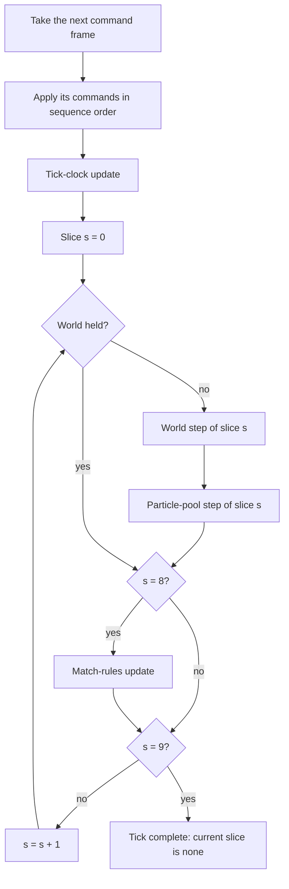
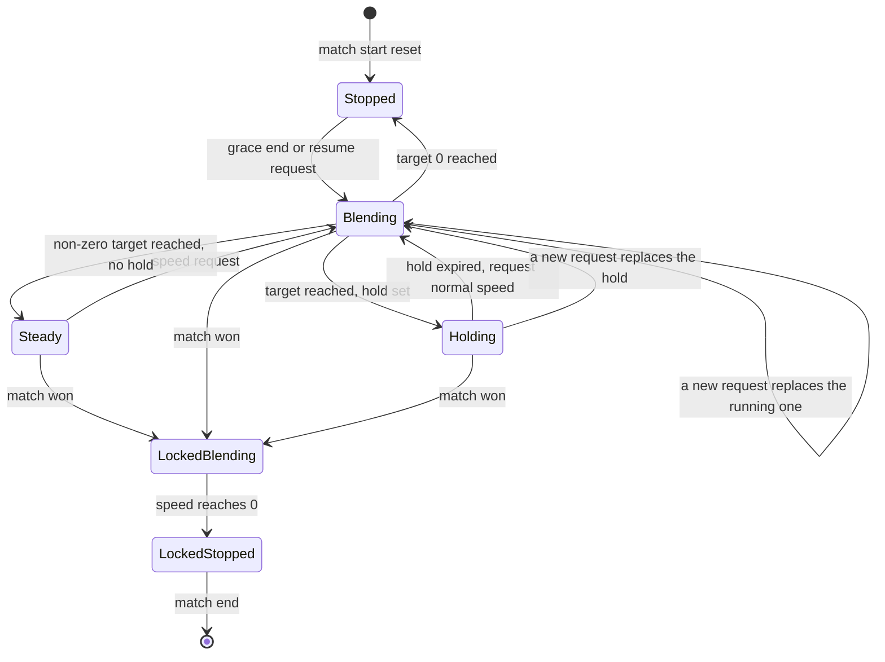
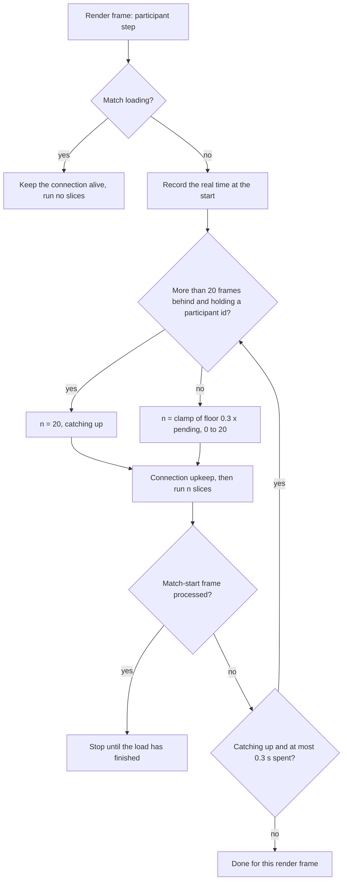
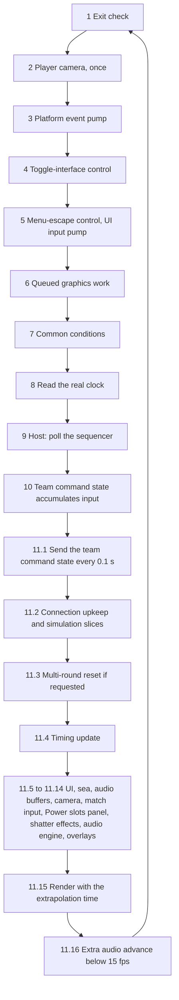
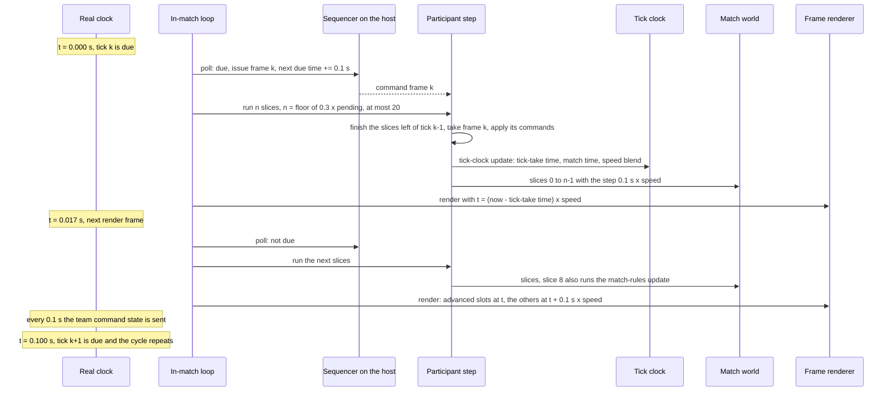

# Tick timing and main loop

> Status: Reference · Prefix: R-SIM · Related: [Simulation model](README.md) · [Match lifecycle and state reset](02_match_lifecycle_and_state_reset.md) · [Containers and update order](04_containers_and_update_order.md) · [Teams and player commands](06_teams_and_player_commands.md) · [Randomness and integrity](07_randomness_and_integrity.md)

## 1 Purpose and player experience

This document holds the **single definition of the reference tick rate** (`ref.sim.tick_period`). Every other document of the reference library states its durations in ticks at this rate and refers to this key; seconds appear elsewhere only as a derived display value.

It also specifies how the reference advances a match in time:

- the tick and its ten update slices, and which work runs in which slice;
- the real-time tick schedule of the reference tick source;
- how a participant spreads the slices of each tick over its render frames, and how it catches up when it falls behind;
- the tick clock: game speed, speed requests, the pause ramp, the start hold and the end-of-match slow-down;
- render-time extrapolation of object positions between ticks;
- the presentation clocks and the render-rate counter;
- the order of work in one in-match frame.

**Player experience.** The world moves in fixed steps of one tenth of a second, yet motion looks continuous, because every object is drawn extrapolated from its last tick; a sudden turn or stop shows as a small snap. Speed effects (Time Dilation, Time Rush and the meteor shower's slow-motion) change the pace of the whole match smoothly over several seconds. Pausing a match against bots takes about two seconds of slow-down, and the end of a match slows the world to a halt. A participant whose computer falls far behind renders at a few frames per second until it has caught up.

**Scope.** The reference process structure (where the tick source runs, which loop polls it, which thread runs the simulation) is described only as far as it decides observable timing. The Species process roles (DEC-220), threading model (DEC-224), frame-loop pacing and catch-up (DEC-225), tick rate (DEC-227), simulation–presentation boundary (DEC-222), numeric model (DEC-240) and networking model (DEC-200, DEC-203) are decided by the design phase. The update order inside a tick is [04](04_containers_and_update_order.md); the integrity rules that every clock and random stream obey are [07](07_randomness_and_integrity.md).

## 2 Rules

### 2.1 The reference tick rate

**R-SIM-500** (MUST) The reference simulation advances in **ticks** of fixed length `ref.sim.tick_period` = 0.1 s of real time. The **reference tick rate** is therefore 1 / `ref.sim.tick_period` = 10 ticks per second. This is the only definition of the reference tick rate in the library; every tick-denominated value of every reference tuning table is a count of these ticks (DEC-227).

**R-SIM-501** (MUST) Every simulation timer, cooldown, lifetime and probability window is an integer number of ticks, or a per-second rate that is converted to ticks when the data loads. No simulation timer is a floating-point countdown (DEC-002).

**R-SIM-502** (MUST) A duration in seconds is a derived display value only: seconds = ticks × `ref.sim.tick_period` at game speed 1. A document that shows seconds shows the tick count beside them.

**R-SIM-503** (MUST) The **mode second** is the named constant `ref.mode.mode_second`, 11 ticks (1.1 s at the reference tick rate), defined in the tuning table of [reference/01](../01_skirmish_rules_and_modes/README.md) (R-MODE-002). Every rule that the match rules state "per second" (the match clock, elimination countdowns, Relic timers, reinforcement waves and rank checks) advances once per mode second, so displayed mode seconds run 10 % slower than real seconds. The mode-second timers start at 0 at match start, so the first mode second ends on the first tick after the grace period. The rules that use the mode second are in reference/01. Its length is kept for the first playable and re-examined in playtest (DEC-002, DEC-003).

**R-SIM-504** (MUST) The reference tick counts in every tuning table are the starting values of Species (DEC-004). A reference behaviour that looks accidental is stated as an explicit rule with a named key, never left implicit (DEC-006). The reference library is the specification of record for these values (DEC-005).

**R-SIM-505** (MUST) The Species tick rate is open (DEC-227), and the reference rate of R-SIM-500 is the default. A change of tick rate rescales every tick-denominated value of every reference tuning table, the mode second included, by one rounding rule that the design phase fixes with that decision.

### 2.2 The tick and its update slices

**R-SIM-510** (MUST) In the reference structure, one tick is one **command frame**: the batch of player commands that the tick source sequences for that tick (R-SIM-549 states how ticks and command frames relate under tick scheduling). Executing a tick performs, in this order:

1. apply every command of the frame, in sequence order (the command catalogue and the batching rules are [06](06_teams_and_player_commands.md));
2. the tick-clock update (§2.5);
3. update slices 0 to `ref.sim.update_slices` − 1, that is, 10 slices numbered 0 to 9 (`UPDATE_SLICES_PER_TICK`).

**R-SIM-511** (MUST) Each update slice *s* runs, in this order:

1. the world step of slice *s* (`MatchWorld`), and then the particle-pool step of slice *s* (`ParticlePool`); both are skipped while the world is held (§2.6);
2. in slice `ref.sim.slice.match_rules` (slice 8, counting from 0) only: the match-rules update (`MatchRules`). It runs also while the world is held, which is how the grace countdown and the end of the start hold run at game speed 0.

**R-SIM-512** (MUST) The world step of a slice runs five sub-steps in this fixed serial order: 0 teams (each team's actors, actor groups and Power slots), 1 weapons (laser bolts and effects), 2 structures, 3 Essence orbs, 4 sky. The sub-steps never run concurrently, and their observable order is this serial order (DEC-224). The order inside each sub-step is [04](04_containers_and_update_order.md).

**R-SIM-513** (MUST) Work that is not spread over the slices runs in one fixed slice of every tick:

| Work | Slice (from 0) | Key |
|---|---|---|
| a team's Power slots update | 1 | `ref.sim.slice.power_slots` |
| map-effect spawners (snow, dust storm, lightning) | 3 | `ref.sim.slice.map_effects` |
| sky offset (cosmetic, no random draw) | 3 | `ref.sim.slice.sky` |
| actor-grid query cache eviction | 7 | `ref.sim.grid_cache.evict_slice`, defined in [05](05_space_routing_and_physics.md) |
| Supply crate drops | 8 | `ref.sim.slice.supply_crates` |
| match-rules update | 8 | `ref.sim.slice.match_rules` |

Teams, weapons, structures and Essence orbs advance one slice share of their sliced pools in every slice (R-SIM-514).

**R-SIM-514** (MUST) A **sliced pool** (`SlicedPool`) of capacity *N* (the number of slots allocated, not the number of live objects) gives slice *s* the slot range from *lower* to *upper*, inclusive, where *lower* = 0 for *s* = 0 and otherwise the slot after the last slot of slice *s* − 1, and *upper* = *N* − 1 for *s* = 9 and otherwise *lower* + ⌊*N* / 10⌋. Slices 0 to 8 therefore each cover ⌊*N* / 10⌋ + 1 slots, and slice 9 covers the remainder, which can be empty. A pool records the last slot it has advanced in the current tick.

**R-SIM-515** (MUST) Every object that exists for the whole of a tick advances exactly once in that tick, with the per-tick step of R-SIM-541. In particular every structure advances exactly once per tick (DEC-117).

**R-SIM-516** (MUST) An object created during a tick advances in that same tick exactly when its slot lies after the last slot its pool has already advanced in the tick; an object placed in an earlier, re-used slot first advances in the next tick. Freed slots are re-used last-freed-first, and new slots are appended in blocks ([04](04_containers_and_update_order.md)). Consequently an object with a countdown per advance (grenade, turret round, fireball, shockwave ring) can start its life one tick early, and an object timed by match time takes one extra movement step before an unchanged deadline: the rocket and the airstrike target marker are such objects. This is the reference default of DEC-455.

### 2.3 The reference tick schedule

**R-SIM-520** (MUST) In the reference, the tick source is a command sequencer that runs in the host's process; this library specifies no networking model (DEC-200). The sequencer issues its first command frame one `ref.sim.tick_period` after it starts, and schedules each further frame one `ref.sim.tick_period` after the previous **scheduled** time, never after the actual issue time.

**R-SIM-521** (MUST) The sequencer is polled once per iteration of whichever loop the host is running: the front-end and lobby loop, the in-match loop of §2.10 and the loading view's loop (the loading view polls it only when it can do so without waiting). A poll issues a command frame only when the current real time is later than the scheduled time, and issues at most `ref.sim.schedule.max_frames_per_poll` (1) frame.

**R-SIM-522** (MUST) The sequencer never skips a tick and never issues two frames in one poll. After a stall it owes frames and issues one per poll until the schedule has caught up; the schedule is never re-anchored to the current time.

**R-SIM-523** (MUST) The effective tick rate is therefore the lower of the reference tick rate and the host's loop rate: a host whose loop runs fewer than 10 iterations per second slows the match for every participant.

**R-SIM-524** (MUST) The schedule does not depend on game speed or on pause. In the reference structure, game speed changes only the game time that each tick adds (R-SIM-541), and pause changes only whether the world step runs (R-SIM-550). The schedule keeps running through the lobby and through every loading view.

**R-SIM-525** (MUST) Where the Species tick source runs, and how it is paced against real time and against a host's frame rate, are decided by DEC-220 and DEC-225; R-SIM-520 to R-SIM-524 describe the reference default.

### 2.4 Slices per render frame and catch-up

**R-SIM-530** (MUST) Each participant executes command frames strictly in sequence order, one tick at a time. It takes the next frame only when every slice of the previous tick has run; between ticks its current slice is "none".

**R-SIM-531** (MUST) Once per render frame, a participant runs *n* update slices, taking a new command frame whenever its current slice is "none" and a frame is available. With *P* the pending slice count, 10 × (the number of the latest frame received − the number of the last frame taken), plus (10 − the current slice) while a tick is part-way through, the slice count is *n* = clamp(⌊`ref.sim.pacing.gain` × *P*⌋, 0, `ref.sim.pacing.max_slices_per_frame`), that is ⌊0.3 × *P*⌋ capped at 20.

**R-SIM-532** (MUST) A participant that holds a participant id and is more than `ref.sim.pacing.catch_up_threshold` (20) frames behind is **catching up**. While catching up it runs `ref.sim.pacing.catch_up_slices` (20) slices per iteration, and it repeats the iteration (connection upkeep, then the slices) inside the same render frame while it is still catching up and the real time spent in this render frame's iterations is at most `ref.sim.pacing.catch_up_budget` (0.3 s). The budget is checked after every iteration.

**R-SIM-533** (MUST) While a match is loading, a participant runs no slices and only keeps its connection alive. When it processes the command frame that starts a match, it stops processing frames at once, and resumes only when the load has finished.

**R-SIM-534** (MUST) In normal play these rules run about 30 % of the backlog per render frame and never more than two ticks' worth. A backlog of 3 slices or fewer gives ⌊0.9⌋ = 0 and is not drained until the next frame arrives, so at 60 frames per second and above the last three slices of every tick (7, 8 and 9, including the match-rules update and the Supply crate drops of slice 8) wait for the next command frame, and each tick completes about one tick period after it arrives.

**R-SIM-535** (MUST) A participant that is catching up spends up to 0.3 s per render frame simulating, so it renders at about 3 frames per second until it has caught up.

**R-SIM-536** (MUST) The Species input delay, display delay and catch-up policy are decided by DEC-203 and DEC-225; R-SIM-530 to R-SIM-535 describe the reference default, in which command latency depends on the participant's render rate (table below).

The steady state of R-SIM-531, with one command frame every 0.1 s, frames arriving on a render-frame boundary and no network latency, is (derived values, not tuning):

| Render rate | Slices run per render frame (share of frames) | Mean backlog at frame start | Mean delay from a frame's arrival to its tenth slice | Maximum delay |
|---|---|---|---|---|
| 15 fps | 5: 33 %, 7: 33 %, 8: 33 % | 23.3 slices | 217 ms | 233 ms |
| 20 fps | 4: 50 %, 6: 50 % | 17.0 slices | 150 ms | 150 ms |
| 30 fps | 2: 33 %, 3: 33 %, 5: 33 % | 12.7 slices | 133 ms | 133 ms |
| 60 fps | 0: 17 %, 1: 33 %, 2: 17 %, 3: 33 % | 7.0 slices | 100 ms | 100 ms |
| 120 fps | 0: 58 %, 1: 17 %, 2: 8 %, 3: 17 % | — | 100 ms | 100 ms |
| 144 fps | 0: 65 %, 1: 14 %, 2: 7 %, 3: 14 % | — | 103 ms | 106 ms |

A frame that arrives between two render frames waits up to one more render frame. The total command latency in the reference is the wait for the next tick (uniform, 0 to 100 ms), plus the network round trip, plus this pacing delay.

### 2.5 The tick clock and game speed

**R-SIM-540** (MUST) The tick clock (`TickClock`) holds the following state. Only the simulation state is read by simulation rules.

| Field | Kind | Meaning |
|---|---|---|
| game speed *s* | simulation | 1 = normal speed, 0 = stopped |
| match time | simulation | game seconds since match start (R-SIM-547) |
| requested speed | simulation | the target of the running speed request, or none |
| blend rate | simulation | the share of the remaining difference that each tick removes (1 = immediate) |
| hold length | simulation | how long the reached target is held before speed returns to normal, or none (hold forever) |
| lock | simulation | while set, speed requests are ignored |
| tick-take time | presentation | the real time at which the current tick's command frame was taken (R-SIM-561) |
| smooth-time accumulator and its last-call time | presentation | R-SIM-570 |

**R-SIM-541** (MUST) The tick-clock update runs once per tick, after the frame's commands have been applied, in this order:

1. record the tick-take time from the real clock;
2. if the world is not held (R-SIM-550): match time += `ref.sim.tick_period` × *s*, using the speed from before this tick's blend;
3. if a speed request is pending: *s* += (requested speed − *s*) × blend rate; then, if |*s* − requested speed| < `ref.sim.speed.snap_threshold` (0.01), *s* = requested speed and the request is cleared, keeping the blend rate;
4. if no request is pending (including one that step 3 has just completed) and a hold length is set: hold length −= `ref.sim.tick_period`; when it reaches 0 or less, the hold is cleared and a request for speed `ref.sim.speed.normal` (1.0) is made at the blend rate of the request that has just ended.

**R-SIM-542** (MUST) A speed request names a target speed, a blend rate and a hold length (or none). While the tick clock is locked, a request is ignored; otherwise it replaces any running request, all three fields together.

**R-SIM-543** (MUST) The match rules lock the tick clock when the match is won (R-SIM-555). The lock is cleared only by the reset at match start (R-SIM-551).

**R-SIM-544** (MUST) The tick clock reports **paused** while *s* < `ref.sim.speed.pause_threshold` (0.01).

**R-SIM-545** (MUST) The reference makes exactly these speed requests (target, blend rate, hold):

| Source | Target | Blend rate | Hold | Rule |
|---|---|---|---|---|
| end of the grace period | `ref.sim.speed.normal` (1.0) | `ref.sim.speed.grace_end_rate` (1.0) | none | R-SIM-552 |
| pause command, pausing | `ref.sim.speed.stopped` (0) | `ref.sim.speed.pause_rate` (0.2) | none | R-SIM-554 |
| pause command, resuming | `ref.sim.speed.normal` (1.0) | `ref.sim.speed.pause_rate` (0.2) | none | R-SIM-554 |
| match won (then lock) | `ref.sim.speed.stopped` (0) | `ref.sim.speed.game_over_rate` (0.2) | none | R-SIM-555 |
| Time Dilation | `ref.sim.speed.time_dilation_min` + a simulation unit-fraction draw × `ref.sim.speed.time_dilation_spread`, that is 0.2 + [0, 0.2) | `ref.sim.speed.crate_rate` (0.05) | `ref.sim.speed.crate_hold` (150 ticks) | R-SIM-556 |
| Time Rush | `ref.sim.speed.time_rush_min` + a simulation unit-fraction draw × `ref.sim.speed.time_rush_spread`, that is 1.3 + [0, 0.7) | `ref.sim.speed.crate_rate` (0.05) | `ref.sim.speed.crate_hold` (150 ticks) | R-SIM-556 |
| meteor near its target | `ref.sim.speed.meteor_target` (0.4) | `ref.sim.speed.meteor_rate` (0.1) | `ref.sim.speed.meteor_hold` (40 ticks) | R-SIM-556 |
| hold expired | `ref.sim.speed.normal` (1.0) | the rate of the ended request | none | R-SIM-541 |

Every request comes from simulation code or from a sequenced command, so it happens at the same tick for every participant.

**R-SIM-546** (MUST) The tick clock's speed, blend and match time are evaluated in the numeric model that DEC-240 decides. The snap and pause thresholds of R-SIM-541 and R-SIM-544 are part of the rules whatever that representation is, and the blend is an exponential approach evaluated once per tick, never per render frame.

**R-SIM-547** (MUST) Simulation time is the tick counter, and no simulation rule reads any other clock (DEC-009). Match time is the number of ticks the world has run since match start × `ref.sim.tick_period`. In the reference structure, where every tick adds `ref.sim.tick_period` × *s* (R-SIM-541 step 2), this is the same match time per unit of real time.

**R-SIM-548** (MUST) Game speed is **tick scheduling** (DEC-039). Every tick has the length `ref.sim.tick_period` and the same arithmetic at every speed; game speed sets how many ticks run per unit of real time, so that over any interval of real time the number of ticks run equals the integral of *s* over the interval divided by `ref.sim.tick_period`, with any fraction carried to the next interval and never dropped. Every per-tick probability, growth and rate, including the hold countdown of R-SIM-541 step 4, therefore scales with game speed (DEC-092).

**R-SIM-549** (MUST) Under tick scheduling, command frames (R-SIM-510), the speed blend (step 3 of R-SIM-541) and the match-rules update while the world is held (R-SIM-511) keep the reference real-time cadence of one per `ref.sim.tick_period` of real time, so that the speed ramps of R-SIM-554 and R-SIM-555 keep their reference real-time lengths and a held match can resume; the hold countdown (step 4 of R-SIM-541) counts the ticks the world runs (R-SIM-548). The ticks of the world step are scheduled within that cadence; the exact scheduling and rounding rule is decided with DEC-225 (see DEC-264).

### 2.6 The held world, the start hold, pause and the end of a match

**R-SIM-550** (MUST) The world is **held** while a match exists and the tick clock reports paused (R-SIM-544). While the world is held:

- the world step and the particle-pool step do not run, and match time does not advance;
- the extrapolation time is 0 (R-SIM-560), and the presentation frame time is frozen (R-SIM-570);
- command frames are still taken, the tick clock still blends the speed, and the match-rules update still runs in slice `ref.sim.slice.match_rules`.

Whether the world is held depends on game speed alone, never on local or transport state ([07](07_randomness_and_integrity.md)).

**R-SIM-551** (MUST) The tick clock is reset at match start and at a multi-round reset of the match world ([02](02_match_lifecycle_and_state_reset.md)): game speed `ref.sim.speed.stopped` (0), match time 0, no speed request, blend rate none, no hold and no lock. Every field of the tick clock that a simulation rule reads is reset, the hold length included, so no hold of an earlier match can expire in the next one (DEC-011). Every match therefore starts with the world held.

**R-SIM-552** (MUST) While every local-player, remote-player and spectator team is ready, the match-rules update counts the grace countdown down by one tick per command frame from `ref.match.grace_period` (30 ticks, defined in [reference/01](../01_skirmish_rules_and_modes/README.md); the ready-up barrier is DEC-036). When the countdown reaches 0, the match rules request (`ref.sim.speed.normal`, `ref.sim.speed.grace_end_rate`, no hold), so the speed is 1 at the next tick and the first world tick of the match runs then.

**R-SIM-553** (MUST) A participant can request a pause only when no team slot of the match is a remote human, outside the grace period, and before the match is over. The request is the sequenced pause command, and it takes effect at the tick that executes it, identically for every participant (DEC-038).

**R-SIM-554** (MUST) Executing the pause command toggles the match's pause request and requests speed `ref.sim.speed.stopped` when it pauses or `ref.sim.speed.normal` when it resumes, at blend rate `ref.sim.speed.pause_rate`, with no hold. The speed after *n* ticks is 0.8^*n* while stopping and 1 − 0.8^*n* while resuming, and it snaps to the target after 21 ticks (2.1 s). During the stopping ramp 0.495 game seconds elapse, and during the resuming ramp 1.605, both counted over the same 21 ticks as in R-SIM-555. The pause request chooses only the target speed; whether the world is held is decided by the speed alone (R-SIM-550).

**R-SIM-555** (MUST) When the match is won, the match rules request (`ref.sim.speed.stopped`, `ref.sim.speed.game_over_rate`, no hold) and then lock the tick clock. The world slows to a halt over the 21 ticks (2.1 s) that follow the request, during which 0.495 game seconds elapse: Σ (*n* = 0 to 20) of `ref.sim.tick_period` × 0.8^*n*, which counts the first of these ticks at speed 1, because step 2 of R-SIM-541 adds match time with the speed from before that tick's blend. Every later request (Supply crates, meteors and pause) is ignored.

**R-SIM-556** (MUST) Time Dilation and Time Rush ([reference/04](../04_supply_crates_powers_and_weapons/README.md)) and the meteor shower make the requests of R-SIM-545. A meteor makes its request when it comes within `ref.sim.speed.meteor_trigger_distance` (200 wu) of its target. Neither speed outcome makes a request once the match is over. A request replaces any running one (R-SIM-542), so a later request ends the hold of an earlier one.

**R-SIM-557** (MUST) Under the reference structure (one tick per 0.1 s of real time), these requests take the real times of the vector table of acceptance criterion A6 (§6). Under tick scheduling (R-SIM-548, R-SIM-549) the ramps keep these real-time lengths, and the hold of a Time Dilation or Time Rush lasts `ref.sim.speed.crate_hold` ticks of the world, so its real duration depends on the speed that the outcome sets: from 37.5 s at 0.4× to 75 s at 0.2× for a Time Dilation, and from 7.5 s at 2.0× to about 11.5 s at 1.3× for a Time Rush (see DEC-265).

### 2.7 Render-time extrapolation

**R-SIM-560** (MUST) The **extrapolation time** *t* is 0 while the world is held; otherwise it is min(real now − tick-take time, `ref.sim.render.extrapolation_cap`) × *s*, with the cap 1.0 s of real time.

**R-SIM-561** (MUST) The tick-take time is the real time at which the participant takes the current tick's command frame, before any of its slices has run.

**R-SIM-562** (MUST) Every renderer draws an object at its position + its velocity × *t*; a mesh fragment also advances its orientation by its angular velocity × *t*. For an object in a sliced pool, a slot that the current tick has already advanced is drawn with *t*, and a slot that it has not yet advanced is drawn with *t* + `ref.sim.tick_period` × *s*. Both parts of a part-advanced pool are therefore shown at the same nominal time: the end of the current tick plus *t*.

**R-SIM-563** (MUST) This is extrapolation, not interpolation: no copy of a previous state exists. When a new tick is taken, *t* drops back to 0, so an extrapolation error (a turn, a stop, a collision) shows as a small snap. The cap of R-SIM-560 bounds the drift when command frames stop arriving.

**R-SIM-564** (MUST) The extrapolation time is an argument of the presentation code only; it is never stored in simulation state, and the extrapolated positions are never written back.

**R-SIM-565** (MUST) Whether Species extrapolates as the reference does or interpolates between two simulation states, with a display delay of one tick (100 ms at the reference tick rate), is decided by DEC-222 together with DEC-227.

### 2.8 Clocks

**R-SIM-570** (MUST) The reference uses these clocks. Only match time and the per-tick game-time step are simulation clocks; every other clock is a presentation or scheduling clock and never feeds a simulation rule (DEC-009).

| Clock | Definition | Advances | Used for |
|---|---|---|---|
| real clock | monotonic real time in seconds, relative to process start | continuously | the tick schedule, the control-state send schedule, UI timers, audio envelopes, the extrapolation time |
| presentation frame time | the real clock, read once per frame at the frame's timing update; frozen while the world is held | once per frame | render-time animation |
| presentation frame delta | real now − presentation frame time, clamped to at most `ref.sim.frame.delta_clamp` (0.25 s); not recomputed while the world is held (R-SIM-571) | once per frame | per-frame cosmetic animation: camera, UI, sea, the audio update accumulator |
| match time | R-SIM-547 | per tick | every simulation timing |
| per-tick game-time step | `ref.sim.tick_period` × *s* in the reference structure | changes with game speed | the length of one simulation step |
| extrapolation time | R-SIM-560 | continuously | render extrapolation |
| smooth presentation time | at each call, += (real now − real time of the last call) × *s*; a projection form returns the value for a later real time without changing state; not reset at match start | per call | smooth cosmetic motion |
| audio update accumulator | += presentation frame delta at each audio-engine advance; the advance runs one audio logic update of `ref.sim.frame.audio_update_period` (0.05 s) when the accumulator holds at least that much | per audio-engine advance | audio logic at 20 updates per second |
| loading-view frame | each loading frame lasts until its start + `ref.sim.frame.loading_frame_period` (1/60 s), sleeping the remainder | per loading frame | a 60 Hz cap during loads only |

**R-SIM-571** (MUST) While the world is held, the presentation frame delta keeps its last value; it is not set to 0. Camera, UI and the audio update accumulator therefore keep advancing by the last frame delta every frame during a pause.

**R-SIM-572** (MUST) The smooth presentation time is neither safe for simulation use nor safe for concurrent use; only presentation code on the frame loop reads it.

**R-SIM-573** (MUST) In Species, every clock reads the platform clock, which accepts injected time for capture and replay (ADR-074). Camera motion uses one presentation clock (DEC-024), visual effects use the presentation clock of ADR-036, and the frame delta clamp `ref.sim.frame.delta_clamp` is kept (ADR-012). R-SIM-571 states the reference behaviour of the frame delta while the world is held. In Species the presentation clock gives a scaled, an unscaled and a real reading of the platform clock; the camera clock advances by the real, clamped frame step and keeps advancing while the world is held, so no camera or UI motion advances by a stale frame delta (see DEC-955).

### 2.9 Render rate and the frame-rate counter

**R-SIM-575** (MUST) The reference in-match loop renders exactly once per iteration and never sleeps, so its frame rate is limited only by presentation; vertical sync follows the display driver's setting, and the vertical-sync preference has no effect. In Species, presentation and frame pacing follow the swap chain's present interval (ADR-012).

**R-SIM-576** (MUST) The frames-per-second counter counts the frames completed in the last `ref.sim.frame.fps_window` (1 s); until the first window completes it reads `ref.sim.frame.fps_initial` (60). Its readers are the debug overlay, the low-frame-rate audio rule (R-SIM-581 step 11.16), the frame-rate caption of the graphics options, and the lobby's backdrop detail switch ([reference/09](../09_front_end_and_match_flow/README.md)).

### 2.10 The in-match frame

**R-SIM-580** (MUST) When the in-match loop starts, it clears the match-loading flag, shows the interface, marks the participant as a client (and as the host when its process runs the sequencer), sets the next control-state send time and the last render time to the real clock, creates a fresh local team command state (`TeamCommandState`), starts a fade-in of `ref.sim.frame.match_fade_in` (0.6 s) and triggers the match-entry ambience event ([reference/10](../10_audio_design/README.md)).

**R-SIM-581** (MUST) Each iteration of the in-match loop runs these steps in this exact order:

1. **Exit check.** If no fade is running and the requested match differs from the current match, start the fade-out. If a fade is running and is complete, shut down the control-hint overlay and leave the loop.
2. **Player camera.** In the first iteration in which the local team exists (the first frame after team initialisation), cut the camera to that team's camera view `spawn_view_<n>`, where *n* is the team's start position. This happens once per build of the match world: the in-place reset of step 11.3 re-arms it, so the camera cuts again, to the view of the team's new start position, in the first iteration after the reset ([reference/06 camera](../06_controls_camera_and_commands/camera.md) R-CTRL-497).
3. **Platform event pump**: window messages, through the input router (`InputRouter`).
4. **Toggle-interface control**: shows or hides the HUD.
5. **Menu-escape control**, only once the fade-in is complete: if any UI window is open, close every window and show the interface; otherwise, if the Power slots panel is visible, hide it; otherwise open the in-match menu window and hide the interface. In every case, then advance the UI input pump (`UiInputPump`).
6. **Queued graphics work**: run the graphics requests that worker threads have queued.
7. **Common conditions**: run `ref.sim.frame.deferred_jobs_per_iteration` (1) deferred job; show the controller-disconnected dialog when a controller is unplugged, and remove it when it is plugged back in; record whether the window has lost focus (forced to "lost" while the controller is unplugged in gamepad mode; this flag holds no world in a match); write the memory report every `ref.sim.frame.memory_log_interval` (60 s); handle the debug quit control; check the audio device; on quit, finalise and exit.
8. **Read the real clock** as *now*.
9. **Host only**: poll the sequencer (R-SIM-521); this issues at most one command frame.
10. **Continuous input**: if no UI window is open, the team command state accumulates the continuous control input ([06](06_teams_and_player_commands.md)).
11. **Client part**, always:
    1. if *now* is later than the next send time: send the team command state (its target is filled from the object under the cursor, and its action flags are cleared while the Power slots panel, a window or the chat log is visible), then clear it; next send time += `ref.sim.frame.control_send_period` (0.1 s); if the send time is still behind *now*, set it to *now* + `ref.sim.frame.control_send_period`, so there is no burst of catch-up sends;
    2. connection upkeep and the simulation step: the slices of R-SIM-531 to R-SIM-533;
    3. if the match rules have requested a multi-round reset, reset the match world in place ([02](02_match_lifecycle_and_state_reset.md)); this re-arms step 2;
    4. timing update: the presentation frame time and delta (R-SIM-570); last render time = the real clock; advance the profiler where one exists;
    5. UI input pump;
    6. if the input-device class has switched between keyboard and gamepad while the Power slots panel is hidden, rebuild the panel for the new class;
    7. sea renderer (`SeaRenderer`);
    8. top up the audio output buffers (the reference mixes audio on this thread at this point); in Species the audio engine mixes on its own thread, so this step has no work ([audio engine](../../architecture/components/audio_engine.md) AEN-116);
    9. camera (`MatchCamera`), only while the window has focus; where presentation timelines are adopted (DEC-051), a running timeline advances just before this step, after step 11.8 ([camera and sequences](../../architecture/components/camera_and_sequences.md) CAM-103);
    10. match input pump (`MatchInputPump`);
    11. Power slots panel (`PowerSlotsPanel`);
    12. shatter effects (`ShatterEffects`);
    13. audio engine (`AudioEngine`), once it is initialised; in Species this step only sends the frame's commands to the audio engine, which runs its update on its own thread: the listener and the match state, and one `EmitterUpdate` per tracked emitter that presentation builds from the newest snapshot, including the teams-nearby and unit-count inputs ([audio engine](../../architecture/components/audio_engine.md) AEN-041 to AEN-043, AEN-116); which side of the simulation and presentation boundary produces these records is DEC-222;
    14. the control-hint overlay, world markers (`WorldMarkers`) and the hint overlay (`HintOverlay`);
    15. render the frame (`FrameRenderer`) with the extrapolation time of R-SIM-560, ending with the present;
    16. if the frames-per-second counter is below `ref.sim.frame.low_fps_audio_threshold` (15), advance the audio engine once more, because each advance runs at most one audio logic update and audio would otherwise fall behind below 20 frames per second. In Species the audio engine updates at its own rate whatever the frame rate, so this extra advance does not exist (AEN-116).

**R-SIM-582** (MUST) After the loop, the match ambience stops, the match-exit ambience event is triggered and the match is shut down ([02](02_match_lifecycle_and_state_reset.md)).

**R-SIM-583** (MUST) Because of this order, input sampled in steps 3 to 5 and 10 is sent in step 11.1, before the simulation step; camera, HUD and audio (steps 11.5 to 11.14) advance after the simulation step and always see its newest state; and rendering comes last, with an extrapolation time measured from the latest tick-take.

**R-SIM-584** (MUST) The continuous control state is therefore sampled and sent once per `ref.sim.frame.control_send_period`; how the tick source batches it, and which state applies when a tick receives none, are [06](06_teams_and_player_commands.md). Input timing, coalescing and latency in Species are DEC-203.

## 3 States and flows

Figure 1 — One tick: command application, the tick-clock update and the ten update slices, with the match-rules update in slice 8 (R-SIM-510, R-SIM-511).

Figure 2 — Speed-request states of the tick clock; "Stopped" and "LockedStopped" hold the world (R-SIM-541 to R-SIM-555).

Figure 3 — Slices per render frame and catch-up (R-SIM-531 to R-SIM-533).

Figure 4 — Order of one iteration of the in-match loop (R-SIM-581).

Figure 5 — Frame timing on a host rendering at 60 frames per second (R-SIM-520 to R-SIM-534, R-SIM-560 to R-SIM-562).

Worked example for Figure 5: a host at 60 frames per second, normal speed, no network latency, render frames every 16.7 ms ("k.s" is slice *s* of tick *k*). These are derived values.

| Frame | Real time | Event | Pending slices | Slices run | Extrapolation time at render |
|---|---|---|---|---|---|
| f | 0.000 s | the sequencer issues frame *k* (on the host, in the same loop iteration, before the participant step) | 13 (3 left of tick *k*−1, plus 10) | *k*−1.7, *k*−1.8, *k*−1.9 (slice 8: match-rules update and Supply crate drops) | about 0.083 s, still measured from the tick-take of *k*−1 at about −0.083 s |
| f+1 | 0.017 s | the participant takes frame *k*: commands applied, tick-clock update | 10 | *k*.0, *k*.1, *k*.2 | about 0.000 s |
| f+2 | 0.033 s | | 7 | *k*.3, *k*.4 | about 0.017 s |
| f+3 | 0.050 s | | 5 | *k*.5 | about 0.033 s |
| f+4 | 0.067 s | | 4 | *k*.6 | about 0.050 s |
| f+5 | 0.083 s | | 3 | none (⌊0.9⌋ = 0) | about 0.067 s |
| f+6 | 0.100 s | the sequencer issues frame *k*+1 | 13 | *k*.7, *k*.8, *k*.9 | about 0.083 s |

Alongside, the team command state is sent once per 0.1 s, the audio engine runs one 0.05 s logic update every third render frame, and the presentation frame delta of about 0.0167 s drives camera and UI animation.

## 4 Tuning table

| key | value | unit | range or notes | requirement | DEC |
|---|---|---|---|---|---|
| `ref.sim.tick_period` | 0.1 | s of real time per tick | **the reference tick rate: 10 ticks per second.** The reference schedule adds the period rounded to single precision, 0.100000001490116 s per tick | R-SIM-500, R-SIM-520 | DEC-227 |
| `ref.sim.update_slices` | 10 | slices per tick | the constant `UPDATE_SLICES_PER_TICK` | R-SIM-510, R-SIM-514 | DEC-224, DEC-227 |
| `ref.sim.slice.power_slots` | 1 | slice index (from 0) | | R-SIM-513 | |
| `ref.sim.slice.map_effects` | 3 | slice index | snow, dust storm and lightning spawners | R-SIM-513 | |
| `ref.sim.slice.sky` | 3 | slice index | cosmetic | R-SIM-513 | |
| `ref.sim.slice.supply_crates` | 8 | slice index | | R-SIM-513 | |
| `ref.sim.slice.match_rules` | 8 | slice index | runs also while the world is held | R-SIM-511, R-SIM-513 | |
| `ref.sim.schedule.max_frames_per_poll` | 1 | command frames | | R-SIM-521 | DEC-225 |
| `ref.sim.pacing.gain` | 0.3 | share of the pending slices per render frame | result rounded down | R-SIM-531 | DEC-225 |
| `ref.sim.pacing.max_slices_per_frame` | 20 | slices | two ticks' worth | R-SIM-531 | DEC-225 |
| `ref.sim.pacing.catch_up_threshold` | 20 | command frames behind | catching up when strictly more | R-SIM-532 | DEC-225 |
| `ref.sim.pacing.catch_up_slices` | 20 | slices per iteration | | R-SIM-532 | DEC-225 |
| `ref.sim.pacing.catch_up_budget` | 0.3 | s of real time per render frame | three tick periods | R-SIM-532 | DEC-225 |
| `ref.sim.speed.normal` | 1.0 | game speed | normal speed; the target at grace end, on resume and at hold expiry | R-SIM-541, R-SIM-545 | DEC-039 |
| `ref.sim.speed.stopped` | 0 | game speed | the target of pause and game over; the speed at match start | R-SIM-545, R-SIM-551 | DEC-038 |
| `ref.sim.speed.pause_threshold` | 0.01 | game speed | paused while the speed is below | R-SIM-544 | |
| `ref.sim.speed.snap_threshold` | 0.01 | game speed difference | snap while the difference is below | R-SIM-541 | |
| `ref.sim.speed.grace_end_rate` | 1.0 | blend rate | immediate | R-SIM-552 | |
| `ref.sim.speed.pause_rate` | 0.2 | blend rate | 21 ticks to snap | R-SIM-554 | DEC-038 |
| `ref.sim.speed.game_over_rate` | 0.2 | blend rate | 21 ticks to snap | R-SIM-555 | |
| `ref.sim.speed.time_dilation_min` | 0.2 | game speed | target = min + unit draw × spread | R-SIM-545 | DEC-039 |
| `ref.sim.speed.time_dilation_spread` | 0.2 | game speed | target range 0.2 to 0.4 | R-SIM-545 | DEC-039 |
| `ref.sim.speed.time_rush_min` | 1.3 | game speed | | R-SIM-545 | DEC-039 |
| `ref.sim.speed.time_rush_spread` | 0.7 | game speed | target range 1.3 to 2.0 | R-SIM-545 | DEC-039 |
| `ref.sim.speed.crate_rate` | 0.05 | blend rate | Time Dilation and Time Rush | R-SIM-545 | DEC-039 |
| `ref.sim.speed.crate_hold` | 150 | ticks | 15 s; counts from the tick the target is reached | R-SIM-545, R-SIM-557 | DEC-039, DEC-092 |
| `ref.sim.speed.meteor_target` | 0.4 | game speed | | R-SIM-545 | |
| `ref.sim.speed.meteor_rate` | 0.1 | blend rate | | R-SIM-545 | |
| `ref.sim.speed.meteor_hold` | 40 | ticks | 4 s | R-SIM-545 | DEC-092 |
| `ref.sim.speed.meteor_trigger_distance` | 200 | wu | distance from a meteor to its target | R-SIM-556 | |
| `ref.sim.render.extrapolation_cap` | 1.0 | s of real time | ten tick periods | R-SIM-560 | DEC-222 |
| `ref.sim.frame.delta_clamp` | 0.25 | s of real time | presentation frame delta cap | R-SIM-570, R-SIM-573 | |
| `ref.sim.frame.control_send_period` | 0.1 | s of real time | one tick period; no burst catch-up | R-SIM-581, R-SIM-584 | DEC-203 |
| `ref.sim.frame.audio_update_period` | 0.05 | s of real time | 20 audio logic updates per second | R-SIM-570 | |
| `ref.sim.frame.low_fps_audio_threshold` | 15 | frames per second | an extra audio advance below this rate | R-SIM-581 | |
| `ref.sim.frame.fps_window` | 1.0 | s of real time | | R-SIM-576 | |
| `ref.sim.frame.fps_initial` | 60 | frames per second | until the first window completes | R-SIM-576 | |
| `ref.sim.frame.loading_frame_period` | 1/60 | s of real time | loading views only | R-SIM-570 | |
| `ref.sim.frame.match_fade_in` | 0.6 | s of real time | | R-SIM-580 | |
| `ref.sim.frame.memory_log_interval` | 60 | s of real time | diagnostic memory report | R-SIM-581 | |
| `ref.sim.frame.deferred_jobs_per_iteration` | 1 | jobs | | R-SIM-581 | |

Keys cited here and defined elsewhere: `ref.mode.mode_second` in [reference/01](../01_skirmish_rules_and_modes/README.md); `ref.match.grace_period` in reference/01; `ref.sim.grid_cache.evict_slice` in [05](05_space_routing_and_physics.md). Every value is a reference value adopted as the Species starting value (DEC-004).

## 5 Edge cases and interactions

- **Slow host.** A host whose loop runs below 10 iterations per second issues fewer than 10 command frames per second, and every participant's match runs slower (R-SIM-523).
- **Stall on the host.** After a stall the sequencer issues the owed frames one per poll, back to back, and never skips one (R-SIM-522); participants then see a burst of frames and drain it by R-SIM-531, or catch up by R-SIM-532 when more than 20 frames behind.
- **Small backlog.** A backlog of 1 to 3 slices advances nothing until the next frame arrives (R-SIM-534). The match-rules update and the Supply crate drops of slice 8 therefore run about one tick period after their command frame arrives on a fast client.
- **Catch-up spiral.** A participant that is catching up spends up to 0.3 s per render frame simulating (R-SIM-532), so its frame rate falls to about 3 frames per second until it is no longer more than 20 frames behind.
- **Overlapping speed requests.** A request replaces the running one with all three fields (R-SIM-542). A meteor slow-motion during the hold of a Time Rush ends that hold: after the meteor's own hold the speed returns to 1.0 at the meteor's blend rate, and the rest of the Time Rush is lost. A Time Dilation during a Time Rush ramp replaces the ramp's target, rate and hold.
- **Game over.** Once the match is won, the lock of R-SIM-555 ignores every later request; Time Dilation and Time Rush make none, and a pause command has no effect on the speed.
- **Pause during the grace period or with a remote human.** No pause can be requested (R-SIM-553).
- **Leaving a match during a hold.** The reset of R-SIM-551 clears the hold, the blend rate and the lock, so the next match starts at speed 0 with no request (DEC-011).
- **Paused presentation.** While the world is held, the presentation frame delta keeps its last value (R-SIM-571), so camera and UI animation keep running at the pace of the last frame before the pause; the extrapolation time is 0, so objects are drawn exactly at their tick positions.
- **No frames arriving.** When command frames stop arriving, each object is drawn up to 1.0 s × speed ahead of its last tick and then stops (R-SIM-560, R-SIM-563).
- **Objects created mid-tick.** Whether a new laser bolt or effect advances in the tick it is created in depends on its slot (R-SIM-516, DEC-455); a rocket and an airstrike target marker created in a later slot take one extra movement step before their match-time deadline.
- **Multi-round matches.** A multi-round reset resets the tick clock like a match start (R-SIM-551), so every round begins held and runs its own grace period.
- **Speed already at the target.** A request whose target lies within 0.01 of the current speed snaps on its first blend, and its hold starts counting in the same tick (R-SIM-541).

## 6 Acceptance criteria

- **A1** (R-SIM-500, R-SIM-501, R-SIM-502) Given every tuning table of the reference library, when each duration is checked, then it is an integer number of ticks, every seconds value shown equals ticks × 0.1 s, and no simulation timer field is a floating-point countdown.
- **A2** (R-SIM-503) Given a match, when the match-rules timers that run per mode second are traced, then each mode second lasts exactly 11 ticks, and the first one ends on the first tick after the grace period.
- **A3** (R-SIM-514) Given sliced pools of capacity *N*, when the slice ranges are computed, then they are:

  | *N* | Slices 0 to 8 | Slice 9 |
  |---|---|---|
  | 100 | 11 slots each: 0–10, 11–21, 22–32, 33–43, 44–54, 55–65, 66–76, 77–87, 88–98 | slot 99 |
  | 95 | 10 slots each: 0–9, 10–19, 20–29, 30–39, 40–49, 50–59, 60–69, 70–79, 80–89 | slots 90–94 |
  | 5 | slices 0–4 one slot each (0, 1, 2, 3, 4); slices 5–8 visit no slot | empty |

- **A4** (R-SIM-515, R-SIM-516) Given a tick in which a new effect is created in slice 4 in a slot after the last advanced slot, and another is created in a re-used earlier slot, when the tick ends, then the first has advanced once and the second has not advanced; every object that existed for the whole tick has advanced exactly once.
- **A5** (R-SIM-531, R-SIM-532) Given pending slice counts, when the slice count per render frame is computed, then: *P* = 13 → 3; 10 → 3; 7 → 2; 5 → 1; 4 → 1; 3 → 0; 100 → 20 (capped); and a participant 21 frames behind runs 20 slices per iteration, repeated until 0.3 s of real time is spent or it is no longer more than 20 frames behind.
- **A6** (R-SIM-541, R-SIM-545, R-SIM-554, R-SIM-555, R-SIM-557) Given the reference structure, one tick per 0.1 s of real time and the start speed shown, when each request runs, then:

  | Request | Speed change | Rate | Hold | Target reached after | Back at 1.0 after | Game time elapsed |
  |---|---|---|---|---|---|---|
  | grace end | 0 → 1.0 | 1.0 | none | 1 tick (0.1 s) | — | 0.000 game s over 0.1 s |
  | pause | 1.0 → 0 | 0.2 | none | 21 ticks (2.1 s) | — | 0.495 game s over 2.1 s |
  | resume | 0 → 1.0 | 0.2 | none | 21 ticks (2.1 s) | — | 1.605 game s over 2.1 s |
  | match won | 1.0 → 0 | 0.2 | none | 21 ticks (2.1 s) | — | 0.495 game s over 2.1 s |
  | Time Dilation, target 0.2 | 1.0 → 0.2 | 0.05 | 150 ticks | 86 ticks (8.6 s) | 322 ticks (32.2 s) | 13.320 game s over 32.2 s |
  | Time Dilation, target 0.3 | 1.0 → 0.3 | 0.05 | 150 ticks | 83 ticks (8.3 s) | 316 ticks (31.6 s) | 15.290 game s over 31.6 s |
  | Time Dilation, target 0.4 | 1.0 → 0.4 | 0.05 | 150 ticks | 80 ticks (8.0 s) | 310 ticks (31.0 s) | 17.200 game s over 31.0 s |
  | Time Rush, target 1.3 | 1.0 → 1.3 | 0.05 | 150 ticks | 67 ticks (6.7 s) | 284 ticks (28.4 s) | 34.910 game s over 28.4 s |
  | Time Rush, target 1.65 | 1.0 → 1.65 | 0.05 | 150 ticks | 82 ticks (8.2 s) | 314 ticks (31.4 s) | 46.480 game s over 31.4 s |
  | Time Rush, target 2.0 | 1.0 → 2.0 | 0.05 | 150 ticks | 90 ticks (9.0 s) | 330 ticks (33.0 s) | 57.000 game s over 33.0 s |
  | meteor | 1.0 → 0.4 | 0.1 | 40 ticks | 39 ticks (3.9 s) | 117 ticks (11.7 s) | 7.020 game s over 11.7 s |

- **A7** (R-SIM-542, R-SIM-543, R-SIM-555) Given a won match, when a Time Rush outcome, a meteor and a pause command occur afterwards, then the speed continues its ramp to 0 and none of them changes it.
- **A8** (R-SIM-553) Given a match with a remote human, or within the grace period, or after it is won, when a participant requests a pause, then no pause command is issued; given a match against bots only after the grace period, it is issued and takes effect at the tick that executes it on every participant.
- **A9** (R-SIM-550, R-SIM-552) Given a new match, when the ticks are traced, then the world step does not run until the grace countdown has ended, the match-rules update runs in slice 8 of every command frame meanwhile, and the first world tick follows the tick in which the grace countdown reaches 0.
- **A10** (R-SIM-551) Given a match left during the hold of a Time Dilation, when the next match starts, then its tick clock has speed 0, no request, no hold and no lock, and its speed reaches 1.0 one tick after the grace period ends.
- **A11** (R-SIM-548, R-SIM-549) Given game speed held at 0.3 for 10 s of real time, when the ticks are counted, then 30 ticks of the world have run, each of length 0.1 s; at speed 2.0, 200 ticks; the ramps of the pause command still take 2.1 s of real time.
- **A12** (R-SIM-560, R-SIM-562, R-SIM-563, R-SIM-564) Given an actor with position *p* and velocity *v* at normal speed, when a frame renders 0.05 s after the tick-take, then the actor is drawn at *p* + 0.05 *v* if its slot has advanced this tick and at *p* + 0.15 *v* otherwise; while the world is held it is drawn at *p*; 2 s after the last tick-take it is drawn at *p* + 1.0 *v*; and the actor's simulation state is unchanged by rendering.
- **A13** (R-SIM-581, R-SIM-583) Given an instrumented in-match frame, when its steps are logged, then they occur in the order of R-SIM-581, the control state is sent before the simulation slices, and camera, HUD and audio advance after them.
- **A14** (R-SIM-521, R-SIM-522) Given a host loop that stalls for 0.5 s, when it resumes, then the sequencer issues exactly one command frame per poll until five owed frames have been issued, and none is skipped.

## 7 Dependencies

- Reference documents: [Simulation model](README.md); [02 Match lifecycle and state reset](02_match_lifecycle_and_state_reset.md) (match start, multi-round reset, shutdown); [04 Containers and update order](04_containers_and_update_order.md) (the order inside each slice, slot re-use); [06 Teams and player commands](06_teams_and_player_commands.md) (command catalogue, batching, the team command state); [07 Randomness and integrity](07_randomness_and_integrity.md) (clock and random-stream integrity rules); [reference/01](../01_skirmish_rules_and_modes/README.md) (the grace period, mode-second rules, the match won); [reference/04](../04_supply_crates_powers_and_weapons/README.md) (Time Dilation, Time Rush, meteor shower); [reference/06](../06_controls_camera_and_commands/README.md) (continuous control input, camera views); [reference/09](../09_front_end_and_match_flow/README.md) (front end, lobby, loading view); [reference/10](../10_audio_design/README.md) (ambience events, audio logic rate).
- Engine components: [platform layer](../../architecture/components/platform_layer.md) (clock, window messages); [renderer](../../architecture/components/renderer/README.md) (render pass, extrapolation inputs); [audio engine](../../architecture/components/audio_engine.md); [input](../../architecture/components/input.md); [camera and sequences](../../architecture/components/camera_and_sequences.md); [diagnostics, test and performance](../../architecture/components/diagnostics_test_and_performance.md).
- ADRs: [ADR-012](../../ADR/ADR-012-swap-chain-presentation-and-frame-pacing.md) (presentation and frame pacing, frame delta clamp); [ADR-036](../../ADR/ADR-036-effect-events-and-presentation-clock.md) (presentation clock); [ADR-074](../../ADR/ADR-074-platform-clock-with-injectable-time.md) (platform clock with injectable time).
- Assets: none.

## 8 Open decisions

- DEC-003 — length of the mode second after playtest (default: 11 ticks).
- DEC-200 — replication and authority model (default: none specified; the reference tick source is a host-side command sequencer).
- DEC-203 — input timing, coalescing and latency (default: the reference send period and pacing of R-SIM-531 and R-SIM-584).
- DEC-220 — process roles and the headless server (default: the tick source in the host's client process).
- DEC-222 — simulation and presentation boundary, extrapolation or interpolation (default: R-SIM-560 to R-SIM-564).
- DEC-224 — threading and job model (default: the serial sub-step order of R-SIM-512).
- DEC-225 — frame loop, simulation pacing and catch-up, and the scheduling rule of R-SIM-549 (default: R-SIM-520 to R-SIM-535).
- DEC-227 — simulation tick rate (default: `ref.sim.tick_period`, 10 ticks per second).
- DEC-240 — simulation numeric model (default: the reference arithmetic of the tick clock).
- DEC-264 — what runs while game speed is 0 (default: the real-time cadence of R-SIM-549 for command frames, the speed blend and the held-world rules update).
- DEC-265 — real duration of the speed-crate holds (default: the hold counts ticks of the world, R-SIM-557).
- DEC-455 — same-tick advance of objects created during a tick (default: R-SIM-516).

The register index is [decisions/README.md](../../decisions/README.md).
