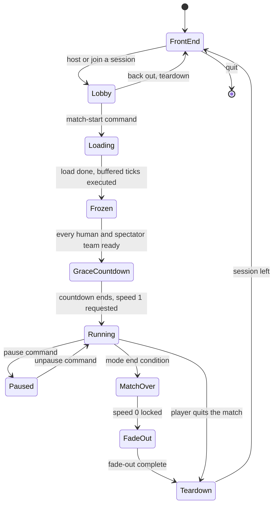
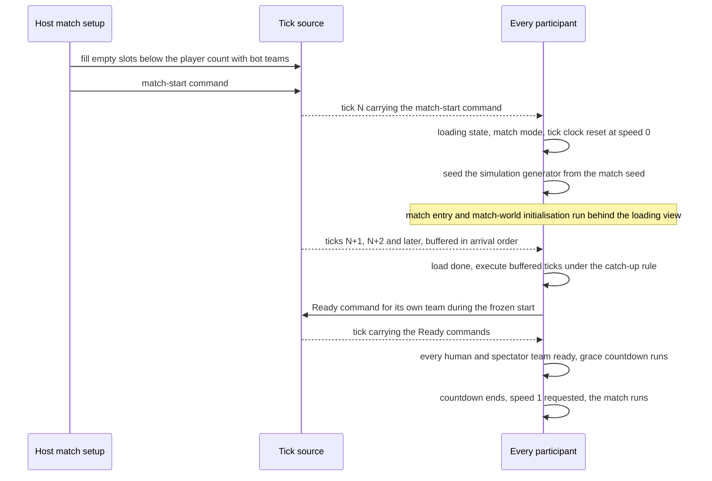

# Match lifecycle and per-match state reset

> Status: Reference · Prefix: R-SIM · Related: [Simulation model](README.md) · [Tick timing and main loop](01_tick_timing_and_main_loop.md) · [Entity model and identity](03_entity_model_and_identity.md) · [Containers and update order](04_containers_and_update_order.md) · [Teams and player commands](06_teams_and_player_commands.md) · [Randomness and integrity](07_randomness_and_integrity.md) · [Front end and match flow](../09_front_end_and_match_flow/README.md) · [Skirmish rules and modes](../01_skirmish_rules_and_modes/README.md)

## 1 Purpose and player experience

This document specifies how long each part of the running reference game lives, how a match world is created, initialised and destroyed, and which state is set back to its initial value at every match start. It covers:

- the lifetime classes (process, front-end visit, session, match, mode, load, frame) and what each one holds;
- the simulation side of match start: bot teams for empty slots, the frozen start, the ready step and the grace countdown;
- the exact order of match entry and of match-world initialisation;
- every piece of state that outlives a single object, where it is reset, and the per-match rule that applies to it;
- the exact order of match teardown;
- the multi-round Siege rebuild point;
- the rule that nothing about a match is persisted.

What happens inside a running tick is [01](01_tick_timing_and_main_loop.md) and [04](04_containers_and_update_order.md); the objects that the match world holds are [03](03_entity_model_and_identity.md).

**Player experience.** Every match begins from the same clean state, whatever the process played before. A match loads behind a loading view, opens frozen, and starts moving only when every human and spectator team has declared itself ready and the grace countdown has run. When the match ends, every participant leaves the session; a rematch goes back through the lobby.

## 2 Rules

### 2.1 Lifetime classes

**R-SIM-001** (MUST) Every long-lived object of the running game belongs to exactly one lifetime class of table 2.1-A. It is created at that class's begin point, destroyed at its end point, and holds only the state that the table assigns to the class. How Species composes these lifetimes in its own processes is DEC-221.

Table 2.1-A Lifetime classes.

| Lifetime | Begins | Ends | Holds |
|---|---|---|---|
| Process | application start-up | process exit | the application root (`Application`) and its long-lived services: asset cache (`AssetCache`), frame renderer (`FrameRenderer`), audio engine (`AudioEngine`), the session connection and its listener, match camera (`MatchCamera`), UI input pump (`UiInputPump`), particle pool (`ParticlePool`), front-end controller (`FrontEndController`), match rules (`MatchRules`) with the six lobby slots (`LobbySlot`), world markers (`WorldMarkers`), hint overlay (`HintOverlay`), the on-screen control hints, world cursor (`WorldCursor`), achievement events (`AchievementEvents`), the loading view (`LoadingView`) and its worker; also the local team id, the power and research levels (`PowerLevels`) and the structure serial counter, which match-world initialisation sets for each match (§2.4) |
| Front-end visit | the first front-end loop iteration whose fade-in is complete creates the front-end menu | the front-end loop exits and destroys the menu | the front-end screens (`FrontEndScreen`); the application's game mode is "none"; the match rules are reset on entry; the match camera looks at the front-end scene from `ref.sim.lifetime.front_end_camera_position` along `ref.sim.lifetime.front_end_camera_direction` |
| Session | host: starting a hosted session from the lobby; joiner: joining a session from the join page | teardown (§2.6), after a match or when the player backs out of the lobby | the hosted session and its listener (host only); the participant's connection state and participant id; the session's command history |
| Match | the match-start command sets the match state flags (§2.2); match entry creates the objects (§2.3) | teardown (§2.6) | the match world (`MatchWorld`) and everything it owns: the terrain height field (`TerrainField`), the six teams (`MatchTeam`), every actor group (`ActorGroup`), every simulated object (`SimObject`), the actor grid (`ActorGrid`), its cache (`ActorGridCache`), the obstacle grid (`ObstacleGrid`), the land and sea route graphs (`LandRouteGraph`, `SeaRouteGraph`), the sea renderer (`SeaRenderer`) and the sky renderer (`SkyRenderer`); the match input pump (`MatchInputPump`); the per-match state of the match rules; the per-match state of table 2.5-A; the tick-clock state (`TickClock`) |
| Mode | creation of the power-slots panel (`PowerSlotsPanel`) | the next creation of that panel | the power-slots panel variant; it is re-created at application start-up, at match entry (§2.3 step 2) and when the player switches between gamepad and keyboard-and-mouse input |
| Load | the loading view starts showing | its work queue is idle and its job list is empty | the loading-view overlay; while it shows, sounds are muted and asset-cache look-ups are serialised |
| Frame | the top of a main-loop iteration | the bottom of that iteration | the team command state (`TeamCommandState`) being accumulated, which is sent once per `ref.sim.tick_period` (06); UI event processing; the per-frame advance of UI, camera and sound |

**R-SIM-002** (MUST) The match lifetime owns every simulated object and every mutable value that a simulation rule reads or writes. All of it is created when a match starts and destroyed when the match ends, and no simulation state survives from one match into the next (DEC-011). Which Species object owns world, region and match state, and how that state is created, saved and destroyed, is DEC-223.

**R-SIM-003** (MUST) A session lasts exactly one match. At teardown every participant leaves the session and the host destroys its session; a rematch goes back through the lobby and opens a new session.

**R-SIM-004** (MUST) The match rules object lives for the process. It is reset when the front end is entered and at teardown (§2.6 step 11). While a match world exists, it advances once per tick in slice `ref.sim.slice.match_rules`, also while the match is paused (01); while no match world exists, it does not advance.

**R-SIM-005** (MUST) The particle pool, the world markers, the hint overlay and the shatter effects (`ShatterEffects`) live for the process but hold content of the current match only. Teardown empties or resets each of them (§2.6 steps 2, 5, 6 and 7).

### 2.2 Match start (simulation side)

**R-SIM-006** (MUST) Before a match starts, the host's match setup fills every empty team slot below the map's player count with a bot team (`TeamKind::Bot`), one per missing player, and then issues the match-start command. The match setup is specified in [screen flow and match setup](../09_front_end_and_match_flow/screen_flow_and_match_setup.md); lobby authority and the match-setup state are DEC-243.

**R-SIM-007** (MUST) A session acts on its first match-start command only. A further match-start command in the same session has no effect. A match-start command that names a map outside the permitted maps of the edition starts no match, and the refusal is logged with the map id ([build tooling and distribution](../../architecture/components/build_tooling_and_distribution.md) BLD-053); the reference edition permits every map it holds.

**R-SIM-008** (MUST) When a participant executes the match-start command, it enters the loading state, switches the application to match mode, resets the tick clock, which starts at game speed `ref.sim.speed.stopped` ([01](01_tick_timing_and_main_loop.md) R-SIM-551), and executes no further tick until the match world has loaded. Ticks that arrive during the load wait in arrival order (01).

**R-SIM-009** (MUST) The simulation generator (`SimRng`) is seeded from the match's recorded seed when the match starts, before any step of match-world initialisation draws from it, and no simulation draw happens before match start (DEC-013). Match-world initialisation (§2.4) then makes the same simulation draws in the same order on every participant, before the first tick of the match executes. Every initialisation draw belongs to an explicit initialisation step of §2.4 or of an object's spawn step, never to a constructor (DEC-652). The generators and the draw discipline are [07](07_randomness_and_integrity.md).

**R-SIM-010** (MUST) While the match world loads, the loading view keeps the participant's connection to the session alive, and on the host it keeps the session's tick schedule running, so ticks continue to be issued and buffered during the load (01).

**R-SIM-011** (MUST) When the load has finished, the participant executes the ticks buffered during the load under the catch-up rule of [01](01_tick_timing_and_main_loop.md) before the match runs at normal pace.

**R-SIM-012** (MUST) The match opens frozen, at game speed `ref.sim.speed.stopped`. Each player marks their team ready with the Ready command (06). When every human team and every spectator team is ready, the match rules run the grace countdown of `ref.match.grace_period` ([skirmish rules](../01_skirmish_rules_and_modes/README.md)) in their slice of every tick, although the match is still frozen; when the countdown ends, the match rules request game speed `ref.sim.speed.normal`, which takes effect at the next tick, and the match runs. The countdown and the speed request are specified in [01](01_tick_timing_and_main_loop.md) R-SIM-552.

**R-SIM-013** (MUST) A match reaches its end state by the rules of its mode ([skirmish rules](../01_skirmish_rules_and_modes/README.md)). The match rules then bring game speed to `ref.sim.speed.stopped` and lock the tick clock, so that no later speed request changes it ([01](01_tick_timing_and_main_loop.md) R-SIM-555), and the match loop fades out and runs teardown (§2.6).

### 2.3 Match entry

**R-SIM-014** (MUST) Entering a match runs the steps of table 2.3-A in this order. Steps 2 to 8 form the load job, which runs while the loading view shows; steps 1 and 9 run in the main loop.

Table 2.3-A Match entry steps.

| Step | Action |
|---|---|
| 1 | The loading state is already set by the match-start command (R-SIM-008). While it is set, tick processing only keeps the connection alive, and arriving ticks wait. The loading view starts and waits, in addition, until every sound has loaded. |
| 2 | Create the match variant of the power-slots panel (Mode lifetime). |
| 3 | Reset the object serial counter, so that object serials of the new match restart at `ref.sim.id.first_serial` ([03](03_entity_model_and_identity.md) §2.4). |
| 4 | Create the match world and make it the current match world; create the match input pump. |
| 5 | Initialise the match world with the requested map (§2.4). |
| 6 | Set up the team-tinted turret meshes (presentation). |
| 7 | Set the current match id to the fixed match id. Every match uses the same fixed match id (DEC-223). |
| 8 | Update the camera's object-tracking mode. If command-stream replay is enabled and this participant hosts, load the recorded command history (replay hook: DEC-046, [07](07_randomness_and_integrity.md)). Set the camera bounds on both horizontal axes to −`ref.sim.match_entry.camera_border` to the world size + `ref.sim.match_entry.camera_border`. Set the fallback camera position to (world size x, `ref.sim.match_entry.fallback_camera_height`, world size x), looking along `ref.sim.match_entry.fallback_camera_direction`; then move the camera to the map's default camera view (`default_view`) and cut to it. |
| 9 | Outside the map editor, the camera enters free movement and the match loop starts (01). In the map editor the camera enters the developer fly mode and the editor loop runs instead ([map editor hooks](../08_maps_and_level_design/map_editor_hooks.md)). The camera part of this step is step 6 of [camera and sequences](../../architecture/components/camera_and_sequences.md) CAM-060. |

**R-SIM-015** (MUST) The match world is the current match world from the moment it is created in step 4, before its initialisation runs. Every initialisation step that spawns objects (team initialisation, the bot controllers of bot teams, the Rogue faction and the Visitor faction) therefore reaches the match world that is being initialised.

### 2.4 Match-world initialisation

**R-SIM-016** (MUST) Match-world initialisation runs the steps of table 2.4-A in this order.

Table 2.4-A Match-world initialisation steps.

| Step | Action |
|---|---|
| 1 | Load the map definition (`MapDefinition`). The match has no global difficulty: actor speeds use difficulty level 0, and a difficulty value that a map lists is a descriptive rating, not a setting (DEC-010). |
| 2 | Re-seed the presentation generator (`FxRng::Seed`) with `ref.sim.match.presentation_seed` ([07](07_randomness_and_integrity.md)). |
| 3 | Set the per-match state of table 2.5-A to its initial values: the structure serial counter, the Supply crate count and the Abductor-used flag, the bot-objectives-initialised flag, the Transport objective list, the Population Limiter state, the Reaper Serpent count, the dust vortex timer and position, the actor-group offset table (cleared), and the per-match entries that R-SIM-019 to R-SIM-024 add. Then, for each team slot 0 to 5 in order: clear its bot controller registry entry, set its Spawn Node count to 0, assign its start position ([06](06_teams_and_player_commands.md)), clear its Core Device registry entry and clear its Flag Chain base zone. Assigning start positions makes simulation draws. |
| 4 | Copy the seasonal-theme flag from the match setup (DEC-118). |
| 5 | Create the map lights (`MapLight`), the terrain height field ([terrain](../../architecture/components/terrain.md)) and the sea renderer. |
| 6 | Set team colours and alliances ([06](06_teams_and_player_commands.md) R-SIM-416 to R-SIM-421): in Siege, the Siege set-up; otherwise in a co-op match, the co-op set-up for each player position not yet in a group; otherwise every bot team takes a bot colour from the match rules. In the tutorial, each team's colour is its team index. |
| 7 | Outside the map editor, in this order: create every map-placed structure, once, from its map record (DEC-652); create the actor grid; create the actor grid cache; create the obstacle grid, whose creation computes it completely; compute the bot navigation links ([bots](../07_bots/README.md)); create the sky renderer; build the land route graph; build the sea route graph. The obstacle grid exists before the bot navigation links are computed, so the links account for walls and Barrier Emitters (DEC-087), and both route graphs are built after the obstacle grid, so their edges account for walls ([05](05_space_routing_and_physics.md)). In the map editor this step only snaps the map-placed structures to the terrain. |
| 8 | For each team slot 0 to 5 in order: a slot whose lobby colour is "none" takes the next available colour; create the team from its lobby slot; if the slot is in use, initialise the team (its bot controller, its starting powers, one Worker for every port that its Spawn Nodes and Solar Arrays have, its instant units, and the terrain snap of its objects; [buildings](../03_buildings_and_world_objects/README.md) and [population flow](../05_population_flow.md)). Then mark the teams as initialised. |
| 9 | When the map's player count is below `ref.sim.team.player_slots`, every slot from the player count to `ref.sim.team.player_slots` − 1 (so never the Rogue faction slot or the Visitor faction slot) draws a colour from 0 to `ref.sim.team.bot_colour_count` − 1 that no player slot holds, by the unused-slot colour rule of [06](06_teams_and_player_commands.md) R-SIM-422. Only the colour changes. |
| 10 | Allow the Rogue faction; set up the Rogue faction team in slot `ref.sim.team.rogue_slot` (4) and the Visitor faction team in slot `ref.sim.team.visitor_slot` (5) ([06](06_teams_and_player_commands.md)); set the fixed power levels of table 2.4-B. |
| 11 | Generate the actor-group offset table: `ref.sim.group.offset_table_size` unit-fraction draws from the simulation generator, in index order (DEC-652). |

Table 2.4-B Fixed power levels at match-world initialisation (`PowerLevels`).

| Power or research item | Level | Key |
|---|---|---|
| every item not listed below | 3 | `ref.sim.init.power_level_default` |
| Strike team | 1 | `ref.sim.init.power_level.strike_team` |
| laser | 2 | `ref.sim.init.power_level.laser` |
| grenade | 2 | `ref.sim.init.power_level.grenade` |
| rocket | 2 | `ref.sim.init.power_level.rocket` |
| airstrike | 2 | `ref.sim.init.power_level.airstrike` |
| Worker | 4 | `ref.sim.init.power_level.worker` |

**R-SIM-017** (MUST) Reading the map definition creates no simulation object and makes no draw. Each structure that the map places is created once, in step 7, directly from its map record; no template object of any structure kind is created (DEC-652).

**R-SIM-018** (MUST) After step 7 has created the map-placed structures, the structure serial counter is set to the highest structure id in the map plus 1, so that structures created during the match take serials above every map id ([03](03_entity_model_and_identity.md) §2.4).

### 2.5 Per-match state and its reset points

Table 2.5-A lists every value that outlives a single simulated object, where it is set, and its class: **simulation** (a simulation rule reads or writes it), **statistics**, **data** (read-only tables), **presentation**, **audio** or **scratch**.

Table 2.5-A State that outlives a single object.

| State | Initial value | Set or reset | Class |
|---|---|---|---|
| object serial counter (actors and effects) | 0; the first serial handed out is `ref.sim.id.first_serial` | match entry, step 3 (§2.3); the multi-round Siege rebuild does not reset it (R-SIM-029) | simulation (identity) |
| structure serial counter | `ref.sim.id.structure_serial_start`, then the highest map structure id + 1 | initialisation step 3, then R-SIM-018 | simulation |
| Supply crate count; Abductor-used flag | 0; false | initialisation step 3 | simulation |
| actor population counter | 0 | +1 when an actor is created, −1 when it is destroyed; the bot controller is not counted; set to 0 when the match world is destroyed | statistics |
| Spawn Node count per team slot, with one more entry for "no team" | 0 in every entry | initialisation step 3, every entry (R-SIM-020) | simulation |
| Source Node registry id | none | match-world creation; then written by every Source Node advance (R-SIM-024) | simulation |
| Population Limiter overpopulation flag and timer | not overpopulated; 0 | initialisation step 3 | simulation |
| Crawler population per team | 0 | +1 when a Crawler is created, −1 when it is destroyed; destroying the match world destroys every Crawler, so the counts return to 0 | simulation |
| Reaper Serpent count | 0 | initialisation step 3 | simulation |
| dust vortex timer; dust vortex position | 0; none | initialisation step 3 | simulation |
| bot controller registry, one entry per team slot | none | initialisation step 3 | simulation |
| bot-objectives-initialised flag | false | initialisation step 3 | simulation |
| Transport objective list | empty | initialisation step 3 | simulation |
| Core Device registry, one entry per team slot | none | initialisation step 3 | simulation |
| Core Device default time | 0 | match-rules reset | simulation |
| Flag Chain base zone, one entry per team slot | none | initialisation step 3 | simulation |
| current Core Device pulse wave (`CorePulseWave`) | none | set when a pulse wave is created, cleared when it is destroyed | simulation |
| exclusion zone list (`ExclusionZone`) | empty | an exclusion zone joins it when created and leaves it when destroyed | simulation |
| teleport transit table | empty | match-world creation (R-SIM-022) | simulation |
| actor-group offset table | empty | cleared at initialisation step 3 and when the match world is destroyed; generated at initialisation step 11 (R-SIM-023) | simulation |
| Control Zone counter | 0 | match-world creation (R-SIM-019) | simulation |
| Transport weapon-cycle debounce | none | per Transport, at its creation (R-SIM-021) | simulation |
| tutorial gates *bots may act* and *bots may spawn* | clear | match-world creation; set only by tutorial events and never cleared during the match (R-SIM-032) | simulation |
| tick-clock speed state | normal speed, no speed hold | match start (R-SIM-008, R-SIM-025) | simulation |
| Strike team trail-point id counter (`TrailPoint`) | 0 | match-world creation | simulation |
| presentation generator state | `ref.sim.match.presentation_seed` | initialisation step 2 | presentation |
| simulation generator state | the match seed | match start (R-SIM-009) | simulation |
| sound voice id counter (`SoundVoice`) | 0 at process start | never reset; increases monotonically | audio |
| match-rules data tables | loaded once | process lifetime | data |
| actor stat table names and values (`ActorStatTable`) | loaded once from the stat data at application start-up | process lifetime | data |
| particle kind table | fixed | process lifetime | presentation (data) |
| mesh caches of structures, centipedes and Reaper Serpents, one per team where team-tinted | loaded on first use | process lifetime | presentation |
| neighbour-query result storage of the match world, actors, structures, the camera and the hint overlay | per call | each query (R-SIM-026) | scratch |
| front-end highlight and drop-down state | — | front end | presentation |
| a function-local "an order was moved" flag of the team-command update, shared by all teams | — | never | presentation: it gates only the local cursor marker |
| the threat-horn time stamp of Workers and the grace-countdown sound state | — | never | audio and presentation only |
| Leader mode-cycle state | — | never | none in a match: the cycle returns at once in matches |

**R-SIM-019** (MUST) Every value that table 2.5-A classes as simulation is match state. It takes its initial value when the match world is created, belongs to the match world and is destroyed with it. Simulation code holds no other mutable state outside the match world: no mutable static, file-level or function-level variable in simulation code, a rule that static analysis enforces (DEC-011). The Control Zone counter that the zone-scoring pass reads, and that Flag Chain initialisation adds to, starts at 0 in every match (DEC-011).

**R-SIM-020** (MUST) The per-team Spawn Node counts, one per team slot plus one for "no team", all start at 0 in every match, team slot 5 included (DEC-011). The count matters because a Spawn Node skips its activation delay when it is its team's only Spawn Node ([economy and spawn objects](../03_buildings_and_world_objects/economy_and_spawn_objects.md)).

**R-SIM-021** (MUST) The weapon-cycle debounce belongs to each Transport for one match (DEC-011): a weapon-cycle command on a selected Transport toggles its loading only when more than `ref.sim.state.transport_cycle_debounce` has passed since that Transport's previous toggle ([Transport](../02_units/transport.md)).

**R-SIM-022** (MUST) The teleport transit table, which records the actors in transit through teleport structures, is match state: it is empty when the match world is created and is destroyed with it, in addition to the pruning of entries whose actor no longer exists (DEC-011; DEC-223 item 2).

**R-SIM-023** (MUST) The actor-group offset table is cleared at initialisation step 3 and when the match world is destroyed, and it is generated at initialisation step 11, never on its first use (DEC-011, DEC-652). Formation offsets read it ([06](06_teams_and_player_commands.md)).

**R-SIM-024** (MUST) The Source Node registry id is match state with the initial value "none" (DEC-011). Each Source Node writes its own structure id into it at the start of each of its advances. An Essence-orb request of a Spawn Node resolves the registry id by a structure look-up followed by a kind check, so an id that names no live Source Node resolves to "no Source Node". A Spawn Node's first production timer ([economy and spawn objects](../03_buildings_and_world_objects/economy_and_spawn_objects.md)) always runs for more than one tick, and no Spawn Surge is active at match start, so the first request of a match comes after the first tick, in which every Source Node has advanced. The registry therefore names the map's Source Node whenever a request reads it, and on a map without a Source Node every request resolves to "no Source Node".

**R-SIM-025** (MUST) The tick-clock speed state returns to normal speed at match start, and any Time Dilation or Time Rush speed hold ends, so game speed cannot carry an invalid value into the next match (DEC-011). The tick clock is [01](01_tick_timing_and_main_loop.md).

**R-SIM-026** (MUST) Scratch storage that a query fills, such as a neighbour list, belongs to that call: it is never a shared static buffer and has no fixed limit (DEC-028).

**R-SIM-027** (MUST) Playing match A and then match B in one process, and playing match B alone in a fresh process, with the same match setup, seed and commands for B, give identical simulation state for B after every tick (DEC-223 item 4). The Species run-time divergence check is DEC-206.

**R-SIM-032** (MUST) The two gates of the second tutorial, *bots may act* and *bots may spawn*, are match state ([tutorial and help](../11_tutorial_and_help.md) R-TUT-082). Both are clear when the match world is created, in every match; only the tutorial events of the command order set them ([06](06_teams_and_player_commands.md) R-SIM-462), and once set a gate stays set until the match world is destroyed. While the bots-may-spawn gate is clear in the second tutorial, the match-rules update of every tick (R-SIM-004) sets the time remaining to `ref.tut.second.held_time_remaining` (R-TUT-081); from the tick at which the gate is set, the time remaining counts down as in every Zone Control match.

### 2.6 Teardown

**R-SIM-028** (MUST) Teardown runs once, at the end of the match loop, after the fade-out has completed, the match ambience has stopped and the match-exit sound event has fired ([audio design](../10_audio_design/README.md)). Its steps run in the order of table 2.6-A, and the application then returns to the front end.

Table 2.6-A Teardown steps.

| Step | Action |
|---|---|
| 1 | If command-stream recording is enabled and this participant hosts, save the session's command history (replay hook: DEC-046, DEC-250, [07](07_randomness_and_integrity.md)). |
| 2 | Reset the shatter effects. |
| 3 | Leave the session: send the leave notice, wait a bounded time (DEC-221 item 7), reset the session state, set the local team id to "none" and clear the requested map. |
| 4 | Empty the match world ([04](04_containers_and_update_order.md) §2.7). |
| 5 | Empty the particle pool. |
| 6 | Clear every world marker. |
| 7 | Reset the hint overlay. |
| 8 | Destroy the match world and set the current match id to "none". |
| 9 | Destroy the match input pump. |
| 10 | On the host: destroy the hosted session; it stops advertising itself, stops its listener and empties its command history, its participants, its teams and its queues. |
| 11 | Reset the match rules. |
| 12 | Set the local team id to "none". |
| 13 | Clear the player's pause request. |

### 2.7 Multi-round Siege rebuild

**R-SIM-029** (MUST) Multi-round Siege is not selectable in any match setup (DEC-066). When it is enabled, the match rules raise a rebuild request at the end of a round that has further rounds to play, and the rebuild runs these steps in order: rotate the team positions; destroy the match world, then create a new one and initialise it (§2.4) without a loading view; restore the last processed slice index; reset the tick clock; set the grace timer to `ref.match.grace_period`. The rebuild does not reset the object serial counter (DEC-066).

**R-SIM-030** (MUST) The rebuild runs at a tick boundary: after every slice of the tick in which the round ended has run, and before the commands of the next tick apply. No participant advances the old match world after the rebuild request, so every participant rebuilds from the same state and none consumes a simulation draw that another does not (see DEC-261).

### 2.8 Persistence

**R-SIM-031** (MUST) No match, lobby or session state is written to storage. A match world exists only in memory, from match entry to teardown, and a participant who leaves cannot resume (DEC-251). The client-local settings store holds only the settings of [options, localisation and hooks](../09_front_end_and_match_flow/options_localisation_and_hooks.md) (DEC-250).

## 3 States and flows

Diagram 3-A shows the application states that a match passes through.

Caption: Diagram 3-A, application states from the front end through one match and back (R-SIM-003, R-SIM-008, R-SIM-012, R-SIM-013, R-SIM-028).

Diagram 3-B shows the simulation side of match start; the lobby messages that carry the match setup are not shown.

Caption: Diagram 3-B, match start from the match-start command to normal play (R-SIM-006 to R-SIM-012).

Diagram 3-C shows the order of match entry and match-world initialisation.

```mermaid
flowchart TD
    A["Match-start command executed: loading state, tick clock at speed 0"] --> B["Create the match power-slots panel"]
    B --> C["Reset the object serial counter"]
    C --> D["Create the match world and make it current; create the match input pump"]
    D --> I1["Init 1: load the map definition, no difficulty"]
    I1 --> I2["Init 2: re-seed the presentation generator"]
    I2 --> I3["Init 3: reset per-match state; per team slot 0 to 5 clear registries and assign start positions"]
    I3 --> I4["Init 4: copy the seasonal-theme flag"]
    I4 --> I5["Init 5: map lights, terrain height field, sea renderer"]
    I5 --> I6["Init 6: team colours and alliances"]
    I6 --> I7["Init 7: map-placed structures, actor grid, grid cache, obstacle grid, bot navigation links, sky, land and sea route graphs"]
    I7 --> I8["Init 8: create and initialise the six teams"]
    I8 --> I9["Init 9: colour fill for unused slots below four players"]
    I9 --> I10["Init 10: Rogue and Visitor faction teams, fixed power levels"]
    I10 --> I11["Init 11: generate the actor-group offset table"]
    I11 --> E6["Team-tinted turret meshes"]
    E6 --> E7["Current match id set"]
    E7 --> E8["Camera tracking, optional replay load, camera bounds and default view"]
    E8 --> E9["Main loop: free camera, match loop starts"]
```

Caption: Diagram 3-C, match entry (table 2.3-A) with match-world initialisation (table 2.4-A) expanded in place (R-SIM-014, R-SIM-016).

## 4 Tuning table

| key | value | unit | range or notes | requirement | DEC |
|---|---|---|---|---|---|
| `ref.sim.id.first_serial` | 1 | serial | the counter is reset to 0 and incremented before each use, so the first serial of a match is 1 | R-SIM-014 | DEC-011 |
| `ref.sim.id.structure_serial_start` | 0 | serial | value of the structure serial counter at initialisation step 3; after the map-placed structures it becomes the highest map structure id + 1 | R-SIM-018 | DEC-011 |
| `ref.sim.match.presentation_seed` | 1 | seed | presentation generator seed at every match-world initialisation | R-SIM-016 | DEC-013 |
| `ref.sim.match_entry.camera_border` | 200 | wu | margin outside the map on both horizontal axes | R-SIM-014 | — |
| `ref.sim.match_entry.fallback_camera_height` | 1000 | wu | height of the fallback camera position | R-SIM-014 | — |
| `ref.sim.match_entry.fallback_camera_direction` | (−1, −0.7, −1) | direction vector | not normalised; fallback viewing direction | R-SIM-014 | — |
| `ref.sim.lifetime.front_end_camera_position` | (−900, 3000, 3970) | wu | front-end camera position | R-SIM-001 | — |
| `ref.sim.lifetime.front_end_camera_direction` | (0, 0.5, −1) | direction vector | not normalised; front-end viewing direction | R-SIM-001 | — |
| `ref.sim.init.power_level_default` | 3 | level | every power and research item not listed below | R-SIM-016 | — |
| `ref.sim.init.power_level.strike_team` | 1 | level | | R-SIM-016 | — |
| `ref.sim.init.power_level.laser` | 2 | level | | R-SIM-016 | — |
| `ref.sim.init.power_level.grenade` | 2 | level | | R-SIM-016 | — |
| `ref.sim.init.power_level.rocket` | 2 | level | | R-SIM-016 | — |
| `ref.sim.init.power_level.airstrike` | 2 | level | | R-SIM-016 | — |
| `ref.sim.init.power_level.worker` | 4 | level | | R-SIM-016 | — |
| `ref.sim.state.transport_cycle_debounce` | 3 | ticks | 0.3 s of game time; a toggle needs strictly more than this since the same Transport's previous toggle | R-SIM-021 | DEC-011 |

The tick period `ref.sim.tick_period`, the slice of the match-rules update `ref.sim.slice.match_rules` and the game speeds `ref.sim.speed.stopped` and `ref.sim.speed.normal` are defined in [01](01_tick_timing_and_main_loop.md); the offset-table size `ref.sim.group.offset_table_size` and the team keys `ref.sim.team.player_slots`, `ref.sim.team.bot_colour_count`, `ref.sim.team.rogue_slot` and `ref.sim.team.visitor_slot` are defined in [06](06_teams_and_player_commands.md); the grace period `ref.match.grace_period` is defined in [skirmish rules](../01_skirmish_rules_and_modes/README.md); the held time remaining `ref.tut.second.held_time_remaining` is defined in [tutorial and help](../11_tutorial_and_help.md). Every value in this table is a reference value adopted as the Species starting value (DEC-004).

## 5 Edge cases and interactions

- **Source Node registry between matches.** The registry id is written at the start of every Source Node advance, and the first read of a match comes only after the first tick, because a Spawn Node's first production timer runs for more than one tick and a Spawn Surge cannot be active at match start. A value left over from an earlier match therefore never reaches a request on a map with a Source Node, and on a map without one it fails the kind check. With R-SIM-024 the value starts as "none" in any case, so no outcome depends on what the process played before.
- **Spawn Node count of team slot 5.** The count of slot 5 (the Visitor faction slot) matters only when that team owns Spawn Nodes. When it does, a count left over from an earlier match would change whether its single Spawn Node skips the activation delay; R-SIM-020 resets it.
- **Control Zone counter.** Zone Control's per-second loop recomputes the counter, while Flag Chain initialisation adds to it. A value left over from an earlier match would change the Transit Gate reward choice, the Zone Control win test and a score term ([skirmish rules](../01_skirmish_rules_and_modes/README.md)); R-SIM-019 starts it at 0.
- **Transport weapon-cycle debounce.** No participant's input produces the weapon-cycle commands in a reference match, so the debounce never acts on reference input. With one value shared by every Transport, one team's toggle would block every other team's toggle for `ref.sim.state.transport_cycle_debounce`; R-SIM-021 makes it per Transport.
- **Spawning into an unused faction slot.** Spawning actors for the Rogue faction slot or the Visitor faction slot while that slot is unused initialises the slot first ([04](04_containers_and_update_order.md) §2.5).
- **The grace countdown while frozen.** The match rules advance in their slice although the match world does not advance at game speed 0, so the grace countdown and the end of the frozen start run while nothing else moves (01).
- **Teardown after backing out of the lobby.** A session can end without a match; then no match world exists, and the steps that empty or destroy the match world have nothing to act on.
- **Multi-round Siege draws.** The rebuild of R-SIM-029 runs match-world initialisation again, which draws from the simulation generator; R-SIM-030 fixes the generator position at the rebuild, because no participant runs further slices of the old match world first.

## 6 Acceptance criteria

| # | Given | When | Then | Requirements |
|---|---|---|---|---|
| AC-1 | one process that has played a Flag Chain match | a Zone Control match B runs with a fixed seed and command log | the per-tick simulation state of B equals that of B run alone in a fresh process | R-SIM-019, R-SIM-027 |
| AC-2 | a match in which team slot 5 owned Spawn Nodes | the next match starts | every Spawn Node count, the "no team" entry and slot 5 included, is 0 before the first tick | R-SIM-020 |
| AC-3 | a map without a Source Node, played after a map with one | a Spawn Node requests an Essence orb | the request resolves to "no Source Node" | R-SIM-024 |
| AC-4 | a map with a Source Node | any Spawn Node makes its first request of the match | the request comes after the first tick, and the registry names that Source Node | R-SIM-024 |
| AC-5 | a match that ends while a Time Dilation hold is active | the next match starts | the tick clock is at normal speed with no hold | R-SIM-025 |
| AC-6 | two Transports of different teams | each receives a weapon-cycle command in consecutive ticks | both toggle; a second command to the same Transport within `ref.sim.state.transport_cycle_debounce` does not toggle it | R-SIM-021 |
| AC-7 | a recorded match setup and seed | match-world initialisation runs twice from the same setup | both runs make the same simulation draws in the same order, and no draw happens before match start | R-SIM-009, R-SIM-016, R-SIM-017 |
| AC-8 | a map whose bot navigation nodes are separated by a wall or a Barrier Emitter | initialisation completes | no bot navigation link crosses the wall or the emitter | R-SIM-016 |
| AC-9 | a match world after initialisation | the first runtime structure is created | its serial is one above the highest structure id of the map | R-SIM-018 |
| AC-10 | the actor-group offset table | the match world is initialised and the first formation offset is read | the table already holds `ref.sim.group.offset_table_size` values, generated at step 11 | R-SIM-016, R-SIM-023 |
| AC-11 | a two-player match on a four-player map | initialisation completes | slots 2 and 3 are bot teams created by the match setup, and each has a colour | R-SIM-006, R-SIM-016 |
| AC-12 | a match that has ended | teardown runs | the steps of table 2.6-A run in order, the particle pool and world markers are empty, and the session is gone on every participant | R-SIM-003, R-SIM-005, R-SIM-028 |
| AC-13 | a session that has started its match | a second match-start command arrives | nothing happens | R-SIM-007 |
| AC-14 | every human team ready during the frozen start | ticks continue | the grace countdown of `ref.match.grace_period` runs, then game speed becomes `ref.sim.speed.normal` | R-SIM-012 |
| AC-15 | multi-round Siege enabled in a test build | a round ends | the rebuild runs at the next tick boundary on every participant, and the object serial counter keeps its value | R-SIM-029, R-SIM-030 |
| AC-16 | a match in progress | the process is restarted | no match, lobby or session state is restored | R-SIM-031 |
| AC-17 | a second tutorial whose bots-may-spawn gate was set, followed by a new match | the new match world is created | both tutorial gates are clear, and in a second tutorial the time remaining is held at `ref.tut.second.held_time_remaining` until the gate is set | R-SIM-032 |
| AC-18 | an edition whose permitted maps exclude map M | a match-start command names M | no match starts and the refusal is logged with M's id | R-SIM-007 |

## 7 Dependencies

- Reference documents: [01 Tick timing and main loop](01_tick_timing_and_main_loop.md) (tick period, slices, catch-up, pause, speed changes), [03 Entity model and identity](03_entity_model_and_identity.md) (serial counters), [04 Containers and update order](04_containers_and_update_order.md) (emptying the match world, creation rules), [05 Space, routing and physics](05_space_routing_and_physics.md) (grids and route graphs), [06 Teams and player commands](06_teams_and_player_commands.md) (start positions, colours, alliances, the Ready command, formation offsets), [07 Randomness and integrity](07_randomness_and_integrity.md) (generators, replay hooks), [skirmish rules and modes](../01_skirmish_rules_and_modes/README.md) (grace period, end conditions, multi-round Siege), [Transport](../02_units/transport.md), [buildings and world objects](../03_buildings_and_world_objects/README.md), [economy and spawn objects](../03_buildings_and_world_objects/economy_and_spawn_objects.md), [population flow](../05_population_flow.md), [bots](../07_bots/README.md), [map editor hooks](../08_maps_and_level_design/map_editor_hooks.md), [screen flow and match setup](../09_front_end_and_match_flow/screen_flow_and_match_setup.md), [options, localisation and hooks](../09_front_end_and_match_flow/options_localisation_and_hooks.md), [audio design](../10_audio_design/README.md), [tutorial and help](../11_tutorial_and_help.md) (the tutorial gates and the held time remaining).
- Engine components: [terrain](../../architecture/components/terrain.md) (the terrain height field built at initialisation step 5), [platform layer](../../architecture/components/platform_layer.md) (process lifetime), [camera and sequences](../../architecture/components/camera_and_sequences.md) (CAM-060, the camera part of match entry), [build tooling and distribution](../../architecture/components/build_tooling_and_distribution.md) (BLD-053, the permitted maps of an edition).
- Assets: none.

## 8 Open decisions

- DEC-221 — composition root, service lifetimes and the application state machine.
- DEC-223 — world, region and match state ownership and reset.
- DEC-206 — divergence detection and integrity checking.
- DEC-243 — lobby authority and the match-setup state.
- DEC-046 — replays.
- DEC-066 — multi-round Siege.
- DEC-250 — persisted data inventory and client-local storage.
- DEC-251 — world-state persistence, schema migration and rollback.
- Resolved and applied here: DEC-004, DEC-010, DEC-011, DEC-013, DEC-028, DEC-087, DEC-103, DEC-118, DEC-261, DEC-652.
