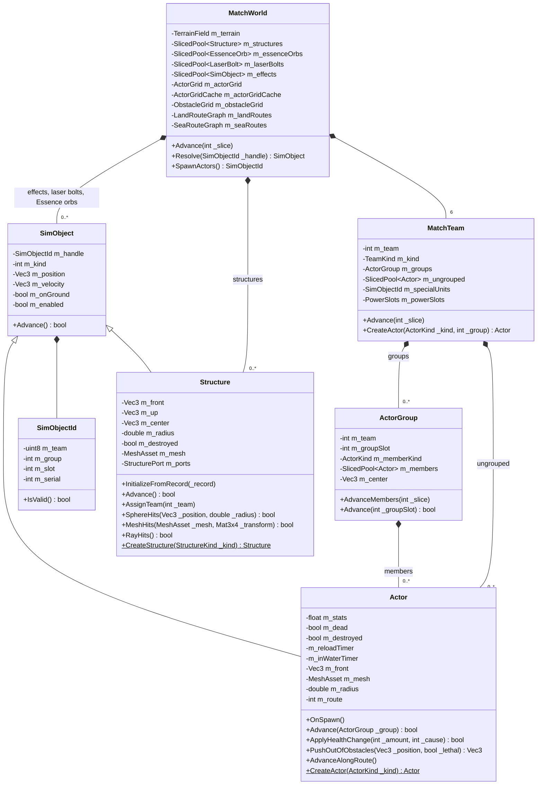
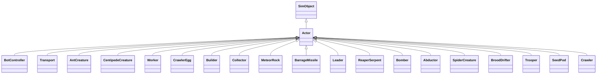
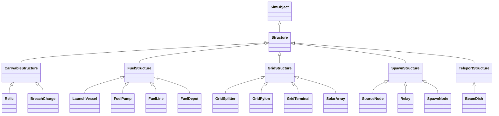
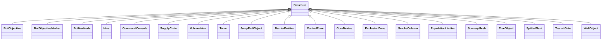
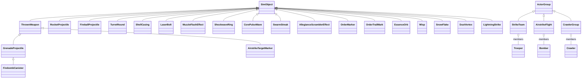
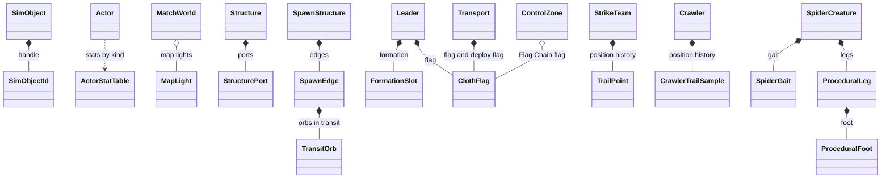
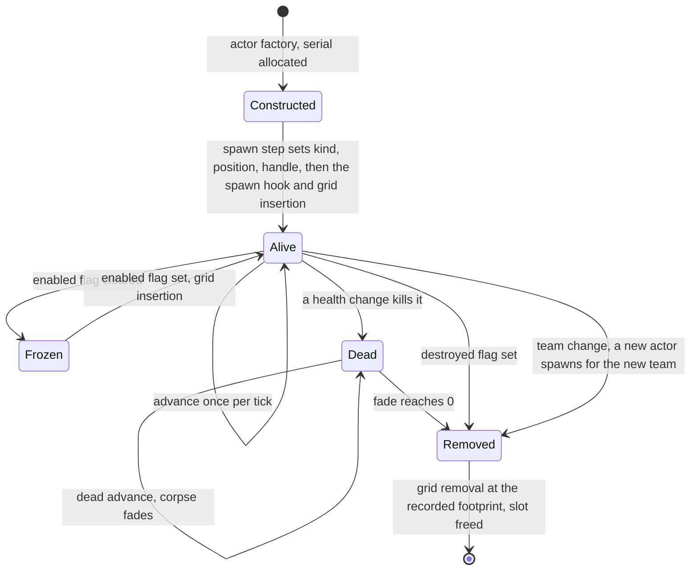
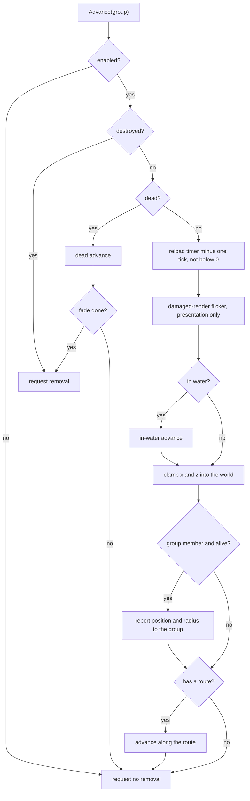
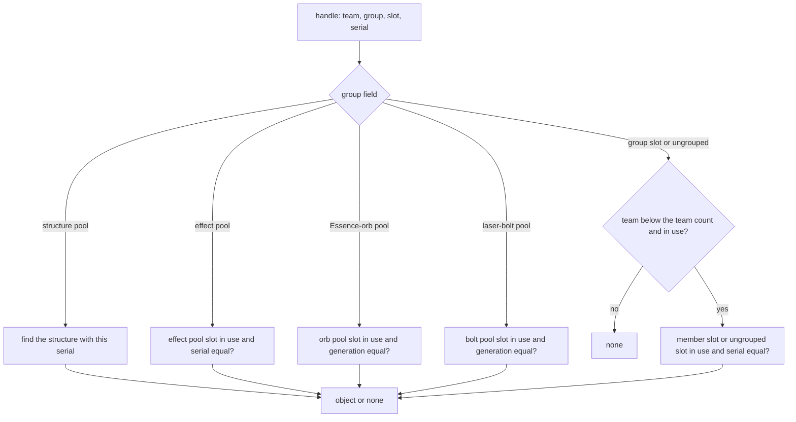

# Entity model and identity

> Status: Reference · Prefix: R-SIM · Related: [Simulation model](README.md) · [Match lifecycle and state reset](02_match_lifecycle_and_state_reset.md) · [Containers and update order](04_containers_and_update_order.md) · [Space, routing and physics](05_space_routing_and_physics.md) · [Teams and player commands](06_teams_and_player_commands.md) · [Randomness and integrity](07_randomness_and_integrity.md) · [Units](../02_units/README.md) · [Buildings and world objects](../03_buildings_and_world_objects/README.md) · [Supply crates, powers and weapons](../04_supply_crates_powers_and_weapons/README.md)

## 1 Purpose and player experience

This document specifies the object model of a match as Species types:

- the three families of simulated objects (actors, structures and effects) and the actor group that holds actors;
- the complete type hierarchy of every simulated-object kind, with the reference document that specifies each kind's behaviour;
- the members of the core types that the rest of the reference library relies on;
- the base contracts of each family: construction, initialisation, the per-tick advance, death and removal, freezing, ownership change and collision, and the renderer that draws each family;
- object identity: the handle, how every kind of object is identified and allocated, how a handle resolves to an object, and the rules for holding handles.

Per-kind behaviour (state machines, stats, weapons) is in [units](../02_units/README.md), [buildings and world objects](../03_buildings_and_world_objects/README.md), [supply crates, powers and weapons](../04_supply_crates_powers_and_weapons/README.md) and [bots](../07_bots/README.md). Containers and the order in which objects advance are [04](04_containers_and_update_order.md); spatial queries, movement and collision are [05](05_space_routing_and_physics.md); teams and ownership are [06](06_teams_and_player_commands.md).

**Player experience.** The object model has no direct player-facing behaviour. It is what makes every Worker, structure, projectile and Essence orb behave the same way in every match and on every participant: each object has one identity, advances once per tick, and disappears through one removal path.

## 2 Rules

### 2.1 Object families

**R-SIM-101** (MUST) Every simulated object is a simulated object (`SimObject`): it has a handle (`SimObjectId`), a kind, a position, a velocity, an on-ground flag and an enabled flag. Every simulated object belongs to exactly one of three families (DEC-028):

1. **actors** (`Actor`): the mobile units and creatures. Every actor belongs to a team, either as a member of one of that team's actor groups or among that team's ungrouped actors;
2. **structures** (`Structure`): the static objects that a map places or that rules create during a match, Supply crates included. They live in the match world's structure pool;
3. **effects**: every other simulated-object kind. Effects live in the match world's effect pool, except laser bolts (`LaserBolt`) and Essence orbs (`EssenceOrb`), which are held by value in a pool each of their own.

**R-SIM-102** (MUST) An actor group (`ActorGroup`) is not a simulated object. It is a container, owned by one team, of actors of one kind that move as a group: the members of a Strike team, an airstrike flight, a Crawler group and the plain groups of centipede segments and Hive ants (DEC-117).

**R-SIM-103** (MUST) The set of simulated-object kinds is exactly the set of diagrams 2.2-B to 2.2-E and table 2.2-G. Every type has at most one base type, by single inheritance, and no type outside these diagrams derives from `SimObject`, `Actor` or `Structure`. The in-scope set is 19 actor kinds; 5 intermediate structure bases with 14 subtypes and 20 direct structure kinds; 21 effect and weapon types, laser bolts and Essence orbs included; 3 actor-group subtypes; and 13 helper types that are not simulated objects.

**R-SIM-104** (MUST) A `SimObject`'s kind is one value of the actor-kind enumeration (`ActorKind`) for an actor, of the structure-kind enumeration (`StructureKind`) for a structure, or of the effect-kind enumeration of table 2.3-B for an effect. Species defines its own enumerator values; no rule depends on their numeric values.

### 2.2 Type hierarchy (Species types)

Diagram 2.2-A shows the core types and the members that the rest of the reference library relies on. `SlicedPool~T~` is a pool of `T` whose slots advance in update slices ([04](04_containers_and_update_order.md)).

Caption: Diagram 2.2-A, core types of the match world and the members other documents rely on (R-SIM-101, R-SIM-102, R-SIM-105). State members are private (`m_`) and are read and changed through the operations of their type; operations are public; parameters are written `_name`.

**R-SIM-105** (MUST) The core types hold at least the members of diagram 2.2-A, with the meaning given there. The match world owns six teams, the structure pool, the effect pool, the laser-bolt pool, the Essence-orb pool, the actor grid, its cache, the obstacle grid and the two route graphs; each team owns its actor groups, its ungrouped actors, its list of special units and its Power slots (`PowerSlots`); each actor group owns its members. The full member lists of the match world are [04](04_containers_and_update_order.md) §2.1, and of teams and actor groups [06](06_teams_and_player_commands.md).

Diagram 2.2-B shows every actor kind.

Caption: Diagram 2.2-B, the 19 actor kinds, each derived directly from `Actor` (R-SIM-103).

Diagram 2.2-C shows the five intermediate structure bases and their subtypes.

Caption: Diagram 2.2-C, intermediate structure bases (carryable, fuel-chain, energy-grid, spawn-network and teleport structures) and their 14 subtypes (R-SIM-103).

Diagram 2.2-D shows the structure kinds that derive directly from `Structure`.

Caption: Diagram 2.2-D, the 20 direct structure kinds (R-SIM-103). `ControlZone` is the one type for the Control Zone, the Relic Base, the Relic Spawn Zone, the Flag post and the Home post.

Diagram 2.2-E shows the effect and weapon types, the order markers, laser bolts, Essence orbs and the actor-group subtypes.

Caption: Diagram 2.2-E, the 21 effect, weapon, marker, laser-bolt and Essence-orb types and the 3 actor-group subtypes with their member kinds (R-SIM-102, R-SIM-103).

Diagram 2.2-F shows the helper types that are not simulated objects, with their owners.

Caption: Diagram 2.2-F, the 13 helper types and the type that owns or uses each (R-SIM-103).

Table 2.2-G gives every type, its base, its family and the document that specifies its behaviour.

| # | Type | Base | Family | Behaviour specified in |
|---|---|---|---|---|
| 1 | `SimObject` | — | root | §2.3 |
| 2 | `SimObjectId` | — | helper | §2.4 |
| 3 | `Actor` | `SimObject` | actor base | §2.3; [units](../02_units/README.md) |
| 4 | `ActorStatTable` | — | helper | [units](../02_units/README.md) |
| 5 | `BotController` | `Actor` | actor | [bots](../07_bots/README.md) |
| 6 | `Transport` | `Actor` | actor | [Transport](../02_units/transport.md) |
| 7 | `AntCreature` | `Actor` | actor | [creatures](../02_units/creatures.md) |
| 8 | `CentipedeCreature` | `Actor` | actor | [creatures](../02_units/creatures.md) |
| 9 | `Worker` | `Actor` | actor | [Worker](../02_units/worker.md) |
| 10 | `CrawlerEgg` | `Actor` | actor | [creatures](../02_units/creatures.md) |
| 11 | `Builder` | `Actor` | actor | [Builder](../02_units/builder.md) |
| 12 | `Collector` | `Actor` | actor | [Collector](../02_units/collector.md) |
| 13 | `MeteorRock` | `Actor` | actor | [hazards and projectiles](../02_units/hazards_and_projectiles.md) |
| 14 | `BarrageMissile` | `Actor` | actor | [hazards and projectiles](../02_units/hazards_and_projectiles.md) |
| 15 | `Leader` | `Actor` | actor | [Leader and formations](../02_units/leader_and_formations.md) |
| 16 | `ReaperSerpent` | `Actor` | actor | [creatures](../02_units/creatures.md) |
| 17 | `Bomber` | `Actor` | actor | [hazards and projectiles](../02_units/hazards_and_projectiles.md) |
| 18 | `Abductor` | `Actor` | actor | [hazards and projectiles](../02_units/hazards_and_projectiles.md) |
| 19 | `SpiderCreature` | `Actor` | actor | [creatures](../02_units/creatures.md) |
| 20 | `BroodDrifter` | `Actor` | actor | [creatures](../02_units/creatures.md) |
| 21 | `Trooper` | `Actor` | actor | [Strike team](../02_units/strike_team.md) |
| 22 | `SeedPod` | `Actor` | actor | [creatures](../02_units/creatures.md) |
| 23 | `Crawler` | `Actor` | actor | [creatures](../02_units/creatures.md) |
| 24 | `ActorGroup` | — | actor container | §2.3; [06](06_teams_and_player_commands.md) |
| 25 | `StrikeTeam` | `ActorGroup` | actor container | [Strike team](../02_units/strike_team.md) |
| 26 | `AirstrikeFlight` | `ActorGroup` | actor container | [hazards and projectiles](../02_units/hazards_and_projectiles.md) |
| 27 | `CrawlerGroup` | `ActorGroup` | actor container | [creatures](../02_units/creatures.md) |
| 28 | `Structure` | `SimObject` | structure base | §2.3; [buildings and world objects](../03_buildings_and_world_objects/README.md) |
| 29 | `StructurePort` | — | helper | [buildings and world objects](../03_buildings_and_world_objects/README.md) |
| 30 | `CarryableStructure` | `Structure` | structure base | [mode objects](../03_buildings_and_world_objects/mode_objects.md) |
| 31 | `Relic` | `CarryableStructure` | structure | [mode objects](../03_buildings_and_world_objects/mode_objects.md) |
| 32 | `BreachCharge` | `CarryableStructure` | structure | [mode objects](../03_buildings_and_world_objects/mode_objects.md) |
| 33 | `FuelStructure` | `Structure` | structure base | [economy and spawn objects](../03_buildings_and_world_objects/economy_and_spawn_objects.md) |
| 34 | `LaunchVessel` | `FuelStructure` | structure | [mode objects](../03_buildings_and_world_objects/mode_objects.md) |
| 35 | `FuelPump` | `FuelStructure` | structure | [economy and spawn objects](../03_buildings_and_world_objects/economy_and_spawn_objects.md) |
| 36 | `FuelLine` | `FuelStructure` | structure | [economy and spawn objects](../03_buildings_and_world_objects/economy_and_spawn_objects.md) |
| 37 | `FuelDepot` | `FuelStructure` | structure | [economy and spawn objects](../03_buildings_and_world_objects/economy_and_spawn_objects.md) |
| 38 | `GridStructure` | `Structure` | structure base | [economy and spawn objects](../03_buildings_and_world_objects/economy_and_spawn_objects.md) |
| 39 | `GridSplitter` | `GridStructure` | structure | [economy and spawn objects](../03_buildings_and_world_objects/economy_and_spawn_objects.md) |
| 40 | `GridPylon` | `GridStructure` | structure | [economy and spawn objects](../03_buildings_and_world_objects/economy_and_spawn_objects.md) |
| 41 | `GridTerminal` | `GridStructure` | structure | [economy and spawn objects](../03_buildings_and_world_objects/economy_and_spawn_objects.md) |
| 42 | `SolarArray` | `GridStructure` | structure | [economy and spawn objects](../03_buildings_and_world_objects/economy_and_spawn_objects.md) |
| 43 | `SpawnStructure` | `Structure` | structure base | [economy and spawn objects](../03_buildings_and_world_objects/economy_and_spawn_objects.md) |
| 44 | `SpawnEdge` | — | helper | [economy and spawn objects](../03_buildings_and_world_objects/economy_and_spawn_objects.md) |
| 45 | `TransitOrb` | — | helper | [economy and spawn objects](../03_buildings_and_world_objects/economy_and_spawn_objects.md) |
| 46 | `SourceNode` | `SpawnStructure` | structure | [economy and spawn objects](../03_buildings_and_world_objects/economy_and_spawn_objects.md) |
| 47 | `Relay` | `SpawnStructure` | structure | [economy and spawn objects](../03_buildings_and_world_objects/economy_and_spawn_objects.md) |
| 48 | `SpawnNode` | `SpawnStructure` | structure | [economy and spawn objects](../03_buildings_and_world_objects/economy_and_spawn_objects.md) |
| 49 | `TeleportStructure` | `Structure` | structure base | [economy and spawn objects](../03_buildings_and_world_objects/economy_and_spawn_objects.md) |
| 50 | `BeamDish` | `TeleportStructure` | structure | [economy and spawn objects](../03_buildings_and_world_objects/economy_and_spawn_objects.md) |
| 51 | `BotObjective` | `Structure` | structure | [bots](../07_bots/README.md) |
| 52 | `BotObjectiveMarker` | `Structure` | structure | [bots](../07_bots/README.md) |
| 53 | `BotNavNode` | `Structure` | structure | [bots](../07_bots/README.md) |
| 54 | `Hive` | `Structure` | structure | [trees and crate structures](../03_buildings_and_world_objects/trees_and_crate_structures.md) |
| 55 | `CommandConsole` | `Structure` | structure | [mode objects](../03_buildings_and_world_objects/mode_objects.md) |
| 56 | `SupplyCrate` | `Structure` | structure | [crates and powers](../04_supply_crates_powers_and_weapons/crates_and_powers.md) |
| 57 | `VolcanoVent` | `Structure` | structure | [defences and props](../03_buildings_and_world_objects/defences_and_props.md) |
| 58 | `Turret` | `Structure` | structure | [defences and props](../03_buildings_and_world_objects/defences_and_props.md) |
| 59 | `JumpPadObject` | `Structure` | structure | [defences and props](../03_buildings_and_world_objects/defences_and_props.md) |
| 60 | `BarrierEmitter` | `Structure` | structure | [defences and props](../03_buildings_and_world_objects/defences_and_props.md) |
| 61 | `ControlZone` | `Structure` | structure | [mode objects](../03_buildings_and_world_objects/mode_objects.md) |
| 62 | `CoreDevice` | `Structure` | structure | [mode objects](../03_buildings_and_world_objects/mode_objects.md) |
| 63 | `ExclusionZone` | `Structure` | structure | [defences and props](../03_buildings_and_world_objects/defences_and_props.md) |
| 64 | `SmokeColumn` | `Structure` | structure | [defences and props](../03_buildings_and_world_objects/defences_and_props.md) |
| 65 | `PopulationLimiter` | `Structure` | structure | [economy and spawn objects](../03_buildings_and_world_objects/economy_and_spawn_objects.md) |
| 66 | `SceneryMesh` | `Structure` | structure | [defences and props](../03_buildings_and_world_objects/defences_and_props.md) |
| 67 | `TreeObject` | `Structure` | structure | [trees and crate structures](../03_buildings_and_world_objects/trees_and_crate_structures.md) |
| 68 | `SpitterPlant` | `Structure` | structure | [trees and crate structures](../03_buildings_and_world_objects/trees_and_crate_structures.md) |
| 69 | `TransitGate` | `Structure` | structure | [economy and spawn objects](../03_buildings_and_world_objects/economy_and_spawn_objects.md) |
| 70 | `WallObject` | `Structure` | structure | [defences and props](../03_buildings_and_world_objects/defences_and_props.md) |
| 71 | `ThrownWeapon` | `SimObject` | effect base | [weapons and projectiles](../04_supply_crates_powers_and_weapons/weapons_and_projectiles.md) |
| 72 | `GrenadeProjectile` | `ThrownWeapon` | effect | [weapons and projectiles](../04_supply_crates_powers_and_weapons/weapons_and_projectiles.md) |
| 73 | `FirebombCanister` | `GrenadeProjectile` | effect | [weapons and projectiles](../04_supply_crates_powers_and_weapons/weapons_and_projectiles.md) |
| 74 | `AirstrikeTargetMarker` | `ThrownWeapon` | effect | [weapons and projectiles](../04_supply_crates_powers_and_weapons/weapons_and_projectiles.md) |
| 75 | `RocketProjectile` | `SimObject` | effect | [weapons and projectiles](../04_supply_crates_powers_and_weapons/weapons_and_projectiles.md) |
| 76 | `FireballProjectile` | `SimObject` | effect | [weapons and projectiles](../04_supply_crates_powers_and_weapons/weapons_and_projectiles.md) |
| 77 | `TurretRound` | `SimObject` | effect | [weapons and projectiles](../04_supply_crates_powers_and_weapons/weapons_and_projectiles.md) |
| 78 | `ShellCasing` | `SimObject` | effect | [weapons and projectiles](../04_supply_crates_powers_and_weapons/weapons_and_projectiles.md) |
| 79 | `LaserBolt` | `SimObject` | effect (own pool) | [weapons and projectiles](../04_supply_crates_powers_and_weapons/weapons_and_projectiles.md) |
| 80 | `MuzzleFlashEffect` | `SimObject` | effect | [weapons and projectiles](../04_supply_crates_powers_and_weapons/weapons_and_projectiles.md) |
| 81 | `ShockwaveRing` | `SimObject` | effect | [weapons and projectiles](../04_supply_crates_powers_and_weapons/weapons_and_projectiles.md) |
| 82 | `CorePulseWave` | `SimObject` | effect | [weapons and projectiles](../04_supply_crates_powers_and_weapons/weapons_and_projectiles.md) |
| 83 | `SwarmStreak` | `SimObject` | effect | [crates and powers](../04_supply_crates_powers_and_weapons/crates_and_powers.md) |
| 84 | `AllegianceScramblerEffect` | `SimObject` | effect | [trees and crate structures](../03_buildings_and_world_objects/trees_and_crate_structures.md) §2.5 |
| 85 | `OrderMarker` | `SimObject` | effect | [Leader and formations](../02_units/leader_and_formations.md) |
| 86 | `OrderTrailMark` | `SimObject` | effect | [Leader and formations](../02_units/leader_and_formations.md) |
| 87 | `EssenceOrb` | `SimObject` | effect (own pool) | [Essence orbs](../02_units/essence_orbs.md) |
| 88 | `Wisp` | `SimObject` | effect | [creatures](../02_units/creatures.md) |
| 89 | `SnowFlake` | `SimObject` | effect | [04](04_containers_and_update_order.md) §2.8; [weapons and projectiles](../04_supply_crates_powers_and_weapons/weapons_and_projectiles.md) |
| 90 | `DustVortex` | `SimObject` | effect | [04](04_containers_and_update_order.md) §2.8; [weapons and projectiles](../04_supply_crates_powers_and_weapons/weapons_and_projectiles.md) |
| 91 | `LightningStrike` | `SimObject` | effect | [04](04_containers_and_update_order.md) §2.8; [weapons and projectiles](../04_supply_crates_powers_and_weapons/weapons_and_projectiles.md) |
| 92 | `MapLight` | — | helper (map data) | [maps and level design](../08_maps_and_level_design/rules_and_conventions.md) |
| 93 | `FormationSlot` | — | helper | [Leader and formations](../02_units/leader_and_formations.md) |
| 94 | `ClothFlag` | — | helper (presentation primitive) | [mode objects](../03_buildings_and_world_objects/mode_objects.md) |
| 95 | `TrailPoint` | — | helper | [Strike team](../02_units/strike_team.md) |
| 96 | `CrawlerTrailSample` | — | helper | [creatures](../02_units/creatures.md) |
| 97 | `SpiderGait` | — | helper | [creatures](../02_units/creatures.md) |
| 98 | `ProceduralLeg` | — | helper | [creatures](../02_units/creatures.md) |
| 99 | `ProceduralFoot` | — | helper | [creatures](../02_units/creatures.md) |

### 2.3 Base contracts

#### 2.3.1 Simulated object

**R-SIM-106** (MUST) Every `SimObject` follows the contract of table 2.3-A.

Table 2.3-A Simulated-object contract.

| Hook | Default | Contract |
|---|---|---|
| construction | not on the ground, enabled, kind unset | the handle is invalid until the creator sets it; construction makes no simulation draw (DEC-652) |
| `Advance()` | requests no removal | the per-tick step of effects, laser bolts, Essence orbs and structures; a result of "remove" asks the owning pool to remove the object (laser bolts and Essence orbs are freed in place in their by-value pools; every other object is also destroyed) |
| drawing | — | a simulated object has no render hook: presentation draws it from the presentation snapshot (R-SIM-130), and nothing that draws it writes simulation state (DEC-007) |
| bounce off the terrain | — | a helper of every simulated object; [05](05_space_routing_and_physics.md) specifies it |

**R-SIM-107** (MUST) The position and the velocity of a simulated object are 3-vectors (`Vec3`) in world units and world units per second. Under the default numeric model they hold binary64 components (DEC-240); the numeric semantics that rules depend on are DEC-241. No simulation field ever holds NaN or an infinity (DEC-653).

#### 2.3.2 Actor

**R-SIM-108** (MUST) An actor is constructed only through the actor factory (`Actor::CreateActor`), which takes an actor kind, rejects an invalid kind and allocates the actor's serial from the object serial counter (§2.4). An actor's construction never depends on its team, because its handle is not yet set, and makes no simulation draw (DEC-652).

**R-SIM-109** (MUST) An actor is initialised only in the spawn step of the match world ([04](04_containers_and_update_order.md) §2.5), in this order: set its kind (which sets its stats from the actor stat table and draws its initial reload timer once per spawn: one draw `NextUnit(rate)` in seconds, set as ⌈u ÷ `ref.sim.tick_period`⌉ ticks ([reference/02](../02_units/README.md) R-UNIT-015; DEC-652)); find its spawn position; clear its on-ground flag; set its velocity and front; set its handle; record its spawn point and roam range; set its route; call its spawn hook (`OnSpawn`); insert it into its team's actor grid with its radius. The spawn hook sets the team-tinted meshes and computes the actor's centre and radius from its mesh.

**R-SIM-110** (MUST) The owner of an actor calls `Advance(group)` once per tick, with the owning actor group or "none" for an ungrouped actor, and only while the actor is enabled. A result of "remove" means the actor is dead and is removed and destroyed by its owner; otherwise the owner updates the actor's actor-grid registration from its position before the advance to its position after it ([04](04_containers_and_update_order.md) §2.4; DEC-650).

**R-SIM-111** (MUST) The base actor advance runs these steps in order. Whether an actor kind runs the base advance before its own steps, after them or not at all is specified per kind in table 2.7-A of [units](../02_units/README.md) (R-UNIT-024):

1. if the actor is not enabled, request no removal and stop; if it is destroyed, request removal and stop;
2. if it is dead, run the dead advance, and request removal and stop if that asks for it;
3. count the reload timer down by one tick, stopping at 0 (DEC-002);
4. update the damaged-render flicker, which is presentation state: it draws only from the presentation generator, reads only the presentation clock, and no simulation rule reads it (DEC-007, DEC-013);
5. if the actor is in water, run the in-water advance ([05](05_space_routing_and_physics.md));
6. clamp its x and z coordinates into the range 0 to the world size;
7. if it is a member of a group and alive, report its position and radius to the group;
8. if it has a route, advance along the route ([05](05_space_routing_and_physics.md));
9. request no removal.

**R-SIM-112** (MUST) When a health change kills an actor, the actor becomes dead: its health field becomes the corpse fade value, it releases one Essence orb unless its kind or its team releases none ([Essence orbs](../02_units/essence_orbs.md); the Rogue faction releases none, DEC-084), and it stays in its container and in the actor grid while the corpse fades. Most queries skip dead actors explicitly ([05](05_space_routing_and_physics.md)). When the fade reaches 0, the next advance requests removal. The fade values and the per-kind exceptions are in [units](../02_units/README.md); the fade takes the same number of ticks at every game speed (DEC-039, DEC-002).

**R-SIM-113** (MUST) Setting an actor's destroyed flag removes it instantly: its next advance requests removal, without a corpse.

**R-SIM-114** (MUST) Clearing an actor's enabled flag freezes it: its owner skips its advance entirely. The advance of a team's ungrouped actors removes an ungrouped actor that has just become disabled from the actor grid; the advance of a group's members does not. A teleport structure freezes an actor while it is in transit, and re-enables it and re-inserts it into the actor grid when it leaves ([buildings and world objects](../03_buildings_and_world_objects/README.md)).

**R-SIM-115** (MUST) An actor's actor-grid registration follows its recorded footprint: removing or moving it uses the cell set recorded at registration, never a set recomputed from its current radius, and a change of radius is a re-registration (DEC-650). Code that moves an actor outside the actor's own advance updates the actor grid itself; the Beam Dish, the centipede and the Reaper Serpent do so ([05](05_space_routing_and_physics.md)).

**R-SIM-116** (MUST) A change of an actor's team destroys the actor and spawns a new actor of the new team, because the handle includes the team (DEC-028). Every actor that begins its life as a special unit (Leader, Transport, Collector, Builder) registers itself in its team's special-unit list in its spawn hook and unregisters when it is removed, so the list never holds a removed actor (DEC-117).

#### 2.3.3 Structure

**R-SIM-117** (MUST) A structure is constructed only through the structure factory (`Structure::CreateStructure`) by structure kind. A map record names its structure kind, and the content build rejects a map record whose kind is not an in-scope structure kind (DEC-015). A structure's team defaults to "none".

**R-SIM-118** (MUST) A structure is initialised once, from its map record or from the values its creator gives (DEC-652): its height is snapped to the terrain; its centre and radius are computed from its mesh, or the radius is `ref.sim.structure.default_radius` when it has no mesh; its map lights and its ports are collected; and its ports are rebuilt.

**R-SIM-119** (MUST) A structure is inserted into the match world's structure pool. A creator that inserts a structure during a match (a tree creating its offspring, a Supply crate and its outcomes, a Builder, a Transport) updates the obstacle grid incrementally, and the affected route-graph edges are rebuilt (DEC-095, [05](05_space_routing_and_physics.md)).

**R-SIM-120** (MUST) The base structure advance requests removal if the structure is destroyed; otherwise it evaluates the structure's ports and requests no removal. Every structure advances exactly once per tick (DEC-117).

**R-SIM-121** (MUST) When a structure's advance requests removal, the structure pool removes and destroys it; if it was a bot navigation node (`BotNavNode`) or a wall (`WallObject`), the bot navigation links are recomputed at once ([bots](../07_bots/README.md)); the obstacle grid and the affected route-graph edges are updated (DEC-095, [04](04_containers_and_update_order.md) §2.6).

**R-SIM-122** (MUST) A structure changes team in place, through its team-assignment operation, which also emits the team-change sound event; only Control Zones and Relics bind a sound to it (DEC-117, [audio design](../10_audio_design/README.md)); the structure keeps its serial, so every handle to it stays valid. The ownership change paths are [buildings and world objects](../03_buildings_and_world_objects/README.md).

**R-SIM-123** (MUST) A structure's sphere, mesh and ray hit tests are delegated to its collision volume, which is map and asset data (DEC-012). The hit geometry is the collision asset of the structure's mesh, never its render geometry ([asset pipeline and resources](../../architecture/components/asset_pipeline_and_resources.md) AST-044), and the queries follow the mesh hit-query contract that the collision assets serve: ray, sphere, mesh against mesh, centre, radius and radius scale ([world renderers](../../architecture/components/renderer/world_renderers.md) §4.4). The simulation reads a mesh's socket transforms and the bounding sphere of each of its collision assets only from the mesh's simulation data record (`SimRecord`; AST-043, AST-046), and the member order of `mesh.relic.variant`, among whose 8 members a Relic's mesh is drawn, is simulation data of that record (AST-016). The base structure is indestructible: damage to it only emits its damage sound event.

#### 2.3.4 Effects, laser bolts and Essence orbs

**R-SIM-124** (MUST) An effect is created into the effect pool and given the handle (its team or "none", the effect-pool marker, its slot, a new object serial). Its `Advance()` runs once per tick; a result of "remove" frees its slot and destroys it. The effect kinds are those of table 2.3-B.

Table 2.3-B Effect kinds.

| Effect kind | Type | Created by |
|---|---|---|
| grenade | `GrenadeProjectile` | the match world's throw helper: a Worker's or a Trooper's grenade, a mortar turret's shot |
| airstrike target marker | `AirstrikeTargetMarker` | the throw helper, for the airstrike power |
| airstrike bomb | `GrenadeProjectile` of the airstrike-bomb kind | a Bomber |
| firebomb canister | `FirebombCanister` | a Bomber of a Firebomb Run |
| rocket | `RocketProjectile` | the match world's rocket helper |
| fireball | `FireballProjectile` | the match world's fireball helper |
| turret round | `TurretRound` | the match world's turret-round helper, for a turret's shot |
| shell casing | `ShellCasing` | a turret's shot |
| muzzle flash | `MuzzleFlashEffect` | the throw, rocket, turret-round and laser helpers, with each shot |
| shockwave ring | `ShockwaveRing` | the match world's shockwave helper |
| Core Device pulse wave | `CorePulseWave` | a Core Device |
| Swarm streak | `SwarmStreak` | the Swarm outcome |
| Allegiance Scrambler effect | `AllegianceScramblerEffect` | the Allegiance Scrambler outcome ([trees and crate structures](../03_buildings_and_world_objects/trees_and_crate_structures.md) §2.5) |
| order marker | `OrderMarker` | a Leader's order |
| order trail mark | `OrderTrailMark` | an order marker, periodically |
| Wisp | `Wisp` | a Blight Grove tree; a Reaper Serpent kill ([creatures](../02_units/creatures.md)) |
| snowflake | `SnowFlake` | the snow spawner ([04](04_containers_and_update_order.md) §2.8) |
| dust object | `DustVortex` | the dust-storm spawner ([04](04_containers_and_update_order.md) §2.8) |
| lightning strike | `LightningStrike` | the lightning spawner ([04](04_containers_and_update_order.md) §2.8) |

**R-SIM-125** (MUST) A laser bolt is held by value in the laser-bolt pool. Firing a laser takes a slot, initialises the bolt with its lifetime and gives it a handle (the laser-bolt pool marker, its slot and the slot's generation, DEC-028); the bolt records its firing team. When its advance requests removal, its slot is freed.

**R-SIM-126** (MUST) An Essence orb is held by value in the Essence-orb pool, which starts with `ref.sim.container.orb_presize` slots ([04](04_containers_and_update_order.md)). Spawning an Essence orb is refused for the Rogue faction (DEC-084); otherwise it takes a slot, places the orb at the given position raised by `ref.sim.spawn.orb_lift`, sets its velocity, its team and its owner (the actor that released it), gives it a handle (its team, the Essence-orb pool marker, its slot and the slot's generation, DEC-028) and calls its spawn hook. When its advance requests removal, its slot is freed.

**R-SIM-127** (MUST) The generation that a laser-bolt or Essence-orb handle carries is a per-slot counter that changes whenever the slot is reused. It is not taken from the object serial counter, so creating laser bolts and Essence orbs never changes the serial of any actor or effect (DEC-028; see DEC-262).

**R-SIM-128** (MUST) A by-value pool can relocate its elements when it grows. Simulation code therefore holds a handle, never a direct reference, to an object of such a pool across any creation in the same pool and across ticks.

#### 2.3.5 Actor group

**R-SIM-129** (MUST) An actor group advances its members in every slice ([04](04_containers_and_update_order.md) §2.4). Its own advance runs once per tick, in slice 0: it recomputes the group's centre, velocity and radius from the positions and radii that its members reported in their advances of the previous tick, advances the group along its map route if it has one, and requests the group's removal when no member slot is in use; the team then removes and destroys the group. Members, formation offsets and the actor-group subtypes are [06](06_teams_and_player_commands.md).

#### 2.3.6 Render hooks

**R-SIM-130** (MUST) Presentation draws each family from the presentation snapshot (DEC-222) through the renderer's game-object renderers of table 2.3-C; no simulated object has a render hook, and no renderer writes simulation state (DEC-007). Each object is extrapolated by the extrapolation time of [01](01_tick_timing_and_main_loop.md) R-SIM-560, with the extra tick period of R-SIM-562 for a slot that its pool has not yet advanced in the current tick.

Table 2.3-C Renderers per family.

| Family | Renderer and pass | Notes |
|---|---|---|
| structures | the structure renderer (`StructureRenderer`, [world renderers](../../architecture/components/renderer/world_renderers.md)): the opaque mesh of every structure in view in the structure pass; lights, ports and transparent parts in the structure alpha pass | a structure can ask to be drawn in the far-to-near sorted alpha pass |
| ungrouped actors | the actor renderer (`ActorRenderer`, [entity and overlay renderers](../../architecture/components/renderer/entity_and_overlay_renderers.md)): the other-actors pass of each team | Workers and Crawlers among a team's ungrouped actors are drawn by the Worker and Crawler passes of the actor renderer instead |
| group members | the actor renderer: the actor-group pass draws the members of every group in view | a Crawler group is drawn by the Crawler pass |
| effects and laser bolts | the effect renderer (`EffectRenderer`): the effects pass and the laser-bolt pass | — |
| Essence orbs | the Essence-orb pass ([animation and VFX](../../architecture/components/animation_and_vfx/README.md)) | Rogue faction orbs first, with subtractive blending; every other orb after them, with additive blending |
| route trails | the route-line renderer (`RouteLineRenderer`): the route pass | its pulse and its fade run on the presentation clock (DEC-024) |

### 2.4 Identity and handles

**R-SIM-131** (MUST) A handle (`SimObjectId`) has the four fields of table 2.4-A. A default-constructed or cleared handle holds the invalid value of each field.

Table 2.4-A Handle fields.

| Field | Range | Invalid value | Meaning |
|---|---|---|---|
| team | 0 to `ref.sim.handle.team_values` − 1 | "no team" | owning team slot 0 to 5 (`ref.sim.max_teams`, [06](06_teams_and_player_commands.md)); "no team" for unowned objects |
| group | an actor-group slot from 0 to `ref.sim.handle.max_group_slots` − 1, or one of the markers "ungrouped", "structure pool", "Essence-orb pool", "laser-bolt pool", "effect pool" | "ungrouped" | for an actor, the slot of its group in the team's group pool, or "ungrouped" for a member of the team's ungrouped actors; for every other object, the marker of its pool |
| slot | 0 to `ref.sim.handle.max_slots` − 1 | "none" | the slot inside the container that team and group select; "none" for a structure |
| serial | a positive number | "none" | the serial that distinguishes successive occupants of a slot: for actors and effects a serial from the object serial counter; for structures the structure's id from the map or from the structure serial counter; for laser bolts and Essence orbs the slot's generation (R-SIM-127) |

**R-SIM-132** (MUST) A handle is valid exactly when its team is not "no team", or its group is not "ungrouped", or its slot is not "none"; the serial is not part of the test. A handle (no team, structure pool, none, 42) is therefore valid, and a handle (no team, ungrouped, none, 42) is not. Two handles are equal exactly when all four fields are equal; the actor grid stores handles and removes duplicates by this equality. A valid handle can be stale: only resolution (R-SIM-133) tells whether its object still exists.

**R-SIM-133** (MUST) A handle resolves through the resolver of table 2.4-B, and every kind of object is generation-checked: a handle whose object has been removed resolves to "none", even when its slot now holds another object (DEC-028).

Table 2.4-B Handle resolution.

| Group field | Container | Resolution | Slot check | Serial check |
|---|---|---|---|---|
| actor-group slot | the members of that group of the team | actor resolution (R-SIM-134) | the group slot and the member slot are in use | yes |
| "ungrouped" | the team's ungrouped actors | actor resolution (R-SIM-134) | the slot is in use | yes |
| "structure pool" | the structure pool | the structure whose serial equals the handle's serial | none (the slot is "none") | the serial is the only key |
| "Essence-orb pool" | the Essence-orb pool | by slot | the slot is in use | yes, against the slot's generation (DEC-028) |
| "laser-bolt pool" | the laser-bolt pool | by slot | the slot is in use | yes, against the slot's generation (DEC-028) |
| "effect pool" | the effect pool | by slot | the slot is in use | yes |

**R-SIM-134** (MUST) Actor resolution returns "none" when the handle's team is not below `ref.sim.max_teams` or names an unused team slot. Otherwise: if the group field is a group slot in use and the member slot is in use and its actor's serial equals the handle's serial, it returns that member; else if the group field is "ungrouped" and the slot of the team's ungrouped actors is in use and its actor's serial equals the handle's serial, it returns that actor; else it returns "none". Typed actor resolution also requires the actor's kind to equal the requested kind. Group resolution uses only the team and group fields.

**R-SIM-135** (MUST) The owner search for Essence orbs is a separate operation from orb resolution: given the handle of an actor, it returns the slot of the first Essence orb, in slot order, whose owner handle equals it, or "none".

**R-SIM-136** (MUST) Every kind of object receives its handle by the rule of table 2.4-C.

Table 2.4-C Handle allocation.

| Object kind | Team | Group | Slot | Serial | Set by |
|---|---|---|---|---|---|
| ungrouped actor | owner | "ungrouped" | the slot the team's ungrouped pool hands out ([04](04_containers_and_update_order.md) §2.3) | the next object serial, allocated by the actor factory | the team's actor creation; the spawn step sets team, group and slot |
| group member | owner | the group's slot | the slot in the group's member pool | the next object serial, allocated by the actor factory | the group's actor creation; the spawn step |
| map-placed structure | the team at the record's map position, or "no team" when the record gives none | "structure pool" | "none" | the structure's id in the map, unique within the map (a duplicate is a content build error, DEC-015) | match-world initialisation step 7 ([02](02_match_lifecycle_and_state_reset.md)) |
| structure created during the match: Supply crates, crate turrets, tree offspring, the bot navigation nodes of turrets, Relics and Beam Dishes, Relics | the creator's team | "structure pool" | "none" (a tree passes a slot when it creates its offspring) | the next structure serial | each creator |
| effect | the firing team, or "no team" | "effect pool" | the slot the effect pool hands out | the next object serial | the creators of table 2.3-B |
| Essence orb | the releasing team | "Essence-orb pool" | the slot the orb pool hands out | the slot's generation | Essence-orb spawn (R-SIM-126) |
| laser bolt | the firing team | "laser-bolt pool" | the slot the bolt pool hands out | the slot's generation | laser firing (R-SIM-125) |
| actor group | — | the slot the team's group pool hands out | — | — | the team's group creation ([04](04_containers_and_update_order.md) §2.5) |
| route | — | — | the slot of route storage | — | route generation ([05](05_space_routing_and_physics.md), DEC-651) |

**R-SIM-137** (MUST) Two counters allocate serials. The object serial counter, shared by actors and effects, is incremented before each use, so the first serial of a match is `ref.sim.id.first_serial`; it is reset to 0 at match entry, immediately before the match world is created, and not by the multi-round Siege rebuild ([02](02_match_lifecycle_and_state_reset.md)). The structure serial counter is set to 0 when match-world initialisation starts and to the highest map structure id + 1 after the map-placed structures exist ([02](02_match_lifecycle_and_state_reset.md)).

**R-SIM-138** (MUST) Serials are identical on every participant only if every participant creates the same actors and effects in the same order, and every effect creation, cosmetic effects such as muzzle flashes, snowflakes, order markers and order trail marks included, shifts the serials of every later actor. Serials are inputs of rules: the Barrier Emitter clearance of a Worker, the dust-vortex lift height, formation slots, and the presentation variations of Workers (airborne tumble, render variation and damaged-render phase) read an actor's serial ([Worker](../02_units/worker.md)). Object creation therefore follows the same rules on every participant, with no creation that depends on local state ([07](07_randomness_and_integrity.md)). Snowflakes, Wisps, muzzle flashes and shell casings stay in the simulated effect pool, take object serials and are created identically on every participant, although their random draws come from the presentation generator (see DEC-266).

**R-SIM-139** (MUST) Handles are weak. Holding a handle never keeps an object alive, and every use of a handle resolves it and handles "none".

**R-SIM-140** (MUST) A structure is found by its serial alone; its serial is unique within the match, so the look-up has at most one result.

**R-SIM-141** (MUST) A player command that names an actor carries the actor's slot among the commanding team's actors, and a command that names a structure carries the structure's serial ([06](06_teams_and_player_commands.md)). Slot allocation is therefore identical on every participant, because every creation and removal happens inside the tick (DEC-008).

**R-SIM-142** (MUST) A team's selection (its selected actor group, selected actor and selected structure) changes only through player commands ([06](06_teams_and_player_commands.md)) and is resolved again on every use. The selected actor is held as a generational handle, so a selection whose actor has been removed resolves to "none" and never designates a later occupant of the same slot (DEC-028). Destroying an actor group clears the team's selected group when it names that group (see DEC-262).

**R-SIM-143** (MUST) An actor's actor-grid membership is keyed by its full handle, serial included. The owner rebuilds the handle used for removal from the actor's team, group, slot and serial, so it always equals the handle that was inserted.

### 2.5 Population of simulated objects

**R-SIM-144** (MUST) The object model holds, in one match, every body that the map's population caps allow ([population flow](../05_population_flow.md)), plus every Essence orb, laser bolt, effect and structure that the rules create. It sets no limit of its own below the handle ranges of table 2.4-A. Every laser bolt and every Essence orb is a simulated object with its own handle. The performance envelope at the population cap is DEC-106, and the replication budget for these objects is DEC-201.

**R-SIM-145** (MUST) Actor stats are floating-point values ([randomness and integrity](07_randomness_and_integrity.md) R-SIM-707; DEC-090). Gameplay is computed only by the simulation on the CPU; no GPU work and no third-party component computes a simulated object's state (DEC-654).

## 3 States and flows

Diagram 3-A shows the life of an actor from creation to removal.

Caption: Diagram 3-A, actor life cycle (R-SIM-108 to R-SIM-116).

Diagram 3-B shows the base actor advance.

Caption: Diagram 3-B, the base actor advance sequence (R-SIM-111). A dead actor whose fade is not done requests no removal and does not run the later steps.

Diagram 3-C shows handle resolution.

Caption: Diagram 3-C, resolving a handle to an object (R-SIM-133, R-SIM-134).

## 4 Tuning table

| key | value | unit | range or notes | requirement | DEC |
|---|---|---|---|---|---|
| `ref.sim.structure.default_radius` | 13.0 | wu | radius of a structure that has no mesh | R-SIM-118 | — |
| `ref.sim.handle.team_values` | 256 | values | the team field is 8 bits wide; team slots 0 to 5 and "no team" are used | R-SIM-131 | DEC-223 |
| `ref.sim.handle.max_group_slots` | 65536 | slots | upper bound of an actor-group slot in a handle; test builds check it | R-SIM-131, R-SIM-144 | DEC-223 |
| `ref.sim.handle.max_slots` | 65536 | slots | upper bound of a container slot in a handle; test builds check it | R-SIM-131, R-SIM-144 | DEC-223 |

The keys `ref.sim.id.first_serial` and `ref.sim.id.structure_serial_start` are defined in [02](02_match_lifecycle_and_state_reset.md); `ref.sim.container.orb_presize` and `ref.sim.spawn.orb_lift` in [04](04_containers_and_update_order.md); `ref.sim.tick_period` in [01](01_tick_timing_and_main_loop.md); `ref.sim.max_teams` in [06](06_teams_and_player_commands.md). Every value is a reference value adopted as the Species starting value (DEC-004).

## 5 Edge cases and interactions

- **Validity is not existence.** A handle to a structure with "no team" is valid; a handle that names only a serial, with the ungrouped marker and slot "none", is invalid even though its serial is set (R-SIM-132).
- **Disabled group members.** A group member that disables itself during its own advance stays registered in the actor grid until it is re-enabled or removed, while an ungrouped actor in the same situation leaves the grid at once (R-SIM-114). Queries can therefore return a frozen group member.
- **Dead actors in queries.** A fading corpse stays in the actor grid and counts as present to every query that does not skip dead actors explicitly (R-SIM-112).
- **Essence orbs and slot reuse.** Essence-orb slots are reused last-freed-first, so a removed orb's slot is often reused within one or two ticks. With the per-slot generation of R-SIM-127, a stored orb handle then resolves to "none" instead of to the new orb.
- **Selections across a death.** A team's selected actor that dies leaves the selection resolving to "none"; when its group is destroyed, the selected group is cleared (R-SIM-142).
- **Serial shifts from cosmetic effects.** Adding or removing a cosmetic effect kind changes the serial of every later actor and so changes the rules that read serials (R-SIM-138). A Species change that adds an effect kind is a visible change of the reference behaviour.
- **Commands that name actors by slot.** A command that names an actor slot whose occupant was replaced between the issue and the execution of the command acts on the new occupant (R-SIM-141).

## 6 Acceptance criteria

| # | Given | When | Then | Requirements |
|---|---|---|---|---|
| AC-1 | a handle to an ungrouped Worker | the Worker is removed and a new Worker takes its slot | the old handle resolves to "none" and the new Worker has a higher serial | R-SIM-133, R-SIM-134, R-SIM-137 |
| AC-2 | a handle to an Essence orb | the orb is removed and its slot is reused in the next tick | the old handle resolves to "none" | R-SIM-127, R-SIM-133 |
| AC-3 | a match in which laser bolts and Essence orbs are created | the serials of the actors spawned afterwards are compared with a run without those bolts and orbs | they are identical | R-SIM-127 |
| AC-4 | the handles (no team, structure pool, none, 42) and (no team, ungrouped, none, 42) | validity is tested | the first is valid and the second is not | R-SIM-132 |
| AC-5 | a map whose highest structure id is 120 | the first Supply crate of the match is created | its serial is 121 | R-SIM-136, R-SIM-137 |
| AC-6 | a fresh match | the first actor or effect is created | its serial is `ref.sim.id.first_serial` | R-SIM-137 |
| AC-7 | an actor whose radius changes between two ticks | it moves | its old grid cells no longer list it and its new cells do, and no other actor's registration changes | R-SIM-115 |
| AC-8 | a Worker that a teleport structure is carrying | ticks pass | it does not advance; when it leaves the teleport it is enabled and in the actor grid again | R-SIM-114 |
| AC-9 | a team's selected Worker | the Worker dies and its slot is reused | the selection resolves to "none" | R-SIM-142 |
| AC-10 | a Leader | it is removed | the team's special-unit list no longer holds it | R-SIM-116 |
| AC-11 | an actor of team 0 converted to team 1 | the conversion completes | the team-0 handle resolves to "none" and a new actor exists in team 1 | R-SIM-116 |
| AC-12 | a Rogue faction actor that dies | its corpse fades | no Essence orb is created | R-SIM-112, R-SIM-126 |
| AC-13 | a structure without a mesh | it is initialised | its radius is `ref.sim.structure.default_radius` | R-SIM-118 |
| AC-14 | a map record that names a kind outside the in-scope structure kinds | the content build runs | the build fails with a diagnostic | R-SIM-117 |
| AC-15 | any tick of a test-build match | the per-tick check runs | no position or velocity is NaN or infinite | R-SIM-107 |

## 7 Dependencies

- Reference documents: [01 Tick timing and main loop](01_tick_timing_and_main_loop.md), [02 Match lifecycle and state reset](02_match_lifecycle_and_state_reset.md), [04 Containers and update order](04_containers_and_update_order.md), [05 Space, routing and physics](05_space_routing_and_physics.md), [06 Teams and player commands](06_teams_and_player_commands.md), [07 Randomness and integrity](07_randomness_and_integrity.md), [units](../02_units/README.md) and its kind documents, [buildings and world objects](../03_buildings_and_world_objects/README.md) and its kind documents, [supply crates, powers and weapons](../04_supply_crates_powers_and_weapons/README.md), [population flow](../05_population_flow.md), [bots](../07_bots/README.md), [maps and level design](../08_maps_and_level_design/rules_and_conventions.md), [audio design](../10_audio_design/README.md).
- Engine components: [renderer](../../architecture/components/renderer/README.md) (the passes of table 2.3-C; the mesh hit-query contract of [world renderers](../../architecture/components/renderer/world_renderers.md) §4.4), [asset pipeline and resources](../../architecture/components/asset_pipeline_and_resources.md) (collision assets and the simulation data record: AST-016, AST-043, AST-044, AST-046), [data schemas](../../architecture/components/data_schemas/README.md) (map records and the actor stat table), [diagnostics, test and performance](../../architecture/components/diagnostics_test_and_performance/README.md) (handle range and finiteness checks in test builds).
- Assets: `mesh.relic.variant` (its member order is simulation data, R-SIM-123).

## 8 Open decisions

- DEC-106 — performance envelope at the population cap.
- DEC-201 — replication bandwidth and population budget.
- DEC-223 — world, region and match state ownership and reset, including the handle layout for a persistent world.
- DEC-240 — simulation numeric model and determinism scope.
- DEC-241 — numeric semantics that reference rules depend on.
- DEC-651 — lifetime of simulation routes.
- DEC-266 — decorative objects in the simulated pools (default: snowflakes, Wisps, muzzle flashes and shell casings take effect-pool slots and object serials, R-SIM-138).
- Resolved and applied here: DEC-002, DEC-004, DEC-007, DEC-008, DEC-012, DEC-013, DEC-015, DEC-024, DEC-028, DEC-039, DEC-084, DEC-095, DEC-117, DEC-262, DEC-650, DEC-652, DEC-653, DEC-654.
