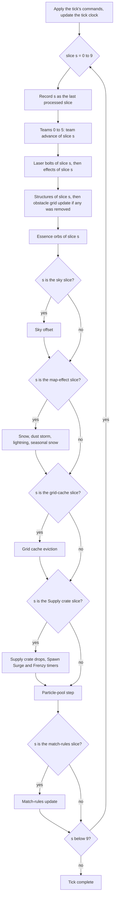
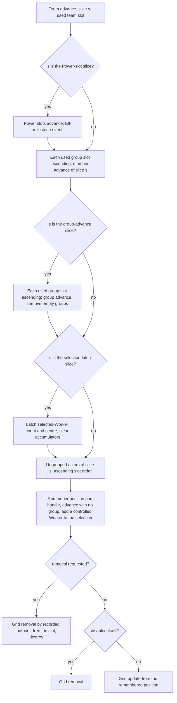
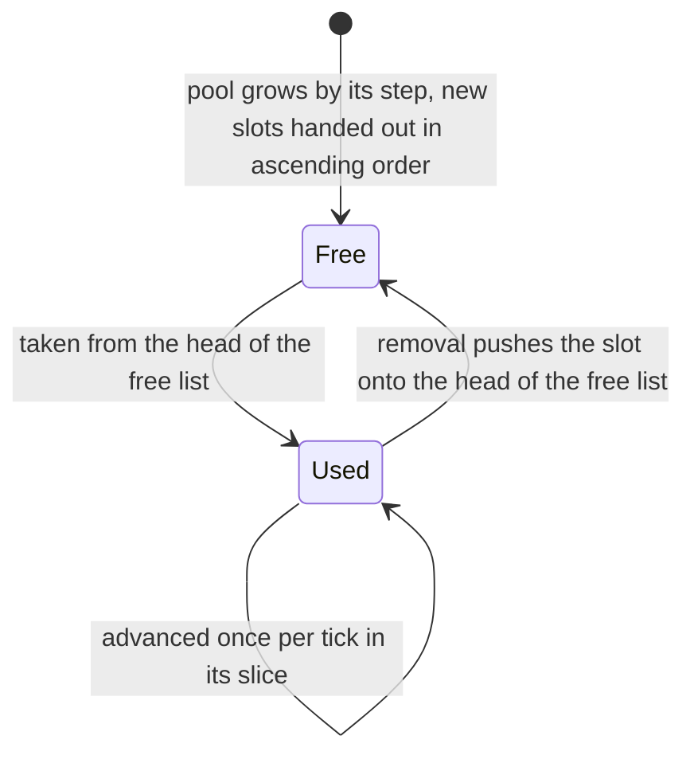

# Containers and update order

> Status: Reference · Prefix: R-SIM · Related: [Simulation model](README.md) · [Tick timing and main loop](01_tick_timing_and_main_loop.md) · [Match lifecycle and state reset](02_match_lifecycle_and_state_reset.md) · [Entity model and identity](03_entity_model_and_identity.md) · [Space, routing and physics](05_space_routing_and_physics.md) · [Teams and player commands](06_teams_and_player_commands.md) · [Randomness and integrity](07_randomness_and_integrity.md)

## 1 Purpose and player experience

This document specifies where the simulated objects of a match live and in which order they change:

- the members of the match world and every simulation container, with how objects enter and leave each one;
- the iteration order of the containers and how they hand out and reuse slots, which is what makes the update order identical on every participant;
- the details of slice partitioning that the tick structure of [01](01_tick_timing_and_main_loop.md) relies on;
- the exact order of every step inside one update slice, down to the order of actors within a team;
- the rules for creating and removing objects;
- the map-effect spawners for snow, dust storms and lightning;
- the register of outcomes that the update order decides, with the stable key of each;
- the query and service operations of the match world.

The tick, its ten update slices, the slice bounds of a sliced pool and the same-tick advance rule are defined in [01](01_tick_timing_and_main_loop.md) (R-SIM-510 to R-SIM-516); this document specifies what runs inside them. Spatial grids and routes are [05](05_space_routing_and_physics.md).

**Player experience.** The update order is invisible to players, but it decides every tie: which team takes a contested Control Zone, which Worker occupies a port, which Spawn Node's production lands first. Because the order is fixed and identical everywhere, the same match plays out the same way for every participant.

## 2 Rules

### 2.1 The match world

**R-SIM-201** (MUST) Exactly one match world exists at a time while a match runs, and every simulation step acts on the current match world ([02](02_match_lifecycle_and_state_reset.md) R-SIM-015). How Species owns world, region and match state is DEC-223.

**R-SIM-202** (MUST) The match world holds the members of table 2.1-A with the initial values given there. Members marked presentation never feed a simulation rule (DEC-007).

Table 2.1-A Match-world members.

| Member | Initial value | Meaning | Class |
|---|---|---|---|
| last processed slice | 0 | the last slice passed to the world step; the sky renderer reads it for its offset | presentation reads it |
| co-op group colour taken, per co-op group and per member | false | whether the first and the second shade of each co-op group's colour have been handed out ([06](06_teams_and_player_commands.md)) | simulation |
| crate-drop announcement pending | true | the drop announcement shows only for the first Supply crate of the match | presentation |
| terrain height field (`TerrainField`) | built at initialisation step 5 | heights, normals and render data ([terrain](../../architecture/components/terrain.md)) | simulation |
| actor grid (`ActorGrid`) | built at initialisation step 7 | spatial index of actors, cells of `ref.sim.actor_grid.cell_size` ([05](05_space_routing_and_physics.md)) | simulation |
| actor grid cache (`ActorGridCache`) | built at initialisation step 7 | memo of enemy queries ([05](05_space_routing_and_physics.md)) | simulation |
| obstacle grid (`ObstacleGrid`) | built at initialisation step 7 | structure footprint grid, cells of `ref.sim.obstacle_grid.cell_size` ([05](05_space_routing_and_physics.md)) | simulation |
| map definition (`MapDefinition`) | loaded at initialisation step 1 | the parsed map ([maps](../08_maps_and_level_design/rules_and_conventions.md)) | simulation data |
| sky renderer (`SkyRenderer`) | built at initialisation step 7 | advanced in slice `ref.sim.slice.sky`; cosmetic | presentation |
| sea renderer (`SeaRenderer`) | built at initialisation step 5 | advanced once per render frame by the main loop; cosmetic | presentation |
| land route graph (`LandRouteGraph`) | built at initialisation step 7 | land routes ([05](05_space_routing_and_physics.md)) | simulation |
| sea route graph (`SeaRouteGraph`) | built at initialisation step 7 | sea routes of Transports ([05](05_space_routing_and_physics.md)) | simulation |
| teams (`MatchTeam`) | all six created at initialisation step 8, unused slots included | [06](06_teams_and_player_commands.md) | simulation |
| start position per team slot | "none" | the map start position, 0 to the player count − 1, of each team slot | simulation |
| shared map-effect timer | `ref.sim.weather.shared_timer_initial` | the timer of the snow, dust-storm and lightning spawners; a value below `ref.sim.weather.first_run_threshold` marks their first run (§2.8) | simulation |
| Supply crate drop countdown | 0 | [crates and powers](../04_supply_crates_powers_and_weapons/crates_and_powers.md) | simulation |
| Spawn Surge timer; Frenzy timer | 0; 0 | crate-outcome timers, counted down in slice `ref.sim.slice.supply_crates` (R-SIM-218) | simulation |
| Rogue faction allowed | true | while false, the look-ups of the Rogue faction team and of the Visitor faction team return "none" | simulation |
| teams initialised | false | set at the end of initialisation step 8 | simulation |
| centre-screen message: timer, text, team, no-overwrite flag | 0; empty; "none"; false | a message expires after `ref.sim.world.message_expiry` of real time; the team "no team" shows it in white | presentation |
| map lights (`MapLight`) | built at initialisation step 5 | render data | presentation |
| structure pool | empty | every structure, Supply crates included | simulation |
| Essence-orb pool | `ref.sim.container.orb_presize` free slots | Essence orbs | simulation |
| laser-bolt pool | empty | laser bolts | simulation |
| effect pool | empty | every effect kind of [03](03_entity_model_and_identity.md) table 2.3-B | simulation |
| chat messages | empty | newest first; each holds its text, the sender's participant id, its receive time (real time), its colour and the sender's name | presentation |
| wind direction | the zero vector | set by the dust-storm spawner (§2.8) | simulation |
| co-op group per team slot | 0 | 0 for none, 1 or 2 for an alliance group ([06](06_teams_and_player_commands.md)) | simulation |
| colour of each co-op group | "none" | the colour id chosen for each of the two groups | simulation |
| burn patches | empty | scorched terrain patches, each a position and a radius | presentation |
| seasonal-theme flag | false | copied from the match setup at initialisation step 4 (DEC-118) | simulation |
| alpha depth-sort storage | empty | storage for the far-to-near sort of the structure alpha pass | presentation |

**R-SIM-203** (MUST) Neighbour-query results and every other scratch list are storage of the call that fills them; the match world holds no shared result buffer (DEC-028).

### 2.2 Simulation containers

**R-SIM-204** (MUST) The simulated objects of a match live in the containers of table 2.2-A, enter them only by the "added by" path and leave them only by the "removed when" path.

Table 2.2-A Simulation containers.

| Container | Owner | Kind | Element handle | Added by | Removed when | Advanced per slice |
|---|---|---|---|---|---|---|
| ungrouped actors | team | sliced pool (`SlicedPool`) that grows by `ref.sim.container.ungrouped_step` slots | (team, ungrouped, slot, serial) | the spawn operation without a group (R-SIM-226) | its advance requests removal (R-SIM-221 step 5) | yes |
| group members | actor group | sliced pool that grows by `ref.sim.container.member_step` slots and starts with as many slots as the group was created for | (team, group slot, slot, serial) | the spawn operation with a group | its advance requests removal (R-SIM-222) | yes |
| actor groups | team | pool, not sliced, that grows by `ref.sim.container.group_step` slots | group slot | group creation (R-SIM-227) | the group's advance requests removal in slice `ref.sim.slice.group_advance` | no: every group advances its members in every slice, and advances itself once per tick |
| special units | team | list of handles | a copy of the actor's handle | the spawn hook of a Leader, a Transport, a Collector or a Builder | that actor is removed | no: a look-up list (DEC-117) |
| structures | match world | sliced pool that grows by `ref.sim.container.structure_step` slots | (team, structure pool, none, serial) | initialisation step 7; Supply crate drops; the runtime creators of [03](03_entity_model_and_identity.md) table 2.4-C | its advance requests removal (R-SIM-232) | yes |
| Essence orbs | match world | sliced pool of values, `ref.sim.container.orb_presize` slots at creation, growing by `ref.sim.container.orb_step` | (team, Essence-orb pool, slot, generation) | Essence-orb spawn ([03](03_entity_model_and_identity.md) R-SIM-126) | its advance requests removal | yes |
| laser bolts | match world | sliced pool of values that grows by `ref.sim.container.laser_bolt_step` slots | (team, laser-bolt pool, slot, generation) | laser firing ([03](03_entity_model_and_identity.md) R-SIM-125) | its advance requests removal | yes |
| effects | match world | sliced pool that grows by `ref.sim.container.effect_step` slots | (team or no team, effect pool, slot, serial) | the creators of [03](03_entity_model_and_identity.md) table 2.3-B | its advance requests removal | yes |
| map lights | match world | list that grows by `ref.sim.container.light_step` | — | initialisation step 5 | emptying the match world | render data |
| chat messages; burn patches | match world | lists | — | a chat message; a scorch | after `ref.sim.world.chat_expiry` of real time; never | presentation |
| actor-grid cells, one set per team | actor grid | [05](05_space_routing_and_physics.md) | handle | registration | deregistration | — |
| actor-grid cache entries | actor grid cache | [05](05_space_routing_and_physics.md) | — | a cache miss | eviction in slice `ref.sim.grid_cache.evict_slice` | — |
| obstacle-grid cells | obstacle grid | [05](05_space_routing_and_physics.md) | structure serial | [05](05_space_routing_and_physics.md) (DEC-095) | [05](05_space_routing_and_physics.md) | — |
| route-graph nodes; routes | route graphs | [05](05_space_routing_and_physics.md) | slot | graph construction; route generation | never; route deletion (DEC-651) | — |
| structure ports (`StructurePort`) | structure | list | port index | port set-up | port rebuild | — ([buildings](../03_buildings_and_world_objects/README.md)) |
| particles (`ParticleInstance`) | particle pool | sliced pool | — | particle creation | end of the particle's life | presentation: every particle advances in slice `ref.sim.slice.particles` |

**R-SIM-205** (MUST) A team's ungrouped actors are every actor spawned without an actor group, the team's bot controller included. Troopers, Bombers, centipede segments and Hive ants are members of actor groups (DEC-117).

### 2.3 Iteration order and slot reuse

**R-SIM-206** (MUST) Every simulation pool is iterated in ascending slot order, skipping free slots, and an iteration includes the slots that become used while it runs, within the limits of the slice bounds (§2.4).

**R-SIM-207** (MUST) The ungrouped-actor pools, the member pools, the structure pool, the Essence-orb pool, the laser-bolt pool, the effect pool and the particle pool hand out slots last-freed-first: freeing a slot puts it at the head of the pool's free list, and taking a slot takes the head. When no slot is free, the pool grows by its step: the new slots are appended after the highest slot, and they are handed out in ascending order.

**R-SIM-208** (MUST) The actor-group pool takes the head of its free list for a new group and then places the group at that slot explicitly, which rebuilds its free list in ascending slot order. A new group therefore takes the most recently freed group slot when a group has been removed since the last group creation, and otherwise the lowest free group slot.

**R-SIM-209** (MUST) Slot indices never move: removal never compacts a pool, and growth never renumbers a slot. Route storage is not one of these pools; it hands out its lowest free slot ([05](05_space_routing_and_physics.md), DEC-651).

**R-SIM-210** (MUST) No simulation code iterates a hash map, sorts by address or depends on where an object is allocated in memory. The only sort that touches simulated objects is the far-to-near depth sort of the structure alpha pass, which is presentation.

**R-SIM-211** (MUST) Every outcome that the iteration order decides is an explicit rule over a stable key (DEC-016). The stable key of iteration is the slot order that R-SIM-206 to R-SIM-209 produce, which every participant computes identically because every creation and removal happens inside the tick. The register of such outcomes is §2.9. Whether an object created or handed over during a tick advances in that same tick is DEC-455; its default is [01](01_tick_timing_and_main_loop.md) R-SIM-516.

**R-SIM-212** (MUST) A 2-D grid of the simulation (`Grid2D`, `SurfaceGrid`) returns its one shared outside value for a read outside its range and ignores a write outside its range. Its nearest-cell look-up is the integer part of coordinate ÷ cell size without subtracting the grid origin, which is correct because every simulation grid has its origin at 0. Value reads between cells interpolate bilinearly ([05](05_space_routing_and_physics.md), [terrain](../../architecture/components/terrain.md)).

### 2.4 Slice partitioning

**R-SIM-213** (MUST) A sliced pool computes the bounds of [01](01_tick_timing_and_main_loop.md) R-SIM-514 from its capacity at the moment each slice starts. A pool that grows during a tick computes the bounds of its later slices in that tick from its new capacity. Slices 0 to 8 each cover ⌊capacity ÷ `ref.sim.update_slices`⌋ + 1 slots; slice 9 runs from the slot after the last slot of slice 8 to capacity − 1, and is empty when that range is empty.

**R-SIM-214** (MUST) Every tick runs its slices in the order 0 to 9, without skipping or repeating a slice. Test builds check that every pool receives its slices in ascending order from 0 to 9, followed by 0 in the next tick, except for its first slice after it is created or emptied, which can be any slice.

**R-SIM-215** (MUST) A sliced pool that has just been created or emptied records slot 0 as its last advanced slot, not "none". When its first slice of a tick is a slice s greater than 0, that slice starts at slot 1, so slot 0 is not advanced in that tick; from the next tick on, slice 0 starts at slot 0 again. This applies to the member pool of an actor group created during a tick, whose members first advance in a later slice, and to the pools of a team slot initialised during a tick (DEC-006, DEC-455).

**R-SIM-216** (MUST) Within a tick, an object in an earlier slice sees the state of objects in later slices as the previous tick left it, and within a slice an object sees the objects of earlier slots and earlier steps already advanced.

**R-SIM-217** (MUST) The renderer's extrapolation offset for a sliced pool ([01](01_tick_timing_and_main_loop.md) R-SIM-562) compares each slot with the last slot the pool has advanced in the current tick.

### 2.5 Update order within a tick

**R-SIM-218** (MUST) Before slice 0 of a tick, the tick's commands are applied and the tick clock is updated ([01](01_tick_timing_and_main_loop.md) R-SIM-510). In each slice s, the world step runs these steps in this order, followed by the particle-pool step and, in slice `ref.sim.slice.match_rules`, the match-rules update ([01](01_tick_timing_and_main_loop.md) R-SIM-511):

1. record s as the last processed slice;
2. **teams**: team slots 0 to 5 in index order, skipping unused slots, each running its team advance (R-SIM-221);
3. **weapons**: the slice-s range of the laser-bolt pool, each bolt's advance followed by its removal when requested; then the slice-s range of the effect pool, each effect's advance followed by its removal and destruction when requested;
4. **structures**: the slice-s range of the structure pool, each structure's advance followed by its removal when requested (R-SIM-232); then, when any structure was removed in this slice, the obstacle grid is updated (DEC-095);
5. **Essence orbs**: the slice-s range of the Essence-orb pool, each orb's advance followed by its removal when requested;
6. **sky**: in slice `ref.sim.slice.sky` only, the sky offset advances; it is cosmetic and makes no draw;
7. in slice `ref.sim.slice.map_effects` only, the map-effect spawners in this order: snow, when the map has the snow effect; dust storm, when the map has it; lightning, when the map has it; then snow again when the seasonal theme is active (§2.8);
8. in slice `ref.sim.grid_cache.evict_slice` only, the actor grid cache evicts its expired entries ([05](05_space_routing_and_physics.md));
9. in slice `ref.sim.slice.supply_crates` only, the Supply crate drops ([crates and powers](../04_supply_crates_powers_and_weapons/crates_and_powers.md)); then the Spawn Surge timer and the Frenzy timer each count down by one tick while above 0.

**R-SIM-219** (MUST) Steps 2 to 6 of R-SIM-218 run serially, in that order, never concurrently: they share the simulation generator, the actor grid, the structure pool, the object serial counter and the query results. A Species implementation that runs simulation work in parallel reproduces this observable order or replaces it explicitly; the threading model is DEC-224, and the tick rate that this order runs at is DEC-227.

**R-SIM-220** (MUST) The work of table 2.5-A runs in the stated slices of every tick.

Table 2.5-A Work per slice.

| Slice | Work |
|---|---|
| every slice | the slice share of every team's ungrouped actors and of every group's members; the slice share of the laser-bolt, effect, structure and Essence-orb pools |
| slice 0: `ref.sim.slice.group_advance` | the advance of every actor group (centre, radius, velocity, route, empty-group removal) |
| slice 0: `ref.sim.slice.selection_latch` | each team latches its selected-Worker count and centre |
| slice 0: `ref.sim.slice.particles` | every particle advances (presentation) |
| slice 1: `ref.sim.slice.power_slots` | every team's Power slots advance; kill-milestone events |
| slice 3: `ref.sim.slice.sky` | the sky offset (presentation) |
| slice 3: `ref.sim.slice.map_effects` | the snow, dust-storm and lightning spawners |
| slice 7: `ref.sim.grid_cache.evict_slice` | actor-grid cache eviction |
| slice 8: `ref.sim.slice.supply_crates` | Supply crate drops; the Spawn Surge and Frenzy timers |
| slice 8: `ref.sim.slice.match_rules` | the match-rules update, after the world step and the particle step |

**R-SIM-221** (MUST) A team advance in slice s runs only for a used team slot, and runs these steps in order:

1. in slice `ref.sim.slice.power_slots` only: the team's Power slots advance ([crates and powers](../04_supply_crates_powers_and_weapons/crates_and_powers.md)); then, when the team's kill total has changed since the previous tick, a kill-milestone presentation event fires for the lowest value of `ref.sim.team.kill_milestones` that is above the previous total and at or below the new total, at most one per tick, and the presentation shows it only for the local team (DEC-007); the new total is remembered;
2. in every slice: for each used group slot in ascending order, the group's member advance for slice s (R-SIM-222);
3. in slice `ref.sim.slice.group_advance` only: for each used group slot in ascending order, the group's advance ([03](03_entity_model_and_identity.md) R-SIM-129); a group that requests removal is removed and destroyed;
4. in slice `ref.sim.slice.selection_latch` only: the selected-Worker count becomes the count accumulated during the previous tick, and the selected-Worker centre becomes the accumulated position sum ÷ that count when the count is at least 1; with no Worker selected, the team has no centre (DEC-653). The accumulators are then cleared;
5. for each used slot of the slice-s range of the team's ungrouped actors whose actor is enabled: remember the actor's position and handle; run its advance with no group; if the actor is a live Worker under player control, add it to the selection accumulators; then, if the advance requested removal, remove the actor from the actor grid by its recorded footprint (DEC-650), free its slot and destroy it; else, if the actor has disabled itself, remove it from the actor grid; else update its actor-grid registration from the remembered position to its new position.

**R-SIM-222** (MUST) A group's member advance for slice s takes each used slot of the slice-s range of the member pool whose actor is enabled: it remembers the actor's position, runs the actor's advance with the group, and then either removes the member (actor-grid removal by the recorded footprint, and destruction) when removal was requested, or updates its actor-grid registration from the remembered position to its new position. A member that disabled itself during its advance stays registered in the actor grid ([03](03_entity_model_and_identity.md) R-SIM-114).

**R-SIM-223** (MUST) As a consequence, within one slice, the members of team 0's groups advance (in group-slot order, each group's members in slot order) before team 0's ungrouped actors, which advance before any actor of team 1; and every team's actors advance before the laser bolts, effects, structures and Essence orbs of the same slice.

**R-SIM-224** (MUST) A team's bot controller is one of its ungrouped actors and advances in the slice that its slot gives it; DEC-312 takes this to be slice 0. Its decisions and the recount of bot navigation nodes, which are structures and advance in step 4 of each slice, happen in the order that their slots give within the tick; this changes a bot's reaction time by at most one tick (DEC-312).

**R-SIM-225** (MUST) An object created during a tick, or handed from one container slot to another during a tick, advances again in that tick exactly when its new slot lies after the last slot already advanced ([01](01_tick_timing_and_main_loop.md) R-SIM-516, DEC-455). This covers Essence orbs handed between spawn-network structures, Workers spawned into a team's pool, effects and laser bolts created during a tick, and Supply crates opened before or after a Spawn Node in structure order (DEC-304).

### 2.6 Creation rules

**R-SIM-226** (MUST) Actors are created only by the spawn operation `MatchWorld::spawnActors(position, team, group, kind, count, velocity, spread, roam range = none, route = none, route waypoint = none)`. When the team is the Rogue faction slot or the Visitor faction slot and that slot is unused, the slot is initialised first ([06](06_teams_and_player_commands.md)). For each of the count actors, in order:

1. the team's actor creation ([03](03_entity_model_and_identity.md) R-SIM-108), into the group when one is given, else among the ungrouped actors;
2. set its kind ([03](03_entity_model_and_identity.md) R-SIM-109);
3. its position: the valid-spawn-position search around the position with the spread ([05](05_space_routing_and_physics.md) R-SIM-368); each attempt draws a distance `SimRng::NextUnit(spread)` and then an angle `SimRng::NextUnit(2π)` around the position, and is accepted when it lies on the map and the terrain height there is above `ref.sim.physics.sea_level`;
4. clear its on-ground flag;
5. its velocity: the given velocity;
6. its front: for a Worker, a random horizontal direction from two signed unit-fraction draws of the simulation generator; for every other kind, the normalised velocity, or `ref.sim.spawn.default_front` when the velocity is zero;
7. its handle (team, group, slot) and its serial;
8. its spawn point: the given position;
9. its roam range: the given roam range, or the spread when the roam range is "none";
10. its route and route waypoint;
11. its spawn hook;
12. its actor-grid registration with its radius.

When the actors were spawned into a group, the group then recomputes its formation offsets ([06](06_teams_and_player_commands.md)). The spawn operation makes no population-cap check: caps are enforced by the structures that spawn actors ([population flow](../05_population_flow.md)). Every draw of these steps belongs to this spawn step (DEC-652).

**R-SIM-227** (MUST) A group is created by the team's group creation with a member kind, a count and a position: it takes a group slot (R-SIM-208), creates the actor-group subtype that the member kind selects (Trooper: Strike team; Bomber: airstrike flight; Crawler: Crawler group; any other kind: a plain actor group), places it in its slot, and calls the group's spawn hook.

**R-SIM-228** (MUST) Essence orbs are created only by Essence-orb spawn ([03](03_entity_model_and_identity.md) R-SIM-126), laser bolts only by laser firing ([03](03_entity_model_and_identity.md) R-SIM-125), and effects only by the creators of [03](03_entity_model_and_identity.md) table 2.3-B; a shot helper that fires a grenade, a rocket, a turret round or a laser also creates the shot's muzzle flash ([weapons and projectiles](../04_supply_crates_powers_and_weapons/weapons_and_projectiles.md)).

**R-SIM-229** (MUST) Structures are created either at match-world initialisation step 7 from their map records ([02](02_match_lifecycle_and_state_reset.md)), or during the match by a rule, which inserts the structure into the structure pool and updates the obstacle grid incrementally and the affected route-graph edges (DEC-095).

**R-SIM-230** (MUST) Any advance can create objects; their first advance follows R-SIM-225. Nothing creates a simulated object outside a tick or outside match-world initialisation: tutorial effects that insert objects are sequenced simulation events at a tick (DEC-103), and route previews that the UI draws live in a separate store (DEC-095).

### 2.7 Removal rules

**R-SIM-231** (MUST) Every kind of object is removed by the owner and with the side effects of table 2.7-A.

Table 2.7-A Removal.

| Kind | Removed by | Side effects |
|---|---|---|
| actor | its container's owner, after the actor's advance requested removal (dead, or destroyed) | actor-grid removal by the recorded footprint (DEC-650); destruction, which lowers the actor population count and unregisters a special unit ([03](03_entity_model_and_identity.md) R-SIM-116) |
| dead actor that is still fading | not removed | it stays in its container and in the actor grid, visible to grid queries; most queries skip dead actors explicitly ([05](05_space_routing_and_physics.md)) |
| a whole team | the match rules eliminate it ([skirmish rules](../01_skirmish_rules_and_modes/README.md)) | the elimination of [06](06_teams_and_player_commands.md) R-SIM-407 applies: every group member and ungrouped actor of the team receives a lethal health change, every Power of the team stops, and every Transit Gate it owns becomes neutral; removal then follows the normal death path |
| actor group | its team, in slice `ref.sim.slice.group_advance`, when the group reports that no member slot is in use | destroying the group clears the team's selected group when it names this group |
| structure | the structure pool (R-SIM-218 step 4) | when it is a bot navigation node or a wall, the bot navigation links are recomputed at once ([bots](../07_bots/README.md)); the obstacle grid is updated, and the affected route-graph edges are rebuilt (DEC-095) |
| effect, laser bolt, Essence orb | its pool (R-SIM-218 steps 3 and 5) | none |
| route | route deletion only ([05](05_space_routing_and_physics.md), DEC-651) | none |
| everything | emptying the match world (R-SIM-232) | — |

**R-SIM-232** (MUST) Emptying the match world, at teardown ([02](02_match_lifecycle_and_state_reset.md) table 2.6-A step 4), destroys the sea renderer, the terrain height field, the map lights, every structure and every effect; empties the Essence-orb and laser-bolt pools; deletes the actor-group offset table; destroys every team with its actors and groups; destroys the map definition, the actor grid, the actor grid cache, the obstacle grid and the sky renderer; and resets the bot objective state and the Transport objective list. Destroying the match world also sets the actor population count to 0.

### 2.8 Map-effect spawners

**R-SIM-233** (MUST) The map-effect spawners run in slice `ref.sim.slice.map_effects` in the order of R-SIM-218 step 7. Every object they create is an effect with the handle (no team, effect pool, slot, serial), and every period below is counted in ticks (DEC-002).

**R-SIM-234** (MUST) The snow spawner: when the shared map-effect timer is below `ref.sim.weather.first_run_threshold`, it first creates `ref.sim.weather.snow_burst` snowflakes (`SnowFlake`) at random positions over the map, each at a random height between 0 and `ref.sim.weather.snow_burst_height_range`. It then counts the shared timer down by one tick; when the timer reaches 0 or below, it sets the timer to `ref.sim.weather.snow_period` and creates one snowflake at a random position over the map at height `ref.sim.weather.snow_height_base` plus a random amount up to `ref.sim.weather.snow_height_range`.

**R-SIM-235** (MUST) The dust-storm spawner: it counts the dust vortex timer down by one tick; when it reaches 0 or below, the timer is set to `ref.sim.weather.vortex_timer_base` plus a random amount up to `ref.sim.weather.vortex_timer_range`, and then, if a draw reduced modulo `ref.sim.weather.vortex_chance` is 0 and no vortex is active, a vortex starts at a random point over the map at a random height up to `ref.sim.weather.vortex_height_range`, re-drawn while the terrain at that point is at or below `ref.sim.weather.land_threshold` (a bounded search with a deterministic fallback, DEC-014); otherwise the vortex ends and the wind direction becomes the normalised difference of two random positions. On its first run (shared timer below `ref.sim.weather.first_run_threshold`) it creates `ref.sim.weather.dust_burst` dust objects (`DustVortex`), each at a random height up to `ref.sim.weather.dust_burst_height_range`, each growing its size by a random amount up to `ref.sim.weather.dust_size_range`. It then counts the shared timer down by one tick; when it reaches 0 or below, it creates `ref.sim.weather.dust_per_period` dust objects and sets the timer to `ref.sim.weather.dust_period`. While a vortex is active, every actor-grid neighbour within `ref.sim.weather.vortex_radius` of the vortex's ground point that is an on-ground Worker enters the in-vortex state and becomes airborne ([Worker](../02_units/worker.md)).

**R-SIM-236** (MUST) The lightning spawner counts the shared timer down by one tick; when it reaches 0 or below, it sets the timer to a random value up to `ref.sim.weather.lightning_timer_range` and creates one lightning strike (`LightningStrike`) at height `ref.sim.weather.lightning_height` over a random land point, re-drawn while the terrain at the point is at or below `ref.sim.weather.land_threshold` (bounded, DEC-014).

**R-SIM-237** (MUST) The snow, dust-storm and lightning spawners share one timer, so on a map with more than one of these effects, or with the seasonal theme and dust, each spawner's timer setting changes the others' timing; with the seasonal theme on a snow map the snow spawner runs twice per tick. This interference is reference behaviour (DEC-006).

**R-SIM-238** (MUST) Each draw of the spawners is a simulation draw when it decides a simulation outcome (the vortex chance, position and timer, the wind direction, the lightning timer and position) and a presentation draw otherwise; snowflake draws are presentation draws (DEC-013, DEC-118). [07](07_randomness_and_integrity.md) lists the generator of every draw site. The number of objects each spawner creates is a simulation fact in every case, because every effect takes an object serial ([03](03_entity_model_and_identity.md) R-SIM-138).

### 2.9 Order-dependent outcomes

**R-SIM-239** (MUST) The outcomes of table 2.9-A depend on the update or query order. Each is an explicit rule of its owning document with the stable key given here (DEC-016).

Table 2.9-A Order-dependent outcomes.

| Outcome | Rule and stable key | Owning document |
|---|---|---|
| port occupant | the first operating Worker in actor-grid result order: cell x, then cell z, then team 0 to 5, then cell slot | [buildings](../03_buildings_and_world_objects/README.md); [05](05_space_routing_and_physics.md) R-SIM-310 |
| ownership ties of Spawn Nodes, turrets, Solar Arrays and Control Zones | the lowest team index | [buildings](../03_buildings_and_world_objects/README.md); [Zone Control](../01_skirmish_rules_and_modes/zone_control.md) |
| simultaneous Launch Vessel launches | the lowest team index | [Launch Race](../01_skirmish_rules_and_modes/launch_race.md) |
| single-round Siege winner | the first slot of the winning side | [Siege](../01_skirmish_rules_and_modes/siege.md) |
| Relic Run co-op winner | the last slot of the winning group | [Relic Run](../01_skirmish_rules_and_modes/relic_run.md) |
| Launch Vessel look-up | the last matching structure in structure order | [mode objects](../03_buildings_and_world_objects/mode_objects.md) |
| Relic spawn zone | the first Relic Spawn Zone, in structure order, at the greatest distance | [Relic Run](../01_skirmish_rules_and_modes/relic_run.md) |
| Population Limiter of a Spawn Node | the first Population Limiter in structure order | [economy and spawn objects](../03_buildings_and_world_objects/economy_and_spawn_objects.md) |
| Beam Dish receiver | the nearest receiver by distance | [buildings](../03_buildings_and_world_objects/README.md) |
| Command Console ownership | the first qualifying team in slot order; it changes only to a team with strictly more operators | [mode objects](../03_buildings_and_world_objects/mode_objects.md) |
| bot structure choices | structures in structure order; the first found wins; comparisons are strict | [bots](../07_bots/README.md) |
| area damage and its kill credit | actors in actor-grid result order | [05](05_space_routing_and_physics.md) R-SIM-389 |
| nearest-actor selections | strict less-than comparisons, so the first actor found in result order wins a tie | [05](05_space_routing_and_physics.md) |
| bot Leader orders after a refused promotion | the corrected ids of DEC-087 | [bots](../07_bots/README.md) |

### 2.10 Match-world query and service operations

**R-SIM-240** (MUST) The match world offers the operations of table 2.10-A with the meaning given there. Operations marked local serve one participant's presentation and input, never run inside the simulation step, and reach the simulation only as commands (DEC-008).

Table 2.10-A Match-world operations.

| Operation | Meaning |
|---|---|
| resolve a handle; resolve an actor; resolve a typed actor; resolve a group; resolve an effect; resolve a structure by serial; resolve an Essence orb by slot; find the Essence orb of an owner | [03](03_entity_model_and_identity.md) §2.4 |
| first actor hit by a ray; first structure hit by a ray | the first actor of teams 0 to 5, or the first structure, that the ray hits ([05](05_space_routing_and_physics.md) R-SIM-387); "none" when nothing is hit |
| structure under a ray for a team (local) | among the structures of that team or of no team: a Beam Dish or a turret wins at once, at range 0, when the exact ray test hits it; any other structure is tested as a sphere of `ref.sim.query.structure_pick_fraction` × its radius; the best is the one with the smallest screen-space distance between its centre and the hit point |
| actor group under a ray for a team (local) | a ray test against each group's sphere of `ref.sim.query.group_pick_factor` × its radius, then against each member's sphere of the same factor × the member's radius; the best by screen-space distance |
| actor under a ray for a team (local) | over the team's ungrouped actors: a Leader is tested against its camera-scaled bounding sphere; a Transport by its exact ray test, which wins at range `ref.sim.query.transport_pick_range`; every other actor as a sphere of `ref.sim.query.actor_pick_factor` × its radius; Workers can be excluded |
| walkability; walking distance | [05](05_space_routing_and_physics.md) |
| visibility between two points | a terrain ray from the first point moved `ref.sim.query.visibility_offset` along the direction; visible when the ray hits nothing or hits beyond the distance between the points + `ref.sim.query.visibility_offset` |
| spawn actors; Essence-orb spawn | R-SIM-226; [03](03_entity_model_and_identity.md) R-SIM-126 |
| throw a weapon; fire a rocket; fire a turret round; launch a fireball; fire a laser; create a shockwave; area damage | [weapons and projectiles](../04_supply_crates_powers_and_weapons/weapons_and_projectiles.md); [05](05_space_routing_and_physics.md) R-SIM-388 |
| select Workers; give crowd orders; promote a Worker; demote a Leader; apply a team's control state | command execution ([06](06_teams_and_player_commands.md)) |
| friendship; Rogue faction team; Visitor faction team; faction set-up; start positions; team from a start position; position rotation; attacker and defender tests; co-op and Siege set-up; group colours | [06](06_teams_and_player_commands.md) |
| recompute the bot navigation links | every live bot navigation node recomputes its neighbours, and then the links are culled ([bots](../07_bots/README.md)) |
| viable position | true when the position is walkable to at least one bot navigation node ([05](05_space_routing_and_physics.md)) |
| local team; local Power slots (local) | the team and Power slots of the local team id; "none" when the local team id is "none" |
| rendering, messages, chat, burn patches, fog and lights (local) | presentation ([renderer](../../architecture/components/renderer/README.md)) |
| last processed slice | read and set the last processed slice |

## 3 States and flows

Diagram 3-A shows the order of one tick.

Caption: Diagram 3-A, the order of one tick with the world step expanded (R-SIM-218, R-SIM-220). The world and particle steps are skipped while the world is held; the match-rules update still runs ([01](01_tick_timing_and_main_loop.md) R-SIM-511).

Diagram 3-B shows one team advance.

Caption: Diagram 3-B, the team advance of one slice (R-SIM-221, R-SIM-222).

Diagram 3-C shows a pool slot.

Caption: Diagram 3-C, the life of a slot of a last-freed-first pool (R-SIM-207, R-SIM-209).

## 4 Tuning table

| key | value | unit | range or notes | requirement | DEC |
|---|---|---|---|---|---|
| `ref.sim.container.ungrouped_step` | 100 | slots | growth step of a team's ungrouped actors | R-SIM-204 | DEC-455 |
| `ref.sim.container.member_step` | 100 | slots | growth step of a group's members; the pool starts with the group's requested count | R-SIM-204 | DEC-455 |
| `ref.sim.container.group_step` | 5 | slots | growth step of a team's actor groups | R-SIM-204 | DEC-455 |
| `ref.sim.container.structure_step` | 10 | slots | growth step of the structure pool | R-SIM-204 | DEC-455 |
| `ref.sim.container.orb_presize` | 100 | slots | slots of the Essence-orb pool at creation | R-SIM-202, R-SIM-204 | DEC-455 |
| `ref.sim.container.orb_step` | 100 | slots | growth step of the Essence-orb pool | R-SIM-204 | DEC-455 |
| `ref.sim.container.laser_bolt_step` | 100 | slots | growth step of the laser-bolt pool | R-SIM-204 | DEC-455 |
| `ref.sim.container.effect_step` | 100 | slots | growth step of the effect pool | R-SIM-204 | DEC-455 |
| `ref.sim.container.light_step` | 1 | entries | growth step of the map-light list (render data) | R-SIM-204 | — |
| `ref.sim.slice.group_advance` | 0 | slice index | actor-group advance and empty-group removal | R-SIM-220, R-SIM-221 | — |
| `ref.sim.slice.selection_latch` | 0 | slice index | selected-Worker count and centre | R-SIM-220, R-SIM-221 | DEC-653 |
| `ref.sim.slice.particles` | 0 | slice index | every particle advances in this slice (presentation) | R-SIM-204, R-SIM-220 | — |
| `ref.sim.team.kill_milestones` | 500, 1000, 2000, 3000, 4000, 5000 | kills | one presentation event per tick at most | R-SIM-221 | DEC-007 |
| `ref.sim.spawn.default_front` | (1, 0, 0) | unit vector | front of a non-Worker actor spawned with zero velocity | R-SIM-226 | — |
| `ref.sim.spawn.orb_lift` | 1 | wu | an Essence orb starts this far above its given position | R-SIM-228 | — |
| `ref.sim.weather.shared_timer_initial` | −99.9 | s of game time (−999 ticks) | a marker value; below `ref.sim.weather.first_run_threshold` means first run | R-SIM-202, R-SIM-234 | DEC-002 |
| `ref.sim.weather.first_run_threshold` | −90 | s of game time (−900 ticks) | | R-SIM-234, R-SIM-235 | DEC-002 |
| `ref.sim.weather.snow_burst` | 150 | snowflakes | first-run burst | R-SIM-234 | — |
| `ref.sim.weather.snow_burst_height_range` | 1000 | wu | burst height drawn from 0 to this value | R-SIM-234 | DEC-118 |
| `ref.sim.weather.snow_period` | 1 | tick | 0.1 s; one snowflake per period | R-SIM-234 | DEC-002 |
| `ref.sim.weather.snow_height_base` | 700 | wu | | R-SIM-234 | — |
| `ref.sim.weather.snow_height_range` | 300 | wu | added to the base by a draw | R-SIM-234 | DEC-118 |
| `ref.sim.weather.vortex_timer_base` | 150 | ticks | 15 s | R-SIM-235 | DEC-002 |
| `ref.sim.weather.vortex_timer_range` | 150 | ticks | 15 s; the timer is 150 to 300 ticks | R-SIM-235 | DEC-002 |
| `ref.sim.weather.vortex_chance` | 10 | — | a vortex starts when a draw modulo this value is 0 (1 in 10) | R-SIM-235 | — |
| `ref.sim.weather.vortex_height_range` | 500 | wu | | R-SIM-235 | — |
| `ref.sim.weather.land_threshold` | 1.0 | wu | a vortex or lightning point needs terrain above this height | R-SIM-235, R-SIM-236 | DEC-014 |
| `ref.sim.weather.dust_burst` | 300 | dust objects | first-run burst | R-SIM-235 | — |
| `ref.sim.weather.dust_burst_height_range` | 1000 | wu | | R-SIM-235 | — |
| `ref.sim.weather.dust_size_range` | 20 | size units | random size growth of a burst dust object | R-SIM-235 | — |
| `ref.sim.weather.dust_per_period` | 2 | dust objects | | R-SIM-235 | — |
| `ref.sim.weather.dust_period` | 1 | tick | 0.1 s | R-SIM-235 | DEC-002 |
| `ref.sim.weather.vortex_radius` | 50 | wu | radius around the vortex's ground point | R-SIM-235 | — |
| `ref.sim.weather.lightning_timer_range` | 150 | ticks | 15 s; the timer is 0 to 150 ticks | R-SIM-236 | DEC-002 |
| `ref.sim.weather.lightning_height` | 1200 | wu | | R-SIM-236 | — |
| `ref.sim.world.message_expiry` | 3.0 | s of real time | centre-screen message (presentation) | R-SIM-202 | — |
| `ref.sim.world.chat_expiry` | 60 | s of real time | chat message (presentation) | R-SIM-204 | — |
| `ref.sim.query.structure_pick_fraction` | 0.75 | × radius | local structure picking | R-SIM-240 | — |
| `ref.sim.query.group_pick_factor` | 1.5 | × radius | local group picking | R-SIM-240 | — |
| `ref.sim.query.transport_pick_range` | 0.001 | screen-space range | a Transport's exact ray hit wins with this range | R-SIM-240 | — |
| `ref.sim.query.actor_pick_factor` | 1.0 | × radius | local actor picking | R-SIM-240 | — |
| `ref.sim.query.visibility_offset` | 20 | wu | start offset and end margin of the visibility test | R-SIM-240 | — |

The slice keys `ref.sim.slice.power_slots`, `ref.sim.slice.sky`, `ref.sim.slice.map_effects`, `ref.sim.slice.supply_crates` and `ref.sim.slice.match_rules`, and `ref.sim.update_slices`, are defined in [01](01_tick_timing_and_main_loop.md); the grid-cache slice `ref.sim.grid_cache.evict_slice` and the grid cell sizes `ref.sim.actor_grid.cell_size` and `ref.sim.obstacle_grid.cell_size` in [05](05_space_routing_and_physics.md). Every value is a reference value adopted as the Species starting value (DEC-004).

## 5 Edge cases and interactions

- **Same-tick hand-overs in the spawn network.** An Essence orb handed from one spawn-network structure to the next advances again in the same tick when the receiving structure's slot comes later in structure order, so a transit of h hops takes between 9h + 1 and 10h + 1 ticks, and the exact count on a map depends on the order in which its structures load (DEC-455; the upper bound is DEC-002; [population flow](../05_population_flow.md)).
- **Spawn Surge count.** A Supply crate that opens before a Spawn Node in structure order gives that Spawn Node one more request than one that opens after it (50 or 51; DEC-304).
- **Transit Gate waves against the cap.** The order in which Transit Gate waves are counted against the population cap follows structure order (DEC-455, [population flow](../05_population_flow.md)).
- **Countdown objects created mid-tick.** An effect created during a tick into a slot above the last advanced slot advances in the same tick, so a countdown per advance starts one tick early, and an object timed by match time takes one extra movement step ([01](01_tick_timing_and_main_loop.md) R-SIM-516).
- **Slot 0 of a new group.** A group created during a tick, whose members' first slice of that tick is above slice 0, does not advance its member in slot 0 in that tick (R-SIM-215).
- **Group-slot reuse.** Because group creation rebuilds the free list in ascending order, freeing group slots 1, 2 and 3 in that order and then creating two groups gives them slots 3 and 1, where a last-freed-first pool would give slots 3 and 2 (R-SIM-208).
- **Disabled ungrouped actors.** An ungrouped actor that disables itself leaves the actor grid at once, while a disabled group member stays (R-SIM-221, R-SIM-222).
- **Selection with nothing selected.** With no Worker selected, the team has no selected-Worker centre; the route preview, the selection arrows and the Power icon position show nothing (DEC-653).
- **Map-effect timer sharing.** On a map with snow and lightning, the snow spawner keeps resetting the shared timer to one tick and lightning strikes fire on the same timer (R-SIM-237).
- **Pause.** While the world is held, no world step and no particle step runs, but the match-rules update runs in its slice ([01](01_tick_timing_and_main_loop.md)).

## 6 Acceptance criteria

| # | Given | When | Then | Requirements |
|---|---|---|---|---|
| AC-1 | an effect pool whose slots 3 and 7 were freed in that order | two effects are created | the first takes slot 7 and the second slot 3 | R-SIM-207 |
| AC-2 | a full structure pool of capacity 10 | a structure is created | the pool grows to 20 slots and the new structure takes slot 10 | R-SIM-204, R-SIM-207 |
| AC-3 | a team whose group slots 1, 2 and 3 were freed in that order | two groups are created | the first takes slot 3 and the second slot 1 (a last-freed-first pool would give slot 2) | R-SIM-208 |
| AC-4 | a pool of capacity 100 | the slices of one tick run | slices 0 to 8 cover 11 slots each and slice 9 covers 1 slot | R-SIM-213 |
| AC-5 | a pool that grows from 100 to 200 slots during slice 4 | slices 5 to 9 run | their bounds use the capacity 200 | R-SIM-213 |
| AC-6 | an actor group created in slice 3 of a tick | that tick completes | its member in slot 0 has not advanced; in the next tick it advances in slice 0 | R-SIM-215 |
| AC-7 | two teams with actors in slice 2 | slice 2 runs | every actor of team 0 (group members first) advances before any actor of team 1, and all of them before the structures of slice 2 | R-SIM-218, R-SIM-221, R-SIM-223 |
| AC-8 | a team with no selected Worker | slice `ref.sim.slice.selection_latch` runs | the team has no selected-Worker centre and no field holds NaN | R-SIM-221 |
| AC-9 | a team whose kill total jumps from 400 to 1100 in one tick | slice `ref.sim.slice.power_slots` runs | one milestone event for 500 fires | R-SIM-221 |
| AC-10 | a structure removed in slice 6 | slice 6 completes | the obstacle grid no longer lists it before slice 7 starts | R-SIM-218, R-SIM-231 |
| AC-11 | a Worker spawned with zero velocity and a Leader spawned with zero velocity | they are spawned | the Worker's front is horizontal and drawn from the simulation generator, the Leader's front is `ref.sim.spawn.default_front` | R-SIM-226 |
| AC-12 | a spawn into the unused Rogue faction slot | the spawn operation runs | the slot is initialised first and the actors join it | R-SIM-226 |
| AC-13 | a map with snow and the seasonal theme active | slice `ref.sim.slice.map_effects` runs | the snow spawner runs twice in that tick | R-SIM-218, R-SIM-237 |
| AC-14 | a match whose shared timer starts at `ref.sim.weather.shared_timer_initial` on a snow map | the first map-effect slice runs | `ref.sim.weather.snow_burst` snowflakes are created, then one more | R-SIM-234 |
| AC-15 | the same match setup and commands run twice, once with the simulation steps in parallel jobs | both runs complete | their per-tick simulation state is identical | R-SIM-219 |
| AC-16 | an eliminated team | the elimination runs | every actor of the team dies through the normal death path and its Transit Gates become neutral | R-SIM-231 |

## 7 Dependencies

- Reference documents: [01 Tick timing and main loop](01_tick_timing_and_main_loop.md) (tick structure, slice bounds, slice keys, same-tick rule, held world, extrapolation), [02 Match lifecycle and state reset](02_match_lifecycle_and_state_reset.md) (initialisation steps, teardown), [03 Entity model and identity](03_entity_model_and_identity.md) (handles, contracts, effect kinds), [05 Space, routing and physics](05_space_routing_and_physics.md) (grids, routes, spawn-position search, ray tests, area damage), [06 Teams and player commands](06_teams_and_player_commands.md), [07 Randomness and integrity](07_randomness_and_integrity.md) (draw sites), [skirmish rules and modes](../01_skirmish_rules_and_modes/README.md) and the mode documents, [Worker](../02_units/worker.md), [buildings and world objects](../03_buildings_and_world_objects/README.md) and its kind documents, [supply crates, powers and weapons](../04_supply_crates_powers_and_weapons/README.md), [population flow](../05_population_flow.md), [bots](../07_bots/README.md), [maps](../08_maps_and_level_design/rules_and_conventions.md).
- Engine components: [terrain](../../architecture/components/terrain.md), [renderer](../../architecture/components/renderer/README.md), [diagnostics, test and performance](../../architecture/components/diagnostics_test_and_performance.md) (the slice-order check of R-SIM-214).
- Assets: none.

## 8 Open decisions

- DEC-455 — same-tick advance of objects created or handed over during a tick (DEC-306 is superseded by it).
- DEC-312 — bot decisions and node recounts within a tick.
- DEC-224 — threading and job model.
- DEC-227 — simulation tick rate.
- DEC-223 — world, region and match state ownership.
- DEC-304 — Spawn Surge request count.
- DEC-651 — lifetime of simulation routes.
- Resolved and applied here: DEC-002, DEC-004, DEC-006, DEC-007, DEC-008, DEC-013, DEC-014, DEC-016, DEC-028, DEC-087, DEC-095, DEC-103, DEC-117, DEC-118, DEC-650, DEC-652, DEC-653.
