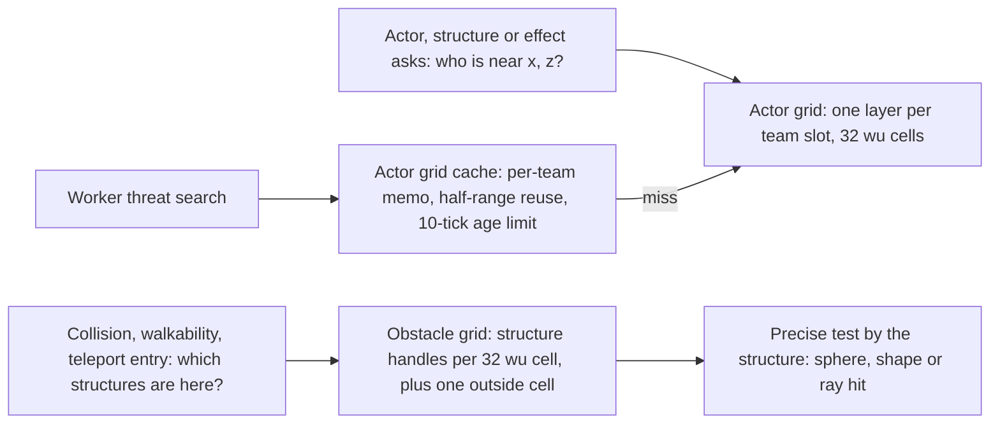
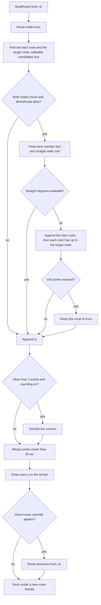
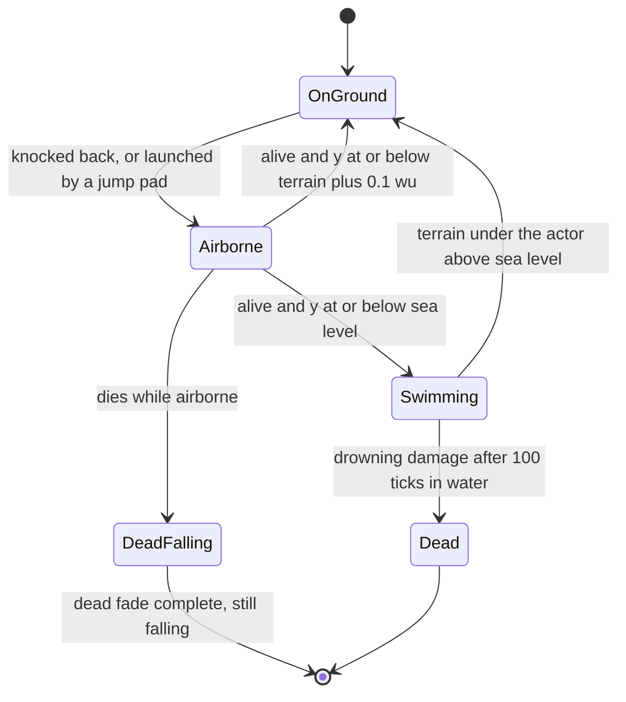
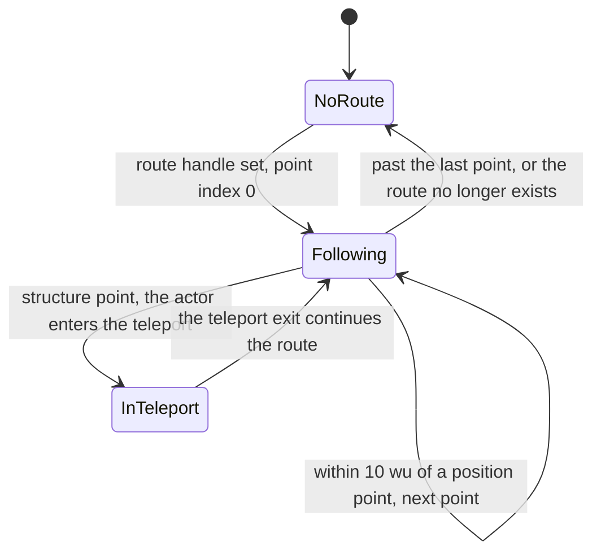

# Space, routing and physics

> Status: Reference · Prefix: R-SIM · Related: [README.md](README.md), [01_tick_timing_and_main_loop.md](01_tick_timing_and_main_loop.md), [03_entity_model_and_identity.md](03_entity_model_and_identity.md), [04_containers_and_update_order.md](04_containers_and_update_order.md), [06_teams_and_player_commands.md](06_teams_and_player_commands.md), [07_randomness_and_integrity.md](07_randomness_and_integrity.md)

## 1 Purpose and player experience

A reference match moves crowds of up to about 2,000 actors over an island terrain surrounded by sea. The player never sees the machinery in this document, but feels it everywhere: a Worker notices an enemy because the actor grid says one is near; a Worker throws a grenade because a cell count says the target is crowded; a Control Zone is contested because an enemy count is above zero; a crowd order flows around water, cliffs and walls because the land route graph found a chain of navigation nodes; a body hit by an explosion is flung into the air, falls, lands or drowns.

This document specifies, as reference behaviour:

- the three spatial structures of a match world (actor grid, actor grid cache, obstacle grid) and every query they answer, including the approximate queries whose softness is part of the tuned gameplay;
- the two route graphs, the walkability primitives, graph construction, the path query, route following and route lifetime;
- the movement model: per-tick integration, the ground, world and spawn clamps, falling, water, obstacle push, bounce, teleport entry, ray tests and the explosion primitive.

There is no rigid-body physics and no collision between actors. Motion is explicit per-tick integration, terrain height look-ups and push-out loops against structure hit volumes. Per-kind speeds and slope rules belong to [../../02_units/README.md](../02_units/README.md).

## 2 Rules

### 2.1 General

**R-SIM-300** (MUST) The values of §4 are the reference tuning baseline (DEC-004). The rules of this document are the specification of record for space, routing and physics (DEC-005). Every approximation named here (the cell-granular counts, the capacity-based presence tests, the cached enemy query, the inclusive obstacle-grid bounds, the Barrier Emitter dilation, the symmetric walkability memo and the start-relative slope test) is an explicit rule with a named key, never an implementation accident (DEC-006).

**R-SIM-301** (MUST) No step specified in this document stores a non-finite value (NaN or an infinity) in simulation state. Each site that could produce one carries the explicit guard that DEC-653 lists, and the guard keeps the reference result wherever that result is defined.

### 2.2 Spatial structures of the match world

**R-SIM-302** (MUST) Each match world (`MatchWorld`) owns exactly three spatial structures. They are created at match-world initialisation, at the step that [04_containers_and_update_order.md](04_containers_and_update_order.md) gives, and the map editor creates none of them.

| Structure | Species type | Cell size | Content | Upkeep |
|---|---|---|---|---|
| actor grid | `ActorGrid` | `ref.sim.actor_grid.cell_size` (32 wu) per side | actor handles, one layer per team slot; the no-team value is never registered | per actor, after each advance (R-SIM-308) |
| actor grid cache | `ActorGridCache` | — | memo of recent enemy queries | entries evicted by age once per tick (R-SIM-318) |
| obstacle grid | `ObstacleGrid` | `ref.sim.obstacle_grid.cell_size` (32 wu) per side | handles of structures whose hit volume overlaps the cell | incrementally, when a structure is created or removed (R-SIM-324) |

**R-SIM-303** (MUST) Only actors are registered in the actor grid. Structures, effects, laser bolts and Essence orbs are never registered. An Essence orb or an effect that looks for targets scans its own container, or queries the actor grid for actors.

**R-SIM-304** (MUST) Each spatial structure, and each route graph of §2.7, covers the whole map and is sized from the map's world extent. The reference specifies no partition of these structures below the map; their organisation at world scale is DEC-247.

### 2.3 Actor grid: layout, cells and registration

**R-SIM-305** (MUST) The actor grid has one layer per team slot (`ref.sim.max_teams` layers, [06_teams_and_player_commands.md](06_teams_and_player_commands.md)). Each layer is a row-major array of cells with trunc(world size ÷ `ref.sim.actor_grid.cell_size`) + `ref.sim.actor_grid.extra_cells` cells per axis. The cell index of a world coordinate is trunc(coordinate ÷ cell size), truncating toward zero (DEC-241 item 1).

**R-SIM-306** (MUST) A cell look-up does not clamp. Every caller passes an on-map position: the world clamp (R-SIM-366) keeps actor positions inside [0, world size], and the extra cell makes a coordinate equal to the world size valid. A look-up outside the grid is a defect, which a test-build assertion reports.

**R-SIM-307** (MUST) Each cell of each layer holds a growable slot array of actor handles with an intrusive free list, and follows this slot rule:

1. Capacity starts at `ref.sim.actor_grid.initial_cell_capacity` (0). When a registration finds no free slot, the capacity grows to `ref.sim.actor_grid.first_cell_capacity` (2) from 0, and is multiplied by `ref.sim.actor_grid.cell_growth_factor` (2) otherwise (so the capacities run 0, 2, 4, 8, each later capacity double the one before). The new slots join the free list in ascending slot order.
2. Registering a handle takes the slot at the head of the free list.
3. Unregistering a handle scans the whole cell, frees **every** slot that holds the handle, pushes each freed slot onto the head of the free list (the last slot freed is the first reused), and reports whether any slot held it.
4. Capacity never shrinks during a match.

The slot order of a cell is the within-cell order of every query result (R-SIM-310, DEC-016).

**R-SIM-308** (MUST) An actor's footprint is the set of cells it registers in:

- an actor of the no-team value is not registered;
- an actor of radius 0 (a sprite actor) registers in the single cell that contains (x, z);
- an actor of radius r > 0 (an actor with a hit shape) registers in every cell that overlaps the square [x − f·r, x + f·r] × [z − f·r, z + f·r], with f = `ref.sim.actor_grid.footprint_factor` (0.5, so the square's half-width is half the radius), clamped to the grid.

Registration follows the recorded footprint (DEC-650): registering records the cell set; unregistering or moving the actor uses the recorded cell set, never a set recomputed from the actor's current radius at its old position; a change of radius is a re-registration, in which the actor leaves its recorded cells and registers over the cells of its new radius at once; and an actor is re-registered whenever its cell set changes. The container that owns the actor updates its registration after each advance that does not request the actor's removal ([04_containers_and_update_order.md](04_containers_and_update_order.md)). An unregistration that finds no entry is a defect, which a test-build assertion reports. In test builds a check after each tick confirms that every grid entry names a live actor whose recorded cell set contains that cell.

### 2.4 Actor grid queries

**R-SIM-309** (MUST) The exact range query `ActorGrid::InRange(x, z, r, teamMask)` returns the handles of the actors of the included teams whose current position lies strictly within distance r of (x, z) in the horizontal plane:

```
cells := every cell overlapping the square [x - r, x + r] x [z - r, z + r], clamped to the grid
result := empty list
for cellX ascending, then cellZ ascending:
    for team 0 .. kMaxTeams-1 with teamMask[team]:
        for slot 0 .. capacity-1 of that cell and layer:
            h := handle in slot; skip an empty slot
            skip h if h is already in result         # an actor with a hit shape sits in several cells
            a := resolve(h); skip h if it resolves to nothing
            if (a.x - x)^2 + (a.z - z)^2 < r^2: append h to result
return result
```

The test uses each actor's current position, which may already have moved during this tick, and the comparison is strict. The query uses per-call scratch storage with no fixed size limit (DEC-028).

**R-SIM-310** (MUST) The result order of every actor-grid query is the stable key of DEC-016: cell x ascending, then cell z ascending, then team 0 to 5, then cell slot order (R-SIM-307). Rules that take "the first" actor of a query result use this order; the port occupant of [../03_buildings_and_world_objects/README.md](../03_buildings_and_world_objects/README.md) is such a rule (DEC-094, DEC-016).

**R-SIM-311** (MUST) The actor grid answers these queries. Friendship is the rule of [06_teams_and_player_commands.md](06_teams_and_player_commands.md); the no-team value is nobody's friend, so the enemy mask of a team contains every team that is not its friend.

| Query | Teams | Range test | Result |
|---|---|---|---|
| `InRange(x, z, r, teamMask)` | the mask | circular, exact (R-SIM-309) | handles |
| `InRange(x, z, r)` | all | circular, exact | handles |
| `Enemies(x, z, r, team)` | every team that is not a friend of `team` | circular, exact | handles |
| `Friends(x, z, r, team)` | every friend of `team` | circular, exact | handles |
| `NearestEnemy(x, z, minR, maxR, team)` | enemies | exact within `maxR`; a candidate replaces the best so far only if minR² ≤ d² < best d² | the nearest enemy that is neither a bot controller nor dead; on equal distance the first in result order is kept; an invalid handle if there is none |
| `CountInCells(x, z, r, teamMask)` | the mask | **none** | the number of distinct handles in every cell that overlaps the square [x ± r] × [z ± r] |
| `CountEnemiesInCells(x, z, r, team)`, `CountFriendsInCells(x, z, r, team)` | enemies, friends | **none** | as `CountInCells` |
| `AnyInCells(x, z, r[, teamMask])` | all, or the mask | **none** | true if any covered cell of an included team has a capacity above 0 |
| `EnemiesInCells(x, z, r, team)`, `FriendsInCells(x, z, r, team)` | enemies, friends | **none** | as `AnyInCells` |

**R-SIM-312** (MUST) The count and presence queries are approximate by rule, and the approximation is gameplay (DEC-094; the reference behaviour is the default):

1. A count query counts whole cells of the square that bounds the range, so it counts actors up to r + `ref.sim.actor_grid.cell_size` × √2 (about r + 45 wu) away, and over-counts by up to one cell beyond the range in every direction.
2. A count query counts every registered handle, so a dead actor that is still registered, such as a falling corpse, counts (DEC-313).
3. A presence query tests cell capacity, not membership. Because capacity never shrinks (R-SIM-307), a covered cell that has ever held an actor of an included team answers "present" for the rest of the match, so presence queries skip work only early in a match.

**R-SIM-313** (MUST) The approximate queries drive these decisions. The radii and thresholds are specified, and tuned, in the owning documents; the values are repeated here for reference.

| Caller | Query | Decision it drives | Owning document |
|---|---|---|---|
| Worker threat search | `EnemiesInCells(search position, range)` gates the cached enemy query (R-SIM-317); `FriendsInCells` | whether to look for threats at all; the fear test | [../02_units/worker.md](../02_units/worker.md) |
| Worker grenade decision | `CountInCells`, `CountFriendsInCells` and `CountEnemiesInCells` at the threat, radius 50 wu | throw a grenade when more than 5 enemies and fewer than 2 friends are near the target | [../02_units/worker.md](../02_units/worker.md) |
| Population Limiter | `CountFriendsInCells(position, search radius, team)` for each team, on its staggered recount | the per-team counts | [../03_buildings_and_world_objects/economy_and_spawn_objects.md](../03_buildings_and_world_objects/economy_and_spawn_objects.md) |
| Control Zone | `CountEnemiesInCells(position, zone size) > 0` | whether the zone is contested | [../01_skirmish_rules_and_modes/zone_control.md](../01_skirmish_rules_and_modes/zone_control.md) |
| turret | `CountFriendsInCells(test point, range)`; `EnemiesInCells(position, maximum range)` | the friendly-fire guard; whether to search for a target | [../03_buildings_and_world_objects/defences_and_props.md](../03_buildings_and_world_objects/defences_and_props.md) |
| bot objective, bot objective marker | `CountInCells(position, scan range)`; `CountFriendsInCells` for each team | objective ownership | [../07_bots.md](../07_bots.md) |
| bot controller | `EnemiesInCells(marker, 450 wu)`; `CountFriendsInCells(structure, area) < 30` and `CountEnemiesInCells(structure, area) > 50` | the under-attack test and the losing-position test | [../07_bots.md](../07_bots.md) |
| Transport | `CountFriendsInCells(structure, 200 wu)`; `CountInCells(marker, Transport search range) > 25`; `CountFriendsInCells` and `CountEnemiesInCells` at the drop point | the bot Transport's loading and drop decisions | [../02_units/transport.md](../02_units/transport.md) |
| Strike team | `CountEnemiesInCells(enemy, 75 wu)` | target scoring | [../02_units/strike_team.md](../02_units/strike_team.md) |
| Crawler | `EnemiesInCells(centre, search radius)` | whether to search | [../02_units/creatures_and_hazards.md](../02_units/creatures_and_hazards.md) |
| Spitter Plant | `EnemiesInCells(trigger point, trigger radius)` | the launch trigger | [../03_buildings_and_world_objects/defences_and_props.md](../03_buildings_and_world_objects/defences_and_props.md) |
| Power slots | `CountInCells(position, power effect range)` | whether a Power target is valid | [../04_supply_crates_powers_and_weapons/crates_and_powers.md](../04_supply_crates_powers_and_weapons/crates_and_powers.md) |
| weapon effect | `CountEnemiesInCells(position, 15 wu)` | an effect's trigger test | [../04_supply_crates_powers_and_weapons/weapons_and_projectiles.md](../04_supply_crates_powers_and_weapons/weapons_and_projectiles.md) |
| Launch Vessel | `CountEnemiesInCells(test point, radius)` | the Launch Race vessel logic | [../03_buildings_and_world_objects/mode_objects.md](../03_buildings_and_world_objects/mode_objects.md) |
| hint overlay | counts | presentation only; no simulation effect | [../11_tutorial_and_help.md](../11_tutorial_and_help.md) |

**R-SIM-314** (MUST) Spatial queries and the upkeep of every spatial structure produce exactly the results this document specifies, whatever per-tick cost budget applies. The reference defines no per-tick CPU budget and no engine population limit; Species budgets, caps and stress populations are DEC-228.

### 2.5 Actor grid cache

**R-SIM-315** (MUST) The actor grid cache holds a list of entries. Each entry stores the query centre (x, z), the squared range r², the squared half range (`ref.sim.grid_cache.reuse_fraction` × r)², the team, the result count, the tick at which the entry was made, and the list of result handles. In the reference the stored centre, ranges and time are single-precision values; the numeric semantics are DEC-241.

**R-SIM-316** (MUST) `ActorGridCache::CachedEnemies(x, z, r, team)` answers as follows:

1. **Hit.** Among the entries of the same team, consider those whose centre lies strictly within the entry's half range of (x, z), that is d² < stored half range². If there is any, take the one whose centre is nearest to (x, z) and return its handle list unchanged. The requested range r is ignored on a hit, and the list is not filtered, so it can hold actors outside the requested range.
2. **Miss.** Otherwise run the exact query `Enemies(x, z, r, team)` (R-SIM-311), store a new entry (x, z, r², (0.5 r)², team, count, current tick, handles), and return its list.

**R-SIM-317** (MUST) The Worker threat search ([../02_units/worker.md](../02_units/worker.md)) is the only caller of the cache. It resolves each returned handle again and re-checks the actor's state and position, because a cached list can name actors that have since died or moved.

**R-SIM-318** (MUST) Once per tick, in update slice `ref.sim.grid_cache.evict_slice` (slice 7 of [04_containers_and_update_order.md](04_containers_and_update_order.md)), the cache deletes every entry whose age exceeds `ref.sim.grid_cache.max_age` (10 ticks, 1.0 s). A cached result can therefore be reused for up to 11 ticks (about 1.1 s).

**R-SIM-319** (MUST) Cache results depend on which Worker queried first in a tick and in the ticks before. They are reproducible because the update order that issues the queries is fixed ([04_containers_and_update_order.md](04_containers_and_update_order.md)). The staleness, the half-range reuse and the unfiltered hit are kept as reference rules; whether queries become exact is DEC-094.

### 2.6 Obstacle grid

**R-SIM-320** (MUST) The obstacle grid is a world surface grid (`SurfaceGrid`) with its origin at (0, 0) and ceil(world size ÷ `ref.sim.obstacle_grid.cell_size`) cells per axis. Each cell holds a list of structure handles. Every cell coordinate outside the grid, negative or at or beyond the cell count, reads and writes one shared **outside cell**.

**R-SIM-321** (MUST) The cells of one structure are found as follows:

```
(cx, cz) := cell of the structure's centre position
range := ceil(structure radius / cellSize)
for x from max(cx - range, 0) to min(cx + range, cellCount), both bounds inclusive:
    for z from max(cz - range, 0) to min(cz + range, cellCount), both bounds inclusive:
        centre := centre of cell (x, z), with y = terrain height at that point
        if structure.SphereHit(centre, cellSize * ref.sim.obstacle_grid.cell_test_fraction):
            append the structure's handle to cell (x, z)       # no duplicate check
```

The upper bounds are inclusive, so a structure whose bounding sphere reaches within half a cell beyond the far map edge also appends its handle to the outside cell. Maps are square, so one cell count serves both axes.

**R-SIM-322** (MUST) A Barrier Emitter that has a link adds itself along the line to the linked emitter as well: it samples the segment from its own position to the linked emitter's position at n = trunc(segment length ÷ `ref.sim.obstacle_grid.emitter_sample_spacing`) + 1 points (about one per wu) and adds its handle to the cell of each sample, with a duplicate check. For every sample whose cell x and cell z are both non-zero, the four edge-adjacent cells receive the handle as well, so the line is dilated by `ref.sim.obstacle_grid.emitter_dilation` (1) cell. An emitter is added whether or not it is enabled; every user of the grid checks the enabled state itself. The dilation changes only the set of candidates that users test precisely.

**R-SIM-323** (MUST) The contents of the obstacle grid always equal the result of a full rebuild: every in-range cell and the outside cell cleared, then R-SIM-321 and R-SIM-322 applied to every structure in stable structure-index order (DEC-016). Within each cell, handles are in that order. The grid is built in full at match-world initialisation and then maintained incrementally (DEC-095): creating a structure adds its handles, and removing one removes them, with the outside cell maintained like every other cell. Structures are created at run time by tree growth, by Supply crate outcomes, by Builders and by Transports, and removed when they are destroyed or burnt.

**R-SIM-324** (MUST) `ObstacleGrid::StructuresAt(x, z)` returns the list of the cell (floor(x ÷ cell size), floor(z ÷ cell size)), the nearest cell with no interpolation. A negative coordinate, or one at or beyond cell count × cell size, returns the outside cell's list. Precise collision is always delegated to the structure's own sphere, shape and ray hit tests ([../03_buildings_and_world_objects/README.md](../03_buildings_and_world_objects/README.md)).

**R-SIM-325** (MUST) Every user of the obstacle grid resolves each handle and skips one that no longer resolves. Handles are generational, so a stale handle is a failed look-up and never a crash (DEC-028); this includes teleport entry (R-SIM-386) and Strike team direct control, which look up the cell under a point that can lie off the map.

**R-SIM-326** (MUST) The users of the obstacle grid are: the actor obstacle push (R-SIM-380), teleport entry (R-SIM-386), the Worker and the Leader, the walkability test and the walking-distance cost (§2.8), the bot controller, the Transport, the Supply crate, the Builder, turrets, the Barrier Emitter, the lightning strike, the Essence orb, trees, the Breach Charge and the weapon effects.

**R-SIM-327** (MUST) Every collision and hit volume that the simulation uses comes from map or asset data produced and validated by the content build (DEC-012, ADR-0059); none is derived from render geometry, and no load-time generation of simulation data draws from the presentation generator. A tree's crown hit centre ignores the tree's rotation, so the baked collision data states each centre explicitly.

**R-SIM-328** (MUST) A smoke column is an invisible obstacle that blocks movement; its size is specified in [../03_buildings_and_world_objects/defences_and_props.md](../03_buildings_and_world_objects/defences_and_props.md). This reference behaviour is the default of the Open DEC-089.

**R-SIM-329** (MUST) The obstacle grid exists before the land and sea route graphs are built (§2.9) and before the bot navigation links are computed, so that the initial bot navigation graph accounts for walls and Barrier Emitters (DEC-087).

### 2.7 Route graphs: data model

**R-SIM-330** (MUST) Each match world owns two route graphs (`RouteGraph`), each holding a list of route graph nodes and a store of routes:

| Graph | Species type | Users |
|---|---|---|
| land route graph | `LandRouteGraph` | crowd orders to Workers, Leaders, Relics, carryable structures, Breach Charges, and the direct route of a Transport order |
| sea route graph | `SeaRouteGraph` | Transports only; its routes are never drawn |

**R-SIM-331** (MUST) A route graph node (`RouteGraphNode`) exists for every bot navigation node structure (`BotNavNode`), in stable structure-index order (DEC-016). It holds the node's position as a route point, a check-cliffs flag taken from the bot navigation node (default true), and a route table.

**R-SIM-332** (MUST) A route table is a list of hop entries (`RouteHop`). Each entry holds a target node, a next node and a total remaining cost, meaning: "to reach the target, go to the next node first; the remaining cost from here is the total".

**R-SIM-333** (MUST) A route point (`RoutePoint`) is one of three kinds, and its position resolves as follows:

| Kind | Position |
|---|---|
| `RoutePointKind::Position` | the stored 3-D position |
| `RoutePointKind::GroundPosition` | the stored position, unchanged (it is not snapped to the terrain) |
| `RoutePointKind::Structure` | the entrance position of the named teleport structure (`TeleportStructure`, that is a Beam Dish); a structure point of any other kind is a defect, which a test-build assertion reports |

**R-SIM-334** (MUST) A route (`RoutePath`) holds its handle, an ordered list of route points and a status (valid or failed). It supports: appending a position point; appending a structure point; reading point i; the index of the point nearest to a position, by 3-D squared distance; the index of the nearest edge to a position, by 2-D point-to-segment distance, which returns the index of the segment's first point; the route's walking distance, the sum of `WalkCost` (R-SIM-338) over its legs, where any negative leg makes the whole result that negative value; and the end point.

### 2.8 Walkability primitives

**R-SIM-335** (MUST) `IsPathClear(from, to, evaluateCliffs = false, permitSteepDownhill = false)` decides whether a straight walk is possible, and also reports an enabled Barrier Emitter on the way:

```
if from.y <= seaLevel or to.y <= seaLevel: return not clear      # the y values passed in, not the terrain
step := ref.sim.walk.step                                          # 20 wu
numSteps := trunc(|to - from| / step)
if numSteps == 0: return clear                                     # R-SIM-337
diff := (to - from) / numSteps
pos := from; wet := 0
repeat numSteps times:                                             # samples from, from + diff, ..., one step short of to
    pos.y := terrain height at pos
    if pos.y <= seaLevel: wet += step
    if wet >= ref.sim.walk.wet_limit: return not clear             # two wet samples
    if evaluateCliffs:
        g := (pos.y - from.y) / step                               # relative to the start point, never advanced
        if g > ref.sim.walk.max_climb_gradient: return not clear   # more than 48 wu above the start
        if not permitSteepDownhill or g > 0:
            if terrain normal y at pos < ref.sim.walk.min_normal_y: return not clear
    for each structure b in ObstacleGrid.StructuresAt(pos):
        if b is a wall and b.SphereHit(pos, step * ref.sim.walk.wall_clearance_factor):   # 13.2 wu
            return not clear
        if b is an enabled Barrier Emitter and b.SphereHit(pos, ref.sim.walk.emitter_report_radius):
            report b                                               # reported; it does not block
    pos += diff
return clear
```

Sea level is `ref.sim.physics.sea_level` (R-SIM-365).

**R-SIM-336** (MUST) The slope test compares every sample with the **start point**, not with the previous sample. A long gentle climb therefore fails once it rises more than `ref.sim.walk.max_climb_gradient` × step (48 wu) above the start, while a steep step that stays below that height passes. The test is direction-dependent: `IsPathClear(a, b)` and `IsPathClear(b, a)` can differ.

**R-SIM-337** (MUST) A segment shorter than one step has zero steps. Only the endpoint water test applies, and the function returns clear without computing a step vector (DEC-653 item 4).

**R-SIM-338** (MUST) `WalkCost(from, to, checkObstacles = true)` returns the walking cost of a straight segment, or −1 when it is blocked:

```
numSteps := trunc(|to - from| / ref.sim.walk.cost_step)            # 40 wu
cost := 0; wet := 0; prev := from
for i := 1 .. numSteps:
    p := from + (to - from) * i / numSteps, with p.y := terrain height at p
    if p.y <= seaLevel: wet += ref.sim.walk.cost_step
    if wet >= ref.sim.walk.cost_wet_limit: return -1               # one wet sample
    if checkObstacles:
        for each structure b in ObstacleGrid.StructuresAt(p):
            if (b is a wall or b is an enabled Barrier Emitter) and b.SphereHit(p, ref.sim.walk.cost_obstacle_radius):
                return -1
    gradient := gradient from prev to p                            # rise over run between consecutive samples
    cost += |p - prev| * (1 + max(0, ref.sim.walk.uphill_factor * gradient))   # uphill penalty only
    prev := p
return cost
```

### 2.9 Route graph construction

**R-SIM-339** (MUST) The land route graph is built at match-world initialisation, after the structures and the obstacle grid exist ([04_containers_and_update_order.md](04_containers_and_update_order.md)):

1. One node per bot navigation node (R-SIM-331).
2. Edges: for every ordered pair of nodes (i, j), **including i = j**, whose straight distance is below `ref.sim.route.link_range` (600 wu) and for which walkable(i, j) holds, node i receives the hop entry (target j, next j, cost walkCost(i, j)). Here walkable(i, j) = `IsPathClear(p_i, p_j, evaluateCliffs = checkCliffs_i and checkCliffs_j)`, and walkCost(i, j) = `WalkCost(p_i, p_j, checkObstacles = false)`, so walls and Barrier Emitters do not enter the edge cost.
3. Propagation (R-SIM-341).
4. Result: every node knows, for each target it can reach, the next node on the cheapest known path.

**R-SIM-340** (MUST) walkable(i, j) and walkCost(i, j) are each memoised in a **symmetric** table: the pairs (i, j) and (j, i) share one answer, although `IsPathClear` is direction-dependent (R-SIM-336). The first-computed direction wins. The edge loop runs i ascending, then j ascending, so the shared answer for two different nodes is the one computed from the lower-indexed node to the higher-indexed node.

**R-SIM-341** (MUST) Propagation is distance-vector relaxation repeated N times, where N is the node count. In each pass, for every node i in node order, for each entry e of i (with first hop h = e.next), and for each entry k of node h, node i is offered the entry (target k.target, next h, total walkCost(i, h) + k.total). An offer is accepted only if node i has no entry for that target or its existing entry's total is greater than the offered total; an accepted offer replaces the existing entry for that target. A later offer of equal total never replaces an earlier entry, so among equal-cost paths the one found first is kept. After N passes the totals have converged.

**R-SIM-342** (MUST) The sea route graph uses the same nodes with every check-cliffs flag false. Its edge test is straight distance below `ref.sim.route.link_range` and the Transport's sea-route-clear test ([../02_units/transport.md](../02_units/transport.md)); its edge cost is the straight 3-D distance. A node whose table size differs from the node count after propagation is reported as a diagnostic.

**R-SIM-343** (MUST) When a structure is built or destroyed during a match, the route-graph edges that it affects are rebuilt, and the tables re-propagated, with the same rules (DEC-095). Toggling a Barrier Emitter rebuilds nothing: the per-query walkability tests of §2.10 see each emitter's current state.

**R-SIM-344** (MUST) A bot moves troops from one bot navigation node to a linked node in a straight line along the link; bot troop dispatch does not query the route graphs ([../07_bots.md](../07_bots.md)). This reference behaviour is the default of the Open DEC-557.

### 2.10 Path query

**R-SIM-345** (MUST) `RouteGraph::BuildRoute(from, to, directRoute = false, permitClimbing = true, noRounding = false)` returns the handle of a new route, built in this order:

1. The route starts with the point `from`.
2. Find the target node (nearest to `to`) and the start node (nearest to `from`) by R-SIM-346.
3. A complex route is possible when both nodes were found and `directRoute` is false. Only then run the corridor test of R-SIM-347, which yields `straightWalkable` and `straightCost`.
4. If a complex route is possible and the segment is not `straightWalkable`, append the node chain of R-SIM-348.
5. Append the point `to`.
6. If the route has more than 2 points and `noRounding` is false, smooth the corners (R-SIM-349).
7. Merge close points (R-SIM-350).
8. Snap the y of every point to the terrain, then apply the direct-route override (R-SIM-351).
9. Store the route (R-SIM-352).

**R-SIM-346** (MUST) The nearest node to a position is found by a linear scan over the nodes in node order for the least 3-D distance; on equal distance the first node is kept. The scan first requires walkability: a candidate qualifies only if `IsPathClear(position, node position, evaluateCliffs = true, permitSteepDownhill = false)` holds **and** reports no enabled Barrier Emitter on the way. If no node qualifies, the scan is repeated without the walkability requirement.

**R-SIM-347** (MUST) The corridor test checks three lanes: the segment from `from` to `to`, and the same segment offset by `ref.sim.route.corridor_offset` (40 wu) to each side, along the perpendicular (from − to) × up scaled to that length. Each lane is tested with `IsPathClear(lane start, lane end, evaluateCliffs = true, permitSteepDownhill = permitClimbing)`, and `straightWalkable` holds only if all three lanes are clear. `straightCost` is `WalkCost(from, to)` with obstacles checked.

**R-SIM-348** (MUST) The node chain appends the start node's position, then repeatedly looks up, at the current node, the hop entry for the target node, and appends the position of its next node, until the target node is reached. If the current node has no entry for the target, the chain stops with the points built so far. If the route reaches `ref.sim.route.max_points` (100) points, a diagnostic is reported and the route is reset to the single point `from`.

**R-SIM-349** (MUST) Corner smoothing visits each interior point i in order. With `fromPos` the already-smoothed predecessor, `mid` the point itself and `toPos` its successor: numSteps := trunc(|mid − fromPos| ÷ `ref.sim.route.smoothing_step`) (50 wu); for j from numSteps − 1 down to 0, the candidate fromPos + (mid − fromPos) × j ÷ numSteps is accepted while the three-lane corridor from the candidate to `toPos` is clear (lanes as R-SIM-347, tested with evaluateCliffs = true and permitSteepDownhill = true); the scan stops at the first candidate that fails. Point i becomes the last accepted candidate, which pulls the corner back towards its predecessor. If no candidate is accepted, or numSteps is 0, the point is unchanged.

**R-SIM-350** (MUST) Merging scans the route from its start. Whenever a point and its successor are closer than `ref.sim.route.merge_distance` (50 wu) and `IsPathClear(point, successor, evaluateCliffs = true)` holds, both are replaced in place by their midpoint, and the merged point is tested again against its new successor.

**R-SIM-351** (MUST) After the y of every point is snapped to the terrain, the direct-route override applies: with climbing := not `straightWalkable` and `straightCost` > 0, if `straightCost` ≥ 0 and (not climbing or `permitClimbing`) and `straightCost` ≤ the route's walking distance (R-SIM-334), the route is replaced by the two points [from, to]. When a complex route was not possible (step 3), the route already holds only [from, to].

**R-SIM-352** (MUST) The new route is stored under a new generational route handle (DEC-028). `BuildRoute` draws no random value; its result depends only on the terrain, the structures and the node tables. Every point of a generated route is a position point: structure points arise only from teleport travel (R-SIM-386).

**R-SIM-353** (MUST) These simulation rules call `BuildRoute`; the argument values are part of each rule:

| Caller | Graph | Arguments |
|---|---|---|
| crowd order to Workers ([06_teams_and_player_commands.md](06_teams_and_player_commands.md)) | land | `directRoute` from the command |
| applying a team's control state while a Transport is selected | land | a direct route, which is highlighted for display |
| Leader orders, and the Leader's route rebuild when it is more than 50 wu from its route start ([../02_units/leader_and_formations.md](../02_units/leader_and_formations.md)) | land | `directRoute` from the order; a direct route for the highlight |
| Relic | land | `permitClimbing = false` |
| Breach Charge | land | `permitClimbing = true` |
| Transport | sea | `permitClimbing = true`, `noRounding = true` |

A carryable structure follows the route that its own kind generated. Route previews drawn by the user interface use a separate preview store (R-SIM-358).

### 2.11 Following a route

**R-SIM-354** (MUST) An actor that follows a route looks the route up by handle in its route graph each advance; if the route no longer exists, the actor clears its route handle. A point index of "none" starts at 0. The current point becomes the actor's waypoint and its recorded spawn position. When the point is not a structure point and the actor is within `ref.sim.route.trigger_distance` (10 wu) of it, the actor moves on to the next point; past the last point, it clears its route handle and point index. A structure point is never "reached": the actor enters the teleport there (R-SIM-386), and the teleport's exit continues the route.

**R-SIM-355** (MUST) An actor group ([06_teams_and_player_commands.md](06_teams_and_player_commands.md)) follows its route in update slice 0, inside the group's advance: its waypoint is the route's point at the group's point index (starting at 0); it moves on within `ref.sim.route.trigger_distance` unless the point is a structure point; the end of the route clears the group's route.

**R-SIM-356** (MUST) Workers and Leaders follow routes under their own rules for orders and formations ([../02_units/worker.md](../02_units/worker.md), [../02_units/leader_and_formations.md](../02_units/leader_and_formations.md)).

### 2.12 Route lifetime and handles

**R-SIM-357** (MUST) A route that simulation code generates stays in its route store until the match world is destroyed; only a Transport frees routes, its own sea routes. The store therefore grows for the whole match, and the growth costs memory only, because no rule reads a route that no actor or order holds. This reference behaviour is the default of the Open DEC-651.

**R-SIM-358** (MUST) Route previews that the user interface draws are computed in a separate preview store. They never take entries or handles from the simulation's route stores (DEC-095).

**R-SIM-359** (MUST) Route handles are generational and are never reused within a match (DEC-028). Because only simulation steps allocate them (R-SIM-358), every participant allocates the same handles for the same routes, and route contents are identical everywhere, since route generation has no random input (R-SIM-352).

### 2.13 Integration model and clamps

**R-SIM-360** (MUST) The simulation has no rigid-body physics and no collision between actors. Motion is explicit per-tick integration, terrain height look-ups and push-out loops against structure hit volumes. Per-kind speeds and slope rules are in [../02_units/README.md](../02_units/README.md).

**R-SIM-361** (MUST) Every object integrates exactly once per tick with the time step dt = `ref.sim.tick_period` of game time (0.1 s; the constant is defined in [01_tick_timing_and_main_loop.md](01_tick_timing_and_main_loop.md)). Game speed changes the number of ticks that run per real second, never dt and never the tick arithmetic that a rule sees (DEC-039).

**R-SIM-362** (MUST) Where gravity applies, integration is semi-implicit Euler: v += g × dt, then p += v × dt. Elsewhere it is p += v × dt.

**R-SIM-363** (MUST) Every constant that a rule applies once per tick, such as the gravity of Crawler eggs and spiders and the per-tick counters of [../02_units/creatures_and_hazards.md](../02_units/creatures_and_hazards.md), is a per-second rate scheduled in ticks, so the speed outcomes change it exactly as they change every other rule (DEC-092).

**R-SIM-364** (MUST) A thrown weapon's vertical velocity falls by `ref.sim.physics.thrown_gravity` × dt each tick: 98 wu/s² of game time, that is 9.8 wu/s per tick ([../04_supply_crates_powers_and_weapons/weapons_and_projectiles.md](../04_supply_crates_powers_and_weapons/weapons_and_projectiles.md)).

**R-SIM-365** (MUST) One wu corresponds to about one metre, and actor speeds in the stat data are per second. Sea level is the height `ref.sim.physics.sea_level` (0); terrain at or below sea level is water.

**R-SIM-366** (MUST) The base actor advance clamps x into [0, world size x] and z into [0, world size z] on every tick (the world clamp). Actor kinds whose advance does not run the base step receive no world clamp: the Bomber, the barrage missile, the centipede, the meteor and the bot controller.

**R-SIM-367** (MUST) A ground actor sets its y to the terrain height at (x, z) in its own movement rule and in the obstacle push while it is on the ground (R-SIM-380). A structure snaps its y to the terrain height when it is initialised. A presentation change, such as a change of render detail, never re-snaps a structure (DEC-007).

**R-SIM-368** (MUST) The valid-spawn-position search makes up to `ref.sim.spawn.search_attempts` (10) attempts around the requested point, each drawing `ref.sim.spawn.draws_per_attempt` (2) values from the simulation generator; an attempt that lies off the map is never valid. When no attempt is valid, the search returns the requested point clamped to `ref.sim.spawn.edge_margin` (20 wu) inside the map edges, which may lie in water. [06_teams_and_player_commands.md](06_teams_and_player_commands.md) applies this search to the bot controller.

**R-SIM-369** (MUST) Simulation heights are bilinear samples of the terrain height field, and simulation normals come from its normal field ([../../architecture/components/terrain.md](../../architecture/components/terrain.md)). Every participant reads bit-identical heights and normals. The runtime model of the terrain, in the reference a height field that every participant generates at load from the map definition, is the default of the Open DEC-246.

### 2.14 Falling

**R-SIM-370** (MUST) An airborne actor advances by this step, used by every actor kind of R-SIM-373 while it is not on the ground:

```
v += (0, -ref.sim.physics.gravity, 0) * dt          # 15 wu/s^2
p += v * dt
PushFromObstacles(p)                                # result discarded (R-SIM-371)
if not dead:
    ground := terrain height at p + ref.sim.physics.land_threshold
    if p.y <= ground:
        onGround := true; v := 0; p.y := ground + ref.sim.physics.land_offset
    if p.y <= seaLevel:
        if inWater < 0: inWater := 0                # starts the in-water count (R-SIM-376)
        v := 0
```

A landed actor therefore rests `ref.sim.physics.land_threshold` + `ref.sim.physics.land_offset` (0.2 wu) above the terrain.

**R-SIM-371** (MUST) The airborne step calls the obstacle push and discards its result: a falling actor is never pushed out of structures. Only the push's side effects remain: the shore search, which draws one value from the simulation generator when the actor is at or below the shore height (R-SIM-379), and the Barrier Emitter kill (R-SIM-381).

**R-SIM-372** (MUST) A dead actor skips the landing test. A corpse thrown into the air keeps falling, through the terrain, while its dead fade lowers its health by `ref.sim.physics.dead_fade_per_tick` (2) per tick, from 100 to 0 in 50 ticks; it is drawn below the ground. This reference behaviour is the default of the Open DEC-313, and such a corpse still counts in the approximate count queries (R-SIM-312).

**R-SIM-373** (MUST) The airborne step applies to these kinds while they are airborne: ant, Worker, Crawler egg, Trooper, Leader, and every actor that a jump pad launches.

**R-SIM-374** (MUST) An explosion knocks an actor back by adding normalise((dir.x, k, dir.z)) × f to its velocity and making it airborne, where dir is the explosion-to-actor vector of the explosion model ([../04_supply_crates_powers_and_weapons/weapons_and_projectiles.md](../04_supply_crates_powers_and_weapons/weapons_and_projectiles.md)), k is the explosion damage while the actor is on the ground and −1 while it is airborne, and f is the actor's damage factor (R-SIM-388). Troopers and Leaders receive the velocity change but are not made airborne.

### 2.15 Water

**R-SIM-375** (MUST) An actor's in-water count is negative while it is out of water. The airborne step starts it at 0 when the actor comes down at or below sea level (R-SIM-370).

**R-SIM-376** (MUST) While its in-water count is not negative, an actor advances by the swimming step each tick:

```
inWater += 1                                        # ticks in water
if inWater > ref.sim.water.drown_after: actor health -= ref.sim.water.drown_damage
if the actor belongs to an actor group:
    steer v towards (group waypoint + rectangle formation offset of its index) at speed * ref.sim.water.steer_speed_factor
set |v| := ref.sim.water.swim_speed                 # always, so steering sets only the direction
p += v * dt
p.y := -ref.sim.water.bob_amplitude * sin(ref.sim.water.bob_rate * t) - ref.sim.water.bob_depth   # t = inWater * dt, in seconds
if terrain height at p > seaLevel: inWater := -1    # out of the water
```

The first drowning damage lands on the 101st tick in water (nominal 10.0 s, counted as DEC-002 counts every timer). The rectangle formation offset is that of [06_teams_and_player_commands.md](06_teams_and_player_commands.md).

**R-SIM-377** (MUST) Workers do not use the swimming step: they follow their own water rules, including instant death in deep water ([../02_units/worker.md](../02_units/worker.md)).

**R-SIM-378** (MUST) The path tests treat water as §2.8 states: `IsPathClear` is blocked by two wet samples of 20 wu, and `WalkCost` by one wet sample of 40 wu.

**R-SIM-379** (MUST) The shore search is part of the obstacle push. If the candidate position's y is at or below `ref.sim.water.shore_height` (1.0 wu), one signed fraction a is drawn from the simulation generator ([07_randomness_and_integrity.md](07_randomness_and_integrity.md)); then for d = 0 to `ref.sim.water.shore_search_radius` (50 wu) in steps of `ref.sim.water.shore_search_step` (1 wu), the point at horizontal distance d from the candidate in the direction of angle d × a × π is sampled, and the first sample whose terrain height is above the shore height becomes the candidate. If no sample qualifies, the candidate is unchanged.

### 2.16 Obstacle push and structure contact

**R-SIM-380** (MUST) `PushFromObstacles(candidate, kill = true)` returns the position that an actor may take, given the candidate position it wants:

```
result := candidate
if onGround: result.y := terrain height at result
shore search on result (R-SIM-379)
for each handle in ObstacleGrid.StructuresAt(result), in cell order:
    b := resolve(handle); skip it if it resolves to nothing
    hit := (actor has a hit shape and b.ShapeHit(actor shape at transform(front, up, result)))
        or ((actor has no hit shape or actor is a Leader) and b.SphereHit(result, ref.sim.push.contact_radius))
    if not hit:
        previous := actor position - actor velocity * dt
        hit := b.RayTest(previous, actor front, |actor position - previous|)       # anti-tunnelling
    if not hit: next structure
    if b is an enabled Barrier Emitter and kill:
        apply R-SIM-381; next structure                                          # never pushed by it
    push := (b.position - result) with y := 0, scaled to length ref.sim.push.step   # 4.0 wu
    while b.SphereHit(result, ref.sim.push.clearance_radius):                   # 2.0 wu
        result -= push                                                           # 4 wu steps directly away from the base point
return result                                                                    # y is not re-snapped after a structure push
```

**R-SIM-381** (MUST) When an actor touches an enabled Barrier Emitter with `kill` set: if the emitter's team is not a friend of the actor's team (the no-team value is nobody's friend), the actor's health changes by −`ref.sim.push.emitter_kill_damage` (9999) and the emitter's electrocution effect plays at the actor's position; a friendly enabled emitter is passed through. In neither case is the actor pushed by the emitter.

**R-SIM-382** (MUST) The push loop of R-SIM-380 always terminates (DEC-014). Each pass moves the candidate a fixed 4.0 wu in one horizontal direction, and every hit volume is finite, so the 2.0 wu clearance sphere leaves it after finitely many passes. When the candidate stands exactly on the structure's base point, the zero-length offset is scaled by the degenerate-vector rule of DEC-241 item 6, and no non-finite value arises (R-SIM-301).

**R-SIM-383** (MUST) `Structure::PushFrom(position, r)` moves a position directly away from the structure's position in steps of `ref.sim.push.structure_step` (2.0 wu) while a sphere of radius r at the position hits the structure. Structure port placement calls it with r = `ref.sim.push.port_radius` (5.0 wu) ([../03_buildings_and_world_objects/README.md](../03_buildings_and_world_objects/README.md)); it has no other caller.

**R-SIM-384** (MUST) Workers use their own push rules for water, walls, Barrier Emitters (an emitter sets enemy Workers on fire), trees and every other structure ([../02_units/worker.md](../02_units/worker.md)).

### 2.17 Bounce

**R-SIM-385** (MUST) `Bounce()` places the impact point at the object's current position with its y snapped to the terrain, and reflects the velocity about the terrain normal n there: v′ = 2(n · (−v))n − (−v), then multiplies it by `ref.sim.physics.restitution` (0.85). The Seed Pod and thrown weapons bounce ([../02_units/creatures_and_hazards.md](../02_units/creatures_and_hazards.md), [../04_supply_crates_powers_and_weapons/weapons_and_projectiles.md](../04_supply_crates_powers_and_weapons/weapons_and_projectiles.md)).

### 2.18 Teleport entry

**R-SIM-386** (MUST) `TryEnterTeleport(required = none)` examines the structures of the obstacle cell under the actor's position, or only the `required` structure when one is given, in cell order. A Beam Dish qualifies when it is ready to send, the actor is less than `ref.sim.teleport.entry_distance` (15 wu) from its entrance, and the dot product of the actor's front with the entrance's front is negative. On the first qualifying structure the teleport takes the actor (it disables the actor, carries it, re-enables it at the exit and re-registers it in the actor grid there; [../03_buildings_and_world_objects/README.md](../03_buildings_and_world_objects/README.md)), a teleport-entry presentation event is emitted ([../10_audio_design.md](../10_audio_design.md)), and the structure's handle is returned. Otherwise no handle is returned.

### 2.19 Ray tests

**R-SIM-387** (MUST) The simulation's ray tests are:

| Test | Rule |
|---|---|
| actor ray hit | the ray against the actor's hit shape at transform (front, up, position); an actor without a hit shape is a sphere of radius `ref.sim.ray.sprite_radius` (5.0 wu) |
| structure ray hit | the ray against the structure's hit shape (no hit position or normal is produced); a structure without a hit shape is a sphere |
| terrain ray hit | the line-of-sight test of the simulation ([../../architecture/components/terrain.md](../../architecture/components/terrain.md)) |

Pointer picking of actors, actor groups and structures is screen-space and local to one participant; it is presentation and input ([../06_controls_camera_and_commands.md](../06_controls_camera_and_commands.md)) and never runs inside the simulation step. Its result reaches the simulation only as a command (DEC-008).

### 2.20 Explosions

**R-SIM-388** (MUST) `Explode(position, range r, damage, team, fromStructure)` is the only area-damage primitive. The team and structure filters and the per-weapon parameters are specified in [../04_supply_crates_powers_and_weapons/weapons_and_projectiles.md](../04_supply_crates_powers_and_weapons/weapons_and_projectiles.md). It applies, in this order of effect:

1. Every actor within `ref.sim.explosion.actor_reach` × r (2r) of the position takes damage × f, with f = clamp(`ref.sim.explosion.actor_gain` × (2r − d) ÷ r, 0, 1) at distance d: full damage up to d = 1.5r, then linear to 0 at d = 2r. This curve is the tuned rule (DEC-093). The actor is knocked back (R-SIM-374).
2. Every structure within `ref.sim.explosion.structure_reach` × r (3r) takes damage × (1 − d ÷ 3r).
3. A shockwave ring effect is created at the position.
4. Kills are counted for the team kill counter ([06_teams_and_player_commands.md](06_teams_and_player_commands.md)).

**R-SIM-389** (MUST) An explosion visits actors in actor-grid result order (R-SIM-310), and that order decides the order of kill credit.

## 3 States and flows



*Figure 1 — The three spatial structures of a match world and the questions each one answers (R-SIM-302 to R-SIM-324).*



*Figure 2 — The path query of R-SIM-345 to R-SIM-352.*



*Figure 3 — Movement states of an actor that uses the base airborne and swimming steps (R-SIM-370 to R-SIM-376); Workers use their own water rules.*



*Figure 4 — Route following by an actor or an actor group (R-SIM-354, R-SIM-355).*

## 4 Tuning table

The tick period `ref.sim.tick_period` and the update slice count `ref.sim.update_slices` are defined in [01_tick_timing_and_main_loop.md](01_tick_timing_and_main_loop.md); the team-slot count `ref.sim.max_teams` is defined in [06_teams_and_player_commands.md](06_teams_and_player_commands.md).

| key | value | unit | range or notes | requirement | DEC |
|---|---|---|---|---|---|
| `ref.sim.actor_grid.cell_size` | 32 | wu | count queries reach up to r + 32 × √2 (about r + 45 wu) | R-SIM-302, R-SIM-305, R-SIM-312 | DEC-028 |
| `ref.sim.actor_grid.extra_cells` | 1 | cells per axis | makes a coordinate equal to the world size valid | R-SIM-305, R-SIM-306 | — |
| `ref.sim.actor_grid.initial_cell_capacity` | 0 | slots | | R-SIM-307 | — |
| `ref.sim.actor_grid.first_cell_capacity` | 2 | slots | first growth from capacity 0 | R-SIM-307 | — |
| `ref.sim.actor_grid.cell_growth_factor` | 2 | × capacity | later growths double; capacity never shrinks | R-SIM-307 | — |
| `ref.sim.actor_grid.footprint_factor` | 0.5 | × radius | half-width of the footprint square of an actor with a hit shape | R-SIM-308 | DEC-650 |
| `ref.sim.grid_cache.reuse_fraction` | 0.5 | × range | a query point strictly within half the cached range hits | R-SIM-315, R-SIM-316 | DEC-094 |
| `ref.sim.grid_cache.max_age` | 10 | ticks | 1.0 s; an entry is reused for up to 11 ticks | R-SIM-318 | DEC-094 |
| `ref.sim.grid_cache.evict_slice` | 7 | update slice | one of `ref.sim.update_slices` | R-SIM-318 | — |
| `ref.sim.obstacle_grid.cell_size` | 32 | wu | | R-SIM-302, R-SIM-320 | DEC-095 |
| `ref.sim.obstacle_grid.cell_test_fraction` | 0.5 | × cell size | radius of the cell test sphere (16 wu) | R-SIM-321 | — |
| `ref.sim.obstacle_grid.emitter_sample_spacing` | 1 | wu | samples along a Barrier Emitter link | R-SIM-322 | — |
| `ref.sim.obstacle_grid.emitter_dilation` | 1 | cells | the four edge-adjacent cells of each sample | R-SIM-322 | — |
| `ref.sim.walk.step` | 20 | wu | sample spacing of `IsPathClear` | R-SIM-335 | — |
| `ref.sim.walk.wet_limit` | 40 | wu | reached by two wet samples | R-SIM-335, R-SIM-378 | — |
| `ref.sim.walk.max_climb_gradient` | 2.4 | rise per step | 48 wu above the start point | R-SIM-335, R-SIM-336 | — |
| `ref.sim.walk.min_normal_y` | 0.8 | normal y component | | R-SIM-335 | — |
| `ref.sim.walk.wall_clearance_factor` | 0.66 | × step | wall test sphere 13.2 wu | R-SIM-335 | — |
| `ref.sim.walk.emitter_report_radius` | 10 | wu | reports, does not block | R-SIM-335 | — |
| `ref.sim.walk.cost_step` | 40 | wu | sample spacing of `WalkCost` | R-SIM-338 | — |
| `ref.sim.walk.cost_wet_limit` | 40 | wu | reached by one wet sample | R-SIM-338, R-SIM-378 | — |
| `ref.sim.walk.cost_obstacle_radius` | 20 | wu | wall or enabled Barrier Emitter | R-SIM-338 | — |
| `ref.sim.walk.uphill_factor` | 1.5 | × gradient | uphill penalty only | R-SIM-338 | — |
| `ref.sim.route.link_range` | 600 | wu | strict; land and sea graphs | R-SIM-339, R-SIM-342 | — |
| `ref.sim.route.corridor_offset` | 40 | wu | side lanes of the corridor test | R-SIM-347, R-SIM-349 | — |
| `ref.sim.route.max_points` | 100 | points | overflow resets the route to its start | R-SIM-348 | — |
| `ref.sim.route.smoothing_step` | 50 | wu | | R-SIM-349 | — |
| `ref.sim.route.merge_distance` | 50 | wu | strict | R-SIM-350 | — |
| `ref.sim.route.trigger_distance` | 10 | wu | a position point counts as reached | R-SIM-354, R-SIM-355 | — |
| `ref.sim.physics.sea_level` | 0 | wu (height) | terrain at or below it is water | R-SIM-335, R-SIM-365, R-SIM-370 | — |
| `ref.sim.physics.gravity` | 15 | wu/s² | 1.5 wu/s per tick | R-SIM-370 | — |
| `ref.sim.physics.thrown_gravity` | 98 | wu/s² | 9.8 wu/s per tick | R-SIM-364 | DEC-092 |
| `ref.sim.physics.land_threshold` | 0.1 | wu | | R-SIM-370 | — |
| `ref.sim.physics.land_offset` | 0.1 | wu | a landed actor rests 0.2 wu above the terrain | R-SIM-370 | — |
| `ref.sim.physics.dead_fade_per_tick` | 2 | health per tick | 100 to 0 in 50 ticks while airborne | R-SIM-372 | DEC-313 |
| `ref.sim.physics.restitution` | 0.85 | × speed | | R-SIM-385 | — |
| `ref.sim.spawn.search_attempts` | 10 | attempts | | R-SIM-368 | DEC-014 |
| `ref.sim.spawn.draws_per_attempt` | 2 | draws | 20 draws when no attempt is valid | R-SIM-368 | — |
| `ref.sim.spawn.edge_margin` | 20 | wu | fallback clamp inside the map edges | R-SIM-368 | — |
| `ref.sim.water.drown_after` | 100 | ticks | first damage on the 101st tick in water (nominal 10.0 s) | R-SIM-376 | DEC-002 |
| `ref.sim.water.drown_damage` | 500 | health | | R-SIM-376 | — |
| `ref.sim.water.steer_speed_factor` | 0.3 | × actor speed | actors in an actor group only | R-SIM-376 | — |
| `ref.sim.water.swim_speed` | 5.0 | wu/s | set every tick | R-SIM-376 | — |
| `ref.sim.water.bob_amplitude` | 1 | wu | | R-SIM-376 | — |
| `ref.sim.water.bob_rate` | 3 | rad/s | of in-water time | R-SIM-376 | — |
| `ref.sim.water.bob_depth` | 4 | wu | below sea level | R-SIM-376 | — |
| `ref.sim.water.shore_height` | 1.0 | wu | | R-SIM-379 | — |
| `ref.sim.water.shore_search_radius` | 50 | wu | | R-SIM-379 | — |
| `ref.sim.water.shore_search_step` | 1 | wu | 51 samples, d = 0 included | R-SIM-379 | — |
| `ref.sim.push.contact_radius` | 1.0 | wu | sphere test for actors without a hit shape and for Leaders | R-SIM-380 | — |
| `ref.sim.push.step` | 4.0 | wu | | R-SIM-380, R-SIM-382 | — |
| `ref.sim.push.clearance_radius` | 2.0 | wu | | R-SIM-380, R-SIM-382 | — |
| `ref.sim.push.emitter_kill_damage` | 9999 | health | | R-SIM-381 | — |
| `ref.sim.push.structure_step` | 2.0 | wu | | R-SIM-383 | — |
| `ref.sim.push.port_radius` | 5.0 | wu | structure port placement | R-SIM-383 | — |
| `ref.sim.teleport.entry_distance` | 15 | wu | strict | R-SIM-386 | — |
| `ref.sim.ray.sprite_radius` | 5.0 | wu | actors without a hit shape | R-SIM-387 | — |
| `ref.sim.explosion.actor_reach` | 2 | × range | | R-SIM-388 | DEC-093 |
| `ref.sim.explosion.actor_gain` | 2 | — | full damage up to 1.5 × range | R-SIM-388 | DEC-093 |
| `ref.sim.explosion.structure_reach` | 3 | × range | | R-SIM-388 | — |

## 5 Edge cases and interactions

1. **Count over-reach.** A count query counts every actor in every cell of the bounding square, so an actor up to about r + 45 wu away is counted and the count over-counts by up to one cell in every direction (R-SIM-312). Grenade throwing, zone contests, population counts and bot tests are tuned with this softness.
2. **Permanent presence.** Once an actor of a team has been registered in a cell, every later presence query that covers that cell for that team answers "present", even after the actor has left or died (R-SIM-312). Presence queries therefore save work only early in a match.
3. **Cached threat lists.** A cache hit returns a list made for another query point and another range; it can omit actors that are inside the requester's range but outside the cached circle, include actors outside the requested range, and name actors that have died or moved, for up to 11 ticks (R-SIM-316 to R-SIM-318). The Worker re-checks every handle it uses (R-SIM-317).
4. **Shaped actors in several cells.** An actor with a hit shape occupies every cell of its footprint; the exact query reports it once (R-SIM-309), and the count queries also count it once, because they count distinct handles (R-SIM-311).
5. **Radius changes.** A radius change between two updates re-registers the actor at once over its new cells, so no stale entry stays behind and no other actor's entry is removed (R-SIM-308, DEC-650).
6. **Grid upkeep cost.** The obstacle grid is updated incrementally when trees burn, Supply crates land or a Builder or Transport creates a structure, so these events cause no full rebuild (R-SIM-323, DEC-095).
7. **Barrier Emitter dilation.** A linked emitter line occupies a band about three cells wide in the obstacle grid; the extra cells only add candidates that the precise tests reject (R-SIM-322).
8. **Outside cell.** A structure that reaches beyond the far map edge sits in the outside cell together with every other such structure, and positions off the map, negative or beyond the edge, see that list. The outside cell is maintained like every other cell, so it never holds a removed structure, and a stale handle is a failed look-up in any case (R-SIM-323, R-SIM-325).
9. **Navigation links and walls.** The obstacle grid exists before the bot navigation links are computed, so the initial bot navigation graph respects walls and Barrier Emitters (R-SIM-329, DEC-087).
10. **Direction-dependent walkability.** A gentle climb of more than 48 wu fails uphill and passes downhill (R-SIM-336). Because route-graph edges share one memoised answer per node pair, computed from the lower-indexed node (R-SIM-340), such a pair has an edge in both directions or in neither.
11. **Short segments.** A segment shorter than 20 wu is clear exactly when both of its end heights are above sea level (R-SIM-337).
12. **Enabled emitters and route search.** An enabled Barrier Emitter never blocks `IsPathClear`, but a node whose straight path crosses one is not taken as the walkable nearest node (R-SIM-346); emitter toggles change no route table (R-SIM-343).
13. **Route overflow.** A node chain that reaches 100 points is abandoned, and the route degenerates to [from, to] before smoothing (R-SIM-348).
14. **Blocked legs and the override.** A route with a blocked leg has a negative walking distance, so the direct-route override never replaces it (R-SIM-351).
15. **Route store growth.** Routes generated in a match are kept until the match world is destroyed (R-SIM-357, DEC-651).
16. **Falling corpses.** An actor that dies in the air sinks through the terrain while it fades, and it still counts in approximate counts while it is registered (R-SIM-372, DEC-313).
17. **Falling over water.** Each tick a falling actor is at or below the shore height, its discarded obstacle push still runs the shore search and draws one simulation value (R-SIM-371, R-SIM-379).
18. **Falling into structures.** A falling actor is never pushed out of a structure while it falls; only an enemy enabled Barrier Emitter that it touches affects it (R-SIM-371, R-SIM-381).
19. **Standing on a base point.** An actor whose candidate position equals a structure's base point is pushed along the degenerate-vector direction and the push loop ends (R-SIM-382).
20. **Kinds without a world clamp.** Bombers, barrage missiles, centipedes, meteors and bot controllers can hold positions outside [0, world size] (R-SIM-366).
21. **Kill credit.** When an explosion kills several actors, kill credit follows actor-grid result order (R-SIM-389).
22. **Equal-cost paths.** Two paths of equal total cost to a target keep the next hop found first during propagation (R-SIM-341).
23. **Smoke columns.** A smoke column blocks movement although it is invisible (R-SIM-328, DEC-089).

## 6 Acceptance criteria

**AC-SIM-05-01 — Footprints** (R-SIM-305, R-SIM-308). With a cell size of 32 wu:

| Actor position (x, z) | Radius | Cells registered |
|---|---|---|
| (100, 100) | 0 | (3, 3) |
| (100, 100) | 20 | x 2–3, z 2–3: 4 cells (square [90, 110]) |
| (100, 100) | 64 | x 2–4, z 2–4: 9 cells (square [68, 132]) |
| (0, 0) | 20 | (0, 0) only (the square is clamped to the grid) |

**AC-SIM-05-02 — Cell slot rule and result order** (R-SIM-307, R-SIM-310). Given an empty cell in one layer, when A, B and C are registered, then A holds slot 0, B slot 1 and C slot 2, and the capacity is 4. When A is unregistered and D registered, then D holds slot 0, and a query that covers the cell returns D, B, C in that order.

**AC-SIM-05-03 — Count over-reach** (R-SIM-311, R-SIM-312). Given an enemy at (31, 31) and the query point (16, 16) with r = 10, then `Enemies` returns nothing and `CountEnemiesInCells` returns 1.

**AC-SIM-05-04 — Permanent presence** (R-SIM-312). Given an enemy that was registered in cell (0, 0) and has since left it, when `EnemiesInCells(16, 16, 10)` runs, then it returns true.

**AC-SIM-05-05 — Cache reuse and eviction** (R-SIM-316, R-SIM-318). Given a team-1 entry made at tick 10 for (0, 0) with r = 100: a team-1 query at tick 15 for (30, 0) with r = 20 returns the cached list unchanged; a team-1 query for (60, 0) misses; a team-2 query for (0, 0) misses. The entry is still present after slice 7 of tick 20 and is gone after slice 7 of tick 21.

**AC-SIM-05-06 — Start-relative slope** (R-SIM-335, R-SIM-336). Given terrain that rises 1 wu every 20 wu with normals above 0.8 everywhere, from a start on that slope: a 960 wu segment uphill is clear, a 1,000 wu segment uphill is not clear, and both are clear downhill.

**AC-SIM-05-07 — Zero steps and wet samples** (R-SIM-335, R-SIM-337, R-SIM-338). A 15 wu segment between two land points is clear and computes no step vector. A segment with exactly one wet sample is clear for `IsPathClear` and returns −1 from `WalkCost`; a segment with two wet samples is not clear.

**AC-SIM-05-08 — Symmetric memo** (R-SIM-336, R-SIM-339, R-SIM-340). Given node 0 at the foot and node 1 at the top of a uniform land slope that rises 70 wu over 100 wu horizontally (terrain normal y about 0.82), with both check-cliffs flags true: `IsPathClear` from node 1 to node 0 is clear, from node 0 to node 1 it is not, and neither node's table holds an edge to the other.

**AC-SIM-05-09 — Path query shapes** (R-SIM-345 to R-SIM-351). A query whose three corridor lanes are clear returns [from, to]. A query with `directRoute` true returns [from, to]. A query whose node chain would exceed 100 points returns [from, to]. A query whose straight walk cost is not greater than the node route's walking distance returns [from, to]. Every returned point has its y on the terrain except where the override restored [from, to].

**AC-SIM-05-10 — Determinism of routes** (R-SIM-352, R-SIM-358, R-SIM-359). Given two participants with the same match state, one of which draws route previews every frame, when the same crowd order executes on both, then both allocate the same route handle with identical points.

**AC-SIM-05-11 — Explosion curve** (R-SIM-388, DEC-093). For r = 10 and damage 100:

| Target | Distance d | Damage |
|---|---|---|
| actor | 0 | 100 |
| actor | 15 | 100 |
| actor | 17.5 | 50 |
| actor | 20 | 0 |
| structure | 15 | 50 |
| structure | 30 | 0 |

**AC-SIM-05-12 — Bounce** (R-SIM-385). On flat terrain (n = (0, 1, 0)): v = (0, −10, 0) becomes (0, 8.5, 0), and v = (3, −4, 0) becomes (2.55, 3.4, 0).

**AC-SIM-05-13 — Falling and landing** (R-SIM-370, R-SIM-372). A live actor falling onto terrain of height 50 comes to rest with y = 50.2 and zero velocity. An actor that dies at height 30 while airborne keeps falling below the terrain and reaches health 0 after 50 ticks.

**AC-SIM-05-14 — Drowning** (R-SIM-375, R-SIM-376). Given an actor that comes down in the sea, then its in-water count starts at 0, the first drowning damage of 500 applies on its 101st swimming step, and the actor's speed is 5.0 wu/s on every swimming step.

**AC-SIM-05-15 — Obstacle push** (R-SIM-380 to R-SIM-382). An actor whose candidate lies 1 wu inside a structure's hit volume ends outside its 2.0 wu clearance sphere after whole 4.0 wu steps directly away from the structure's base point. An actor whose candidate equals the base point ends outside the volume with every component finite. An enemy actor that touches an enabled Barrier Emitter takes 9999 damage; a friendly one passes and is not pushed.

**AC-SIM-05-16 — Incremental obstacle grid** (R-SIM-323). Property test: for random sequences of structure creations and removals on a map, the incrementally maintained grid, outside cell included, equals a full rebuild, cell by cell and in order.

**AC-SIM-05-17 — Teleport entry** (R-SIM-386). An actor facing a ready Beam Dish's entrance (negative dot product) 14 wu from it enters; at 15 wu, or facing the same way as the entrance, it does not.

**AC-SIM-05-18 — Clamps and spawn search** (R-SIM-366, R-SIM-368). A Worker advanced to x = −5 is clamped to x = 0; a Bomber at x = −5 is not. A spawn search for (−100, 0, −100) on a map of size 3,000 wu makes 20 draws and returns (20, 0, 20).

**AC-SIM-05-19 — Finite state** (R-SIM-301). In test builds, after every tick of a soak match, no field written by the rules of this document holds NaN or an infinity.

## 7 Dependencies

- **Reference documents:** [README.md](README.md), [01_tick_timing_and_main_loop.md](01_tick_timing_and_main_loop.md) (tick period, update slices, game speed), [03_entity_model_and_identity.md](03_entity_model_and_identity.md) (handles), [04_containers_and_update_order.md](04_containers_and_update_order.md) (initialisation order, per-slice order, grid upkeep after advance), [06_teams_and_player_commands.md](06_teams_and_player_commands.md) (team slots, friendship, actor groups, commands), [07_randomness_and_integrity.md](07_randomness_and_integrity.md) (simulation generator, integrity rules); [../02_units/README.md](../02_units/README.md), [../02_units/worker.md](../02_units/worker.md), [../02_units/leader_and_formations.md](../02_units/leader_and_formations.md), [../02_units/transport.md](../02_units/transport.md), [../02_units/strike_team.md](../02_units/strike_team.md), [../02_units/creatures_and_hazards.md](../02_units/creatures_and_hazards.md); [../03_buildings_and_world_objects/README.md](../03_buildings_and_world_objects/README.md), [../03_buildings_and_world_objects/economy_and_spawn_objects.md](../03_buildings_and_world_objects/economy_and_spawn_objects.md), [../03_buildings_and_world_objects/defences_and_props.md](../03_buildings_and_world_objects/defences_and_props.md), [../03_buildings_and_world_objects/mode_objects.md](../03_buildings_and_world_objects/mode_objects.md); [../04_supply_crates_powers_and_weapons/weapons_and_projectiles.md](../04_supply_crates_powers_and_weapons/weapons_and_projectiles.md), [../04_supply_crates_powers_and_weapons/crates_and_powers.md](../04_supply_crates_powers_and_weapons/crates_and_powers.md); [../01_skirmish_rules_and_modes/zone_control.md](../01_skirmish_rules_and_modes/zone_control.md); [../06_controls_camera_and_commands.md](../06_controls_camera_and_commands.md); [../07_bots.md](../07_bots.md); [../08_maps_and_level_design/rules_and_conventions.md](../08_maps_and_level_design/rules_and_conventions.md) (square maps bordered by sea); [../10_audio_design.md](../10_audio_design.md); [../11_tutorial_and_help.md](../11_tutorial_and_help.md).
- **Engine components:** [../../architecture/components/terrain.md](../../architecture/components/terrain.md) (height, normal and ray queries), [../../architecture/components/data_schemas.md](../../architecture/components/data_schemas.md) and [../../architecture/components/asset_pipeline_and_resources.md](../../architecture/components/asset_pipeline_and_resources.md) (collision data), [../../architecture/components/diagnostics_test_and_performance.md](../../architecture/components/diagnostics_test_and_performance.md) (test-build checks), [../../architecture/components/renderer/entity_and_overlay_renderers.md](../../architecture/components/renderer/entity_and_overlay_renderers.md) (route display).
- **ADRs:** ADR-0059 (content build and validators, for collision data).
- **Assets:** none.

## 8 Open decisions

| DEC | Topic | Default specified in §2 |
|---|---|---|
| DEC-089 | Smoke-column obstacle | the smoke column blocks movement (R-SIM-328) |
| DEC-094 | Exact or approximate actor-grid queries | cell-granular counts, capacity-based presence and the cached enemy query (R-SIM-312, R-SIM-316 to R-SIM-319) |
| DEC-228 | Per-tick CPU budget, population caps and stress populations | no budget; results independent of cost (R-SIM-314) |
| DEC-241 | Numeric semantics that reference rules depend on | truncating conversions, degenerate-vector results (R-SIM-305, R-SIM-315, R-SIM-382) |
| DEC-246 | Terrain runtime model and terrain content identity | heights generated at load, identical everywhere (R-SIM-369) |
| DEC-247 | Terrain scale and large-world terrain inputs | one set of grids and route graphs per map (R-SIM-304) |
| DEC-313 | Dead airborne actors | corpses sink and still count (R-SIM-372) |
| DEC-557 | Bot troop movement between navigation nodes | straight lines along links (R-SIM-344) |
| DEC-651 | Lifetime of simulation routes | routes kept until the match world is destroyed (R-SIM-357) |

Resolved decisions applied in §2: DEC-004, DEC-005, DEC-006, DEC-007, DEC-008, DEC-012, DEC-014, DEC-016, DEC-028, DEC-039, DEC-087, DEC-092, DEC-093, DEC-095, DEC-650, DEC-653.
