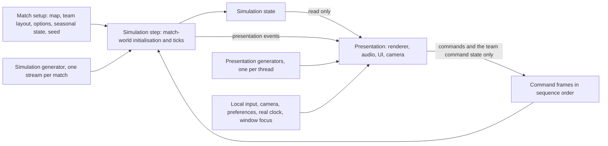
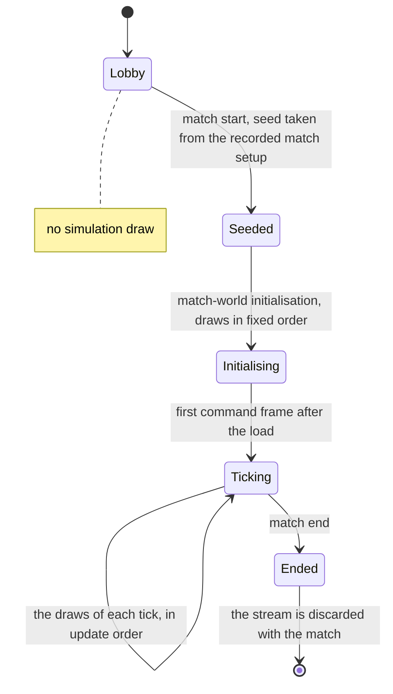
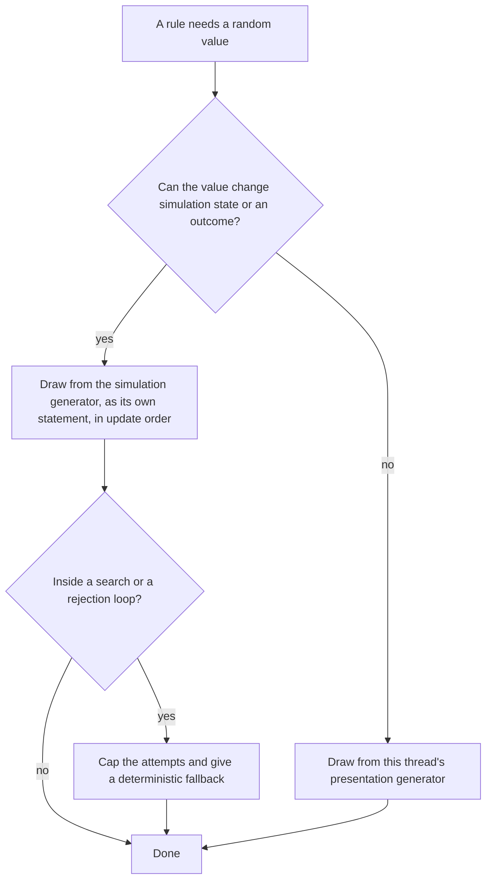

# Randomness and integrity

> Status: Reference · Prefix: R-SIM · Related: [Simulation model](README.md) · [Tick timing and main loop](01_tick_timing_and_main_loop.md) · [Match lifecycle and state reset](02_match_lifecycle_and_state_reset.md) · [Entity model and identity](03_entity_model_and_identity.md) · [Containers and update order](04_containers_and_update_order.md) · [Teams and player commands](06_teams_and_player_commands.md)

## 1 Purpose and player experience

The reference simulation is a deterministic function of three inputs: the match setup (map, team layout and match options), the seed of the simulation random stream, and the ordered stream of command frames. Every participant runs the whole simulation and obtains the same match. This document specifies what keeps it deterministic:

- the random streams: the simulation generator, the presentation generators and the private terrain generators, with their seeding and lifetime;
- the draw discipline, and what every object family draws and what each draw decides;
- the classification of every subsystem's state as simulation state or presentation state;
- the **simulation-integrity rules**: presentation never writes simulation state, local-only state never reaches the simulation, no presentation generator feeds the simulation, and no simulation state survives between matches. Each place where the reference breaks one of these rules is listed with its fixed rule;
- the integrity duties of the bots, and further per-subsystem rules;
- the hooks for recording and replaying the command stream.

**Player experience.** Every participant sees the same battle: the same Worker wins the same fight, the same Supply crate outcome appears, and the same tree catches fire. Cosmetic variety (particle sprays, sound choice, the wobble of snowflakes) may differ between participants without consequence. A participant's camera, preferences, frame rate, local clock and window focus never change what happens in the match.

**Scope.** The integrity rules are fixed. The generator algorithm and stream derivation (DEC-242), the numeric model (DEC-240), the threading model (DEC-224), the mechanism that enforces the simulation–presentation boundary (DEC-222), the ownership of world, region and match state (DEC-223), the networking model (DEC-200), divergence detection (DEC-206) and the replay feature (DEC-046) are decided by the design phase. Tick timing is [01](01_tick_timing_and_main_loop.md); the per-match reset points are [02](02_match_lifecycle_and_state_reset.md).

## 2 Rules

### 2.1 Scope of the integrity rules

**R-SIM-600** (MUST) **Simulation** is everything that a tick executes (command application, the tick-clock update, the world step and the match-rules update, [01](01_tick_timing_and_main_loop.md)) and the match-world initialisation that runs when a map loads. **Presentation** is everything else: rendering, audio, UI, camera, input handling, particles and shatter effects. Presentation may differ freely between participants and never feeds the simulation.

**R-SIM-601** (MUST) Given the same match setup, the same seed and the same command frames, every value that feeds simulation state is identical for every participant and for every run: positions and velocities, timers, stat-derived values, terrain heights and normals, random draws and every comparison derived from them. Presentation results never need to agree. Which builds and data paths must agree bit for bit, and the numeric model that guarantees it, are decided by DEC-240.

### 2.2 Random streams

**R-SIM-605** (MUST) The **simulation generator** (`SimRng`) is one sequential stream per match, owned by the match. It offers three draw forms:

| Draw | Result | Reference definition |
|---|---|---|
| `SimRng::NextUint` | an unsigned 32-bit integer, uniform over 0 to 2³² − 1 | one draw of the stream |
| `SimRng::NextUnit(r)` | uniform over [0, *r*) for *r* > 0 | one integer draw × *r* / 2³² |
| `SimRng::NextSigned(r)` | uniform over [−*r*/2, *r*/2): half of *r* on either side of 0 | (`NextUnit(1)` − 0.5) × *r* |

A 3-vector built from draws takes its x draw first, then y, then z.

**R-SIM-606** (MUST) The generator algorithm, its seeding function and the stream structure are not part of the reference library; the default is one sequential stream, owned by the match world and seeded once per match (DEC-242). The draw order of the reference generator is not reproduced, and every distribution is (DEC-013).

**R-SIM-607** (MUST) The **presentation generators** (`FxRng`) serve cosmetic effects, audio variation and every other presentation randomness. Their draw forms are `FxRng::NextUint` (a non-negative integer), `FxRng::NextUnit(r)` (uniform over [0, *r*], *r* included) and `FxRng::NextSigned(r)` (uniform over [−*r*/2, *r*/2], both ends included), and `FxRng::Seed` sets a state. In the reference:

- one process-wide presentation generator is re-seeded with `ref.sim.match.presentation_seed` (1, [02](02_match_lifecycle_and_state_reset.md)) at every match-world initialisation, after the map definition is read and before the terrain is built; each tree geometry pass re-seeds it from the tree's seed, and the terrain colour pass re-seeds it at every vertex from the vertex coordinates and its own previous output; nothing else re-seeds it;
- that generator is shared by audio, terrain colours, tree geometry and an online-service thread, and it is not safe for concurrent use;
- a second, per-thread runtime generator, never seeded in a match, serves tree leaf particles, Sickness particles, the Allegiance Scrambler's particles and the hint overlay's choice of tab.

**R-SIM-608** (MUST) Every presentation consumer draws from its own presentation generator instance, and no generator instance is shared between threads: one presentation generator per thread at least, with the audio engine owning its own instance (ADR-0022). No presentation generator is reachable from simulation code (DEC-013, DEC-224, DEC-242).

**R-SIM-609** (MUST) Each terrain tile owns a private generator, re-seeded from the tile's seed in the map definition at the start of every generation of that tile. Its output, the height field, is simulation static data, independent of call history and of every other consumer. The terrain algorithm and its generator are specified by the [terrain component](../../architecture/components/terrain.md); the terrain runtime model is DEC-246.

**R-SIM-610** (MUST) The simulation generator is seeded once per match, at match start, and the seed is part of the recorded match setup. No simulation draw happens before match start (DEC-013). In the reference, the host derives a seed from host-local entropy for each session, sends it to each participant when it joins, and records it nowhere; every match runs in a fresh session, so no generator state carries from one match into the next.

**R-SIM-611** (MUST) No simulation draw happens in the lobby, and no UI, rendering, audio or input code draws from the simulation generator. The reference has no such draw: the lobby advances no match world, and none of the simulation generator's call sites is in UI, render, audio or input code.

**R-SIM-612** (MUST) The draws of match-world initialisation happen at one logical point for every participant: a participant that processes the command frame that starts a match takes no further frame until the initialisation has finished ([01](01_tick_timing_and_main_loop.md) R-SIM-533). Initialisation draws, in this order: the colours of unused team slots (a retry loop, bounded by DEC-014), the start positions of all six team slots in team-index order, the bot colours, the co-op pairing, the Siege sides, the initialisation of structures and bot controllers, and the starting Powers. Every participant loads with identical lobby-slot state (colour ids and slot kinds), and a loader that runs on another thread, or concurrently with other work, keeps this draw order (DEC-224).

**R-SIM-613** (MUST) Instrumentation never changes a draw. A build that records each draw with its call site and a running count produces exactly the values of a build without it; in the reference the draw-tracking build computes the signed draw by a different formula and cannot play with an untracked build. The draw log keeps the most recent draws with their call sites, which is the tool for finding the first draw at which two runs differ (DEC-206).

### 2.3 Draw discipline

**R-SIM-620** (MUST) Every gameplay decision draws from the simulation generator: Supply crate drops, captures, outcomes and effects, bot choices, spawn timers, damage rolls, conversions and scatter.

**R-SIM-621** (MUST) Every expression that combines several draws has a defined draw order. Each draw is its own statement; no draw sits inside a constructor, an argument list or the condition of a variable-length loop (DEC-013, DEC-242). The reference fixes the order in three ways, whose distributions are kept: a vector draw takes x, then y, then z; the tree generation of a Supply crate outcome makes its `ref.sim.rng.crate_tree_draws` (8) integer draws one statement at a time; and the spawners draw the height on its own statement before the x and z coordinates.

**R-SIM-622** (MUST) The number of simulation draws never depends on local or presentation state. Every cosmetic draw is a presentation draw (DEC-013); the reference makes the draws below from the simulation stream, and each one moves to a presentation generator (DEC-222):

| Cosmetic draw | Reference draws |
|---|---|
| ant leg shape | one integer draw, modulo 3, per ant per tick |
| snowflake and Wisp wobble | three `NextSigned(1)` and one `NextUnit(20)` per object per tick |
| meteor fire size | five `NextSigned(60)` per tick |
| Spitter Plant burning-particle size | one `NextSigned(100 × size)` per burning tick |
| turret shell casings | three `NextSigned(0.5)` and one `NextUnit(20)` per shot (`ref.sim.rng.turret_casing_draws_per_barrel`, 4) |
| turret overheat smoke | one unit draw per particle |
| Trooper shell casings | per shot |
| Worker abduction spark | one `NextUnit(1)` compared with 0.5 per abducted tick |
| volcano vent | one integer draw per idle tick and one `NextUnit(4)` |
| Barrier Emitter sparks | one `NextUnit(4)` per spark |
| Essence orb break particles | fifteen `NextUnit(5)` once |
| thrown-weapon trail, airstrike target marker smoke, rocket smoke, Transport exhaust | per particle |

**R-SIM-623** (MUST) Every rejection loop and search in the simulation has a capped number of attempts and a deterministic fallback (DEC-014). In the reference these loops are deterministic for identical inputs but consume a data-dependent number of draws, and several are unbounded: the Supply crate capture when no valid outcome exists; the starting-Powers choice; the Missile Barrage sea search; the Abductor land search; the bot target-area loops; the Brood spawn-type choice; the target-structure retries; the valid-point loops of the Strike team, Transport, Collector and Builder outcomes; the turret spacing of the Flag Chain turret placement; the Launch Race drop-off point search; the colour loop for unused slots at match-world initialisation; the bot colour choice, unbounded when every bot colour is taken; and the land searches of lightning strikes and dust vortices.

**R-SIM-624** (MUST) A draw whose occurrence depends on a condition is its own statement inside that condition, and the owning rule states the condition (DEC-652). For example, the Supply crate capture roll is drawn only when no outcome is forced, so a forced outcome shortens the stream.

**R-SIM-625** (MUST) No presentation generator feeds simulation state. In the reference the one exception is the tree crown hit volume (R-SIM-650); every collision and hit volume that the simulation uses is map or asset data (DEC-012).

**R-SIM-626** (MUST) No simulation object draws from the simulation generator while it is being constructed. Every draw that initialises a new object happens once, in the explicit spawn or initialisation step that creates it (DEC-652). This covers: the evaluation timer and the spawn timer of a Spawn Node (2 draws); the timer of a Population Limiter (1); the initial values of a bot controller (4); the random position search of a turret at initialisation (3); the initial values of Workers (2), Builders, snowflakes (4), Wisps (4), Spitter Plants, Seed Pods, Crawlers and bot objective markers; and the rate that an actor draws when its kind is set, which a Worker draws once per spawn. Reading a map definition creates no simulation object and draws nothing; each structure that the map places is created once, at match-world initialisation. In the reference, constructors draw, and a map-placed structure is constructed twice (a template, then the real object), so each map-placed bot objective marker draws twice at load, and a Worker draws its rate twice per spawn.

**R-SIM-627** (MUST) The actor-group formation offset table holds `ref.sim.init.group_offset_table_size` (100, [02](02_match_lifecycle_and_state_reset.md)) values from `SimRng::NextUnit(1)`. It is cleared at every match start and end (DEC-011) and generated at a fixed step of match initialisation, never on its first use (DEC-652); the reference generates it on the first formation query after a map load.

**R-SIM-628** (MUST) A spawn-position search ([05](05_space_routing_and_physics.md)) draws `NextUnit(spread)` for the distance and `NextUnit(2π)` for the angle in each attempt (`ref.sim.spawn.draws_per_attempt`, 2), for up to `ref.sim.spawn.search_attempts` (10) attempts, so a search that finds no valid position consumes 20 draws before it falls back to the clamp of `ref.sim.spawn.edge_margin`. In the reference every bot controller's spawn is such a search: it asks for the off-map point of `ref.sim.bot.controller_spawn_request` ([06](06_teams_and_player_commands.md)) and always consumes all 20 draws; where Species places the bot controller is DEC-087.

### 2.4 What each object family draws

**R-SIM-630** (MUST) The simulation draws of the reference are those of Table 1, made at the stated points; the draws marked "presentation" move to a presentation generator by R-SIM-622. The route graph, the actor grid, the obstacle grid, the base simulated object and the procedural legs make no draw. The ranges in Table 1 repeat, for readability, values that the owning documents define in their tuning tables; *r* stands for a radius or range given there.

Table 1 — Draws per object family (simulation draws unless marked presentation).

| Object family and step | Draws per occurrence | When | Owner |
|---|---|---|---|
| any actor: kind assignment | `NextUnit(rate of the actor kind)` | every spawn; once per spawn for a Worker (R-SIM-626) | [reference/02](../02_units/README.md) |
| any actor: attack | two `NextSigned(15)` | each shot | reference/02 |
| any actor: push out of obstacles | `NextSigned(1)` | when its height is 1 wu or less | reference/02 |
| spawn-position search | per attempt `NextUnit(spread)` and `NextUnit(2π)`, at most 10 attempts (R-SIM-628); a Worker's initial facing: a vector of two `NextSigned(1)` | spawn | reference/02 |
| Worker: initial values | `NextUnit(5)`, `NextUnit(60)` | spawn step | reference/02 |
| Worker: retarget | `NextUnit(1)` | every retarget, every 1 to 2 s | reference/02 |
| Worker: approaching a carryable structure | `NextUnit(2π)` | when its waypoint is far | reference/02 |
| Worker: riding a Transport | a vector of two `NextSigned(1)` and `NextUnit(20)` when the Transport is destroyed; `NextSigned(π/2)` and `NextUnit(10)` when unloaded | those events | reference/02 |
| Worker: combat | `NextSigned(π/2)` for movement every combat tick; `NextUnit(20)` on approach; `NextUint` for the fire roll outside a formation; two `NextSigned(60)` under Fury; `NextUnit(8)` for the grenade timer; two `NextUnit(4)` for the rocket jitter of a Worker driven insane by Sickness | every combat tick | reference/02 |
| Worker: under crowd control | `NextUnit(0.5)`, `NextUnit(number of Workers under control)`, `NextUnit(2π)` | every 0.5 to 1 s | reference/02 |
| Worker: following a waypoint order | `NextUnit(10)`, `NextUnit(2π)` | the jitter at a teleport structure | reference/02 |
| Worker: following a Leader | `NextUnit(r)`, `NextUnit(2π)` | the 5 s retarget and on arrival | reference/02 |
| Worker: attacking a structure | `NextUnit(50)` | every tick | reference/02 |
| Worker: idle position search | `NextUnit(1)`, then `NextSigned(2π)` in 70 % of searches | idle | reference/02 |
| Worker: Supply crate search | `NextUnit(2 × 35/3)`, `NextUnit(2π)`, `NextUnit(35/3)` | when it has found a Supply crate | reference/02 |
| Worker: zone search | a vector of two `NextSigned(20)` | when it has found a zone | reference/02 |
| Worker: search for a Transport, a Leader, a structure port (twice) or a carryable structure | `NextUint` | when candidates exist; the first draw of the port search is then overridden by the nearest-structure loop | reference/02 |
| Worker: giving orders, following a route, searching for a Leader | `NextUnit(r)`, `NextUnit(2π)` | — | reference/02 |
| Worker: threat search | `NextUint` (the Hive check, 1 in 500) | every search that passes the tree check | reference/02 |
| Worker: victory dance | `NextUnit(5)` (team slot 0 only), `NextUnit(15)` | each idle retarget | reference/02 |
| Worker: moving to a target while sick | `NextUint` | every tick while it has Sickness | reference/02 |
| Worker: on fire | a vector of two `NextSigned(100)`, `NextUnit(10)` | every burning tick | reference/02 |
| Worker: being abducted | `NextUnit(1)` spark | every abducted tick — presentation | reference/02 |
| Worker: Sickness spread | `NextUnit(5)`, `NextUint` per neighbour, `NextUint`, `NextUnit(10)` | every 5 to 10 s | reference/02 |
| Worker: infected by Sickness | `NextUnit(10)` | the infection event | reference/02 |
| Worker: Convert shot | two `NextSigned(15)` | each shot | reference/02 |
| Leader: bot re-order | `NextUnit(20)`, `NextUnit(2π)` | each bot re-order | [reference/07](../07_bots.md) |
| Essence orb: spawn | `NextUnit(10)`, three `NextUnit(2)` | spawn | reference/02 |
| Essence orb: step | three `NextSigned(1)` every tick; `NextUnit(0.5)` while being born; `NextUnit(10)` at the high point of its birth; `NextSigned(60)` from birth to floating; `NextUnit(2)` at death | every orb, every tick | reference/02 |
| Essence orb: break | fifteen `NextUnit(5)` | once — presentation | reference/02 |
| actor-group formation offsets | 100 `NextUnit(1)` | match initialisation (R-SIM-627) | [03](03_entity_model_and_identity.md) |
| ant: leg shape | `NextUint` modulo 3 | every tick per ant — presentation | reference/02 |
| ant: moving to a target | `NextSigned(0.2)` heading jitter | every tick | reference/02 |
| meteor: fire size | five `NextSigned(60)` | every tick — presentation; its slow-motion request is simulation ([01](01_tick_timing_and_main_loop.md)) | [reference/04](../04_supply_crates_powers_and_weapons/README.md) |
| Spitter Plant: burning particles | `NextSigned(100 × size)` | while burning — presentation | [reference/03](../03_buildings_and_world_objects/README.md) |
| snowflake, Wisp: wobble | three `NextSigned(1)` and `NextUnit(20)` | every object, every tick — presentation | reference/02, [reference/08](../08_maps_and_level_design/README.md) |
| map-effect spawners (snow, dust storm, lightning) | unit draws and vector draws for spawn positions; the dust vortex and lightning strikes are gameplay, snow is decoration | slice 3 ([01](01_tick_timing_and_main_loop.md)) | reference/08 |
| lightning strike | `NextUnit(1)` compared with 0.01: the strike roll, 1 % per tick, which sets fire | every tick | reference/02 |
| Crawler: nearby egg | ⌊`NextUnit(n)`⌋ | each search | reference/02 |
| tree: Essence orb drop | `NextUint` test, then `NextUnit(h)` for x, `NextUnit(2π)` for the yaw, then `NextUnit(6)` repeated until it names a valid team; the drop timer `NextUnit(5)` | each drop | reference/03 |
| tree: offspring | `NextUnit(H)`, then `NextSigned(π/4)` or `NextUnit(2π)`, then `NextUnit(99999)` for the seed, then `NextSigned(0.2)` for the height | each offspring | reference/03 |
| Blight Grove tree | `NextUnit(10)` every tick; its Wisp `NextSigned(1)` and `NextUnit(25)`; corruption `NextUnit(5)` | — | reference/04 |
| Barrier Emitter | `NextUnit(10)` at initialisation; `NextUnit(4)` per spark (presentation) | — | reference/03 |
| volcano vent | `NextUint` every idle tick and `NextUnit(4)` | — presentation | reference/08 |
| Allegiance Scrambler effect | `NextUnit(2.5)`, `NextUint` per converted Worker | each conversion | reference/04 |
| turret: primary fire | for every examined manned barrel of every turret type, `ref.sim.rng.turret_sim_draws_per_barrel` (3) draws: two `NextSigned(target radius)` and one `NextSigned(0.1)` (the mortar target and force, drawn also for the other types); then the shell ejection (presentation, R-SIM-622); an unmanned barrel draws nothing; overheat smoke per particle (presentation); initialisation 3 draws | each shot: up to two barrels per trigger, one for a rocket turret | reference/03 |
| Solar Array | `NextUnit(20)` every tick, also while unmanned | every tick | reference/03 |
| Beam Dish | the beam-loss kick | when a beam is lost | reference/03 |
| Spawn Node, Population Limiter | 2 and 1 draws | creation (R-SIM-626) | reference/03 |
| weapons and special units | laser damage 20 + `NextUnit(20)` and its push; the shockwave ignition chance; the airstrike bomb count 3 + `NextUint` modulo 5; the airstrike target-marker scatter, a vector of `NextSigned(100)`; the barrage-missile scatter `NextSigned(300)`; the Strike team's target choice, aim and grenade chance; the Transport's bot choices and conversion jitter; the Collector's wander and Essence orb snap offsets; the Builder's idle rotation rate | — | reference/02, reference/04 |
| Supply crates | spawning, falling, capture, outcome choice and every outcome effect | — | reference/04 |
| bot controllers and bot objectives | the bot navigation-node priorities and every bot decision | — | reference/07 |
| match rules | `NextUint` for the Relic spawn choice, the Comeback Bonus reward, the bot colour and the Relic mesh (one of 8); `NextUnit` for the Relic timer and the Transit Gate spawn offsets and velocities; a vector draw for the Relic facing | slice 8 ([01](01_tick_timing_and_main_loop.md)) | [reference/01](../01_skirmish_rules_and_modes/README.md) |

**R-SIM-631** (MUST) The snow, dust-storm and lightning spawners of a map share one countdown timer, so on a map that enables more than one of these effects their spawn schedules are coupled. This is a kept quirk (DEC-006); the spawners themselves are specified in [reference/08](../08_maps_and_level_design/README.md).

### 2.5 Simulation state and presentation state

**R-SIM-635** (MUST) Every piece of state belongs to one of three classes:

- **simulation state**: identical for every participant (R-SIM-601), changed only by a tick or by match-world initialisation;
- **presentation state**: local to one participant, free to differ, and never read by simulation code;
- **simulation-resident presentation state**: state that the reference stores in a simulation object although only presentation code writes and reads it.

**R-SIM-636** (MUST) Simulation objects hold no presentation fields. Every simulation-resident presentation field of Table 2 is presentation state in Species, held by presentation and keyed by the object's handle, and no simulation rule reads it (DEC-007).

**R-SIM-637** (MUST) The subsystems of the reference are classified as in Table 2.

Table 2 — Classification of every major subsystem's state.

| Subsystem and state | Class | Notes |
|---|---|---|
| actors (each team's actor groups and ungrouped actors): positions, velocities, facings, health, states, timers and orders | simulation | [03](03_entity_model_and_identity.md) |
| structures, including ownership, capture, ports and spawn timers | simulation | |
| laser bolts and effects: grenades, rockets, turret rounds, airstrike target markers and bombs, shockwave rings, fireballs, the Core Device pulse wave, Swarm streaks, Wisps, snowflakes, dust vortices, lightning strikes, muzzle flashes and shell casings | simulation | snowflakes, Wisps, muzzle flashes and shell casings are decorative, but they live in the simulated effect pool, take simulation handles and, in the reference, draw from the simulation stream (R-SIM-622) |
| Essence orbs | simulation | |
| Supply crates: spawn, fall, capture and outcome | simulation | [reference/04](../04_supply_crates_powers_and_weapons/README.md) |
| a Supply crate's orientation, centre position and bubble timer | simulation-resident presentation | the renderer rotates the orientation by the presentation frame delta; the simulation recomputes the centre position from that orientation, but only the renderer reads it; Supply crates take no sphere, shape or ray hits |
| bot controllers, one per bot team | simulation | run on every participant (§2.12) |
| Powers in the Power slots | simulation | the recent-Powers list, the most-recent-Power highlight timer and the per-source timer run on the real clock: simulation-resident presentation |
| tick clock: game speed, match time, speed requests | simulation | the tick-take time, the smooth presentation time and the extrapolation time are presentation ([01](01_tick_timing_and_main_loop.md)) |
| match rules: scores, timers, eliminations, Relic, Launch Vessel and Control Zone state | simulation | messages, achievement progress and help notifications for the local team are presentation side effects (R-SIM-666) |
| lobby and match options, team names and colours, ready flags | match setup | sequenced like commands ([06](06_teams_and_player_commands.md)) |
| terrain height field, normals, obstacle grid, route-graph node tables | simulation static data | generated deterministically from the map definition; terrain tiles use private generators (R-SIM-609) |
| actor grid and its query cache | simulation derived structures | query results, their order and the cache's staleness decide outcomes ([05](05_space_routing_and_physics.md)) |
| route contents | simulation | |
| route slot ids | participant-local in the reference | route previews never allocate from the simulation pool (R-SIM-662) |
| route display fade and walkable-preview flag | presentation | |
| trees: fire, spread, Essence orb drops, corruption and offspring | simulation | |
| a tree's crown hit volume | simulation | in the reference computed by the tree's render-geometry pass from a presentation generator (R-SIM-650); colours and sway are presentation |
| sky offset | presentation | advanced inside the tick, in slice 3, without draws |
| map-effect spawners: snow, dust storm, lightning, and an orb-rain effect that no reference map enables | simulation | the dust vortex and lightning strikes affect units; snow is decoration in the simulation stream |
| particles (`ParticlePool`) | presentation | advanced inside the slice loop but with presentation draws only; creating a particle returns nothing, and nothing reads particles |
| shatter effects | presentation | real-clock lifetimes; advanced once per render frame |
| audio | presentation | never writes simulation state; reads objects, positions, team ids, the local team, terrain height, game speed, the grace state and the camera; uses presentation draws and the real clock; team-matched sounds, camera-relative priorities and voice stealing differ per participant by design; simulation code queries sound state only to decide whether to start or restart a sound (the fuel line and the Launch Vessel) |
| camera, match input pump, world cursor, Power slots panel, world markers, hint overlay, chat and HUD | presentation | the reference crossings are §2.9 |
| input drivers and camera motion | presentation | non-deterministic by design: drivers sample device state once per render frame; the camera integrates the presentation frame delta (at most 0.25 s) or its own real-clock deltas; camera shake uses presentation draws; no simulation draw happens in input or camera code. Input reaches the simulation only through the team command state, and camera-relative stick directions are converted to world-space vectors before they are sent |
| sea renderer, terrain colours, lights, fog and screen effects | presentation | |
| a spider's procedural legs and feet (`ProceduralLeg`, `ProceduralFoot`) | simulation-resident presentation | the foot swing is timed by the presentation frame time; only leg rendering, foot-fall sounds and the next leg-move time depend on it; the body height comes from the terrain, not from the feet (DEC-007) |
| the render-damage flicker flag of actors, the Hive, the centipede and the Spitter Plant | simulation-resident presentation | set inside the step from a presentation draw and the presentation frame time |
| a Reaper Serpent's trail of captured Essence orbs | simulation-resident presentation | real-clock birth times and a presentation-drawn slot |
| a Leader's picking sphere | presentation | scaled by the camera distance and a display-scale preference; used only by mouse picking |
| achievements, statistics and profile | presentation | hooks only ([reference/09](../09_front_end_and_match_flow/README.md)) |

### 2.6 Presentation randomness inside simulation code

**R-SIM-640** (MUST) Every presentation draw that the reference makes inside simulation code is presentation, and its value never reaches simulation state. Table 3 gives each site and its rule.

Table 3 — Presentation draws inside simulation code.

| Site | What the draw drives | Rule |
|---|---|---|
| tree geometry passes | branch geometry and the crown hit volume (the centroid of the leaves, with a radius of `ref.sim.integrity.tree_crown_radius_factor` (0.8) × the largest leaf distance) | the crown hit volume is map or asset data (R-SIM-651); the geometry is presentation |
| tree fire particles and leaf drop | particles | presentation |
| render-damage flicker of actors, the Hive, the centipede and the Spitter Plant | a flag stored in the simulation object, never read by the simulation | presentation state (R-SIM-636) |
| a Worker on fire, under Speed Boost or with Sickness; opening a Supply crate; receiving a Shield, Speed Boost, Convert or Fury; taking and losing crowd control | particle counts and velocities; one draw gates the on-fire sound | presentation |
| Worker threat search | a 1-in-200 draw chooses whether the threat horn sounds; the sound is rate-limited by one match-time stamp that every Worker shares | presentation; the shared stamp is presentation state, never a static of simulation code (DEC-223) |
| blasts, promotion and demotion | core and debris particle counts and sizes; flash particles | presentation |
| the extinguishing effect of a Supply crate outcome | 200 fire-spray particles from a rejection loop of presentation draws | presentation; the loop length is local |
| laser bolts, turret rounds, fireballs, firebomb canisters, rocket explosion colours and cores, lightning strikes, meteor positions, Collector and Abductor engines, the Launch Vessel, the fuel pump, boarding at the fuel depot, volcano vents, smoke columns, Barrier Emitter sparks and Swarm streaks | particles | presentation |
| Reaper Serpent captured-orb trail | sprite positions and slots | presentation state |
| shatter effects and particles | debris and particles | presentation; nothing in the simulation reads them |
| camera shake | the local camera | presentation |
| centipede copies placed by a difficulty factor above 1 | positions of the copies, drawn from the presentation generator | never occurs: the difficulty level is 0 in every match, so no copy exists (R-SIM-725, DEC-010) |
| Allegiance Scrambler particles | the particle colour, drawn in its render code, so the particle count follows the frame rate | presentation |
| hint overlay | which help tab is shown | presentation |
| audio | sample choice, emitter choice and randomised sound parameters | presentation, from the audio engine's own generator (R-SIM-608) |
| terrain colours and the sea shore | colour variation and shore noise | presentation |
| UI windows | window placement | presentation |
| online-service registration | its retry timing | presentation, never through a shared generator (R-SIM-608) |

### 2.7 Tree crown hit volumes

**R-SIM-650** (MUST) In the reference, a tree's crown hit volume is a simulation input (fire spreads from a tree to another when the sum of their crown radii is at least the distance between them) that the tree's render-geometry pass computes: it compiles the leaf geometry, accumulating the crown centre and the leaf count, then re-seeds the shared presentation generator from the tree's seed and runs a radius pass on the calling thread. The pass runs at map load on the loader thread, when a tree spawns an offspring, and whenever the render geometry is rebuilt; only one render detail level gives the correct volume. Any draw from the shared generator by another thread between the re-seed and the end of the pass (audio choosing a sample during the loading view, the online-service thread) changes that tree's crown volume on that participant only, and its fire spread then differs.

**R-SIM-651** (MUST) Geometry that feeds the simulation never comes from rendering or from a process-wide generator: every tree crown hit volume is baked collision data from the content build, each with its centre stated explicitly (the reference centre ignores the tree's rotation), and any run-time procedural content uses its own local generator (DEC-012). The content build derives the reference radius with `ref.sim.integrity.tree_crown_radius_factor`.

### 2.8 Presentation never writes simulation state

**R-SIM-655** (MUST) The simulation step changes only simulation state, and no render, UI, audio or camera code writes a field of a simulation object. Presentation reads immutable simulation state; messages, sounds, help notifications, achievement progress and kill totals that a rule produces are presentation events emitted at the tick where the rule fires (DEC-007). The mechanism that enforces this boundary in Species is DEC-222.

**R-SIM-656** (MUST) Each render path of the reference that writes a field of a simulation object follows the fixed rule of Table 4.

Table 4 — Render paths that write simulation fields.

| Writer | Field | Read by the simulation | Rule |
|---|---|---|---|
| tree render, rebuilding missing geometry | the crown hit volume; colours | yes: fire spread and obstacles | the volume is data (R-SIM-651); colours are presentation |
| Barrier Emitter render, for emitters in view only | marks the emitter's link as absent when the linked handle is missing or names no Barrier Emitter | yes: the emitter's step branches on it | links are validated by the content build (DEC-015), and the simulation step itself treats a missing link as absent; on the reference maps no link dangles, and Barrier Emitters are never destroyed |
| Beam Dish render | range and receiver, saved and restored around the drawing of its link | yes | rendering only reads them |
| turret render in the map editor | the turret's facing, set to the structure's facing | yes: aim | the editor preview never writes simulation state ([reference/08](../08_maps_and_level_design/README.md)) |
| Supply crate render and bubble render | orientation, bubble timer | no | presentation state (R-SIM-636) |
| thrown-weapon render | tumble orientation per render frame, flash count and its flash sound | no | presentation state; the flash sound is a presentation event (DEC-318) |
| shell-casing render | facing | yes: the casing's own step reads it | the casing's step owns its facing, and rendering never writes it (DEC-222) |
| Transport, Worker, fuel pump, cloth flag and Control Zone renders; structure transparency sort; centre message; route display; Launch Race status panel | Transport smoothing, a Worker's colour timer and shadow structure, the pump movement, the cloth flag, the cloth flag that a Flag Chain Control Zone's render creates, the sort buffer, the message state, the route display fade and walkable flag, the panel state | no | presentation state |
| Solar Array render | orientation from the terrain normal | yes: its shape-hit transform | set once by its initialisation, to the same value; rendering only reads it |
| world-cursor crosshair | the structure kind of the local team's selected structure, which it assigns instead of comparing | yes: the kind | presentation compares and never assigns (DEC-222); in the reference it has no effect, because only Beam Dishes and turrets can be selected |

### 2.9 Local-only state never enters the simulation

**R-SIM-660** (MUST) The simulation never reads the local camera, local input devices, UI state, client preferences, the identity of the local team, the real clock or any other per-participant state. Every player interaction with the world is a command or a field of the continuous control state (DEC-008), simulation time comes only from the tick counter (DEC-009), and a setting that changes simulation results exists only as a match option (DEC-010).

**R-SIM-661** (MUST) Strike team direct control reads only the sender's control state. In the reference it runs for every team's selected Strike team on every participant and also reads the **local** camera's free-look state: on any participant whose player holds the free-look control while that Strike team moves, the team receives an extra waypoint and an extra attack, and diverges on that participant only. The sending client converts the look-around state, the aim direction and the movement direction to world space before they enter its control state (DEC-008).

**R-SIM-662** (MUST) Client-local helpers never allocate from simulation containers: route previews of the match input pump use their own pool, so the route handles that the simulation gives to Workers are identical for every participant (DEC-095).

**R-SIM-663** (MUST) The most-recent-Power id of a team's Power slots is simulation state, written only by the simulation. In the reference the Power slots panel clears it on the owning participant only, after a real-time delay, while the simulation reads it right after a successful Power use in the same tick (the turret and firebomb options of Supply crate outcomes, instant units and the bot's Leader); the panel's highlight timer is presentation state.

**R-SIM-664** (MUST) Every change that a player causes travels as a command. Cancelling a Power is a command, never a direct call from the UI, and local input never switches or changes a world object directly (DEC-008); the reference has such paths only in controls and structure types that a match never reaches.

**R-SIM-665** (MUST) Executing a command never issues a further player command: one Leader toggle yields one command and one selection change on every participant (DEC-119). In the reference, executing a Leader toggle makes every participant issue a selection command of its own.

**R-SIM-666** (MUST) Presentation calls that the reference makes from simulation code, guarded by the identity of the local team, are presentation events (DEC-007): the cursor marker of a team move (gated in the reference by one flag shared by all teams), the selection arrows, sounds and turret-aim camera of a selection, the route highlight and cursor markers of a crowd order (the reference keeps an unbounded marker list), the marker of a promotion, Leader route highlights, Supply crate messages and help, the messages and achievement progress of Control Zones, Relics, Launch Vessels and barrage missiles, Power messages and camera requests, and the kill total, achievement flags and help notifications of the match rules. No flag of simulation code is shared between teams or survives between calls (DEC-223).

**R-SIM-667** (MUST) Command execution reads only simulation state and match-setup state. In the reference, some command handlers branch on local state (the ready toggle and the seasonal-mode command check whether the participant is at the main menu; the team-name and chat commands post to UI windows; a waypoint order adds a marker only for friends of the local team; the co-op command reaches a front-end window without checking that it exists). In Species, a handler's presentation side effects are events, and no handler reaches a UI object.

**R-SIM-668** (MUST) The selection-circle centre and radius and the last-orders time that the match input pump writes into a team are presentation state of the local participant; only UI code reads them.

**R-SIM-669** (MUST) The reference's other crossings follow the fixed rules already stated: the tutorial overlay that inserts Supply crates and changes options from the render loop on real-clock timers (R-SIM-727, DEC-103); a Leader's picking sphere (Table 2); the launch spectacle, whose Workers face a real-clock target and which is inactive in matches (DEC-009); the Siege complete-defence flag, which uses the tick counter (DEC-009); the process-wide difficulty level (R-SIM-725); the world-cursor crosshair (Table 4); the Control Zone counter and the Transport weapon-cycle debounce that survive between matches (R-SIM-730); and the tree crown hit volumes (R-SIM-651).

### 2.10 Layering rules

**R-SIM-670** (MUST) Control enters the simulation only as sequenced commands. Local input produces the team command state, sent once per tick period, and command requests; the simulation applies both when their command frame executes ([01](01_tick_timing_and_main_loop.md), [06](06_teams_and_player_commands.md)). How Species carries commands and state between processes is the networking model (DEC-200).

**R-SIM-671** (MUST) The simulation never reads the real clock for a rule; it uses match time and the per-tick step ([01](01_tick_timing_and_main_loop.md), DEC-009).

**R-SIM-672** (MUST) Presentation reads simulation state and never writes it. The reference presentation reads live simulation objects directly every frame, with no snapshot and no double buffer, and extrapolates positions ([01](01_tick_timing_and_main_loop.md) R-SIM-560 to R-SIM-564).

**R-SIM-673** (MUST) The simulation step can run with the transport, renderer, audio and UI replaced by stubs. In the reference the transport layer owns the simulation clock (it calls the world step, the particle-pool step, the match-rules update and the tick-clock update), so solo play needs an in-process loop-back sequencer; which process roles Species has and how the step is driven are DEC-220 and DEC-225.

**R-SIM-674** (MUST) The simulation triggers no sound and calls no HUD or UI code directly: it emits presentation events (DEC-007). In the reference the simulation triggers sounds synchronously from the world step, and the audio engine silently drops a trigger made from any thread but the main thread, during a loading view, or before the sound archives have loaded; the Species event contract states what is guaranteed and what may be dropped (DEC-222).

**R-SIM-675** (MUST) Whether the world is held depends on game speed alone ([01](01_tick_timing_and_main_loop.md) R-SIM-550). In the reference, the tick-clock update and the extrapolation time read a pause predicate that also holds the world while this participant sees a diverged participant, or while its window has lost focus in content outside the reference library, so match time can stop on one participant only. The reaction to a detected divergence belongs to the networking model (DEC-206).

### 2.11 Rules the object model states

**R-SIM-680** (MUST) Simulated objects live in match-owned containers with stable handles and a documented iteration order ([03](03_entity_model_and_identity.md), [04](04_containers_and_update_order.md)); every tie that iteration order decides is an explicit rule over a stable key (DEC-016).

**R-SIM-681** (MUST) Every simulated object advances exactly once per tick, and whether an object created during a tick advances in that tick is an explicit rule ([01](01_tick_timing_and_main_loop.md) R-SIM-516, DEC-455).

**R-SIM-682** (MUST) Simulated objects hold no presentation fields (R-SIM-636).

**R-SIM-683** (MUST) Hit volumes that gameplay uses are data or computed by the simulation, never by-products of rendering (R-SIM-651).

**R-SIM-684** (MUST) The only time source of the simulation is the tick counter, and its only randomness is the simulation generator (DEC-009, DEC-013).

**R-SIM-685** (MUST) Client-local helpers (previews, cursor markers) never allocate from simulation containers (R-SIM-662).

### 2.12 Bots and integrity

**R-SIM-690** (MUST) Bots run inside the simulation, on every participant that simulates. Each bot team (`TeamKind::Bot`), and each of the Rogue and Visitor factions, which no participant owns, has a bot controller that the deterministic team initialisation creates at match start, or that the sequenced handling of a leaving participant creates ([06](06_teams_and_player_commands.md)). The bot controller advances in the teams sub-step of the world step and issues no command (DEC-119). Where Species runs its bots is part of the networking model (DEC-200).

**R-SIM-691** (MUST) Bot inputs are simulation state only: structures, actors, the actor grid, match time, the match options and the map definition. Bot randomness comes only from the simulation generator, with ordered vector draws. The only calls in bot code that are not simulation are presentation: a real-clock timing of the bot's start-up for diagnostics, preference reads in render code, presentation draws for promotion particles, and local-team checks that guard messages and route highlights.

**R-SIM-692** (MUST) Iteration order is part of the bot rules. "First found", "last wins" and strict-greater tie-breaks over structure-index order and over actor-grid result order (cell x, then cell z, then team, then slot) decide bot targets, and because many bot loops draw once per candidate, the order also decides how many draws a decision consumes. Structure indices and the slot re-use policy are therefore identical for every participant ([04](04_containers_and_update_order.md), DEC-016).

**R-SIM-693** (MUST) Any difference in a bot's inputs changes its draw consumption, because its rejection loops draw a data-dependent number of values, and with it every later draw of the stream. Every participant that simulates pays the bots' processing cost, including their quadratic target scans and their loops over all pairs of structures (DEC-200).

**R-SIM-694** (MUST) The numeric semantics that bot rules observe (comparisons, truncations and integer tick timers) are those of DEC-241 and DEC-002, and no bot rule ever meets a non-finite value (R-SIM-715).

### 2.13 Further per-subsystem rules

**R-SIM-700** (MUST) Real time decides only presentation pacing and UI throttles: how many update slices run per render frame ([01](01_tick_timing_and_main_loop.md) R-SIM-531), how long a centre message is shown, and the last-orders time of the match input pump. It never decides a simulation result (DEC-009).

**R-SIM-701** (MUST) Clocks are not mixed in simulation rules. The Launch Race status panel and its blink effects, the barrage missile's ground marker and the render paths of the Collector and the Builder read the real clock or the presentation frame time for drawing only; the Supply crate offset of crate particles reads the presentation frame time for particles only; and the Siege complete-defence flag uses the tick counter (DEC-009).

**R-SIM-702** (MUST) Sliced-pool partitioning uses the pool's capacity, and freed slots are re-used last-freed-first, so the order of creation and deletion decides which slot, which slice and which tick a new object first advances in ([01](01_tick_timing_and_main_loop.md) R-SIM-514 and R-SIM-516, DEC-455). Every participant creates and deletes objects in the same order.

**R-SIM-703** (MUST) The explosion damage falloff is reproduced exactly as [05](05_space_routing_and_physics.md) specifies it (DEC-093).

**R-SIM-704** (MUST) Every float-to-integer truncation and every integer division that a rule depends on is stated explicitly by the document that owns the rule: the Launch Race score (fuel, plus passengers, plus height, each truncated), the Catch-up bonus and the population caps (DEC-241).

**R-SIM-705** (MUST) Every simulation field has a defined value from the moment its object is created. In the reference two fields of the match rules, the Siege complete-defence flag and the time remaining, have no defined value until their first use (DEC-011, DEC-223).

**R-SIM-706** (MUST) A spawn network is a tree, and an Essence orb is on one edge at a time (DEC-456); a link shared by two paths would advance the same orb twice in one tick.

**R-SIM-707** (MUST) Actor stats are floating-point values, so no stat is truncated to a byte and no speed overflows (DEC-090).

**R-SIM-708** (MUST) The areas of the reference that are most prone to divergence start the determinism test corpus: terrain heights and trees, Barrier Emitters, Relics, the dust vortex, and Leaders that direct Workers into Beam Dishes (DEC-206).

**R-SIM-709** (MUST) Audio never affects the simulation. With its own presentation generator (R-SIM-608), audio no longer perturbs any other generator consumer either.

**R-SIM-710** (MUST) Terrain generation is a pure function of the map definition's terrain data (R-SIM-609). Terrain content identity, and whether terrain heights are generated at load or baked, are DEC-246.

**R-SIM-711** (MUST) The remaining tick-level determinism rules are those of [01](01_tick_timing_and_main_loop.md): the speed blend is a per-tick exponential approach (R-SIM-541, R-SIM-546), the match-rules update runs also while the world is held (R-SIM-511), render extrapolation never writes simulation state (R-SIM-564), and a tick is distinct from the game time it adds (R-SIM-547, R-SIM-548).

### 2.14 Non-finite values

**R-SIM-715** (MUST) No simulation step stores NaN or an infinity. Each site where the reference can produce one has an explicit guard that keeps the reference result wherever that result is defined (DEC-653):

1. a team's selected-Worker centre exists only while at least one Worker is selected; with none selected the team has no centre, and the UI elements that read it (the route preview, the selection arrows and the Power icon position) show nothing;
2. a crowd order computes no route and no route start when no Worker is under control, and then does nothing (DEC-555);
3. an actor-group formation offset uses a row length of at least 1;
4. a walkability test whose start and end give zero steps returns walkable without dividing, which is the reference result;
5. the Worker fire and combat rules and the thrown-weapon rule that divide by the game speed are never evaluated at game speed 0, because no world tick runs while the world is held; each of these divisions also carries an explicit guard;
6. a bot priority with no usable neighbours yields no NaN (DEC-087);
7. a score-weighted Supply crate drop whose total score is 0 takes the unweighted choice directly (R-SIM-716);
8. the turret aim cosine is clamped to the range −1 to 1 before its arccosine, so rounding never yields NaN;
9. degenerate vector and geometric queries follow DEC-241.

**R-SIM-716** (MUST) A score-weighted Supply crate drop favours lower-scoring teams. When the scores it weights total 0, every team in the weighting has the same weight; the weighting never divides by a zero total and never produces a non-finite value (DEC-465). The drop position is DEC-114.

**R-SIM-717** (MUST) In test builds, a check after every tick asserts that no simulation field holds NaN or an infinity (DEC-653).

### 2.15 Gameplay is computed only by the simulation

**R-SIM-720** (MUST) Every value that feeds simulation state is computed by the simulation step on the CPU. GPU work serves presentation only: rendering, particles, shatter debris and animation. No physics library or other third-party component computes gameplay, and no third-party code runs inside a tick (DEC-654, DEC-240).

### 2.16 Settings, seasonal state and tutorials

**R-SIM-725** (MUST) A setting that changes simulation results exists only as a match option inside the match setup, and Species has no process-wide difficulty level: actor speeds are those of difficulty level 0 (DEC-010). In the reference the simulation reads a process-wide difficulty level that scales the actor speed stat of every actor kind except the Bomber, the Brood Drifter's egg chance and egg timer, and the factor with which a map definition is read; every map load resets it to 0 before reading, no reference map pins a difficulty, and the options screen can change it only in the front end, so it is 0 in every match, and the instant-unit copies of centipedes that a higher factor would add never exist.

**R-SIM-726** (MUST) The seasonal state is match state: it is decided once, in the match setup before match start, recorded with the setup and identical for every participant; no participant decides it from its own date or clock, nothing changes it during the match, and seasonal effects such as snow draw from the presentation generator (DEC-118). In the reference each participant switches the seasonal theme on from its own date check and relays the flag through the command stream into the simulation. Whether Species keeps a seasonal theme, and who chooses it, is DEC-101; until it is decided, the host's match setup applies the reference date rule ([reference/09](../09_front_end_and_match_flow/README.md)) once, from the host's local date.

**R-SIM-727** (MUST) Tutorial steps form a graph keyed by object tags, tutorial state resets at every run, and every world-changing tutorial effect, such as inserting a Supply crate or changing an option, is a sequenced simulation event at a tick, never an action of the render loop or of a real-clock timer (DEC-103, [reference/11](../11_tutorial_and_help.md)).

### 2.17 Ownership, reset and threads

**R-SIM-730** (MUST) No simulation state survives from one match into the next, and simulation code holds no mutable static state (DEC-011). In the reference two such values are read by the simulation: a process-wide count of Control Zones that the Flag Chain rules read and that only the start of a Zone Control match resets, so participants with different session histories diverge; and a Transport weapon-cycle debounce held in a function-level static, reached only through commands that an unmodified participant never sends. The complete list of per-match state and its reset points is [02](02_match_lifecycle_and_state_reset.md).

**R-SIM-731** (MUST) Every mutable simulation value (handles and handle seeds, counters, timers, bot tables, generator state and caches) belongs to one owner, so that a match is created and destroyed as a whole, and every generator stream is seeded from its owner's data, never from a session join. Which Species object owns world, region and match state, and how that state is created, saved and destroyed, is DEC-223.

**R-SIM-732** (MUST) In the reference, at most one thread runs simulation code at any moment: the main thread runs every tick, and the loader thread runs match-world initialisation while the main thread runs only the loading view. By R-SIM-601, the result of every tick is that of this serial execution whatever the thread count and scheduling; the Species threading model is DEC-224.

### 2.18 Hooks: command-stream replay

**R-SIM-740** (MUST) The reference has a command-stream recording hook behind a hidden developer preference with two modes:

- **record**: when the match shuts down, the sequencer's command history is saved to a file that holds the number of frames and then every frame in sequence order;
- **playback**: after a map has loaded, the host's sequencer loads such a file, replacing the history that the participant is consuming. The sequencer's next frame number becomes the last loaded frame's number + 1 only when that loaded number is greater than the current next number; when the two are equal the next number is left unchanged.

Both modes also drive the presentation frame delta at a fixed capture rate, while the real clock and every real-time schedule stay real.

**R-SIM-741** (MUST) The recording holds no seed, because the seed reaches each participant separately when it joins, and playback starts after the replaying session's own match start. The recording therefore reproduces a match only when the seed and the alignment happen to match; it is a developer tool, not a player-facing replay.

**R-SIM-742** (MUST) The library specifies only these hooks and the determinism that a replay relies on: the same match setup, seed and command frames give the same match (R-SIM-601, R-SIM-610, DEC-013). The Species replay feature is DEC-046; a replay needs the build identity, the content hashes, the seed and the team layout together with the command stream (DEC-206).

**R-SIM-743** (MUST) The library specifies no run-time divergence check; whether and how Species hashes simulation state to detect divergence, and how it reacts, are DEC-206.

## 3 States and flows

Figure 1 — The simulation boundary: only the match setup, the seed and the command frames reach the simulation; presentation reads simulation state and receives events, and never writes back (R-SIM-601, R-SIM-655, R-SIM-660, R-SIM-670 to R-SIM-672).

Figure 2 — Lifetime of the simulation stream of one match (R-SIM-605, R-SIM-610 to R-SIM-612, R-SIM-730).

Figure 3 — Choosing the generator for a draw (R-SIM-620 to R-SIM-626).

## 4 Tuning table

| key | value | unit | range or notes | requirement | DEC |
|---|---|---|---|---|---|
| `ref.sim.rng.crate_tree_draws` | 8 | integer draws | made one statement at a time by the tree generation of a Supply crate outcome | R-SIM-621 | DEC-013 |
| `ref.sim.rng.turret_sim_draws_per_barrel` | 3 | simulation draws | per examined manned barrel, every turret type; an unmanned barrel draws nothing | R-SIM-630 | DEC-013 |
| `ref.sim.rng.turret_casing_draws_per_barrel` | 4 | presentation draws | shell ejection per examined manned barrel; simulation draws in the reference | R-SIM-622 | DEC-013, DEC-222 |
| `ref.sim.integrity.tree_crown_radius_factor` | 0.8 | × the largest leaf distance from the crown centre | reference derivation of the baked crown radius | R-SIM-640, R-SIM-651 | DEC-012 |

Keys cited here and defined elsewhere: `ref.sim.match.presentation_seed` and `ref.sim.init.group_offset_table_size` in [02](02_match_lifecycle_and_state_reset.md); `ref.sim.spawn.search_attempts`, `ref.sim.spawn.draws_per_attempt` and `ref.sim.spawn.edge_margin` in [05](05_space_routing_and_physics.md); `ref.sim.bot.controller_spawn_request` in [06](06_teams_and_player_commands.md); the tick and slice keys in [01](01_tick_timing_and_main_loop.md). The draw ranges of Table 1 and Table 3 are defined by the documents named in Table 1. Every value is a reference value adopted as the Species starting value (DEC-004).

## 5 Edge cases and interactions

- **Forced Supply crate outcome.** A forced outcome skips the capture roll, so the stream is one draw shorter from that point (R-SIM-624).
- **Wasted draws.** The structure-port search of a Worker draws one value that the nearest-structure loop then overrides, and a non-mortar turret draws the mortar target and force values it never uses; both draws are part of the reference stream (Table 1).
- **Team slot 0 only.** A Worker's victory dance makes its first draw only on team slot 0 (Table 1).
- **Decorative objects.** Snowflakes, Wisps, muzzle flashes and shell casings live in the simulated effect pool and take simulation handles, so creating one shifts the serials of every later object ([03](03_entity_model_and_identity.md)), even after their draws move to a presentation generator (R-SIM-622).
- **Bots after a failed Power use.** A bot reads its team's most-recent-Power id right after a Power use; the id is meaningful only when the use succeeded ([reference/07](../07_bots.md), R-SIM-663).
- **Modified content.** A Barrier Emitter whose link names a missing object is rejected by the content build; if it reached the simulation, the step would treat the link as absent (Table 4).
- **Unreachable crossings.** The launch spectacle and the process-wide difficulty level never act in a match; their fixed rules (R-SIM-669, R-SIM-725) keep them from ever becoming simulation inputs.
- **Sounds off the main thread.** In the reference a sound trigger from another thread, during a loading view or before the sound archives have loaded is dropped silently; it never affects the simulation (R-SIM-674).
- **Instrumented builds.** A draw-tracking build must agree with an untracked build value for value; in the reference it cannot, because its signed draw rounds differently (R-SIM-613).
- **Several map effects.** Snow, dust storm and lightning on one map share one countdown timer (R-SIM-631).
- **Seasonal mismatch.** Two participants with different local dates still play the same seasonal state, because it is part of the match setup (R-SIM-726).

## 6 Acceptance criteria

- **A1** (R-SIM-605) Given a seeded simulation generator, when 10⁶ draws of each form are taken with *r* = 7, then every `NextUnit(7)` lies in [0, 7), every `NextSigned(7)` lies in [−3.5, 3.5), and every `NextUint` lies in [0, 2³² − 1].
- **A2** (R-SIM-605, R-SIM-621) Given a generator at a known state, when a vector draw is taken, then its x, y and z equal the first, second and third draws of a copy of the generator at the same state.
- **A3** (R-SIM-601, R-SIM-610) Given the same match setup, seed and command frames, when a match is run twice, then the per-tick hashes of simulation state are identical; with a different seed recorded in the setup they differ.
- **A4** (R-SIM-608, R-SIM-611, R-SIM-622, R-SIM-640) Given a recorded match, when a cosmetic particle, a sound or a UI element is added to presentation code and the match is replayed, then the simulation hash of every tick is unchanged.
- **A5** (R-SIM-611) Given the build, when the include and link graph is checked, then no UI, rendering, audio or input code can reach the simulation generator.
- **A6** (R-SIM-626, R-SIM-627) Given an editor or preview context, when any simulation object type is constructed outside a simulation step, then the simulation stream position is unchanged; and the formation offset table is complete before the first tick of every match.
- **A7** (R-SIM-623) Given a map with no sea, no land above the search heights, or every bot colour taken, when the Missile Barrage, the Abductor, a lightning strike, a dust vortex and the bot colour choice run, then each terminates within its cap and takes its deterministic fallback.
- **A8** (R-SIM-636, R-SIM-637) Given a running match, when every field classified as presentation in Table 2 is changed between ticks, then the simulation hash of every later tick is unchanged.
- **A9** (R-SIM-655, R-SIM-656) Given each object kind of Table 4, when it is rendered for 100 frames between two ticks, then its simulation state before and after rendering is identical.
- **A10** (R-SIM-660, R-SIM-661, R-SIM-675) Given two participants that run the same command frames, one of them holding the free-look control, using different preferences, a different local team, a lost window focus and a real clock offset by one hour, when the match runs, then their per-tick hashes are identical.
- **A11** (R-SIM-730) Given one process, when match A and then match B are played, and match B is played alone in a fresh process, then the per-tick hashes of B are identical in both runs.
- **A12** (R-SIM-650, R-SIM-651) Given a map with trees, when it loads at every render detail level while another thread draws from a presentation generator, then every tree crown hit volume equals the baked collision data.
- **A13** (R-SIM-715, R-SIM-716, R-SIM-717) Given the guarded sites of R-SIM-715, including a score-weighted Supply crate drop with every score 0, when they run, then no simulation field holds NaN or an infinity after any tick, and the zero-score drop uses equal weights.
- **A14** (R-SIM-613) Given the draw-tracking build and the untracked build, when both run the same match, then every draw value is identical.
- **A15** (R-SIM-665) Given a match with three participants, when one participant toggles a Leader, then exactly one command and one selection change result on every participant.
- **A16** (R-SIM-726) Given two participants whose local dates differ, one inside and one outside the seasonal date window, when they play the same match, then both have the seasonal state of the match setup.
- **A17** (R-SIM-740, R-SIM-741) Given a recorded command history and the reference playback hook, when it is played back in a session with a different seed, then the match diverges from the recording; with the recorded seed and aligned frames, the per-tick hashes match.
- **A18** (R-SIM-690, R-SIM-691, R-SIM-692) Given a match with bot teams, when bot code is checked, then it reads no presentation state and draws only from the simulation generator, and two runs whose structures are created in the same order give identical bot decisions and draw counts.

## 7 Dependencies

- Reference documents: [01 Tick timing and main loop](01_tick_timing_and_main_loop.md); [02 Match lifecycle and state reset](02_match_lifecycle_and_state_reset.md); [03 Entity model and identity](03_entity_model_and_identity.md); [04 Containers and update order](04_containers_and_update_order.md); [05 Space, routing and physics](05_space_routing_and_physics.md); [06 Teams and player commands](06_teams_and_player_commands.md); the owners of the draws in Table 1: [reference/01](../01_skirmish_rules_and_modes/README.md), [reference/02](../02_units/README.md), [reference/03](../03_buildings_and_world_objects/README.md), [reference/04](../04_supply_crates_powers_and_weapons/README.md), [reference/07](../07_bots.md), [reference/08](../08_maps_and_level_design/README.md); [reference/09](../09_front_end_and_match_flow/README.md) (seasonal date rule, achievements and statistics hooks); [reference/11](../11_tutorial_and_help.md) (tutorial events).
- Engine components: [terrain](../../architecture/components/terrain.md) (private tile generators); [renderer](../../architecture/components/renderer/README.md) (read-only presentation); [animation and VFX](../../architecture/components/animation_and_vfx.md) (presentation draws, effect events); [audio engine](../../architecture/components/audio_engine.md) (own presentation generator); [diagnostics, test and performance](../../architecture/components/diagnostics_test_and_performance.md) (per-tick hashes, draw tracking, determinism corpus).
- ADRs: [ADR-0022](../../adr/0022-audio-engine-on-xaudio2.md) (the audio engine's own generator); [ADR-0036](../../adr/0036-effect-events-and-presentation-clock.md) (effect events).
- Assets: none.

## 8 Open decisions

- DEC-046 — replays (default: the developer recording hook of R-SIM-740 only).
- DEC-101 — whether Species keeps a seasonal theme and who chooses it (default: the host's match setup applies the reference date rule once).
- DEC-200 — replication and authority model; where bots run.
- DEC-206 — divergence detection and integrity checking (default: none specified).
- DEC-222 — the mechanism that enforces the simulation–presentation boundary.
- DEC-223 — ownership of world, region and match state.
- DEC-224 — threading and job model (default: the serial execution of R-SIM-732).
- DEC-240 — simulation numeric model and determinism scope.
- DEC-241 — numeric semantics that reference rules depend on.
- DEC-242 — simulation generator algorithm and stream derivation (default: one sequential stream per match).
- DEC-246 — terrain runtime model and terrain content identity.
- DEC-318 — sound triggers tied to the frame rate.
- DEC-455 — same-tick advance of objects created during a tick.

The register index is [decisions/README.md](../../decisions/README.md).
