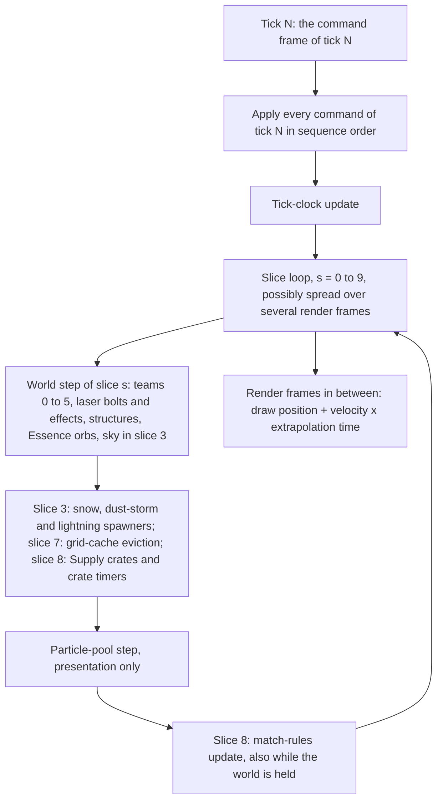

# Simulation model

> Status: Reference · Prefix: R-SIM · Related: [Reference overview](../00_reference_overview.md) · [Skirmish rules and modes](../01_skirmish_rules_and_modes/README.md) · [Units](../02_units/README.md) · [Buildings and world objects](../03_buildings_and_world_objects/README.md) · [Supply crates, powers and weapons](../04_supply_crates_powers_and_weapons/README.md)

## Purpose

This folder specifies the engine-level model of a reference match: what kinds of simulated objects exist, how they are identified, stored, created, advanced in time, removed and found in space, how they move, collide and find routes, who owns them, which random streams they draw from, how player intent reaches them, and how simulated state is kept apart from what is drawn. It also holds the single definition of the reference tick rate, which every tick-denominated value of the reference library depends on.

Per-kind behaviour (state machines, stats, weapons) is not here: it is in [units](../02_units/README.md), [buildings and world objects](../03_buildings_and_world_objects/README.md), [supply crates, powers and weapons](../04_supply_crates_powers_and_weapons/README.md) and [bots](../07_bots/README.md). Terrain generation and height queries are the [terrain component](../../architecture/components/terrain/README.md); render passes are the [renderer](../../architecture/components/renderer/README.md).

Every requirement in this folder uses the prefix `R-SIM`, and every tuning key of the folder has the form ref.sim.<object>.<parameter>.

## The model at a glance

- **One match world owns everything simulated.** The match world (`MatchWorld`) holds the terrain height field, the six team slots, the pools of structures, effects, laser bolts and Essence orbs, the actor grid and its query cache, the obstacle grid and the land and sea route graphs. It is created at match start and destroyed at match end, and no simulation state survives from one match to the next (DEC-011).
- **Three families of simulated objects.** Every simulated object (`SimObject`) has a position, a velocity, a kind and a handle. Actors (`Actor`) are the units and creatures, owned by a team; structures (`Structure`) are the map-placed or rule-created static objects; effects are every other kind, with laser bolts and Essence orbs held by value in pools of their own (DEC-028). Actor groups (`ActorGroup`) hold actors that move together.
- **Weak, checked handles.** An object is addressed by a four-field handle (`SimObjectId`: team, group, slot, serial) that is resolved on every use. Every kind of object is generation-checked, so a handle to a removed object resolves to "none" (DEC-028).
- **Ticks and slices.** One tick of `ref.sim.tick_period` (0.1 s of real time) runs as ten update slices. Every sliced pool advances about one tenth of its slots per slice, so every object advances exactly once per tick, in an order fixed by slot indices that every participant computes identically.
- **Removal through the owner.** An object's advance can request its own removal; the container's owner performs it, with its side effects (actor-grid removal, obstacle-grid update, bot-navigation-link rebuild).
- **Space.** Spatial queries use per-team uniform actor grids, an obstacle grid of structure footprints and node-graph routers for land and sea, all with fixed, stable result orders (DEC-016).
- **Randomness and integrity.** Gameplay draws only from the simulation generator, seeded once per match; presentation draws from separate generators. Player intent enters only as sequenced commands, presentation never writes simulation state, and gameplay is computed only by the simulation on the CPU (DEC-007, DEC-008, DEC-013, DEC-654).
- **Rendering extrapolates.** Renderers never store interpolated state; they draw each object at its position + velocity × the extrapolation time since the current tick was taken.
- **Nothing persists.** A match world lives only in memory, and no match, lobby or session state is saved (DEC-250, DEC-251). The numeric model is DEC-240, and the performance envelope at the population cap is DEC-106.

Caption: One tick of the reference simulation, from the command frame to the rendered frames between ticks; the details are in [01](01_tick_timing_and_main_loop.md) and [04](04_containers_and_update_order.md).

## Document map

| File | Scope | Main contents |
|---|---|---|
| [01 Tick timing and main loop](01_tick_timing_and_main_loop.md) | time | the reference tick rate (`ref.sim.tick_period`) and the mode second; the tick and its update slices; the tick schedule; slices per render frame and catch-up; the tick clock, game speed and speed requests; the held world, the start hold, pause and the end of a match; render-time extrapolation; the clocks; the in-match frame in exact order |
| [02 Match lifecycle and state reset](02_match_lifecycle_and_state_reset.md) | lifetimes | the lifetime classes and what each holds; the simulation side of match start; match entry and match-world initialisation in exact order; every piece of state that outlives one object and its per-match reset; teardown in exact order; the multi-round Siege rebuild point; no persistence |
| [03 Entity model and identity](03_entity_model_and_identity.md) | objects | the object families; the complete type hierarchy as Species types, with the document that specifies each kind; the core members; the base contracts of simulated objects, actors, structures, effects, laser bolts, Essence orbs and actor groups; render hooks per family; handles, their resolution and allocation, serial counters and the handle rules |
| [04 Containers and update order](04_containers_and_update_order.md) | order | the members of the match world; every simulation container; iteration order and slot reuse; slice-partitioning details; the exact order of every step within a slice and within a team; creation and removal rules; the map-effect spawners; the register of order-dependent outcomes; the query and service operations of the match world |
| [05 Space, routing and physics](05_space_routing_and_physics.md) | space | the actor grid, its queries and its cache; the obstacle grid; walkability; route-graph construction, path queries, route following and route lifetime; integration, falling, water, obstacle push, bounce, teleport entry, ray tests and area damage |
| [06 Teams and player commands](06_teams_and_player_commands.md) | ownership and input | team slots, ids and kinds; lobby slots and match teams; ownership of objects; friendship; colours, start positions and alliances; actor groups and formations; bots as team slots; the team command state; the execution order of commands; the player command catalogue |
| [07 Randomness and integrity](07_randomness_and_integrity.md) | integrity | the random streams and the draw discipline; what each object family draws; simulation state versus presentation state; presentation randomness inside simulation code; the rules that presentation never writes simulation state and that local-only state never enters it; the layering rules; non-finite values; gameplay computed only by the simulation; settings, seasonal state and tutorials; ownership, reset and threads; the command-stream replay hooks |

**Reading order.** Read 01 first: every other document counts time in its ticks. Then 03 (what exists), 04 (in which order it changes) and 02 (how a match begins and ends), followed by 05, 06 and 07 as needed.

## Decisions that shape the model

| Decision | Status | Effect on this folder |
|---|---|---|
| DEC-004, DEC-005, DEC-006 | Resolved | the reference values are the Species starting values; the library is the specification of record; every kept quirk is a named rule |
| DEC-011 | Resolved | all mutable simulation state belongs to the match and is reset at every match start (02) |
| DEC-016 | Resolved | every order-dependent outcome is an explicit rule over a stable key (04, 05) |
| DEC-028 | Resolved | the object model, the update order, the grids and the router are kept; every object kind has generational handles; scratch storage is per call (03, 04, 05) |
| DEC-654 | Resolved | gameplay is computed only by the CPU simulation |
| DEC-260, DEC-261, DEC-262 | Resolved | the gap rules of [simulation gap rules](../../decisions/simulation_gap_rules.md): order within an actor-grid cell by actor serial (05); the multi-round rebuild at a tick boundary (02); generations of laser-bolt and Essence-orb handles and the generational team selection (03, 06) |
| DEC-263, DEC-264, DEC-265, DEC-266 | Open | route and actor-group edge cases (05, 06); what runs at game speed 0 and the real length of the speed-crate holds (01); decorative objects in the simulated pools (03, 07) |
| DEC-106 | Open | the performance envelope at the population cap |
| DEC-240 | Open | the simulation numeric model and its determinism scope |
| DEC-250, DEC-251 | Open | persisted data; world-state persistence |
| DEC-223, DEC-224, DEC-227 | Open | state ownership, threading and the Species tick rate, decided by the design phase |
