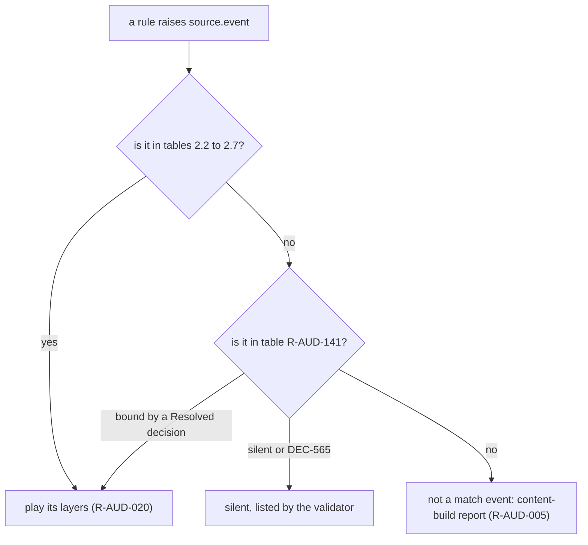

# Audio design: event catalogue

> Status: Reference · Prefix: R-AUD · Related: [Folder index](README.md) · [Event model and sound data](event_model_and_sound_data.md) · [Positional, priorities and mix](positional_priorities_and_mix.md) · [02 Units](../02_units/README.md) · [03 Buildings and world objects](../03_buildings_and_world_objects/README.md) · [04 Supply crates, powers and weapons](../04_supply_crates_powers_and_weapons/README.md) · [assets/GameAssets.md](../../assets/GameAssets.md)

## 1 Purpose and player experience

This file is the Species sound-event set: every sound source, every event that game code raises in a skirmish match or at the front end, the moment that raises it, and, for every bound event, its layers with their sample groups and their complete sound data. It is the data that the [event model](event_model_and_sound_data.md) interprets, and the authoring list of the Species sound set ([music hooks and brief](music_hooks_and_sound_design_brief.md) R-AUD-411). Of the 276 events that a match or the front end raises, 182 are bound and audible, and 94 are silent: most stay silent by default (DEC-565), and seven are bound by Resolved decisions to sounds that the reference does not play (DEC-564, DEC-097, DEC-049).

## 2 Rules

### 2.1 Sound sources

**R-AUD-120** (MUST) An **object source** is an actor kind or a structure kind. Its source id is the stem of the kind's string-id prefix, for example `worker` for `unit.worker` and `spawn_node` for `building.spawn_node` ([02 Units](../02_units/README.md) R-UNIT-047, [03 Buildings](../03_buildings_and_world_objects/README.md) R-BLDG-049).

**R-AUD-121** (MUST) The **non-object sources** are these eleven, in this order; the order is the enumeration order of the non-object sources and carries meaning, so it is kept:

| # | Source | Events |
|---|---|---|
| 0 | `laser_bolt` | `spawn`, `hurt_actor`, `hit_structure`, `kill` |
| 1 | `grenade` | `spawn`, `bounce`, `fuse_blink`, `explode` |
| 2 | `rocket` | `spawn`, `explode` |
| 3 | `airstrike_bomb` | `bounce`, `fuse_blink`, `explode` |
| 4 | `essence_orb` | `collected` |
| 5 | `power_input` | `begin`, `confirm` |
| 6 | `ambience` | `match_enter`, `match_exit` |
| 7 | `music` | the music hooks ([music hooks and brief](music_hooks_and_sound_design_brief.md), KH-MUSIC) |
| 8 | `power_slots` | `icon_hover`, `discard`, `select`, `selection_set`, `selection_cleared` |
| 9 | `crate_outcome` | one event per Supply crate outcome (R-AUD-139) |
| 10 | `match_ui` | `countdown_tick`, `countdown_zero`, `game_over`, `victory`, `defeat`, `selection_circle`, `unit_select`, `toggle_state`, `lobby_bed`, `menu_hover`, `menu_select`, `menu_back`, `error`, `chat_message`, `unit_highlight`, `order_given` |

**R-AUD-122** (MUST) These sources raise events in a match or at the front end (bound events, their layers, and silent events):

| Source | Name | Kind | Bound events | Layers | Silent events |
|---|---|---|---|---|---|
{{SUMMARY}}

**R-AUD-123** (MUST) **Base events.** Every actor kind has the base events `<source>.spawn`, `<source>.attack`, `<source>.hurt`, `<source>.enter_gate`, `<source>.exit_gate`, `<source>.die` and `<source>.selected` ([02 Units](../02_units/README.md) R-UNIT-047), and every structure kind has `<source>.spawn`, `<source>.owner_changed`, `<source>.damaged` and `<source>.explode` ([03 Buildings](../03_buildings_and_world_objects/README.md) R-BLDG-049). A base event appears in this catalogue only where some rule of a match raises it.

**R-AUD-124** (MUST) **Owner changes of structures.** Only the Control Zone and the Relic bind a sound to `<source>.owner_changed` ([12 entity model](../12_simulation_model/03_entity_model_and_identity.md) R-SIM-122); every other structure's owner change is silent. In particular an empty Solar Array raises no `solar_array.owner_changed`, because the team-assignment operation raises the event only when the team changes ([03 Buildings](../03_buildings_and_world_objects/README.md) R-BLDG-038), and the event has no definition in any case.

**R-AUD-125** (MUST) **Reading the tables.** Each table row is one layer; the first row of an event names the event and the moment that raises it, and the further rows (″) are its further layers. The columns are:

- **Sample group:** the asset id of [assets/asset_manifest.csv](../../assets/asset_manifest.csv) that the layer plays (R-AUD-045).
- **Playback:** the position (`2d`, `fix`, `att`), the loop kind (`once`, `loop`, `note`), the sharing when not one voice per trigger (`share-rnd`, `share-near`) and the audience when not all (`own`, `enemy`, `none`) (R-AUD-049).
- **Min (wu):** the minimum distance.
- **Level (dB):** the level: a number is fixed; `rnd a to b` is random; `<link> x1 to x2 → y1 to y2` is linked to the named link, its input range x1 to x2 mapping to the output range y1 to y2 (R-AUD-051, R-AUD-052).
- **Pitch (×):** the pitch multiplier, in the same forms; empty is 1.0.
- **Envelope and loop (s):** `a` attack, `s` sustain, `r` release, `ld` loop delay, in the same forms; an absent value is 0.
- **Effect:** the effect use of [event model](event_model_and_sound_data.md) R-AUD-082, which runs only when effects are enabled (DEC-567).
- `sN` after a value is its smoothing (R-AUD-054); `/note` marks a value evaluated once per note (R-AUD-053).

### 2.2 Units

**R-AUD-126** (MUST) The `worker` source raises and binds the events of table 2.2-A. The Worker's spawn chatter and the reload layer of its attack play from their nearest emitter only (R-AUD-213, DEC-109); its threat sounds are stopped when its threat ends (R-AUD-039).

Table 2.2-A Worker sound events.

{{T:worker}}

**R-AUD-127** (MUST) The `leader` source raises and binds the events of table 2.2-B. The own-audience layers are heard only by the Leader's owner; cancelling a Leader's orders stops all its order events ([02 Leader](../02_units/leader_and_formations.md) R-UNIT-193). `leader.attack` is never raised, because a Leader never attacks.

Table 2.2-B Leader sound events.

{{T:leader}}

**R-AUD-128** (MUST) The `trooper` source raises and binds the events of table 2.2-C. One shared-random voice carries the chatter of every Trooper of the match.

Table 2.2-C Trooper sound events.

{{T:trooper}}

**R-AUD-129** (MUST) The `transport`, `collector`, `builder` and `bomber` sources raise and bind the events of tables 2.2-D to 2.2-G, and the `essence_orb` source the event of table 2.2-H. The Collector's and the Bomber's engines follow height and speed; a Builder's laser hits raise no `builder.hurt`, because a Builder ignores laser damage ([02 Builder](../02_units/builder.md) R-UNIT-461).

Table 2.2-D Transport sound events.

{{T:transport}}

Table 2.2-E Collector sound events.

{{T:collector}}

Table 2.2-F Builder sound events.

{{T:builder}}

Table 2.2-G Bomber sound events.

{{T:bomber}}

Table 2.2-H Essence orb sound events.

{{T:essence_orb}}

### 2.3 Creatures

**R-AUD-130** (MUST) The creature sources raise and bind the events of tables 2.3-A to 2.3-H. A Crawler egg raises only its silent `crawler_egg.spawn`; its death plays no sound ([02 creatures](../02_units/creatures.md) R-UNIT-527).

Table 2.3-A Crawler sound events.

{{T:crawler}}

Table 2.3-B Brood Drifter sound events.

{{T:brood_drifter}}

Table 2.3-C centipede sound events.

{{T:centipede}}

Table 2.3-D spider sound events.

{{T:spider}}

Table 2.3-E ant sound events.

{{T:ant}}

Table 2.3-F Reaper Serpent sound events.

{{T:reaper_serpent}}

Table 2.3-G Seed Pod sound events.

{{T:seed_pod}}

Table 2.3-H Abductor sound events.

{{T:abductor}}

### 2.4 Weapons

**R-AUD-131** (MUST) The weapon sources raise and bind the events of tables 2.4-A to 2.4-F. A laser bolt that wounds a Worker without killing it plays the hit bark at the victim, for the shooter's team; the other laser-bolt events are silent in the reference and bound in Species (R-AUD-142).

Table 2.4-A barrage missile sound events.

{{T:barrage_missile}}

Table 2.4-B meteor sound events.

{{T:meteor}}

Table 2.4-C laser bolt sound events.

{{T:laser_bolt}}

Table 2.4-D grenade sound events.

{{T:grenade}}

Table 2.4-E rocket sound events.

{{T:rocket}}

Table 2.4-F airstrike bomb sound events.

{{T:airstrike_bomb}}

### 2.5 Structures

**R-AUD-132** (MUST) The `spawn_node`, `beam_dish`, `solar_array`, `grid_pylon`, `fuel_pump`, `fuel_line` and `fuel_depot` sources raise and bind the events of tables 2.5-A to 2.5-G ([03 economy and spawn objects](../03_buildings_and_world_objects/economy_and_spawn_objects.md) R-BLDG-130, R-BLDG-167, R-BLDG-171, R-BLDG-180, R-BLDG-199, R-BLDG-201). A Transit Gate binds no event (R-AUD-141).

Table 2.5-A Spawn Node sound events.

{{T:spawn_node}}

Table 2.5-B Beam Dish sound events.

{{T:beam_dish}}

Table 2.5-C Solar Array sound events.

{{T:solar_array}}

Table 2.5-D grid pylon sound events.

{{T:grid_pylon}}

Table 2.5-E fuel pump sound events.

{{T:fuel_pump}}

Table 2.5-F fuel line sound events.

{{T:fuel_line}}

Table 2.5-G fuel depot sound events.

{{T:fuel_depot}}

**R-AUD-133** (MUST) The `launch_vessel` source raises and binds the events of table 2.5-H. Its state loops and its engine loop are started and stopped by explicit events (R-AUD-032, DEC-323); `launch_vessel.hungry` plays from its nearest emitter only (R-AUD-213).

Table 2.5-H Launch Vessel sound events.

{{T:launch_vessel}}

**R-AUD-134** (MUST) The `control_zone` source raises and binds the events of table 2.5-I. The kinds that share the Control Zone's type, the Relic Base, the Relic Spawn Zone, the Flag post and the Home post, raise the same events ([03 mode objects](../03_buildings_and_world_objects/mode_objects.md) R-BLDG-257). Its no-team layer plays the lost sting, so a Control Zone or Flag post that becomes neutral plays that sting only (R-AUD-025, DEC-097).

Table 2.5-I Control Zone sound events.

{{T:control_zone}}

**R-AUD-135** (MUST) The `command_console` and `core_device` sources raise and bind the events of tables 2.5-J and 2.5-K. The Core Device's presence loop is world-fixed and is stopped when the device is destroyed or removed and at match exit (R-AUD-041); a Command Console linked to the Core Device raises no second spawn event (R-AUD-042).

Table 2.5-J Command Console sound events.

{{T:command_console}}

Table 2.5-K Core Device sound events.

{{T:core_device}}

**R-AUD-136** (MUST) The `turret`, `barrier_emitter`, `tree`, `hive` and `spitter_plant` sources raise and bind the events of tables 2.5-L to 2.5-P ([03 defences and props](../03_buildings_and_world_objects/defences_and_props.md) R-BLDG-429, R-BLDG-448; [03 trees and crate structures](../03_buildings_and_world_objects/trees_and_crate_structures.md) R-BLDG-630, R-BLDG-655). A tree raises `tree.spawn` and exactly one presence loop, chosen at initialisation. `turret.fire_grenade` belongs to the mortar turret, which no match creates, so it is never raised.

Table 2.5-L turret sound events.

{{T:turret}}

Table 2.5-M Barrier Emitter sound events.

{{T:barrier_emitter}}

Table 2.5-N tree sound events.

{{T:tree}}

Table 2.5-O Hive sound events.

{{T:hive}}

Table 2.5-P Spitter Plant sound events.

{{T:spitter_plant}}

**R-AUD-137** (MUST) The `relic` source raises and binds the events of table 2.5-Q ([03 mode objects](../03_buildings_and_world_objects/mode_objects.md) R-BLDG-284, R-BLDG-285). Its own-audience owner sting shares its group with the first layer of `control_zone.relic_scored`; its no-team layer plays the enemy sting (R-AUD-025, DEC-097).

Table 2.5-Q Relic sound events.

{{T:relic}}

### 2.6 Supply crates and outcomes

**R-AUD-138** (MUST) The `supply_crate` source raises and binds the events of table 2.6-A ([04 crates and powers](../04_supply_crates_powers_and_weapons/crates_and_powers.md) R-CRATE-117, R-CRATE-145). The progress events follow the bucket rules of R-AUD-030 and R-AUD-031.

Table 2.6-A Supply crate sound events.

{{T:supply_crate}}

**R-AUD-139** (MUST) The `crate_outcome` source has one event per Supply crate outcome, `crate_outcome.<outcome>` with the outcome's id, raised when the outcome runs (R-AUD-035); table 2.6-B lists the 25 that a match raises. The gun turret, rocket turret and flame turret outcomes raise `crate_outcome.gun_turret`; the Firebomb Run raises `crate_outcome.airstrike`; the Builder, Time Dilation and Time Rush outcomes raise none. "Played for no team" marks an outcome that acts for no team.

Table 2.6-B Supply crate outcome stings.

{{T:crate_outcome}}

### 2.7 Interface and ambience

**R-AUD-140** (MUST) The `match_ui`, `power_slots`, `power_input` and `ambience` sources raise and bind the events of tables 2.7-A to 2.7-D ([front end, HUD, voice and ambience](front_end_hud_voice_and_ambience.md)).

Table 2.7-A match UI sound events.

{{T:match_ui}}

Table 2.7-B Power slots panel sound events.

{{T:power_slots}}

Table 2.7-C Power input sound events.

{{T:power_input}}

Table 2.7-D ambience sound events.

{{T:ambience}}

### 2.8 Events with no binding

**R-AUD-141** (MUST) These events are raised by the rules of a match or of the front end with no binding in the reference, and are silent there. The last column gives the Species rule:

| Event | Raised when | Species |
|---|---|---|
{{SILENT}}

**R-AUD-142** (MUST) The events marked "bound" in table R-AUD-141 are bound in Species by Resolved decisions: laser fire is audible, so `laser_bolt.spawn`, `laser_bolt.hit_structure` and `laser_bolt.kill` play new laser-bolt groups (DEC-564), moments for which the reference set holds unused recordings of laser charging, structure hits, actor hits, ground hits and ricochets; the Strike team grenade throw plays a new throw sound (DEC-097); and the match end plays the game-over announcement and the victory or defeat sting (DEC-097, DEC-049; R-AUD-307). Their groups, except the two stings, are not yet in the asset manifest (R-AUD-413).

**R-AUD-143** (MUST) The events marked "silent (DEC-565)" stay silent until DEC-565 binds them; the reference sound set holds unused takes for some of them (R-AUD-314). The events marked "silent" stay silent with no open decision.

**R-AUD-144** (MUST) A `supply_crate` drain raises the progress events of the falling buckets (R-AUD-031), which are bound; the reference's drain name, which matches nothing, does not exist in Species.

### 2.9 Kinds with no sound definitions

**R-AUD-145** (MUST) These kinds have no sound definitions, so every event that they raise is silent: the bot controller's actor; the Source Node, Relay, Population Limiter, grid terminal, grid splitter, wall, jump pad, exclusion zone, Breach Charge, smoke column, volcano vent and scenery mesh; and the bot navigation nodes, bot objectives and bot objective markers. Most of them are invisible logic objects; the visible ones, a jump-pad launch, a wall hit and the Siege Breach Charge, are silent by omission.

## 3 States and flows

Diagram 3-A: how an event id resolves against this catalogue (R-AUD-122, R-AUD-141).

## 4 Tuning table

This file defines no tuning keys: the values in its tables are the sound data of each layer, not tuning values, and the rules that interpret them are in the [event model](event_model_and_sound_data.md) and [positional, priorities and mix](positional_priorities_and_mix.md).

## 5 Edge cases and interactions

- **Shared groups.** One group can serve several events with different layer data; R-AUD-067 lists them. The Leader's acknowledgement group, for example, plays for `leader.spawn`, `leader.selected`, `worker.ordered` and the acknowledgement layers of the Leader's order events.
- **A spawn that is a loop.** The `spawn` events of most creatures, vehicles and structures play a presence loop that lasts for the emitter's life (R-AUD-040); the Transport, Reaper Serpent and Abductor add one-shot or further loop layers.
- **Grace-period Relics.** A Relic that appears during the grace period raises no `relic.spawn` (R-BLDG-284).
- **Turret kill tick.** `turret.kill_tick` plays the countdown tick at the turret, positioned, so a kill credited far away is quiet.
- **Hive explosion.** `hive.explode` plays the grenade explosion group at a lower pitch, world-fixed, with a long release.
- **Silent visible objects.** A Breach Charge, a wall hit and a jump-pad launch play nothing (R-AUD-145); any sound for them would be a new event.

## 6 Acceptance criteria

- **AC-CAT-01** (R-AUD-122) Given a match of each mode with every Supply crate outcome enabled, then every event raised belongs to tables 2.2 to 2.7 or to table R-AUD-141, and every bound event of tables 2.2 to 2.7 that the mode can reach is raised at least once over a set of scripted test matches.
- **AC-CAT-02** (R-AUD-125) Given the cooked sound-event set, then for every layer of tables 2.2 to 2.7 its group, position, loop kind, sharing, audience, minimum distance, level, pitch, envelope and effect equal the table's values.
- **AC-CAT-03** (R-AUD-134, R-AUD-137) Given a Control Zone captured by team 1, then the local team 1 hears the captured sting and team 2 the lost sting; given it neutralised, then both hear the lost sting once.
- **AC-CAT-04** (R-AUD-139) Given each of the gun turret, rocket turret and flame turret outcomes, then each plays `crate_outcome.gun_turret`; given the Builder outcome placed, then no outcome sting plays and `power_input.confirm` plays.
- **AC-CAT-05** (R-AUD-141, R-AUD-142) Given a Worker firing at a structure until it kills a Worker behind it, then `laser_bolt.spawn`, `laser_bolt.hit_structure` and `laser_bolt.kill` play their groups (their placeholders until authored).
- **AC-CAT-06** (R-AUD-124) Given 1,000 ticks with every Solar Array empty, then no `solar_array.owner_changed` is raised.
- **AC-CAT-07** (R-AUD-145) Given a Breach Charge carried and detonated, then no sound event of the Breach Charge plays.

## 7 Dependencies

- **Reference documents:** [event model and sound data](event_model_and_sound_data.md) (how layers play); [positional, priorities and mix](positional_priorities_and_mix.md) (crowd radius, buses); [front end, HUD, voice and ambience](front_end_hud_voice_and_ambience.md) (interface, voice and ambience rules); [02 Units](../02_units/README.md) (worker, Leader, Strike team, Transport, Collector, Builder, Essence orbs, creatures, hazards); [03 Buildings and world objects](../03_buildings_and_world_objects/README.md) (every structure's events); [04 Supply crates, powers and weapons](../04_supply_crates_powers_and_weapons/README.md) (crates, outcomes, weapons); [06 Controls, camera and commands](../06_controls_camera_and_commands/README.md) (selection and Power-slot sounds); [12 entity model](../12_simulation_model/03_entity_model_and_identity.md) (team changes).
- **Engine components:** [audio engine](../../architecture/components/audio_engine.md); [data schemas](../../architecture/components/data_schemas.md) (the cooked sound-event set).
- **Assets:** every group named in tables 2.2 to 2.7: {{ASSETS}}.

## 8 Open decisions

Each default is the behaviour that §2 specifies.

- DEC-565 — sounds for the other silent gameplay events: every event marked "silent (DEC-565)" (R-AUD-141, R-AUD-143).
- DEC-109 — crowd-sound audibility radius: `worker.spawn`, the reload layer of `worker.attack`, `launch_vessel.hungry` (R-AUD-126, R-AUD-133).
- DEC-567 — dry mix or applied effects: the effect column (R-AUD-125).
